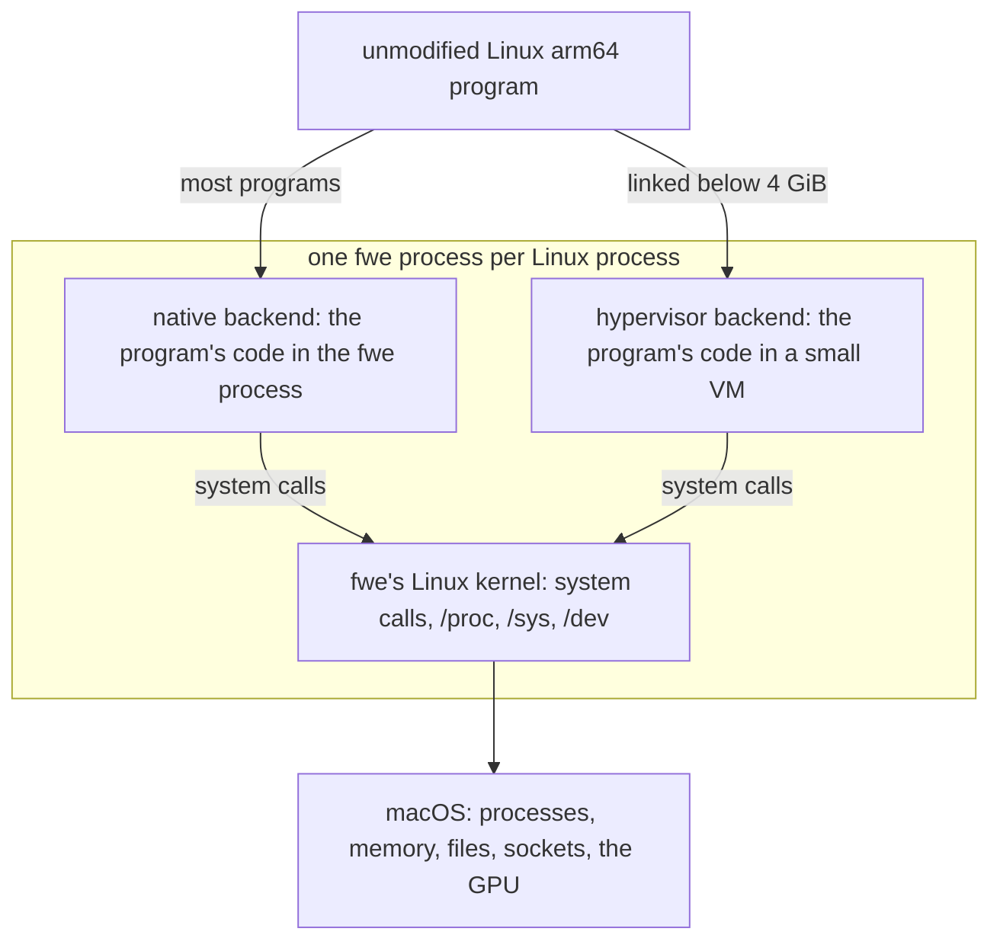

# fun-with-emulators

`fwe` runs unmodified Linux arm64 programs on macOS on Apple Silicon:
command-line programs and toolchains, language runtimes, containers
(Docker, Podman), graphical programs, Windows programs through Linux's
Wine and, by 1.0, gVisor's sandbox. It implements the Linux kernel's
user-space ABI instead of running a Linux kernel, as Wine does for
Windows. It is written in Rust. This page says what runs and how to
install, run and test `fwe`; the [documents](#documentation) hold the
rest.

## How it works

An Apple Silicon Mac runs the same instructions as an arm64 Linux
machine; only the kernel differs. A Linux program's code runs directly on
the processor, and `fwe` plays the kernel: each Linux process is one
`fwe` process, which carries out the program's system calls with macOS's
own and provides what macOS lacks (namespaces, cgroups, epoll, inotify,
System V IPC, keyrings and more).



A program linked at a fixed address below 4 GiB, which macOS reserves,
runs in a Hypervisor.framework VM; code made at run time (a JIT
compiler's) runs by translation ([docs/jit.md](docs/jit.md)).
[docs/linux-on-macos.md](docs/linux-on-macos.md) says which binaries run
where and how each Linux feature maps onto macOS.

## Status

What runs unmodified, its output checked in CI:

- **Natively:** Debian's coreutils, bash, git, SQLite, lighttpd, rustc
  with Cargo, apt and Node.js; Alpine's Node.js, OpenJDK, LuaJIT, Racket
  and Guile, whose JIT compilers' code runs translated.
- **In the VM:** Debian's Python, GCC, clang and Go, and Alpine's SBCL,
  on a software stand-in for Hypervisor.framework; not yet on real
  hardware.
- **Containers, natively:** crun, Podman and containerd run the `alpine`
  image; Podman builds, pushes, pulls and runs images, rootless too;
  Docker Engine runs and builds images (BuildKit) and brings up Docker
  Compose projects.
- **Windows:** Wine runs ARM64 Windows console programs in the VM
  (`fwe --vm`, on the stand-in), and Notepad on an X display.
- **Graphical, natively:** X11 clients, GTK, Qt, Tk and software OpenGL
  on an X server on the Mac; Weston with Wayland clients and Xwayland;
  Vulkan (`vkcube`) and OpenGL (`glxgears`, through Zink) on the Mac's
  GPU, through fwe's own Vulkan driver.
- **Conformance:** every LTP system-call test that applies passes.

Native speed, browsers, graphical Wine natively and gVisor are left to
1.0 ([ROADMAP.md](ROADMAP.md)).

## Usage

```sh
brew tap e6qu/fwe https://github.com/e6qu/fun-with-emulators
brew install --HEAD fwe
fwe --pull debian:trixie ~/debian          # a Debian userland, from its image
fwe --root ~/debian ~/debian/bin/bash      # a shell in it
fwe ./hello                                # a Linux arm64 executable
fwe --strace ./hello                       # with its system calls traced
```

The [user guide](docs/user-guide.md) covers installing, userlands,
programs, containers and what does not work.

## Testing

```sh
cargo test
```

On Apple Silicon macOS this runs the end-to-end tests too: they build the
programs in `guests/` (with `clang` from the Xcode command line tools)
and run them under `fwe`. Tests of distribution programs download them
first (`guests/*/fetch`). The container, Wine, JDK, debugger, display and
image tests run only where their variable is set (`FWE_PODMAN_TESTS` and
the like), as CI sets it. The hypervisor backend's tests run on a
software stand-in (`brew install unicorn`), and on the real framework
only with `FWE_HV_TESTS=1`, on a machine meant for it
([docs/hypervisor.md](docs/hypervisor.md#tests-and-ci)). On other hosts
only the unit tests run. [AGENTS.md](AGENTS.md) lists every check CI
runs.

The tests, and LTP's runner and the benchmarks through
`tools/hostmem.py`, watch the host's memory: with less than 20% of it
available or more than 50% wired, no guest starts, and a run ends its
processes and fails, naming what holds the memory, before the Mac runs
short and panics.

LTP's system-call tests run under `fwe` against `tools/ltp/baseline.txt`;
CI fails if a test in the baseline stops passing:

```sh
tools/ltp/build.sh target/ltp      # needs zig 0.17.0: LTP in an Alpine root
cargo build --profile checked -p fwe   # optimized, its checks kept
tools/ltp/run.py --fwe target/checked/fwe --root target/ltp/root
```

## Documentation

| Document | Contents |
|---|---|
| [docs/user-guide.md](docs/user-guide.md) | Installing fwe, a Linux userland, running programs and containers, what does not work |
| [PLAN.md](PLAN.md) | Goal, approach, scope, the 1.0 finish line, principles, how progress is measured |
| [ROADMAP.md](ROADMAP.md) | What is done and the pull requests left to 1.0 |
| [docs/linux-on-macos.md](docs/linux-on-macos.md) | Which binaries run where, which instructions are rewritten, how the VM is used, how each Linux feature maps onto macOS |
| [docs/architecture.md](docs/architecture.md) | How each part of fwe works, and its known limitations |
| [docs/jit.md](docs/jit.md) | How code a program makes at run time runs by translation, what it costs, the runtimes tested |
| [docs/hypervisor.md](docs/hypervisor.md) | The hypervisor backend, its safety rules, and running it |
| [docs/comparisons.md](docs/comparisons.md) | fwe beside Wine, WSL, Linux VMs, gVisor, QEMU, Rosetta, FreeBSD's Linuxulator and others |
| [docs/linking.md](docs/linking.md) | Background: how programs are built and loaded on Linux and macOS on arm64 |
| [docs/arm64.md](docs/arm64.md) | Background: the arm64 instruction set as fwe's work needs it |

## Layout

| Path | Contents |
|---|---|
| `crates/abi` | Linux arm64 ABI: system-call numbers, errno values, flags, structures |
| `crates/elf` | ELF parsing, load planning, unwind tables, build IDs |
| `crates/kernel` | Linux system calls on top of the host, and the GPU device behind fwe's Vulkan driver |
| `crates/native` | The native backend (loader, code rewriting, translator, traps) and the hypervisor backend with its stand-in |
| `crates/fwe` | The `fwe` command and the end-to-end tests |
| `driver/vulkan` | fwe's Linux Vulkan driver, which fwe builds with `clang` and serves to guests |
| `guests/asm`, `guests/c`, `guests/rust`, `guests/windows` | Test programs the tests build |
| `guests/musl`, `guests/glibc`, `guests/debian`, `guests/alpine`, `guests/ioccc`, `guests/apps` | Vendored or fetched programs the tests run, with their provenance |
| `tools/gen-abi.py`, `tools/gen-vulkan.py` | Generate the ABI tables from Linux's UAPI headers, and the Vulkan driver's calls from Vulkan's registry |
| `tools/debian-manifest.py` | Makes the Debian manifests in `guests/debian/fetch` from Debian's package index |
| `tools/ltp` | Builds LTP and runs its system-call tests against the baseline |
| `tools/bench` | The benchmarks and their budgets (`run.py`, run in CI), and `vm.sh`, which runs them beside a Linux VM on your Mac |
| `tools/display` | Screenshots and window closing for the display tests |
| `tools/x18forms` | Generates the guest that checks each `x18` form real binaries hold, rewritten and translated |
| `tools/hostmem.py`, `tools/hv-record-listen.py` | The host-memory watch of LTP's runner and the benchmarks; the listener for the hypervisor flight recorder's datagrams |
| `docs/` | The documents above |
| `notes/research/` | Dated research notes on other projects, kept as written |

## License

MIT, see [LICENSE](LICENSE). The binaries under `guests/` carry their own
licenses, noted in each directory's README.
