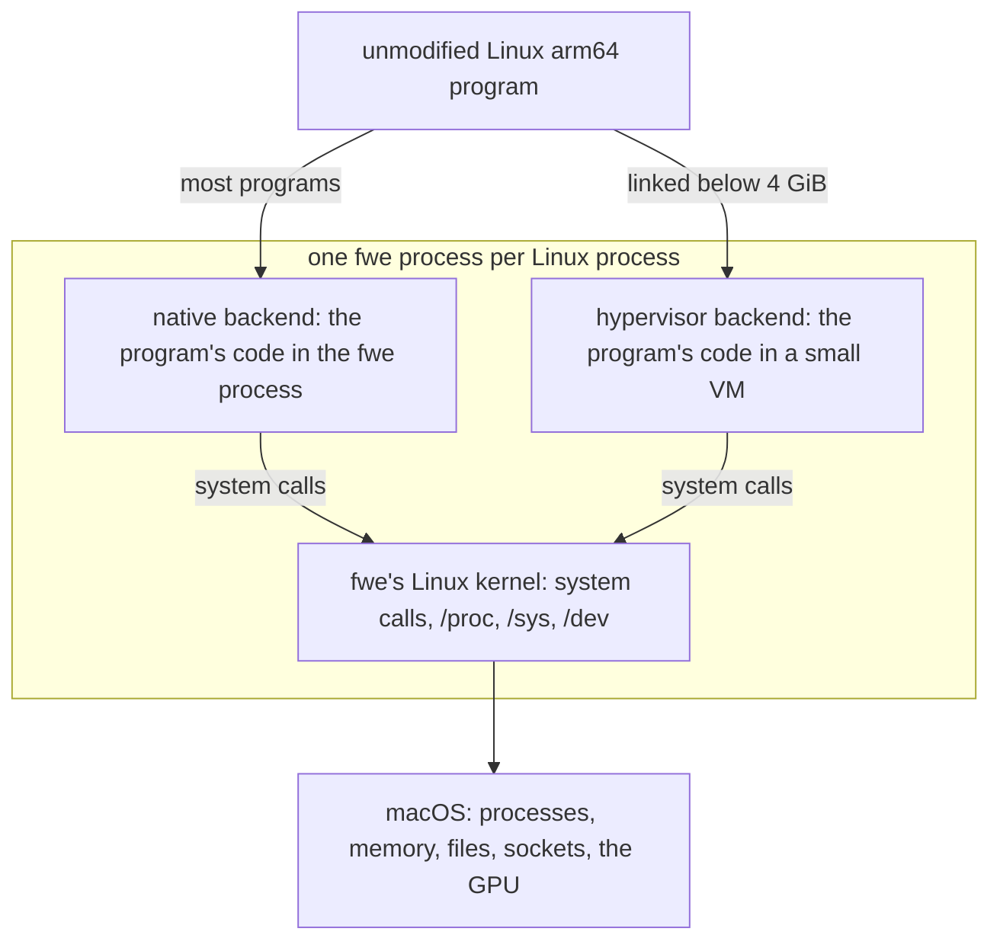

# fun-with-emulators

`fwe` runs unmodified Linux arm64 programs on macOS on Apple Silicon:
command-line programs and toolchains, language runtimes, containers
(Docker, Podman), graphical programs and their sound, Windows programs through Linux's
Wine and, by 1.0, gVisor's sandbox. It implements the Linux kernel's
user-space ABI instead of running a Linux kernel, as Wine does for
Windows. It is written in Rust. This page says what runs and how to
install, run and test `fwe`; the [documents](#documentation) hold the
rest.

## How it works

An Apple Silicon Mac runs the same instructions as an arm64 Linux
machine; only the kernel differs. A Linux program's code runs directly on
the processor, and `fwe` plays the kernel: each Linux process is one
`fwe` process, which carries out the program's system calls with macOS's
own and provides what macOS lacks (namespaces, cgroups, epoll, inotify,
System V IPC, keyrings and more).



A program linked at a fixed address below 4 GiB, which macOS reserves,
runs in a Hypervisor.framework VM; code made at run time (a JIT
compiler's) runs by translation ([docs/jit.md](docs/jit.md)).
[docs/linux-on-macos.md](docs/linux-on-macos.md) says which binaries run
where and how each Linux feature maps onto macOS.

## Status

What runs unmodified, its output checked in CI:

- **Natively:** Debian's coreutils, bash, git, SQLite, lighttpd, rustc
  with Cargo, apt and Node.js; Alpine's Node.js, OpenJDK, LuaJIT, Racket
  and Guile, whose JIT compilers' code runs translated.
- **In the VM:** Debian's Python, GCC, clang and Go, and Alpine's SBCL,
  on a software stand-in for Hypervisor.framework; not yet on real
  hardware.
- **Containers, natively:** crun, Podman and containerd run the `alpine`
  image; Podman builds, pushes, pulls and runs images, rootless too;
  Docker Engine runs and builds images (BuildKit) and brings up Docker
  Compose projects.
- **Windows:** Wine runs ARM64 Windows console programs in the VM
  (`fwe --vm`, on the stand-in), and Notepad, PuTTY and OpenTTD, with
  its sounds, on an X display.
- **Graphical, natively:** X11 clients, GTK, Qt, Tk and software OpenGL
  on an X server on the Mac; Weston with Wayland clients and Xwayland;
  Vulkan (`vkcube`) and OpenGL (`glxgears`, through Zink) on the Mac's
  GPU, through fwe's own Vulkan driver; Extreme Tux Racer and Xonotic.
- **Sound, natively:** PulseAudio's, ALSA's and PipeWire's programs play
  through PulseAudio on the Mac; games play their music, browsers their
  videos' sound.
- **Browsers and applications, natively:** Chromium and Firefox with
  their sandboxes, showing pages and playing video; Electron, Visual
  Studio Code and Zed editing files; Tauri and Wails apps, built under fwe,
  drawing through WebKitGTK.
- **Conformance:** every LTP system-call test that applies passes.

Native speed, graphical Wine natively, gVisor and programs on the GPU
through MoltenVK are left to 1.0 ([ROADMAP.md](ROADMAP.md)).

## Usage

```sh
brew tap e6qu/fwe https://github.com/e6qu/fun-with-emulators
brew install --HEAD fwe
fwe --pull debian:trixie ~/debian          # a Debian userland, from its image
fwe --root ~/debian ~/debian/bin/bash      # a shell in it
fwe ./hello                                # a Linux arm64 executable
fwe --strace ./hello                       # with its system calls traced
```

The [user guide](docs/user-guide.md) covers installing, userlands,
programs, containers and what does not work.

## Examples

Programs with windows draw on XQuartz (`brew install --cask xquartz`,
then log out and back in, so programs get its `DISPLAY`). Their sound
plays through PulseAudio on the Mac (`brew install pulseaudio`, then
`brew services start pulseaudio`), which fwe hands them as it hands them
XQuartz's display. Each example runs a userland's programs with a Linux
environment (`env -i`), as the
[user guide](docs/user-guide.md#a-linux-userland) explains. CI runs every
example as written here, on XQuartz, and checks that its window draws
and, for a game, that it plays sound.

### Extreme Tux Racer

A Debian game drawn with OpenGL. Mesa finds none of XQuartz's GLX
configurations usable, so the game draws in Xephyr, the userland's own
X server, which shows its screen in an XQuartz window. Mesa renders on
the CPU: through Zink, on the Mac's GPU, one of the game's shaders does
not yet build on MoltenVK ([M7 PR 6](ROADMAP.md)). Its music plays
through OpenAL's PulseAudio client (`libpulse0`, which OpenAL only
recommends).

<!-- example: tuxracer, window "Extreme Tux Racer", sound -->
```sh
[ -d ~/debian ] || fwe --pull debian:trixie ~/debian
env -i HOME=/root PATH=/usr/sbin:/usr/bin:/sbin:/bin "$(command -v fwe)" --root ~/debian ~/debian/bin/sh -c \
  'apt-get update -qq && apt-get install -qq -y --no-install-recommends extremetuxracer xserver-xephyr libgl1-mesa-dri libpulse0'
env -i HOME=/root PATH=/usr/games:/usr/bin:/bin DISPLAY="$DISPLAY" "$(command -v fwe)" --root ~/debian ~/debian/bin/sh -c \
  'Xephyr :1 -screen 1024x768 -title "Extreme Tux Racer" & until [ -S /tmp/.X11-unix/X1 ]; do sleep 0.1; done
   DISPLAY=:1 LIBGL_ALWAYS_SOFTWARE=1 etr; kill $!'
```

### Xonotic

An arena shooter from Alpine (its data is 1.2 GB), drawn with OpenGL in
Xephyr on the CPU as Tux Racer is, its music played through SDL's
PulseAudio client:

<!-- example: xonotic, window "Xonotic", sound -->
```sh
[ -d ~/alpine ] || fwe --pull alpine:3.24 ~/alpine
env -i HOME=/root PATH=/usr/sbin:/usr/bin:/sbin:/bin "$(command -v fwe)" --root ~/alpine ~/alpine/bin/sh -c \
  'apk add -q xonotic-sdl xonotic-data xorg-server-xephyr mesa-dri-gallium libpulse'
env -i HOME=/root PATH=/usr/bin:/bin DISPLAY="$DISPLAY" "$(command -v fwe)" --root ~/alpine ~/alpine/bin/sh -c \
  'Xephyr :1 -screen 1024x768 -title Xonotic & until [ -S /tmp/.X11-unix/X1 ]; do sleep 0.1; done
   DISPLAY=:1 LIBGL_ALWAYS_SOFTWARE=1 xonotic-sdl; kill $!'
```

### vkcube, on the GPU

Vulkan programs draw on the Mac's GPU through fwe's own Vulkan driver,
on MoltenVK (`brew install molten-vk`), and show their frames on XQuartz
directly:

<!-- example: vkcube, window "^$" 500x500 -->
```sh
[ -d ~/debian ] || fwe --pull debian:trixie ~/debian
env -i HOME=/root PATH=/usr/sbin:/usr/bin:/sbin:/bin "$(command -v fwe)" --root ~/debian ~/debian/bin/sh -c \
  'apt-get update -qq && apt-get install -qq -y --no-install-recommends vulkan-tools'
env -i HOME=/root PATH=/usr/bin:/bin DISPLAY="$DISPLAY" VK_DRIVER_FILES=/etc/vulkan/icd.d/fwe_icd.aarch64.json \
  "$(command -v fwe)" --root ~/debian ~/debian/usr/bin/vkcube --wsi xcb
```

### PuTTY, a Windows program

PuTTY's build for Windows on Arm, run by Alpine's Wine. Wine needs 4 KiB
pages, so it runs in fwe's VM (`--vm`), which needs `fwe` signed with
the hypervisor entitlement (Homebrew's is) on a Mac that offers the
hypervisor ([user guide](docs/user-guide.md#programs-linked-below-4-gib)).
The VM has been tested only on CI's software stand-in for
Hypervisor.framework. Once Wine runs natively
([M6 PR 7](ROADMAP.md)), the example runs without `--vm`.

<!-- example: putty, window "PuTTY Configuration", vm -->
```sh
[ -d ~/alpine ] || fwe --pull alpine:3.24 ~/alpine
env -i HOME=/root PATH=/usr/sbin:/usr/bin:/sbin:/bin "$(command -v fwe)" --root ~/alpine ~/alpine/bin/sh -c \
  'apk add -q wine font-dejavu libxcursor libxi libxinerama libxrandr libxcomposite'
curl -fsSL -o ~/alpine/root/putty.exe https://the.earth.li/~sgtatham/putty/0.83/wa64/putty.exe
echo "19a81aee36bcfcc5f9bb3401529458bbe8ea88a8478291ce2300058f4cb64a00  $HOME/alpine/root/putty.exe" | shasum -a 256 -c
env -i HOME=/root PATH=/usr/bin:/bin DISPLAY="$DISPLAY" WINEDLLOVERRIDES="mscoree,mshtml=" \
  "$(command -v fwe)" --vm --root ~/alpine ~/alpine/bin/sh -c 'wine /root/putty.exe'
```

### OpenTTD, a Windows game with sound

OpenTTD's build for Windows on Arm, with its free graphics and sounds
(OpenGFX and OpenSFX, which it reads from its `baseset` directory), run
by Alpine's Wine in fwe's VM as PuTTY is. Wine plays the game's sounds
through its PulseAudio driver. Its music (OpenMSX) needs a MIDI device,
which Wine has none of here.

<!-- example: openttd, window "OpenTTD", vm, sound -->
```sh
[ -d ~/alpine ] || fwe --pull alpine:3.24 ~/alpine
env -i HOME=/root PATH=/usr/sbin:/usr/bin:/sbin:/bin "$(command -v fwe)" --root ~/alpine ~/alpine/bin/sh -c \
  'apk add -q wine font-dejavu libpulse libxcursor libxi libxinerama libxrandr libxcomposite'
(
  cd ~/alpine/root
  curl -fsSLO https://cdn.openttd.org/openttd-releases/15.3/openttd-15.3-windows-arm64.zip
  curl -fsSLO https://cdn.openttd.org/opengfx-releases/8.0/opengfx-8.0-all.zip
  curl -fsSLO https://cdn.openttd.org/opensfx-releases/1.0.3/opensfx-1.0.3-all.zip
  shasum -a 256 -c <<'SUMS'
8b4eb443e425ed3046ca94336008fef78ce7c535fd607ae2ec79630e6d6dba96  openttd-15.3-windows-arm64.zip
43a0c1dabf39cb865394f3a6cc36d4da5c10ecfaaf55652043104806810903be  opengfx-8.0-all.zip
e0a218b7dd9438e701503b0f84c25a97c1c11b7c2f025323fb19d6db16ef3759  opensfx-1.0.3-all.zip
SUMS
  unzip -oq openttd-15.3-windows-arm64.zip
  unzip -oq -d openttd-15.3-windows-arm64/baseset opengfx-8.0-all.zip
  unzip -oq -d openttd-15.3-windows-arm64/baseset opensfx-1.0.3-all.zip
)
env -i HOME=/root PATH=/usr/bin:/bin DISPLAY="$DISPLAY" WINEDLLOVERRIDES="mscoree,mshtml=" \
  "$(command -v fwe)" --vm --root ~/alpine ~/alpine/bin/sh -c 'wine /root/openttd-15.3-windows-arm64/openttd.exe'
```

## Testing

```sh
cargo test
```

On Apple Silicon macOS this runs the end-to-end tests too: they build the
programs in `guests/` (with `clang` from the Xcode command line tools)
and run them under `fwe`. Tests of distribution programs download them
first (`guests/*/fetch`). The container, Wine, JDK, debugger, display and
image tests run only where their variable is set (`FWE_PODMAN_TESTS` and
the like), as CI sets it. The hypervisor backend's tests run on a
software stand-in (`brew install unicorn`), and on the real framework
only with `FWE_HV_TESTS=1`, on a machine meant for it
([docs/hypervisor.md](docs/hypervisor.md#tests-and-ci)). On other hosts
only the unit tests run. [AGENTS.md](AGENTS.md) lists every check CI
runs.

The tests, and LTP's runner and the benchmarks through
`tools/hostmem.py`, watch the host's memory: with less than 20% of it
available or more than 50% wired, no guest starts, and a run ends its
processes and fails, naming what holds the memory, before the Mac runs
short and panics.

LTP's system-call tests run under `fwe` against `tools/ltp/baseline.txt`;
CI fails if a test in the baseline stops passing:

```sh
tools/ltp/build.sh target/ltp      # needs zig 0.17.0: LTP in an Alpine root
cargo build --profile checked -p fwe   # optimized, its checks kept
tools/ltp/run.py --fwe target/checked/fwe --root target/ltp/root
```

## Documentation

| Document | Contents |
|---|---|
| [docs/user-guide.md](docs/user-guide.md) | Installing fwe, a Linux userland, running programs and containers, what does not work |
| [PLAN.md](PLAN.md) | Goal, approach, scope, the 1.0 finish line, principles, how progress is measured |
| [ROADMAP.md](ROADMAP.md) | What is done and the pull requests left to 1.0 |
| [docs/linux-on-macos.md](docs/linux-on-macos.md) | Which binaries run where, which instructions are rewritten, how the VM is used, how each Linux feature maps onto macOS |
| [docs/architecture.md](docs/architecture.md) | How each part of fwe works, and its known limitations |
| [docs/jit.md](docs/jit.md) | How code a program makes at run time runs by translation, what it costs, the runtimes tested |
| [docs/hypervisor.md](docs/hypervisor.md) | The hypervisor backend, its safety rules, and running it |
| [docs/comparisons.md](docs/comparisons.md) | fwe beside Wine, WSL, Linux VMs, gVisor, QEMU, Rosetta, FreeBSD's Linuxulator and others |
| [docs/linking.md](docs/linking.md) | Background: how programs are built and loaded on Linux and macOS on arm64 |
| [docs/arm64.md](docs/arm64.md) | Background: the arm64 instruction set as fwe's work needs it |

## Layout

| Path | Contents |
|---|---|
| `crates/abi` | Linux arm64 ABI: system-call numbers, errno values, flags, structures |
| `crates/elf` | ELF parsing, load planning, unwind tables, build IDs |
| `crates/kernel` | Linux system calls on top of the host, and the GPU device behind fwe's Vulkan driver |
| `crates/native` | The native backend (loader, code rewriting, translator, traps) and the hypervisor backend with its stand-in |
| `crates/fwe` | The `fwe` command and the end-to-end tests |
| `driver/vulkan` | fwe's Linux Vulkan driver, which fwe builds with `clang` and serves to guests |
| `guests/asm`, `guests/c`, `guests/rust`, `guests/windows` | Test programs the tests build |
| `guests/musl`, `guests/glibc`, `guests/debian`, `guests/alpine`, `guests/ioccc`, `guests/apps` | Vendored or fetched programs the tests run, with their provenance |
| `tools/gen-abi.py`, `tools/gen-vulkan.py` | Generate the ABI tables from Linux's UAPI headers, and the Vulkan driver's calls from Vulkan's registry |
| `tools/debian-manifest.py` | Makes the Debian manifests in `guests/debian/fetch` from Debian's package index |
| `tools/ltp` | Builds LTP and runs its system-call tests against the baseline |
| `tools/bench` | The benchmarks and their budgets (`run.py`, run in CI), and `vm.sh`, which runs them beside a Linux VM on your Mac |
| `tools/display` | Screenshots and window closing for the display tests |
| `tools/x18forms` | Generates the guest that checks each `x18` form real binaries hold, rewritten and translated |
| `tools/hostmem.py`, `tools/hv-record-listen.py` | The host-memory watch of LTP's runner and the benchmarks; the listener for the hypervisor flight recorder's datagrams |
| `docs/` | The documents above |
| `notes/research/` | Dated research notes on other projects, kept as written |

## License

MIT, see [LICENSE](LICENSE). The binaries under `guests/` carry their own
licenses, noted in each directory's README.
