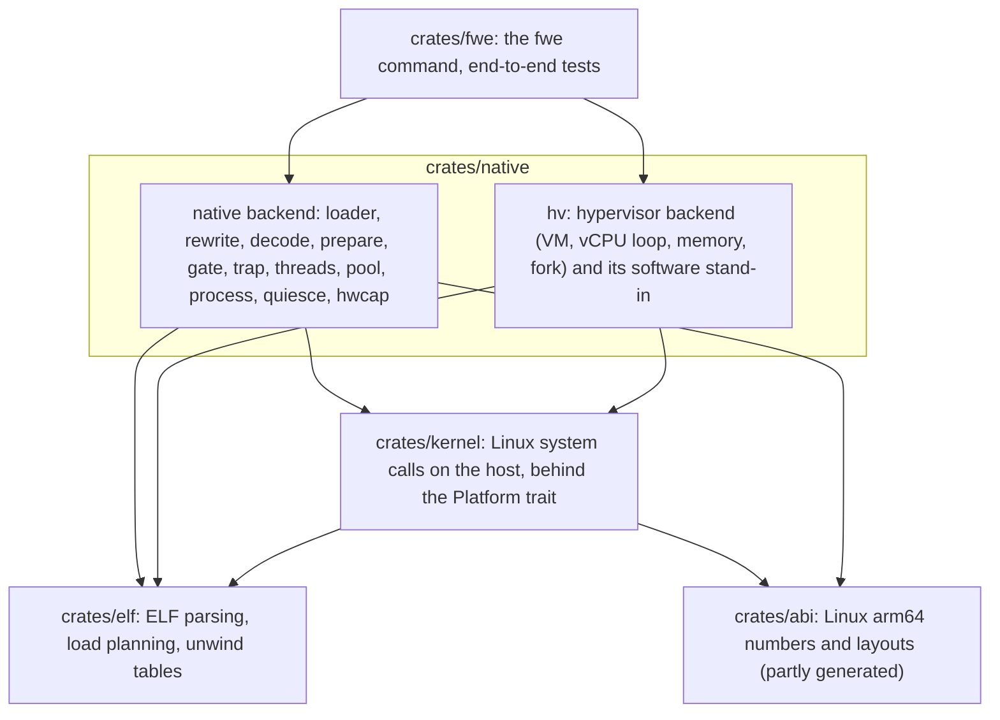

# Architecture

## Summary

fwe is a Linux kernel written as an ordinary macOS program. Each guest
process is one `fwe` process holding the guest's code and memory, a
*backend* that runs the guest's code and catches its system calls, and the
*kernel crate*, which carries out each call with macOS system calls and
keeps the Linux state macOS has no place for. The native backend runs
guest code inside the fwe process after rewriting a few instructions; the
hypervisor backend runs it in a small VM. Both hand every system call to
the same kernel crate.

This document covers the crates, a system call's path, each backend's
machinery, the kernel crate area by area, and the
[known limitations](#known-limitations). What each Linux primitive becomes
on macOS, and how host events reach the guest, is in
[linux-on-macos.md](linux-on-macos.md); the hypervisor backend's rules,
testing and operation are in [hypervisor.md](hypervisor.md).

## Components

fwe is a Cargo workspace of five crates:

- The **kernel crate** does not depend on how guest code runs. A backend
  traps a guest system call, calls `Kernel::enter_syscall` with the
  guest's registers, and serves the kernel through `fwe_kernel::Platform`:
  preparing code for execution, ending a thread or the process, setting
  how the host treats a signal and, for the VM, carrying out memory calls
  (`Platform::memory`).
- The **native backend** runs guest code in-process after rewriting the
  instructions macOS cannot run unchanged. It runs every
  position-independent binary, and fixed-address ones linked at or above
  4 GiB.
- The **hypervisor backend** runs the guest at EL0 in a
  Hypervisor.framework VM. fwe picks it for a non-PIE executable linked
  below 4 GiB, which the native backend cannot map.
- **Root filesystems:** `fwe --pull IMAGE DIR` (`crates/fwe/src/pull.rs`)
  fetches an image's linux/arm64 variant from its registry (`curl`, with
  an anonymous token where asked), checks each layer's SHA-256 digest and
  unpacks the layers in order with the host's `tar`, applying whiteouts.
  What an unprivileged unpacking loses is kept as fwe keeps it for the
  guest, read from the layers' headers (`crates/fwe/src/tarlist.rs`):
  owners other than root (`org.fwe.owner`), set-ID bits and modes that
  deny the owner (`org.fwe.mode`). Every file gets the user's group, which
  the guest sees as root's. On a case-insensitive volume a name that
  differs from an earlier one only in case is left out and listed. It
  writes `/etc/resolv.conf` with the host's name servers, and `/etc/hosts`
  where the image has none, as a container runtime does.
- **Hosts:** the kernel, ELF and ABI crates build on any Unix (`libc`
  supplies host values; on Linux most translations are the identity), and
  CI runs their unit tests on Linux too. The backends, and so `fwe`, run
  only on macOS on Apple Silicon.
- **Translation:** Linux values (errno, flags, clock ids, signals,
  rlimits, ioctls) map to host values in `crates/kernel/src/host.rs`.
  `crates/abi` holds the Linux side; `tools/gen-abi.py` generates system
  call numbers and errno values from the UAPI headers.

## System calls

A backend catches the guest's `svc` (the native backend's gate or trap
handler, or the VM's run loop), reads the number and arguments from the
guest's registers and hands them to the kernel crate (drawn in
[linux-on-macos.md](linux-on-macos.md#system-call-entry)). Seccomp
filters see the call first. The kernel crate then runs it under its lock
or, for a call that may block, without it:

- **The kernel lock** (`crates/kernel/src/klock.rs`) is a read-write lock
  over the process's kernel state. Calls that only read it (the ids,
  `uname`, the time, `getrandom`, `fstat`, `newfstatat`, `statx`,
  `faccessat`, `readlinkat`, `getcwd`, `lseek`) or change only the calling
  thread's state (`rt_sigprocmask`, `sigaltstack`) take its shared side,
  several threads at once (`Kernel::dispatch_shared`); every other call
  holds it alone (`Kernel::enter_syscall`), so a descriptor or mapping and
  fwe's record of it change together. A reader writes nothing other
  readers use: it counts itself in one of 32 counters, each on its own
  cache line, and checks a flag only writers set. A writer sets the flag
  and waits for the counters to drain; readers that find it set enter when
  it is done, ahead of the next writer.
- **Blocking calls run without it**, so a waiting thread never stalls the
  thread meant to wake it: `futex`, the sleeps, `epoll_pwait`, `ppoll`,
  `pselect6`, `rt_sigsuspend`, `rt_sigtimedwait`, `wait4`, `waitid`, the
  blocking socket calls, `flock`, `F_SETLKW`/`F_OFD_SETLKW`, `read`/`write`
  and their vectored and positioned forms, `sendfile`, `splice`, `tee`,
  `vmsplice`, `copy_file_range`, FIFO opens (by any path: another user's
  FIFO, from a directory descriptor, in an overlay) and IPC waits. `clone`,
  `execve` and `exit` are the backend's.
- **Signals during a call:** the thread's guest mask is in force on the
  host while a call runs, so a signal the guest takes interrupts a blocking
  host call (`EINTR`). The call then runs again if no guest handler waits
  for the signal, or if the handler has `SA_RESTART` and Linux restarts
  the call (I/O, `wait4`/`waitid`, `accept`, `openat`, `ioctl`,
  `flock`/`fcntl`, a futex wait without a timeout); otherwise it fails with
  `EINTR` once the handler returns. `ppoll`, `pselect6` and `epoll_pwait`
  run under their mask, as `rt_sigsuspend` does.
- **Return:** the result goes into `x0`, `pc` advances, a ready signal is
  delivered, and the guest resumes with every other register preserved.
- **Unimplemented** calls fail with `ENOSYS` and are noted under
  `--strace`.

### Guest memory access

A bad pointer argument must fail the call with `EFAULT`, not crash fwe.
Every kernel access to guest memory goes through
`crates/kernel/src/uaccess.rs` (typed values, strings, string arrays,
byte ranges):

- the copies run in a small assembly routine; when one faults, the
  backend's fault handler resumes it at a recovery point (Linux's
  exception-table scheme) and the call fails with `EFAULT`;
- a pointer handed straight to a host call is checked by the host; the
  macOS C library functions that work in user space (`clock_gettime`,
  `gettimeofday`, `nanosleep`) write to fwe's memory and go through the
  checked copies;
- in the VM, every guest pointer is checked against the guest's mappings
  (`set_validator`) and translated (`g2h`, `host_arg`), see
  [linux-on-macos.md](linux-on-macos.md#pages-and-translation).

### Tracing

- `--strace` prints each call with its arguments (paths and names as
  strings) and result, and the backend's notes (what was loaded and
  prepared), to standard error.
- `--strace=failures` prints only failing calls and the notes, cheap
  enough to keep a run's timing.
- `--strace-file=PATH` appends the trace of every process of the run to
  `PATH`, each line naming its process.
- `FWE_TIMING=1` prints how long each phase of a start, an `execve` and a
  `fork` took, to standard error.
- All are passed on across `execve` and `fork`. A failed code preparation
  is noted with its reason (no room for stubs, say) and the guest gets
  `ENOMEM`.

## Native backend

The native backend (`crates/native`) runs guest code in the fwe process:
the loader, the code preparation that rewrites guest instructions, the
system-call gate, the trap handlers that turn host signals into system
calls, signals and faults for the guest, and the machinery for threads
and `fork`.

### Loading

- The loader (`crates/native/src/loader.rs`) reserves the image's span (a
  PIE where the host picks), copies each `PT_LOAD` segment in, writable,
  rewrites its code and sets the final protections. Stub space is
  reserved right after the image, within branch range. A 16 KiB host page
  shared by several segments gets the union of their protections.
- The break is reserved after the image and its stub space (up to 1 GiB,
  halved while something is in the way) before the dynamic linker is
  placed. The stack is 8 MiB with a guard page.
- `execve` of a script runs its `#!` interpreter (`Kernel::exec_target`)
  in either backend, so no shell is needed.
- The auxiliary vector's ids and `AT_SECURE` are the guest's, as the
  exec leaves them (`AuxIds`): the kernel computes them before an
  in-place `execve` loads the program, and a re-executed fwe reads them
  from its exec state before its kernel exists, in either backend.
- An in-place `execve` checks the new program first (an arm64 ELF that
  fits the address space, with a dynamic linker that exists), so a bad
  one fails with the caller intact. A re-exec checks only that it is an
  ELF file before the host `execve`, so a later failure ends the process.
- **Busy programs** (`crates/kernel/src/textbusy.rs`): a page every fwe
  process maps holds each process's program and a ring of files recently
  opened for writing. Opening a running program's file to write, or
  running a file some process holds open to write (confirmed by the
  host), fails with `ETXTBSY`. A writer whose ring entry later opens
  overwrote goes unseen.
- A program given by a host path inside the rootfs gets its guest path as
  `argv[0]` and `AT_EXECFN` (Python finds its installation so); `--argv0`
  overrides it.

### Rewriting guest code

Which instructions are rewritten, into what, and which parts of a binary
are scanned is in
[linux-on-macos.md](linux-on-macos.md#which-instructions-get-translated-and-how).
The pieces:

- `crates/native/src/rewrite.rs` scans a range word by word, rewrites
  `svc #0` in place and builds a stub for each thread-pointer or `x18`
  site. A word with no 18 in any register field (bits 0, 5, 10 and 16),
  nearly every one, is passed over without decoding.
- `crates/native/src/decode.rs` decodes an instruction naming `x18` so the
  stub can substitute a scratch register, adjust an `sp` offset or rebuild
  a PC-relative or branch form, and finds the forms with stubs of their
  own (`casp`, writeback onto `sp`, `sp` written from `x18`).
- `crates/native/src/prepare.rs` groups sites so one stub region reaches
  each group (at most a quarter of the branch range apart), takes the
  region from the loader's arena or reserves one near the code, maps it
  with fwe's memory tag (241, "Memory Tag 241" in `vmmap`, which the
  benchmarks count as fwe's), writes the stubs, points each site at its
  stub and invalidates the instruction cache. Placement keeps stub regions reachable:
  - a mapping the guest leaves to the host is asked for at 2 TiB, above
    the program, its break and fwe's own memory, so mappings fill upwards
    with free space past the latest (in the gaps below, a library's code
    could find no stub region in reach); code mapped without a fixed
    address that still finds none is mapped again where there is room;
  - a large mapping (64 MiB or more) that may hold code (a file's, an
    inaccessible one, as a library's span is reserved before its code is
    mapped over it, or an executable one) is placed with room on both
    sides, since code longer than a branch reaches has sites that reach
    only room below it;
  - large data (a heap, an arena) fills upwards with the rest: adjacent
    mappings are one host region, and a host fork's cost grows with the
    regions.
- The kernel crate asks for preparation through `Platform::prepare_exec`
  whenever guest memory becomes executable (`mmap`, `mprotect`, a
  write+exec fault, in `crates/kernel/src/mm.rs`), passing the code ranges
  it knows from the file's sections and unwind table; a failure is traced
  (see [Tracing](#tracing)).
- `crates/kernel/src/prepcache.rs` keeps, in fwe's private directory and
  by a file's identity (device, inode, size, modification time), its
  sections' and unwind table's code ranges and, for each mapped code range
  of 64 KiB or more, the words the scan rewrote or found sites at, with
  their old values, as Rosetta 2 keeps its translations. A later mapping
  of that range replays them (`rewrite::replay`), touching only the pages
  that hold them, after checking each word is unchanged (scanning again
  if not). The loader keeps the same for the program and its dynamic
  linker, with their stub space size and unwind tables' code ranges. The
  collector removes entries older than 30 days.
- `crates/kernel/src/lazycode.rs` writes a kept range's pages as they
  first run. Its stubs are written as it is mapped; the words its pages
  owe (branches to stubs, system calls turned into traps) are kept aside,
  and those pages are mapped readable but not executable. The first
  instruction fetch there faults (on the instruction's own page; any other
  fault is handled as usual), and the handler writes the page (each word
  only if unchanged) and gives it the protections the guest asked for,
  under a lock: another thread that faulted on it meanwhile finds it
  written and runs on. Up to eight owed pages each way with the same
  protections are written with it, in one protection change, since code
  that runs is mostly together. A page made writable, or moved by
  `mremap`, has its words written first. A large library is mostly never
  run: clang's `libLLVM` has sites on 2,081 of its 5,927 code pages, most
  never reached by a compile. The pages a run wrote are added to the
  range's kept preparation as the process ends (`prepare::keep_hot`); the
  next start writes those as it prepares the range and owes only the
  rest.

The stub for an instruction writing `sp` from `x18` sets `sp` before it
reloads its two scratch registers from below the old `sp`; a signal
delivered on those loads has them done first (`finish_sp_stub` in
`crates/native/src/trap.rs`), so its frame cannot overwrite them.

The trap handler reads the guest's `x18` into `Regs` and writes it back on
return, so a signal frame carries the real value, `rt_sigreturn` restores
it, and a cloned thread starts with its parent's. Correctness never
depends on the host preserving `x18`; macOS 26.4's custom-`x18` ABI is
only probed (`fwe --host-info`), not used: switching it at every trap
costs two host calls, one of which could hang.

### Faults

Natively, every trap guest code takes arrives as a host signal. The fault
handlers (`on_fault` and `on_sigtrap` in `crates/native/src/trap.rs`) sort
each into a system call, an emulated instruction, a write+exec page
switch, a recovered checked copy, a signal another process sent, a signal
for the guest, or a fatal fault in fwe's own code; what each becomes for
the guest is in [linux-on-macos.md](linux-on-macos.md#faults-in-guest-code).

A handler is entered with every signal blocked. For a system call it
unblocks the guest's signals while the call runs, so a wait can be
interrupted, and blocks them again before returning; the return restores
the guest's mask. A call that neither waits nor touches guest memory
(`getpid`, `brk`, `mmap` and the like, outside `--strace`) runs with them
blocked, two host calls fewer; a signal arriving meanwhile is delivered as
the handler returns.

### The system-call gate

A rewritten `svc #0` calls the gate (`crates/native/src/gate.rs`) through
a stub of its own; the trap handles only what the gate does not finish
(see [linux-on-macos.md](linux-on-macos.md#system-calls-svc-calls-fwes-gate)):

- **State:** each guest thread has a block (the guest's `Regs`, the stub's
  return address, an `active` flag and a count of signals recorded for
  it) and a 1 MiB gate stack, mapped as it first enters guest code
  (`trap::prepare_guest_entry`); a TSD slot points to the block. A forked
  child keeps its copy.
- **Thread pool** (`crates/native/src/pool.rs`): a thread that ends
  through the gate leaves its host thread waiting, every host signal
  blocked, for the next `clone` (up to sixteen wait). The new thread runs
  on it, with its block, stacks and every per-thread state of the kernel
  and backend reset as for a new host thread (`fwe_kernel::thread_reused`).
  A host thread that ends returns its gate and signal stacks
  (`crates/native/src/stacks.rs`); a new one takes a pair whose thread has
  gone (its Mach thread port is dead) before mapping new ones.
- **The mask:** guest code runs under the host mask its guest mask calls
  for, and so does the call. A call that changes the guest's mask sets the
  host thread's to match before the gate returns.
- **Plain calls only:** the Rust half (`trap::fwe_gate_call`) runs a call
  through `Kernel::enter_syscall` or `fwe_kernel::blocking_syscall`, as
  the trap does, unless a tracer stops at system calls (`PTRACE_SYSCALL`),
  a seccomp filter is set, or the trap runs the call its own way
  (`execve`, a `clone`/`clone3` of a process or of a traced thread,
  `wait4`, `waitid`, `pidfd_getfd`, the IPC waits, `rt_sigtimedwait`). An
  untraced thread's `clone`/`clone3` makes the thread from the block's
  registers, and its `exit` ends it with every host signal blocked. The
  gate returns straight to the guest only when the call changed nothing
  but `x0` and the mask and nothing is to be delivered; otherwise it takes
  the trap (`brk #0x4c5a`), whose handler installs the block's state and
  delivers what is pending.
- **Signals:** a host signal is taken at once only where the thread is in
  guest code: not in the gate's instructions, nor while the block is
  active. Elsewhere it is recorded and counted; the call looks for one to
  deliver as it ends, and the gate's way out compares the count with the
  one the call saw. A signal landing on the way out restarts it
  (`gate::rewind`), so it is delivered there, not at the thread's next
  call.

## Memory bookkeeping

Both backends carry out the guest's memory calls (natively with host
calls, in the VM on its page tables, see
[linux-on-macos.md](linux-on-macos.md#memory)); the kernel crate keeps the
records Linux would:

- **Ownership:** every guest range (images, stubs, stack, break,
  mappings) is recorded (`fwe_kernel::mm::track`) and removed when
  unmapped; fwe's own memory never is, so `execve` discards exactly the
  old program.
- **Linux's view** (`crates/kernel/src/maps.rs`): each successful memory
  call, with the guest's protections and sharing and the file and offset
  mapped; the loaders add the program, its dynamic linker (file-backed as
  far as the file has contents, zeroed beyond) and the stack, and the
  break is the heap. Memory fwe maps that the guest did not ask for (code
  stubs, a guard page) is listed as anonymous with the host's protections,
  so a program looking for free space does not pick it.
- **Other processes:** each process publishes its record, with its start
  time, in an entry of its own in the process store before its next
  system call that is not a memory call, and before a `fork`, so a run of
  mapping calls publishes once; it removes it as it ends. Another
  process's `/proc/<pid>/maps` and `smaps` read it (an entry left by an
  earlier process of the pid is ignored), with resident pages from the
  host (`proc_pidinfo`). `PROCMAP_QUERY` answers for any of them, with
  the mapped file's GNU build ID.
- **`vm.max_map_count`** (65530 by default): an `mmap`, or an `munmap`
  that splits a mapping, past it fails with `ENOMEM`.
- **Locking** (`mlock`, `mlock2`, `mlockall`, `MAP_LOCKED`) brings memory
  in, marks it locked for `smaps`, `VmLck` and the next lock's
  `RLIMIT_MEMLOCK` check, and wires it on the host with `mlock` (unlocking
  unwires it) as far as the host lets a user process; a mapping made
  locked (`MAP_LOCKED`, or after `MCL_FUTURE`) past `RLIMIT_MEMLOCK` fails
  with `EAGAIN`, and `MAP_LOCKED` with a limit of 0 with `EPERM`.
- **Sealing** (`mseal`): a flag on the mapping, carried across `fork`;
  `munmap`, `mprotect`, `mremap`, a `MAP_FIXED` `mmap` over it and a
  discarding `madvise` of read-only anonymous memory fail with `EPERM`.
- `remap_file_pages` maps the range of a shared file mapping afresh at the
  page asked for, as Linux, which has no non-linear mappings, does.
- `POSIX_FADV_DONTNEED` writes a range's changes back and drops its pages
  from the host's cache (a shared mapping of it, synced and invalidated).
- Write+exec memory is recorded in `crates/kernel/src/mm.rs` and handled
  per backend.

## Processes

The fork, vfork, execve and wait models are drawn in
[linux-on-macos.md](linux-on-macos.md#processes). What fwe does to make
and replace processes, and the per-process state it keeps:

- **Native fork** (sequence in
  [linux-on-macos.md](linux-on-macos.md#fork)):
  - `fwe_kernel::fork_locked` holds the kernel lock for writing and every
    registry lock across the host `fork`, with the locks threads take
    outside the kernel lock (epoll interest lists, pipe states, the user
    namespace...; `forklock.rs`, taken all at once or not at all, so their
    order never matters). The child, which has only the forking thread,
    so inherits none held by a thread it lacks; it clears the kernel
    lock's reader counters. A `RwLock` among them is replaced in the child
    rather than unlocked, since on macOS unlocking one walks a queue of
    waiting threads the child lacks.
  - The fork refuses (`ENOSYS`) once the process has a VM.
  - Threads running guest code are suspended
    (`crates/native/src/quiesce.rs`); one in fwe's code (which may hold
    `malloc`'s lock) runs on and waits before re-entering guest code until
    the fork is done.
  - The child goes on only once the parent has unblocked signals, so a
    signal it sends its parent keeps its sender, and enters the guest
    directly with `x0` = 0 rather than through the inherited trap frame,
    whose signal mask macOS would not restore.
  - Every signal but `SIGSEGV`, `SIGBUS` and `SIGSYS` is held across the
    host `fork`; one of those sent to the child before it is set up (it
    may not know its pid yet, and it forgets its parent's pending signals)
    is kept and posted once it is (`trap::post_early`).
- **VM fork state** (`Kernel::save_for_fork`,
  `crates/kernel/src/snapshot.rs`): signal dispositions, the forking
  thread's mask and alternate stack, the break, filesystem view,
  credentials, descriptor limits, every descriptor registry and the
  translated guest ranges, then the backend's registers, thread pointer,
  PAC keys, mapping records and slab use. The format is private to one
  fwe binary.
- **Re-exec state** (`Kernel::exec_state`): see
  [linux-on-macos.md](linux-on-macos.md#execve).
- **Process records** (`crates/kernel/src/procreg.rs`): one per host pid,
  with the start time (so a record never outlives its process into another
  with the same pid), cgroup, namespaces, name, command line, program,
  ancestors, subreaper flag, nice value, scheduling policy and
  `oom_score_adj`.
- **The process store** (`crates/kernel/src/procstore.rs`): memory every
  fwe process of the user maps, a POSIX shared memory object (a file's
  dirty pages would be written back to disk as each process holding them
  ends). It holds an entry per pid (a lock naming its holder's pid, taken
  over from one that died holding it; a sequence number, odd while the
  record changes; where its bytes are; the end status), the records'
  bytes in chained 4 KiB blocks, a bitmap of pids with a record, a table
  of how processes ended, the CPU's features (asked of the host by the
  first process after boot), and the thread-number blocks, signal
  mailboxes, ptrace pages and shared cells described below. A writer holds
  the entry's lock, writes new blocks, links them and frees the old ones;
  a reader takes no lock and rereads if the sequence number changed.
  A program's start writes its record once. A native fork's child writes
  its whole record as it starts, from what its parent knows (program,
  cgroup, whether the host reaps). The parent marks it as still to write
  before its `fork` returns: until then every listing has it, and a look
  at its record waits for it (so a reaper's watcher finds the orphan of a
  parent that ended at once).
- **Process descriptors** (`crates/kernel/src/pidfd.rs`): a kqueue
  watching the process's exit, marked with what it names (see
  [linux-on-macos.md](linux-on-macos.md#waiting-and-events)).
  `pidfd_send_signal` is `kill`, `tgkill` or `rt_sigqueueinfo` of that
  process; `PIDFD_GET_INFO` gives its pid, parent and ids, and once this
  process has reaped it, its wait status; the `PIDFD_GET_*_NAMESPACE`
  requests and `setns` use its namespaces as `/proc/<pid>/ns` has them.
  `pidfd_getfd` queues a request in the target's mailbox and wakes it; its
  wake handler sends the descriptor as `SCM_RIGHTS` to a datagram socket
  the caller bound beside the process store (or, where that path is too
  long for a socket address, in `/tmp/fwe-<uid>-fd`, which only the user
  may use).
- **Priorities and policies:** `setpriority`/`getpriority` and the
  `sched_*` calls (`crates/kernel/src/sched.rs`) are kept in the record
  with Linux's checks and inherited (`SCHED_RESET_ON_FORK` honoured); the
  host's scheduling is untouched. Policies are per process.
- **Resource limits:** those the host lacks, and `RLIMIT_MEMLOCK`, `CORE`,
  `STACK`, `CPU` and `NPROC`, are fwe's (`crates/kernel/src/rlimits.rs`);
  the others are the host's. `RLIMIT_NOFILE` is virtual (see
  [Descriptors](#descriptors)). Past the CPU soft limit the host's
  `SIGXCPU` comes each second, and past the hard one fwe ends the process
  with `SIGKILL`; `RLIMIT_NPROC` is checked at `fork` and thread creation against the
  tasks (threads) of the user's fwe processes.
- **Core dumps** (`crates/kernel/src/coredump.rs`): a signal whose default
  dumps core leaves an ELF core (the thread's registers, the process, and
  the mappings Linux's default `coredump_filter` dumps, less memory given
  `MADV_DONTDUMP`), named by `kernel.core_pattern` and `core_uses_pid`
  and cut short at `RLIMIT_CORE`. The host's own core limit is 0.
- **End status:** a process a signal ends leaves its Linux wait status in
  its entry (`procreg::ending`), so its parent reads the signal and core
  bit Linux would report, even for a signal the host lacks.
- **POSIX timers** (`crates/kernel/src/posixtimer.rs`): a thread of fwe's,
  started with a process's first timer, sleeps until the next is due and
  raises its signal (`SI_TIMER`) for the process or a thread; a periodic
  timer rearms when its signal is taken, the intervals missed counted as
  its overrun. A CPU-time timer is checked at most every 10 ms. A fork
  child has none; `execve` deletes them. The signal of a timer deleted or
  reset while it waits is still delivered.
- **Interval timers** are the host's; one longer than the host takes
  (100,000,000 s) gets the host's longest and reads back as asked.
  CPU-time clocks are the host thread's or process's CPU time.
- **Orphans:** see
  [linux-on-macos.md](linux-on-macos.md#orphans-and-reapers). A reaper's
  `SIGCHLD` for an adopted process is raised inside the reaper (pending
  with a child's `siginfo`; disposition, mask and `SA_NOCLDSTOP` act on
  it), not sent through the host, where a held one would absorb it. An
  orphan keeps the adopter it had when its parent ended.

## Threads and futexes

A guest thread is a host thread running guest code, scheduled by the
host; fwe adds Linux's thread identity and futexes:

- Guest threads run at the host's user-interactive quality of service,
  so a busy host wakes them on time, as Linux wakes a sleeping task.
- `CLONE_SETTLS`, `CLONE_PARENT_SETTID`, `CLONE_CHILD_SETTID` and
  `CLONE_CHILD_CLEARTID` act as on Linux. A new thread starts with its
  creator's thread pointer (without `CLONE_SETTLS`), name, signal mask
  and floating-point control and status registers.
- Thread ids: the main thread's is the pid; another's comes from its pid
  namespace or, outside one, from a counter all fwe processes share,
  numbered from 100000 (past every macOS pid, so a thread number never
  names another process) and wrapping below 4194304.
- Futexes (`crates/kernel/src/futex.rs`) wait outside the kernel lock. A
  wake takes waiters oldest first and marks each woken, so it reports
  exactly how many it woke. `FUTEX_WAIT_BITSET`/`WAKE_BITSET` match by
  bits; `FUTEX_CMP_REQUEUE` moves waiters. `futex_waitv` waits on up to
  128 at once, private ones in the process's queues and shared ones in the
  shared table, and returns the index of the one woken.
- A shared futex's waiters are in a slot table every fwe process maps
  (`crates/kernel/src/sharedfutex.rs`), keyed by Mach memory object and
  offset for shared memory and by process and address for private memory.
  A slot carries a generation, so a wake never claims one freed and
  reused; a dead owner's slot is freed by the next process that looks. A
  waiter takes the first free slot, and the header keeps the highest slot
  ever taken, which bounds a wake's search.
- Waiters check every 20 ms for a signal they should take, and return
  `EINTR` for it.
- Robust futex lists (`set_robust_list`): as a thread ends, and for every
  thread as its process ends or runs another program, each word on its
  list it still owns is marked `FUTEX_OWNER_DIED` (by a compare-and-swap
  that survives a fault in guest memory) and a waiter woken, as Linux's
  `exit_robust_list` does. Each thread's list is in its registry entry for
  the process's other threads, and in the process store for other
  processes' `get_robust_list` (by host pid for a main thread, by number
  for another), cleared as the process starts and ends.

## Signals

The Linux side (numbers, dispositions, sending) is in
[linux-on-macos.md](linux-on-macos.md#signals), and how a host signal
reaches the guest in
[linux-on-macos.md](linux-on-macos.md#host-signals). The machinery is in
the kernel crate (`crates/kernel/src/signal.rs`, `thread.rs`,
`signote.rs`), fed by the backends' handlers:

- **Pending sets** are atomics in host thread-locals (the host handler
  records into them), registered by tid so another thread can target one.
  A real-time signal already pending is queued behind it, with its own
  `siginfo`, in a lock-free pool the process's sets share (4096 entries),
  oldest first.
- **`RLIMIT_SIGPENDING`** bounds a count of the signals pending in the
  process (each number pending and each queued, with one for each POSIX
  timer, as Linux allocates its signal with it): past it a real-time
  signal sent with a code other than `SI_USER` (`sigqueue`, `tgkill`) and
  `timer_create` fail with `EAGAIN`, and a `kill`'s is merged into the one
  pending. One another process queued in the mailbox is left there while
  the process is at its limit, and taken once a pending signal is.
- **fwe's handlers** start and end with every signal blocked, so the
  backend always knows whether it interrupted guest code or its own. Each
  thread otherwise runs under a host mask that blocks only the
  guest-blocked signals the host acts on itself.
- **Parked signals:** a process-wide signal the host holds can sit on a
  thread running fwe's handlers. A native thread entering a system call
  with such a signal parked on it, one the guest catches, takes it off the
  host and records it against the process, and the others are woken.
- **Wake signal:** a signal recorded without a host signal (real-time,
  emulated faults, caught `tgkill`) wakes its target thread, or every
  thread, with `SIGEMT`. Another process is sent it only if it is a live
  fwe process, one with a record (`host::kill` checks every send): the
  host's default action for `SIGEMT` would end any other.
- **Wake pipes:** every host signal a thread takes writes a byte to that
  thread's pipe (`thread::poke_wait`), and the sleeps, `poll`, `select`
  and the `epoll` waits watch it beside the guest's descriptors
  (`thread::wait_ready_ns`), so a signal landing between the check for
  pending ones and the host wait still ends the wait. Their time is kept
  by a kqueue timer of the thread's with `NOTE_CRITICAL`, which the host
  does not coalesce. A futex wait close to its deadline sleeps the same
  way, a wake writing to its pipe.
- **Signals the host lacks, between processes:** queued in the target's
  mailbox (up to 64, with sender, code and value) and the target woken
  with `SIGEMT`; its wake handler moves them onto its pending sets. One
  for a thread of another process (`tgkill`, ptrace's attach) is queued
  with the tid and posted to that thread through a table of the threads'
  pending sets the handler reads without a lock.
- **Threads of another process:** thread numbers are taken in blocks of
  64, each block's process recorded in the process store; a process that
  has had more than its main thread publishes its tids in an entry of its
  own there, which `/proc/<pid>/task` lists.
- **Orphan ordering:** an adopted orphan's `SIGCHLD` replaces its former
  parent's while that is pending, and absorbs one after it, as Linux
  sends them.
- **Notes:** a sender writes a note in one of eight slots per host signal
  in the target's mailbox (pid, uid, time, and for `SI_MESGQ` the code and
  value), a free one or else the oldest; the target's handler takes the
  note of the sender the host names, or the oldest. Mailboxes are a pool
  of 4096 in the process store, one given to a pid by its first sender
  (most processes are sent nothing) and taken back with its record, or
  when the pool is full and its process is gone. Each slot and queue entry
  is claimed and taken by a compare-and-swap of a word holding a
  generation (for the queue, its ordering ticket) and the sender, so the
  handler takes notes without a lock, whatever its thread was doing.
- **Before a re-exec,** the whole guest mask goes on the host, and pending
  signals the guest blocks are re-raised on the thread, which the host
  `execve` keeps.
- **Frames:** an arm64 `rt_sigframe` with Linux's `ucontext`/`sigcontext`
  and an `fpsimd_context` record, on the guest stack or the alternate
  stack under `SA_ONSTACK` (a handler already on it continues from its
  `sp`); `x0`–`x2` per `SA_SIGINFO`; return through `sa_restorer` or a
  trampoline the backend maps at startup. `rt_sigreturn` restores
  registers, mask and alternate stack.

### ptrace

`crates/kernel/src/ptrace.rs`. macOS lets no process read another's
memory or threads, so a tracee does its tracer's work itself:

- **Mailbox:** a page per traced thread in the process store (named by
  the pid for a main thread, the tid for another), kept while its tracer
  lives. It names the thread's process and holds the stop's wait status,
  the general and FP registers, the `siginfo`, the options, and one
  request at a time with its result, handed over through shared host
  address waits.
- **Stops:** a signal about to be delivered (every one but `SIGKILL`; the
  host catches even ignored ones while traced, and `SIGSTOP` sent to a
  tracee becomes fwe's), a fault (a breakpoint's `SIGTRAP`), the program
  after `execve` (or the exec event), and each system call's entry and
  exit under `PTRACE_SYSCALL`. The tracee writes its state, tells its
  tracer (the page's generation, `SIGCHLD` and the wake signal) and serves
  requests until told to go on, with the signal the tracer chose and the
  registers as the tracer left them.
- **The tracer** reads and writes registers, `siginfo`, options and the
  signal mask in the mailbox (`PTRACE_GET_SYSCALL_INFO` too, from the
  registers and whether the stop is an entry or exit), and asks the tracee
  for memory: `PEEK`/`POKE`, and up to 2 KiB at a time for another
  process's `/proc/<pid>/mem` and `process_vm_readv`/`writev` of a stopped
  tracee, written as `/proc/self/mem` writes (code too, its instructions
  fetched afresh, in the VM as well). Its `wait4` and `waitid` report a
  tracee's stop from the mailbox before the host's children, looking again
  as tracees stop, and the end of a tracee that is not its child, which
  the tracee leaves in its mailbox.
- **Events:** a fork, vfork or clone a tracer follows
  (`PTRACE_O_TRACEFORK` and the like) stops the parent with the event and
  starts the child traced, stopped by `SIGSTOP`, with its parent's options
  (in the VM through the fork's snapshot); a followed thread
  (`PTRACE_O_TRACECLONE`) starts traced the same way, stops on its own
  while the process's other threads go on, and its end is reported by its
  tid; the exit event comes before a process ends, and
  `PTRACE_O_EXITKILL` ends a tracer's tracees with it.
- **Seizing** (`PTRACE_SEIZE`) marks the mailbox seized and nudges the
  tracee with a `SIGSTOP` of fwe's own queue and code, which no guest
  sees, ending a wait it is in (the call restarts) so it starts being
  traced without stopping. `PTRACE_INTERRUPT` sets a word and nudges it
  the same way: it stops with `PTRACE_EVENT_STOP` and `SIGTRAP`, at once
  or as soon as its current stop ends. A seized tracee's group-stop is an
  event stop with the stop signal; under `PTRACE_LISTEN` it stays stopped
  until `SIGCONT` comes (looked for among the host's pending signals, as
  a stop is served with them blocked) or the tracer interrupts it, then
  reports `PTRACE_EVENT_STOP` with `SIGTRAP`. A process or thread a seized
  tracee starts begins with that stop instead of `SIGSTOP`, and an
  `execve` stops it only for the exec event. A pending guest `SIGKILL`
  ends any stop.
- **Single-stepping** plants fwe's breakpoint (`brk #0x4c59`) wherever the
  instruction may go next (a branch's target and the next instruction, a
  register's address), stops when one is hit, and puts the instructions
  back.
- **Attaching** makes the target's mailbox and sends it `SIGSTOP` as
  fwe's; the target starts being traced as it takes it. Only a process of
  fwe's can be traced.
- **Access** (`Kernel::may_access`, Linux's `__ptrace_may_access`): to
  attach (`ptrace`, `/proc/<pid>/mem`, `process_vm_readv`/`writev`,
  `pidfd_getfd`) or read (`get_robust_list`, a pidfd's namespaces), the
  target's real, effective and saved ids must all be the caller's (its
  file-system ids for a `/proc` file), the target dumpable, and its
  permitted capabilities within the caller's, each else `CAP_SYS_PTRACE`
  in the target's user namespace; to attach, Yama's
  `kernel.yama.ptrace_scope` too (1, the default: a descendant, or the
  process the target named with `PR_SET_PTRACER`; 2: `CAP_SYS_PTRACE`; 3:
  none); and the target in the caller's Landlock domain or one nested in
  it. Each process's record carries what others check of it
  (`procreg::Security`: capabilities, dumpable, named tracer,
  `no_new_privs`, seccomp), written when one of the calls that change it
  changed it. Dumpable is set again by `execve` (to 1, or to
  `fs.suid_dumpable` after an exec that changed the ids, gained
  capabilities or ran a program its caller may not read) and lost to
  `fs.suid_dumpable` by a change of effective or file-system ids; an
  undumpable process's `/proc/<pid>` files are root's of its user
  namespace. `/proc/<pid>/status` shows `TracerPid` from the mailbox.

## Files

A file operation starts with a guest path or descriptor and ends with a
host call on a host descriptor. In between, fwe resolves the path in the
guest's root and mount table, keeps its own descriptors out of the
guest's reach, and translates what comes back.

### Paths and mounts

- The guest's root is a host directory (`fwe --root DIR`, else the host's
  `/`), with its mount namespace's table on it: by default the rootfs at
  `/`, and `/proc`, `/sys`, `/sys/fs/cgroup`, `/dev/pts`, `/dev/mqueue`
  and `/dev/shm`.
- `crates/kernel/src/fs.rs` resolves each path component by component:
  symlinks followed by fwe (absolute targets re-rooted), mounts entered,
  `..` clamped at the process's root. `*at` calls start from where their
  descriptor was opened. A trailing slash names a directory, as on Linux:
  a lookup follows a final link and finds anything else `ENOTDIR`; a call
  that removes or renames the name needs a directory there itself, and
  one that makes a file there finds `ENOENT` (or `EEXIST`).
- Fast paths:
  - a run of plain names that crosses no mount is looked up in one host
    `openat` (`O_NOFOLLOW_ANY`, opened to search, not to read);
  - a path under no mount but the root's, needing no search permission
    checked, is found in one host call from the root: a `stat`
    (`AT_SYMLINK_NOFOLLOW_ANY`), or an open only to read of a regular file
    or directory whose mode and owner are the host's and that is not one
    of fwe's device nodes, while no lease is held (`O_NOFOLLOW_ANY`); a
    node's `stat` is its device's. The host refuses either where a link is on
    the way, and fwe then walks name by name. That `stat` comes before the
    look for fwe's own files, which it never reaches (it crosses no mount
    or link);
  - with no root filesystem, the links at the top of macOS's sealed system
    volume (`/tmp`, `/var` and `/etc`, into `/private`) are followed
    without reading them;
  - an `openat` resolves its path once: the look for a FIFO to wait for,
    made without the kernel lock, hands its resolution to the open while
    the view it was made in (root, working directory, mount table) is
    unchanged.
- Every open file remembers the mount it came through
  (`crates/kernel/src/fdmarks.rs`), followed through `dup`, `close`,
  `fork` and `execve` and dropped once the descriptor names another file:
  `fstatfs` reports that mount, `/proc/self/fd` its path, and a
  `/proc/self/fd/N` link reaches the file after the mount or path is gone.
- Read-only mounts fail writes with `EROFS` (devices, FIFOs and sockets
  still open for writing; a socket's node is not made; fwe's `/proc` and
  `/sys` files are not written through one); a bind mount keeps its
  source's per-mount flags (read-only, `nosuid` and the rest; an
  unbindable submount stays behind), which a remount changes; a rename
  or link across mounts fails with `EXDEV`, removing a mount's root with
  `EBUSY`.
- `openat2` (`crates/kernel/src/openat2.rs`) walks the path itself for its
  `resolve` rules (no symlinks, no `/proc` magic links, no mount crossed,
  nothing above the directory, the directory as the root), then opens
  what it reached as `openat` would.
- A host symlink into fwe's `/proc` or `/sys` (`/etc/mtab`, say) is
  opened and `stat`ed as the file it leads to.
- `/dev/shm` is reached by any path that leads there, symlinks included,
  whether or not the rootfs has a `/dev`; its files report their
  `/dev/shm` path.

### Descriptors

Guest descriptors are host descriptors, so I/O is direct; the work is in
keeping fwe's own descriptors apart and Linux's limits exact:

- fwe's own descriptors (the rootfs handle, pipe ends behind eventfd and
  signalfd, a vfork parent's pipe, the signal mailbox, in the VM every
  file mapping's file) live in a reserved range from just above the
  guest's up to the host's limit (`crates/kernel/src/fdtable.rs`).
- At startup fwe raises its host soft limit as far as macOS allows and
  gives the guest a virtual `RLIMIT_NOFILE`: soft 1024, hard leaving fwe a
  quarter of the host's descriptors, at least 64 and at most 16384 (the
  host's table grows to the highest descriptor, and a host `fork` copies
  it all).
- The guest never reaches the range: `close_range(3, ~0)`, closing up to
  the limit and listing `/proc/self/fd` stop below it; a call naming one
  fails with `EBADF`, as does `dup2` onto one. Root may raise the limit
  past it, up to `fs.nr_open`, as Linux allows; the guest's descriptors
  stay below it. When the range is full, what needed one fails as Linux
  would (`EMFILE` for an `eventfd`, `ENOMEM` for an `mmap`, `EAGAIN` for a
  `fork`).
- The soft limit holds as on Linux: a new descriptor at or above it is
  closed again and the call fails with `EMFILE` (`dup3` onto one with
  `EBADF`, `F_DUPFD` from one with `EINVAL`).
- A new descriptor is the lowest free number: the directory fwe holds
  while resolving a path is moved into the reserved range first.
- An `O_CREAT` open that macOS fails with `ENOENT` because another process
  is unlinking the name is retried.
- `O_PATH` descriptors are marked and refused what Linux refuses
  (`EBADF`). An `O_PATH` open of a FIFO, a device or socket the host
  cannot open, or a symlink itself is a stand-in that names the file: its
  `fstat` (kept mode and owner too), `readlinkat`, `faccessat2`,
  `utimensat`, `fchownat` and `fchmodat2` (`AT_EMPTY_PATH`),
  `name_to_handle_at` and fdinfo are the
  file's, and its `/proc/self/fd` link reopens it. One of a link in fwe's
  `/proc` or `/sys` names that link.

### File contents and metadata

- `stat`/`statx` are translated to the arm64 Linux layout; `statx`
  reports the immutable, append-only and no-dump attributes from the
  host's file flags, and the birth time APFS keeps. A tmpfs file is on the device
  `/proc/<pid>/mountinfo` gives its mount, in page-sized blocks; any other
  mount of host files has there the host device its files report.
  `getdents64` is built from `getdirentries`, re-reading from the
  directory position when translated entries outgrow the guest's buffer.
- **Modes** (`crates/kernel/src/modes.rs`): a mode that denies its owner,
  or set-ID bits (which the host drops from a file of a group its user is
  not in, and on any write), is kept in `org.fwe.mode`, the file flagged
  `UF_NODUMP`; `stat` reports it. The guest's own no-dump flag
  (`chattr +d`) is recorded apart, in `org.fwe.nodump`, so the inode flags
  and `statx` report only it, and changing them keeps the mark. A write by a caller without
  `CAP_FSETID` (through any descriptor of the file, a `truncate`,
  `fallocate`, `copy_file_range`, `sendfile` or `splice` into it, or a
  shared writable mapping of it, as it is made) clears a file's set-ID
  bits, as on Linux. Attributes are read and
  written by path, from the directory where the path is too long. A
  regular file `open` makes has its mode itself on the host where only
  the owner's read or write bits are denied (a repository's read-only
  objects, which are never written again); such a file, or one made by
  something else, is converted the first time the host refuses what fwe
  allowed (an open, an attribute, a kept owner). The kept mode and owner
  are read once a process per file and change time.
- **Owners** (`crates/kernel/src/owners.rs`): a file whose owner is not
  root (fwe's user) keeps it in `org.fwe.owner`, under the same flag;
  `stat` reports it. A new file is its maker's (its file-system user, and
  group or a set-group-ID directory's), and `chown` changes the record
  under Linux's rules.
- **Permission checks** are fwe's (`creds::Access::permits`): opening a
  file, `faccessat` (by the real ids unless `AT_EACCESS`, the walk too),
  changing a directory's entries (with the sticky bit's restriction, in an
  overlay too), searching each directory of a path, `chdir`, `chmod`,
  `utimensat`, extended attributes, `execve` (root too needs an execute
  bit) and `O_NOATIME` (owner only), by the owner's, group's or others'
  bits against the caller's file-system ids, `CAP_DAC_OVERRIDE` and
  `CAP_DAC_READ_SEARCH` passing them. Checks outside the kernel lock (the
  path walk, a connect or send to a Unix socket's node, the directory a
  `bind` makes one in) use the credentials
  published after each system call (`creds::access`).
  `fs.protected_symlinks` (an overlay's links too) and `fs.protected_hardlinks` act as on Linux
  (off by default, as in Linux's kernel; read again only when a sysctl
  changes). Without a root filesystem the host's own files and directories
  (root's, no owner kept) are left to the host's checks. fwe's own umask
  on the host is 0: fwe applies the guest's umask.
- **Extended attributes** (`crates/kernel/src/xattr.rs`): a list shows
  only Linux's namespaces; `trusted.` ones are hidden from callers without
  `CAP_SYS_ADMIN`; `user.` ones are for regular files and directories
  only; writing a `security.` one needs `CAP_SYS_ADMIN`, or `CAP_SETFCAP`
  for `security.capability`, whose value must be revision 2 or 3 of its
  size (`EINVAL`), is kept as revision 3 for the root of a writer's user
  namespace of fwe's and read back as the reader's namespace sees it, and
  goes with a change of owner and with the first write to the file
  (any write call, a truncation, a copy or splice into it, a shared
  writable mapping) once this process opened it to write, by its host
  identity as a set-ID file is watched (`modes::CAPS_FILES`).
- **memfd** (`crates/kernel/src/memfd.rs`): `/proc/self/fd` names it
  `/memfd:<name> (deleted)`; `F_SEAL_SHRINK`/`GROW` are checked by
  `ftruncate` and `fallocate`, `F_SEAL_EXEC` by `fchmod`; after
  `F_SEAL_WRITE` the host refuses writes and writable shared mappings,
  reported as `EPERM`.
- **Programs run from a descriptor** (`execveat(fd, "", AT_EMPTY_PATH)`,
  `/dev/fd/N`, a `/proc/self/fd` path, as crun runs its sealed copy) are
  read through it; fwe keeps a descriptor of the program, which
  `/proc/self/exe` opens.
- **Copying:** `sendfile` and `copy_file_range` copy between descriptors.
  `splice`, `tee` and `vmsplice` (`crates/kernel/src/splice.rs`) copy too,
  since the pipes are the host's: from a pipe what it holds, into one what
  room it has, waiting unless asked not to, without the kernel lock. A
  pipe's data is taken only as far as it can be written: all of it, the
  rest put back through a write end the process holds (as `tee` puts back
  all it copies), or else no more than the output takes now. A pipe or
  socket with no reader fails with `EPIPE` before anything is taken.
- **fcntl:** status and descriptor flags, record locks and the
  open-file-description `F_OFD_*` forms (macOS's private numbers) are
  translated (`struct flock` and lock types differ); `flock` passes
  through. macOS, as Linux, drops all of a process's record locks on a
  file when the process closes any descriptor of it, so fwe never opens a
  guest's file for its own ends (`crates/kernel/src/reclocks.rs`): its
  attributes, flags, times, `truncate` and an overlay's copy-up go by
  path (from the directory, `pthread_fchdir_np`, where the path is past
  the host's 1024 bytes), and a process that has taken a record lock
  opens to read the whole way, never one host call that opens to look.
  Owner thread, `F_SETSIG`'s signal, `F_CREATED_QUERY` and pipe
  sizes (`F_SETPIPE_SZ`, `fs.pipe-max-size`) are kept by fwe
  (`crates/kernel/src/fdstate.rs`) and checked as Linux checks them. A
  host `SIGIO` for a descriptor with a chosen signal arrives as that
  signal, with `si_fd` and `si_band`.
- **Smaller pipes:** a pipe given less than the host's capacity holds no
  more. The writing process keeps the page buffers its writes made, as
  Linux fills them (a write's tail shorter than a page joins the last
  buffer if it fits whole; a read frees a buffer once it has read all of
  it), learns how far reads have gone from the bytes the host pipe holds,
  and cuts each write to the room left, waiting while blocking. A full
  pipe is not writable to `poll`, `select` and `epoll`, which recheck it
  each millisecond.
- **Whole pipe writes** (`crates/kernel/src/pipelock.rs`): a write of up
  to Linux's `PIPE_BUF` (4096 bytes) arrives whole, never interleaved,
  where the host keeps only 512 whole. A pipe's writers take turns
  through a lock of that pipe's own in a page every fwe process maps (one
  whose holder has ended is taken over); a non-blocking writer writes
  whole or fails with `EAGAIN`.
- **Inode flags** (`FS_IOC_GETFLAGS`, `FS_IOC_SETFLAGS`): immutable,
  append-only and no-dump are the host's user flags of the same meaning,
  which it enforces (no-dump also marks a kept mode, so such a file does
  not show it); setting the first two takes `CAP_LINUX_IMMUTABLE`, and
  such a file's extended attributes cannot change. An append-only file's
  times may be set to now (fwe lifts the flag for the change, which the
  host would refuse), not to a given time. `O_NOATIME` (a descriptor's
  own; the host has none) leaves the access time as a `noatime` mount
  does.
- **`O_TMPFILE`** (`crates/kernel/src/tmpfile.rs`): the file is made under
  a hidden name in its directory (`getdents` leaves it out; `rmdir` of a
  directory holding only such names removes them; its link count leaves
  it out), removed when the last of its maker's descriptors of it is
  closed or the maker ends (a fork child's close leaves it), or at once
  with `O_EXCL`; `linkat` gives it a name through `/proc/self/fd` or
  `AT_EMPTY_PATH`.
- **File handles** (`crates/kernel/src/handles.rs`): a handle names the
  host file system and inode, which the host turns back into a path
  (`fsgetpath`) for `open_by_handle_at`, so it survives a rename and goes
  stale (`ESTALE`) with the file or on another file system; a file fwe
  makes up has an identifier handle (`AT_HANDLE_FID`) only. The file is
  opened as `openat` opens it, at the path the caller sees it at: under
  the host directory of `mount_fd`'s mount (or an overlay's layer), at
  that mount's place, under the caller's root, and the same file there;
  anything else is stale, so a handle never reaches past the guest's view.
- **Leases** (`crates/kernel/src/leases.rs`): a record all fwe processes
  share. An open or truncation that conflicts with a lease signals its
  holder and waits until the lease is released or downgraded, or for
  `fs.lease-break-time` seconds (`EWOULDBLOCK` if non-blocking).
- **ioctl:** terminal, pty and `FIO*` requests, network interface requests
  (`SIOCGIFFLAGS` and the like), and the loop-device requests.
- **FIFOs** (`crates/kernel/src/fifo.rs`): `epoll` and `ppoll` on a FIFO's
  read end wait in short slices and probe with `select` between them
  (reading nothing), reporting `POLLHUP` once the buffered data is read
  (once to an edge-triggered or one-shot `epoll` entry). Each slice is an
  ordinary wait, which a signal ends and which moves a signal blocked for
  a `signalfd` onto it. An open that waits for the other end runs without
  the kernel lock.

### /proc and /sys

`/proc` and `/sys` are generated:

- A path in a `proc` or `sysfs` mount is answered by
  `crates/kernel/src/procfs.rs` (`procpid.rs` for another process's
  `/proc/<pid>`) from an anonymous seekable descriptor;
  `crates/kernel/src/synthdir.rs` serves `getdents64`, `lseek`, `fstat`
  and `close` of the directories from an in-memory list. A process's
  `/proc/<pid>` and its contents are owned by its effective user and group
  (root's while it is not dumpable). An unknown path is `ENOENT`.
- `/proc/self`: `exe`, `cwd`, `root`, `cmdline`, `stat`, `status`,
  `cgroup`, `mountinfo`, `mounts`, `uid_map`, `gid_map`, `setgroups`,
  `maps`, `smaps`, `auxv` (the vector the program started with),
  `personality`, `oom_score`, `oom_adj`, `oom_score_adj`, `fd`, `fdinfo`,
  `ns`, `environ` (the environment strings in the initial stack, between
  the arguments and `AT_EXECFN`'s string, read from memory), `limits`,
  `statm` and `io` (sizes and storage bytes from the host; the counts it
  does not keep are 0), `net`, `task/<tid>/{stat,status,comm}`. Writing
  `comm` names the thread as `PR_SET_NAME` does (another process's:
  `EINVAL`). The state in `stat` is the main
  thread's: `S` while it waits in a system call, never while it waits for
  one of fwe's own locks (as a Linux task waiting on a kernel lock is not
  asleep).
- `/proc` globals: `cpuinfo` (Linux's arm64 format: BogoMIPS from the
  host's timer, the features of the hwcaps the program was given, the
  implementer and, for a chip Linux knows, the part from `hw.cpufamily`;
  variant and revision 0), `meminfo` (the host's memory: `hw.memsize`,
  the VM statistics, `vm.swapusage`), `stat` (host CPU times and boot
  time), `uptime`, `loadavg`, `cmdline`, `filesystems`, `partitions`,
  `net` (a link to `self/net`: `dev`, `if_inet6`, `route`, `snmp`, `tcp`,
  `tcp6`, `udp`, `udp6` and `unix` of the reader's network namespace, in
  `crates/kernel/src/procnet.rs`),
  `config.gz` (the options of what fwe implements), `keys`, `key-users`,
  `sysvipc/{shm,sem,msg}`, and under `/proc/sys`: `kernel/{ostype,
  osrelease,version,hostname,domainname,pid_max,cap_last_cap,ngroups_max,
  overflowuid,overflowgid,threads-max,tainted}` (`hostname` and
  `domainname` written as `sethostname` sets them),
  `kernel/random/{entropy_avail,poolsize,uuid,boot_id}`, `fs/{nr_open,
  file-max,pipe-max-size,pipe-user-pages-soft,pipe-user-pages-hard,
  lease-break-time,protected_symlinks,protected_hardlinks,suid_dumpable}`,
  `kernel/{yama/ptrace_scope,unprivileged_bpf_disabled}` (the security
  ones: Yama's scope decides attaching, 3 for good, set with
  `CAP_SYS_PTRACE`; BPF's opens maps and socket filters to anyone at 0,
  1 for good; `suid_dumpable` is what a process that changed its ids is
  left; `net.ipv4.ping_group_range` decides ping sockets),
  `fs/inotify/*`, `fs/mqueue/*`,
  `vm/{overcommit_memory,mmap_min_addr,drop_caches,max_map_count}`,
  `kernel/keys/*`, `user/max_*_namespaces`, the IPC limits and a network
  namespace's sysctls, `net/core/{somaxconn,rmem_max,wmem_max}` among them
  (`crates/kernel/src/sysctl.rs`). `fs.nr_open` bounds `RLIMIT_NOFILE`
  and the copy of a shared descriptor table `unshare(CLONE_FILES)` makes;
  `somaxconn` caps `listen`'s backlog, `rmem_max`/`wmem_max` the socket
  buffers. The `user/max_*_namespaces` limits are each user namespace's
  own (no limit in a new one until set, Linux's in the initial one): a
  new namespace counts against its maker's user namespace and each above
  it, and one past a limit, or a user namespace nested more than 32 deep,
  fails with `ENOSPC` (`crates/kernel/src/ns.rs`). `vm.drop_caches` and
  `fs.pipe-user-pages-*` are kept and read back: the page cache and the
  pipe buffers are the host's.
- `/sys`: `fs/cgroup` (a mount point), `devices/system/cpu/{online,possible}`
  and the loop devices' `block`, `dev/block` and `devices/virtual/block`
  entries.
- `/proc/self/fd` links name the file's guest path, or `pipe:[ino]`,
  `socket:[ino]`, `anon_inode:[eventfd]` and the like; opening one reopens
  the file or, for an object with no path, duplicates the descriptor.
- `/proc/<pid>` of another process: `stat`, `status`, `cmdline`, `comm`,
  `exe`, `cgroup`, `ns`, `fd`, `task`, `maps`, `smaps`, `environ` (its
  memory, as `process_vm_readv` reaches it), `limits`, `statm`, `io`,
  `cwd`, `root`, `mountinfo`, `mounts`, `net`, the `oom_*` files,
  `coredump_filter`, `timerslack_ns`, `uid_map`, `gid_map` and
  `setgroups`, from its records and the host. A process shares its mount
  namespace, root, working directory and limits in its entry of the
  process store as they change. `maps`, `smaps`, `environ`, `io`, `cwd`
  and `root` take what Linux's `PTRACE_MODE_READ_FSCREDS` takes
  (`EACCES` otherwise). `oom_score_adj` is inherited
  (going below the last value a privileged process set takes
  `CAP_SYS_RESOURCE`). A host process fwe did not start (outside a pid
  namespace any number names the host's, 1 its `launchd`) is a directory
  with its `stat`. A zombie keeps its record until reaped, so its
  `/proc/<pid>` exists with state `Z` (the host answers for a zombie only
  in its `kinfo_proc`).

## Event descriptors and inotify

The Linux event descriptors are built on kqueues and pipes (mapping in
[linux-on-macos.md](linux-on-macos.md#waiting-and-events)):

- **epoll** (`crates/kernel/src/epoll.rs`): `epoll_ctl` checks as Linux
  does, in its order (`EBADF`, `EPERM` for a regular file or directory,
  `EINVAL`, `ELOOP` for loops and nesting past Linux's limit, `EEXIST`,
  `ENOENT`). A wait's timeout, `epoll_pwait2`'s `timespec` included, is
  rounded up to whole milliseconds. A socket watched for `EPOLLRDHUP`
  alone has a read filter at a low-water mark no read reaches, so only
  the end fires. A mounts file (`/proc/<pid>/mounts`, `mountinfo`)
  reports `POLLERR | POLLPRI` once its namespace's mounts changed since it
  was opened or last polled (`crates/kernel/src/mountwatch.rs`: the
  namespace record's generation, checked in slices).
- **eventfd and timerfd** (`crates/kernel/src/specialfd.rs`) live in a
  process-global registry that `read`, `write` and `close` consult first.
  An eventfd's counter is a file of fwe's, mapped, with a lock word, so a
  fork child and its parent, or a process it is passed to, share one
  counter, as on Linux.
- **`EPOLLEXCLUSIVE`** (`crates/kernel/src/exclusive.rs`): a page every
  fwe process maps counts, for each pipe a set watches exclusively, its
  writes and the writes a waiter took. A set a write woke reports it only
  if it takes one; the others wait for the next write. An edge-triggered
  set sees such a pipe readable anew when written to.
- **Fork:** of the epoll and timerfd kqueues a fork child rebuilds (see
  [linux-on-macos.md](linux-on-macos.md#waiting-and-events)), a timer
  keeps its schedule, and one with an expiry due and unread is readable in
  the child at once.
- **signalfd** (`crates/kernel/src/signalfd.rs`): a call interrupted by a
  signal moved onto a signalfd runs again.
- **inotify** (`crates/kernel/src/inotify.rs`):
  - every fwe process's file calls raise Linux's events for a watched file
    and a file in a watched directory: open, access, modify, truncate,
    close (write or not), attribute changes, create, delete (for the last
    link `IN_ATTRIB`, `IN_DELETE_SELF`, `IN_IGNORED`), moves with one
    cookie, `IN_MOVE_SELF`, `IN_UNMOUNT` (for watches made in the mount
    namespace of the unmount);
  - the watches are a shared record naming each file by host device and
    inode; an overlay's file is named by the overlay and its lower file
    (a copy-up records that), so watches survive a copy-up;
  - shared words of each instance (a cell of the process store) count
    what is queued (to `fs.inotify.max_queued_events`, then
    `IN_Q_OVERFLOW` once the rest is read) and keep the last event, so an
    identical one is merged;
  - `IN_ONESHOT`, `IN_EXCL_UNLINK`, `IN_MASK_ADD`, `IN_MASK_CREATE`,
    `IN_ONLYDIR`, `IN_DONT_FOLLOW` and the `fs.inotify.*` limits act;
    `/proc/self/fdinfo` lists the watches.
- **dnotify** (`crates/kernel/src/dnotify.rs`): an `F_NOTIFY` watch is a
  watch in inotify's record naming its owner and descriptor, so the same
  events reach it, as a signal: the descriptor's `F_SETSIG` one with
  `si_fd` (or `SIGIO`). The owner's own events are posted as the call
  runs; another process's reach it as a `SIGIO` note naming the
  descriptor. `DN_RENAME` hears a rename within the directory only, as on
  Linux.
- **AIO** (`crates/kernel/src/aio.rs`): a context is the process's (not a
  fork child's), named by a read-only page of zeros it maps, whose missing
  magic number sends libaio's `io_getevents` to the system call. A
  request is carried out as `io_submit` takes it, as Linux does without
  `O_DIRECT`, and its completion queued; a poll of a descriptor not yet
  ready waits until `io_getevents` finds it ready. `io_submit`,
  `io_getevents` and `io_cancel` run without the kernel lock.

## IPC

System V IPC, POSIX message queues and keys are fwe's own, kept in shared
records ([linux-on-macos.md](linux-on-macos.md#ipc)):

- **System V** (`crates/kernel/src/sysvipc.rs`, `ipcops.rs`): the record
  holds keys, owners, permissions, times, semaphore values and undo
  adjustments, messages, and the namespace's limits (`kernel.shmmax`,
  `kernel.sem`, `kernel.msgmni`…, which root may change). `shmat` honours
  `SHMLBA` with `SHM_RND` and maps over existing memory only with
  `SHM_REMAP`; a fork child counts its parent's attachments; `execve` and
  exit detach. A wait ends with `EINTR` for a signal, `EIDRM` if the
  object goes, `EAGAIN` at `semtimedop`'s timeout. A process is known by
  pid and start time. Each change is journalled as the objects it changed,
  and an index (by key, by slot, and of the objects that name processes)
  finds objects directly, so a call in a namespace of thousands of objects
  costs what it changes.
- **POSIX message queues** (`crates/kernel/src/mqueue.rs`): each queue
  counts against `fs.mqueue.queues_max` and the creator's
  `RLIMIT_MSGQUEUE`; messages by priority, oldest first; a wait ends with
  `ETIMEDOUT`, `EINTR`, or restarts under `SA_RESTART`; checks in Linux's
  order. A descriptor reads as the queue's status line; `/dev/mqueue`
  lists the namespace's queues. A `SIGEV_THREAD` registration ends with
  `mq_notify` or the owner closing a descriptor (`execve` included), and
  its netlink socket is a host datagram socket bound in the namespace's
  directory.
- **Keys** (`crates/kernel/src/keys.rs`, `keytypes.rs`, `keycrypto.rs`): a
  fork child holds its parent's session keyring; `execve` drops the thread
  and process keyrings. An unreachable key goes, invalidated keys at once
  and revoked or expired ones after `kernel.keys.gc_delay`. Possession
  adds possessor permissions; root bypasses no key permission but
  `CAP_SYS_ADMIN` changes owners. Quotas count each user's keys and bytes
  (description, payload charge, four bytes a link) against
  `kernel.keys.maxkeys`/`maxbytes` (`root_*` for root). Payload rules are
  Linux's; `KEYCTL_DH_COMPUTE`, the public-key operations and
  signature-checking restrictions use fwe's own cryptography.

## Sockets and terminals

Sockets and terminals are the host's; fwe translates their interfaces:

- `crates/kernel/src/net.rs` translates addresses, flags and options,
  with `crates/kernel/src/sockopt.rs` for the IP, IPv6 and TCP options
  (see [linux-on-macos.md](linux-on-macos.md#sockets)), and checks each
  call's arguments in Linux's order before the host sees them. A Unix
  socket gets Linux's buffer sizes; reading an unconnected Unix stream
  socket fails with `EINVAL`; `shutdown` of one whose peer has gone
  succeeds. What the host has no place for is kept per descriptor in the
  process: bytes `MSG_MORE` holds back, multicast groups a TCP socket
  joined, the options fwe keeps, and which IPv6 sockets `IPV6_ADDRFORM`
  made IPv4.
- The socket calls run without the kernel lock, so the process's root,
  working directory and its file access
  (`creds::access`, which a connect, send or bind to a Unix socket's node
  is checked by, as an open of a file is) are
  published after each system call. `AF_UNIX` paths resolve like file
  paths (`fs::resolve_host`). `bind` follows no final symlink and takes an
  existing name as in use (`EADDRINUSE`), then refuses a read-only mount
  (`EROFS`). A socket's node has the socket's
  mode less the umask.
- `SOCK_SEQPACKET` (`crates/kernel/src/seqpacket.rs`): a receive takes one
  whole message, cut to the buffer (`MSG_TRUNC`); a send is whole or
  `EAGAIN`. Buffers hold two of the largest messages, and that odd size
  marks the socket, so one received with `SCM_RIGHTS` is recognised. A
  message is sent or taken under the socket's lock for that direction (a
  mutex within a process, a byte-range lock on a file of fwe's between
  processes).
- Control messages (`crates/kernel/src/scm.rs`): a descriptor fwe stands
  in for travels with a bundle, a host datagram socket sent last that
  holds a manifest and the host objects behind it; the receiver takes it
  before the guest sees the message (see
  [linux-on-macos.md](linux-on-macos.md#sockets)). The sender keeps the
  bundle's end until the receiver has emptied it, as the host's
  collection of descriptors in flight can otherwise take it for
  unreachable while the message is on its way.
- Netlink (`crates/kernel/src/netlink.rs`): the guest's descriptor is one
  end of a host datagram pair; fwe writes each reply to the other.
  `RTM_NEWLINK` needs `CAP_NET_ADMIN`.
- DNS: the resolver reads `/etc/resolv.conf` and `/etc/hosts` from the
  rootfs (`fwe --pull` writes the host's name servers into it).
- Terminals: `termios` translation in `crates/kernel/src/term.rs`, the
  terminal requests in `Kernel::sys_ioctl`, ptys in
  `crates/kernel/src/pty.rs` (mapping in
  [linux-on-macos.md](linux-on-macos.md#terminals-and-key-strokes)). A
  closed pty master keeps its number mapped, since another process may
  still hold it.

## Containers

Container runtimes need namespaces, mounts, cgroups, credentials, seccomp
and devices, none of which macOS offers an unprivileged process; how each
is mapped is in [linux-on-macos.md](linux-on-macos.md#namespaces):

- **Shared records** (`crates/kernel/src/shared.rs`, collected by
  `shared::collect`): see
  [linux-on-macos.md](linux-on-macos.md#kernel-wide-state).
- **Namespace creation:** the parent makes a child's namespaces before the
  host `fork`, so the child inherits them (a VM fork child from its
  snapshot).
- **Namespace owners:** a namespace's record names the user namespace
  that owns it (a file `owner` in the record's directory; the mount
  table's `owner` for a mount namespace), which `NS_GET_USERNS` reports
  and every capability check over what the namespace holds asks
  (`Creds::has_in`, `userns::capable_in`); `Creds::has` is the initial
  namespace's, `Creds::has_over` a file's (its owner and group mapped in
  the caller's namespace). A mount copied into a less privileged
  namespace's table carries its locks (`Mount::locked`).
- **Namespace descriptors** (`crates/kernel/src/nsfd.rs`): a descriptor
  names a namespace's record; it stats as nsfs shows it (the identity is
  the inode), refuses reads and writes, answers `NS_GET_*` (type, parent,
  owner, a mount namespace's id), and is what `setns` joins. Bound to a
  file it is an `nsfs` mount whose source is the namespace (the mount
  table keeps its kind, identity and record), which the collector counts
  as live.
- **A thread's own view** (`crates/kernel/src/threadfs.rs`): a thread that
  unshares `CLONE_FS` or changes a namespace while others run gets a copy
  of the process's filesystem view (root, working directory, umask, mount
  table and namespaces), which all its path and namespace lookups use; its
  sockets and IPC act in its namespaces through thread-local overrides. A
  copy made for a namespace alone follows the process's root, working
  directory and umask both ways, and is dropped once the thread is back in
  the process's namespaces. The process's record lists the namespaces
  such copies hold, which keeps them live.
- **Mount propagation** (`crates/kernel/src/mounts.rs`): a bind of a
  shared mount joins its peer group; a mount under a shared one is copied
  to the same place in the parent's peers and in the slaves of its group,
  on through shared slaves; an unmount takes each copy whose mounts are
  all copies of the unmounted tree's; a mount under a shared mount cannot
  be moved (`EINVAL`). Peer groups span namespaces, numbered across them.
  A namespace copied into a user namespace other than the original's
  owner (`unshare -Urm`) gets slaves of the original's shared mounts, and
  its mounts are locked there (flags, attachment).
- **Mount flags:** under `nosuid` a program's set-ID bits and file
  capabilities grant nothing; `nodev` refuses device opens (`EACCES`);
  `noexec` refuses running a program or mapping a file executable
  (`EACCES`, `EPERM`, and later `mprotect`); `nosymfollow` refuses links
  (`ELOOP`); `noatime`, `nodiratime` and `strictatime` set a read file's
  access time as Linux would, its change time left alone
  (`crates/kernel/src/atime.rs`), `relatime`
  is left to the host.
- **Busy mounts and roots:** a mount is busy while something is mounted
  under it, the caller's working directory or root is in it, or a file
  opened through it is open in this process or (by host path) in another
  fwe process of the namespace; `MNT_DETACH` and `MNT_EXPIRE` act as on
  Linux. `pivot_root` replaces the mount at the caller's root, the
  namespace's or a chroot's. A `chroot` that leaves the working directory
  outside the new root has `getcwd` report it `(unreachable)` until a
  `chdir`, as on Linux.
- **New mount API** (`crates/kernel/src/mountapi.rs`): a filesystem
  context gathers source, flags and options through `fsconfig`, checked
  as Linux checks them (an unknown parameter is logged; reading the
  context's descriptor gives the log); `CMD_CREATE` makes the filesystem.
  A detached mount (`fsmount`, `open_tree` with `OPEN_TREE_CLONE`) is kept
  against an `O_PATH` descriptor; `move_mount` attaches it (beneath the
  target with `MOVE_MOUNT_BENEATH`). `statx` reports mount ids (unique
  ones for `STATX_MNT_ID_UNIQUE`), which `statmount` and `listmount` use;
  a mount the caller cannot reach is refused without `CAP_SYS_ADMIN`.
- **Overlays** (`crates/kernel/src/overlay.rs`): a descriptor of a lower
  file changed through it (`fchmod`) moves onto the copy; a descriptor
  opened through an overlay keeps its layers after the mount moves or
  goes, and resolves from the mount it was opened through while that
  exists (a bind of the overlay, with what is mounted below it). An opaque
  directory is marked `trusted.overlay.opaque` (`user.overlay.opaque` with
  `userxattr`). The overlay's own attributes are hidden; `metacopy=on`,
  `redirect_dir=on` and `index=on` are refused.
- **tmpfs size** (`crates/kernel/src/tmpfs.rs`): a tmpfs mount is a
  directory of fwe's, its `size=` kept in a file beside it. Its use is
  what its files take on the host, recounted once the count is a quarter
  second old; a write past the size (any of the write calls, or
  `copy_file_range`, `sendfile` or `splice` into a file) writes what fits or fails with
  `ENOSPC`, `fallocate` fits whole or fails, and `statfs` reports the size
  and what is left; a remount with `size=` sets a new size.
- **cgroups** (`crates/kernel/src/cgroupfs.rs`, `bpf.rs`): device programs
  are kept in the cgroup's directory, so they outlive the runtime that
  attached them. The eBPF interpreter checks each access against the
  context and stack and stops a program that runs too long. A program of
  a type fwe does not run (anything but device programs and socket
  filters) does not load (`EINVAL`, as a kernel without the type answers
  a library's probe); `/proc/self/fdinfo` shows a program's type, id and
  tag (the first 8 bytes of its instructions' SHA-1).
- **eBPF maps and socket filters** (`crates/kernel/src/bpfmap.rs`,
  `bpf.rs`, `bpfcheck.rs`): array and hash maps, each an unlinked file of
  fwe's its descriptors share. A socket filter is checked as it loads:
  each path is followed with what is known of each register, and a map
  access at a known offset outside the value is refused, as Linux's
  verifier refuses it; one at an offset only the run knows is checked by
  the interpreter. Attached with `SO_ATTACH_BPF`, it runs on what this
  process sends to the socket (by its connected peer, which the host's
  socket record names), by `write`, `writev`, `send`, `sendto`,
  `sendmsg`, `sendmmsg`, `sendfile` and `splice`, keeping what it returns
  of the data; it reads the data with `bpf_skb_load_bytes`, and of
  `__sk_buff` only `len` is filled in. A filter attached by another
  process (or by this one before an `execve`) is not seen, since the
  filters are kept in the process that attached them, nor one on an
  unconnected socket; classic filters (`SO_ATTACH_FILTER`), `LD_ABS` and
  `LD_IND`, and direct packet access are not taken.
- **Loop devices** (`crates/kernel/src/loopdev.rs`): eight at first. An
  open device is its node's descriptor, marked, whose position the host
  keeps; reads and writes are in whole sectors from the attached file's
  offset within its size limit. A device `LOOP_CTL_GET_FREE` names is not
  named to another process for a few seconds unless attached, so tests
  run side by side get different ones.
- **Landlock** (`crates/kernel/src/landlock.rs`, checked by
  `landlockops.rs`): a ruleset is the process's, kept against its
  descriptor; `landlock_restrict_self` adds it to the process's domain as
  a layer, which `fork` and `execve` carry. While a domain is in force
  each call it restricts is checked first: a file access is granted by a
  rule on the file or a directory above it, matched by host identity up
  the file's host path (`EACCES`); a move between directories needs
  `REFER` in both (`EXDEV`); truncation of a regular file and `ioctl` on
  a device (but for the requests Linux leaves to any holder) are decided
  at open, and a refusal is marked on the open file description
  (`host::mark_landlock_denied`, its no-`SIGPIPE` flag, which neither
  kind uses), so it holds for every descriptor of it in any process; TCP
  `bind` and `connect` need a rule for the port; `mount`, `umount2`,
  `pivot_root` and `move_mount` are refused in a domain that restricts
  files (`EPERM`); a signal (to each member of a process group, or each
  process `kill(-1)` reaches), a connection or a datagram (`sendto`,
  `sendmsg`, each of `sendmmsg`'s) to an abstract socket leaving a
  scoping layer's domain is `EPERM` (each layer has an id, and a
  restricted process publishes its chain beside the process records); so
  is tracing a process outside the domain. The LSM
  calls report Linux's capabilities, Landlock and Yama as the security
  modules (`/sys/kernel/security/lsm`), none keeping attributes of a
  process.

## Other calls

- `pselect6` turns its sets into a `poll`; it and `ppoll` write back the
  time left unless the personality has `STICKY_TIMEOUTS`.
- `personality` is per process across `fork` and `execve`; `UNAME26`
  makes `uname` report a 2.6 release; the address-space flags are kept
  and reported only.
- `clock_settime`, `settimeofday`, `adjtimex` and `clock_adjtime` check
  their arguments and refuse a change with `EPERM`; read, the clock is
  unsynchronised (`crates/kernel/src/clockset.rs`).
- `statfs`/`fstatfs` report the host filesystem's sizes and counts with
  ext4's type (or the mount's type and flags); `msync` is the host's.
- `prctl`: thread name, anonymous memory's names (kept with each mapping
  in fwe's record, `[anon:name]` in `maps`), capability bounding and
  ambient sets, keepcaps,
  securebits, child subreaper, `no_new_privs`, seccomp, dumpability,
  Yama's named tracer, parent-death signal, timer slack, transparent huge pages and speculation
  control (reported as not affected); others fail with `EINVAL`.
- `getcpu`, `vhangup`, `readahead`, `sync_file_range`,
  `syslog` (the kernel log, `crates/kernel/src/klog.rs`, which holds
  the audit records of logged seccomp actions) and `membarrier` check their arguments
  and permissions as Linux does (`crates/kernel/src/calls.rs`);
  `rt_sigqueueinfo` and `rt_tgsigqueueinfo` send with the caller's
  `siginfo`.
- `acct` (`crates/kernel/src/acct.rs`): the accounting file's host path is
  kept in a file of fwe's for the pid namespace, and each ending process
  appends its `struct acct_v3` to the nearest namespace's with accounting
  on, its own or one above: times, memory and faults from its usage,
  `AFORK` for a fork child that ran no program. The process store counts
  the namespaces with accounting on; while there are none, an ending
  process looks for no file.
- `process_vm_readv`/`process_vm_writev` (`crates/kernel/src/procvm.rs`):
  the caller writes the ranges (and data to write) to a request file and
  asks the other process through its mailbox; its wake handler copies with
  `mach_vm_read_overwrite` and `mach_vm_write` on its own task (which fail
  for an address with nothing behind it) and wakes the caller on a reply
  socket. In the VM it translates guest addresses without waiting on the
  translation table (a request made while the table changes is retried).
- `cachestat` counts a file's resident pages with `mincore` of a mapping
  of the range; `ioprio_set` checks and keeps the caller's I/O priority,
  which nothing applies.
- `sysinfo` reports the host's uptime, load and memory (as
  `/proc/meminfo`), and as `procs` the tasks of the processes the
  caller's pid namespace holds.

## Known limitations

Where fwe differs from Linux in ways a Linux program could notice. The
[roadmap](../ROADMAP.md) says which are to be lifted for 1.0.

**Execution**
- ptrace has no seccomp event (`PTRACE_O_TRACESECCOMP`), no hardware
  breakpoint or watchpoint (their register sets say there are none), and
  no `PTRACE_PEEKSIGINFO` (`EIO`). A single step over an exclusive load
  and store loops, as a breakpoint between them clears the monitor.
- A non-PIE executable linked below 4 GiB runs only in the VM backend,
  which needs `fwe` signed with the hypervisor entitlement and a
  bare-metal Apple Silicon Mac.
- The memory-tagging instructions with an `sp` operand, `casp` on `sp`,
  an authenticated load written back onto `sp` and `blraa x18, x30` are
  left unrewritten when they name `x18` (`--strace` counts them), as is
  any `x18` use in JIT code. A binary with neither section headers nor an
  unwind table has its whole executable segment taken as code, and an
  inline jump table in code the unwind table covers could be patched.

**Processes**
- A `vfork` child shares the guest's memory but not its mappings (an
  `mmap`, `munmap` or `mprotect` in it stays in the child).
- Native: a thread inside fwe's code during a `fork` (in a system call)
  is not stopped, so a write it makes to guest memory then (a `read`
  completing) may or may not reach the child.
- A fork child: an epoll or timerfd descriptor duplicated with `dup` is
  gone (only the original number is rebuilt); a timerfd's expiries are
  counted for parent and child apart; the signals moved onto signalfds
  are the child's own copy while the signalfds' readiness pipes are
  shared.
- A VM fork that fails after spawning its child can have that child reaped
  by another thread's `wait4(-1)`.
- `clone3` chooses no pid in the initial pid namespace (`EPERM`) nor a
  thread's (`EINVAL`); `kcmp` takes two descriptors of the same file in
  another process for one open file; `waitid` reports no `rusage`; a
  core file holds the dying thread's registers only, and a `core_pattern`
  piping to a program dumps none; a process ended by a signal the host
  lacks exits on the host with status 128 + the signal, which only a
  parent that is not fwe's sees.
- A `CLONE_PARENT` child is still its creator's child on the host, which
  the creator could `wait` for while it lives (Linux's could not).
- `PIDFD_GET_INFO` gives a wait status only to the process that reaped
  it, and no cgroup id; a `PIDFD_THREAD` descriptor names only a thread
  of the caller's own process, and in a fork child, or passed to another
  process, it stands for the process; `pidfd_getfd` of a descriptor fwe
  stands in for (an eventfd, a timerfd, a signalfd) gives the host object
  behind it (the target answers from a signal handler, which cannot
  describe it), and waits while the target is stopped.
- A native process ended by `SIGKILL`, or any process ended by a signal
  from outside fwe that the host applies, leaves the robust futexes it
  held as they were (their next locker waits rather than getting
  `EOWNERDEAD`) and writes no accounting record; a VM process takes a
  `SIGKILL` from fwe as its own ending, with both.
- `process_vm_readv`/`process_vm_writev` of a stopped process (other than
  in a ptrace stop of the caller's) waits until it runs again (its handler
  serves the request), and one of a process fwe did not start fails with
  `EPERM`, as `pidfd_getfd` of one does; in the VM, a write to guest memory the guest maps read-only
  succeeds.
- A Landlock domain is the process's, not the thread's that made it (the
  process's other threads are restricted with it), and its file rules
  follow a file's host path, so a bind mount's files are under the rules
  of the directory they are bound from. A device fwe makes of a host
  socket or pipe, opened without `IOCTL_DEV`, keeps no mark: its `ioctl`
  is not refused.
- An I/O priority set for another process (`ioprio_set`) is checked and
  accepted but not kept: `ioprio_get` reports that process's as (none,
  0).
- A parent-death signal (`PR_SET_PDEATHSIG`) is sent when the parent
  process ends (Linux sends it when the parent thread does).

**Resources**
- The limits the host keeps (`RLIMIT_FSIZE`, `RLIMIT_DATA`, `RLIMIT_AS`),
  and the CPU and process-count limits fwe keeps on top of the host's,
  cannot be raised past the host's hard limit, even by root.
- A limit set on another process with `prlimit` takes effect at its next
  system call, which it is woken to make if it waits in one: one running
  guest code without calls (a loop) takes it up only once it makes one.
- A process's nice value (its main thread's) is given to the host
  process, which lets a user raise it but not lower it: a guest's
  lowering stands in fwe's record and in what it reads back, while the
  host process keeps the highest value it had. Another thread's nice
  value is kept for it, and only the process's reaches the host; a thread
  of another process cannot be named by its tid (`ESRCH`).
- A CPU affinity is checked and kept per process (a thread's is its
  process's), but threads run on any CPU: macOS has no affinity a
  process may set. `getcpu` reports the affinity's first CPU, macOS
  telling no thread the CPU it runs on. A process fwe did not start is
  reported to run on every CPU, and setting its affinity changes
  nothing. Scheduling policies are per process, not per thread, and do
  not change how the host schedules.

**Memory**
- Native: a not-yet-written page of a private mapping of a file with no
  name (a memfd), written by a system call other than the `read` family
  (`recv` into it, say), fails with `EFAULT`; the program's own write, or
  fwe's copies into it, make it a copy first.
- Native: `mremap` does not grow or move code (an executable mapping,
  prepared where it is: `ENOMEM`); a grown shared anonymous mapping's new
  part is not shared with processes that share the rest;
  `MADV_DONTNEED` on a private file mapping keeps modified pages where
  Linux restores the file's.
- VM: a program's main stack is 8 MiB whatever its `RLIMIT_STACK`.
- Native: `PR_PAC_RESET_KEYS` fails with `EINVAL`: guest code runs with
  the host process's pointer-authentication keys, which macOS sets and no
  process may change.
- Native: a program's main stack is mapped as large as its
  `RLIMIT_STACK` from the start (the host committing pages as they are
  used), so `/proc/<pid>/maps` shows all of it where Linux shows what it
  grew to.
- VM: a fork child keeps the memory `MADV_WIPEONFORK` and
  `MADV_DONTFORK` were given; a `MAP_GROWSDOWN` mapping does not grow;
  `MADV_HWPOISON` poisons nothing, `MADV_GUARD_INSTALL` guards nothing,
  `MADV_REMOVE` frees nothing, and `MADV_FREE`, `MADV_DONTDUMP` are
  ignored (the VM's `madvise` acts on `MADV_DONTNEED` and
  `MADV_DONTNEED_LOCKED` only).
- `MADV_REMOVE` zeroes the pages where Linux frees the file's blocks.
- Another process's `/proc/<pid>/mem` reaches its memory as
  `process_vm_readv` does (or, for a stopped tracee of the reader's,
  through its ptrace mailbox), and `pagemap` is the caller's own only; a
  `pagemap` entry tells whether a page is in memory, its frame number 0,
  as Linux shows it to a process without `CAP_SYS_ADMIN`.
  `coredump_filter` is the default and cannot be changed.
- Native: write+exec memory takes a fault each time a page switches
  between being written and being run, slow for code that does both to
  one page often; a host call writing into such a page while it is
  executable (a `read` into it) fails with `EFAULT`.
- VM: a private file mapping is a copy of the file when mapped, so later
  writes to the file do not show; a shared segment cannot grow with
  `mremap`, and `MREMAP_FIXED`/`MREMAP_DONTUNMAP` are refused (`EINVAL`).
- VM: a buffer a host call takes whole (`read`'s, an `iovec`'s) that runs
  over the edge of a translated range fails with `EINVAL`; `ioctl`'s
  argument is translated but not checked against the guest's mappings; a
  `MAP_FIXED` mapping placed exactly where fwe keeps another translated
  range's memory makes their addresses ambiguous within a call that
  translated a pointer into that range.
- VM: residency (`mincore`, `Rss`) is by 16 KiB host pages. Another
  process's `Rss` is exact for a mapping that is a host region of its own;
  for one inside a larger region (all of a VM process's guest memory) it
  is as much of the region as is resident, which can overstate it.

**Files and descriptors**
- A root on a case-insensitive volume (macOS's default) holds one file
  for names that differ only in case: a lookup of `FOO` finds `foo`, an
  `O_CREAT|O_EXCL` open or `mkdir` of `Foo` beside `foo` is `EEXIST`, a
  `rename` of `foo` to `Foo` renames the one file, and a listing shows the
  case each name was made with. fwe checks no name's case (on every
  lookup it would cost more than the call); `fwe --pull` keeps the first
  of an image's names that differ only in case and lists the others, and
  a case-sensitive APFS volume (or disk image) for the root avoids all of
  this.
- A process's record locks on a file are dropped, as macOS drops them on
  any close of the file, where fwe reads it through a descriptor of its
  own: the program `execve` runs, a file mapping grown by `mremap` or
  `remap_file_pages`, and a loop device's backing file at each of its
  reads and writes.
- A directory listing's positions (its entries' `d_off`, which `lseek`
  returns to) are counted per descriptor: a duplicate, or a fork child,
  listing the same open directory moves the host's place under the
  other's count.
- What fwe keeps of an open file for `fcntl` (owner thread, `F_SETSIG`'s
  signal) is per descriptor, so a duplicate's changes do not show in the
  original.
- A pipe holds at most what the host's does (64 KiB): a new pipe's
  capacity is that, not Linux's 16 pages, and one set larger with
  `F_SETPIPE_SZ` still holds no more. A smaller capacity is kept by the
  process that writes: writes from two processes into a pipe sharing it
  are each held to the room one of them sees, and `splice`, `tee` and
  `vmsplice` into it count its room in bytes, not page buffers.
- `pwritev2` with `RWF_APPEND` sets `O_APPEND` on the open file for the
  call, which another writer sharing it sees meanwhile.
- Descriptors received with `SCM_RIGHTS` are not held to the guest's
  `RLIMIT_NOFILE`; a reopened `/proc/self/fd` entry for a pipe or socket
  shares the original's file description.
- `fallocate` reserves space past the end (mode 0, `FALLOC_FL_KEEP_SIZE`)
  and punches holes, but does not fill a hole inside a sparse file; other
  modes are `EOPNOTSUPP`.
- `/dev/shm` outlives its processes until the host clears its temporary
  files, and a `rename` between it and the rootfs succeeds where Linux
  returns `EXDEV`.
- memfd: `F_SEAL_GROW` does not stop a `writev` or `pwritev` past the end
  (`write` and `pwrite64` are checked); `F_SEAL_WRITE` does not reach
  another process's descriptors and changes the inode number; a memfd
  reopened through `/proc/self/fd` shares the original's offset.
- `tee` needs a write end of its input pipe (`EINVAL` otherwise); without
  one, `splice` from a pipe to a file or waiting socket that a signal or
  error cuts short loses what it took and did not write.
- `/dev` has `null`, `zero`, `full`, `random`, `urandom`, `tty`, `ptmx`,
  `pts`, the loop devices and the `/proc/self/fd` links; a node `mknod`
  makes opens a device only for those numbers (`ENXIO` otherwise), lists
  as a regular file in `getdents64`, and `/dev`'s listing does not show
  fwe's own.
- A file owner other than fwe's user, not given by the guest, reads as
  65534. Without a root filesystem, the host's own files are not held to
  their bits for a guest that is not root. Access control lists are not
  kept, nor `fs.protected_fifos` and `fs.protected_regular`.
- The working directory follows a rename of its directory (or one above
  it) by the process itself, not by another process.
- A `sendto` to an `AF_UNIX` path longer than the host's 103 bytes once
  rooted fails with `ENAMETOOLONG` (`bind` and `connect` reach it from its
  directory).

**Mounts**
- A tmpfs's files are host files: its size counts their host blocks, up
  to a quarter second late, so writes from several processes at once can
  pass it, and so can writes through a shared mapping, which fwe does not
  see.
- Mountable filesystems are tmpfs, `proc`, `sysfs`, `cgroup2`, `devpts`,
  `mqueue` and overlays, none on a block device (ext4, XFS: `ENODEV`), so
  a loop device holds bytes but no filesystem to mount.
- A loop device's file must stay at its path while attached;
  `LOOP_CLR_FD` detaches at once even while another process has the
  device open; `LO_FLAGS_AUTOCLEAR` detaches nothing on the last close; a
  device maps only where its start in the file falls on a page.
- A detached mount or filesystem context is the process's (kept across
  `fork` and `execve` with its descriptor), so one passed over a socket is
  a plain descriptor of its directory; `fspick` and a remount reconfigure
  the one mount.
- A mount is not busy for a process fwe did not start, for another
  process's working directory, or for a file another process opened at a
  host path two mounts share (a bind, a lower layer two overlays have).
- Overlays: layers must be host directories (not in another overlay); a
  directory a lower layer has cannot be renamed (`EXDEV`, as with
  `redirect_dir=off`); a rename leaving a whiteout, and a `bind` over one,
  are two host steps another process can see between; a lower file that
  another was renamed over, changed through a descriptor of it, fails with
  `ESTALE`, and one moved onto its copy-up (or copied up from another
  file system) loses its record locks;
  descriptors of one overlay directory (`dup`, `fork`) each keep their own
  listing position.

**Namespaces and cgroups**
- A network namespace has only loopback (no `veth`); a port is freed when
  the last descriptor of its socket in the binding process closes; a
  datagram socket connected to a port nobody had bound stays connected to
  nobody when the port is bound later (Linux's reaches the new socket);
  the initial namespace's sysctls cannot change.
- A port below 1024 bound on a loopback address of the initial namespace,
  when fwe is not root, is reached by its number only from fwe's
  processes: the host keeps it for root, so it is an ephemeral port there.
- A new `proc` or `sysfs` mount in a user namespace is not held to
  Linux's rule that an unobscured one be mounted already
  (`mnt_already_visible`), and a filesystem a user namespace mounts can
  hold device nodes another made (Linux's `SB_I_NODEV`): `mknod` of a
  device takes `CAP_MKNOD` in the initial namespace anyway.
- A pid namespace's init killed from outside fwe after its parent ran
  another program ends its namespace only once that parent reaps it or a
  reaper sees it gone.
- A reaper sees an adopted orphan's state after each signal it is sent, so
  a stop and continue sent together before it looks are not reported, and
  unreported stops are forgotten when the reaper runs another program.
- `/proc` in the initial pid namespace lists only fwe's processes
  (another host process is reached by its number, with only its `stat`);
  `/proc/net` there shows the host's interfaces but only fwe's processes'
  sockets, and no route through a gateway; `/proc/<pid>/io` counts only
  storage bytes and `statm` only the size and resident set; writing
  another thread's `comm` is refused (`EINVAL`).
- cgroups: memory, CPU, I/O and other limits are kept and read back but
  not enforced (only `pids.max` and device programs are); a threaded
  cgroup cannot be made (`cgroup.type` refuses `threaded`); there is no
  cgroup v1; the tree is the user's, not the machine's. A new thread in
  the VM backend is not held to `pids.max` or `RLIMIT_NPROC`.
- seccomp filters apply to every thread (as with
  `SECCOMP_FILTER_FLAG_TSYNC`). There is no user-notification listener:
  `SECCOMP_FILTER_FLAG_NEW_LISTENER` fails with `EINVAL` (so libseccomp
  reports `SCMP_ACT_NOTIFY` unsupported) and `SECCOMP_RET_USER_NOTIF` with
  `ENOSYS`. A listener needs a descriptor any process may hold (passed
  over a socket, inherited) whose `poll` wakes when a call waits, a
  calling thread held in its call until a process it does not know
  answers through that descriptor, and `SECCOMP_IOCTL_NOTIF_ADDFD`'s
  placing of the supervisor's descriptor in the caller's table, which on
  macOS only the caller itself can do; none of that is built.
  `kernel.seccomp.actions_logged` is fixed at Linux's default, and a
  destructive `syslog` read takes what is there without waiting for more.

**Signals**
- `RLIMIT_SIGPENDING` counts the signals pending in each process, not in
  all of a user's processes as Linux does, and a process queues at most
  4096 real-time signals whatever its limit. A process at its limit
  leaves another's signals in its mailbox, so that sender gets `EAGAIN`
  only once 64 more wait there; a signal the host lacks reaches only
  fwe's processes (`EINVAL` to any other).
- A blocked signal whose action the host applies (ignored, or a default
  that ignores or continues) loses its sender, which matters only if a
  handler is installed before it is unblocked; a signal from outside fwe
  (or to a process group) that arrives while an fwe handler runs comes
  with no sender; a blocked signal pending across an `execve` arrives
  with fwe's own pid as sender.
- A signal arriving between a blocking call's start and its host wait is
  noticed only when the call ends, except for `poll`, `select`, the
  `epoll` waits, `rt_sigsuspend` and `rt_sigtimedwait`; a futex wait
  notices one within 20 ms; a call rerun after an interruption the guest
  does not see starts its timeout over.
- A fault signal sent by a process fwe did not start is taken as a fault.
- A process-wide signal left at its default action and sent while every
  thread blocks it stays with the thread macOS parked it on rather than
  acting when another thread unblocks it (a caught one is handed on,
  except in the VM).

**Event descriptors and inotify**
- `EPOLLEXCLUSIVE` wakes one waiter only for a pipe, and counts only the
  writes fwe's processes make with `write` and `writev`: a socket (a
  shared listening socket among them) or a pipe another program writes to
  wakes every waiter, which then race for what is there (a non-blocking
  `accept` the others lose fails with `EAGAIN`); the host tells no waiter
  that another took it.
- `EPOLLPRI` reports a TCP socket's urgent data (and a mounts file's
  change); on another socket it reports nothing.
- A `CLOCK_REALTIME` timerfd set for an absolute time does not follow a
  later change of the host's clock, and `TFD_TIMER_CANCEL_ON_SET` never
  cancels.
- A `poll`, `select` or `epoll` timeout on an idle host ends a quarter to
  half a millisecond late (the host's timer wake), and on a loaded host
  any sleep, or the gap between two successive calls, can stretch to
  milliseconds: more than LTP's timer tests and `clock_gettime04` allow.
- inotify: a change by a program fwe does not run raises no event;
  `IN_DELETE_SELF` comes as the last link goes, not the last descriptor; a
  close raises its event once no descriptor of the open file is left in
  the process, and one by `dup2` or `close_range` raises none (exit and
  `execve` do); an instance goes when the process that made it closes it
  or ends, even if a child holds it; two processes raising events at once
  can leave an identical event unmerged, or merge one with an event
  already read; a process started before anything was watched notices the
  first watch within a second.

**IPC and keys**
- System V: `SHM_INFO` reports no resident pages; a segment stays
  attached in a VM fork child without being counted for it; `SHM_HUGETLB`
  is refused.
- POSIX message queues: `poll`, `select` and `epoll` see a queue's
  descriptor as always ready; a queue's file in `/dev/mqueue` is read, not
  opened as the queue or removed; a guest `flock` of a queue descriptor is
  not held; `RLIMIT_MSGQUEUE` counts the user's queues in the namespace
  only; a registration goes with `close` or `execve` of a descriptor, not
  `dup2` or `close_range`.
- Descriptors passed with `SCM_RIGHTS`: an epoll descriptor cannot be
  (`EINVAL`); a timerfd's expiries are counted apart in sender and
  receiver; an inotify instance takes no watches in the receiver
  (`EINVAL`); a message queue, namespace, mount API, Landlock ruleset,
  loop device, pseudo-terminal master or synthesized `/proc` directory
  descriptor arrives as the host object behind it; a receiver that is
  not an fwe process sees one more descriptor (the bundle) with any of
  the descriptors fwe stands in for.
- Credentials: `SO_PEERCRED` and the credentials a stream's reader gets
  with `SO_PASSCRED` are the peer process's as they are when read (Linux
  takes them at `connect`, and per message on a stream), the process that
  made a socket pair for both its ends; an unconnected datagram carries
  the sender's only to a bound socket that asked for them.
- Sockets: what fwe keeps of a socket (see
  [Sockets and terminals](#sockets-and-terminals)) is per descriptor, so
  a duplicate or another process sharing the socket does not see it; a
  socket closed with bytes held back sends them without waiting. An
  abstract name whose socket is bound but not listening counts as free.
  Options whose data comes in control messages (`IP_PKTINFO`,
  `IP_RECVTTL`, `SO_TIMESTAMP`) are refused, and so is `TCP_INFO`.
- Keys: no `/sbin/request-key` helper runs, so a constructed key is
  negative and `KEYCTL_INSTANTIATE`, `NEGATE`, `REJECT` and
  `ASSUME_AUTHORITY` have no authorisation key; asymmetric keys are RSA
  only (`ENOPKG` for ECDSA and others), and a certificate signed with
  SHA-3 or Streebog has no signature a restriction can check.

**Not implemented:** see
[linux-on-macos.md](linux-on-macos.md#not-available).
