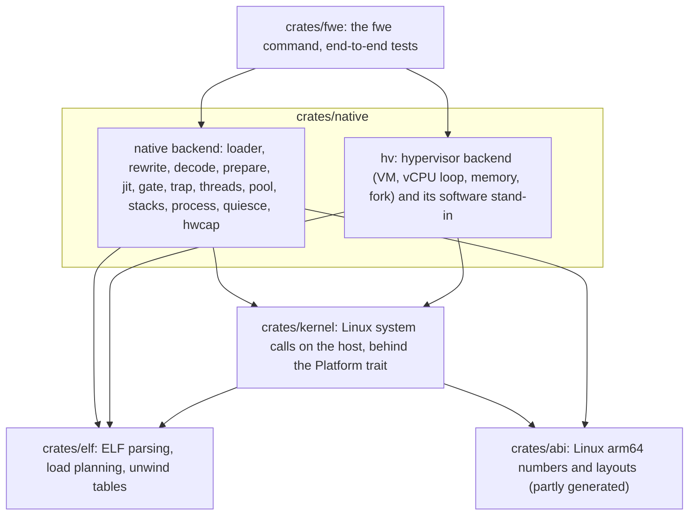
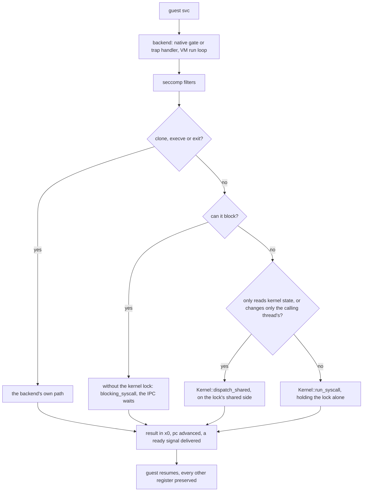
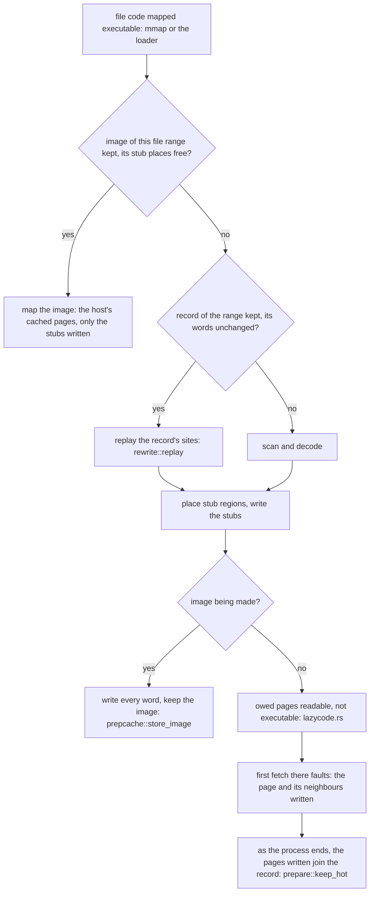
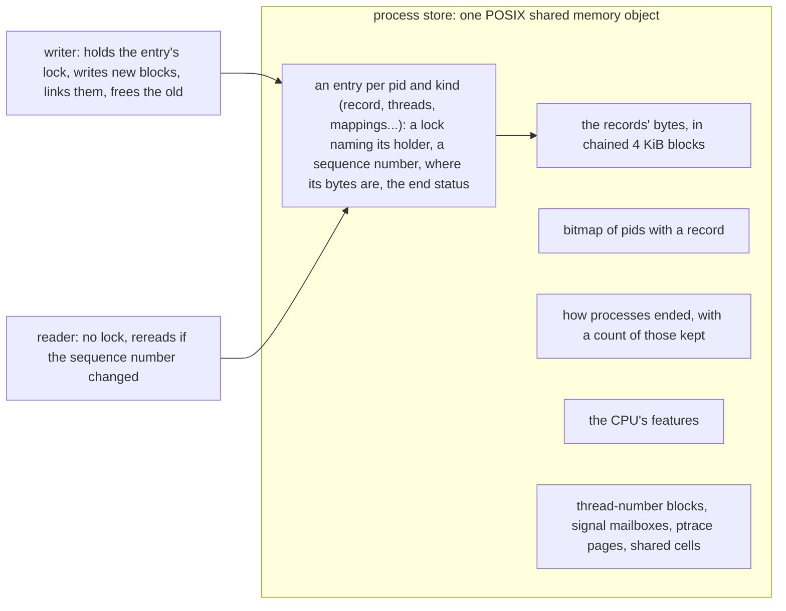

# Architecture

How each part of fwe works: the crates, a system call's path, the native
backend's machinery, the kernel crate area by area, and the
[known limitations](#known-limitations). What each Linux primitive becomes
on macOS, and how host events reach the guest, is in
[linux-on-macos.md](linux-on-macos.md); the hypervisor backend's rules,
testing and operation are in [hypervisor.md](hypervisor.md); code made at
run time is in [jit.md](jit.md).

The key words "MUST", "MUST NOT", "REQUIRED", "SHALL", "SHALL NOT",
"SHOULD", "SHOULD NOT", "RECOMMENDED", "NOT RECOMMENDED", "MAY", and
"OPTIONAL" in this document are to be interpreted as described in BCP 14
[RFC 2119](https://www.rfc-editor.org/rfc/rfc2119) [RFC 8174](https://www.rfc-editor.org/rfc/rfc8174)
when, and only when, they appear in all capitals, as shown here.

## Components

fwe is a Linux kernel written as an ordinary macOS program. Each guest
process is one `fwe` process holding the guest's code and memory, a
*backend* that runs the guest's code and catches its system calls, and
the *kernel crate*, which carries out each call with macOS system calls
and keeps the Linux state macOS has no place for. The native backend runs
guest code inside the fwe process, a few instructions rewritten and code
made at run time translated; the hypervisor backend runs it in a small
VM. Both hand every system call to the same kernel crate.

fwe is a Cargo workspace of five crates:

- **The kernel crate** does not depend on how guest code runs. A backend
  traps a guest system call, calls `Kernel::run_syscall` with the guest's
  registers, and serves the kernel through `fwe_kernel::Platform`:
  preparing code for execution, ending a thread or the process, setting
  how the host treats a signal and, for the VM, carrying out memory calls
  (`Platform::memory`).
- **The backends:** the native one runs guest code in-process; the
  hypervisor one runs the guest at EL0 in a Hypervisor.framework VM.
  Which programs each runs, and why, is in
  [linux-on-macos.md](linux-on-macos.md#which-binaries-run-where-and-why).
- **Hosts:** the kernel, ELF and ABI crates build on any Unix (`libc`
  supplies host values; on Linux most translations are the identity), and
  CI runs their unit tests on Linux too. The backends, and so `fwe`, run
  only on macOS on Apple Silicon.
- **Translation:** Linux values (errno, flags, clock ids, signals,
  rlimits, ioctls) map to host values in `crates/kernel/src/host.rs`.
  `crates/abi` holds the Linux side; `tools/gen-abi.py` generates system
  call numbers and errno values from the UAPI headers. A host errno is a
  `host::HostErrno`, which reaches the guest only through `.linux()` and
  compares only with a host constant (`.is(libc::E…)`), so a host number
  is never returned as Linux's.

### Root filesystems

`fwe --pull IMAGE DIR` (`crates/fwe/src/pull.rs`) fetches an image's
linux/arm64 variant from its registry (`curl`, with an anonymous token
where asked), checks each layer's SHA-256 digest and unpacks the layers in
order with the host's `tar`, applying whiteouts. What an unprivileged
unpacking loses is read from the layers' headers
(`crates/fwe/src/tarlist.rs`) and kept as fwe keeps it for the guest:
owners other than root (`org.fwe.owner`), set-ID bits and modes that deny
the owner (`org.fwe.mode`). Every file gets the user's group, which the
guest sees as root's. On a case-insensitive volume a name that differs
from an earlier one only in case is left out and listed. It writes
`/etc/resolv.conf` with the host's name servers, and `/etc/hosts` where
the image has none, as a container runtime does.

## System calls

A backend catches the guest's `svc` (the native backend's gate or trap
handler, or the VM's run loop), reads the number and arguments from the
guest's registers and hands them to the kernel crate
([linux-on-macos.md](linux-on-macos.md#system-call-entry)). Seccomp
filters see the call first. The call then runs on one of four paths:

**The kernel lock** (`crates/kernel/src/klock.rs`) is a read-write lock
over the process's kernel state. Calls that only read it (the ids,
`uname`, the time, `getrandom`, `fstat`, `newfstatat`, `statx`,
`faccessat`, `readlinkat`, `getcwd`, `lseek`) or change only the calling
thread's state (`rt_sigprocmask`, `sigaltstack`) take its shared side,
several threads at once. Every other call holds it alone, so a descriptor
or mapping and fwe's record of it change together. A reader writes
nothing other readers use: it counts itself in one of 32 counters, each
on its own cache line, and checks a flag only writers set; a writer sets
the flag and waits for the counters to drain. Readers that find the flag
set enter when the writer is done, ahead of the next writer, and a writer
lets the writers already waiting go first. A plain host mutex would go to
whichever thread asks first, often the one that just let it go, and could
keep a thread out of every call while others made one exclusive call
after another.

**Blocking calls run without the lock**, so a waiting thread never stalls
the thread meant to wake it: `futex`, the sleeps, `epoll_pwait`, `ppoll`,
`pselect6`, `rt_sigsuspend`, `rt_sigtimedwait`, `wait4`, `waitid`, the
blocking socket calls, `flock`, `F_SETLKW`/`F_OFD_SETLKW`, `read`/`write`
and their vectored and positioned forms, `sendfile`, `splice`, `tee`,
`vmsplice`, `copy_file_range`, FIFO opens (by any path: another user's
FIFO, from a directory descriptor, in an overlay) and IPC waits. They take
the shared side to finish, unless a signal is to be delivered.

**Signals during a call:** the thread's guest mask is in force on the
host while a call runs, so a signal the guest takes interrupts a blocking
host call; whether the call then runs again or fails with `EINTR` is in
[linux-on-macos.md](linux-on-macos.md#a-host-signal-reaching-a-guest-thread).
`ppoll`, `pselect6` and `epoll_pwait` run under their mask, as
`rt_sigsuspend` does.

**Unimplemented** calls fail with `ENOSYS` and are noted under
`--strace`.

### Guest memory access

A bad pointer argument MUST fail the call with `EFAULT`, not crash fwe.
Every kernel access to guest memory goes through
`crates/kernel/src/uaccess.rs` (typed values, strings, string arrays,
byte ranges). The copies run in a small assembly routine; when one
faults, the backend's fault handler resumes it at a recovery point
(Linux's exception-table scheme) and the call fails with `EFAULT`. A
pointer handed straight to a host call is checked by the host. The macOS
C library functions that work in user space (`clock_gettime`,
`gettimeofday`, `nanosleep`) write to fwe's memory and go through the
checked copies. In the VM, every guest pointer is checked against the
guest's mappings (`set_validator`) and translated (`g2h`, `host_arg`)
([linux-on-macos.md](linux-on-macos.md#pages-and-translation)).

### Tracing

- `--strace` prints each call with its arguments (paths and names as
  strings) and result, and the backend's notes (what was loaded and
  prepared), to standard error. `--strace=failures` prints only failing
  calls and the notes, cheap enough to keep a run's timing.
- `--strace-file=PATH` appends the trace of every process of the run to
  `PATH`, each line naming its process. Alone (without `--strace`) it
  holds fwe's notes only, among them a file's times around each read
  whose access time fwe keeps or sets, and at the close of one opened
  with `O_NOATIME`.
- `FWE_TIMING=1` prints to standard error how long each phase of a start,
  an `execve`, a `fork` (in parent and child) and a `wait` took, and the
  page faults each took (in a fork's child every page touched is one; in
  the parent every page written while the child lives).
- All are passed on across `execve` and `fork`. A failed code preparation
  is noted with its reason (no room for stubs, say), and the guest gets
  `ENOMEM`.

## Native backend

The native backend (`crates/native`) runs guest code in the fwe process:
the loader, the code preparation that rewrites guest instructions, the
system-call gate, the trap handlers that turn host signals into system
calls, signals and faults for the guest, and the machinery for threads
and `fork`.

### Loading

The loader (`crates/native/src/loader.rs`) reserves the image's span,
copies each `PT_LOAD` segment in writable, rewrites its code and sets the
final protections, or maps its kept image
([Kept preparation and images](#kept-preparation-and-images)). A 16 KiB
host page shared by several segments gets the union of their protections.
The layout:

- A PIE goes at `loader::PIE_BASE`, two thirds up the host's 47 bits as
  Linux places one, with free room below it for memory a program wants
  within a branch's reach of its code. Its dynamic linker goes where the
  host picks.
- A static non-PIE program linked below 4 GiB whose link kept its
  relocations is loaded 1 TiB higher (`loader::moved`).
- Stub space is reserved right after the image, within branch range, and
  the break after that (up to 1 GiB, halved while something is in the
  way), before the dynamic linker is placed.
- The main stack is as large as the soft `RLIMIT_STACK` (128 KiB to
  4 GiB), with a guard page, and ends at `loader::STACK_TOP`, near the top
  of the host's 47 bits, above the image as on Linux.

Around the load:

- **Scripts:** `execve` of a script runs its `#!` interpreter
  (`Kernel::exec_target`) in either backend, so no shell is needed; so
  does a script given to fwe itself (`script_target`), its interpreter
  found in the root.
- **The auxiliary vector's ids** and `AT_SECURE` are the guest's, as the
  exec leaves them (`AuxIds`): the kernel computes them before an
  in-place `execve` loads the program, and a re-executed fwe reads them
  from its exec state before its kernel exists, in either backend.
- **Checks before an `execve`:** an in-place `execve` checks the new
  program first (an arm64 ELF that fits the address space, with a dynamic
  linker that exists), so a bad one fails with the caller intact. A
  re-exec checks only that it is an ELF file before the host `execve`, so
  a later failure ends the process.
- **Busy programs** (`crates/kernel/src/textbusy.rs`): a page every fwe
  process maps holds each process's program and a ring of files recently
  opened for writing. Opening a running program's file to write, or
  running a file some process holds open to write (confirmed by the
  host), fails with `ETXTBSY`. A writer whose ring entry later opens
  overwrote goes unseen.
- **`argv[0]`:** a program given by a host path inside the rootfs gets its
  guest path as `argv[0]` and `AT_EXECFN` (Python finds its installation
  so); `--argv0` overrides it.

### Rewriting guest code

Which instructions are rewritten, into what, and which parts of a binary
are scanned is in
[linux-on-macos.md](linux-on-macos.md#which-instructions-get-translated-and-how).
The kernel crate asks for preparation through `Platform::prepare_exec`
whenever a file's code or anonymous memory is mapped executable (`mmap`,
the loader, in `crates/kernel/src/mm.rs`), passing the code ranges it
knows from the file's sections and unwind table. The pieces:

- **Scanning** (`crates/native/src/rewrite.rs`): a range is scanned word
  by word for the sites: each `svc` (made a `brk #0x4c58` trap in place,
  so it stays a system call where no stub can be placed), each
  thread-pointer access and each instruction naming `x18`. A word with no
  18 in any register field (bits 0, 5, 10 and 16), nearly every one, is
  passed over without decoding. The scan builds each site's stub.
- **Decoding** (`crates/native/src/decode.rs`): an instruction naming
  `x18` is decoded so the stub can substitute a scratch register or
  rebuild a PC-relative or branch form; `sp` stays as it is. The forms
  decoded apart (`casp`, writeback onto `sp`, `sp` written from `x18`)
  are found here.
- **Placing stubs** (`crates/native/src/prepare.rs`): sites are grouped so
  one stub region reaches each group (at most a quarter of the branch
  range apart). The region comes from the loader's arena or is reserved
  near the code, mapped with fwe's memory tag (241, "Memory Tag 241" in
  `vmmap`, which the benchmarks count as fwe's). The stubs are written,
  each site pointed at its stub, and the instruction cache invalidated.
- **Keeping stub regions reachable** (`crates/kernel/src/mm.rs`): a
  mapping the guest leaves to the host is asked for at 2 TiB, above the
  program, its break and fwe's own memory, so mappings fill upwards with
  free space past the latest (in the gaps below, a library's code could
  find no stub region in reach); code mapped without a fixed address that
  still finds none is mapped again where there is room. A large mapping
  (64 MiB or more) that can hold code (a file's; an inaccessible one, as a
  library's span is reserved before its code is mapped over it; an
  executable one) is placed with room on both sides, since code longer
  than a branch reaches has sites that reach only room below it. Large
  data (a heap, an arena) fills upwards with the rest: adjacent mappings
  are one host region, and a host fork's cost grows with the regions.
- **Registers kept in TSD slots:** stubs, the gates and translations keep
  the registers they borrow in three scratch slots of the host thread's
  TSD (`scratch_slots` in `crates/native/src/lib.rs`), never below the
  program's `sp`, which is the program's. The first goes through `x18` in
  a group (`rewrite::TSD18`); a fault on an access through `x18` below
  4 GiB, where macOS zeroed it entering its kernel, starts the group
  again from its `mrs` (`x18_restart` in `crates/native/src/trap.rs`,
  `rewrite::restart_at`, `gate::restart` for the gates' first words).
- **Faults and signals in stubs:** a thread stopped in a stub is shown as
  the program is (`prepare::stub_to_guest`, `rewrite::to_guest`). The
  stub's slot (each stub has one of `STUB_WORDS` words from its region's
  start) gives the site by its branch back. Before the stub's instruction
  (`rewrite::main_of`) it is at its site, each register the stub kept and
  has not taken back read from its slot (`rewrite::undo`); after it, the
  rest of the stub is carried out on its registers (`rewrite::step`) and
  it is past it. Translations do the same with the words they hold.
- **The guest's `x18`:** the trap handler reads it into `Regs` and writes
  it back on return. Correctness never depends on the host preserving
  `x18`. macOS 26.4's custom-`x18` ABI is only probed
  (`fwe --host-info`), not used: switching it at every trap costs two
  host calls, one of which could hang.

### Code made executable at run time

Code made executable after it was mapped (`mprotect` adding `PROT_EXEC`,
or mapped writable and executable) is not prepared where the backend
translates such code (`Platform::translates_jit`, the native one): it is
handed over (`Platform::jit_code`) and mapped on the host readable and
never executable. `jit_changed` tells the backend when it is unmapped,
mapped over, moved or given other protections, and `jit_mapped` of every
new mapping or protection change. Code that was executable and has not
been written since, made executable again (glibc's dynamic linker adds
`PROT_BTI` to every object built for it), runs as prepared.

`crates/native/src/jit.rs` runs such code by translation into fwe's code
cache, never changing the program's memory or letting the host execute
it: a fetch from it faults and the block is translated (`jit::enter`);
ways out go through the exit gate (`gate::fwe_exit_gate`) and are linked;
indirect branches look their targets up in a table at 2^45; the
program's `ic ivau` drops the translations of the line it flushes whose
words changed (`jit::flushed`). Why, how each part works, what it costs
and how other translators compare are in [jit.md](jit.md).

### Kept preparation and images

Preparation is kept per file, not redone at each start:

- **Records** (`crates/kernel/src/prepcache.rs`), in fwe's private
  directory, by a file's identity (device, inode, size, and modification
  and change times): its sections' and unwind table's code ranges and,
  for each mapped code range of 64 KiB or more, the words the scan
  rewrote or found sites at, with their old values. A later mapping of
  that range replays them (`rewrite::replay`), touching only the pages
  that hold them, after checking each word is unchanged (scanning again
  if not). The loader keeps the same for the program and its dynamic
  linker, with their stub space size.
- **Images:** a mapping of a file's code (a library a dynamic linker
  maps), and the program and dynamic linker fwe's loader loads, are also
  kept as their pages as preparation left them, in a file beside the
  record (`prepcache::store_image`), with where their stub regions were
  (as offsets) and the sites each serves. A later mapping of the same
  range of the same file maps the image in its place (`Platform::map_image`
  in `crates/native/src/prepare.rs`; the loader's `map_load_image`, its
  stubs back in the arena), writable, then given its protections (macOS
  maps no file executable at once). Its pages are the host's cached ones,
  shared by every process and never copied; only the stubs are written
  for the process (they name its gate and slots). Where a stub region's
  place is taken, the mapping is prepared from the record instead. The
  process that makes an image writes every word at once.
- **Lazy writes** (`crates/kernel/src/lazycode.rs`): for code with no
  image being made, the stubs are written as it is mapped, but the words
  its pages owe (branches to stubs, system calls made traps) are kept
  aside and those pages mapped readable, not executable. The first
  instruction fetch there faults (on the instruction's own page); the
  handler writes the page (each word only if unchanged), with up to eight
  owed pages each way of the same protections, and gives them the guest's
  protections, under a lock (another thread that faulted meanwhile finds
  the page written). A page made writable, or moved by `mremap`, has its
  words written first. A large library is mostly never run: clang's
  `libLLVM` has sites on 2,081 of its 5,927 code pages, most never reached
  by a compile. The pages a run wrote are added to the record as the
  process ends (`prepare::keep_hot`), and the next start writes those as
  it prepares the range.
- **Collection:** `shared::collect` removes records and images older
  than 30 days, and an image once its file is gone or changed (found by
  device and inode through `/.vol`).

### Faults

Natively, every trap guest code takes arrives as a host signal. The fault
handlers (`on_fault` and `on_sigtrap` in `crates/native/src/trap.rs`) tell
apart fwe's own traps (system calls, emulated instructions, lazy writes,
translation, the first write to a page of a nameless file's private
mapping (`Kernel::view_fault`) or below a `MAP_GROWSDOWN` mapping
(`Kernel::stack_fault`), recovered checked copies), faults for the guest
(rewound to their site from a stub or translation) and fatal faults in
fwe's own code. Each case, and what the guest sees, is in
[linux-on-macos.md](linux-on-macos.md#faults-in-guest-code).

A handler is entered with every signal blocked. For a system call it
unblocks the guest's signals while the call runs, so a wait can be
interrupted, and blocks them again before returning; the return restores
the guest's mask. A call that neither waits nor touches guest memory
(`getpid`, `brk`, `mmap` and the like, outside `--strace`) runs with them
blocked, two host calls fewer; a signal arriving meanwhile is delivered
as the handler returns.

### The system-call gate

A rewritten `svc #0` calls the gate (`crates/native/src/gate.rs`) through
a stub of its own; the trap handles only what the gate does not finish
([linux-on-macos.md](linux-on-macos.md#system-calls-svc-calls-fwes-gate)
shows the stub).

- **State:** each guest thread has a block (the guest's `Regs`, the
  stub's return address, an `active` flag, a count of signals recorded
  for it, and its `quiesce` slot, marked as the call leaves and re-enters
  guest code) and a 1 MiB gate stack, mapped as it first enters guest
  code (`trap::prepare_guest_entry`). A TSD slot points to the block. A
  forked child keeps its copy.
- **Thread pool** (`crates/native/src/pool.rs`): a thread that ends
  through the gate leaves its host thread waiting, every host signal
  blocked, for the next `clone` (up to sixteen wait). The new thread runs
  on it, with its block, stacks and every per-thread state of the kernel
  and backend reset as for a new host thread (`fwe_kernel::thread_reused`).
  A host thread that ends returns its gate and signal stacks
  (`crates/native/src/stacks.rs`); a new one takes a pair whose thread has
  gone (its Mach thread port is dead) before mapping new ones.
- **The mask:** guest code runs under the host mask its guest mask calls
  for, and so does the call. A call that changes the guest's mask sets the
  host thread's to match before the gate returns.
- **Plain calls only:** the Rust half (`trap::fwe_gate_call`) runs a call
  through `Kernel::run_syscall` or `fwe_kernel::blocking_syscall`, as the
  trap does. It leaves to the trap a call a tracer stops at
  (`PTRACE_SYSCALL`), any call once a seccomp filter is set, and the calls
  the trap runs its own way (`execve`, a `clone`/`clone3` of a process or
  of a traced thread, `wait4`, `waitid`, `pidfd_getfd`, the IPC waits,
  `rt_sigtimedwait`). An untraced thread's `clone`/`clone3` makes the
  thread from the block's registers, and its `exit` ends it with every
  host signal blocked. The gate returns straight to the guest only when
  the call changed nothing but `x0` and the mask and nothing is to be
  delivered; otherwise it takes the trap (`brk #0x4c5a`), whose handler
  installs the block's state and delivers what is pending.
- **Signals:** a host signal is taken at once only where the thread is in
  guest code: not in the gate's instructions, nor while the block is
  active. Elsewhere it is recorded and counted; the call looks for one to
  deliver as it ends, and the gate's way out compares the count with the
  one the call saw. A signal landing on the way out restarts it
  (`gate::rewind`), so it is delivered there, not at the thread's next
  call.

## Memory bookkeeping

Both backends carry out the guest's memory calls (natively with host
calls, in the VM on its page tables;
[linux-on-macos.md](linux-on-macos.md#memory)). The kernel crate keeps
the records Linux would:

- **Ownership:** every guest range (images, stubs, stack, break,
  mappings) is recorded (`fwe_kernel::mm::track`) and removed when
  unmapped; fwe's own memory never is, so `execve` discards exactly the
  old program.
- **Linux's view** (`crates/kernel/src/maps.rs`): each successful memory
  call, with the guest's protections and sharing and the file and offset
  mapped. The loaders add the program, its dynamic linker (file-backed as
  far as the file has contents, zeroed beyond) and the stack, and the
  break is the heap. Memory fwe maps that the guest did not ask for (code
  stubs, a guard page) is listed as anonymous with the host's
  protections, so a program looking for free space does not pick it.
  `prctl`'s anonymous memory names are kept with each mapping
  (`[anon:name]` in `maps`).
- **The latest mapping waits** beside both records, outside their locks
  (`fwe_kernel::deferred`), until anything else changes or reads them. A
  buffer the host placed (not `MAP_FIXED`), mapped and unmapped at once,
  with no range marked by `madvise`, `MAP_GROWSDOWN` or a file view, so
  takes neither lock and changes neither record.
- **Other processes:** each process publishes its record, with its start
  time, in an entry of its own in the
  [process store](#process-records-and-the-process-store) before its next
  system call that is not a memory call, and before a `fork`, so a run of
  mapping calls publishes once; it removes it as it ends. Another
  process's `/proc/<pid>/maps` and `smaps` read it (an entry left by an
  earlier process of the pid is ignored), with resident pages from the
  host (`proc_pidinfo`). `PROCMAP_QUERY` answers for any of them, with the
  mapped file's GNU build ID.
- **`vm.max_map_count`** (65530 by default): an `mmap`, or an `munmap`
  that splits a mapping, past it fails with `ENOMEM`.
- **Locking** (`mlock`, `mlock2`, `mlockall`, `MAP_LOCKED`): marked in the
  record for `smaps`, `VmLck` and the next lock's `RLIMIT_MEMLOCK` check;
  the calls' behaviour is in
  [linux-on-macos.md](linux-on-macos.md#memory-calls).
- **Sealing** (`mseal`): a flag on the mapping, carried across `fork`;
  `munmap`, `mprotect`, `mremap`, a `MAP_FIXED` `mmap` over it and a
  discarding `madvise` of read-only anonymous memory fail with `EPERM`.
- **Nameless file views:** natively a private mapping of a file with no
  name (a memfd, or a file unlinked once opened) is mapped shared and not
  writable on the host (`file_views` in `crates/kernel/src/mm.rs`), and a
  page becomes a private copy of itself at its first write: the guest's
  (`Kernel::view_fault`), or the host's for the guest, which
  `mm::host_writes` runs first (as it lets the translator drop
  translations of a page it is about to write).

## Processes

The fork, vfork, execve and wait models are drawn in
[linux-on-macos.md](linux-on-macos.md#processes). This section covers what
fwe does to make and replace processes, and the state it keeps for each.

### Fork

A native fork (sequence in [linux-on-macos.md](linux-on-macos.md#fork))
is a host `fork` with the kernel's locks held:

- **Locks:** `fwe_kernel::fork_locked` holds the kernel lock for writing
  and every registry lock across the host `fork`, with the locks threads
  take outside the kernel lock (epoll interest lists, pipe states, the
  user namespace...; `crates/kernel/src/forklock.rs`, taken all at once or
  not at all, so their order never matters). The child, which has only the
  forking thread, so inherits none held by a thread it lacks, and it
  clears the kernel lock's reader counters. `RwLock`s among them are
  replaced in the child rather than unlocked, since on macOS unlocking one
  walks a queue of waiting threads the child lacks: every `RwLock` is a
  `forklock::ForkRwLock`, and `clippy.toml` refuses `std::sync::RwLock`
  elsewhere. A single-threaded process takes none of them: none can be
  held, and taking and letting go of them would touch, and copy in both
  processes, the pages they are on.
- **Other threads:** those running guest code are suspended
  (`crates/native/src/quiesce.rs`); one in fwe's code (which might hold
  `malloc`'s lock) runs on and waits before re-entering guest code until
  the fork is done.
- **The child** goes on only once the parent has unblocked signals, so a
  signal it sends its parent keeps its sender. It enters the guest
  directly with `x0` = 0 rather than through the inherited trap frame,
  whose signal mask macOS would not restore. Every signal but `SIGSEGV`,
  `SIGBUS` and `SIGSYS` is held across the host `fork`. One of those sent
  to the child before it is set up (it might not know its pid yet, and it
  forgets its parent's pending signals) is kept and posted once it is
  (`trap::post_early`).
- **Cost:** a fork costs the pages each process then touches, each a
  fault in the child. The code a child runs as it starts and ends (the
  fork itself, its records, `init_main`, the system calls it makes, its
  end) is laid out together, in a section of its own (`__TEXT,__fwe_fork`,
  by `link_section` on each function). The host's fork costs more for
  every page of `malloc`'s regions written, and for a high descriptor
  ([Descriptors](#descriptors)): fwe maps its blocks of 32 KiB and more (a
  program's bytes, read into memory sized for them) on their own
  (`crates/fwe/src/alloc.rs`), which a fork leaves to copy as written.
- **A process with a VM** refuses the native fork (`ENOSYS`). A VM fork
  carries its state in a snapshot (`Kernel::save_for_fork`,
  `crates/kernel/src/snapshot.rs`): signal dispositions, the forking
  thread's mask and alternate stack, the break, filesystem view,
  credentials, descriptor limits, every descriptor registry and the
  translated guest ranges, then the backend's registers, thread pointer,
  PAC keys, mapping records and slab use. The format is private to one fwe
  binary.

A re-exec carries its state the same way (`Kernel::exec_state`); what
crosses is listed under
[linux-on-macos.md](linux-on-macos.md#execve). Of the descriptor
registries it carries only the descriptors without close-on-exec, which
the host's `execve` keeps; fwe's own descriptors behind them (an
eventfd's pipe and counter, a signalfd's pipe end) are cleared of the
flag for it and marked again in the new program, and the kqueues it
closes (epoll sets, timerfds, process descriptors) are made again at
their numbers, an epoll set's duplicates too.

### Process records and the process store

Each process has a record (`crates/kernel/src/procreg.rs`), one per host
pid, with the start time (so a record never outlives its process into
another with the same pid), cgroup, namespaces, name, command line,
program, ancestors, subreaper flag, nice value, scheduling policy, CPU
affinity, limits and `oom_score_adj`. Records live in the process store
(`crates/kernel/src/procstore.rs`), memory every fwe process of the user
maps: a POSIX shared memory object, since a file's dirty pages would be
written back to disk as each process holding them ends.

An entry's lock names its holder's pid and is taken over from one that
died holding it; its sequence number is odd while the record changes. A
pid's entries of each kind sit side by side. The table of how processes
ended counts those kept, so most looks (a parent reaping its child) read
no table. The CPU's features are asked of the host by the first process
after boot. The thread-number blocks, mailboxes, ptrace pages and cells
are described under [Threads and futexes](#threads-and-futexes),
[Signals](#signals) and [ptrace](#ptrace).

**A start** writes its record once. A native fork's parent makes the
child's whole record before the fork (`procreg::Prepared`, with the
child's view of its filesystem and limits), and the child writes it with
its start time (`procreg::own_prepared`) rather than make it, which would
fault in every page of the code and memory the making needs. Where
another process changed the child's record meanwhile, the child makes its
own from that one. The parent marks the record still to write before its
`fork` returns; until then every listing has it, and a look at it waits.
A reaper's watcher, which the host does not tell of the orphan of a
parent that ended at once, does not wait: while a listed record is still
to be written it looks again every 5 ms, and follows the orphan once its
record names the reaper an ancestor.

### Per-process state

- **Process descriptors** (`crates/kernel/src/pidfd.rs`): a kqueue
  watching the process's exit, marked with what it names
  ([linux-on-macos.md](linux-on-macos.md#waiting-and-events)).
  `pidfd_send_signal` is `kill`, `tgkill` or `rt_sigqueueinfo` of that
  process. `PIDFD_GET_INFO` gives its pid, parent and ids, and once this
  process has reaped it, its wait status; the `PIDFD_GET_*_NAMESPACE`
  requests and `setns` use its namespaces as `/proc/<pid>/ns` has them.
  `pidfd_getfd` queues a request in the target's mailbox and wakes it; its
  wake handler sends the descriptor as `SCM_RIGHTS` to a datagram socket
  the caller bound beside the process store (or, where that path is too
  long for a socket address, in `/tmp/fwe-<uid>-fd`, which only the user
  can use).
- **Priorities, policies and limits** (`crates/kernel/src/sched.rs`,
  `rlimits.rs`) are kept in the record with Linux's checks; how each maps
  to the host is in
  [linux-on-macos.md](linux-on-macos.md#time-scheduling-and-limits).
  `RLIMIT_NPROC` counts the tasks (threads) of the user's fwe processes:
  each process keeps its real user and thread count in a word of the
  process store, so a check reads one word per process, and only a count
  at the limit looks at which of them are alive.
- **Core dumps** (`crates/kernel/src/coredump.rs`): a signal whose default
  dumps core leaves an ELF core (the thread's registers, the process, and
  the mappings Linux's default `coredump_filter` dumps, less memory given
  `MADV_DONTDUMP`), named by `kernel.core_pattern` and `core_uses_pid` and
  cut short at `RLIMIT_CORE`. The host's own core limit is 0.
- **End status:** a process a signal ends leaves its Linux wait status in
  its entry (`procreg::ending`), so its parent reads the signal and core
  bit Linux would report, even for a signal the host lacks.
- **POSIX timers** (`crates/kernel/src/posixtimer.rs`): a thread of fwe's
  per process ([linux-on-macos.md](linux-on-macos.md#time-calls)).
- **Orphans** ([linux-on-macos.md](linux-on-macos.md#orphans-and-reapers)):
  a reaper's `SIGCHLD` for an adopted process is raised inside the reaper
  (pending with a child's `siginfo`; disposition, mask and `SA_NOCLDSTOP`
  act on it), not sent through the host, where a held one would absorb
  it. It replaces the former parent's while that is pending, and absorbs
  one after it, as Linux sends them. An orphan keeps the adopter it had
  when its parent ended.

## Threads and futexes

A guest thread is a host thread running guest code, scheduled by the
host; fwe adds Linux's thread identity and futexes
([linux-on-macos.md](linux-on-macos.md#threads-clone-and-futexes)).
Guest threads run at the host's user-interactive quality of service, so a
busy host wakes them on time, as Linux wakes a sleeping task. A new
thread starts with its creator's thread pointer (without
`CLONE_SETTLS`), name, signal mask and floating-point control and status
registers.

**Thread ids:** the main thread's is the pid. Every other thread takes a
number from a counter all fwe processes share, numbered from 100000 (past
every macOS pid, so a thread number never names another process) and
wrapping below 4194304: its `Tid`, as Linux's initial pid namespace
numbers it, which names it to every other process. Outside a pid
namespace of fwe's it is also its thread id; in one, its thread id is a
number of the namespace, whose record keeps the `Tid` beside it, so a
caller's number for a thread is translated to the `Tid` and back. `Tid`s
are taken in blocks of 64, each block's process recorded in the process
store. A process that has had more than its main thread publishes its
threads' `Tid`s and robust-list heads in entries of its own there, which
`/proc/<pid>/task`, `cgroup.threads` and `get_robust_list` read in the
reader's numbers.

**Futexes** (`crates/kernel/src/futex.rs`) wait outside the kernel lock.
A wake takes waiters oldest first and marks each woken, so it reports
exactly how many it woke. `FUTEX_WAIT_BITSET`/`WAKE_BITSET` match by
bits; `FUTEX_CMP_REQUEUE` moves waiters; `FUTEX_WAKE_OP` changes its
second word with a compare-and-swap loop and wakes that word's waiters
too when the old value meets its comparison. `futex_waitv` waits on up
to 128 at once, private ones in the process's queues and shared ones in
the shared table, and returns the index of the one woken. Waiters check
every 20 ms for a signal they would take, and return `EINTR` for it.

**Priority-inheritance futexes** (`FUTEX_LOCK_PI`, `LOCK_PI2`,
`TRYLOCK_PI`, `UNLOCK_PI`): the word holds its owner's thread id. A lock
takes a word with no owner (`FUTEX_OWNER_DIED` kept), and otherwise marks
it `FUTEX_WAITERS` and waits in the same queues and table, with its
thread id and no bits, so no wake takes it. An unlock hands the lock to
the oldest waiter, writing its thread id with `FUTEX_WAITERS`, as Linux
does; a shared slot is held while the word changes. A waiter whose owner
has gone takes the lock (Linux's `exit_pi_state_list`); a lock a signal
interrupts runs again after the handler, `SA_RESTART` or not
(`signal::restarts_always`). The host schedules no thread by its
priority for the guest, so no owner is lent one.

**Shared futexes** (`crates/kernel/src/sharedfutex.rs`): waiters are in
a slot table every fwe process maps, keyed by Mach memory object and
offset for shared memory and by process and address for private memory.
A slot carries a generation, so a wake never claims one freed and reused;
a dead owner's slot is freed by the next process that looks. A waiter
takes the first free slot, and the header keeps the highest slot ever
taken, which bounds a wake's search.

**Robust futex lists** (`set_robust_list`): as a thread ends, and for
every thread as its process ends or runs another program, each word on
its list it still owns is marked `FUTEX_OWNER_DIED` (by a
compare-and-swap that survives a fault in guest memory) and a waiter
woken, as Linux's `exit_robust_list` does. Each thread's list is in its
registry entry for the process's other threads, and in the process store
for other processes' `get_robust_list` (by host pid for a main thread, by
number for another), cleared as the process starts and ends.

## Signals

The Linux side (numbers, dispositions, frames, sending) is in
[linux-on-macos.md](linux-on-macos.md#signals), and how a host signal
reaches the guest in
[linux-on-macos.md](linux-on-macos.md#host-signals). The machinery is in
the kernel crate (`crates/kernel/src/signal.rs`, `thread.rs`,
`signote.rs`), fed by the backends' handlers.

### Pending signals and the host

- **Pending sets** are atomics in host thread-locals (the host handler
  records into them), registered by tid so another thread can target
  one. Each signal's slot in a set is claimed by a compare-and-swap of its
  state (empty, written, full or being taken), so posts and takes from
  many threads and handlers at once (every thread takes from the
  process's set) take each signal once, with the `siginfo` it was posted
  with. A take blocks its thread's host signals while it holds a slot, so
  a post that finds the slot being taken waits only on another running
  thread. A post that finds a standard signal pending, or being written,
  is one with it. A real-time signal already pending is queued behind it,
  with its own `siginfo`, in a lock-free pool the process's sets share
  (4096 entries), oldest first.
- **`RLIMIT_SIGPENDING`** bounds a count of the signals pending in the
  process: each number pending and each queued, with one for each POSIX
  timer, as Linux allocates its signal with it. Past it, a real-time
  signal sent with a code other than `SI_USER` (`sigqueue`, `tgkill`) and
  `timer_create` fail with `EAGAIN`, and a `kill`'s is merged into the one
  pending. One another process queued in the mailbox is left there while
  the process is at its limit, and taken once a pending signal is.
- **fwe's handlers** start and end with every signal blocked, so the
  backend always knows whether it interrupted guest code or its own. Each
  thread otherwise runs under a host mask that blocks only the
  guest-blocked signals the host acts on itself. A handler that
  interrupted fwe only records the signal. That code might be in the host
  allocator, so nothing there allocates or frees (`host::NoAllocation`
  marks it; a debug build's allocator ends the process if something does,
  so the tests find it), and calls that might are split from those that
  cannot (`procstore::mailbox` finds a mailbox, `mailbox_or_make` can make
  one; `signote::continuing_own` beside `continuing`).
- **Host masks put back by scope:** a change of a thread's host mask for
  a scope is a `host::MaskGuard`, which puts the mask back as it is
  dropped, on every path out (`sigsuspend`'s and `sigtimedwait`'s checks,
  a call's temporary mask, a fork, a stop); a change for good is one of
  `host.rs`'s named calls. `clippy.toml` refuses `libc::pthread_sigmask`
  and `libc::sigprocmask` anywhere else.
- **Guards:** fwe's own stacks (each thread's signal stack, and its gate's
  stack below the gate's block) have an inaccessible `host::GUARD` below
  them, and the shared memory of every fwe process (the process store,
  the file store's arenas) one on each side (`host::map_stack`,
  `host::map_shared_guarded`). A stack that overflows (a handler nested
  without bound, a guest thread's stack made with no guard of its own)
  faults there and its process ends, instead of writing over the mapping
  beside it, which can be memory every fwe process shares.
- **Parked signals:** a process-wide signal the host holds can sit on a
  thread running fwe's handlers. A native thread entering a system call
  with such a signal parked on it, one the guest catches, takes it off the
  host and records it against the process, and the others are woken. The
  look is a host call: a call that neither waits nor reads signal state
  (ids, clocks, futex wakes) looks at most every 100 µs, every other call
  each time.
- **Wake pipes:** every host signal a thread takes writes a byte to that
  thread's pipe (`thread::poke_wait`), and the sleeps, `poll`, `select`
  and the `epoll` waits watch it beside the guest's descriptors
  (`thread::wait_ready_ns`; `wait_ready_urgent_ns` watches TCP sockets for
  urgent data on the thread's kqueue too, for `poll` and `select`), so a
  signal landing between the check for pending ones and the host wait
  still ends the wait. Their time is kept by a kqueue timer of the
  thread's with `NOTE_CRITICAL`, which the host does not coalesce. A futex
  wait close to its deadline sleeps the same way, a wake writing to its
  pipe.
- **Before a re-exec,** the whole guest mask goes on the host, and pending
  signals the guest blocks are re-raised on the thread, which the host
  `execve` keeps.
- **Frames** are built as Linux builds them
  ([linux-on-macos.md](linux-on-macos.md#dispositions-masks-and-frames)):
  a handler already on the alternate stack continues from its `sp`; the
  `rt_sigreturn` trampoline is mapped by the backend at startup.

### Between processes

- **One process per host signal:** a host process is a `HostPid`
  (`crates/kernel/src/ids.rs`), a pid above 0, and the host's `kill` is
  reached only through `host.rs` with one (`kill_process` for fwe's own
  ends, `signal_named` for the guest's, `probe` to ask whether a process
  is there), so no number fwe holds reaches a process group or every
  process on the host. A guest's group or `kill(-1)` is sent to each
  member. `clippy.toml` refuses `libc::kill` anywhere else.
- **The wake signal:** a signal recorded without a host signal
  (real-time, emulated faults, caught `tgkill`) wakes its target thread,
  or every thread, with `SIGEMT`. Another process is sent it only if it is
  a live fwe process, one with a record (`host::kill` checks every send):
  the host's default action for `SIGEMT` would end any other.
- **Mailboxes:** a pool of 4096 in the process store, one given to a pid
  by its first sender (most processes are sent nothing) and taken back
  with its record, or when the pool is full and its process is gone.
  Signals the host lacks are queued in the target's mailbox (up to 64,
  with sender, code and value) and the target woken with `SIGEMT`; its
  wake handler moves them onto its pending sets. One for a thread of
  another process (`tgkill`, ptrace's attach) is queued with the thread's
  `Tid` and posted to that thread through a table of the threads' pending
  sets, by `Tid`, which the handler reads without a lock.
- **Sender notes:** a sender of a host signal writes a note in one of
  eight slots per signal in the target's mailbox (pid, uid, time, and for
  `SI_MESGQ` the code and value), a free one or else the oldest; the
  target's handler takes the note of the sender the host names, or the
  oldest. Each slot and queue entry is claimed and taken by a
  compare-and-swap of a word holding a generation (for the queue, its
  ordering ticket) and the sender, so the handler takes notes without a
  lock, whatever its thread was doing.

### Stops

Stops (`SIGSTOP`, the default action of `SIGTSTP`, `SIGTTIN`, `SIGTTOU`,
`cgroup.freeze`) take no lock with them:

- A process stops only where it takes the signal, at the end of a call or
  in its handler, and only once none of its threads holds a lock of
  shared memory (`procstore::Holding`: the process store's records and
  areas, the file store's arenas, the shared records, the seqpacket
  locks), a thread that holds none taking none meanwhile
  (`procstore::stop_holding_nothing`). `SIGSTOP` between fwe's processes
  goes through the mailbox for this, dated by the target's count of
  `SIGCONT`s, so a stop sent before the latest `SIGCONT` is not taken.
- The stop is fwe's (`signal::job_stop`): the stopping thread wakes the
  others, which then wait for the kernel lock it keeps (a thread in the
  program's code takes its wake under that lock, one in a host call ends
  the call to). It notes the stop in its mailbox (its signal, and a count
  of stops and of continues, which a `wait` takes each once), tells its
  parent with `SIGCHLD` through the parent's mailbox, and sleeps on its
  count of `SIGCONT`s, which every continue moves on and wakes. A
  `SIGKILL` ends it there as anywhere.
- A parent's `wait` for stops or continues (`WUNTRACED`, `WSTOPPED`,
  `WCONTINUED`) looks at its children's mailboxes beside what the host
  reports, woken by that `SIGCHLD` (`reaper::take_own_change`); an
  adopter's watcher sees an adopted one's.
- Only a process whose parent is a living process that is not fwe's (the
  first of a run, under a shell that needs to see it stop) stops on the
  host, which then ends the stop at the host's `SIGCONT` alone. macOS's
  own stop can leave a process suspended though shown as running when a
  `SIGCONT` comes as it stops (macOS sets the process stopped before it
  suspends it).
- The host's `SIGCONT` is caught: one from a process that is not fwe's (a
  shell's `fg`, a host `kill -CONT`) is the guest's `SIGCONT`, and ends a
  stop of fwe's too; fwe's own processes send the guest's through the
  mailbox (`signal::host_continued`).

### ptrace

`crates/kernel/src/ptrace.rs`. macOS lets no process read another's
memory or threads, so a tracee does its tracer's work itself.

**The mailbox** is a page per traced thread in the process store, named
by the host pid for a main thread and the `Tid` for another (so tracers
in pid namespaces whose threads have the same numbers never share one),
kept while its tracer lives. It names the thread's process and holds the
stop's wait status, the general and FP registers, the `siginfo`, the
options, and one request at a time with its result, handed over through
shared host address waits. A tracee detached or ended marks it so, and
its tracer frees it as it next looks, so no tracer's request lands in a
page made again for another tracee.

**Stops:** a signal about to be delivered (every one but `SIGKILL`; the
host catches even ignored ones while traced, and `SIGSTOP` sent to a
tracee becomes fwe's), a fault (a breakpoint's `SIGTRAP`), the program
after `execve` (or the exec event), and each system call's entry and exit
under `PTRACE_SYSCALL`. The tracee writes its state, tells its tracer
(the page's generation, `SIGCHLD` and the wake signal) and serves
requests until told to go on, with the signal the tracer chose and the
registers as the tracer left them. A stop is made under the kernel lock
and served without it (`ptrace::Stop`, `KernelLock::serve_stop`), as
Linux stops a task only on its way back to user mode: the process's other
threads go on, and each stops for its tracer in its turn (a debugger
stopping every thread, a crash reporter attaching to each). The exit
event's stop is the exception, served holding the lock as the process
ends.

**The tracer** reads and writes registers, `siginfo`, options and the
signal mask in the mailbox (`PTRACE_GET_SYSCALL_INFO` too, from the
registers and whether the stop is an entry or exit), and asks the tracee
for memory: `PEEK`/`POKE`, and up to 2 KiB at a time for another
process's `/proc/<pid>/mem` and `process_vm_readv`/`writev` of a stopped
tracee, written as `/proc/self/mem` writes (code too, its instructions
fetched afresh, in the VM as well). Its `wait4` and `waitid` report a
tracee's stop from the mailbox before the host's children, looking again
as tracees stop, and the end of a tracee that is not its child, which the
tracee leaves in its mailbox. A wait for a process group matches a traced
thread by its process's group; a wait for a thread looks only at its
mailbox (it is no host child).

- **Events:** a fork, vfork or clone a tracer follows
  (`PTRACE_O_TRACEFORK` and the like) stops the parent with the event and
  starts the child traced, stopped by `SIGSTOP`, with its parent's options
  (in the VM through the fork's snapshot). A followed thread
  (`PTRACE_O_TRACECLONE`) starts traced the same way, stops on its own
  while the process's other threads go on, and its end is reported by its
  tid. The exit event comes before a process ends, and
  `PTRACE_O_EXITKILL` ends a tracer's tracees with it.
- **Seizing** (`PTRACE_SEIZE`) marks the mailbox seized and nudges the
  tracee with a `SIGSTOP` of fwe's own queue and code, which no guest
  sees, ending a wait it is in (the call restarts), so it starts being
  traced without stopping. `PTRACE_INTERRUPT` sets a word and nudges it
  the same way: it stops with `PTRACE_EVENT_STOP` and `SIGTRAP`, at once
  or as soon as its current stop ends. A tracee's group-stop is its
  tracer's: an event stop with the stop signal for a seized tracee, the
  signal's stop for an attached one, ended as the tracer restarts it.
  Under `PTRACE_LISTEN` a seized one stays stopped until `SIGCONT` comes
  (its count of continues moves on, or one is pending) or the tracer
  interrupts it, then reports `PTRACE_EVENT_STOP` with `SIGTRAP`. A
  process or thread a seized tracee starts begins with that stop instead
  of `SIGSTOP`, and an `execve` stops it only for the exec event. A
  pending guest `SIGKILL` ends any stop.
- **Single-stepping** plants fwe's breakpoint (`brk #0x4c59`) wherever the
  instruction can go next (a branch's target and the next instruction, a
  register's address), stops when one is hit, and puts the instructions
  back.
- **Attaching** makes the target's mailbox and sends it `SIGSTOP` as
  fwe's; the target starts being traced as it takes it. Only a process of
  fwe's can be traced.
- **A tracer that ends** leaves its tracees detached: a stop its `wait`
  took goes on with no signal (the wait took it), one it did not take
  with the signal it was for, as on Linux.
- **Access** (`Kernel::may_access`, Linux's `__ptrace_may_access`), to
  attach (`ptrace`, `/proc/<pid>/mem`, `process_vm_readv`/`writev`,
  `pidfd_getfd`) or read (`get_robust_list`, a pidfd's namespaces), takes
  the target's real, effective and saved ids all equal to the caller's
  (its file-system ids for a `/proc` file), the target dumpable, and its
  permitted capabilities within the caller's, each else `CAP_SYS_PTRACE`
  in the target's user namespace; to attach, Yama's
  `kernel.yama.ptrace_scope` too (1, the default: a descendant, or the
  process the target named with `PR_SET_PTRACER`; 2: `CAP_SYS_PTRACE`; 3:
  none); and the target in the caller's Landlock domain or one nested in
  it.
- **What others check of a process** is in its record
  (`procreg::Security`: capabilities, dumpable, named tracer,
  `no_new_privs`, seccomp), written when one of the calls that change it
  changed it. Dumpable is set again by `execve` (to 1, or to
  `fs.suid_dumpable` after an exec that changed the ids, gained
  capabilities or ran a program its caller cannot read) and lost to
  `fs.suid_dumpable` by a change of effective or file-system ids. An
  undumpable process's `/proc/<pid>` files are root's of its user
  namespace. `/proc/<pid>/status` shows `TracerPid` from the mailbox.

## Files

A file operation starts with a guest path or descriptor and ends with a
host call on a host descriptor. In between, fwe resolves the path in the
guest's root and mount table, keeps its own descriptors out of the
guest's reach, and translates what comes back. The per-call mapping is in
[linux-on-macos.md](linux-on-macos.md#file-calls).

### Paths and mounts

- **The root** is a host directory (`fwe --root DIR`, else the host's
  `/`), with its mount namespace's table on it: by default the rootfs at
  `/`, and `/proc`, `/sys`, `/sys/fs/cgroup`, `/dev/pts`, `/dev/mqueue`
  and `/dev/shm`.
- **Resolution** (`crates/kernel/src/fs.rs`) goes component by component:
  symlinks followed by fwe (absolute targets re-rooted), mounts entered,
  `..` clamped at the process's root. `*at` calls start from where their
  descriptor was opened. A trailing slash names a directory, as on Linux:
  a lookup follows a final link and finds anything else `ENOTDIR`; a call
  that removes or renames the name needs a directory there itself, and
  one that makes a file there finds `ENOENT` (or `EEXIST`).
- **Fast paths:** a run of plain names that crosses no mount is looked up
  in one host `openat` (`O_NOFOLLOW_ANY`, opened to search, not to read).
  A path under no mount but the root's, needing no search permission
  checked, is found in one host call from the root: a `stat`
  (`AT_SYMLINK_NOFOLLOW_ANY`), or an open only to read of a regular file
  or directory whose mode and owner are the host's and that is not one of
  fwe's device nodes, while no lease is held (`O_NOFOLLOW_ANY`). A node's
  `stat` is its device's. The host refuses either where a link is on the
  way, and fwe then walks name by name. That `stat` comes before the look
  for fwe's own files, which it never reaches (it crosses no mount or
  link). With no root filesystem, the links at the top of macOS's sealed
  system volume (`/tmp`, `/var` and `/etc`, into `/private`) are followed
  without reading them. An `openat` resolves its path once: the look for
  a FIFO to wait for, made without the kernel lock, hands its resolution
  to the open while the view it was made in (root, working directory,
  mount table) is unchanged.
- **Mount origins** (`crates/kernel/src/fdmarks.rs`): every open file
  remembers the mount it came through, followed through `dup`, `close`,
  `fork` and `execve` and dropped once the descriptor names another file.
  `fstatfs` reports that mount, `/proc/self/fd` its path, and a
  `/proc/self/fd/N` link reaches the file after the mount or path is gone.
- **Mount flags on paths:** read-only mounts fail writes with `EROFS`
  (devices, FIFOs and sockets still open for writing; a socket's node is
  not made; fwe's `/proc` and `/sys` files are not written through one). A
  bind mount keeps its source's per-mount flags (read-only, `nosuid` and
  the rest; an unbindable submount stays behind), which a remount
  changes. A rename or link across mounts fails with `EXDEV`, removing a
  mount's root with `EBUSY`.
- **`openat2`** (`crates/kernel/src/openat2.rs`) walks the path itself for
  its `resolve` rules (no symlinks, no `/proc` magic links, no mount
  crossed, nothing above the directory, the directory as the root), then
  opens what it reached as `openat` would.
- **A host symlink into fwe's `/proc` or `/sys`** (`/etc/mtab`, say) is
  opened and `stat`ed as the file it leads to.
- **`/dev/shm`** is reached by any path that leads there, symlinks
  included, whether or not the rootfs has a `/dev`; its files report their
  `/dev/shm` path.

### Descriptors

Guest descriptors are host descriptors, so I/O is direct; the work is in
keeping fwe's own descriptors apart and Linux's limits exact
(`crates/kernel/src/fdtable.rs`):

- **fwe's own descriptors** (the rootfs handle, pipe ends behind eventfd
  and signalfd, a vfork parent's pipe, the signal mailbox, in the VM every
  file mapping's file) live in a reserved range from just above the
  guest's up to the host's limit. The rootfs handle, which every process
  holds, sits lower: at the first free number at or above the guest's
  soft limit, which no descriptor of the guest's reaches. A process
  holding nothing else of fwe's so forks with a small table (a host `fork`
  copies it up to the highest descriptor, and its exit frees it: one at
  16384 costs about 50 µs a fork). A raise of the soft limit past it moves
  it above the new limit first.
- **Limits:** at startup fwe raises its host soft limit as far as macOS
  allows and gives the guest a virtual `RLIMIT_NOFILE`: soft 1024, hard
  leaving fwe a quarter of the host's descriptors, at least 64 and at most
  16384 (the host's table grows to the highest descriptor, and a host
  `fork` copies it all). The soft limit holds as on Linux: a new
  descriptor at or above it is closed again and the call fails with
  `EMFILE` (`dup3` onto one with `EBADF`, `F_DUPFD` from one with
  `EINVAL`).
- **The guest never reaches the range:** `close_range(3, ~0)`, closing up
  to the limit and listing `/proc/self/fd` stop below it; a call naming
  one fails with `EBADF`, as does `dup2` onto one. Root can raise the
  limit past it, up to `fs.nr_open`, as Linux allows; the guest's
  descriptors stay below it. When the range is full, what needed one
  fails as Linux would (`EMFILE` for an `eventfd`, `ENOMEM` for an `mmap`,
  `EAGAIN` for a `fork`).
- **A new descriptor is the lowest free number:** the directory fwe holds
  while resolving a path is moved into the reserved range first.
- **An `O_CREAT` open** that macOS fails with `ENOENT` because another
  process is unlinking the name is retried.
- **`O_PATH`** descriptors are marked and refused what Linux refuses
  (`EBADF`). An `O_PATH` open of a FIFO, a device or socket the host
  cannot open, or a symlink itself is a stand-in that names the file: its
  `fstat` (kept mode and owner too), `readlinkat`, `faccessat2`,
  `utimensat`, `fchownat` and `fchmodat2` (`AT_EMPTY_PATH`),
  `name_to_handle_at` and fdinfo are the file's, and its `/proc/self/fd`
  link reopens it. One of a link in fwe's `/proc` or `/sys` names that
  link.
- **Per-descriptor `fcntl` state** (`crates/kernel/src/fdstate.rs`): owner
  thread, `F_SETSIG`'s signal, `F_CREATED_QUERY` and pipe sizes
  (`F_SETPIPE_SZ`, `fs.pipe-max-size`), checked as Linux checks them. A
  host `SIGIO` for a descriptor with a chosen signal arrives as that
  signal, with `si_fd` and `si_band`.

### Modes, owners and permissions

- **Modes** (`crates/kernel/src/modes.rs`): a mode that denies its owner,
  or set-ID bits (which the host drops from a file of a group its user is
  not in, and on any write), is kept in `org.fwe.mode`, the file flagged
  `UF_NODUMP`; `stat` reports it. A regular file `open` makes has its mode
  itself on the host where only the owner's read or write bits are denied
  (a repository's read-only objects, which are never written again). Such
  a file, or one made by something else, is converted the first time the
  host refuses what fwe allowed (an open, an attribute, a kept owner). The
  kept mode and owner are read once a process per file and change time.
  Attributes are read and written by path, from the directory where the
  path is too long. A write by a caller without `CAP_FSETID` (through any
  descriptor of the file, a `truncate`, `fallocate`, `copy_file_range`,
  `sendfile` or `splice` into it, or a shared writable mapping of it, as
  it is made) clears a file's set-ID bits, as on Linux.
- **Owners** (`crates/kernel/src/owners.rs`): a file whose owner is not
  root (fwe's user) keeps it in `org.fwe.owner`, under the same flag;
  `stat` reports it. A new file is its maker's (its file-system user, and
  group or a set-group-ID directory's), and `chown` changes the record
  under Linux's rules. A new file, directory, node or link given more
  than the host gives it as it is made (an owner other than root, a mode
  kept) is made under a hidden name (`.fwe-making-`, left out of listings
  as `O_TMPFILE`'s are), given its owner and mode there, and renamed onto
  its name only if none is there (`RENAME_EXCL`, `fsops::make_whole`):
  Linux never shows a name before its owner is set, and another process
  of the user making the same name, or making something in it, would
  otherwise find it root's and be refused. A Unix socket node takes no
  extended attribute on macOS: its owner is a file in fwe's directory for
  the user, named by the node's device, inode and birth time
  (`crates/kernel/src/socketowners.rs`), removed with the leftovers once
  the node is gone.
- **Sockets themselves** (`crates/kernel/src/net.rs`): a socket is its
  maker's (the file-system ids that made or accepted it), every
  permission bit set until its owner's `fchmod`; `fstat` reports both, and
  a node `bind` makes takes that mode less the umask. They are kept by the
  host socket's inode number, in the process.
- **Inode flags** (`FS_IOC_GETFLAGS`, `FS_IOC_SETFLAGS`, and as XFS's
  `FS_IOC_FSGETXATTR`, `FS_IOC_FSSETXATTR`): immutable and append-only are
  the host's user flags of the same meaning, which it enforces; setting
  them takes `CAP_LINUX_IMMUTABLE`, and such a file's extended attributes
  cannot change. An append-only file's times can be set to the current
  time (fwe lifts the flag for the change, which the host would refuse),
  not to a given time. The guest's no-dump flag (`chattr +d`) is recorded
  apart, in `org.fwe.nodump`, so the inode flags and `statx` report only
  it, and changing them keeps the mark; its no-access-time flag
  (`chattr +A`) likewise, in `org.fwe.noatime`, a file of it opened being
  read as through `O_NOATIME`. `O_NOATIME` (a descriptor's own; the host
  has none) leaves the access time as a `noatime` mount does.
- **Permission checks** are fwe's (`creds::Access::permits`): opening a
  file, `faccessat` (by the real ids unless `AT_EACCESS`, the walk too),
  changing a directory's entries (with the sticky bit's restriction, in an
  overlay too), searching each directory of a path, `chdir`, `chmod`,
  `utimensat`, extended attributes, `execve` (root too needs an execute
  bit) and `O_NOATIME` (owner only), by the owner's, group's or others'
  bits against the caller's file-system ids, `CAP_DAC_OVERRIDE` and
  `CAP_DAC_READ_SEARCH` passing them. Checks outside the kernel lock (the
  path walk, a connect or send to a Unix socket's node, the directory a
  `bind` makes one in) use the credentials published after each system
  call (`creds::access`). `fs.protected_symlinks` (an overlay's links too)
  and `fs.protected_hardlinks` act as
  [linux-on-macos.md](linux-on-macos.md#what-fwe-enforces) lists, read
  again only when a sysctl changes. Without a root filesystem the host's own files and
  directories (root's, no owner kept) are left to the host's checks.
  fwe's own umask on the host is 0: fwe applies the guest's umask.
- **Extended attributes** (`crates/kernel/src/xattr.rs`): a list shows
  only Linux's namespaces; `trusted.` ones are hidden from callers without
  `CAP_SYS_ADMIN`; `user.` ones are for regular files and directories
  only; writing a `security.` one needs `CAP_SYS_ADMIN`, or `CAP_SETFCAP`
  for `security.capability`. A `security.capability` value other than
  revision 2 or 3 of its size fails with `EINVAL`. It is kept as revision
  3 for the root of a writer's user namespace of fwe's and read back as
  the reader's namespace sees it. It goes with a change of owner and with
  the first write to the file (any write call, a truncation, a copy or
  splice into it, a shared writable mapping) once this process opened it
  to write, by its host identity as a set-ID file is watched
  (`modes::CAPS_FILES`).

### fwe's file store

fwe's file store (`crates/kernel/src/filestore/`, `storeops.rs`,
`storenodes.rs`) holds the files of every tmpfs, of `/dev/shm`, of memfds
and of the cgroup tree.

- A filesystem's names, inodes, owners, modes, times, attributes, flags,
  seals, holders and locks are in a shared memory arena of its own
  (`arena.rs`, `tree.rs`), changed under its lock.
- A regular file's data lies in host shared memory objects, its extents
  (`data.rs`): the first sized to the file when it first holds data (at
  least 2 MiB), each further one as long as all before it, up to 16 TiB in
  all. Each extent's object is sized to the end of its range and holds
  only that range, so a mapping maps it at the file's own offsets.
  Extents keep macOS's memory compressor small: it keeps a wired index of
  each object's pages sized to the object, so one object of 16 TiB a file
  would cost 64 MiB of it; that allocation fails and the compressor then
  panics the host. Each process that reads or writes the file maps the
  extents it needs; the pages are counted against the filesystem's size
  as they are first written.
- A guest's descriptor of a store file stands on `/dev/null`, which keeps
  the description's offset and status flags. The store keeps which
  process holds which file through which description (`desc.rs`), so a
  file with no names goes once its last holder lets go, a fork child
  holding what its parent held. A store file passed by `SCM_RIGHTS` to
  another fwe process is the same description; to a process of the
  host's (an X server), the data's object.
- The path calls in a store directory run Linux's checks in Linux's order
  (`storeops.rs`); a FIFO or socket made in one has a host node in fwe's
  private directory behind it. `stat` puts a store file on its
  filesystem's own device, which `/proc/<pid>/mountinfo` gives its mount,
  in page-sized blocks.
- **memfd** (`crates/kernel/src/memfd.rs`): a file with no name in the
  store's filesystem of memfds. `F_SEAL_SHRINK`/`GROW` are checked by
  every write, `ftruncate` and `fallocate`, `F_SEAL_EXEC` by `fchmod`. A
  mapping of a file with no name holds a descriptor of it
  (`maps::HeldFile`), so `mremap` and `remap_file_pages` map more of it as
  Linux's mapping, which holds its file, does.

### Pipes and copying

- **Copying** (`crates/kernel/src/splice.rs`): `splice`, `tee` and
  `vmsplice` copy, since the pipes are the host's: from a pipe what it
  holds, into one what room it has, waiting unless asked not to, without
  the kernel lock. A pipe's data is taken only as far as it can be
  written: all of it, the rest put back through a write end the process
  holds (as `tee` puts back all it copies), or else no more than the
  output takes at once. A pipe or socket with no reader fails with
  `EPIPE` before anything is taken.
- **Smaller pipes:** a pipe given less than the host's capacity holds no
  more. The writing process keeps the page buffers its writes made, as
  Linux fills them (a write's tail shorter than a page joins the last
  buffer if it fits whole; a read frees a buffer once it has read all of
  it), learns how far reads have gone from the bytes the host pipe holds,
  and cuts each write to the room left, waiting while blocking. A full
  pipe is not writable to `poll`, `select` and `epoll`, which recheck it
  each millisecond.
- **Whole pipe writes** (`crates/kernel/src/pipelock.rs`): a write of up
  to Linux's `PIPE_BUF` (4096 bytes) arrives whole, never interleaved,
  where the host keeps only 512 whole. A pipe's writers take turns
  through a lock of that pipe's own in a page every fwe process maps (one
  whose holder has ended is taken over); a non-blocking writer writes
  whole or fails with `EAGAIN`.
- **FIFOs** (`crates/kernel/src/fifo.rs`): `epoll` and `ppoll` on a
  FIFO's read end wait in short slices and probe with `select` between
  them (reading nothing), reporting `POLLHUP` once the buffered data is
  read (once to an edge-triggered or one-shot `epoll` entry). Each slice
  is an ordinary wait, which a signal ends and which moves a signal
  blocked for a `signalfd` onto it. An open that waits for the other end
  runs without the kernel lock.

### Other file state

- **`stat`/`statx`** are translated to the arm64 Linux layout; a mount of
  host files has in `mountinfo` the host device its files report.
  **`getdents64`** is built from `getdirentries`, re-reading from the
  directory position when translated entries outgrow the guest's buffer.
- **Programs run from a descriptor** (`execveat(fd, "", AT_EMPTY_PATH)`,
  `/dev/fd/N`, a `/proc/self/fd` path, as crun runs its sealed copy) are
  read through it. fwe keeps a descriptor of every running program, as
  Linux keeps a process's `exe_file`, which `/proc/self/exe` reaches
  whatever has become of the program's path (renamed, removed, or outside
  the root).
- **Record locks** (`crates/kernel/src/reclocks.rs`): macOS, as Linux,
  drops all of a process's record locks on a file when the process closes
  any descriptor of it, so fwe never opens a guest's file for its own
  ends. Its attributes, flags, times, `truncate` and an overlay's copy-up
  go by path (from the directory, `pthread_fchdir_np`, where the path is
  past the host's 1024 bytes), and a process that has taken a record lock
  opens to read the whole way, never one host call that opens to look.
- **`O_TMPFILE`** (`crates/kernel/src/tmpfile.rs`): the file is made under
  a hidden name in its directory (`getdents` leaves it out; `rmdir` of a
  directory holding only such names removes them; its link count leaves
  it out), removed when the last of its maker's descriptors of it is
  closed or the maker ends (a fork child's close leaves it), or at once
  with `O_EXCL`; `linkat` gives it a name through `/proc/self/fd` or
  `AT_EMPTY_PATH`.
- **File handles** (`crates/kernel/src/handles.rs`): a handle names the
  host file system and inode, which the host turns back into a path
  (`fsgetpath`) for `open_by_handle_at`, so it survives a rename and goes
  stale (`ESTALE`) with the file or on another file system; a file fwe
  makes up has an identifier handle (`AT_HANDLE_FID`) only. The file is
  opened as `openat` opens it, at the path the caller sees it at: under
  the host directory of `mount_fd`'s mount (or an overlay's layer), at
  that mount's place, under the caller's root, and the same file there;
  anything else is stale, so a handle never reaches past the guest's view.
- **Leases** (`crates/kernel/src/leases.rs`): a record all fwe processes
  share. An open or truncation that conflicts with a lease signals its
  holder and waits until the lease is released or downgraded, or for
  `fs.lease-break-time` seconds (`EWOULDBLOCK` if non-blocking).

### /proc and /sys

`/proc` and `/sys` are generated; which files exist and where their
contents come from is in
[linux-on-macos.md](linux-on-macos.md#proc-sys-and-dev).

- **Serving:** a path in a `proc` or `sysfs` mount is answered by
  `crates/kernel/src/procfs.rs` (`procpid.rs` for another process's
  `/proc/<pid>`, `syscpu.rs` for `/sys/devices/system/cpu`) from an
  anonymous seekable descriptor; `crates/kernel/src/synthdir.rs` serves
  `getdents64`, `lseek`, `fstat` and `close` of the directories from an
  in-memory list. An unknown path is `ENOENT`.
- **Identity:** each entry has its mount's device number (as `mountinfo`
  gives it) and an inode number of its own, which `stat` and `getdents64`
  agree on: 1 for the filesystem's root, as Linux numbers `/proc`'s, and
  otherwise one made from its path, the reader's process named by its pid
  (`fs::synthetic_ino`). Tree walks (glibc's `getcwd` fallback, `find`,
  `du`) tell the entries apart by them.
- **Paths through a descriptor:** an open directory of fwe's is kept by
  its path in the mount namespace's view, so a path relative to it
  resolves in its mount whatever the root has become (Chromium's sandbox
  reads `/proc` through a descriptor it opened before emptying its root).
- **Ownership:** a process's `/proc/<pid>` and its contents are owned by
  its effective user and group (root's while it is not dumpable).
- **Another process's files** come from its records in the process store
  (it shares its mount namespace, root, working directory and limits
  there as they change) and the host. A zombie keeps its record until
  reaped, so its `/proc/<pid>` exists with state `Z` (the host answers for
  a zombie only in its `kinfo_proc`). A host process fwe did not start
  (outside a pid namespace any number names the host's, 1 its `launchd`)
  has what the host tells of any process: `stat`, `status` and `comm` from
  its `kinfo_proc` (its ids mapped as a file owner's are, so another
  user's are `nobody`'s), and `cmdline` from `KERN_PROCARGS2`, empty for
  another user's process, whose arguments the host keeps from fwe's.
- **`environ`** is the environment strings in the initial stack, between
  the arguments and `AT_EXECFN`'s string, read from memory (another
  process's as `process_vm_readv` reaches it); `auxv` the vector the
  program started with.
- **Thread names:** writing `comm` names the thread as `PR_SET_NAME` does;
  any thread of the process can name another so (`pthread_setname_np`).
  Each thread's name is in the thread registry
  (`crates/kernel/src/thread.rs`), inherited by a thread it starts and by
  a fork child, and published in the process store for
  `/proc/<pid>/task/<tid>/{comm,stat,status}`; `execve` names the thread
  after the last component of the path it was given.
- **The state in `stat`** is the main thread's: `S` while it waits in a
  system call, `D` while the host brings in a page for it, and `R` while
  it does fwe's own work, as a Linux task doing its kernel's work is not
  asleep. fwe's own work is waiting for one of fwe's locks or the host's
  reading and writing of fwe's records (a mark in the process store,
  `procstore::Busy`, which also counts the times it was set: read before
  and after the host's state, it tells a wait of fwe's that ended between
  the two), or not yet having gone into the program (a fork's child whose
  making waits; `procstore::entered` marks it as it goes in). A sleep or
  shared-word wait of fwe's takes a `Busy` (`Busy::sleep`,
  `shared::busy_wait_word`); one of the guest's is named so
  (`procstore::guest_sleep`, `shared::guest_wait_word`), and
  `clippy.toml` refuses `std::thread::sleep` elsewhere.
- **`cpuinfo`** is Linux's arm64 format: BogoMIPS from the host's timer,
  the features of the hwcaps the program was given, the implementer and,
  for a chip Linux knows, the part from `hw.cpufamily`. `/proc/net` is
  `crates/kernel/src/procnet.rs`, for the reader's network namespace.
- **`/proc/sys`** is `crates/kernel/src/sysctl.rs`. `fs.nr_open` bounds
  `RLIMIT_NOFILE` and the copy of a shared descriptor table
  `unshare(CLONE_FILES)` makes; `net.core.somaxconn` caps `listen`'s
  backlog, `rmem_max`/`wmem_max` the socket buffers. The
  `user.max_*_namespaces` limits are each user namespace's own (no limit
  in a new one until set, Linux's in the initial one): a new namespace
  counts against its maker's user namespace and each above it, and one
  past a limit, or a user namespace nested more than 32 deep, fails with
  `ENOSPC` (`crates/kernel/src/ns.rs`). `vm.drop_caches` and
  `fs.pipe-user-pages-*` are kept and read back: the page cache and the
  pipe buffers are the host's. `kernel.yama.ptrace_scope` at 3 and
  `kernel.unprivileged_bpf_disabled` at 1 stay so; `hostname` and
  `domainname` are written as `sethostname` sets them.
- **`oom_score_adj`** is inherited; going below the last value a
  privileged process set takes `CAP_SYS_RESOURCE`.
- **`/proc/self/fd` links** name the file's guest path, or `pipe:[ino]`,
  `socket:[ino]`, `anon_inode:[eventfd]` and the like; opening one reopens
  the file or, for an object with no path, duplicates the descriptor.

## Event descriptors and inotify

The Linux event descriptors are built on kqueues and pipes (mapping in
[linux-on-macos.md](linux-on-macos.md#waiting-and-events)):

- **epoll** (`crates/kernel/src/epoll.rs`): `epoll_ctl` checks as Linux
  does, in its order (`EBADF`, `EPERM` for a regular file or directory,
  `EINVAL`, `ELOOP` for loops and nesting past Linux's limit, `EEXIST`,
  `ENOENT`). A duplicate of an epoll descriptor is the same set: the
  tables know a set by one open number of it, which each duplicate maps
  to (`ALIASES`); closing that number hands the set to a duplicate's, and
  a fork child gets its duplicates again. A mounts file
  (`/proc/<pid>/mounts`, `mountinfo`) reports
  `POLLERR | POLLPRI` once its namespace's mounts changed since it was
  opened or last polled (`crates/kernel/src/mountwatch.rs`: the namespace
  record's generation, checked in slices).
- **eventfd and timerfd** (`crates/kernel/src/specialfd.rs`) live in a
  process-global registry that `read`, `write` and `close` consult first.
  An eventfd's counter is a host shared memory object with no name,
  mapped, with a lock word. The counter counts its writes too: an
  edge-triggered set sees the eventfd readable anew on each, as Linux
  wakes its waiters on each, though the pipe holds its one byte
  throughout. Of the epoll and timerfd kqueues a fork child rebuilds, a
  timer keeps its schedule, and one with an expiry due and unread is
  readable in the child at once.
- **`EPOLLEXCLUSIVE`** (`crates/kernel/src/exclusive.rs`): a page every
  fwe process maps counts, for each pipe a set watches exclusively, its
  writes and the writes a waiter took. A set a write woke reports it only
  if it takes one; the others try again at each write counted from then on
  (the writer counts its write once the host's call returns, after the
  host woke every set). An edge-triggered set sees such a pipe readable
  anew when written to.
- **signalfd** (`crates/kernel/src/signalfd.rs`): a call interrupted by a
  signal moved onto a signalfd runs again.
- **inotify** (`crates/kernel/src/inotify.rs`): every fwe process's file
  calls raise Linux's events for a watched file and a file in a watched
  directory: open, access, modify, truncate, close (write or not),
  attribute changes, create, delete (for the last link `IN_ATTRIB`,
  `IN_DELETE_SELF`, `IN_IGNORED`), moves with one cookie, `IN_MOVE_SELF`,
  `IN_UNMOUNT` (for watches made in the mount namespace of the unmount).
  The watches are a shared record naming each file by host device and
  inode; an overlay's file is named by the overlay and its lower file (a
  copy-up records that), so watches survive a copy-up. A count in the
  process store of the times the record was made lets a file call cost
  one word's read while nothing is watched. Shared words of each instance
  (a cell of the process store) count what is queued (to
  `fs.inotify.max_queued_events`, then `IN_Q_OVERFLOW` once the rest is
  read) and keep the last event, so an identical one is merged.
  `IN_ONESHOT`, `IN_EXCL_UNLINK`, `IN_MASK_ADD`, `IN_MASK_CREATE`,
  `IN_ONLYDIR`, `IN_DONT_FOLLOW` and the `fs.inotify.*` limits act;
  `/proc/self/fdinfo` lists the watches.
- **dnotify** (`crates/kernel/src/dnotify.rs`): an `F_NOTIFY` watch is a
  watch in inotify's record naming its owner and descriptor, so the same
  events reach it; `DN_RENAME` hears a rename within the directory only,
  as on Linux.
- **AIO** (`crates/kernel/src/aio.rs`): `io_submit`, `io_getevents` and
  `io_cancel` run without the kernel lock; a context is not a fork
  child's.

## IPC

System V IPC, POSIX message queues and keys are fwe's own, kept in shared
records ([linux-on-macos.md](linux-on-macos.md#other-ipc-calls) has the
calls).

**Changes and waits:** a change is made under the record's lock. A call
that has to wait sleeps on the record's mapped generation word until
another process changes it. Any change wakes every waiter in the
namespace; a waiter woken tries its operation on the data read without
the lock first, and takes the lock only if it can go on, so a change
costs the lock once for each waiter it lets go, not for every waiter.
What a process that has gone leaves (attachments, `SEM_UNDO` adjustments)
is cleaned up by the next process that looks; a process is known by pid
and start time.

- **System V** (`crates/kernel/src/sysvipc.rs`, `ipcops.rs`): the record
  holds keys, owners, permissions, times, semaphore values and undo
  adjustments, messages, and the namespace's limits (`kernel.shmmax`,
  `kernel.sem`, `kernel.msgmni`…, which root can change). The initial
  namespace's record is the host boot's: no process names it, and the
  collector keeps it until the host restarts. A fork child counts its
  parent's attachments; `execve` and exit detach. Each change is
  journalled as the objects it changed, and an index (by key, by slot,
  and of the objects that name processes) finds objects directly, so a
  call in a namespace of thousands of objects costs what it changes.
- **POSIX message queues** (`crates/kernel/src/mqueue.rs`): each queue
  counts against `fs.mqueue.queues_max` and the creator's
  `RLIMIT_MSGQUEUE`; messages by priority, oldest first; checks in Linux's
  order. A descriptor reads as the queue's status line; `/dev/mqueue`
  lists the namespace's queues. A `SIGEV_THREAD` registration ends with
  `mq_notify` or the owner closing a descriptor (`execve` included), and
  its netlink socket is a host datagram socket bound in the namespace's
  directory.
- **Keys** (`crates/kernel/src/keys.rs`, `keytypes.rs`, `keycrypto.rs`): a
  fork child holds its parent's session keyring; `execve` drops the thread
  and process keyrings. An unreachable key goes, invalidated keys at once
  and revoked or expired ones after `kernel.keys.gc_delay`. Possession
  adds possessor permissions; root bypasses no key permission but
  `CAP_SYS_ADMIN` changes owners. Quotas count each user's keys and bytes
  (description, payload charge, four bytes a link) against
  `kernel.keys.maxkeys`/`maxbytes` (`root_*` for root). Payload rules are
  Linux's; `KEYCTL_DH_COMPUTE`, the public-key operations and
  signature-checking restrictions use fwe's own cryptography.

## Sockets and terminals

Sockets and terminals are the host's; fwe translates their interfaces
(mapping in [linux-on-macos.md](linux-on-macos.md#sockets)):

- **Translation** (`crates/kernel/src/net.rs`, with
  `crates/kernel/src/sockopt.rs` for the IP, IPv6 and TCP options):
  addresses, flags and options, each call's arguments checked in Linux's
  order before the host sees them. The socket calls run without the
  kernel lock, so the process's root, working directory and file access
  (`creds::access`, which a connect, send or bind to a Unix socket's node
  is checked by, as an open of a file is) are published after each system
  call.
- **What the host has no place for** is kept per socket
  (`crates/kernel/src/sockstate.rs`): the options fwe keeps, multicast
  groups a TCP socket joined with their source filters
  (`crates/kernel/src/tcpmcast.rs`), whether `IPV6_ADDRFORM` made an IPv6
  socket IPv4, a Unix socket's peer when it was connected, and the
  process that made or connected each end, which a `fork` child or a
  process it was passed to is not (`SCM_CREDENTIALS`). Each socket gets a
  number when it is made, accepted or received; its descriptors map to it
  through `dup` and `close`, `execve` carries the table, and a socket sent
  with `SCM_RIGHTS` carries its state in the message's bundle. Bytes
  `MSG_MORE` holds back are kept per descriptor.
- **`AF_UNIX` paths** resolve like file paths (`fs::resolve_host`). `bind`
  follows no final symlink and takes an existing name as in use
  (`EADDRINUSE`), then refuses a read-only mount (`EROFS`).
- **`SOCK_SEQPACKET`** (`crates/kernel/src/seqpacket.rs`): buffers hold
  two of the largest messages, and that odd size marks the socket, so one
  received with `SCM_RIGHTS` is recognised. A message is sent or taken
  under the socket's lock for that direction (a mutex within a process, a
  lock in the process store between processes).
- **Control messages** (`crates/kernel/src/scm.rs`): a descriptor fwe
  stands in for travels with a bundle, a host datagram socket sent last
  that holds a manifest and the host objects behind it, which the
  receiver takes before the guest sees the message
  ([linux-on-macos.md](linux-on-macos.md#socket-calls)).
- **Netlink** (`crates/kernel/src/netlink.rs`): the guest's descriptor is
  one end of a host datagram pair; fwe writes each reply to the other. A
  socket's `SOL_NETLINK` options and the groups it joins are kept with it,
  and travel with it across `fork`, `execve` and `SCM_RIGHTS`.
- **Terminals:** `termios` translation in `crates/kernel/src/term.rs`, the
  terminal requests in `Kernel::sys_ioctl`, ptys in
  `crates/kernel/src/pty.rs` (mapping in
  [linux-on-macos.md](linux-on-macos.md#terminals-and-key-strokes)). A
  closed pty master keeps its number mapped, since another process might
  still hold it. fwe tells a slave's hang-up itself, by looking at the
  guest processes' descriptors.

## Displays and the GPU

How a Linux program's display and GPU map onto the Mac's is in
[linux-on-macos.md](linux-on-macos.md#displays).

### The X display

`crates/kernel/src/x11.rs`: a guest `connect` to the host's display
(`net::root_unix_path`) reaches the server's socket. On such a connection
fwe follows the client's bytes as it writes them: the setup (its
authorization), then each request's header and length. A `ShmAttach`
names a System V segment, which the server would look up among the
host's; fwe's are files of its own, so it is sent as `ShmAttachFd` with
the segment's file, which the server maps as the guest has it. Whether
the server takes descriptors (MIT-SHM 1.2) fwe asks it once, on a
connection of its own with the client's authorization; a server that
does not gets the `ShmAttach` as it was.

### The GPU

Vulkan runs through fwe's own Linux Vulkan driver
(`crates/kernel/src/vulkan/`, `driver/vulkan/`), which passes each
command a program makes to the Mac's Vulkan driver in fwe's process.

- **The guest side** is `libvulkan_fwe.so`, an aarch64 Linux library
  built with fwe (`crates/kernel/build.rs`: clang, freestanding, and
  `rust-lld`) and served with its manifest from `/etc/vulkan/icd.d`, a
  directory fwe answers itself where a Mac Vulkan driver is installed
  (`vulkan/files.rs`), so a program's own Vulkan loader finds it beside
  the root's drivers. It exports the loader's interface (version 5 to 7)
  and nothing else, and is linked to bind to itself (`-Bsymbolic`), so the
  loader's functions of the same names, in the process's global scope
  when a program links the loader, never stand in for its own. Every
  command is a stub that packs its arguments into 64-bit words and makes
  one ioctl on `/dev/fwe-gpu` (char 10:241, mode 0666).
- **Generated calls:** the stubs, and fwe's typed calls of the Mac
  driver's functions, are generated from Vulkan's registry
  (`tools/gen-vulkan.py`, which checks every layout it relies on against
  the headers), so the Mac's calling convention is the compiler's to
  apply. A timed wait's stub passes an absolute `CLOCK_MONOTONIC`
  deadline, so a wait restarted after a signal ends when it would have.
- **The host side** (`vulkan/mod.rs`, `driver.rs`, `objects.rs`) loads
  the Mac's driver itself, with no loader between: the one
  `FWE_VULKAN_DRIVER` names (a manifest), else KosmicKrisp (Homebrew's
  `mesa`), else MoltenVK (Homebrew's `molten-vk`). It negotiates the
  loader's interface 7 with it (MoltenVK gives 5). Handles are the
  driver's; each object's functions are those its instance or device
  gave. The guest's pointers are the process's, so the driver reads and
  writes the guest's memory itself; pages fwe has yet to make writable
  there are made so first.
- **Instances and devices** are made from copies of the guest's create
  infos whose chains keep only the structures fwe lays out, with no
  layers, the window systems' extensions replaced by the driver's they
  are built on, and a portability driver's enumeration (where the driver
  lists it: it is the loader's) and subset added. No host code calls
  guest code: allocators reach the driver as NULL, and the extensions
  whose structures hold callbacks are not offered.
- **Locking:** most commands run without the kernel lock
  (`vulkan::device::io`), so a program's threads call the driver at once.
  Those in which the driver opens descriptors of its own (Metal's caches,
  read-write and not close-on-exec, as a device is made and pipelines are
  compiled) run under it with every free number of the guest's range
  taken (`fdtable::plugged`), so those land in fwe's reserved range. A
  descriptor a call without the lock makes meanwhile (`accept`, one
  received, a pre-open) moves into the guest's range once the plug is
  gone (`fdtable::into_range`).
- **Waits and signals:** waits with a timeout (fences, semaphores,
  acquiring an image) run in 5 ms slices and end with `EINTR` when a
  signal comes for the thread; the stub makes the call again. The
  driver's threads begin with every signal blocked where fwe starts them
  (making an instance or device). One started later in a guest's call
  that takes a signal hands it to the process, wakes the guest's threads
  to take it, and blocks every signal from then on (`thread::foreign`,
  `trap::take_async`). A fault in the driver on a bad guest pointer ends
  the process with `SIGSEGV`, as a fault in a Linux driver's code in the
  process does.
- **Window systems** are the guest library's (`driver/vulkan/wsi.c`): a
  program's surface is the library's, of an X window (xcb or Xlib), made
  when the loader asks the driver for one of its own. Its swapchain is
  the driver's, on a surface of no window (`VK_EXT_headless_surface`), so
  acquiring images and their fences and semaphores are the driver's own.
  Present copies the image to memory the process reads, on the queue the
  program presents on, after its semaphores, puts the pixels in the
  window with `xcb_put_image`, and gives the image back to the driver's
  swapchain. Asking the window's size after each frame paces frames to
  the X server and reports a resized window (`VK_SUBOPTIMAL_KHR`). The
  library finds xcb and Xlib, the program's, with `dlopen`; it asks fwe
  for an object's parent and a queue's family.
- **Null descriptors** (robustness2's `nullDescriptor`, which Zink needs)
  are fwe's where the driver lacks them (MoltenVK, `vulkan/null.rs`): the
  feature is reported, taken out of the device's create info, and the
  device gets stand-ins (a zeroed buffer, two texel buffer views and a
  1×1 2D image's view), put in the place of every null handle a
  descriptor write, update template, push descriptor or vertex buffer
  binding has.
- **MoltenVK on Apple's virtual machines' paravirtual GPU** (GitHub's
  macOS runners) draws nothing from a vertex or index buffer bound 64 KiB
  or more into a memory it made a Metal placement heap, as Zink binds an
  OpenGL display list's; it draws at every offset on an Apple GPU, and
  with memory of one Metal buffer on that one. There, fwe makes its
  instances with `VK_EXT_layer_settings`' `MVK_CONFIG_USE_MTLHEAP` 0
  (`vulkan/objects.rs`, after the program's own settings), learnt from
  the driver's ID and the device's name on the first instance a process
  makes, which is made again so.
- **`execve`** from a process with the driver in memory starts a fresh
  fwe, with the driver's descriptors made close-on-exec
  (`vulkan::device::before_exec`). A fork child never calls the driver
  (macOS's libraries do not work in a fork child): its copies of its
  parent's opens fail with `ENODEV`, and its own opens are refused while
  the driver is in its memory; an `execve` gives it a device, in a fresh
  fwe if its parent had the driver. A program started in place in the
  child of a parent without the driver (Chromium's GPU process) loads it
  there: fwe's executable carries the Objective-C runtime's mark that
  classes' `+initialize` is safe in a fork child (`__DATA,__objc_fork_ok`,
  in `crates/fwe/src/main.rs`), which the runtime otherwise refuses in the
  child of any process that had threads. In the VM backend there is no
  device.

## Containers

Container runtimes need namespaces, mounts, cgroups, credentials, seccomp
and devices, none of which macOS offers an unprivileged process; how each
is mapped is in [linux-on-macos.md](linux-on-macos.md#namespaces), and the
shared records they are kept in (`crates/kernel/src/shared.rs`, collected
by `shared::collect`) under
[linux-on-macos.md](linux-on-macos.md#kernel-wide-state).

### Namespaces

- **Creation:** the parent makes a child's namespaces before the host
  `fork`, so the child inherits them (a VM fork child from its snapshot).
- **Owners:** a namespace's record names the user namespace that owns it
  (in the note beside the record's data, `shared::set_note`; the mount
  table's `owner` for a mount namespace), which `NS_GET_USERNS` reports
  and every capability check over what the namespace holds asks
  (`Creds::has_in`, `userns::capable_in`). `Creds::has` is the initial
  namespace's, `Creds::has_over` a file's (its owner and group mapped in
  the caller's namespace). A mount copied into a less privileged
  namespace's table carries its locks (`Mount::locked`).
- **Namespace descriptors** (`crates/kernel/src/nsfd.rs`): a descriptor
  names a namespace's record; it stats as nsfs shows it (the identity is
  the inode), refuses reads and writes, answers `NS_GET_*` (type, parent,
  owner, a mount namespace's id), and is what `setns` joins. Bound to a
  file it is an `nsfs` mount whose source is the namespace (the mount
  table keeps its kind, identity and record), which the collector counts
  as live.
- **A view processes share** (`crates/kernel/src/fsshare.rs`): processes
  made with `CLONE_FS` share their root, working directory and umask
  through a shared record they hold. A `chdir`, `fchdir`, `chroot`,
  `pivot_root` or `umask` writes it; each process takes another's change
  as its next call starts (a call made on the kernel lock's shared side is
  then made holding it), and a call made without the lock takes it into
  the view such calls resolve paths in. `execve` and a VM fork carry the
  record; `unshare(CLONE_FS)` (or `CLONE_NEWNS`, `CLONE_NEWUSER`) leaves
  it; `setns` into a mount or user namespace is refused while another
  live process shares it.
- **A thread's own view** (`crates/kernel/src/threadfs.rs`): a thread that
  unshares `CLONE_FS` or changes a namespace while others run gets a copy
  of the process's filesystem view (root, working directory, umask, mount
  table and namespaces), which all its path and namespace lookups use; its
  sockets and IPC act in its namespaces through thread-local overrides. A
  copy made for a namespace alone follows the process's root, working
  directory and umask both ways, and is dropped once the thread is back
  in the process's namespaces. The process's record lists the namespaces
  such copies hold, which keeps them live.

### Mounts

- **Propagation** (`crates/kernel/src/mounts.rs`): a bind of a shared
  mount joins its peer group; a mount under a shared one is copied to the
  same place in the parent's peers and in the slaves of its group, on
  through shared slaves; an unmount takes each copy whose mounts are all
  copies of the unmounted tree's; a mount under a shared mount cannot be
  moved (`EINVAL`). Peer groups span namespaces, numbered across them. A
  namespace copied into a user namespace other than the original's owner
  (`unshare -Urm`) gets slaves of the original's shared mounts, and its
  mounts are locked there (flags, attachment).
- **Flags:** under `nosuid` a program's set-ID bits and file
  capabilities grant nothing; `nodev` refuses device opens (`EACCES`);
  `noexec` refuses running a program or mapping a file executable
  (`EACCES`, `EPERM`, and a later `mprotect`); `nosymfollow` refuses links
  (`ELOOP`). Under `noatime`, `nodiratime` and `strictatime`
  `crates/kernel/src/atime.rs` sets a read file's access time as Linux
  would, its change time left alone; `relatime` is the host's
  ([linux-on-macos.md](linux-on-macos.md#mounts)).
- **Busy mounts and roots:** a mount is busy while something is mounted
  under it, the caller's working directory or root is in it, or a file
  opened through it is open in this process or (by host path) in another
  fwe process of the namespace; `MNT_DETACH` and `MNT_EXPIRE` act as on
  Linux. `pivot_root` replaces the mount at the caller's root, the
  namespace's or a chroot's. A `chroot` that leaves the working directory
  outside the new root has `getcwd` report it `(unreachable)` until a
  `chdir`, as on Linux.
- **New mount API** (`crates/kernel/src/mountapi.rs`): `fsconfig` checks
  as Linux checks (an unknown parameter is logged, and reading the
  context's descriptor gives the log). `statx` reports mount ids (unique
  ones for `STATX_MNT_ID_UNIQUE`), which `statmount` and `listmount` use.
- **Overlays** (`crates/kernel/src/overlay.rs`): a descriptor of a lower
  file changed through it (`fchmod`) moves onto the copy. A descriptor
  opened through an overlay keeps its layers after the mount moves or
  goes, and resolves from the mount it was opened through while that
  exists (a bind of the overlay, with what is mounted below it). An opaque
  directory is marked `trusted.overlay.opaque` (`user.overlay.opaque` with
  `userxattr`). The overlay's own attributes are hidden; `metacopy=on`,
  `redirect_dir=on` and `index=on` are refused.
- **tmpfs** (`crates/kernel/src/tmpfs.rs`): a tmpfs mount is a new
  filesystem of fwe's store, of `size=` and `nr_inodes=` (half the memory
  and an inode for every two of its pages by default, as Linux's). Its
  use is the pages its files' data holds and its inodes, each file's names
  past its first counting as one more (Linux's `shmem_link`), counted as
  they change under the filesystem's lock. A write past the size (any of
  the write calls, a write through a shared mapping, or
  `copy_file_range`, `sendfile` or `splice` into a file) writes what fits
  or fails with `ENOSPC` (`SIGBUS` for a mapping); `fallocate` fits whole
  or fails; a name made past the inodes fails with `ENOSPC`. `statfs`
  reports both and what is left, and a remount with `size=` or
  `nr_inodes=` sets a new one. Its root is its maker's, or `uid=` and
  `gid=`'s, with `mode=`'s mode.
- **`proc` options** (`crates/kernel/src/procfs.rs`): `hidepid=` hides
  another process's `/proc/<pid>` from a reader that cannot trace it and
  is not in the mount's `gid=` (`invisible`, `ptraceable`: not listed,
  `ENOENT`; `noaccess`: listed, nothing in it reached, `EPERM`), checked
  at each open, `stat` and listing; `subset=pid` shows only the
  processes' directories and `self` and `thread-self`.

### cgroups, eBPF, devices and Landlock

- **cgroups** (`crates/kernel/src/cgroupfs.rs`): the tree is a filesystem
  of fwe's store that lasts as long as the user's fwe does. A file that
  reports the present state (`cgroup.procs`, `cgroup.events`,
  `pids.current`...) is made anew as it is opened where what it says
  changed, so a reader's descriptor keeps what it was shown. Device
  programs are attributes of the cgroup's directory no listing shows, so
  they outlive the runtime that attached them.
- **eBPF** (`crates/kernel/src/bpf.rs`, `bpfmap.rs`, `bpfcheck.rs`,
  `memobj.rs`; what runs is in
  [linux-on-macos.md](linux-on-macos.md#ebpf)): maps and loaded programs
  are each an object of fwe's in host shared memory its descriptors
  share, unlinked once made and told apart by the name it was made with
  (which the host keeps, and tells for a descriptor); a program reaches a
  map's elements in memory. A program of a type fwe does not run
  (anything but device programs and socket filters) loads and is kept,
  never attached nor run. `/proc/self/fdinfo` shows a program's type, id
  and tag (the first 8 bytes of its instructions' SHA-1). A socket filter
  is checked as it loads: each path is followed with what is known of
  each register, and a map access at a known offset outside the value is
  refused, as Linux's verifier refuses it; one at an offset only the run
  knows is checked by the interpreter. Attached with `SO_ATTACH_BPF`, a
  filter runs on what this process sends to the socket (by its connected
  peer, which the host's socket record names), by `write`, `writev`,
  `send`, `sendto`, `sendmsg`, `sendmmsg`, `sendfile` and `splice`,
  keeping what it returns of the data. It reads the data with
  `bpf_skb_load_bytes`, and of `__sk_buff` only `len` is filled in.
- **Loop devices** (`crates/kernel/src/loopdev.rs`): eight at first. An
  open device is its node's descriptor, marked, whose position the host
  keeps; reads and writes are in whole sectors from the attached file's
  offset within its size limit. A device `LOOP_CTL_GET_FREE` names is not
  named to another process for a few seconds unless attached, so tests
  run side by side get different ones.
- **Landlock** (`crates/kernel/src/landlock.rs`, checked by
  `landlockops.rs`; the rights and errors are under
  [linux-on-macos.md](linux-on-macos.md#debugging-and-sandboxing-calls)):
  a ruleset is the process's, kept against its descriptor;
  `landlock_restrict_self` adds it to the process's domain as a layer,
  which `fork` and `execve` carry. While a domain is in force each call it
  restricts is checked first. A file access is granted by a rule on the
  file or a directory above it, matched by host identity up the file's
  host path, or for a file of fwe's store by its store identity up to its
  mount and on from the mount point's nearest ancestor there is
  (`EACCES`, as for what resolves but cannot be placed). A refused
  truncation or device `ioctl`, decided at open, is marked on the open
  file description (`host::mark_landlock_denied`, its no-`SIGPIPE` flag,
  which neither kind uses), so it holds for every descriptor of it in any
  process. For the scopes each layer has an id, and a restricted process
  publishes its chain beside the process records; a signal to a process
  group or by `kill(-1)` is checked for each member, and `sendmmsg` for
  each datagram.

## Other calls

Calls whose behaviour is listed in
[linux-on-macos.md](linux-on-macos.md#system-calls-by-category) and that
need more than a translation:

- `acct` (`crates/kernel/src/acct.rs`): the accounting file's host path is
  kept in a record of fwe's in memory for the pid namespace, and each
  ending process appends its `struct acct_v3` to the nearest namespace's
  with accounting on, its own or one above: times, memory and faults from
  its usage, `AFORK` for a fork child that ran no program. The process
  store counts the namespaces with accounting on; while there are none,
  an ending process looks for no file.
- `process_vm_readv`/`process_vm_writev` (`crates/kernel/src/procvm.rs`):
  the caller writes the ranges (and data to write) to a request, a host
  shared memory object both map, and asks the other process through its
  mailbox. Its wake handler copies with `mach_vm_read_overwrite` and
  `mach_vm_write` on its own task (which fail for an address with nothing
  behind it) and wakes the caller on a reply socket. In the VM it
  translates guest addresses without waiting on the translation table (a
  request made while the table changes is retried).
- `syslog` (`crates/kernel/src/klog.rs`): the kernel log, which holds the
  audit records of logged seccomp actions.
- `clock_settime` and the rest (`crates/kernel/src/clockset.rs`), and the
  argument and permission checks of `getcpu`, `vhangup`, `readahead`,
  `sync_file_range` and `membarrier` (`crates/kernel/src/calls.rs`), are
  Linux's.
- `cachestat` counts a file's resident pages with `mincore` of a mapping
  of the range.

## Known limitations

Where fwe differs from Linux in ways a Linux program could notice. The
[roadmap](../ROADMAP.md) says which are to be lifted for 1.0. What fwe
does not implement at all is listed in
[linux-on-macos.md](linux-on-macos.md#not-available). "Native" and "VM"
mark what holds in one backend only.

### Running guest code

- A non-PIE executable linked below 4 GiB, unless it is static and its
  link kept its relocations, runs only in the VM backend, which needs
  `fwe` signed with the hypervisor entitlement and a bare-metal Apple
  Silicon Mac.
- Native: the program shares its address space with fwe, so a `MAP_FIXED`
  mapping over memory fwe keeps for itself (its own code, heap and
  stacks, the stubs, the code cache, the tables of translations and of
  returns at 32 and 48 TiB) replaces it, and fwe fails. Mappings left to
  fwe never land there.
- Native: the memory-tagging instructions with an `sp` operand, `casp` on
  `sp`, an authenticated load written back onto `sp` and
  `blraa x18, x30` are left unrewritten when they name `x18` (`--strace`
  counts them). In code made executable at run time, an authenticated
  branch and those `x18` forms fault (`SIGILL`).
- A binary with neither section headers nor an unwind table has its whole
  executable segment taken as code, and an inline jump table in code the
  unwind table covers could be patched.
- Native: a program reading its own code where fwe rewrote it (a system
  call, a thread-pointer access, a use of `x18`) reads fwe's branch to the
  stub, not its instruction; code it copies from there runs that branch.
- Native: code made executable at run time costs a translation the first
  time each block runs (and a fault the first time native code enters it
  at a place), and each instruction cache line the program flushes drops
  the translations made from it whose words changed, which are made again
  as the code runs ([jit.md](jit.md#what-it-costs)). Code changed without
  a flush (`ic ivau`) keeps running as it was translated, as it can on
  Linux on a processor whose instruction cache is kept apart
  (`CTR_EL0.DIC` clear, as fwe reports); so does code another process
  writes through `/proc/<pid>/mem` other than its tracer's
  ([jit.md](jit.md#code-that-changes)). The code cache holds at most
  8 GiB of translations: filling it while fewer than half of them are
  dropped ends fwe.
- ptrace has no hardware breakpoint or watchpoint (their register sets say
  there are none), and no `PTRACE_PEEKSIGINFO` (`EIO`). A single step over
  an exclusive load and store loops, as a breakpoint between them clears
  the monitor.

### Processes and threads

- A `vfork` child shares the guest's memory but not its mappings (an
  `mmap`, `munmap` or `mprotect` in it stays in the child).
- A process made with `CLONE_FILES` has a copy of its parent's descriptor
  table, not the table itself: a descriptor either opens or closes
  afterwards is its own. A thread that unshared `CLONE_FS` gives a child
  it makes with `CLONE_FS` a copy of its root, working directory and
  umask, not its own.
- Native: a thread inside fwe's code during a `fork` (in a system call) is
  not stopped, so a write it makes to guest memory then (a `read`
  completing) might or might not reach the child.
- In a fork child a timerfd descriptor duplicated with `dup` is gone
  (only the original number is rebuilt); a timerfd's expiries are
  counted for parent and child apart; the signals moved onto signalfds
  are the child's own copy while the signalfds' readiness pipes are
  shared.
- VM: a fork that fails after spawning its child can have that child
  reaped by another thread's `wait4(-1)`.
- `clone3` chooses no pid in the initial pid namespace (`EPERM`) nor a
  thread's (`EINVAL`).
- A `CLONE_PARENT` child is still its creator's child on the host, which
  the creator could `wait` for while it lives (Linux's could not).
- A parent-death signal (`PR_SET_PDEATHSIG`) is sent when the parent
  process ends (Linux sends it when the parent thread does).
- `waitid` reports no `rusage`.
- A core file holds the dying thread's registers only, and a
  `core_pattern` piping to a program dumps none.
- A process ended by a signal the host lacks exits on the host with
  status 128 + the signal, which only a parent that is not fwe's sees.
- A native process ended by `SIGKILL`, or any process ended by a signal
  from outside fwe that the host applies, leaves the robust futexes it
  held as they were (their next locker waits rather than getting
  `EOWNERDEAD`) and writes no accounting record. A VM process takes a
  `SIGKILL` from fwe as its own ending, with both.
- `FUTEX_WAIT_REQUEUE_PI` and `FUTEX_CMP_REQUEUE_PI` fail with `ENOSYS`
  (glibc's condition variables stopped using them in 2.25, and musl's
  never did).
- `kcmp` takes two descriptors of the same file in another process for
  one open file.
- `PIDFD_GET_INFO` gives a wait status only to the process that reaped
  it, and no cgroup id. A `PIDFD_THREAD` descriptor names only a thread of
  the caller's own process, and in a fork child, or passed to another
  process, it stands for the process.
- `pidfd_getfd` of a descriptor fwe stands in for (an eventfd, a timerfd,
  a signalfd) gives the host object behind it (the target answers from a
  signal handler, which cannot describe it), and waits while the target
  is stopped.
- `process_vm_readv`/`process_vm_writev` of a stopped process (other than
  in a ptrace stop of the caller's) waits until it runs again (its
  handler serves the request), and one of a process fwe did not start
  fails with `EPERM`, as `pidfd_getfd` of one does. VM: a write to guest
  memory the guest maps read-only succeeds.
- A root or working directory in `/proc/<pid>` (outside its `fd` and
  `fdinfo`) of a process that has ended fails to open with `ENOENT`;
  Linux opens it and fails to list it.

### Limits and scheduling

- A process can hold descriptors below 16384 only: root can raise
  `RLIMIT_NOFILE` past it, as Linux allows, but an `open` past the
  16384th descriptor fails with `EMFILE`.
- The limit the host keeps (`RLIMIT_FSIZE`), and the CPU and
  process-count limits fwe keeps on top of the host's, cannot be raised
  past the host's hard limit, even by root.
- A limit set on another process with `prlimit` takes effect at its next
  system call, which it is woken to make if it waits in one: one running
  guest code without calls (a loop) takes it up only once it makes one.
- A process's nice value (its main thread's) is given to the host
  process, which lets a user raise it but not lower it: a guest's
  lowering stands in fwe's record and in what it reads back, while the
  host process keeps the highest value it had. Another thread's nice
  value is kept for it, and only the process's reaches the host; a thread
  of another process cannot be named by its tid (`ESRCH`).
- A CPU affinity is checked and kept per process (a thread's is its
  process's), but threads run on any CPU: macOS has no affinity a process
  can set. `getcpu` reports the affinity's first CPU, macOS telling no
  thread the CPU it runs on. A process fwe did not start is reported to
  run on every CPU, and setting its affinity changes nothing.
- Scheduling policies are per process, not per thread, and do not change
  how the host schedules.
- An I/O priority set for another process (`ioprio_set`) is accepted
  without a permission check, and not kept: `ioprio_get` reports that
  process's as (none, 0).

### Memory

- Native: a page the host keeps from writes for fwe (a not-yet-written
  page of a private mapping of a file with no name, such as a memfd, or a
  page code was translated from) written by a system call that hands the
  guest's buffer straight to the host without fwe checking it fails with
  `EFAULT`. The program's own write, `read`, `pread64`, `recvfrom`, calls
  whose buffers fwe checks (the vectored reads, `recvmsg`) and fwe's
  checked copies make the page writable first.
- Native: `mremap` does not grow or move an executable mapping (`ENOMEM`);
  a grown shared anonymous mapping's new part is not shared with
  processes that share the rest; `MADV_DONTNEED` on a private file mapping
  keeps modified pages where Linux restores the file's.
- Native: `PR_PAC_RESET_KEYS` fails with `EINVAL`: guest code runs with
  the host process's pointer-authentication keys, which macOS sets and no
  process can change.
- Native: a program's main stack is mapped as large as its
  `RLIMIT_STACK` from the start (the host committing pages as they are
  used), so `/proc/<pid>/maps` shows all of it where Linux shows what it
  grew to. VM: it is 8 MiB whatever its `RLIMIT_STACK`.
- `MADV_REMOVE` zeroes the pages where Linux frees the file's blocks.
- `coredump_filter` is the default and cannot be changed.
- Another process's `/proc/<pid>/mem` reaches its memory as
  `process_vm_readv` does (or, for a stopped tracee of the reader's,
  through its ptrace mailbox), and `pagemap` is the caller's own only. A
  `pagemap` entry tells whether a page is in memory, its frame number 0,
  as Linux shows it to a process without `CAP_SYS_ADMIN`.
- Huge pages: there are none (`vm.nr_hugepages` stays 0), so what
  reserves them fails; a `MAP_HUGETLB` or `SHM_HUGETLB` request that
  reserves none gets ordinary pages, where Linux would fault on first
  touch.
- VM: the guest's address space is 1 TiB (40 bits; Linux gives 256 TiB),
  so a program linked past it is refused, and mappings stay below it.
- VM: a fork child keeps the memory `MADV_WIPEONFORK` and `MADV_DONTFORK`
  were given; a `MAP_GROWSDOWN` mapping does not grow; `MADV_HWPOISON`
  poisons nothing, `MADV_GUARD_INSTALL` guards nothing, `MADV_REMOVE`
  frees nothing, and `MADV_FREE` and `MADV_DONTDUMP` are ignored (the VM's
  `madvise` acts on `MADV_DONTNEED` and `MADV_DONTNEED_LOCKED` only).
- VM: a private file mapping is a copy of the file when mapped, so later
  writes to the file do not show; a shared segment cannot grow with
  `mremap`, and `MREMAP_FIXED`/`MREMAP_DONTUNMAP` are refused (`EINVAL`).
- VM: a buffer a host call takes whole that runs over the edge of a
  translated range fails with `EINVAL` (an `iovec`'s, `recvfrom`'s, a
  datagram socket's `read`), but for `read`, `write`, `pread64` and
  `pwrite64` on a file, pipe or stream, which are cut where the range
  ends (a shorter count, as Linux can give). `ioctl`'s argument is
  translated but not checked against the guest's mappings. A `MAP_FIXED`
  mapping placed exactly where fwe keeps another translated range's
  memory makes their addresses ambiguous within a call that translated a
  pointer into that range.
- VM: residency (`mincore`, `Rss`) is by 16 KiB host pages. Another
  process's `Rss` is exact for a mapping that is a host region of its
  own; for one inside a larger region (all of a VM process's guest
  memory) it is as much of the region as is resident, which can overstate
  it.

### Files and descriptors

- A root on a case-insensitive volume (macOS's default) holds one file
  for names that differ only in case: a lookup of `FOO` finds `foo`, an
  `O_CREAT|O_EXCL` open or `mkdir` of `Foo` beside `foo` is `EEXIST`, a
  `rename` of `foo` to `Foo` renames the one file, and a listing shows the
  case each name was made with. fwe checks no name's case. A
  case-sensitive APFS volume for the root avoids this.
- A process's record locks on a file are dropped, as macOS drops them on
  any close of the file, where fwe reads it through a descriptor of its
  own: the program `execve` runs, a file mapping grown by `mremap` or
  `remap_file_pages`, and a loop device's backing file at each of its
  reads and writes.
- A directory listing's positions (its entries' `d_off`, which `lseek`
  returns to) are counted per descriptor: a duplicate, or a fork child,
  listing the same open directory moves the host's place under the
  other's count.
- What fwe keeps of an open file for `fcntl` (owner thread, `F_SETSIG`'s
  signal) is per descriptor, so a duplicate's changes do not show in the
  original.
- A pipe holds at most what the host's does (64 KiB): a new pipe's
  capacity is that, not Linux's 16 pages, and one set larger with
  `F_SETPIPE_SZ` still holds no more. A smaller capacity is kept by the
  process that writes: writes from two processes into a pipe sharing it
  are each held to the room one of them sees, and `splice`, `tee` and
  `vmsplice` into it count its room in bytes, not page buffers.
- `tee` needs a write end of its input pipe (`EINVAL` otherwise); without
  one, `splice` from a pipe to a file or waiting socket that a signal or
  error cuts short loses what it took and did not write.
- `pwritev2` with `RWF_APPEND` sets `O_APPEND` on the open file for the
  call, which another writer sharing it sees meanwhile.
- Descriptors received with `SCM_RIGHTS` are not held to the guest's
  `RLIMIT_NOFILE`; a reopened `/proc/self/fd` entry for a pipe or socket
  shares the original's file description.
- `fallocate` of a host file reserves space past the end (mode 0,
  `FALLOC_FL_KEEP_SIZE`) and punches holes, but does not fill a hole
  inside a sparse file; other modes are `EOPNOTSUPP` (a file of fwe's
  store takes `FALLOC_FL_ZERO_RANGE` too).
- `/dev/shm`'s files go once no fwe process on its root is left (fwe
  collects what no live process holds), where Linux keeps them until the
  machine stops.
- `F_SEAL_WRITE` is refused (`EBUSY`) for a writable shared mapping of
  this process only: another process's goes unseen.
- A file of fwe's store holds memory in 16 KiB pages: what a truncation
  or punched hole frees stays the data's (zeroed, the first memory macOS
  takes back when it runs short) until the file goes, though the
  filesystem counts it free.
- A file of fwe's store sent to a process of the host's (`SCM_RIGHTS`) is
  handed over as one shared memory object, which a file that grew past
  its first extent (its size when it first held data, at least 2 MiB) is
  not: sending one is refused (`EOPNOTSUPP`).
- `/dev` has `null`, `zero`, `full`, `random`, `urandom`, `tty`, `ptmx`,
  `pts`, the loop devices, `fwe-gpu` (where a Mac Vulkan driver is
  installed) and the `/proc/self/fd` links; a node `mknod` makes opens a
  device only for those numbers (`ENXIO` otherwise), lists as a regular
  file in `getdents64`, and `/dev`'s listing does not show fwe's own.
- A file owner other than fwe's user, not given by the guest, reads as
  65534. Without a root filesystem, the host's own files are not held to
  their bits for a guest that is not root. Access control lists are not
  kept, nor `fs.protected_fifos` and `fs.protected_regular`.
- A new file does not inherit its directory's no-dump and no-access-time
  flags (`chattr +d`, `+A`), as ext4's and tmpfs's do.
- The working directory follows a rename of its directory (or one above
  it) by the process itself, not by another process.

### Mounts and overlays

- Mountable filesystems are tmpfs, `proc`, `sysfs`, `cgroup2`, `devpts`,
  `mqueue` and overlays, none on a block device (ext4, XFS: `ENODEV`), so
  a loop device holds bytes but no filesystem to mount.
- `proc`'s `hidepid=noaccess` lets another's `/proc/<pid>` directory
  itself be opened, not only `stat`ed; what is in it is refused.
- A loop device's file MUST stay at its path while attached;
  `LOOP_CLR_FD` detaches at once even while another process has the
  device open; `LO_FLAGS_AUTOCLEAR` detaches nothing on the last close; a
  device maps only where its start in the file falls on a page.
- A detached mount or filesystem context is the process's (kept across
  `fork` and `execve` with its descriptor), so one passed over a socket
  is a plain descriptor of its directory; `fspick` and a remount
  reconfigure the one mount.
- A mount is not busy for a process fwe did not start, for another
  process's working directory, or for a file another process opened at a
  host path two mounts share (a bind, a lower layer two overlays have).
- An overlay's layer is a host directory or a tmpfs's (fwe's store), not
  a directory of another overlay. A directory a lower layer has cannot be
  renamed (`EXDEV`, as with `redirect_dir=off`). A rename leaving a
  whiteout, and a `bind` over one, are two host steps another process can
  see between. A lower file that another was renamed over, changed
  through a descriptor of it, fails with `ESTALE`, and one moved onto its
  copy-up (or copied up from another file system) loses its record locks.
  Descriptors of one overlay directory (`dup`, `fork`) each keep their
  own listing position.

### Namespaces, cgroups and sandboxing

- A network namespace has only loopback (no `veth`); a port is freed when
  the last descriptor of its socket in the binding process closes; a
  datagram socket connected to a port nobody had bound stays connected to
  nobody when the port is bound later (Linux's reaches the new socket);
  the initial namespace's network sysctls are fwe's own copy, which root
  changes for fwe's processes and never for the host.
- A port below 1024 bound on a loopback address of the initial namespace,
  when fwe is not root, is reached by its number only from fwe's
  processes: the host keeps it for root, so it is an ephemeral port there.
- A new `proc` or `sysfs` mount in a user namespace is not held to
  Linux's rule that an unobscured one be mounted already
  (`mnt_already_visible`), and a filesystem a user namespace mounts can
  hold device nodes another made (Linux's `SB_I_NODEV`): `mknod` of a
  device takes `CAP_MKNOD` in the initial namespace anyway.
- A pid namespace's init killed from outside fwe after its parent ran
  another program ends its namespace only once that parent reaps it or a
  reaper sees it gone.
- A reaper sees an adopted orphan's state after each signal it is sent,
  so a stop and continue sent together before it looks are not reported,
  and unreported stops are forgotten when the reaper runs another program.
- `/proc` in the initial pid namespace lists only fwe's processes
  (another host process is reached by its number, with only its `stat`,
  `status`, `comm` and `cmdline`); `/proc/net` there shows the host's
  interfaces but only fwe's processes' sockets; `/proc/<pid>/io` counts
  only storage bytes and `statm` only the size and resident set; a
  thread's directory (`task/<tid>`) holds only `comm`, `stat`, `status`
  and `mem` (the caller's own, `ns` too). `/proc/<tid>` of a thread not
  its process's leader, which `/proc` does not list, is its process's
  directory with the thread's own `comm`, `stat` and `status`.
- cgroups: memory, CPU, I/O and other limits are kept and read back but
  not enforced (only `pids.max` and device programs are); a threaded
  cgroup cannot be made (`cgroup.type` refuses `threaded`); there is no
  cgroup v1; the tree is the user's, not the machine's. A frozen cgroup's
  members are stopped processes: a `SIGCONT` thaws one, and its parent sees the
  stop.
- seccomp filters apply to every thread (as with
  `SECCOMP_FILTER_FLAG_TSYNC`). There is no user-notification listener:
  `SECCOMP_FILTER_FLAG_NEW_LISTENER` fails with `EINVAL` (so libseccomp
  reports `SCMP_ACT_NOTIFY` unsupported) and `SECCOMP_RET_USER_NOTIF` with
  `ENOSYS`; `SECCOMP_GET_ACTION_AVAIL` reports it unavailable
  (`EOPNOTSUPP`). `/proc/sys/kernel/seccomp` is absent, the actions
  logged being Linux's defaults, and a destructive `syslog` read takes
  what is there without waiting for more.
- eBPF socket filters run only on what the attaching process sends: a
  filter attached by another process (or by this one before an `execve`)
  is not seen, since the filters are kept in the process that attached
  them, nor one on an unconnected socket. Classic filters
  (`SO_ATTACH_FILTER`), `LD_ABS` and `LD_IND`, and direct packet access
  are not taken.
- A Landlock domain is the process's, not the thread's that made it (the
  process's other threads are restricted with it), and its file rules
  follow a file's host path, so a bind mount's files are under the rules
  of the directory they are bound from. A device fwe makes of a host
  socket or pipe, opened without `IOCTL_DEV`, keeps no mark: its `ioctl`
  is not refused.

### Signal delivery and timing

- `RLIMIT_SIGPENDING` counts the signals pending in each process, not in
  all of a user's processes as Linux does, and a process queues at most
  4096 real-time signals whatever its limit. A process at its limit
  leaves another's signals in its mailbox, so that sender gets `EAGAIN`
  only once 64 more wait there; a signal the host lacks reaches only
  fwe's processes (`EINVAL` to any other).
- A blocked signal whose action the host applies (ignored, or a default
  that ignores or continues) loses its sender, which matters only if a
  handler is installed before it is unblocked; a signal from outside fwe
  (or to a process group) that arrives while an fwe handler runs comes
  with no sender; a blocked signal pending across an `execve` arrives with
  fwe's own pid as sender.
- A signal arriving between a blocking call's start and its host wait is
  noticed only when the call ends, except for `poll`, `select`, the
  `epoll` waits, `rt_sigsuspend` and `rt_sigtimedwait`; a futex wait
  notices one within 20 ms; a call rerun after an interruption the guest
  does not see starts its timeout over.
- A fault signal sent by a process fwe did not start is taken as a fault.
- A process-wide signal left at its default action and sent while every
  thread blocks it stays with the thread macOS parked it on rather than
  acting when another thread unblocks it (a caught one is handed on,
  except in the VM).
- A sleep or timeout ends tens of microseconds late (the host's timer
  wake and fwe's return to the guest), and on a loaded host it, or the
  gap between two successive calls, can stretch to milliseconds. On a
  virtual Mac (a CI runner) the host's own `NOTE_CRITICAL` timers, and so
  fwe's, end up to half the wait late (10 ms at most).
- A `CLOCK_REALTIME` timerfd set for an absolute time does not follow a
  later change of the host's clock, and `TFD_TIMER_CANCEL_ON_SET` never
  cancels.

### Event descriptors

- `EPOLLEXCLUSIVE` wakes one waiter only for a pipe, and counts only the
  writes fwe's processes make with `write` and `writev`: a socket (a
  shared listening socket among them) or a pipe another program writes to
  wakes every waiter, which then race for what is there (a non-blocking
  `accept` the others lose fails with `EAGAIN`); the host tells no waiter
  that another took it.
- `EPOLLPRI` reports a TCP socket's urgent data (and a mounts file's
  change); on another socket it reports nothing.
- inotify: a change by a program fwe does not run raises no event;
  `IN_DELETE_SELF` comes as the last link goes, not the last descriptor; a
  close raises its event once no descriptor of the open file is left in
  the process, and one by `dup2` or `close_range` raises none (exit and
  `execve` do); an instance goes when the process that made it closes it
  or ends, even if a child holds it; two processes raising events at once
  can leave an identical event unmerged, or merge one with an event
  already read.

### IPC, sockets and keys

- System V: `SHM_INFO` reports no resident pages; a segment stays
  attached in a VM fork child without being counted for it; `SHM_LOCK`
  charges a user's locked segments within the IPC namespace, not across
  namespaces as Linux's per-user count does, and wires an attachment made
  later only in the process attaching.
- POSIX message queues: `poll`, `select` and `epoll` see a queue's
  descriptor as always ready; a queue's file in `/dev/mqueue` is read, not
  opened as the queue or removed; a guest `flock` of a queue descriptor is
  not held; `RLIMIT_MSGQUEUE` counts the user's queues in the namespace
  only; a registration goes with `close` or `execve` of a descriptor, not
  `dup2` or `close_range`.
- Descriptors passed with `SCM_RIGHTS`: an epoll descriptor cannot be
  (`EINVAL`); a timerfd's expiries are counted apart in sender and
  receiver; an inotify instance takes no watches in the receiver
  (`EINVAL`); a message queue, namespace, mount API, Landlock ruleset,
  loop device, pseudo-terminal master or synthesized `/proc` directory
  descriptor arrives as the host object behind it; a receiver that is not
  an fwe process sees one more descriptor (the bundle) with any of the
  descriptors fwe stands in for; `MSG_PEEK` gives no descriptors (Linux
  gives copies), as macOS gives none on a peek; a socket passed by a
  sender that ends before its receiver takes it can lose what it held,
  if macOS collects it in between (the sender holds the bundle that keeps
  it reachable).
- Credentials: a message sent on an end by the process that made or
  connected it carries that process's credentials as they were at the
  connection (Linux takes them as they are when it sends); an
  unconnected datagram carries the sender's only to a bound socket that
  asked for them.
- Sockets: what fwe keeps of a socket
  ([Sockets and terminals](#sockets-and-terminals)) is each process's
  copy, so a change one process makes is not seen by another that shares
  the socket (a fork child's, or one it was sent to, which has it as it
  was then); a socket closed with bytes held back sends them without
  waiting. An abstract name whose socket is bound but not listening
  counts as free. Options whose data comes in control messages
  (`IP_PKTINFO`, `IP_RECVTTL`, `SO_TIMESTAMP`) are refused, and so are
  `TCP_INFO`, `TCP_CONGESTION`, `SO_BINDTODEVICE` and `SO_MARK`
  ([the full list](linux-on-macos.md#ipc-and-networking)).
- Keys: no `/sbin/request-key` helper runs, so a constructed key is
  negative and `KEYCTL_INSTANTIATE`, `NEGATE`, `REJECT` and
  `ASSUME_AUTHORITY` have no authorisation key; asymmetric keys are RSA
  only (`ENOPKG` for ECDSA and others), and a certificate signed with
  SHA-3 or Streebog has no signature a restriction can check.

### Graphics

- Only the display fwe's own `DISPLAY` names is the host's: another
  display number a guest names is looked for in its root. A server
  without MIT-SHM 1.2 sees a guest's `ShmAttach` name a segment it cannot
  find, and the client draws without shared memory if it can.
- The GPU is Vulkan through fwe's driver, OpenGL through Mesa's Zink on
  it. Its window systems are X11's (xcb and Xlib surfaces, of 24- and
  32-bit windows, B8G8R8A8 images), each frame copied to the X server;
  there are no Wayland surfaces, so Wayland programs need a compositor run
  in the guest (Weston, drawing on the X display).
- GPU buffers and semaphores are not shared with other processes (no
  external memory or semaphore descriptors), and video coding, debug
  callbacks and the driver's layers are not offered.
- A null image descriptor fwe stands in for is a 2D image of zeros
  whatever the shader's image type, and what is written to a stand-in can
  be read back from it.
- Memory the driver maps for a program (`vkMapMemory`) is the driver's,
  placed by the host below the guest's mappings, and is not in
  `/proc/self/maps`, as fwe's own is not.
- A fork child has no GPU until it calls `execve`, and the VM backend has
  none.
