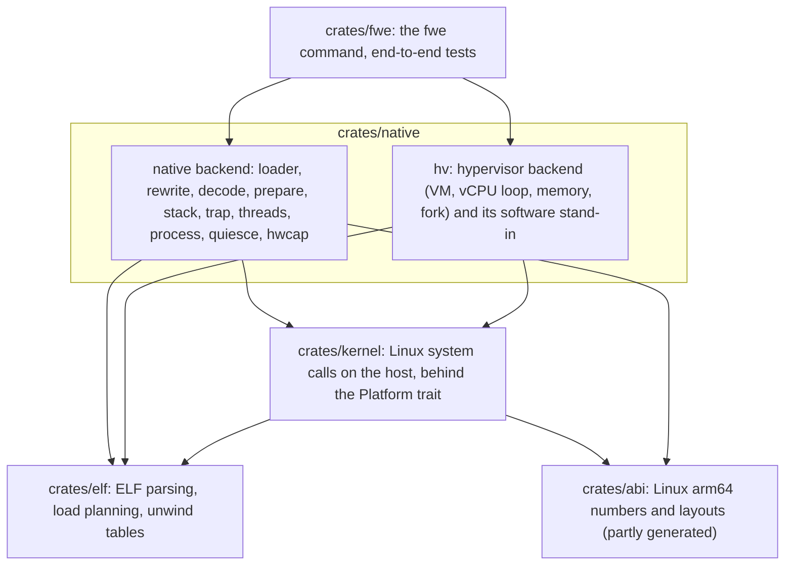

# Architecture

## Summary

fwe is a Linux kernel written as an ordinary macOS program. Each guest
process is one `fwe` process holding the guest's code and memory, a
*backend* that runs the guest's code and catches its system calls, and the
*kernel crate*, which carries out each call with macOS's own system calls
and keeps whatever Linux state macOS has no place for. Two backends exist:
the native one runs guest code inside the fwe process after rewriting a
few instructions, and the hypervisor one runs it in a small VM. Both hand
every system call to the same kernel crate.

This document describes how those parts are built and how they work
together: the crates and what each is for, the path a system call takes,
each backend's own machinery, and then the kernel crate area by area —
memory, processes, threads, signals, files, events, IPC, sockets and
terminals, containers. It ends with the
[known limitations](#known-limitations): where fwe still differs from
Linux.

What each Linux primitive becomes on macOS, and how host events (signals,
key strokes, children ending, errors) reach the guest, is explained in
[linux-on-macos.md](linux-on-macos.md); this document links there rather
than repeating it. The hypervisor backend's own rules, testing and
operation are in [hypervisor.md](hypervisor.md).

## Components

fwe is a Cargo workspace of five crates. The `fwe` command hands the
program to `crates/native`, which picks a backend for it; both backends
lean on the kernel crate for every system call, and everything that knows
Linux's numbers and layouts takes them from the ABI crate:

- The **kernel crate** does not depend on how guest code runs. A backend
  traps guest system calls, calls `Kernel::enter_syscall` with the guest's
  registers, and provides what the kernel needs through
  `fwe_kernel::Platform`: preparing code for execution, ending a thread or
  the process, setting how the host treats a signal and, for the VM,
  carrying out memory calls (`Platform::memory`).
- The **native backend** runs guest code in-process after rewriting the
  instructions macOS cannot let a Linux process run unchanged. It carries
  every position-independent binary, and fixed-address ones linked at or
  above 4 GiB.
- The **hypervisor backend** runs the guest at EL0 in a
  Hypervisor.framework VM. fwe picks it automatically for a non-PIE
  executable linked below 4 GiB, which the native backend cannot map.
- **Hosts:** the kernel, ELF and ABI crates build on any Unix (`libc`
  supplies host values; on Linux most translations are the identity), and
  CI runs their unit tests on Linux too. The backends, and so `fwe`, run
  only on macOS on Apple Silicon.
- **Translation:** Linux values (errno, flags, clock ids, signals,
  rlimits, ioctls) are mapped to host values in
  `crates/kernel/src/host.rs`. `crates/abi` holds the Linux side; system
  call numbers and errno values are generated from the UAPI headers by
  `tools/gen-abi.py`.

## System calls

A system call starts in a backend: the native backend's trap handler or
the VM's run loop catches the guest's `svc`, reads the number and
arguments from the guest's registers, and hands them to the kernel crate
(the path from `svc` to the host is drawn in
[linux-on-macos.md](linux-on-macos.md#system-call-entry)). Seccomp
filters see the call first. Then the kernel crate either runs it under its
lock or, for a call that may block, without it. Inside fwe:

- **One kernel lock.** Most calls run under a single lock through
  `Kernel::enter_syscall`.
- **Blocking calls run without it**, so a waiting thread never stalls the
  thread meant to wake it: `futex`, the sleeps, `epoll_pwait`, `ppoll`,
  `pselect6`, `rt_sigsuspend`, `rt_sigtimedwait`, `wait4`, `waitid`, the
  blocking socket calls, `flock`, `F_SETLKW`, `read`/`write` and their
  vectored and positioned forms, `splice`/`tee`/`vmsplice`, FIFO opens and
  IPC waits. `clone`, `execve` and `exit` are the backend's.
- **Signals during a call:** the thread's guest mask is in force on the
  host while a call runs, so a signal the guest takes interrupts a blocking
  host call (`EINTR`). The result is then finished as Linux would: the
  call runs again if no guest handler waits for the signal, or if the
  handler has `SA_RESTART` and the call is one Linux restarts (I/O,
  `wait4`/`waitid`, `accept`, `openat`, `ioctl`, `flock`/`fcntl`, a futex
  wait without a timeout); otherwise it fails with `EINTR` once the handler
  returns. A masked wait (`ppoll`, `pselect6`, `epoll_pwait`) runs under
  its mask, as `rt_sigsuspend` does.
- **Return:** the result goes into `x0`, `pc` advances, a pending signal is
  delivered if one is ready, and the guest resumes with every other
  register preserved.
- **Unimplemented** calls fail with `ENOSYS` and are noted under
  `--strace`.

### Guest memory access

A system call's arguments are often pointers into guest memory, and a bad
one must fail the call with `EFAULT` rather than crash fwe. Whatever the
kernel reads or writes of guest memory goes through
`crates/kernel/src/uaccess.rs` (typed values, strings, string arrays, byte
ranges):

- the copies run in a small assembly routine; when one faults, the
  backend's fault handler resumes it at a recovery point (Linux's
  exception-table scheme) and the call fails with `EFAULT`;
- a pointer handed straight to a host call is checked by the host; a few
  macOS C library functions do their work in user space (`clock_gettime`,
  `gettimeofday`, `nanosleep`), so their results go through fwe's memory
  and the checked copies;
- in the VM, every guest pointer is first checked against the guest's
  mappings (`set_validator`) and translated (`g2h`, `host_arg`), see
  [linux-on-macos.md](linux-on-macos.md#pages-and-translation).

### Tracing

fwe can show what a guest asks of it, much as `strace` does on Linux:

- `--strace` prints each call with its arguments (paths and names as
  strings) and result, and the backend's notes (what was loaded and
  prepared), to standard error.
- `--strace=failures` prints only failing calls and the notes, cheap
  enough to keep a run's timing.
- `--strace-file=PATH` appends the trace of every process of the run to
  `PATH`, each line naming its process.
- All are passed on across `execve` and `fork`. A failed code preparation
  is noted with its reason (no room for stubs, say) while the guest gets
  `ENOMEM`.

## Native backend

The native backend (`crates/native`) runs guest code in the fwe process.
Its parts are the loader, the code preparation that rewrites guest
instructions, the trap handlers that turn host signals into system calls,
signals and faults for the guest, and the machinery for threads and
`fork`.

### Loading

- The loader (`crates/native/src/loader.rs`) reserves the image's span (a
  PIE where the host picks), copies each `PT_LOAD` segment in, writable,
  rewrites its code (below) and then sets the final protections. Space for
  code stubs is reserved right after the image, within branch range. A
  16 KiB host page shared by several segments gets the union of their
  protections.
- The break is reserved after the image and its stub space (up to 1 GiB,
  halved while something is in the way) before the dynamic linker is
  placed. The stack is 8 MiB with a guard page.
- An in-place `execve` checks the new program first (an arm64 ELF that
  fits the address space, with a dynamic linker that exists), so a bad
  one fails with the caller intact. A re-exec checks only that it is an
  ELF file before the host `execve`, so a later failure ends the
  process.
- **Busy programs** (`crates/kernel/src/textbusy.rs`): a page every fwe
  process maps holds each process's program and a ring of the files
  opened lately for writing; an open to write a running program's file,
  and a run of a file some process still holds open to write (which the
  host confirms), fail with `ETXTBSY`. A writer whose ring entry was
  overwritten by later opens goes unseen.
- A program given by a host path inside the rootfs gets its guest path as
  `argv[0]` and `AT_EXECFN` (Python finds its installation so);
  `--argv0` overrides it.

### Rewriting guest code

Which instructions are rewritten, why, what they become, and which parts
of a binary are scanned is explained in
[linux-on-macos.md](linux-on-macos.md#which-instructions-get-translated-and-how).
The pieces that do it:

- `crates/native/src/rewrite.rs` scans a range word by word, rewrites
  `svc #0` in place, and builds a stub for each thread-pointer or `x18`
  site;
- `crates/native/src/decode.rs` decodes the operands of an instruction
  naming `x18`, so the stub can substitute a scratch register, adjust an
  `sp` offset or rebuild a PC-relative or branch form;
- `crates/native/src/prepare.rs` groups sites so that one stub region
  reaches each group (a quarter of the branch range apart at most), takes
  the region from the loader's arena or reserves one near the code, writes
  the stubs, points each site at its stub and invalidates the instruction
  cache. A mapping the guest leaves to the host is asked for at 2 TiB,
  above the program, its break and fwe's own memory, so that mappings fill
  upwards with free space past the latest (in the gaps below, a library's
  code could find no stub region within reach); code mapped without a
  fixed address that still finds none is mapped again where there is
  room;
- the kernel crate asks for preparation through
  `Platform::prepare_exec` whenever guest memory is to become executable
  (`mmap`, `mprotect`, a write+exec fault, in `crates/kernel/src/mm.rs`),
  passing the code ranges it knows from the file's sections and unwind
  table; a failure is traced (see [Tracing](#tracing)).

The trap handler keeps the `x18` slot and the kernel's register view in
step: it reads the guest's `x18` into `Regs` and writes it back on return,
so a signal frame carries the real value, `rt_sigreturn` restores it, and
a cloned thread starts with its parent's. Correctness never depends on the
host preserving `x18`; macOS 26.4's custom-`x18` ABI is only probed
(`fwe --host-info`), not used: switching it at every trap costs two host
calls, and one of them could hang.

### Faults

Natively, every trap the guest's code takes arrives as a host signal. The
native backend's fault handlers (`on_fault` and `on_sigtrap` in
`crates/native/src/trap.rs`) sort each host fault signal into a system
call, an emulated instruction, a write+exec page switch, a recovered
checked copy, a signal another process sent, a signal for the guest, or a
fatal fault in fwe's own code; what each becomes for the guest is in
[linux-on-macos.md](linux-on-macos.md#faults-in-guest-code).

## Memory bookkeeping

Both backends carry out the guest's memory calls (natively with host
calls, in the VM on its page tables, see
[linux-on-macos.md](linux-on-macos.md#memory)); the kernel crate keeps the
records Linux would keep about them:

- **Ownership:** every guest range (images, stubs, stack, break,
  mappings) is recorded (`fwe_kernel::mm::track`) and removed when
  unmapped; fwe's own memory never is, so `execve` discards exactly the old
  program.
- **Linux's view** (`crates/kernel/src/maps.rs`): each successful memory
  call, whichever backend made it, with the guest's protections and
  sharing and the file and offset mapped; the loaders add the program, its
  dynamic linker (file-backed as far as the file has contents, zeroed
  beyond) and the stack, and the break is the heap. Memory fwe maps that
  the guest did not ask for (code stubs, a guard page) is listed as
  anonymous with the host's protections, so a program looking for free
  space does not pick it.
- **Other processes:** each process publishes its record in a shared
  file beside its process record (a sequence word odd while it is
  written) before its next system call that is not a memory call, and
  before a `fork`, so a run of mapping calls publishes once. Another process's `/proc/<pid>/maps` and `smaps`
  read it, with resident pages from the host (`proc_pidinfo`).
  `PROCMAP_QUERY` answers for any of them, with the mapped file's GNU
  build ID.
- **`vm.max_map_count`** (65530 by default) limits the mappings: an
  `mmap`, or an `munmap` that splits one, past it fails with `ENOMEM`.
- **Locking** (`mlock`, `mlock2`, `mlockall`, `MAP_LOCKED`) brings memory
  in and marks it locked for `smaps`, `VmLck` and the next lock's
  `RLIMIT_MEMLOCK` check; nothing is wired.
- **Sealing** (`mseal`): a flag on the mapping in Linux's view, carried
  across `fork`; `munmap`, `mprotect`, `mremap`, a `MAP_FIXED` `mmap` over
  it and a discarding `madvise` of read-only anonymous memory fail with
  `EPERM`.
- `remap_file_pages` maps the range of a shared file mapping afresh at the
  page asked for, as Linux has done since it dropped non-linear mappings.
- `POSIX_FADV_DONTNEED` writes a range's changes back and drops its pages
  from the host's cache (a shared mapping of it, synced and invalidated).
- Write+exec memory is recorded in `crates/kernel/src/mm.rs` and handled
  per backend.

## Processes

The fork, vfork, execve and wait models are drawn in
[linux-on-macos.md](linux-on-macos.md#processes). Making and replacing
processes touches every part of fwe, so this section lists what each part
does for it, then the per-process state fwe keeps. Inside fwe:

- **fork locking:** `fwe_kernel::fork_locked` holds the kernel lock and
  every kernel registry lock across a host `fork`, so the child (which has
  only the forking thread) inherits none held by a thread it lacks. It
  refuses outright (`ENOSYS`) once the process has a VM.
- **quiesce** (`crates/native/src/quiesce.rs`): threads running guest code
  are suspended for the fork; a thread in fwe's code (which may hold
  `malloc`'s lock) runs on and waits before re-entering guest code until
  the fork is done.
- **Child entry:** the child cannot return through the trap frame it
  inherited (macOS would not restore its signal mask), so it installs a
  signal stack and enters the guest directly with `x0` = 0.
- **Signals around fork:** the parent forks with every asynchronous signal
  blocked, and the child goes on only once the parent has unblocked them,
  so a signal the child sends its parent keeps its sender.
- **vfork wait:** the parent holds the read end of a close-on-exec pipe
  whose write end only the child holds.
- **VM fork state** (`Kernel::save_for_fork`, `crates/kernel/src/snapshot.rs`):
  signal dispositions, the forking thread's mask and alternate stack, the
  break, filesystem view, credentials, descriptor limits, every descriptor
  registry and the translated guest ranges, then the backend's registers,
  thread pointer, PAC keys, mapping records and slab use. The format is
  private to one fwe binary.
- **Re-exec state** (`Kernel::exec_state`): see
  [linux-on-macos.md](linux-on-macos.md#execve).
- **Process records** (`crates/kernel/src/procreg.rs`): a file per host
  pid in fwe's private directory with the process's start time (so a
  record never outlives its process into another with the same pid),
  cgroup, namespaces, name, command line, program, ancestors, subreaper
  flag, nice value, scheduling policy and `oom_score_adj`.
- **Process descriptors** (`crates/kernel/src/pidfd.rs`): a kqueue
  watching the process's exit, marked with what it names (see
  [linux-on-macos.md](linux-on-macos.md#waiting-and-events));
  `pidfd_send_signal` is `kill`, `tgkill` or `rt_sigqueueinfo` of the
  process it names; `PIDFD_GET_INFO` gives its pid, parent and ids, and
  once this process has reaped it, its wait status; the
  `PIDFD_GET_*_NAMESPACE` requests and `setns` with one use its
  namespaces as `/proc/<pid>/ns` has them. `pidfd_getfd` queues a
  request in the target's mailbox and wakes it; its wake handler sends the
  descriptor as `SCM_RIGHTS` to a datagram socket the caller bound beside
  the process records (or, where that path is too long for a socket's
  address, in `/tmp/fwe-<uid>-fd`, which only the user may use).
- **Priorities and policies:** `setpriority`/`getpriority` and the
  `sched_*` calls (`crates/kernel/src/sched.rs`) are kept in the record
  with Linux's checks and inherited (`SCHED_RESET_ON_FORK` honoured); the
  host's scheduling is untouched. Policies are per process.
- **Resource limits:** those the host lacks, and `RLIMIT_MEMLOCK`,
  `CORE`, `STACK`, `CPU` and `NPROC`, are fwe's
  (`crates/kernel/src/rlimits.rs`); the others are the host's.
  `RLIMIT_NOFILE` is virtual (see [Descriptors](#descriptors)). Past the
  CPU soft limit the host's `SIGXCPU` comes each second, and past the
  hard one fwe ends the process with `SIGKILL`; `RLIMIT_NPROC` is checked
  at `fork` against the user's fwe processes.
- **Core dumps** (`crates/kernel/src/coredump.rs`): a signal whose default
  dumps core leaves an ELF core (the thread's registers, the process, and
  the mappings Linux's default `coredump_filter` dumps, which
  `/proc/<pid>/coredump_filter` shows, less memory given
  `MADV_DONTDUMP`), named by `kernel.core_pattern` and `core_uses_pid`
  and cut short at `RLIMIT_CORE`. The host's own core limit is 0.
- **End status:** a process a signal ends leaves its Linux wait status
  beside its record (`procreg::ending`), so its parent reads the signal
  and core bit Linux would report even for a signal the host lacks.
- **POSIX timers** (`crates/kernel/src/posixtimer.rs`): a thread of
  fwe's, started with a process's first timer, sleeps until the next is
  due and raises its signal (`SI_TIMER`) for the process or a thread; a
  periodic timer goes again when its signal is taken, the intervals that
  passed its overrun. A timer of CPU time is looked at again at most
  every 10 ms. A fork child has none; `execve` deletes them. A signal of
  a timer deleted or set again while it waits is still delivered.
- **Interval timers** are the host's; one longer than the host takes
  (100,000,000 s) gets the host's longest and reads back as asked.
  CPU-time clocks are the host thread's or process's CPU time.
- **Orphans:** see
  [linux-on-macos.md](linux-on-macos.md#orphans-and-reapers). A reaper's
  `SIGCHLD` for an adopted process is raised inside the reaper (pending for
  the guest with a child's `siginfo`; disposition, mask and `SA_NOCLDSTOP`
  act on it), not sent through the host, where a held one would absorb it.
  An orphan keeps the adopter it had when its parent ended.

## Threads and futexes

Threads are host threads, so most of their work is scheduling the host
already does; fwe adds Linux's thread identity and futexes:

- Guest threads run at the host's user-interactive quality of service,
  so the host wakes them on time when it is busy, as Linux wakes a
  sleeping task.
- A guest thread is a host thread running guest code; `CLONE_SETTLS`,
  `CLONE_PARENT_SETTID`, `CLONE_CHILD_SETTID` and `CLONE_CHILD_CLEARTID`
  act as on Linux.
- Thread ids: the main thread's is the pid; another's comes from its pid
  namespace, or outside one from a counter every fwe process shares,
  numbered from 100000 (past every macOS pid, so a thread's number never
  names another process) and wrapping below 4194304.
- Futexes (`crates/kernel/src/futex.rs`) wait outside the kernel lock. A
  wake takes waiters off the queue oldest first and marks each woken, so it
  reports exactly how many it woke. `FUTEX_WAIT_BITSET`/`WAKE_BITSET` match
  by bits; `FUTEX_CMP_REQUEUE` moves waiters. `futex_waitv` waits on up
  to 128 at once, private ones in the process's queues and shared ones in
  slots of the shared table, and returns the index of the one woken.
- A shared futex's waiters are in a slot table every fwe process maps
  (`crates/kernel/src/sharedfutex.rs`), keyed by Mach memory object and
  offset for shared memory and by process and address for private memory.
  A slot carries a generation, so a wake never claims one freed and
  reused; a dead owner's slot is freed by the next process that looks.
- Waiters check every 20 ms for a signal they should take, and return
  `EINTR` for it.

## Signals

The Linux side (numbers, dispositions, sending) is in
[linux-on-macos.md](linux-on-macos.md#signals), and how a host signal
reaches the guest in
[linux-on-macos.md](linux-on-macos.md#host-signals). The machinery behind
them lives in the kernel crate (`crates/kernel/src/signal.rs`,
`thread.rs`, `signote.rs`), with the backends' handlers feeding it:

- **Pending sets** are atomics in host thread-locals (the host handler
  records into them), registered by tid so another thread can target one.
- **fwe's handlers** start and end with every signal blocked, so the
  backend always knows whether it interrupted guest code or its own. Each
  thread otherwise runs under a host mask that blocks only the
  guest-blocked signals the host acts on itself.
- **Parked signals:** a process-wide signal the host holds can sit on a
  thread running fwe's handlers. A native thread entering a system call
  with such a signal parked on it, one the guest catches, takes it off the
  host and records it against the process, and the others are woken.
- **Wake signal:** a signal recorded without a host signal (real-time,
  emulated faults, caught `tgkill`) wakes its target thread, or every
  thread, with `SIGEMT`.
- **Wake pipes:** every host signal a thread takes writes a byte to that
  thread's pipe (`thread::poke_wait`), and the sleeps, `poll`, `select`
  and the `epoll` waits watch it beside the guest's descriptors
  (`thread::wait_ready_ns`), so a signal that lands after such a wait
  looked for pending ones, and before the host wait began, still ends it.
  Their time is kept by a kqueue timer of the thread's with
  `NOTE_CRITICAL`, which the host does not coalesce. A futex wait close to
  its deadline sleeps the same way, a wake writing to its pipe.
- **Signals the host lacks, between processes:** queued in the target's
  mailbox (up to 64, with sender, code and value) and the target woken
  with `SIGEMT`; its wake handler moves them onto its pending sets.
- **Orphan ordering:** an adopted orphan's `SIGCHLD` takes the place of
  its former parent's while that is pending, and absorbs one after it, as
  Linux sends them.
- **Notes:** a sender writes a note in one of eight slots per host
  signal in the target's mailbox (pid, uid, time, and for `SI_MESGQ` the
  code and value) with `pwrite`, a free one or else the oldest; the
  target's handler reads the note of the sender the host names, or the
  oldest, with `pread`, both async-signal-safe, the mailbox held in fwe's
  reserved descriptor range.
- **Before a re-exec,** the whole guest mask goes on the host, and signals
  fwe holds pending that the guest blocks are re-raised on the thread,
  which the host `execve` keeps.
- **Frames:** an arm64 `rt_sigframe` with Linux's `ucontext`/`sigcontext`
  and an `fpsimd_context` record, on the guest stack or the alternate
  stack under `SA_ONSTACK` (a handler already on it continues from its
  `sp`); `x0`–`x2` per `SA_SIGINFO`; return through `sa_restorer` or a
  trampoline the backend maps at startup. `rt_sigreturn` restores
  registers, mask and alternate stack.

## Files

Every file operation starts with a guest path or descriptor and ends with
a host call on a host descriptor. In between, fwe resolves the path in the
guest's own root and mount table, keeps the descriptors it needs out of
the guest's reach, and translates what comes back.

### Paths and mounts

- The guest's root is a host directory (`fwe --root DIR`, else the host's
  `/`), with its mount namespace's table on it: by default the rootfs at
  `/`, and `/proc`, `/sys`, `/sys/fs/cgroup`, `/dev/pts`, `/dev/mqueue`
  and `/dev/shm`.
- `crates/kernel/src/fs.rs` resolves each path component by component:
  symlinks followed by fwe (absolute targets re-rooted), mounts entered,
  `..` clamped at the process's root. `*at` calls start from where their
  descriptor was opened.
- Every open file remembers the mount it came through
  (`crates/kernel/src/fdmarks.rs`), followed through `dup`, `close`,
  `fork` and `execve` and dropped once the descriptor names another file:
  `fstatfs` reports that mount, `/proc/self/fd` its path, and a
  `/proc/self/fd/N` link reaches the file after the mount or path is gone.
- Read-only mounts fail writes with `EROFS` (devices, FIFOs and sockets
  still open for writing), a rename or link across mounts fails with
  `EXDEV`, removing a mount's root with `EBUSY`.
- `openat2` (`crates/kernel/src/openat2.rs`) walks the path itself for
  its `resolve` rules (no symlinks, no `/proc` magic links, no mount
  crossed, nothing above the directory, the directory as the root), then
  opens what it reached as `openat` would.
- A host symbolic link into fwe's `/proc` or `/sys` (`/etc/mtab`, say) is
  opened and `stat`ed as the file it leads to.
- `/dev/shm` is reached by any path that leads there, symlinks included,
  whether or not the rootfs has a `/dev`; its files report their
  `/dev/shm` path.

### Descriptors

Guest descriptors are host descriptors, which keeps I/O direct; the work
is in keeping fwe's own descriptors apart and Linux's limits exact:

- Guest descriptors are host descriptors. fwe's own (the rootfs handle,
  pipe ends behind eventfd and signalfd, a vfork parent's pipe, the
  signal mailbox, in the VM every file mapping's file) live in a reserved
  range at the top of the host's space (`crates/kernel/src/fdtable.rs`).
- At startup fwe raises its host soft limit as far as macOS allows and
  gives the guest a virtual `RLIMIT_NOFILE` (soft 1024, hard leaving fwe a
  quarter of the host's descriptors, at least 64).
- The guest never reaches the range: `close_range(3, ~0)`, closing up to
  the limit and listing `/proc/self/fd` stop below it; a call naming one
  fails with `EBADF`, as does `dup2` onto one; the limit cannot be raised
  into it. When the range is full, what needed one fails as Linux would
  (`EMFILE` for an `eventfd`, `ENOMEM` for an `mmap`, `EAGAIN` for a
  `fork`).
- The soft limit holds as on Linux: a new descriptor at or above it is
  closed again and the call fails with `EMFILE` (`dup3` onto one with
  `EBADF`, `F_DUPFD` from one with `EINVAL`).
- A new descriptor is the lowest free number: the directory fwe holds
  while resolving a path is moved into the reserved range first.
- An `O_CREAT` open that macOS fails with `ENOENT` because another process
  is unlinking the name is retried.
- `O_PATH` descriptors are marked and refused what Linux refuses
  (`EBADF`). An `O_PATH` open of a FIFO, a device or socket the host
  cannot open, or a symlink itself is a stand-in that names the file:
  its `fstat`, `readlinkat`, `faccessat2`, `utimensat` and fdinfo are the
  file's, and its `/proc/self/fd` link reopens it. One of a link in fwe's
  `/proc` or `/sys` names that link.

### File contents and metadata

What the guest reads about files, and the file features macOS lacks or
shapes differently:

- `stat`/`statx` are translated to the arm64 Linux layout; `statx`
  reports the immutable, append-only and no-dump attributes from the
  host's file flags. A file of a tmpfs mount is on the device
  `/proc/<pid>/mountinfo` gives the mount, in page-sized blocks.
  `getdents64` is built from `getdirentries`, re-reading from the
  directory position when translated entries outgrow the guest's buffer.
- **Modes** (`crates/kernel/src/modes.rs`): a mode that denies its owner,
  or a file's set-ID bits (which the host drops from a file of a group
  its user is not in, and on any write), is kept in `org.fwe.mode`, the
  file flagged `UF_NODUMP`; `stat` reports it. A write by a caller
  without `CAP_FSETID` takes a file's set-ID bits away, as Linux's does.
  Where a file's path is too long for the host, its attributes are read
  and written through a descriptor of it. A file made by something else
  that the host refuses root is converted the first time.
- **Owners** (`crates/kernel/src/owners.rs`): a file whose owner is not
  root (fwe's user) keeps it in `org.fwe.owner`, under the same flag;
  `stat` reports it. A new file is its maker's (its file-system user, and
  group or a set-group-ID directory's), and `chown` changes the record
  under Linux's rules. Permission checks are fwe's
  (`creds::Access::permits`): opening a file, changing a directory's
  entries (and the sticky bit's restriction), searching each directory of
  a path, `chdir`, `chmod`, `utimensat`, extended attributes and `execve`
  (root too needs an execute bit), `O_NOATIME` (the owner's), by the
  owner's, group's or others' bits against the caller's file-system ids,
  `CAP_DAC_OVERRIDE` and `CAP_DAC_READ_SEARCH` passing them. The checks
  outside the kernel lock (the path walk, a connect to a Unix socket's
  node) use the credentials published after each system call
  (`creds::access`). Without a root filesystem the host's own files and
  directories (root's, no owner kept) are left to the host's checks.
  fwe's own umask on the host is 0: the guest's umask is applied by fwe,
  and its files are made with the modes it asked for.
- **Extended attributes** (`crates/kernel/src/xattr.rs`): a list shows
  only Linux's namespaces; `trusted.` ones are hidden from callers without
  `CAP_SYS_ADMIN`; `user.` ones are for regular files and directories
  only; writing a `security.` one needs `CAP_SYS_ADMIN`, or `CAP_SETFCAP`
  for `security.capability`.
- **memfd** (`crates/kernel/src/memfd.rs`): `/proc/self/fd` names it
  `/memfd:<name> (deleted)`; `F_SEAL_SHRINK`/`GROW` are checked by
  `ftruncate` and `fallocate`, `F_SEAL_EXEC` by `fchmod`; after
  `F_SEAL_WRITE` the host refuses writes and writable shared mappings,
  reported as `EPERM`.
- **Programs run from a descriptor** (`execveat(fd, "", AT_EMPTY_PATH)`,
  `/dev/fd/N`, a `/proc/self/fd` path, as crun runs its sealed copy) are
  read through it; fwe keeps a descriptor of the program, which
  `/proc/self/exe` opens.
- **Copying:** `sendfile` and `copy_file_range` copy between descriptors.
  `splice`, `tee` and `vmsplice` (`crates/kernel/src/splice.rs`) copy too,
  since the pipes are the host's: from a pipe what it holds, into one what
  room it has, waiting unless asked not to, without the kernel lock. A
  pipe's data is taken only as far as it can be written: all of it, with
  the rest put back through a write end the process holds (as `tee` puts
  back all it copies), or else no more than the output takes now. A pipe or
  socket with no reader fails with `EPIPE` before anything is taken.
- **fcntl:** status and descriptor flags translated; record locks and
  the open-file-description `F_OFD_*` forms (macOS's private numbers)
  translated (`struct flock` and lock types differ); `flock` passes
  through. Owner thread, `F_SETSIG`'s signal, whether the open made the
  file (`F_CREATED_QUERY`) and pipe sizes (`F_SETPIPE_SZ`,
  `fs.pipe-max-size`) are kept by fwe (`crates/kernel/src/fdstate.rs`) and
  checked as Linux checks them. A pipe given less than the host's capacity
  holds no more: the writing process keeps the page buffers its writes
  made, as Linux fills them (a write's tail shorter than a page joins the
  last buffer if it fits whole, a read frees a buffer once it has read all
  of it), learns from the bytes the host pipe holds how far reads have
  gone, and cuts each write to the room left, waiting for more while
  blocking. A full pipe is not writable to `poll`, `select` and `epoll`,
  which look at it each millisecond. A host `SIGIO` for a descriptor with a
  chosen signal arrives as that signal, with `si_fd` and `si_band`.
- **Whole pipe writes** (`crates/kernel/src/pipelock.rs`): a write of up
  to Linux's `PIPE_BUF` (4096 bytes) to a pipe arrives whole, never
  interleaved with another writer's, where the host keeps only 512 whole:
  writers of one pipe take turns through a lock of that pipe's own in a
  page every fwe process maps (one whose holder has ended is taken over),
  so only that pipe's writers wait; one that does not wait is written
  whole or not at all (`EAGAIN`).
- **Inode flags** (`FS_IOC_GETFLAGS`, `FS_IOC_SETFLAGS`): immutable,
  append-only and no-dump are the host's user flags of the same meaning,
  which it enforces (no-dump also marks a kept mode, see Modes, so such a
  file does not show it); setting the first two takes `CAP_LINUX_IMMUTABLE`,
  and such a file's extended attributes cannot change. An append-only
  file's times may be set to now (the host refuses it, so the flag is
  lifted for the change), not to a time. `O_NOATIME` (a descriptor's own,
  the host has none) leaves the access time as a `noatime` mount does.
- **`O_TMPFILE`** (`crates/kernel/src/tmpfile.rs`): the file is made
  under a hidden name in its directory (`getdents` leaves it out, `rmdir`
  of a directory holding only such names removes them), which goes when
  the descriptor is closed, or at once with `O_EXCL`; `linkat` gives it a
  name through `/proc/self/fd`.
- **File handles** (`crates/kernel/src/handles.rs`): a handle names the
  host file system and inode, which the host turns back into a path
  (`fsgetpath`) for `open_by_handle_at`, so it survives a rename and goes
  stale (`ESTALE`) with the file or on another file system; a file fwe
  makes up has an identifier handle (`AT_HANDLE_FID`) only.
- **Leases** (`crates/kernel/src/leases.rs`): a record every fwe process
  shares. An open or truncation that conflicts with a lease signals its
  holder and waits until the lease is let go or downgraded, or for
  `fs.lease-break-time` seconds (`EWOULDBLOCK` if non-blocking).
- **ioctl:** terminal, pty and `FIO*` requests, network interface requests
  (`SIOCGIFFLAGS` and the like), and the loop-device requests.
- **FIFOs** (`crates/kernel/src/fifo.rs`): fwe's `epoll` and `ppoll` on a
  FIFO's read end wait in short slices and probe with `select` between
  them, reporting `POLLHUP` once the data still buffered is read (once to
  an edge-triggered or one-shot `epoll` entry). The probe reads nothing.
  An open that waits for the other end runs without the kernel lock.

### /proc and /sys

`/proc` and `/sys` are generated, not stored:

- A path in a `proc` or `sysfs` mount is answered by
  `crates/kernel/src/procfs.rs` (`procpid.rs` for another process's
  `/proc/<pid>`), from an anonymous seekable descriptor;
  `crates/kernel/src/synthdir.rs` serves `getdents64`, `lseek`, `fstat`
  and `close` of the directories from an in-memory list. An unknown path
  is `ENOENT`.
- `/proc/self`: `exe`, `cwd`, `root`, `cmdline`, `stat`, `status`,
  `cgroup`, `mountinfo`, `mounts`, `uid_map`, `gid_map`, `setgroups`,
  `maps`, `smaps`, `auxv` (the vector the program started with),
  `personality`, `oom_score`, `oom_adj`, `oom_score_adj`, `fd`, `fdinfo`,
  `ns`, `task/<tid>/{stat,status,comm}`. A process's state in `stat` is its
  main thread's: `S` while it waits in a system call.
- `/proc` globals: `cpuinfo`, `meminfo`, `stat` (host CPU times and boot
  time), `uptime`, `loadavg`, `cmdline`, `filesystems`, `partitions`,
  `config.gz` (the options of what fwe implements), `keys`, `key-users`,
  `sysvipc/{shm,sem,msg}`, and under `/proc/sys`: `kernel/{ostype,
  osrelease,version,hostname,domainname,pid_max,cap_last_cap,ngroups_max,
  overflowuid,overflowgid,threads-max,tainted}`,
  `kernel/random/{entropy_avail,poolsize}`, `fs/{nr_open,file-max,
  pipe-max-size,pipe-user-pages-soft,pipe-user-pages-hard,lease-break-time}`, `fs/inotify/*`, `fs/mqueue/*`,
  `vm/{overcommit_memory,mmap_min_addr,drop_caches,max_map_count}`,
  `kernel/keys/*`, the IPC limits and a network namespace's sysctls
  (`crates/kernel/src/sysctl.rs`). `fs.nr_open` bounds `RLIMIT_NOFILE` and
  the copy of a shared descriptor table `unshare(CLONE_FILES)` makes.
- `/sys`: `fs/cgroup` (a mount point), `devices/system/cpu/{online,possible}`
  and the loop devices' `block`, `dev/block` and `devices/virtual/block`
  entries.
- `/proc/self/fd` links name the file's guest path, or `pipe:[ino]`,
  `socket:[ino]`, `anon_inode:[eventfd]` and the like; opening one reopens
  the file or, for an object with no path, duplicates the descriptor.
- `/proc/<pid>` of another process: `stat`, `status`, `cmdline`, `comm`,
  `exe`, `cgroup`, `ns`, `fd`, `oom_score_adj` and the maps, from
  its records and what the host reports. `oom_score_adj` is inherited
  (going below the last value a privileged process set takes
  `CAP_SYS_RESOURCE`). A host process fwe did not start (outside a pid
  namespace, any process number names the host's, 1 its `launchd`) is a
  directory with its `stat`, from what the host keeps of it. A zombie keeps its record until it is
  reaped, so its `/proc/<pid>` is there, its state `Z` (the host answers
  for a zombie only in its `kinfo_proc`).

## Event descriptors and inotify

The Linux event descriptors are built on kqueues and pipes (the mapping is
in [linux-on-macos.md](linux-on-macos.md#waiting-and-events)); here is how
each behaves inside fwe:

- **epoll** (`crates/kernel/src/epoll.rs`): `epoll_ctl` checks as Linux
  does, in its order (`EBADF`, `EPERM` for a regular file or directory,
  `EINVAL`, `ELOOP` for loops and nesting past Linux's limit, `EEXIST`,
  `ENOENT`). Waits keep nanoseconds, as `epoll_pwait2`'s `timespec`
  gives them. A socket watched for `EPOLLRDHUP` alone has a read filter at a low-water
  mark no read reaches, so only the end fires. A mounts file (`/proc/<pid>/mounts`, `mountinfo`)
  reports `POLLERR | POLLPRI` to `poll` and `epoll` once its namespace's
  mounts changed since it was opened or last polled
  (`crates/kernel/src/mountwatch.rs`: the namespace record's generation,
  looked at in slices).
- **eventfd and timerfd** (`crates/kernel/src/specialfd.rs`) live in a
  process-global registry that `read`, `write` and `close` consult first.
  An eventfd's counter is a shared page with a lock word in it, so a fork
  child and its parent count on one counter, as Linux's do.
- **`EPOLLEXCLUSIVE`** (`crates/kernel/src/exclusive.rs`): a page every
  fwe process maps counts, for each pipe a set watches exclusively, its
  writes and the writes a waiter took. A set a write woke reports it only
  if it takes one; the others wait for the next write. An edge-triggered
  set sees such a pipe readable anew when it was written to.
- **Fork:** of the epoll and timerfd kqueues a host fork child rebuilds
  (see [linux-on-macos.md](linux-on-macos.md#waiting-and-events)), a
  one-shot timer that expired unread is readable in the child at once.
- **signalfd** (`crates/kernel/src/signalfd.rs`): a call interrupted by a
  signal moved onto a signalfd runs again.
- **inotify** (`crates/kernel/src/inotify.rs`):
  - every fwe process's file calls raise Linux's events for a watched file
    and for a file in a watched directory: open, access, modify, truncate,
    close (write or not), attribute changes, create, delete (for the last
    link `IN_ATTRIB`, `IN_DELETE_SELF`, `IN_IGNORED`), moves with one
    cookie, `IN_MOVE_SELF`, `IN_UNMOUNT`;
  - the watches are a shared record naming each file by host device and
    inode; an overlay's file is named by the overlay and its lower file
    (a copy-up records that), so watches survive a copy-up;
  - shared words beside each instance's socket count what is queued (to
    `fs.inotify.max_queued_events`, then `IN_Q_OVERFLOW` once the rest is
    read) and keep the last event, so an identical one is merged;
  - `IN_ONESHOT`, `IN_EXCL_UNLINK`, `IN_MASK_ADD`, `IN_MASK_CREATE`,
    `IN_ONLYDIR`, `IN_DONT_FOLLOW` and the `fs.inotify.*` limits act;
    `/proc/self/fdinfo` lists the watches.

## IPC

System V IPC, POSIX message queues and keys are fwe's own, kept in shared
records ([linux-on-macos.md](linux-on-macos.md#ipc)). Their details:

- **System V** (`crates/kernel/src/sysvipc.rs`, `ipcops.rs`): the record
  holds keys, owners, permissions, times, semaphore values and undo
  adjustments, messages, and the namespace's limits (`kernel.shmmax`,
  `kernel.sem`, `kernel.msgmni`…, which root may change). `shmat` honours
  `SHMLBA` with `SHM_RND` and maps over existing memory only with
  `SHM_REMAP`; a fork child counts its parent's attachments; `execve` and
  exit detach. A wait ends with `EINTR` for a signal, `EIDRM` if the object
  goes, `EAGAIN` at `semtimedop`'s timeout. A process is known by pid and
  start time. Each change goes to the record's journal as the objects it
  changed, and an index (by key, by slot, and of the objects that name
  processes) finds objects without looking at each, so a namespace of
  thousands of objects costs a call what it changes.
- **POSIX message queues** (`crates/kernel/src/mqueue.rs`): each queue is
  counted against `fs.mqueue.queues_max` and the creator's
  `RLIMIT_MSGQUEUE`; messages by priority, oldest first; a wait ends with
  `ETIMEDOUT`, `EINTR`, or restarts under `SA_RESTART`; checks in Linux's
  order. A descriptor reads as the queue's status line; `/dev/mqueue`
  lists the namespace's queues. A `SIGEV_THREAD` registration ends with
  `mq_notify` or the owner closing a descriptor (an `execve` closing one
  counts), and its netlink socket becomes a host datagram socket bound in
  the namespace's directory.
- **Keys** (`crates/kernel/src/keys.rs`, `keytypes.rs`, `keycrypto.rs`):
  a fork child holds its parent's session keyring; `execve` drops the
  thread and process keyrings. A key nothing reaches goes, invalidated
  keys at once and revoked or expired ones after `kernel.keys.gc_delay`.
  Possession adds possessor permissions; root bypasses no key permission
  but `CAP_SYS_ADMIN` changes owners. Quotas count each user's keys and
  bytes (description, payload charge, four bytes a link) against
  `kernel.keys.maxkeys`/`maxbytes` (`root_*` for root). Payload rules are
  Linux's; `KEYCTL_DH_COMPUTE`, the public-key operations and
  signature-checking restrictions use fwe's own cryptography.

## Sockets and terminals

Sockets and terminals are the host's; fwe translates their interfaces:

- `crates/kernel/src/net.rs` translates addresses, flags and options,
  with `crates/kernel/src/sockopt.rs` for the IP, IPv6 and TCP options
  (see [linux-on-macos.md](linux-on-macos.md#sockets)), and checks each
  call's arguments in Linux's order before the host sees them. A Unix
  socket gets Linux's buffer sizes; reading an unconnected Unix stream
  socket fails with `EINVAL`; `shutdown` of one whose peer has gone
  succeeds. What the host has no place for is kept per descriptor in the
  process: bytes `MSG_MORE` holds back, multicast groups a TCP socket
  joined, the options fwe keeps, and which IPv6 sockets `IPV6_ADDRFORM`
  made IPv4. The calls run without the kernel lock, so whether the caller
  passes permission bits (`CAP_DAC_OVERRIDE`), which a connect to a Unix
  socket's node needs, is published after each system call
  (`creds::dac_override`).
- `AF_UNIX` paths resolve like file paths (`fs::resolve_host`; the socket
  calls run without the kernel lock, so the process's root and working
  directory are published for them). `bind` follows no final symlink and
  takes an existing name as in use (`EADDRINUSE`). A socket's node has the
  socket's mode less the umask.
- `SOCK_SEQPACKET` (`crates/kernel/src/seqpacket.rs`): a receive takes one
  whole message, cut to the buffer (`MSG_TRUNC`); a send is whole or
  `EAGAIN`. Buffers hold two of the largest messages, and that odd size
  marks the socket, so one received with `SCM_RIGHTS` is recognised. A
  message is sent or taken under the socket's lock for that direction (a
  mutex within a process, a byte-range lock on a file of fwe's between
  processes).
- Netlink (`crates/kernel/src/netlink.rs`): the guest's descriptor is one
  end of a host datagram pair; fwe writes each reply to the other.
  `RTM_NEWLINK` needs `CAP_NET_ADMIN`.
- DNS needs nothing special: the resolver reads `/etc/resolv.conf` and
  `/etc/hosts` from the rootfs.
- Terminals: `termios` translation in `crates/kernel/src/term.rs`, the
  terminal requests in `Kernel::sys_ioctl`, ptys in
  `crates/kernel/src/pty.rs` (what each maps to is in
  [linux-on-macos.md](linux-on-macos.md#terminals-and-key-strokes)). A
  closed pty master keeps its number mapped, since another process may
  still hold it.

## Containers

Container runtimes need namespaces, mounts, cgroups, credentials, seccomp
and devices, none of which macOS offers to an unprivileged process; how
each is mapped is in
[linux-on-macos.md](linux-on-macos.md#namespaces). Inside fwe:

- **Shared records** (`crates/kernel/src/shared.rs`, collected by
  `shared::collect`): see
  [linux-on-macos.md](linux-on-macos.md#kernel-wide-state).
- **Namespace creation:** the parent makes a child's namespaces before the
  host `fork`, so the child inherits them (a VM fork child from its
  snapshot).
- **Namespace descriptors** (`crates/kernel/src/nsfd.rs`): a descriptor
  names a namespace's record; it stats as nsfs shows it (the identity is
  the inode), refuses reads and writes, answers `NS_GET_*` (type, parent,
  owner, a mount namespace's id), and is what `setns` joins.
- **Mount propagation** (`crates/kernel/src/mounts.rs`): a bind of a
  shared mount joins its peer group; a mount under a shared one is
  copied to the same place in the parent's peers and in the slaves of its
  group, on through shared slaves; an unmount takes each copy whose mounts
  are all copies of the unmounted tree's; a mount under a shared mount
  cannot be moved (`EINVAL`). Peer groups span namespaces, numbered across
  them. A namespace copied into a user namespace other than the original's
  owner (`unshare -Urm`) gets slaves of the original's shared mounts.
- **Mount flags:** `nodev` refuses device opens (`EACCES`); `noexec`
  refuses running a program or mapping a file executable (`EACCES`,
  `EPERM`, and later `mprotect`); `nosymfollow` refuses links (`ELOOP`);
  `noatime`, `nodiratime` and `strictatime` set a read file's access time
  as Linux would (`crates/kernel/src/atime.rs`), `relatime` is left to the
  host. A mount is busy while something is mounted under it, the caller's
  working directory or root is in it, or a file opened through it is open
  in this process or (by host path) in another fwe process of the
  namespace; `MNT_DETACH` and `MNT_EXPIRE` act as on Linux. `pivot_root`
  replaces the mount at the caller's root, the namespace's or a chroot's.
  A `chroot` that leaves the working directory outside the new root has
  `getcwd` report it `(unreachable)`, as Linux does, until a `chdir`.
- **New mount API** (`crates/kernel/src/mountapi.rs`): a filesystem
  context gathers source, flags and options through `fsconfig`, checked
  as Linux checks them (an unknown parameter is logged; reading the
  context's descriptor gives the log); `CMD_CREATE` makes the filesystem.
  A detached mount (`fsmount`, `open_tree` with `OPEN_TREE_CLONE`) is kept
  against an `O_PATH` descriptor; `move_mount` attaches it (beneath the
  target with `MOVE_MOUNT_BENEATH`). `statx` reports mount ids (unique
  ones for `STATX_MNT_ID_UNIQUE`), which `statmount` and `listmount` use;
  a mount the caller cannot reach is refused without `CAP_SYS_ADMIN`.
- **Overlays** (`crates/kernel/src/overlay.rs`): a descriptor of a lower
  file changed through it (`fchmod`) moves onto the copy; a descriptor
  opened through an overlay keeps its layers after the mount moves or
  goes. An opaque directory is marked `trusted.overlay.opaque` (or
  `user.overlay.opaque` with `userxattr`). The overlay's own attributes
  are hidden; `metacopy=on`,
  `redirect_dir=on` and `index=on` are refused.
- **cgroups** (`crates/kernel/src/cgroupfs.rs`, `bpf.rs`): device programs
  are kept in the cgroup's directory, so they outlive the runtime that
  attached them. The eBPF interpreter checks each access against the
  context and stack and stops a program that runs too long. Other program
  types load (libraries probe with them) but do not attach (`EINVAL`);
  `/proc/self/fdinfo` shows a program's type, id and tag (the first 8 bytes
  of its instructions' SHA-1).
- **Loop devices** (`crates/kernel/src/loopdev.rs`): eight at first. An
  open device is its node's descriptor, marked, whose position the host
  keeps; reads and writes are in whole sectors from the attached file's
  offset within its size limit. A device `LOOP_CTL_GET_FREE` names is not
  named to another process for a few seconds unless attached, so tests run
  side by side get different ones.

## Other calls

Calls that fit none of the areas above:

- `pselect6` turns its sets into a `poll`; it and `ppoll` write back the
  time left unless the personality has `STICKY_TIMEOUTS`.
- `personality` is per process across `fork` and `execve`; `UNAME26`
  makes `uname` report a 2.6 release; the address-space flags are kept
  and reported only.
- `clock_settime`, `settimeofday`, `adjtimex` and `clock_adjtime` check
  their arguments and refuse a change with `EPERM`; read, the clock is
  unsynchronised (`crates/kernel/src/clockset.rs`).
- `statfs`/`fstatfs` report the host filesystem's sizes and counts with
  ext4's type (or the mount's type and flags); `msync` is the host's.
- `prctl`: thread name, capability bounding set and ambient set,
  keepcaps, securebits, child subreaper, `no_new_privs`, seccomp,
  dumpability, parent-death signal, timer slack, transparent huge pages
  and speculation control (reported as not affected); others fail with
  `EINVAL`.
- `getcpu`, `vhangup`, `readahead`, `sync_file_range`, `delete_module`,
  `syslog` (an empty kernel log) and `membarrier` check their arguments
  and permissions as Linux does (`crates/kernel/src/calls.rs`);
  `rt_sigqueueinfo` and `rt_tgsigqueueinfo` send with the caller's
  `siginfo`.
- `sysinfo` reports the host's uptime and load with the fixed memory
  figures of `/proc/meminfo`; `vm.drop_caches` accepts Linux's values and
  drops nothing.

## Known limitations

Where fwe still differs from Linux, grouped by area. Each item is
something a Linux program could notice. The [roadmap](../ROADMAP.md) says
which are to be lifted for 1.0 and which are not planned.

**Execution**
- A non-PIE executable linked below 4 GiB runs only in the VM backend,
  which needs `fwe` signed with the hypervisor entitlement and a
  bare-metal Apple Silicon Mac; that backend is verified on its stand-in,
  not yet on real hardware.
- A few rare `x18` forms are left unrewritten (`--strace` counts them), as
  is any `x18` use in JIT code. A binary without section headers has its
  whole executable segment scanned, and an inline jump table in code the
  unwind table covers could be patched.

**Processes**
- A `vfork` child shares the guest's memory but not its mappings (an
  `mmap`, `munmap` or `mprotect` in it stays in the child).
- Native: a thread inside fwe's code during a `fork` (in a system call)
  is not stopped, so a write it makes to guest memory then (a `read`
  completing) may or may not reach the child.
- A fork child: an epoll or timerfd descriptor duplicated with `dup` is
  gone (only the original number is rebuilt); a periodic timerfd restarts
  its period and loses unread expirations; signalfd queues are the
  child's own copies while their readiness pipes are shared.
- A VM fork that fails after spawning its child can have that child reaped
  by another thread's `wait4(-1)`.
- `clone3` has no chosen tids (`ENOSYS`); `waitid` reports no
  `rusage`; a core file holds the dying thread's registers only, and a
  `core_pattern` piping to a program dumps none; a process ended by a
  signal the host lacks exits on the host with status 128 + the signal,
  which only a parent that is not fwe's sees.
- A `CLONE_PARENT` child's parent is the caller's for `getppid`, `/proc`
  and adoption, but on the host it is the caller's child, which the
  caller's parent cannot `wait` for (nor gets `SIGCHLD` of) while the
  caller lives.
- A process descriptor cannot be passed over a Unix socket (`EINVAL`:
  the host passes no kqueue); `PIDFD_GET_INFO` gives a wait status only
  to the process that reaped it, and no cgroup id; a `PIDFD_THREAD`
  descriptor names only a thread of the caller's own process, and in a
  fork child it stands for the parent's process; `pidfd_getfd` of a
  descriptor fwe stands in for (an eventfd, a timerfd, a signalfd) gives
  the host object behind it, as one passed over a socket does, and waits
  while the target is stopped.
- A parent-death signal (`PR_SET_PDEATHSIG`) is sent when the parent
  process ends (Linux sends it when the parent thread does); a new thread
  does not inherit its creator's name.

**Resources**
- The limits the host keeps (`RLIMIT_FSIZE`, `RLIMIT_DATA`, `RLIMIT_AS`),
  and the CPU and process-count limits fwe keeps on top of the host's,
  cannot be raised past the host's hard limit, even by root.
- Limits set on another process with `prlimit` take effect at its next
  limit call, `fork` or `execve`; reading another's reports what was set
  for it, else the caller's own.
- `sched_setaffinity` is checked and remembered, but threads run on any
  CPU; scheduling policies are per process, not per thread, and do not
  change how the host schedules.

**Memory**
- Native: `mremap` does not grow or move code (an executable mapping,
  prepared where it is: `ENOMEM`); a grown shared anonymous mapping's new
  part is new memory, not shared with processes that share the rest;
  `MADV_DONTNEED` on a private file mapping keeps modified pages where
  Linux restores the file's.
- VM: a fork child keeps the memory `MADV_WIPEONFORK` was given; a
  `MAP_GROWSDOWN` mapping does not grow, and `MADV_HWPOISON` poisons
  nothing.
- `/proc/self/mem` and `/proc/self/pagemap` are the caller's own memory
  only (macOS gives no process another's); a `pagemap` entry tells
  whether a page is in memory, its frame number 0, as Linux shows it to
  a process without `CAP_SYS_ADMIN`. `coredump_filter` is the default
  and cannot be changed.
- Native: write+exec memory takes a fault each time a page goes from being
  written to being run or back, slow for code that does both to one page
  often; a host call writing into such a page while it is executable (a
  `read` into it) fails with `EFAULT`.
- VM: a private file mapping is a copy of the file when mapped, so later
  writes to the file do not show; a shared segment cannot grow with
  `mremap`, and `MREMAP_FIXED`/`MREMAP_DONTUNMAP` are refused (`EINVAL`).
- VM: a buffer a host call takes whole (`read`'s, an `iovec`'s) that runs
  over the edge of a translated range fails with `EINVAL`; `ioctl`'s
  argument is translated but not checked against the guest's mappings; a
  `MAP_FIXED` mapping placed exactly where fwe keeps another translated
  range's memory makes their addresses ambiguous within a call that
  translated a pointer into that range.
- VM: residency (`mincore`, `Rss`) is by 16 KiB host pages. Another
  process's `Rss` is exact for a mapping that is a host region of its own;
  for one inside a larger region (all of a VM process's guest memory) it
  is as much of the region as is resident, which can overstate it.

**Files and descriptors**
- What fwe keeps of an open file for `fcntl` (owner thread, `F_SETSIG`'s
  signal) is per descriptor, so a duplicate's changes do not show in the
  original.
- A pipe holds at most what the host's does (64 KiB): a new pipe's
  capacity is that, not Linux's 16 pages, and one set larger with
  `F_SETPIPE_SZ` still holds no more. A smaller capacity is kept by the
  process that writes: writes from two processes into a pipe sharing it
  are each held to the room one of them sees, and `splice`, `tee` and
  `vmsplice` into it count its room in bytes, not page buffers.
- `pwritev2` with `RWF_APPEND` sets `O_APPEND` on the open file for the
  call, which another writer sharing it sees meanwhile.
- Descriptors received with `SCM_RIGHTS` are not held to the guest's
  `RLIMIT_NOFILE`; a reopened `/proc/self/fd` entry for a pipe or socket
  shares the original's file description.
- `fallocate` reserves space past the end (mode 0, `FALLOC_FL_KEEP_SIZE`)
  and punches holes, but does not fill a hole inside a sparse file; other
  modes are `EOPNOTSUPP`.
- `/dev/shm` outlives its processes until the host clears its temporary
  files, and a `rename` between it and the rootfs succeeds where Linux
  returns `EXDEV`.
- memfd: sealed against writing, it cannot be resized even without
  `F_SEAL_SHRINK`/`GROW`; `F_SEAL_GROW` alone does not stop a write past
  the end; `F_SEAL_WRITE` succeeds despite a writable shared mapping
  (Linux: `EBUSY`), does not reach another process's descriptors, and
  changes the inode number; a memfd reopened through `/proc/self/fd`
  shares the original's offset.
- `tee` needs a write end of its input pipe (`EINVAL` otherwise); without
  one, `splice` from a pipe to a file or waiting socket that a signal or
  error cuts short loses what it took and did not write.
- `/dev` has `null`, `zero`, `full`, `random`, `urandom`, `tty`, `ptmx`,
  `pts`, the loop devices and the `/proc/self/fd` links; a node `mknod`
  makes opens a device only for those numbers (`ENXIO` otherwise), lists
  as a regular file in `getdents64`, and `/dev`'s listing does not show
  fwe's own.
- A file owner other than fwe's user, not given by the guest, reads as
  65534. Without a root filesystem, the host's own files are not held to
  their bits for a guest that is not root. Access control lists are not
  kept, and `fs.protected_*` restrictions are not enforced.
- The working directory follows a rename of its directory (or one above
  it) by the process itself, not by another process.
- A `sendto` to an `AF_UNIX` path longer than the host's 103 bytes once
  rooted fails with `ENAMETOOLONG` (`bind` and `connect` reach it from its
  directory).

**Mounts**
- A tmpfs's `size=` is kept beside its directory: what its files take
  on the host is counted (again when the count is a quarter second old),
  a write past the size writes what fits or fails with `ENOSPC`,
  `fallocate` fits whole or fails, and `statfs` reports the size and what
  is left. Its files are host files, so their blocks are the host's.
- Mountable filesystems are tmpfs, `proc`, `sysfs`, `cgroup2`, `devpts`,
  `mqueue` and overlays, not one on a block device (ext4, XFS: `ENODEV`),
  so a loop device holds bytes but no filesystem to mount.
- A loop device's file must stay at its path while attached;
  `LOOP_CLR_FD` detaches at once even while another process has the device
  open; `LO_FLAGS_AUTOCLEAR` detaches nothing on the last close; a device
  maps only where its start in the file falls on a page.
- A detached mount or filesystem context is the process's (kept across
  `fork` and `execve` with its descriptor), so one passed over a socket is
  a plain descriptor of its directory; `fspick` and a remount reconfigure
  the one mount.
- A mount is not busy for a process fwe did not start, for another
  process's working directory, or for a file another process opened at a
  host path two mounts share (a bind, a lower layer two overlays have).
  Setting an access time also changes the file's change time.
- Overlays: layers must be host directories (not in another overlay); a
  directory a lower layer has cannot be renamed (`EXDEV`, as with
  `redirect_dir=off`); a rename leaving a whiteout, and a `bind` over one,
  are two host steps another process can see between; a lower file that
  another was renamed over, changed through a descriptor of it, fails with
  `ESTALE`, and one moved onto its copy-up loses its record locks;
  descriptors of one overlay directory (`dup`, `fork`) each keep their own
  listing position.

**Namespaces and cgroups**
- A network namespace has only loopback (no `veth`); a datagram to one of
  its ports nobody bound by number goes to the host loopback port of that
  number; a port is freed when the last descriptor of its socket in the
  binding process closes; the initial namespace's sysctls cannot change.
- Capabilities are the process's, not qualified by user namespace; the
  owning user namespace `NS_GET_USERNS` reports for a non-user namespace
  is the caller's.
- A pid namespace's init killed from outside fwe after its parent ran
  another program ends its namespace only once that parent reaps it or a
  reaper sees it gone.
- A reaper sees an adopted orphan's state after each signal it is sent, so
  a stop and continue sent together before it looks are not reported, and
  unreported stops are forgotten when the reaper runs another program.
- `/proc/<pid>` of another process has no `cwd`, `root` or `environ`, and
  the initial pid namespace shows only fwe's processes.
- cgroups: memory, CPU, I/O and other limits are kept and read back but not
  enforced (only `pids.max` and device programs are); a threaded cgroup
  cannot be made (`cgroup.threads` refuses writes); the tree is the
  user's, not the machine's.
- seccomp filters apply to every thread (as with
  `SECCOMP_FILTER_FLAG_TSYNC`); there is no user-notification listener
  (`SECCOMP_RET_USER_NOTIF` and `SECCOMP_RET_TRACE` fail with `ENOSYS`).

**Signals**
- Once taken from the mailbox, one signal is pending per number, a
  real-time one keeping its latest `siginfo`, rather than each queued; a
  signal the host lacks reaches only fwe's processes (`EINVAL` to any
  other).
- A blocked signal whose action the host applies (ignored, or a default
  that ignores or continues) loses its sender, which matters only if a
  handler is installed before it is unblocked; a signal from outside fwe
  (or to a process group) that arrives while an fwe handler runs comes with
  no sender; a blocked signal pending across an `execve` arrives with
  fwe's own pid as sender.
- A signal arriving between a blocking call's start and its host wait is
  noticed only when the call ends, except for `poll`, `select`, the `epoll`
  waits, `rt_sigsuspend` and `rt_sigtimedwait`; a futex wait notices one
  within 20 ms; a call rerun after an interruption the guest does not see starts
  its timeout over.
- A fault signal sent by a process fwe did not start is taken as a fault.
- A process-wide signal left at its default action and sent while every
  thread blocks it stays with the thread macOS parked it on rather than
  acting when another thread unblocks it (a caught one is handed on,
  except in the VM).

**Event descriptors and inotify**
- `EPOLLEXCLUSIVE` wakes one waiter only for a pipe, and counts only
  the writes fwe's processes make with `write` and `writev`: a socket or a
  pipe another program writes to wakes every waiter; `timerfd` measures
  `TFD_TIMER_ABSTIME` against the realtime clock whatever its clock, and a
  periodic timer's first expiry is its interval.
- A `poll`, `select` or `epoll` timeout on an idle host ends a quarter to
  half a millisecond late (the host's wake from its timer), and on a
  loaded CI runner any sleep can end, and two successive calls be,
  milliseconds apart: past what LTP's timer tests and `clock_gettime04`
  allow, so they are not in its baseline.
- inotify: a change by a program fwe does not run raises no event;
  `IN_DELETE_SELF` comes as the last link goes, not the last descriptor; a
  close raises its event once no descriptor of the open file is left in
  the process, and one by `dup2` or `close_range` raises none (exit and
  `execve` do); an instance goes when the process that made it closes it
  or ends, even if a child holds it; two processes raising events at once
  can leave an identical event unmerged, or merge one with an event already
  read; a process started before anything was watched notices the first
  watch within a second.

**IPC and keys**
- System V: every change rewrites the namespace's record, so thousands of
  objects are slow; `SHM_INFO` reports no resident pages; a segment stays
  attached in a VM fork child without being counted for it; `SHM_HUGETLB`
  is refused.
- POSIX message queues: `poll`, `select` and `epoll` see a queue's
  descriptor as always ready; a queue's file in `/dev/mqueue` is read, not
  opened as the queue or removed; a guest `flock` of a queue descriptor is
  not held; `RLIMIT_MSGQUEUE` counts the user's queues in the namespace
  only; a registration goes with `close` or `execve` of a descriptor, not
  `dup2` or `close_range`.
- Sockets: what fwe keeps of a socket (`MSG_MORE`'s bytes held back, a
  TCP socket's multicast groups, kept options, `IPV6_ADDRFORM`) is the
  process's, per descriptor, so a duplicate or another process sharing
  the socket does not see it; a socket closed with bytes held back sends
  them without waiting. An abstract name whose socket is bound but not
  listening counts as free. Options whose data comes in control messages
  (`IP_PKTINFO`, `IP_RECVTTL`, `SO_TIMESTAMP`) are refused, and so is
  `TCP_INFO`.
- Keys: no `/sbin/request-key` helper runs, so a constructed key is
  negative and `KEYCTL_INSTANTIATE`, `NEGATE`, `REJECT` and
  `ASSUME_AUTHORITY` have no authorisation key; asymmetric keys are RSA
  only (`ENOPKG` for ECDSA and others), and a certificate signed with SHA-3
  or Streebog has no signature a restriction can check.

**Not implemented:** see
[linux-on-macos.md](linux-on-macos.md#not-available).
