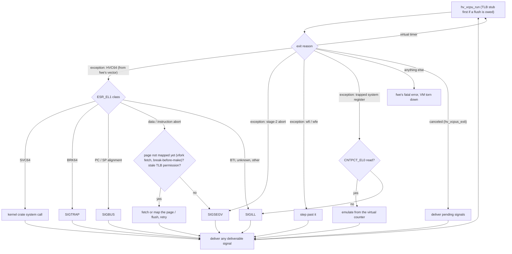

# The hypervisor backend

## Summary

fwe runs a non-position-independent executable linked below 4 GiB, such
as Debian's `python3.11`, GCC and clang at `0x400000` or static Go
programs at `0x10000`, in a small virtual machine made with
Hypervisor.framework, and picks this backend for it automatically. macOS
reserves the low 4 GiB of every arm64 process (`__PAGEZERO`, which
Apple's loader will not let a program shrink on Apple Silicon), and such a
program has no relocations that would let it run anywhere else; in the VM
the guest has an address space of its own.

The VM runs only the guest's CPU and memory. It has no Linux kernel in it:
every system call leaves the VM and goes to the same kernel crate the
native backend uses. How the VM is used (the vCPUs, fwe's exception
vector, the two stages of address translation, system calls, timers and
signals) is explained in
[linux-on-macos.md](linux-on-macos.md#how-the-vm-is-actually-used), and
how its memory, fork and execve compare with Linux and the native backend
in that document's [Memory](linux-on-macos.md#memory) and
[Processes](linux-on-macos.md#processes) sections. Where the backend
differs from Linux is in
[architecture.md](architecture.md#known-limitations), and whether it is
verified on real hardware in the [roadmap](../ROADMAP.md). This document
holds:

- the rules its implementation keeps ([How it works](#how-it-works));
- why misusing the framework is dangerous and the rules that prevent it
  ([Never end a VM process abnormally](#never-end-a-vm-process-abnormally));
- how it is tested without a real VM (the [stand-in](#the-stand-in)) and
  with one ([real-hardware runs](#real-hardware-runs-and-the-flight-recorder));
- how to [run it](#running-it-apple-silicon-no-root) and how
  [CI](#tests-and-ci) is arranged.

The framework needs the `com.apple.security.hypervisor` entitlement (an
ad-hoc signature carrying it is enough) but no root.

## How it works

The code is in `crates/native/src/hv/`. The backend's design follows from
one requirement: the framework must never see host memory change behind
the VM, and a VM must never outlive its process. So the VM's memory is
mapped once and then only the guest's own page tables change.

- **The VM** (`vm.rs`): stage 2 is set up once, when the VM is made, and
  does not change while it runs — the slab (`window.rs`, all private guest
  memory, mapped whole) and fwe's region (the page-table pool and a code
  page). Only shared segments add and remove mappings of their own. The
  framework keeps the host pages it found when a range was mapped, so the
  host memory behind stage 2 must not change either.
- **Stage 1** (`pagetables.rs`): 4 KiB pages in a 40-bit space, each with
  its EL0 permissions and BTI guard, written with single 64-bit stores, a
  new table filled before it is linked in. Taking access away bumps a
  generation; a vCPU resuming after that goes through the TLB stub on the
  code page (`tlbi vmalle1is; dsb ish; isb; eret`, at EL1), and memory or
  tables given back are reused only after a flush covering the edit that
  freed them. A page that would lead a translation possibly still cached
  elsewhere goes in only after such a flush (break-before-make); an access
  meanwhile faults and is retried. A permission fault the tables no longer
  give (a TLB keeping old permissions after `mprotect` widened them) is
  answered with one flush and a retry.
- **Memory** (`mem.rs`): the kernel's memory calls go to the backend
  (`Platform::memory`), which keeps the guest's mappings
  (`crates/kernel/src/vmas.rs`) and edits stage 1. A `MAP_FIXED` mapping
  over slab memory at its own address keeps using that memory, zeroed, so
  translated ranges stay rare.
  The framework maps only host memory that may be written, which a shared
  mapping of a file opened read-only is not: such a segment is made of the
  same file opened again for writing (checked to be the same file; an
  `mprotect` asking to write fails with `EACCES`), or, for a file the user
  may not write, of a private copy.
- **Pointer authentication and BTI**, where the vCPUs' ID registers offer
  them (see [linux-on-macos.md](linux-on-macos.md#cache-maintenance-pac-and-bti)).
- **Signals, threads, `execve` and `fork`** (explained in
  linux-on-macos.md): a signal stops the vCPU with `hv_vcpus_exit` and the
  run loop delivers it, while the framework's own threads block every
  guest signal ([Signals into a running vCPU](linux-on-macos.md#signals-into-a-running-vcpu));
  each guest thread has a vCPU of its own, created on it
  ([Threads](linux-on-macos.md#threads)); `execve` always re-executes fwe
  and `fork` starts a fresh `fwe --hv-fork-child` (`fork.rs`), never a
  host fork ([fork](linux-on-macos.md#fork)).

### The run loop

Each vCPU thread spends its life in one loop: run the vCPU until it exits,
find out why, act, and run it again. Every exception the guest takes at
EL0 enters fwe's vector, which runs `hvc #2` (not `hvc #0`, which the
framework may take for a firmware call), so the vCPU exits and the backend
reads `ESR_EL1` to learn what the guest did. A few things exit the vCPU
directly instead, and a signal for the guest exits it as *canceled*. The
diagram is the whole decision:



## Never end a VM process abnormally

Misusing Hypervisor.framework can bring the whole Mac down, as a watchdog
reset or a kernel panic with no useful report. The suspects:
- a VM process that ends with its VM alive;
- several VM processes ending together;
- a VM that fails to map memory and is then destroyed;
- private memory mapped into two VMs at once.

The runtimes that run Linux programs this way without such trouble
(hyper-linux, elfuse, Carrick) all map guest memory into the VM once, never
change stage 2 or the host memory behind it while the VM runs, and give a
fork child a copy rather than pages mapped into two VMs. fwe does the same,
and keeps these rules:

- **A plain `cargo test` never starts a VM.** The VM tests run on the
  [stand-in](#the-stand-in), and on the real framework only with
  `FWE_HV_TESTS=1`, which only a machine whose crash costs nothing should
  set.
- **Every way out tears the VM down first:** `exit_group`, the last
  thread's `exit`, a fatal signal's default action, fwe's own fatal
  errors, faults and panics, and `execve`. Teardown stops every vCPU, has
  each thread destroy its own (the framework requires that), then destroys
  the VM.
- **Signals whose default action terminates are caught**, so the process
  dies through teardown. `SIGKILL` cannot be caught, so a guest's
  `SIGKILL` to an fwe process (by `kill` or `tgkill`, to a process, a group
  or everyone) is sent as `SIGINFO`, which has no Linux counterpart: a VM
  process takes it as the guest's `SIGKILL`, tears down, then dies of
  `SIGKILL`, so its parent sees Linux's status. Only a `SIGKILL` from
  outside fwe cannot be intercepted.
- **No host `fork` of a VM process.** A fork child cannot use the parent's
  VM (`hv_vm_destroy` fails with `HV_NO_DEVICE`, `hv_vm_create` with
  `HV_BUSY`), so it would die with a VM it inherited.
  `fwe_kernel::fork_locked` refuses outright once a VM exists; a fork child
  that fails to set up tears down any VM it made before it exits.
- **Host memory behind the VM is never replaced.** Private memory stays
  in the slab: `munmap`, `mremap`, a `MAP_FIXED` mapping over existing
  memory and `MADV_DONTNEED` edit stage 1 and zero slab memory, which is
  reused only after a TLB flush. A shared segment leaves the VM before its
  host mapping goes.
- **A vCPU is never destroyed under a call on it.** At the end each thread
  destroys its own vCPU, from the wake signal's handler if it is blocked
  elsewhere, but not in the middle of a framework call on it (it does so as
  the call returns), and no call follows; a vCPU being destroyed is first
  taken out of other threads' `hv_vcpus_exit`.
- **One VM test at a time**, never several in parallel. A `fork` test has
  the parent's and the child's VM processes alive together, as any forking
  program does; each ends through teardown. Each VM test's processes form a
  process group: a timeout sends it `SIGTERM` (caught, so every VM is torn
  down), `SIGKILL` only to a test's first process still alive 5 s later,
  and a process outliving its test gets `SIGTERM` and fails the test.
- **Never alongside another hypervisor client.** The VM tests skip while
  one runs (`krunkit`, `vfkit`, QEMU, Virtualization.framework VMs); for
  Podman, `podman machine stop` first. The same goes for running a VM
  program by hand.

Keep to these when changing the backend.

## The stand-in

The real framework is unavailable in hosted CI and must not be used on a
development Mac, so the backend can also run on a software imitation of
it: `fwe --hv-standin` sends every framework call
(`crates/native/src/hv/standin.rs`) to an emulated CPU, Unicorn (QEMU's
CPU emulator as a library, `brew install unicorn`), loaded only in this
mode. It creates no VM, so it is safe on any Mac and runs in hosted CI; the
flag is passed on to every fwe a guest's `execve`, `fork` or `vfork`
starts.

What it models:
- one VM per process and one vCPU per thread;
- stage 2 as exactly the memory mapped with `hv_vm_map`, with its flags;
- stage 1 as fwe's own tables, walked as the hardware walks them, cached
  until fwe's TLB stub runs (the only code allowed at EL1);
- exceptions at EL0 through the vector to `hvc #2` with `ESR_EL1` and the
  other EL1 registers set; direct exits for stage-2 aborts, `wfi`/`wfe`
  and the physical counter;
- `hv_vcpus_exit` from any thread or signal handler;
- pointer authentication with fwe's keys (run Non-secure, as a VM runs);
- BTI landing pads on guarded pages, checked by the stand-in itself (its
  TLB hook cannot mark a page guarded for QEMU, and QEMU sets `BTYPE` as
  for an unguarded source page, so a `br` through a register other than
  x16 or x17 also accepts `bti c` or `paciasp`).

Only one vCPU emulates at a time, handed on at the next block when another
waits, and each Unicorn engine is driven only by its own thread: Unicorn's
API, `uc_emu_stop` included, races with an engine running on another
thread (its JIT write-protection bookkeeping is unsynchronised on Apple
Silicon), and Unicorn runs hooks inside its own memory calls, so no lock a
hook takes is held across them. Emulation is several times slower than the
CPU, so the tests give stand-in guests a longer time limit.

Besides running the guest, the stand-in checks the rules the backend must
keep, printing a line with `fwe hv stand-in: VIOLATION:` on which the
tests fail:
- a vCPU used from a thread other than its own, a VM destroyed with vCPUs
  alive, a vCPU run before its translation regime is set (40 bits, 4 KiB
  granule) or at EL1 anywhere but the TLB stub;
- a vector entry that is not `hvc #2`;
- a change to the stage 2 the VM ran with (anything but shared segments);
- host memory behind stage 2 replaced while mapped, checked now and then;
- anonymous host memory behind stage 2 shared with another process;
- through a watcher process started with the VM, a process that ends or
  execs with its VM alive.

A refused `hv_vm_map` is reported and fails as the framework fails it:
misaligned (16 KiB), overlapping, or over host memory that is unmapped or
could never be readable and writable. That last rule is inferred from the
framework's behaviour, and checked against it on real hardware (below).
The stand-in's unit test breaks each rule on purpose.
`FWE_STANDIN_DEBUG=1` reports each exception and exit it models.

A stand-in proves nothing about the real framework: its rules are what fwe
has seen the framework do, and the kernel crashes the backend may cause
cannot happen in it. So VM changes are also run on real hardware (below).
- **Not modelled:** the virtual timer, the fault address of an alignment
  fault outside the exclusive and atomic instructions, stack-pointer
  alignment checks, and code one vCPU writes for another without a mapping
  change.
- **Still to confirm on real hardware:** the 4 KiB stage-1 granule on
  every M-series chip, PAC and BTI as the vCPUs' ID registers offer them,
  and how the framework treats cache maintenance and `dc zva` at EL0
  (hyper-linux reports traps: `HCR_EL2.TPU`, `TDZ`).

## Real-hardware runs and the flight recorder

Real runs happen on a machine whose crash costs nothing (the self-hosted
runner of the `hypervisor` job, such as a rented bare-metal Mac), and are
instrumented. A crash leaves no stackshot and loses the last seconds of the
system log, so fwe keeps the evidence itself:

- **The flight recorder** (`--hv-record DEST` or `FWE_HV_RECORD=DEST`;
  `crates/native/src/hv/record.rs`) writes a line before and after every
  framework call that changes a VM (`hv_vm_create`, `hv_vm_map`,
  `hv_vm_unmap`, `hv_vcpu_create`, `hv_vcpu_destroy`, `hv_vm_destroy`)
  with its arguments and result, each process's start, `execve`, fork
  children and end, and a heartbeat with the count of `hv_vcpu_run` calls
  every half second. Each line is written synchronously: to `file:PATH`
  with `F_FULLFSYNC` (a vCPU's destruction and a fatal error are synced
  by the VM's destruction that follows), and/or to
  `udp:HOST:PORT` as a datagram, which a reset cannot take back
  (`tools/hv-record-listen.py PORT` collects them). The setting reaches
  every fwe a guest starts. A call begun and never ended names what was
  running when the machine went down.
- **The `hypervisor` job** records every run to a file outside its
  workspace (and to `FWE_HV_RECORD_UDP` if set), marks the record finished
  at the end, and at its start reports any earlier record that never
  finished, with its last lines, the boot time and panic reports. The
  record is kept as a job artifact.
- **The stand-in's inferred rules are checked**: the job runs
  `fwe --probe hv-map-rules` on the framework and on the stand-in and fails
  if they differ.

## Running it (Apple Silicon, no root)

On a machine meant for it (see the rules above), build fwe, sign it with
the entitlement, and run a low-linked program as any other:

```sh
cargo build --release -p fwe
codesign --sign - --entitlements hypervisor.entitlements --force target/release/fwe
target/release/fwe ./program-linked-low
```

- Without the entitlement, or on a host without hypervisor support
  (`sysctl kern.hv_support` must be `1`), fwe explains that the program
  needs the hypervisor backend and exits with status 126.
- `fwe --hv-spike` runs a tiny guest in a VM as a check that the hypervisor
  works: it prints `hv: hello from the guest` and reports exit status 42.

## Tests and CI

The end-to-end tests named `hv_*` run low-linked programs in the VM
backend:

- By default they run on the stand-in with the unsigned `fwe`, which could
  not create a real VM even by mistake (the tests check it carries no
  entitlement).
- With `FWE_HV_TESTS=1` they sign a copy of `fwe` with the entitlement and
  use the real framework, one test at a time.
- Where neither can run (no Unicorn, no hypervisor), they report the skip
  and pass.

GitHub's hosted macOS runners are VMs without nested virtualization, so the
framework is unavailable there; the `macos` jobs report it in an
informational step:
- `macos-15`: no `kern.hv_support` OID;
- `macos-26`: `kern.hv_support: 0`;
- both: `hv_vm_create` returns `0xfae9400f` (`HV_UNSUPPORTED`) even when
  correctly signed.

So hosted CI runs the backend's tests on the stand-in, and the real
framework runs only on a **self-hosted Apple Silicon runner**, in the
`hypervisor` job.

### Registering the self-hosted runner (one time)

1. On a bare-metal Apple Silicon Mac whose crash costs nothing (a rented
   cloud Mac, never the development Mac), confirm `sysctl kern.hv_support`
   is `1`.
2. Register it: `Settings → Actions → Runners → New self-hosted runner`,
   macOS/ARM64, and follow the `./config.sh` / `./run.sh` steps. GitHub
   labels it `self-hosted`, `macOS`, `ARM64`.
3. Install for the runner user: a Rust toolchain (`rustup`), the Xcode
   command line tools (`clang`) and Unicorn (`brew install unicorn`, for
   the probe comparison). Make sure the runner service's `PATH` includes
   `/opt/homebrew/bin`, which it does not by default.
4. Set the repository variable `FWE_HV_SELF_HOSTED` to `true`
   (`Settings → Secrets and variables → Actions → Variables`). The job
   stays skipped until then, so it never blocks PRs; once set it runs the
   `hv_` tests with `FWE_HV_TESTS=1` and `fwe --hv-spike` on every push.
5. Optionally, to stream the record off the machine, run
   `tools/hv-record-listen.py PORT` elsewhere and set the repository
   variable `FWE_HV_RECORD_UDP` to `udp:HOST:PORT`.
