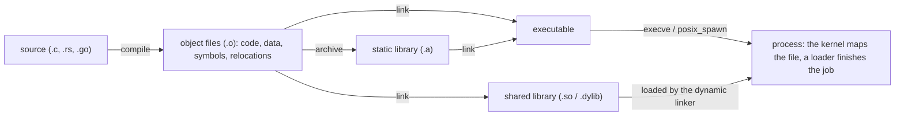
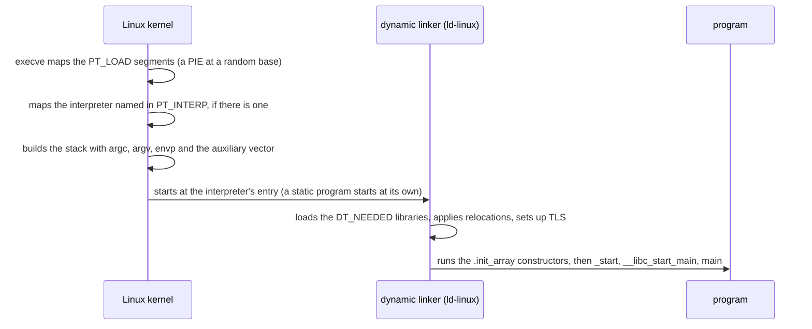
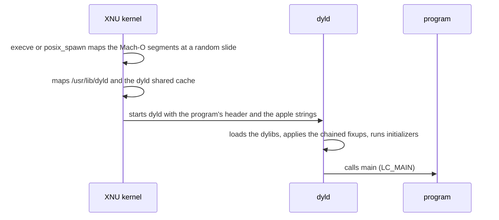

# How programs are built and loaded: Linux and macOS on arm64

The concepts behind a program file and its start: object files,
relocations, linking statically and dynamically, position independence,
ASLR, thread-local storage, and how a kernel and a loader start a
program, each on Linux and on macOS, both on arm64. What fwe does with
them is in [linux-on-macos.md](linux-on-macos.md); this document is the
background it assumes.

## From source to a running program

- **Compiling** turns each source file into an object file: machine code
  and data in *sections* (`.text` for code, `.data` and `.bss` for
  variables, `.rodata` for constants), a *symbol table* naming what the
  file defines and what it needs, and *relocations*: notes saying "this
  instruction or word must hold the address of that symbol, once it is
  known".
- **Linking** puts object files together into one image: it lays the
  sections out at addresses, resolves each symbol to an address, and
  applies the relocations it can. Whatever it cannot resolve yet (an
  address that depends on where the image will be loaded, or a symbol in
  a shared library) it leaves as a *dynamic relocation* for the loader.
- **Loading** maps the image into a process and applies those remaining
  relocations, then jumps to the entry point.

## File formats: ELF and Mach-O

Linux uses ELF (Executable and Linkable Format); macOS uses Mach-O. They
carry the same kinds of thing under different names.

| | ELF (Linux) | Mach-O (macOS) |
|---|---|---|
| Object file | `ET_REL` | `MH_OBJECT` |
| Executable | `ET_EXEC` (fixed address) or `ET_DYN` (PIE) | `MH_EXECUTE`, always position-independent on arm64 (`MH_PIE`) |
| Shared library | `ET_DYN` (`.so`) | `MH_DYLIB` (`.dylib`); loadable plug-ins are `MH_BUNDLE` |
| What the loader maps | program headers (`PT_LOAD` segments) | load commands (`LC_SEGMENT_64`) |
| What the linker sees | section headers (`.text`, `.data`…) | sections inside segments (`__TEXT,__text`, `__DATA,__data`…) |
| Names its loader | `PT_INTERP` (`/lib/ld-linux-aarch64.so.1`) | `LC_LOAD_DYLINKER` (`/usr/lib/dyld`) |
| Entry point | `e_entry` in the header | `LC_MAIN` (an offset; `dyld` calls it) |
| Libraries it needs | `DT_NEEDED` entries (by soname) | `LC_LOAD_DYLIB` commands (by install name) |
| Symbol names | as written: `main` | with a leading underscore: `_main` |
| Inspect with | `readelf`, `objdump`, `file`, `ldd` | `otool -l`, `otool -L`, `dyld_info`, `nm`, `file`, `vmmap` |

An ELF file has two views: *sections* for the linker and *segments* for
the loader. The loader never needs the section headers, so a stripped
binary may drop them along with its symbol table. Each `PT_LOAD` segment
says where in memory a range of the file goes and with which
protections (read, write, execute).

## Relocations and how arm64 code reaches addresses

arm64 instructions are 32 bits wide, so no single instruction holds a
64-bit address. Code reaches an address in one of these ways, and each
has its relocation kind (ELF's `R_AARCH64_*` names):

| Form | Instructions | Reach | Relocation |
|---|---|---|---|
| Branch or call | `b`, `bl` | ±128 MiB from the instruction | `JUMP26`, `CALL26` |
| PC-relative page, then the low 12 bits | `adrp x0, sym` then `add x0, x0, :lo12:sym` or a load | ±4 GiB from the instruction | `ADR_PREL_PG_HI21`, `ADD_ABS_LO12_NC`, `LDST*_ABS_LO12_NC` |
| PC-relative load of a literal | `ldr x0, label` | ±1 MiB | `LD_PREL_LO19` |
| Built in 16-bit pieces | `movz`, `movk` ×3 | any 64-bit value | `MOVW_UABS_G0`–`G3` |
| A pointer stored in data | `.quad sym` | any | `ABS64` |
| A pointer through the GOT | `adrp` + `ldr` of a GOT slot | any | `ADR_GOT_PAGE`, `LD64_GOT_LO12_NC` |

Compilers use the PC-relative forms by default (the *small code model*:
code and data within 4 GiB of each other). Code built so reaches its own
code and data relative to where it runs, and its only absolute addresses
are the pointers stored in its data: function-pointer tables, string
tables, constructor lists (`.init_array`), vtables. The *large code
model* (`-mcmodel=large`) builds addresses with `movz`/`movk` instead.

**The GOT** (global offset table) is a table of pointers the loader
fills in. Code that needs the address of something whose location is
not known at link time (a symbol in another library, or one that may be
interposed) loads it from a GOT slot rather than computing it.

**The PLT** (procedure linkage table) holds small stubs for calls into
other libraries: `bl printf` goes to a stub that jumps through a GOT
slot. macOS calls the same stubs `__stubs` and their slots `__got` (or
`__auth_got`, signed pointers, in Apple's own `arm64e` binaries).

**Dynamic relocations** are what the linker leaves for the loader:

| Linux (ELF) | macOS (Mach-O) | Meaning |
|---|---|---|
| `R_AARCH64_RELATIVE` | a *rebase* | "add the load address (the *slide*) to the pointer here" |
| `R_AARCH64_GLOB_DAT`, `R_AARCH64_JUMP_SLOT` | a *bind* | "put the address of symbol S here" |
| `R_AARCH64_IRELATIVE` | (none: macOS has no ifuncs) | "call this resolver and put its result here": glibc picks, say, the `memcpy` for this CPU |
| `.rela.dyn`, `.rela.plt` tables | chained fixups (`LC_DYLD_CHAINED_FIXUPS`), or rebase and bind opcodes in older binaries | where they are kept |

macOS's *chained fixups* encode each place to fix inside the pointer
slot itself, linking the slots of a page into a chain, so the file needs
no separate table and `dyld` touches only pages that hold pointers.

**Relocations a link keeps.** A linked executable normally holds only
the dynamic relocations; the linker drops the rest once it has applied
them. `ld --emit-relocs` (`-Wl,--emit-relocs`) keeps them all as
`.rela.text`, `.rela.data` and so on: tools that rearrange code after
linking (BOLT, for one) need them, and a whole image can then be moved
to another address with every absolute address it holds updated.

## Static and dynamic linking

**Static linking** copies the code the program uses out of static
libraries (`.a` archives of object files) into the executable. The
result needs nothing else at run time: no loader, no libraries.

**Dynamic linking** leaves the code in shared libraries, loaded when the
program starts. Many processes share one copy of a library's pages, a
fixed library reaches every program that uses it, and the executable
stays small. The price is a loader that runs before `main`, and a
program that depends on the libraries present on the system.

| | Linux | macOS |
|---|---|---|
| Dynamic linker | `ld-linux-aarch64.so.1` (glibc) or `ld-musl-aarch64.so.1` (musl), named by the program | `/usr/lib/dyld`, always |
| Fully static executables | supported: the kernel loads them, and the system call interface is stable | not supported: every program links `libSystem.dylib`, the only stable interface to the kernel |
| A library's name | its *soname* (`libc.so.6`), recorded in each program's `DT_NEEDED` | its *install name* (`/usr/lib/libSystem.B.dylib`, `@rpath/libfoo.dylib`), recorded in `LC_LOAD_DYLIB` |
| Where libraries are searched | `DT_RUNPATH`/`DT_RPATH`, `LD_LIBRARY_PATH`, `/etc/ld.so.cache`, default directories | the install name's path; `@rpath`, `@executable_path` and `@loader_path` expand against the program |
| Symbol lookup | one global scope: the first library that defines a name wins for everyone (*interposition*; `LD_PRELOAD` puts a library first) | *two-level namespace*: each import names the library it comes from; interposing takes an `__interpose` section or `DYLD_INSERT_LIBRARIES`, which macOS ignores for protected programs |
| Versions | glibc's *symbol versioning* (`memcpy@GLIBC_2.17`) keeps old behaviour for old programs | a library's compatibility version, checked at load |
| Binding | lazily by default (a PLT slot is resolved on its first call), or all at start with `-z now` / `BIND_NOW`; `RELRO` then makes the GOT read-only | at load; binaries with chained fixups have no lazy binding |
| System libraries | files on disk, mapped one by one | the *dyld shared cache*: all system libraries pre-linked into one image, mapped into every process; the individual files are not on disk |

## Position independence

Where an image may be loaded decides how much the loader must fix:

| Kind | ELF type | Loads at | Fixed up by | Built with |
|---|---|---|---|---|
| Fixed-address executable | `ET_EXEC` | only its link address | nothing: its addresses are final | `-no-pie`; `-static` with GCC by default |
| PIE (position-independent executable) | `ET_DYN` with `PT_INTERP` | anywhere | the dynamic linker (`RELATIVE` relocations, then the library binds) | `-fPIE -pie`, the default of most distributions' compilers |
| Static PIE | `ET_DYN` without `PT_INTERP` | anywhere | itself: its start-up code (`rcrt1.o`) applies its own `RELATIVE` relocations before the C library starts | `-static-pie` |
| Shared library (PIC) | `ET_DYN`, usually with `DT_SONAME` | anywhere | the dynamic linker | `-fPIC -shared` |

`file` names them: "dynamically linked, interpreter …" for a PIE,
"static-pie linked" for a static PIE, "statically linked" for a
fixed-address static executable. A static PIE and a shared library are
both `ET_DYN` without an interpreter; the `DF_1_PIE` flag in the dynamic
section marks the executable.

On arm64 position independence costs almost nothing: code already reaches
its own code and data PC-relatively, so a PIE differs from a
fixed-address build mainly in the pointers stored in its data, which the
loader adjusts once. On 32-bit x86, which has no PC-relative data
access, it cost a register and several percent, which is why some
packages still opt out; how distributions build theirs is in
[linux-on-macos.md](linux-on-macos.md#how-distributions-build-their-programs).

**Link addresses.** A fixed-address executable goes where its linker put
it: GNU ld at `0x400000` (4 MiB), LLVM's lld at `0x200000`, Go's linker
at `0x10000` (64 KiB). macOS's linker produces only position-independent
arm64 executables, and every arm64 process keeps its lowest 4 GiB
unmapped ([`__PAGEZERO`](#__pagezero-the-unmapped-bottom-of-a-macos-process)).

## `__PAGEZERO`: the unmapped bottom of a macOS process

Every macOS executable starts with a segment named `__PAGEZERO`: no file
contents and no access at all (its protections are none), covering the
lowest addresses of the process. The kernel maps it like any segment, so
nothing else can be placed there, and any load, store or jump into it
faults (`SIGSEGV`, or `EXC_BAD_ACCESS` in a crash report).

On arm64 it spans the whole lowest 4 GiB, `0` to `0x1_0000_0000`, and
the kernel refuses to run an executable whose `__PAGEZERO` is smaller:
it kills the process at `exec`. What that buys:

- **Null pointers fault.** Dereferencing `NULL`, or a field or array
  element a long way past it (`p->x` with `p == NULL`, `a[i]` with a
  huge `i`), lands in unmapped memory and crashes at once, instead of
  reading or writing whatever happened to be mapped low.
- **Truncated pointers fault.** A 64-bit pointer squeezed through a
  32-bit integer and back keeps only its low 32 bits, an address below
  4 GiB. With nothing ever mapped there, such a bug crashes at its first
  use rather than silently touching other memory: a whole class of
  porting bugs from 32-bit code shows up at once.
- **Exploits lose a foothold.** An attacker who can make code follow a
  null or truncated pointer cannot first map their own data at that low
  address, because nothing can be mapped there.

Linux has a smaller version of the same guard: `vm.mmap_min_addr`
(usually 32 or 64 KiB) keeps the lowest pages from being mapped by
unprivileged programs, mainly to stop null-pointer bugs in the kernel
being exploited from user space. Above that, a Linux process owns its
whole lower address space, which is why Linux toolchains link
fixed-address executables at `0x400000` or `0x10000`, addresses inside
macOS's `__PAGEZERO`. A Linux program loaded at such an address cannot
share a process with macOS code, which is what sends those programs to a
VM under fwe ([linux-on-macos.md](linux-on-macos.md#the-low-4-gib)).

## The address space and ASLR

ASLR (address space layout randomization) loads each part of a process
at an address chosen afresh, so an attacker cannot know where code and
data are. Only position-independent images can take part.

| | Linux arm64 | macOS arm64 |
|---|---|---|
| User address space | 48 bits (256 TiB) on most kernels; 52 with larger configurations | about 47 bits (128 TiB); the lowest 4 GiB is `__PAGEZERO` |
| A PIE | loaded at a random base high in the address space (around two thirds up) | slid by a random multiple of the page size |
| A fixed-address executable | at its link address, never randomized | does not exist on arm64 |
| Libraries, `mmap` | from a random `mmap` base below the stack | randomized per process, except the shared cache |
| System libraries | randomized per process like any library | the shared cache is slid once per boot, at the same address in every process |
| Stack, heap (`brk`) | randomized | randomized; macOS has no `brk` heap |
| Switch | `/proc/sys/kernel/randomize_va_space`; `setarch -R` per process | always on |

## Thread-local storage

`__thread` / `thread_local` variables have one copy per thread, found
from a *thread pointer* register.

| | Linux arm64 | macOS arm64 |
|---|---|---|
| Thread pointer | `TPIDR_EL0`, read and written by user code (`mrs`/`msr`); the C library sets it per thread | `TPIDRRO_EL0`, read-only to user code, set by the kernel to the thread's own data |
| Access to a variable | by *TLS model*: local-exec and initial-exec add a fixed offset to the thread pointer; general-dynamic and TLSDESC call into the dynamic linker for libraries loaded later | through a *thread-local variable descriptor*: a call to a function (`tlv_get_addr`) that returns the address |

## Registers the platform reserves

The arm64 procedure call standard leaves `x18` to the platform:

- **Linux** treats `x18` as an ordinary temporary register. Most
  toolchains avoid it anyway, but hand-written code and some compilers'
  output use it, and Windows code (under Wine) keeps its thread block
  there.
- **macOS** reserves `x18`: the kernel may change it at any time, so
  macOS code never uses it.

Pointer authentication (PAC) signs return addresses and pointers with a
key held by the kernel. Linux programs built with
`-mbranch-protection=standard` sign return addresses with instructions
that older CPUs treat as no-ops, and mark branch targets for BTI. macOS
signs pointers throughout (return addresses, function pointers, GOT
slots) in Apple's own `arm64e` binaries; third-party programs are built
as plain `arm64`.

## Starting a program

On Linux:

On macOS:

**The auxiliary vector** is how a Linux kernel tells the loader and the
C library about the process: `AT_PHDR` (where the program's headers are
mapped), `AT_ENTRY`, `AT_BASE` (where the interpreter is), `AT_PAGESZ`,
`AT_RANDOM` (16 random bytes for stack guards), `AT_HWCAP` (CPU
features), `AT_SYSINFO_EHDR` (the vDSO). macOS passes its equivalents to
`dyld` as `apple[]` strings after the environment.

**Fast kernel services.** Linux maps a *vDSO*, a small shared library
the kernel provides, so `clock_gettime` and similar calls run without
entering the kernel. macOS maps a *commpage* with the time and CPU
facts, which `libSystem` reads.

**System calls.** Linux's interface is the stable boundary: `svc #0`
with the call number in `x8`, the same in every release, so a static
program runs on any later kernel. macOS's boundary is `libSystem`: its
kernel calls (`svc #0x80`, number in `x16`) change between releases and
are not for programs to make themselves.

## Pages, segments and memory protections

| | Linux arm64 | macOS arm64 |
|---|---|---|
| Page size | 4 KiB on most kernels; 16 KiB (Asahi, some servers) and 64 KiB exist | 16 KiB |
| Segment alignment | ELF `p_align`: 64 KiB by default from GNU ld and lld on arm64, so a binary loads on any of those page sizes | 16 KiB |
| Executable code | any mapping may be executable, writable and executable at once unless a security module forbids it | every executable page must be covered by a code signature (an ad-hoc one will do; the linker adds it) |
| Code written at run time (JIT) | `mmap` writable, then `mprotect` executable, or both at once | `MAP_JIT` memory, switched per thread between writable and executable (`pthread_jit_write_protect_np`); the hardened runtime asks for an entitlement |

## Unwinding and debug information

Both use DWARF for debug information and for the call-frame information
that unwinding (C++ exceptions, Rust panics, backtraces) reads. Linux
keeps the unwind tables in `.eh_frame` (indexed by `.eh_frame_hdr`,
`PT_GNU_EH_FRAME`); macOS uses a compact encoding (`__unwind_info`),
falling back to `__eh_frame` for functions it cannot describe, and keeps
full debug information in a separate `.dSYM` bundle rather than in the
binary.

## What this means for running Linux programs on macOS

A Linux arm64 program's instructions run on a Mac's CPU unchanged, but
its file and its expectations are Linux's: an ELF image, possibly at a
fixed address inside macOS's `__PAGEZERO`, its own dynamic linker, its
own system calls, the thread pointer in `TPIDR_EL0`, perhaps `x18`, and
pages of 4 KiB. How fwe loads such programs, which ones it runs natively
and which in a VM, and what it rewrites, is in
[linux-on-macos.md](linux-on-macos.md); how each part is built is in
[architecture.md](architecture.md).
