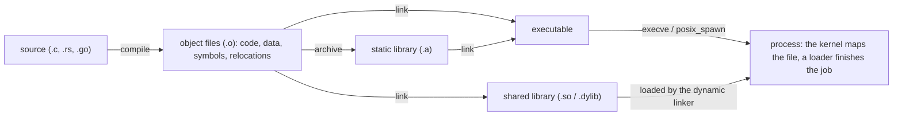
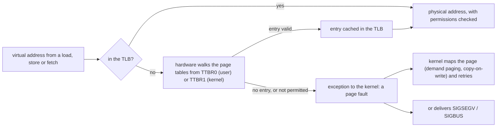
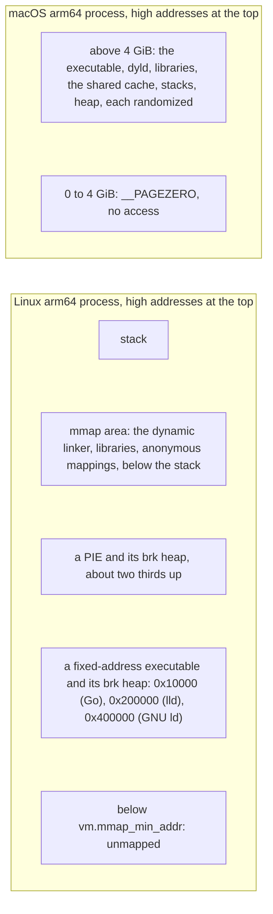
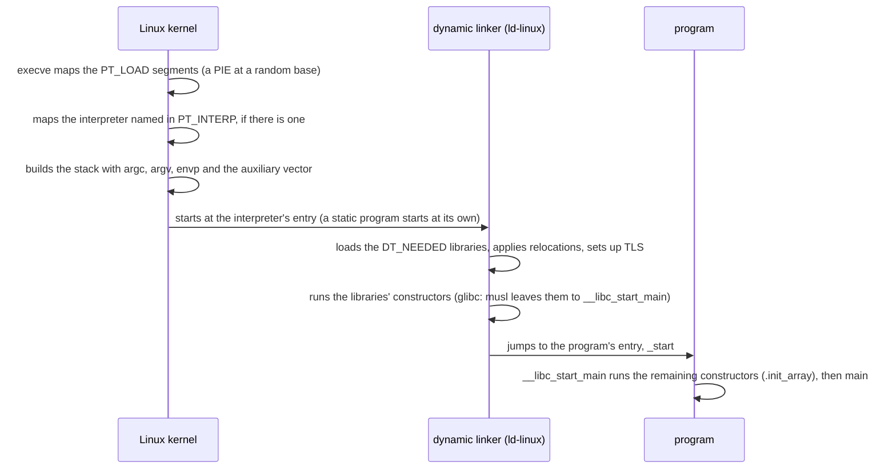
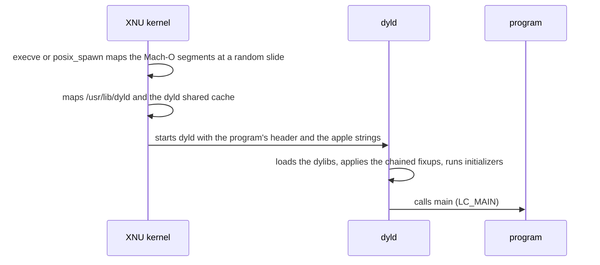

# How programs are built and loaded: Linux and macOS on arm64

This document is background, not fwe: how a program is built and
started on Linux and on macOS, both on arm64. It covers object files,
relocations, static and dynamic linking, position independence and the
code each kind of build makes, virtual memory, `__PAGEZERO`, ASLR,
thread-local storage, and how a kernel and a loader start a program.
The instruction set and the calling conventions, `x18` among them, are
in [arm64.md](arm64.md); what fwe does with all of this is in
[linux-on-macos.md](linux-on-macos.md), and how it is built in
[architecture.md](architecture.md).

## From source to a running program



- **Compiling** turns each source file into an object file: machine code
  and data in *sections* (`.text` for code, `.data` and `.bss` for
  variables, `.rodata` for constants), a *symbol table* naming what the
  file defines and what it needs, and *relocations*: notes saying "this
  instruction or word is to hold the address of that symbol, once it is
  known".
- **Linking** puts object files together into one image: it lays the
  sections out at addresses, resolves each symbol to an address, and
  applies the relocations it can. Whatever it cannot resolve yet (an
  address that depends on where the image will be loaded, or a symbol in
  a shared library) it leaves as a *dynamic relocation* for the loader.
- **Loading** maps the image into a process and applies those remaining
  relocations, then jumps to the entry point.

## File formats: ELF and Mach-O

Linux uses ELF (Executable and Linkable Format); macOS uses Mach-O. They
carry the same kinds of thing under different names.

| | ELF (Linux) | Mach-O (macOS) |
|---|---|---|
| Object file | `ET_REL` | `MH_OBJECT` |
| Executable | `ET_EXEC` (fixed address) or `ET_DYN` (PIE) | `MH_EXECUTE`, always position-independent on arm64 (`MH_PIE`) |
| Shared library | `ET_DYN` (`.so`) | `MH_DYLIB` (`.dylib`); loadable plug-ins are `MH_BUNDLE` |
| What the loader maps | program headers (`PT_LOAD` segments) | load commands (`LC_SEGMENT_64`) |
| What the linker sees | section headers (`.text`, `.data`…) | sections inside segments (`__TEXT,__text`, `__DATA,__data`…) |
| Names its loader | `PT_INTERP` (`/lib/ld-linux-aarch64.so.1`) | `LC_LOAD_DYLINKER` (`/usr/lib/dyld`) |
| Entry point | `e_entry` in the header | `LC_MAIN` (an offset; `dyld` calls it) |
| Libraries it needs | `DT_NEEDED` entries (by soname) | `LC_LOAD_DYLIB` commands (by install name) |
| Symbol names | as written: `main` | with a leading underscore: `_main` |
| Inspect with | `readelf`, `objdump`, `file`, `ldd` | `otool -l`, `otool -L`, `dyld_info`, `nm`, `file`, `vmmap` |

An ELF file has two views: *sections* for the linker and *segments* for
the loader. The loader never needs the section headers, so a stripped
binary can drop them along with its symbol table. Each `PT_LOAD` segment
says where in memory a range of the file goes and with which
protections (read, write, execute).

## Relocations and how arm64 code reaches addresses

arm64 instructions are 32 bits wide, so no single instruction holds a
64-bit address. Code reaches an address in one of these ways, and each
has its relocation kind (ELF's `R_AARCH64_*` names):

| Form | Instructions | Reach | Relocation |
|---|---|---|---|
| Branch or call | `b`, `bl` | ±128 MiB from the instruction | `JUMP26`, `CALL26` |
| PC-relative page, then the low 12 bits | `adrp x0, sym` then `add x0, x0, :lo12:sym` or a load | ±4 GiB from the instruction | `ADR_PREL_PG_HI21`, `ADD_ABS_LO12_NC`, `LDST*_ABS_LO12_NC` |
| PC-relative load of a literal | `ldr x0, label` | ±1 MiB | `LD_PREL_LO19` |
| Built in 16-bit pieces | `movz`, `movk` ×3 | any 64-bit value | `MOVW_UABS_G0`–`G3` |
| A pointer stored in data | `.quad sym` | any | `ABS64` |
| A pointer through the GOT | `adrp` + `ldr` of a GOT slot | any | `ADR_GOT_PAGE`, `LD64_GOT_LO12_NC` |

Compilers use the PC-relative forms by default (the *small code model*:
code and data within 4 GiB of each other). Code built so reaches its own
code and data relative to where it runs, and its only absolute addresses
are the pointers stored in its data: function-pointer tables, string
tables, constructor lists (`.init_array`), vtables. The *large code
model* (`-mcmodel=large`) builds addresses with `movz`/`movk` instead.

**The GOT** (global offset table) is a table of pointers the loader
fills in. Code that needs the address of something whose location is
not known at link time (a symbol in another library, or one that can be
interposed) loads it from a GOT slot rather than computing it.

**The PLT** (procedure linkage table) holds small stubs for calls into
other libraries: `bl printf` goes to a stub that jumps through a GOT
slot. macOS calls the same stubs `__stubs` and their slots `__got` (or
`__auth_got`, signed pointers, in Apple's own `arm64e` binaries).

**Dynamic relocations** are what the linker leaves for the loader:

| Linux (ELF) | macOS (Mach-O) | Meaning |
|---|---|---|
| `R_AARCH64_RELATIVE` | a *rebase* | "add the load address (the *slide*) to the pointer here" |
| `R_AARCH64_GLOB_DAT`, `R_AARCH64_JUMP_SLOT` | a *bind* | "put the address of symbol S here" |
| `R_AARCH64_IRELATIVE` | (none: macOS has no ifuncs) | "call this resolver and put its result here": glibc picks, say, the `memcpy` for this CPU |
| `.rela.dyn`, `.rela.plt` tables | chained fixups (`LC_DYLD_CHAINED_FIXUPS`), or rebase and bind opcodes in older binaries | where they are kept |

macOS's *chained fixups* encode each place to fix inside the pointer
slot itself, linking the slots of a page into a chain, so the file needs
no separate table and `dyld` touches only pages that hold pointers.

**Relocations a link keeps.** A linked executable normally holds only
the dynamic relocations; the linker drops the rest once it has applied
them. `ld --emit-relocs` (`-Wl,--emit-relocs`) keeps them all as
`.rela.text`, `.rela.data` and so on: tools that rearrange code after
linking (BOLT, for one) need them, and a whole image can then be moved
to another address with every absolute address it holds updated.

## Static and dynamic linking

**Static linking** copies the code the program uses out of static
libraries (`.a` archives of object files) into the executable. The
result needs nothing else at run time: no loader, no libraries.

**Dynamic linking** leaves the code in shared libraries, loaded when the
program starts. Many processes share one copy of a library's pages, a
fixed library reaches every program that uses it, and the executable
stays small. The price is a loader that runs before `main`, and a
program that depends on the libraries present on the system.

| | Linux | macOS |
|---|---|---|
| Dynamic linker | `ld-linux-aarch64.so.1` (glibc) or `ld-musl-aarch64.so.1` (musl), named by the program | `/usr/lib/dyld`, always |
| Fully static executables | supported: the kernel loads them, and the system call interface is stable | not supported: every program links `libSystem.dylib`, the only stable interface to the kernel |
| A library's name | its *soname* (`libc.so.6`), recorded in each program's `DT_NEEDED` | its *install name* (`/usr/lib/libSystem.B.dylib`, `@rpath/libfoo.dylib`), recorded in `LC_LOAD_DYLIB` |
| Where libraries are searched | `DT_RUNPATH`/`DT_RPATH`, `LD_LIBRARY_PATH`, `/etc/ld.so.cache`, default directories | the install name's path; `@rpath`, `@executable_path` and `@loader_path` expand against the program |
| Symbol lookup | one global scope: the first library that defines a name wins for everyone (*interposition*; `LD_PRELOAD` puts a library first) | *two-level namespace*: each import names the library it comes from; interposing takes an `__interpose` section or `DYLD_INSERT_LIBRARIES`, which macOS ignores for protected programs |
| Versions | glibc's *symbol versioning* (`memcpy@GLIBC_2.17`) keeps old behaviour for old programs | a library's compatibility version, checked at load |
| Binding | lazily by default (a PLT slot is resolved on its first call), or all at start with `-z now` / `BIND_NOW`; `RELRO` then makes the GOT read-only | at load; binaries with chained fixups have no lazy binding |
| System libraries | files on disk, mapped one by one | the *dyld shared cache*: all system libraries pre-linked into one image, mapped into every process; the individual files are not on disk |

## Position independence

Where an image can be loaded decides how much fixing up it needs, and
by whom:

| Kind | ELF type | Loads at | Fixed up by | Built with |
|---|---|---|---|---|
| Fixed-address executable | `ET_EXEC` | only its link address | nothing: its addresses are final | `-no-pie`; `-static` with GCC by default |
| PIE (position-independent executable) | `ET_DYN` with `PT_INTERP` | anywhere | the dynamic linker (`RELATIVE` relocations, then the library binds) | `-fPIE -pie`, the default of most distributions' compilers |
| Static PIE | `ET_DYN` without `PT_INTERP` | anywhere | itself: its start-up code (`rcrt1.o`) applies its own `RELATIVE` relocations before the C library starts | `-static-pie` |
| Shared library (PIC) | `ET_DYN`, usually with `DT_SONAME` | anywhere | the dynamic linker | `-fPIC -shared` |

`file` names them: "dynamically linked, interpreter …" for a PIE,
"static-pie linked" for a static PIE, "statically linked" for a
fixed-address static executable. A static PIE and a shared library are
both `ET_DYN` without an interpreter; the `DF_1_PIE` flag in the dynamic
section marks the executable.

On arm64 position independence costs almost nothing: code already reaches
its own code and data PC-relatively, so a PIE differs from a
fixed-address build mainly in the pointers stored in its data, which the
loader adjusts once. On 32-bit x86, which has no PC-relative data
access, it costs a register and several percent, which is why some
packages opt out; how distributions build theirs is in
[linux-on-macos.md](linux-on-macos.md#how-distributions-build-their-programs).

**Link addresses.** A fixed-address executable goes where its linker put
it: GNU ld at `0x400000` (4 MiB), LLVM's lld at `0x200000`, Go's linker
at `0x10000` (64 KiB). macOS's linker produces only position-independent
arm64 executables, and every arm64 process keeps its lowest 4 GiB
unmapped ([`__PAGEZERO`](#__pagezero-the-unmapped-bottom-of-a-macos-process)).

## What the code looks like: fixed-address, PIE and static PIE

One small program, compiled and linked three ways, then disassembled.
The output below is real, cut to the lines that matter.

```c
/* demo.c */
extern int other_value;            /* defined in another file or library */
extern int other_func(int);
int counter = 1;                   /* defined here */
const char *names[] = {"a", "b"};  /* pointers stored in data */

int main(void) {
    counter++;
    return other_func(counter + other_value) + names[1][0];
}

/* other.c */
int other_value = 41;
int other_func(int x) { return x + 1; }
```

Built with clang for `aarch64-linux-musl`, linked with lld against musl's
start-up files and `libc.a` (the dynamic case against a shared
`libother.so` built from `other.c` with `-fPIC -shared`):

| Build | Compile | Link | `file` says |
|---|---|---|---|
| fixed-address, static | `-fno-pic` | `-static` with `crt1.o` | `executable, statically linked` (`ET_EXEC`, at `0x200000`) |
| static PIE | `-fPIE` | `-static -pie --no-dynamic-linker` with `rcrt1.o` | `pie executable, static-pie linked` (`ET_DYN`, linked at 0) |
| dynamic PIE | `-fPIE` | `-pie --dynamic-linker=/lib/ld-musl-aarch64.so.1` | `pie executable, dynamically linked, interpreter …` |

### What the compiler emits

The compiler decides how each address is reached; the object file
records what it still needs as relocations. `main` from `-fPIE`,
`llvm-objdump -dr`:

```
 4:  adrp  x8, 0x0                    R_AARCH64_ADR_PREL_PG_HI21   counter
 8:  adrp  x10, 0x0                   R_AARCH64_ADR_GOT_PAGE       other_value
10:  ldr   w9, [x8]                   R_AARCH64_LDST32_ABS_LO12_NC counter
14:  ldr   x10, [x10]                 R_AARCH64_LD64_GOT_LO12_NC   other_value
18:  ldr   w10, [x10]
28:  bl    0x28                       R_AARCH64_CALL26             other_func
2c:  adrp  x8, 0x0                    R_AARCH64_ADR_PREL_PG_HI21   names+0x8
30:  ldr   x8, [x8]                   R_AARCH64_LDST64_ABS_LO12_NC names+0x8
34:  ldrb  w8, [x8]
```

- `counter`, defined in this file, is reached PC-relatively: `adrp` to
  its 4 KiB page, then a load at the low 12 bits.
- `other_value` might live in a shared library, at an address no one knows
  until the program runs, so `-fPIE` reaches it through a GOT slot: the
  first `ldr` fetches its address, the second its value. With
  `-fno-pic` the compiler reaches it directly instead, as it does
  `counter` (were it then in a shared library, the linker would copy it
  into the executable: a *copy relocation*).
- `other_func` is a plain `bl`; the linker decides whether it lands on
  the function or on a PLT stub.
- `names[1]` is loaded from data: a pointer stored in the image.

### `main` after linking

```
fixed-address (0x200000)           static PIE (linked at 0)            dynamic PIE (linked at 0)
adrp x8,  0x230000                 adrp x8,  0x31000                   adrp x8,  0x30000
adrp x10, 0x230000                 adrp x10, 0x21000      ; GOT page   adrp x10, 0x20000      ; GOT page
ldr  w9,  [x8, #0xcf8]  ; counter  ldr  w9,  [x8, #0x258] ; counter    ldr  w9,  [x8, #0x508] ; counter
ldr  w10, [x10, #0xd10] ; value    ldr  x10, [x10, #0x208]; address    ldr  x10, [x10, #0x500]; address
                                   ldr  w10, [x10]        ; value      ldr  w10, [x10]        ; value
bl   other_func                    bl   other_func                     bl   other_func@plt
adrp x8,  0x230000                 adrp x8,  0x31000                   adrp x8,  0x30000
ldr  x8,  [x8, #0xd08]  ; names[1] ldr  x8,  [x8, #0x268] ; names[1]   ldr  x8,  [x8, #0x518] ; names[1]
```

The three are the same code. Every address is reached PC-relatively
(`adrp` prints the page it will reach when the image runs where it was
linked), so none of these instructions changes when the image is loaded
elsewhere. What differs:

- **`other_value`.** The fixed-address build loads it directly, one load.
  Both PIEs go through the GOT, two loads.
- **`other_func`.** In the static builds the call lands on the function
  itself. In the dynamic PIE it lands on a PLT stub, which jumps through
  a GOT slot the dynamic linker fills (`x16` and `x17` are the
  registers the arm64 ABI sets aside for such stubs):

  ```
  other_func@plt:
      adrp x16, 0x30000
      ldr  x17, [x16, #0x538]     ; the slot: other_func's address, once bound
      add  x16, x16, #0x538
      br   x17
  ```

### The data, and what is fixed at load time

| | `names` holds, in the file | Dynamic relocations |
|---|---|---|
| fixed-address | `0x2001c8`, `0x2001ca`: the strings' final addresses | none |
| static PIE | zeros | 18 `R_AARCH64_RELATIVE` (`names`, the GOT, the C library's own tables) |
| dynamic PIE | zeros | `R_AARCH64_RELATIVE` ×2 (addends `0x360`, `0x362`: the strings), `R_AARCH64_GLOB_DAT other_value` (its GOT slot), `R_AARCH64_JUMP_SLOT other_func` (the PLT's slot) |

A fixed-address image is finished at link time: its pointers are final
and nothing runs before `_start`. A PIE's pointers are written at load
time: each `R_AARCH64_RELATIVE` says "store the load address plus this
addend here" (the addend is in the relocation, `RELA`, so the slot in
the file stays zero).

### Who applies them

In the **dynamic PIE**, the dynamic linker does: it is mapped by the
kernel, relocates itself, maps `libother.so`, applies the `RELATIVE`
entries, finds `other_value` and `other_func` in the library for the
`GLOB_DAT` and `JUMP_SLOT` slots, and jumps to the program's entry.

In the **static PIE**, the program does it itself. Its `_start` (from
`rcrt1.o`) finds its own dynamic section PC-relatively and hands it to
the start-up code, before any other code runs:

```
_start:
    mov  x29, #0
    mov  x30, #0
    mov  x0, sp                 ; argc, argv, envp, auxv
    adr  x1, _DYNAMIC           ; where this image's dynamic section is now
    and  sp, x0, #-16
    b    _start_c
```

which then, in outline:

```c
base = address of _DYNAMIC now - its link-time address;
for each entry in .rela.dyn:
    if type == R_AARCH64_RELATIVE:
        *(uint64_t *)(base + entry.offset) = base + entry.addend;
/* then start the C library and call main, as a non-PIE would */
```

The relocating code itself uses no pointer stored in data, only
PC-relative addressing, because none has been fixed yet.

### The same function on macOS

clang for `arm64-apple-macos`, the object file:

```
 8:  adrp  x8, 0x0                    ARM64_RELOC_PAGE21          _counter
 c:  ldr   w9, [x8]                   ARM64_RELOC_PAGEOFF12       _counter
18:  adrp  x8, 0x0                    ARM64_RELOC_GOT_LOAD_PAGE21 _other_value
1c:  ldr   x8, [x8]                   ARM64_RELOC_GOT_LOAD_PAGEOFF12 _other_value
20:  ldr   w8, [x8]
28:  bl    0x28                       ARM64_RELOC_BRANCH26        _other_func
2c:  adrp  x8, 0x0                    ARM64_RELOC_PAGE21          _names (+8)
30:  ldr   x8, [x8]                   ARM64_RELOC_PAGEOFF12       _names (+8)
34:  ldrsb w8, [x8]
```

The same instructions under other names: Mach-O's relocations are
`PAGE21`/`PAGEOFF12` for `adrp` and its low 12 bits, `GOT_LOAD_*` for a
GOT slot, symbols carry a leading underscore, and in assembly source the
forms are written `_counter@PAGE`, `_counter@PAGEOFF` and
`_other_value@GOTPAGE`. One ABI difference shows: `char` is signed on
Apple's platforms (`ldrsb`) and unsigned on Linux arm64 (`ldrb`).

### Why this matters for moving a program

All three builds reach their own code and data PC-relatively, so the
instructions are right wherever the image goes, as long as code and
data move together. Only the pointers stored in data, and any address
built with `movz`/`movk`, depend on where the image is. A PIE lists
those places in its dynamic relocations; a fixed-address executable
throws the list away at link time, unless it was linked with
`--emit-relocs`.

## Virtual memory on arm64

Every address a program uses is *virtual*: the CPU's memory management
unit (MMU) translates it to a physical address through page tables the
kernel builds. The hardware is the same under both kernels; how each
kernel fills in the tables, and what it lets programs ask for, differs.

### Translation



- **Two halves.** arm64 splits the address space: the lower half
  (addresses starting `0x0000…`) is translated through `TTBR0_EL1`, the
  upper half (`0xffff…`) through `TTBR1_EL1`. Linux and XNU both put user
  space in the lower half, one table per process, and the kernel in the
  upper half, shared by all. A context switch changes `TTBR0` only.
- **Page tables** are trees: each level's entry points to the next
  level's table, the last to a page. An entry can also stop early and
  map a whole *block* at once.
- **The TLB** caches translations. Entries are tagged with an ASID
  (address space ID), so a switch between processes need not flush it;
  when the kernel changes a mapping it invalidates the stale entries
  (`tlbi`).
- **Permissions** live in each entry: readable, writable, executable for
  user code (`UXN`) and for the kernel (`PXN`). The kernel is barred
  from touching user memory except through its explicit copy routines
  (`PAN`), and from executing it at all.
- **A fault** on a missing or forbidden page traps to the kernel, which
  either supplies the page and retries the instruction, or sends the
  process a signal.

### Page sizes

The *granule* sets the page size and the shape of the tree:

| Granule | Entries per table | Levels for a 48-bit space | Block mappings | Contiguous hint | Used by |
|---|---|---|---|---|---|
| 4 KiB | 512 | 4 | 2 MiB, 1 GiB | 16 pages (64 KiB) | most Linux kernels |
| 16 KiB | 2048 | 4 (3 for 47 bits) | 32 MiB | 128 pages (2 MiB) | macOS; Linux on Apple Silicon (Asahi) and some servers |
| 64 KiB | 8192 | 3 | 512 MiB | 32 pages (2 MiB) | some Linux server distributions |

The page size is a kernel choice, fixed for each process. Apple's CPUs
offer the 4 KiB granule as well as 16 KiB, and macOS runs Rosetta 2's
x86 processes with it; its own arm64 processes always have 16 KiB pages.
A Linux program asks for the page size (`sysconf(_SC_PAGESIZE)`,
`AT_PAGESZ`) rather than assuming 4 KiB, and ELF segments are aligned
to 64 KiB by default (`p_align`, from GNU ld and lld on arm64), so most
binaries load under any of the three; the exceptions are programs that
assumed 4 KiB pages when built (some memory allocators, for one).

### What each kernel provides

| | Linux | macOS (XNU) |
|---|---|---|
| Calls | `mmap`, `munmap`, `mprotect`, `madvise`, `mremap`, `brk`, `mlock`, `msync`, `userfaultfd`, `memfd_create` | `mmap`, `munmap`, `mprotect`, `madvise`, `mlock`, `msync` (BSD layer), and the Mach VM calls beneath them: `mach_vm_allocate`, `mach_vm_protect`, `mach_vm_remap`, memory entries (`mach_make_memory_entry`) |
| Kinds of mapping | anonymous or file-backed, private (copy-on-write) or shared | the same, built on Mach VM objects |
| Pages appear | on first touch (demand paging); a private page is copied on its first write | the same |
| `fork` | copies the page tables, marks private pages copy-on-write | the same, through Mach's copy-on-write objects |
| Growing a mapping in place | `mremap`, which can also move it | no `mremap`; `mach_vm_remap` maps the same pages elsewhere |
| Heap | `brk` grows a data segment; `malloc` uses it and `mmap` | no `brk`; `malloc` uses `mach_vm_allocate` |
| Giving pages back | `madvise(MADV_DONTNEED)` drops the pages at once: private anonymous ones read back as zero | `MADV_DONTNEED` and `MADV_FREE` are hints that let the kernel reclaim the pages later; until it does they might keep their contents |
| Shared memory without a file | `memfd_create`, `shm_open`, a shared anonymous mapping across `fork` | `shm_open`, Mach memory entries passed over Mach ports |
| Large pages | transparent huge pages (2 MiB with 4 KiB pages), `hugetlbfs` | no user-visible large pages |
| Code | any mapping can be executable, even writable and executable at once, unless a security module forbids it | every executable page needs a code signature covering it (an ad-hoc one will do; the linker adds it) |
| Code written at run time (JIT) | `mmap` writable, then `mprotect` executable, or both at once | `MAP_JIT` memory, switched per thread between writable and executable (`pthread_jit_write_protect_np`); the hardened runtime asks for an entitlement |
| More memory promised than exists | overcommitted by default (`vm.overcommit_memory`); when memory runs out the OOM killer ends a process | overcommitted too |
| When memory is short | pages written to swap (`zswap` can compress them first), file pages dropped | pages compressed in memory by the compressor, then written to swap files |
| Seeing a process's mappings | `/proc/<pid>/maps`, `/proc/<pid>/smaps` | `vmmap <pid>` |

### Two stages: virtual machines

A virtual machine adds a second translation. The guest's own page
tables translate its virtual addresses to what it believes are physical
addresses (*intermediate physical addresses*, IPAs, stage 1); the
hypervisor's tables translate those to real physical memory (stage 2),
which the guest cannot see or change. The TLB caches the combined
result. On a Mac, Hypervisor.framework manages stage 2: `hv_vm_map` maps
a range of the host process's memory at an IPA in the VM, so a guest's
"physical" memory is ordinary memory of the process that runs the VM.

## `__PAGEZERO`: the unmapped bottom of a macOS process

Every macOS executable starts with a segment named `__PAGEZERO`: no file
contents and no access at all (its protections are none), covering the
lowest addresses of the process. The kernel maps it like any segment, so
nothing else can be placed there, and any load, store or jump into it
faults (`SIGSEGV`, or `EXC_BAD_ACCESS` in a crash report).

On arm64 it spans the whole lowest 4 GiB, `0` to `0x1_0000_0000`, and
the kernel refuses to run an executable whose `__PAGEZERO` is smaller:
it kills the process at `exec`. What that buys:

- **Null pointers fault.** Dereferencing `NULL`, or a field or array
  element a long way past it (`p->x` with `p == NULL`, `a[i]` with a
  huge `i`), lands in unmapped memory and crashes at once, instead of
  reading or writing whatever happened to be mapped low.
- **Truncated pointers fault.** A 64-bit pointer squeezed through a
  32-bit integer and back keeps only its low 32 bits, an address below
  4 GiB. With nothing ever mapped there, such a bug crashes at its first
  use rather than silently touching other memory: a whole class of
  porting bugs from 32-bit code shows up at once.
- **Exploits lose a foothold.** An attacker who can make code follow a
  null or truncated pointer cannot first map their own data at that low
  address, because nothing can be mapped there.

Linux has a smaller version of the same guard: `vm.mmap_min_addr`
(usually 32 or 64 KiB) keeps the lowest pages from being mapped by
unprivileged programs, mainly to stop null-pointer bugs in the kernel
being exploited from user space. Above that, a Linux process owns its
whole lower address space, which is why Linux toolchains link
fixed-address executables at `0x400000`, `0x200000` or `0x10000`,
addresses inside macOS's `__PAGEZERO`:



A Linux program loaded at such an address cannot share a process with
macOS code where it was linked; how fwe runs it is in
[linux-on-macos.md](linux-on-macos.md#the-low-4-gib).

## The address space and ASLR

ASLR (address space layout randomization) loads each part of a process
at an address chosen afresh, so an attacker cannot know where code and
data are. Only position-independent images can take part.

| | Linux arm64 | macOS arm64 |
|---|---|---|
| User address space | 48 bits (256 TiB) on most kernels; 52 with larger configurations | about 47 bits (128 TiB); the lowest 4 GiB is `__PAGEZERO` |
| A PIE | loaded at a random base high in the address space (around two thirds up) | slid by a random multiple of the page size |
| A fixed-address executable | at its link address, never randomized | does not exist on arm64 |
| Libraries, `mmap` | from a random `mmap` base below the stack | randomized per process, except the shared cache |
| System libraries | randomized per process like any library | the shared cache is slid once per boot, at the same address in every process |
| Stack, heap (`brk`) | randomized | randomized; macOS has no `brk` heap |
| Switch | `/proc/sys/kernel/randomize_va_space`; `setarch -R` per process | always on |

## Thread-local storage

`__thread` / `thread_local` variables have one copy per thread, found
from a *thread pointer* register.

| | Linux arm64 | macOS arm64 |
|---|---|---|
| Thread pointer | `TPIDR_EL0`, read and written by user code (`mrs`/`msr`); the C library sets it per thread | `TPIDRRO_EL0`, read-only to user code, set by the kernel to the thread's own data |
| Access to a variable | by *TLS model*: local-exec and initial-exec add a fixed offset to the thread pointer; general-dynamic and TLSDESC call into the dynamic linker for libraries loaded later | through a *thread-local variable descriptor*: a call to a function (`tlv_get_addr`) that returns the address |

## Starting a program

On Linux:



On macOS:



**The auxiliary vector** is how a Linux kernel tells the loader and the
C library about the process: `AT_PHDR` (where the program's headers are
mapped), `AT_ENTRY`, `AT_BASE` (where the interpreter is), `AT_PAGESZ`,
`AT_RANDOM` (16 random bytes for stack guards), `AT_HWCAP` (CPU
features), `AT_SYSINFO_EHDR` (the vDSO). macOS passes its equivalents to
`dyld` as `apple[]` strings after the environment.

**Fast kernel services.** Linux maps a *vDSO*, a small shared library
the kernel provides, so `clock_gettime` and similar calls run without
entering the kernel. macOS maps a *commpage* with the time and CPU
facts, which `libSystem` reads.

**System calls.** Linux's interface is the stable boundary: `svc #0`
with the call number in `x8`, the same in every release, so a static
program runs on any later kernel. macOS's boundary is `libSystem`: its
kernel calls (`svc #0x80`, number in `x16`) change between releases and
are not for programs to make themselves.

## Unwinding and debug information

Both use DWARF for debug information and for the call-frame information
that unwinding (C++ exceptions, Rust panics, backtraces) reads. Linux
keeps the unwind tables in `.eh_frame` (indexed by `.eh_frame_hdr`,
`PT_GNU_EH_FRAME`); macOS uses a compact encoding (`__unwind_info`),
falling back to `__eh_frame` for functions it cannot describe, and keeps
full debug information in a separate `.dSYM` bundle rather than in the
binary.
