# Linux on macOS

The key words "MUST", "MUST NOT", "REQUIRED", "SHALL", "SHALL NOT",
"SHOULD", "SHOULD NOT", "RECOMMENDED", "NOT RECOMMENDED", "MAY", and
"OPTIONAL" in this document are to be interpreted as described in BCP 14
[RFC 2119](https://www.rfc-editor.org/rfc/rfc2119) [RFC 8174](https://www.rfc-editor.org/rfc/rfc8174)
when, and only when, they appear in all capitals, as shown here.

fwe runs arm64 Linux programs on Apple Silicon Macs. Both systems use the
same processor, so a Linux program's instructions run on the Mac's CPU
as they are; what differs is the kernel. fwe stands in for Linux's: it
catches each system call, carries it out with what macOS offers, and
turns what macOS reports (key strokes, children ending, data arriving,
errors) into what Linux would have said. This document covers which
programs run on which of fwe's two backends, which instructions the
native backend rewrites, how the VM backend uses the hypervisor, what
each costs and how languages fare; then the mapping itself:
[Linux to macOS](#linux-to-macos) (what Linux does, what macOS has, what
fwe does), [macOS to Linux](#macos-to-linux) (what happens on the host,
what the guest sees), and an index of [what fwe enforces](#what-fwe-enforces).
How fwe's parts work, and where it falls short of Linux, is in
[architecture.md](architecture.md); running the VM backend safely is in
[hypervisor.md](hypervisor.md); code made at run time is in
[jit.md](jit.md).

## Two kernels, one CPU

Every guest process is one host process: a copy of `fwe` holding the
guest's code and memory and a Linux kernel of fwe's making, the *kernel
crate*. The guest reaches the kernel crate through a *backend*, which
catches its system calls and delivers signals into it; the kernel crate
reaches macOS through ordinary C library calls. What Linux keeps in one
kernel for all processes (mount tables, namespaces, IPC objects) fwe keeps
in records its processes share ([Kernel-wide state](#kernel-wide-state)).

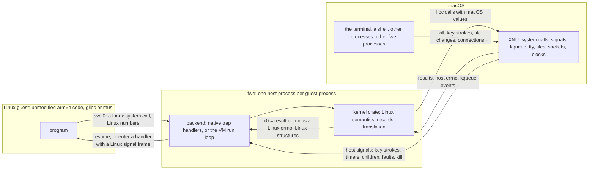

Only what the two kernels define differently needs bridging: the
system-call interface, a few registers macOS reserves, the address space,
the kernel objects macOS lacks or shapes differently, and the events it
reports in its own terms. fwe has two backends, chosen per program, which
bridge the first three differently and share the rest:

| | Native backend | VM backend |
|---|---|---|
| Runs | every position-independent program, `ET_EXEC` images linked at or above 4 GiB, and static ones linked below it whose link kept its relocations (moved) | other non-PIE executables linked below 4 GiB, and under `--vm` every program of the run |
| Guest code | in the `fwe` process, a few instructions rewritten ([Which instructions get translated](#which-instructions-get-translated-and-how)); code made at run time translated | unmodified, at EL0 in a Hypervisor.framework VM with an address space of its own ([How the VM is used](#how-the-vm-is-actually-used)) |
| Page size the guest sees | 16 KiB (the host's) | 4 KiB |
| Guest addresses | host addresses | host addresses, except fixed-address ranges outside the memory set aside for the VM (the *slab*), such as a low-linked image, which are translated |
| A system call | a function call into fwe's gate | a VM exit |
| Host signals reach the guest | the handler rewrites the interrupted guest context | the handler stops the vCPU, the run loop delivers |
| Pointer arguments | read and written through copies that fail with `EFAULT` rather than crash | checked against the guest's mappings and turned into host addresses ([Pages and translation](#pages-and-translation)) |
| The `mmap` family | host `mmap`, `mprotect` and `munmap` at the guest's addresses | the slab's pages and fwe's stage-1 page tables; a `MAP_SHARED` segment is a host `mmap` |
| A new thread | a host thread | a host thread with a vCPU of its own |
| `fork`, `vfork` | host `fork` ([fork](#fork)) | a fresh fwe process, sent the parent's memory and kernel state |
| `execve` | the new program loaded in place, or a host `execve` of fwe ([execve](#execve)) | a host `execve` of fwe |

Both backends hand every system call to the same kernel crate, so a call
behaves the same in either unless this document says otherwise.

## Which binaries run where, and why

fwe picks a backend for each program from its ELF headers alone, because
the two kernels lay out a process's memory differently.

### The low 4 GiB

On Linux an arm64 process owns its whole lower address space. A
non-position-independent program (`ET_EXEC`) runs only at its link
address: the usual toolchains use `0x400000` (4 MiB), Go uses `0x10000`
(64 KiB) for static programs. macOS gives every arm64 process a
mandatory 4 GiB `__PAGEZERO` at address 0, which Apple's loader will not
shrink. The native backend runs the guest at the guest's own addresses
inside the fwe process, so a program linked below 4 GiB has nowhere to
go there as linked (a binary asking for a smaller `__PAGEZERO` is killed
at exec). A
position-independent program (`ET_DYN`, a PIE) goes wherever macOS has
room, and an `ET_EXEC` program linked at or above 4 GiB at its own
address.

A static `ET_EXEC` program linked below 4 GiB can still run natively,
moved 1 TiB higher (a multiple of 4 GiB), when its link kept its
relocations (`--emit-relocs`): arm64 code reaches its own code and data
PC-relatively, so a whole image moved by a multiple of 4 GiB keeps its
code right, and the relocations list every absolute address it holds,
each changed to match (64-bit pointers in data, addresses built in code
from `movz`/`movk`, static glibc's ifunc table). A program whose link
kept none, a dynamic one (its dynamic linker relocates it at its link
address), or one holding an address no relocation follows (a 32-bit
absolute address, one reached through a GOT) is not moved.

### How fwe decides

A non-PIE executable whose lowest loaded page lies below 4 GiB, and that
cannot be moved above it, runs in the VM (`vm_reason` in
`crates/native/src/lib.rs`; `--strace` says why); every other program
runs natively:

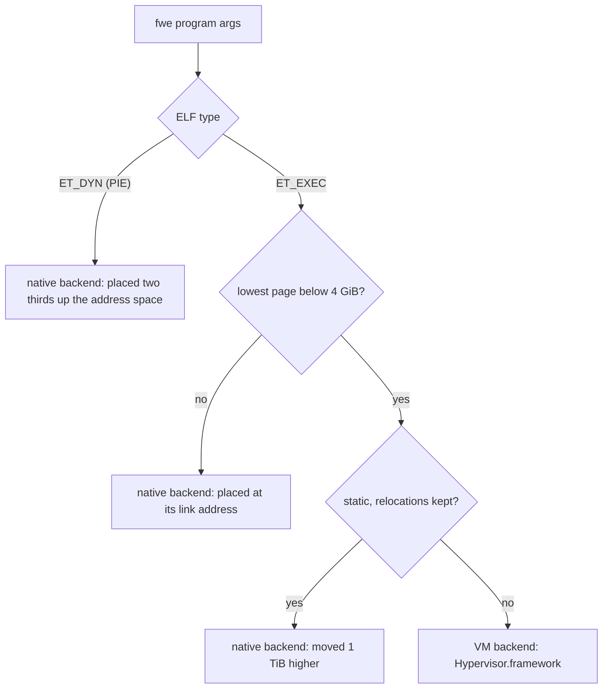

| Binary | Example | Backend |
|---|---|---|
| dynamic PIE | Debian's `bash`, `git`, coreutils, Node.js, clang | native |
| static PIE | `musl-gcc -static-pie`, Rust's `+crt-static` with PIE | native |
| static non-PIE linked at or above 4 GiB | fwe's test guests, linked at 1 TiB (`--image-base=0x10000000000`) | native |
| static non-PIE linked below 4 GiB, relocations kept (`--emit-relocs`) | fwe's `lowlinked` test guest, at `0x200000` | native, moved |
| non-PIE linked below 4 GiB, dynamic | Debian's `python3.13` and GCC, at `0x400000` | VM |
| non-PIE linked below 4 GiB, static, no relocations kept | static Go programs at `0x10000`; fwe's `rust-low` test guests | VM |

"Low-linked" in this documentation and the tests means the last two rows:
the programs that run in the VM. The test suite builds its Rust guests
twice: at 1 TiB to run natively, and at the toolchain's default address
(`target/guests/rust-low`) to run in the VM.

- `fwe --vm` runs every program of the run in the VM (each fwe it starts
  gets `--vm` too), for programs that need 4 KiB pages, such as Wine; a
  PIE is then placed in the slab.
- Where there is no VM (fwe without the hypervisor entitlement, or a Mac
  without hardware virtualization, `kern.hv_support`, and no stand-in), a
  low-linked program given to fwe fails with a message saying so and
  status 126 ([hypervisor.md](hypervisor.md#running-it-apple-silicon-no-root)),
  and a guest's `execve` of one fails with `ENOEXEC`, so the caller goes
  on: podman's pause process, whose `catatonit` is one, then waits in a
  loop of its own.

### How distributions build their programs

(What PIE, static PIE and fixed-address executables are, and how
linking works on each system: [linking.md](linking.md).)

Most of what a distribution ships is PIE: its C compiler builds PIEs by
default, and its packaging passes hardening flags that ask for them. The
exceptions are programs whose build bypasses those flags or opts out,
and they are the same few kinds everywhere. The arm64 packages of the
current releases, by ELF header (`readelf -h -l`):

| Program | Debian 13 | Ubuntu 26.04 | Fedora 45 | CentOS Stream 10 (RHEL 10) | Arch Linux ARM | Alpine 3.24 |
|---|---|---|---|---|---|---|
| Python | non-PIE | non-PIE | PIE | PIE | PIE | PIE |
| GCC (`gcc`, `cc1`, `collect2`) | non-PIE | non-PIE | non-PIE | PIE | non-PIE | non-PIE |
| clang | PIE | PIE | PIE | PIE | PIE | PIE |
| rustc, cargo | PIE | PIE | PIE | PIE | PIE | PIE |
| git | PIE | PIE | PIE | PIE | PIE | PIE |
| the Go toolchain (`go`, `compile`, `link`) | non-PIE, static | non-PIE, static | non-PIE, static | non-PIE, static | non-PIE, static | PIE |
| podman | non-PIE | non-PIE | PIE | PIE | PIE | PIE |
| containerd | non-PIE | PIE (its shim non-PIE) | PIE | not packaged | non-PIE | PIE |
| runc | non-PIE | non-PIE | PIE | not packaged (crun instead) | PIE | PIE |
| catatonit (static) | non-PIE | non-PIE | non-PIE | static PIE | non-PIE | static PIE |
| static busybox | non-PIE | non-PIE | non-PIE | not packaged | non-PIE | static PIE |

Every non-PIE executable among them is linked below 4 GiB (C at
`0x400000`, Go at `0x10000`) and none kept its relocations, so each
runs in the VM. Why each kind is built so:

- **Go.** Go's linker builds non-PIE executables on Linux unless asked
  for `-buildmode=pie`, and Go builds bypass the C compiler's hardening
  flags. A distribution gets PIEs only by passing the flag in its Go
  packaging: Alpine does for everything, Fedora and CentOS for the
  programs they package but not for the toolchain itself, Arch for most
  (its containerd is the exception), Debian and Ubuntu not at all.
- **GCC.** GCC builds its own programs position-dependent unless
  configured with `--enable-host-pie` (or `--enable-host-shared`), so a
  distribution's GCC is non-PIE even where it builds PIEs by default;
  CentOS Stream 10 builds it as PIE.
- **Python.** Debian and Ubuntu build the interpreter without PIE and
  with `libpython` linked into it, for speed in the interpreter's loop:
  a gain on x86, where position-independent code costs an indirection,
  and next to none on arm64, which addresses its own data PC-relatively
  either way.
- **Static programs.** GCC's `-static` builds a non-PIE executable
  unless asked for `-static-pie`; Alpine and CentOS build their static
  programs as static PIEs. Rust's `+crt-static` musl builds (rustc 1.100,
  linking its own start-up files) come out non-PIE at `0x200000`.

The distributions built to run on Apple Silicon (Fedora Asahi Remix,
Asahi's Arch Linux ARM, Ubuntu Asahi, and Omarchy on Apple Silicon, which
builds on Arch Linux ARM and Asahi's repositories) take their programs
from the arm64 packages above, adding their own kernel, firmware and
graphics stack. Their kernels use 16 KiB pages, as the Mac's do, so what
they ship already runs with the page size fwe's native backend gives.

### The dynamic linker

A dynamically linked program names its dynamic linker in `PT_INTERP`
(`/lib/ld-linux-aarch64.so.1` for glibc, `/lib/ld-musl-aarch64.so.1` for
musl). As Linux's does, fwe's loader resolves it in the guest's root
filesystem, maps each of the two images' `PT_LOAD` segments (a PIE at a
base it picks), and starts at the dynamic linker's entry, with `AT_BASE`
and `AT_ENTRY` set; from then on glibc and musl run unmodified. The
interpreter MUST be position-independent (`ELIBBAD` from `execve`
otherwise), so it never decides the backend. The libraries it maps later
go through fwe's `openat` and `mmap` like any file; natively their code is
rewritten as it is mapped executable.

### Across execve

A program can `execve` one of the other kind: a shell in the VM runs a
native `ls`, a native `make` runs a low-linked `gcc`. fwe then re-executes
itself on the new program, and the fresh `fwe` decides again; only a
native program execing a native one can be replaced in place
([execve](#execve) has when, and what crosses).

## Which instructions get translated, and how

This section is about the native backend; the VM backend translates no
instructions. How the code that does it works is in
[architecture.md](architecture.md#rewriting-guest-code); the
instructions, registers and calling conventions themselves are in
[arm64.md](arm64.md).

### What runs unchanged

Almost everything: arithmetic, loads and stores, branches, floating point
and SIMD, atomics and data cache maintenance run directly on the processor.
Only instructions whose meaning depends on the kernel need help:

| Instruction | What Linux expects | Why it cannot run unchanged on macOS | What fwe does |
|---|---|---|---|
| `svc #0` (any `svc`: Linux ignores the immediate) | a Linux system call, number in `x8` | it would enter the macOS kernel, which reads `x16` and other numbers | rewritten to a branch to a stub that calls fwe's gate (`brk #0x4c58` where no stub fits); an `svc` with another immediate only where the image's unwind table says there is code |
| `mrs`/`msr` of `TPIDR_EL0` | the thread pointer, which the program owns | macOS does not preserve `TPIDR_EL0` for user code | rewritten to a branch to a stub |
| any instruction naming `x18` | an ordinary register | macOS clears `x18` on every exception return, preemption included | rewritten to a branch to a stub |
| `mrs <Xt>, ctr_el0` | readable at EL0 | macOS traps it | left alone; emulated when it traps |
| `ic ivau, <Xt>` | invalidates an instruction cache line: code there was written | runs, but fwe runs code a program writes from translations it has to drop | rewritten to a branch to a stub that runs it and calls fwe's gate, which drops the translations made from the line |

### System calls: svc calls fwe's gate

macOS's own system calls use `svc #0x80` with the number in `x16`, so a
Linux `svc #0` would make a wrong call. Before guest code executes,
every `svc #0` is overwritten with a branch to a stub of its own, which
calls fwe's system-call gate (`crates/native/src/gate.rs`). Linux takes an
`svc` with any immediate as a system call, which compilers never emit
but hand-written code can: such an `svc` is rewritten the same way in
code the image's unwind table covers, where it cannot be a constant
(elsewhere a data word could match it far more often than `svc #0`):

```
site:  b     stub                  ; was svc #0
stub:  mrs   x18, tpidrro_el0      ; the host thread's TSD (x18 is fwe's)
       and   x18, x18, #~7
       str   x30, [x18, #s30]      ; x30 and x0 kept in TSD slots
       str   x0, [x18, #s0]
       ldr   x30, =gate
       blr   x30
       mrs   x18, tpidrro_el0
       and   x18, x18, #~7
       ldr   x30, [x18, #s30]
       b     site + 4
```

The gate runs the call on a stack of fwe's, with the number from `x8` and
arguments from `x0`–`x5`. Like Linux's `svc`, which touches no user
memory, the stub leaves memory below the program's `sp` alone, and needs
no stack (musl's thread exit unmaps its own stack before its `exit`).
How a stub keeps registers through `x18` is under
[x18](#x18-a-stub-per-use). An `svc #0` with no stub within branch range
is overwritten with a breakpoint carrying fwe's mark (`0x4c58`, "LX"),
and takes a host signal:

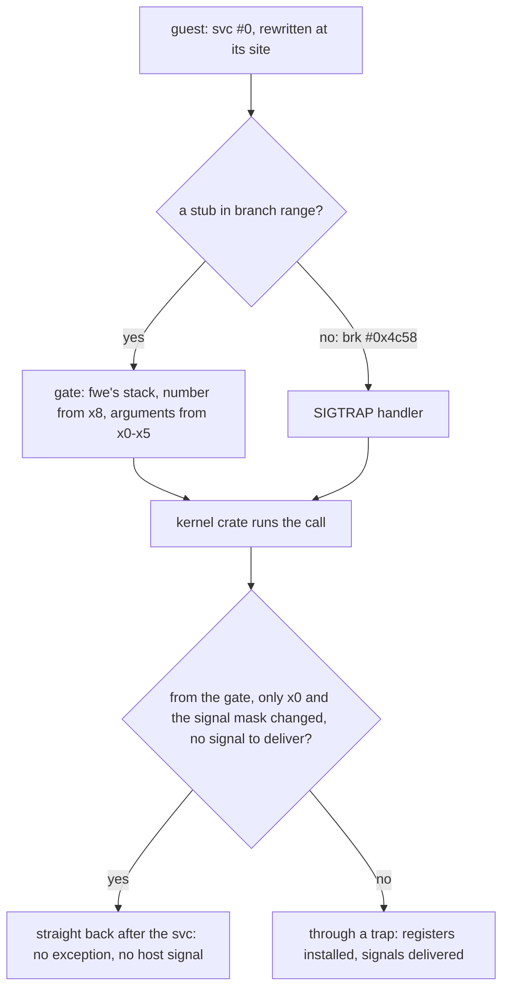

How the gate and its trap work is in
[architecture.md](architecture.md#the-system-call-gate). The breakpoint
fwe writes where no stub fits:

| | Assembly | Word | Bytes in memory |
|---|---|---|---|
| In the Linux binary | `svc #0` | `0xd4000001` | `01 00 00 d4` |
| In memory under fwe | `brk #0x4c58` | `0xd4298b00` | `00 8b 29 d4` |

A `brk` with any other immediate is the guest's own breakpoint and
becomes a `SIGTRAP` for the guest.

### The thread pointer: a stub per access

Linux programs keep thread-local storage at the address in `TPIDR_EL0`,
read with `mrs xN, tpidr_el0` and set by the C library with `msr`. macOS
does not keep that register for user code, so fwe keeps each guest
thread's value in a slot of the host thread's thread-specific data (a
`pthread` key), which macOS points the read-only `TPIDRRO_EL0` at:

```text
Linux binary                  under fwe
------------                  ---------
mrs  x0, tpidr_el0            b    stub
                              ...
                         stub:
                              mrs  x0, tpidrro_el0      // host thread's TSD
                              and  x0, x0, #~7          // low three bits cleared
                              ldr  x0, [x0, #tp_slot]   // the guest's thread pointer
                              b    <next instruction>
```

A write (`msr tpidr_el0, xN`) finds the slot through `x18` and stores the
value there, touching no other register
([x18](#x18-a-stub-per-use)). A read into `xzr` becomes a `nop`.

### x18: a stub per use

On Linux `x18` is an ordinary register. macOS clears it whenever the
kernel returns to user code, preemption included, so a value kept there
can vanish between any two instructions. fwe keeps the guest's `x18` in a
second TSD slot and rewrites every instruction naming `x18` to use an
ordinary register instead:

```text
Linux binary                  under fwe
------------                  ---------
ldr  x0, [x18, #8]            b    stub
                              ...
                         stub:
                              mrs  x18, tpidrro_el0     // the host thread's TSD
                              and  x18, x18, #~7
                              str  x1, [x18, #s0]       // a register the instruction
                                                        // does not use, kept
                              ldr  x1, [x18, #x18_slot] // x1 = the guest's x18
                              ldr  x0, [x1, #8]         // the instruction, x18 -> x1
                              mrs  x18, tpidrro_el0
                              and  x18, x18, #~7
                              ldr  x1, [x18, #s0]       // x1 back
                              b    <next instruction>
```

An instruction that writes `x18` stores the scratch register back into the
slot; macOS preserves every register but `x18`, so the scratch register
survives preemption. The rewrite covers every data-processing, load/store,
exclusive, acquire/release and LSE atomic form, system-register moves and
`sys` (`dc civac, x18`), the thread pointer moved through `x18`, the
pointer-authentication forms, PC-relative
forms (materialised from the original pc), compare- and test-branches,
indirect branches through `x18`, and code using `sp`, written back or
written from `x18` included, which runs with `sp` as it is. `casp` with
`x18` in a pair has a stub of its own, its pairs kept even pairs.

A stub keeps the registers it borrows in TSD slots too, never below
`sp`: memory below `sp` is the program's, which Linux's system calls and
every other instruction leave as it was (Go's `clone` keeps a new
thread's start function below its `sp` across the thread's first system
call; Linux's lack of a red zone lets only a signal frame go there). The
first register is kept before any is free, so through `x18`, which is
fwe's: a group of `mrs x18, tpidrro_el0; and x18, x18, #~7` and loads and
stores through it. macOS can zero `x18` between any two of them; nothing
is mapped in the low 4 GiB, so the next access through it faults, and
fwe's fault handler starts the group again from its `mrs`. Each group
does the same when run again: a register it both stores and loads is
loaded by its last access.

A branch through `x18` needs another register to branch through. A
call, a return or a tail call (`blr`, `ret`, the authenticated forms)
goes through `x16` or `x17`, which the procedure call standard leaves
free there. A plain `br x18` is how clang ends a jump table where `x18`
is free, as on Linux: the case it leads to can read `x16` and `x17`
(V8's tables keep their base in `x16`), so its stub saves them and goes
into fwe, which goes on at the guest's `x18` by translation, back to
native code when the function returns ([jit.md](jit.md)).

The hardware checks `sp` for 16-byte alignment when memory is addressed
through it (Linux and macOS both turn the check on), and Linux programs
can keep `sp` off alignment while they address memory through other
registers (pixman's NEON functions take `sub sp, sp, #0xe8` and save
`x18` through `x29`). No stub addresses memory through `sp`, so stubs run
there as anywhere; the program's own access through such an `sp` faults
as on Linux: `SIGBUS`, `BUS_ADRALN`, at `sp`.

A system call or signal frame sees the guest's real `x18`, `rt_sigreturn`
restores it, and a new thread starts with its creator's. A fault or
signal in a stub is delivered as at its site: the frame has the program's
own instruction for its pc, its registers and `sp` as the site had them,
so a handler that looks up the faulting instruction, or skips it (as a
JIT's implicit null checks do), finds it where the program wrote it.

### Code made executable at run time: translated

Memory a program makes executable after mapping it (`mprotect` adding
`PROT_EXEC`), maps writable and executable at once, or maps from a file
shared and open for writing is not prepared: a JIT compiler writes,
patches and copies code there as it runs, and keeps its data beside it.
Natively it runs by translation into fwe's code cache, the program's
memory never changed and never executable on the host; the instructions
above are expanded in the translations, and the program's `ic ivau`
flushes tell fwe which code changed ([jit.md](jit.md)). Code executable
already and unwritten since, made executable again, is not new: glibc's
dynamic linker does so to every object built for BTI (adding
`PROT_BTI`), and that code runs as prepared.

### CTR_EL0: emulated when it traps

Linux lets user code read `CTR_EL0`, the cache-type register, to learn
cache line sizes before flushing code it wrote. macOS traps the read as
`SIGILL`. fwe's fault handler recognises `mrs <Xt>, ctr_el0`
(`0xd53b0020` with `Xt` in the low five bits), puts Apple Silicon's value
in `Xt` without the bits that let code skip cache maintenance
(`crates/native/src/hwcap.rs`), and resumes after it.

### When code is prepared

Code is prepared while it is still writable and before any thread can run
it: as a program or its dynamic linker is loaded (segments copied into
writable memory, executable sections prepared, final protections set),
and as a file or anonymous memory is mapped with `PROT_EXEC` (for a file,
only the sections its section headers mark executable). Code made
executable after it was mapped is translated instead (above).

Preparing is done once per file, not once per start, as Rosetta 2 keeps
its translations: what a file's scan found is kept by the file's
identity and replayed by a later mapping, and a mapped file's rewrites
are written to each page only as it first runs, a page that owes them
reading as the file's own bytes until then
([architecture.md](architecture.md#kept-preparation-and-images)).

fwe's own `rt_sigreturn` trampoline is `movz x8, #139; brk #0x4c58`: a
trap, not a branch to a stub, since it outlives the program's memory (its
stub regions included) across `execve`.

### What is scanned

arm64 instructions are aligned 4-byte words, so scanning aligned words
finds every instruction. The risk is a data word that happens to encode
one of these instructions, so:

- only `SHF_EXECINSTR` sections are scanned, never the tables sharing an
  executable segment with the code (for a file `mmap`, fwe reads the
  file's section headers);
- `x18` is rewritten only within the ranges the unwind table (`.eh_frame`)
  covers, since hand-written assembly keeps constant tables in `.text`
  (OpenSSL's `libcrypto` has over a thousand data words that decode as
  `x18` instructions); a literal load marks its target as a literal pool.
  That holds where the table describes most of the section: one that
  describes less than half of it (musl, built without unwind tables, has
  entries only for its assembly) leaves all of it code;
- system calls and thread-pointer accesses are rewritten throughout the
  executable sections;
- without section headers, the whole executable segment is scanned, and
  the unwind table is found through `PT_GNU_EH_FRAME`, whose
  `.eh_frame_hdr` points at it; without a usable unwind table, every
  scanned word is taken as code;
- code made executable after mapping (a JIT's) is not scanned but
  translated as it runs.

### Where the stubs go

A stub has to lie within a `b` instruction's reach (128 MiB either way). For
a loaded program, stub space follows the image, sized from a count of the
sites, and an image larger than a branch reaches across has as much
before it too. The middle of an image wider still (Chromium's is 266 MiB,
its code 224 MiB) has nothing but the image itself in reach: a system
call there keeps its trap, and the pages holding its other sites run by
translation, as a JIT's code does ([docs/jit.md](jit.md)); native code's
calls into them fault once and are then linked. What that code calls runs
by translation too, and each process takes the translations earlier runs
kept as it first reaches them: in CI Chromium loads a page in 2.3 to 2.6
times the time Chrome for Testing takes on macOS; on a development Mac a page
loaded again by the same renderer takes 1.9 times. `--strace` notes how
much ("KiB of code beyond its stubs' reach"). For code mapped later, fwe
reserves regions near the code, and code the guest let fwe place that
finds none is mapped again where there is room. Otherwise the preparation
fails: the guest's `mmap` gets `ENOMEM`, and `--strace` notes why.

### What is not translated

A few `x18` forms have no stub and are left as they are, counted per
image under `--strace` ("x18 uses left unrewritten"): the memory-tagging
instructions with an `sp` operand (no Apple CPU runs them), `casp` on
`sp`, an authenticated load written back onto `sp`, and `blraa x18, x30`
(whose stub would set the link register before the branch reads it as
the modifier). In code made executable at run time, those forms and the
authenticated branches (`braa`, `retaa` and their kind) become `udf` in
the translation: `SIGILL` at the program's instruction. Pointer
authentication is not offered natively, so programs use the
instructions' no-op forms
([Cache maintenance, PAC and BTI](#cache-maintenance-pac-and-bti)).

## How the VM is actually used

The VM backend runs no Linux kernel in the VM. It uses the hardware's
virtualization only to give the guest an address space of its own,
starting at 0, and to catch its system calls and faults. The VM has no
devices, firmware or operating system: the guest's code at EL0, a page of
fwe's code at EL1, and page tables fwe writes. System calls go to the same
kernel crate as natively. How the backend's code works, and the rules it
keeps, are in [hypervisor.md](hypervisor.md#how-it-works).

### Hypervisor.framework in brief

The framework lets an ordinary process (signed with the
`com.apple.security.hypervisor` entitlement, no root) make one VM and run
virtual CPUs in it:

- `hv_vm_create` makes the VM; `hv_vm_map` maps ranges of the process's
  memory into the VM's "physical" address space (the IPA space): the
  *stage 2* translation, which the framework owns;
- `hv_vcpu_create` makes a vCPU on the calling thread, which alone can use
  it; `hv_vcpu_run` runs the guest until something makes it exit, and
  returns why;
- `hv_vcpus_exit` makes running vCPUs exit, from any thread.

Inside the VM the guest's *stage 1* page tables translate its virtual
addresses to IPAs, as a Linux kernel's would; fwe writes them.

### What fwe sets up

When a low-linked program starts, fwe:

1. reserves the **slab**, one range of host memory at 512 GiB holding all
   the guest's private memory, and maps it into the VM once, with a region
   of fwe's own (a page-table pool and a code page); stage 2 then stays as
   it is apart from shared memory ([Memory](#memory) has the layout);
2. writes the **code page** at the top of the guest's 40-bit address
   space, mapped for EL1 only: an exception vector whose sixteen entries
   are each `hvc #2; b .`, and a TLB-invalidation stub
   (`tlbi vmalle1is; dsb ish; isb; eret`);
3. creates the first **vCPU** and sets its EL1 registers: stage 1 with
   4 KiB pages and 40-bit addresses, `VBAR_EL1` at the vector, FP/SIMD
   enabled, EL0 allowed the counters, cache maintenance, `dc zva` and
   `wfi`/`wfe` Linux allows user code, and pointer authentication and BTI
   as Linux enables them where the vCPU offers them;
4. **loads** the program at its link address (backed by slab memory and
   translated), the dynamic linker, the stack and the break;
5. **runs** the vCPU at EL0 at the entry point.

### A system call in the VM

The guest's `svc #0` takes an exception to EL1, where fwe's vector entry
executes `hvc #2` and the vCPU exits to fwe (`hvc #0` is avoided, as the
framework might take it for a firmware call). The run loop reads why the
guest entered EL1 from `ESR_EL1` (class `0x15`, a 64-bit `svc`), runs the
call, and resumes the vCPU at EL0 after the `svc`.

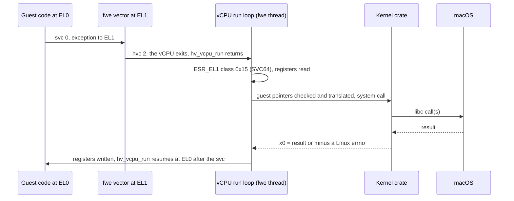

The kernel crate never walks the guest's page tables. Each pointer
argument is checked against the guest's mappings (`EFAULT` if the guest
could not use it) and turned into a host address
([Pages and translation](#pages-and-translation)).

### Faults, breakpoints and other exits

Every other exception the guest takes at EL0 (an abort, a `brk`, a
misaligned pc or sp, an unknown instruction) goes through the same vector
and `hvc` and becomes the signal Linux would send, except an abort that
is only a page not fetched yet (a `vfork` child's) or a stale TLB entry,
which is fixed and retried. A stage-2 abort, `wfi`/`wfe` and a trapped
system-register read exit the vCPU directly
([Faults in guest code](#faults-in-guest-code),
[hypervisor.md](hypervisor.md#the-run-loop)).

### Counters and timers

`CNTVCT_EL0`, the virtual counter, is read directly; every vCPU of a
process (and a fork child) uses the same offset, so all threads see one
clock. A read of `CNTPCT_EL0`, which Linux also lets user code make, is
trapped and emulated from the host's counter minus that offset. The guest
cannot program the timers; its sleeps, interval timers and `timerfd`s are
system calls served with the host's, and a virtual-timer exit just resumes
the vCPU.

### Threads

Each guest thread is a host thread with a vCPU of its own, created on it.
All vCPUs share the VM, its page tables and memory. A new thread's vCPU
starts with its creator's registers, `x0` = 0, the new stack, and
`TPIDR_EL0` from `CLONE_SETTLS`; the thread pointer and `x18` are simply
its own registers.

### Signals into a running vCPU

A host signal for the guest can arrive while the thread's vCPU runs guest
code, where no handler could rewrite the guest's registers. fwe's handler
records the signal pending and calls `hv_vcpus_exit` on that thread's
vCPU; `hv_vcpu_run` returns with a *canceled* exit, and the run loop
builds Linux's frame and resumes the vCPU in the guest's handler. This
reaches even a guest spinning without system calls. The framework's own
threads block every guest signal, so the host delivers guest signals only
to vCPU threads, each under the mask its guest thread calls for
([A host signal reaching a guest thread](#a-host-signal-reaching-a-guest-thread)).

### Memory changes and the TLB

The guest's `mmap`, `munmap`, `mprotect` and `brk` edit stage 1 only: slab
memory is handed out and taken back, never replaced behind the VM. Taking
access away needs every vCPU's TLB invalidated before the guest relies on
it: a vCPU resuming after such an edit first runs the TLB stub at EL1,
which invalidates every vCPU's TLBs and returns to the guest. Memory and
tables given back are reused only after such a flush.

### fork, execve and the end of a VM process

A host `fork` child could not use its parent's VM and would end with one
it inherited, so a VM process never forks on the host: a guest `fork`
starts a fresh `fwe --hv-fork-child` that builds its own VM
([fork](#fork)), and `execve` re-executes fwe ([execve](#execve)).

A process that ends with its VM alive can bring the whole Mac down, so
every way out of a VM process (exit, a fatal signal, fwe's errors and
panics, `execve`) first destroys its vCPUs and the VM, and a guest's
`SIGKILL` to another fwe process is relayed as a catchable `SIGINFO`.
Only a `SIGKILL` from outside fwe cannot be intercepted
([hypervisor.md](hypervisor.md#never-end-a-vm-process-abnormally)).

## Which binaries need the least translation

Every system call leaves guest code and enters fwe. Beyond that, the two
backends charge for different things; none of it changes what a program
computes, only how much fwe does at load time and how often the guest
stops running its own code:

| Program trait | Native | VM |
|---|---|---|
| static | one image prepared | loaded as is |
| dynamic | the dynamic linker and each library prepared as mapped; what a file's preparation made is kept on disk, so later starts map or replay it ([When code is prepared](#when-code-is-prepared)) | loaded as is; private file mappings copied |
| system call | a function call into fwe's gate; a trap for a call that changes more than `x0` and the signal mask, and for an `svc` with no stub in reach | a VM exit and register transfers |
| thread-local variables (`TPIDR_EL0`) | a stub branch per access | the hardware register |
| code using `x18` | a stub branch per use (a few Linux toolchains allocate it) | the hardware register |
| reading `CTR_EL0` | a trap per read (C libraries read it once) | read by the guest |
| reading `CNTPCT_EL0` | read by the guest | a trap per read (`CNTVCT_EL0` is direct) |
| JIT code | a translation the first time each block runs, and a call through the gate for each instruction cache line it flushes ([jit.md](jit.md#what-it-costs)) | no faults |
| `mmap`/`munmap` heavy | host calls | page-table edits; a TLB invalidation on every vCPU when access is taken away |
| `fork` heavy | host `fork`, copy-on-write, after pausing the other guest threads ([fork](#fork)) | a new fwe process sent every page of guest memory that exists |
| `posix_spawn`/`vfork` + `exec` | host `fork` sharing memory, then an in-place or re-exec `execve` | a new process fetching pages as touched, then a re-exec |

A program runs with the least translation when it is position-independent
(so its system calls do not leave a VM), keeps its code apart from its
data in sections the unwind table describes (as compiler output does;
without an unwind table every executable byte is taken as code, see
[What is scanned](#what-is-scanned)), leaves `x18` alone, and makes no
machine code as it runs. A program in the VM pays nothing for its code;
its costs grow with its system calls, memory mapping and forks. Under
`--strace` fwe notes for the program and its dynamic linker `prepared exe
<addr>+<len>: N system calls, M stubs, K x18 uses left unrewritten`
(`interp` for the dynamic linker).

### Examples

Most rows are what fwe's end-to-end tests run (`crates/fwe/tests/guests.rs`;
binaries described in `guests/debian/README.md` and
`guests/alpine/README.md`); rows marked "not tested by fwe" name software
for a well-known property only.

| Category | Software | Why it is there |
|---|---|---|
| native, little rewriting | Debian's coreutils, bash, git, SQLite, lighttpd, apt (tested) | dynamic PIEs against glibc: the program, `ld-linux` and each library scanned once, then prepared from fwe's record; the rewrites are system calls and thread-pointer accesses |
| native, Go built as PIE | Alpine's podman (building, pushing, pulling, rootless), containerd and Docker with BuildKit and Compose (tested) | Alpine builds its Go programs as PIEs ([How distributions build their programs](#how-distributions-build-their-programs)); Debian's podman, containerd and runc are non-PIE and need the VM |
| native, C with musl | Alpine's crun, busybox (tested) | musl PIEs; crun runs its sealed copy from a memfd through `execveat` |
| native, many libraries | Debian's `cargo` and `rustc` with its LLVM library, and clang 19 with LLVM's (tested) | large dynamic PIEs: a few very large libraries, each page's rewrites written only when it first runs |
| native, JIT | Debian's Node.js 20 with V8 (tested) | V8's generated code run by translation, its memory untouched; OpenSSL's assembly keeps constant tables among its code, which the unwind-table rule leaves alone |
| native, JIT | Alpine's Node.js 24 with a current V8 (tested) | the same workload as Node.js 20's: V8's tiers, its compiled regular expressions and WebAssembly, deoptimization, run by translation |
| native, JIT | Alpine's LuaJIT 2.1 (tested) | its trace compiler's code run by translation; compiled code calling C through its FFI, and C (`qsort`) calling back into Lua |
| native, compiling as they run | Alpine's Racket 9 (Chez Scheme), GNU Guile 3.0 (tested) | each compiles to machine code as it runs (`eval`, compiled from text, Guile's JIT), run by translation; Racket's heap holds data on the pages of its code, which `read` writes into |
| native, interpreters making code | Alpine's Python 3.14, Debian's SQLite (tested) | Python's `eval`, `exec` and `compile` make bytecode from text as it runs, and SQLite compiles each statement into a program for its virtual machine; neither makes machine code, so all of it runs as prepared code |
| native, programs that change themselves | self-modifying code, code on the stack, a program changing and running a copy of its executable, quines, IOCCC winners (tested) | code made executable at run time runs by translation, a translation ending at each `isb`; the IOCCC's entries are fetched from the contest's repository and built as old C |
| native, JIT | Alpine's OpenJDK 25 with HotSpot (tested) | its compilers' code run by translation, `x18` included, its code cache untouched; see [Java](#java-and-the-jvm) |
| VM, compiling as it runs | Alpine's SBCL 2.6 (tested) | non-PIE at `0x400000`; compiles each form to machine code as it runs (`compile`, redefinitions, CLOS dispatch), which the VM runs as it is |
| VM, interpreter | Debian's Python 3.13 (tested) | non-PIE at `0x400000`; its C extension modules loaded as they are |
| VM, compilers | Debian's GCC 14 (`gcc`, `cc1`, `collect2`) (tested) | non-PIE, linked low; GNU `as` and `ld` are PIEs and run natively, so every compiler stage is an `execve` between the backends |
| VM, Go toolchain | Debian's Go 1.24: `go`, `compile`, `link`, and the static executables it builds by default (tested) | linked low, non-PIE; `go` starts its tools with `vfork` |
| VM, container engine | Debian's podman 5.4 with its conmon and crun (tested) | podman is non-PIE, linked low; conmon and crun are PIEs and run natively; the pause process's `catatonit` is static and non-PIE, in the VM too |
| fork and exec heavy | bash scripts, `apt` running `dpkg`, the GCC driver, the `go` command (tested) | each child a host `fork` (native) or a new fwe process (VM); each `execve` that changes backend or starts in the VM re-executes fwe |
| system-call heavy | lighttpd serving files and CGI, git (tested) | many small reads, writes and `epoll` waits: each a call into fwe's gate natively, a VM exit in the VM |
| uses `x18` as Linux allows | hand-written assembly that allocates it; Wine on arm64, which keeps the Windows thread block in `x18` (tested, in the VM) | natively each use goes through a stub (in code made executable at run time, its translation's expansion); in the VM `x18` is the guest's own |

## Languages and runtimes

fwe runs machine code and does not distinguish languages. What differs is
how their programs are linked, which decides the backend, and how their
runtimes use threads, signals, memory and code generation.

### C and C++ on glibc

The common case is a dynamic PIE naming `/lib/ld-linux-aarch64.so.1`. From
the [dynamic linker](#the-dynamic-linker) on, glibc runs as on Linux:
`ld.so` reads `/etc/ld.so.cache` and the libraries from the guest's root,
maps them with fwe's `mmap`, applies relocations and RELRO, and sets the
thread pointer with `msr tpidr_el0` (rewritten natively). `AT_SECURE` is
set as Linux sets it ([auxv, hwcaps and the vDSO](#auxv-hwcaps-and-the-vdso)),
so `LD_LIBRARY_PATH`, `LD_PRELOAD` and the rest are ignored and removed
in a program run with raised privilege and honoured in any other. With
no vDSO, `clock_gettime` and `gettimeofday` are real system calls. A
low-linked glibc program runs the same way in the VM (tested with
Debian's Python and GCC). C++ adds nothing fwe sees: `libstdc++` is one
more library, and exceptions unwind in user space.

### musl and Alpine

`/lib/ld-musl-aarch64.so.1` is musl's C library and dynamic linker in
one; static musl programs have no interpreter. Both run natively when
position-independent, as all of Alpine's are (tested: Alpine's root
filesystem, busybox and the container engines).

### Rust

Rust programs are C-like to fwe. The default target
(`aarch64-unknown-linux-gnu`) builds dynamic PIEs against glibc, which run
natively; Debian's `rustc` and `cargo` build and test a project under fwe
(tested). A static `aarch64-unknown-linux-musl` build is a PIE or not
depending on how it is linked: fwe's test guests are non-PIE, linked at
1 TiB to run natively and at the default address (`rust-low`) to run in
the VM (both tested).

### Go

Go's runtime makes system calls itself with `svc #0`, starts threads with
`clone`, parks them on futexes, handles nearly every signal on an
alternate stack, and preempts goroutines by sending `SIGURG` to a thread
with `tgkill`. fwe meets these as for C: the `svc`s are rewritten
(native) or trapped (VM), `clone` makes a host thread (with its own vCPU
in the VM), and a `tgkill` is posted to that thread and the thread woken
([Sending a signal](#sending-a-signal)), which in the VM stops its vCPU
even in a loop with no system calls.

Debian's Go 1.24 toolchain and the static executables it builds by
default are linked low and run in the VM (tested: `go` builds, runs and
tests a module with goroutines; it starts its tools with `vfork`). Go
programs built as PIEs, as Alpine builds podman, containerd and Docker,
run natively (tested).

### Python and other interpreters

An interpreter is an ordinary program to fwe; its scripts are data.
Debian's Python 3.13 is linked non-PIE at `0x400000` and runs in the VM;
its test covers C extension modules, threads, sockets, asyncio, `ctypes`
and libffi closures, signals, `fork`, `subprocess` and a process pool
sharing POSIX semaphores through `/dev/shm`. A Python built as a PIE runs
natively, as bash does.

### Node.js and V8

Debian's Node.js 20 is a dynamic PIE and runs natively (tested: V8's JIT
on a hot function, ICU, OpenSSL digests, zlib, timers and promises, a
child process, an HTTP server and client, and a worker thread). V8's
generated code runs by translation, its code pages untouched
([jit.md](jit.md)).

### Java and the JVM

Alpine's OpenJDK 25 runs natively (tested: `javac` compiles a
multi-threaded application and `java` runs it, with parallel streams,
a thread pool, fork/join, locks and the G1 collector, HotSpot's
interpreter and both of its compilers at work):

- **Backend:** the `java` and `javac` launchers are PIEs; the JVM itself
  is a shared library (`libjvm.so`).
- **JIT code:** HotSpot's code cache runs by translation and stays as
  HotSpot wrote it ([jit.md](jit.md)). Its compilers allocate `x18` like
  any register on Linux (they keep it free only on macOS and Windows);
  the translations keep its value.
- **Safepoints and null checks** rely on `SIGSEGV` from protected pages,
  which fwe delivers with Linux's frame, turning the `SIGBUS` macOS
  reports for some protection faults into `SIGSEGV`
  ([Faults in guest code](#faults-in-guest-code)).
- **Memory sizing:** the JVM sizes its heap from `sysinfo`,
  `/proc/meminfo` and cgroup limits: the first two are the Mac's memory,
  the limits are kept and not enforced ([Memory pressure](#memory-pressure),
  [cgroups](#cgroups)).
- **Tools:** attach mechanisms that use `ptrace` or
  `process_vm_readv`/`writev` work between fwe processes ([ptrace](#ptrace)).

### Wine

Tested: Alpine's arm64 Wine 11 runs under `fwe --vm` (in CI on the
software stand-in for Hypervisor.framework). `wineboot` makes a prefix,
`wine cmd /c` runs a batch command, and a C program built for ARM64
Windows writes, reads and deletes a file, runs threads, has an exception
taken by a vectored handler, and starts itself as a child process.
Notepad draws on an X display and takes what is typed into it.

- **Which Wine:** fwe runs only arm64 Linux code, so an arm64 Wine, which
  runs Windows programs built for ARM64. x86 or x64 Windows programs need
  an x86 emulator inside the arm64 process (Wine on arm64 can load one,
  such as FEX, through WoW64 and ARM64EC), or an x64 Wine under an
  emulator such as box64; fwe has no x86 emulation of its own.
- **Backend:** Wine is position-independent throughout (the loader,
  `wineserver`, and `wine-preloader`, a static PIE that reserves the low
  ranges Windows programs expect with `MAP_FIXED` before loading the
  dynamic linker and Wine), so by default it would run natively with
  16 KiB pages. Windows images assume 4 KiB pages, so Wine runs under
  `fwe --vm`. There its fixed reservations are backed by slab memory
  ([Address-space layout](#address-space-layout)): each, even
  `PROT_NONE`, takes its size out of the slab (28 GiB on an M1 or M2),
  but host memory only for the pages touched; one reaching past fwe's
  code page at 1 TiB fails with `ENOMEM`.
- **`x18`:** the Windows ARM64 ABI keeps the thread's TEB in `x18`. In
  the VM `x18` is the guest's own. Natively, Windows code Wine makes
  executable runs by translation, `x18` kept in its translations
  ([jit.md](jit.md)).
- **wineserver** talks to Wine processes over Unix sockets, passing
  descriptors with `SCM_RIGHTS` (received descriptors are not held to
  `RLIMIT_NOFILE`), and suspends threads with ordinary signals. It stays
  a while after its last client leaves; `wineserver -w` waits for it.
- **Shared memory:** wineserver shares session and object memory through
  files it creates and unlinks, which Wine processes map private and
  writable. fwe gives such a mapping Linux's behaviour: each page shows
  the file's later writes until the process writes that page itself
  ([The mmap family](#the-mmap-family)).
- **Signals:** Wine handles `SIGSEGV`, `SIGBUS`, `SIGILL` and `SIGTRAP`
  on an alternate stack to emulate Windows exceptions; fwe delivers them
  with Linux frames and honours `sigaltstack`.
- **Display:** graphical programs draw through Wine's X11 driver on the X
  display ([Displays](#displays)), with the X libraries, fontconfig and a
  font installed beside Wine (Alpine's Wine package does not depend on
  them); console programs need none of them.

## Linux to macOS

This part goes through Linux's primitives one by one, mostly in tables
that read **Linux | macOS | fwe**, and ends with a reference of every
system call, [category by category](#system-calls-by-category). Some
calls going in and the host calls coming out:

| Guest call (Linux) | What fwe does | Host call(s) (macOS) |
|---|---|---|
| `openat(AT_FDCWD, "/etc/hosts", O_RDONLY \| O_CLOEXEC)` | resolves `/etc/hosts` component by component in the guest's root, following symlinks itself; translates the flags (`O_CLOEXEC` is `0x80000` on Linux, `0x1000000` on macOS) | `openat(<descriptor of the rootfs's etc>, "hosts", O_RDONLY \| O_CLOEXEC \| O_NOFOLLOW)`; the host descriptor is the guest's |
| `epoll_ctl(ep, EPOLL_CTL_ADD, fd, {EPOLLIN \| EPOLLET, data})` | the epoll descriptor is a kqueue | `kevent(ep, {fd, EVFILT_READ, EV_ADD \| EV_CLEAR, udata = data})` |
| `clock_gettime(CLOCK_BOOTTIME, &ts)` (no vDSO, so it traps) | maps the clock id | `clock_gettime(CLOCK_MONOTONIC, &ts)` |
| `kill(pid, SIGUSR1)` | maps the pid out of the guest's pid namespace and the signal number (10 to 30); leaves a sender note for an fwe target | `kill(<host pid>, 30)` |
| `write(fd, buf, n)` to a socket whose peer has gone | sockets are all `SO_NOSIGPIPE`, so fwe raises `SIGPIPE` itself | `write` fails with `EPIPE`; the guest gets `x0 = -32` and a pending `SIGPIPE` |

### Where a system call runs

No guest system call runs on a Linux kernel, and none runs inside the
VM, which holds only the guest's CPU state and memory. Under either
backend every call is carried out by fwe's kernel crate, as ordinary
macOS code in the guest's own fwe process, on the calling guest thread's
host thread. Natively a call reaches it through fwe's gate
([System calls: svc calls fwe's gate](#system-calls-svc-calls-fwes-gate)),
in the VM through a VM exit ([A system call in the VM](#a-system-call-in-the-vm)).
By mechanism:

| Mechanism | What happens | For example |
|---|---|---|
| The same macOS call | arguments, flags, structures and errors translated, with Linux's checks first where macOS's differ | the `read` and `write` family, `lseek`, `fsync`, `flock`, `utimensat`, `unlinkat`, `listen`, `shutdown`, `getsockopt`, `sched_yield`, `getitimer`, `gettimeofday` |
| Other macOS calls | a Linux primitive macOS lacks, built from others | `epoll` (a kqueue), `eventfd` and `signalfd` (a pipe), `timerfd` and `nanosleep` (kqueue timers), `renameat2` (`renameatx_np`), `getdents64` (`__getdirentries64`), `splice` and `sendfile` (copied through a buffer of fwe's), shared futexes and System V semaphores (`__ulock_wait2`, `__ulock_wake`), System V shared memory (a shared memory object, mapped), `getrandom` (`arc4random_buf`), `chown` (an extended attribute) |
| fwe's own state, no macOS call | what Linux's kernel keeps and macOS lacks, or keeps once for the whole Mac | `getpid`, `gettid`, `umask`, the mount calls, `pivot_root`, credentials and capabilities, `unshare`, `setns`, `prctl`, scheduling policies, `personality`, `sigaltstack`, robust-futex lists, `sethostname`, `seccomp`, Landlock |
| Another fwe process | macOS lets no process reach another's memory or threads, so the target does the work, asked through its mailbox and woken by a signal | a signal that carries its sender or that macOS lacks, `tgkill` of another process's thread, `pidfd_getfd`, `process_vm_readv` and `process_vm_writev`, `ptrace`, `/proc/<pid>/mem` |
| A thread of fwe's | something has to happen when no guest thread is in a call | POSIX timers (a timer thread per process), the reaper's watch of the processes it adopted, the watch of the parent's end that `getppid` keeps |
| The backend | the call makes, replaces or ends a process or thread, or changes its memory | `clone` and `clone3`, `execve` and `execveat`, `exit`, `exit_group`, `wait4`, `waitid`, `rt_sigreturn`, `rt_sigtimedwait`, `pidfd_getfd`, and the `mmap` family |
| Not dispatched | `ENOSYS` | [Not available](#not-available) |

### The CPU

The processor is shared; what differs is how a program calls the kernel,
which registers the kernel lets it own, and what the kernel tells it about
the CPU at startup.

#### System call entry

| | Linux arm64 | macOS arm64 |
|---|---|---|
| Instruction | `svc #0` | `svc #0x80` |
| Number in | `x8` | `x16` |
| Arguments | `x0`–`x5` | `x0` and up |
| Error report | `x0` = −errno (−1 to −4095) | carry flag set, `x0` = errno (macOS numbering) |

fwe catches every guest system call before it reaches macOS
([Where a system call runs](#where-a-system-call-runs)), runs it with the
number from `x8`, and returns the result or minus a Linux errno in `x0`.
The kernel crate calls macOS through `libc`, so it sees `-1`/`errno`,
never the carry flag ([Errors](#errors)). A call interrupted by a signal
returns or restarts as under
[A host signal reaching a guest thread](#a-host-signal-reaching-a-guest-thread).

#### Registers and the thread pointer

Linux gives user code every general register and the thread pointer;
macOS keeps two for itself and traps a register read Linux allows. In the
VM the guest has the registers to itself:

| Register | Linux | macOS | fwe, native | fwe, VM |
|---|---|---|---|---|
| `TPIDR_EL0` | the thread pointer (TLS), set with `msr` | not preserved for user code | a stub per access ([The thread pointer](#the-thread-pointer-a-stub-per-access)) | the guest's own |
| `x18` | a scratch register | platform-reserved, cleared on every exception return | a stub per use ([x18](#x18-a-stub-per-use)) | the guest's own |
| `CTR_EL0` | readable at EL0 | `mrs` of it traps | emulated when it traps ([CTR_EL0](#ctr_el0-emulated-when-it-traps)) | read by the guest |
| `CNTPCT_EL0` | readable at EL0 | readable | read by the guest | trapped, emulated from the virtual counter |

`clone` with `CLONE_SETTLS` writes the new thread's TSD slot (native) or
its vCPU's `TPIDR_EL0` (VM).

#### Cache maintenance, PAC and BTI

- **Cache maintenance** is allowed at EL0 on both systems, so a JIT's own
  `dc` works natively; its `ic ivau` runs in a stub that also tells fwe
  which code changed ([jit.md](jit.md#code-that-changes)). Code fwe
  writes into guest memory (images, file data, a fork child's memory) has
  the instruction cache invalidated, as Apple's cores do not keep it
  coherent with data writes.
- **Pointer authentication:** not reported natively (no `PACA`/`PACG` in
  `AT_HWCAP`), since the host owns the keys. The VM backend enables it in
  `SCTLR_EL1` where the vCPUs offer it and reports `PACA` and `PACG`, with
  random keys per program, a thread's from its creator, a fork child's
  from its parent, new ones for `PR_PAC_RESET_KEYS`.
- **BTI:** reported in `AT_HWCAP2` where the host has it, and `mprotect`
  takes `PROT_BTI` where it is reported (`EINVAL` elsewhere, as Linux's
  `arch_validate_prot` gives; `PROT_MTE` always). Natively the guard is
  not enforced
  ([Code made executable at run time](#code-made-executable-at-run-time-translated)).
  In the VM, code of a program built for BTI is mapped guarded
  (`PROT_BTI`) where Linux maps it so, a signal handler is entered as if
  by `blr`, and a branch-target exception is `SIGILL`.

#### auxv, hwcaps and the vDSO

A Linux program learns about its machine from its initial stack, which
fwe builds as Linux does in both backends:

- strings, `AT_RANDOM` bytes, the auxiliary vector, `envp`, `argv`,
  `argc`, 16-byte aligned, on a fresh stack with a guard page
  (`crates/native/src/stack.rs`): natively as large as the soft
  `RLIMIT_STACK` the program starts under (from 128 KiB, and 4 GiB for
  an unlimited one), mapped whole at once where Linux grows it to the
  limit, the host giving it pages as they are used; 8 MiB in the VM;
- the auxiliary vector carries `AT_PHDR`/`AT_PHENT`/`AT_PHNUM`, `AT_BASE`,
  `AT_ENTRY`, `AT_PAGESZ`, the ids, `AT_SECURE`, `AT_RANDOM`, `AT_EXECFN`,
  `AT_PLATFORM`, `AT_MINSIGSTKSZ` and `AT_HWCAP`/`AT_HWCAP2`;
- the ids are the guest's (`AT_UID` to `AT_EGID`, as its user namespace
  shows them, after what the exec grants), never the host process's, and
  `AT_SECURE` is 1 after an exec that raised privilege: the effective uid
  or gid differs from the real one, or a caller other than root gained
  capabilities from the file (`crates/kernel/src/lib.rs`,
  `apply_exec_privs`), which also clears the personality flags Linux
  clears and the parent-death signal;
- `AT_HWCAP`/`AT_HWCAP2` come from macOS's `hw.optional.*` sysctls, only
  features a guest can use directly: SVE and SME (kernel-managed state),
  `CPUID` (trapping ID-register reads) and, natively, PAC are left out.
  The first fwe process after boot asks for them, one call each, and
  keeps them in the process store every later one reads;
- there is no vDSO (no `AT_SYSINFO_EHDR`): the C library makes real
  system calls for `clock_gettime` and `gettimeofday`.

### Memory

A Linux process expects to own its address space, with 4 KiB pages and
memory it can map writable and executable at once. macOS gives a process
an address space shared with its own loader and libraries, starting at
4 GiB, with 16 KiB pages and no write+exec memory.

#### Address-space layout

On Linux the break follows the image and `mmap` grows down from below
the stack. On macOS the first 4 GiB are `__PAGEZERO`
([The low 4 GiB](#the-low-4-gib)).

**Native backend**: guest and fwe in one host address space, guest
addresses equal to host addresses:

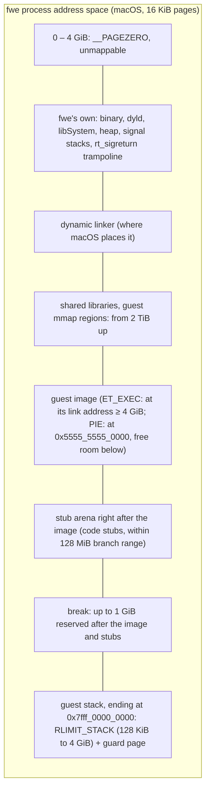

The loader reserves the image's whole span, then copies each segment in,
so gaps stay inaccessible. fwe records every guest range and none of its
own, so `execve` unmaps exactly the old program
([architecture.md](architecture.md#memory-bookkeeping)).

**VM backend**: the guest has an address space of its own; its private
memory lives in one host range, the *slab*:

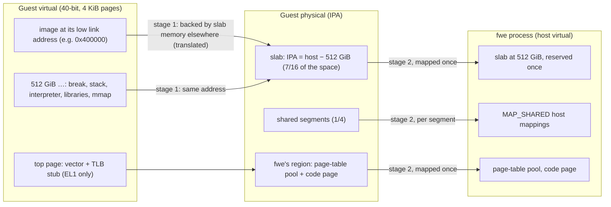

- The slab sits at host 512 GiB in every VM process, so a fork child takes
  its parent's memory at the same addresses.
- A mapping the guest did not place gets a slab range whose guest address
  is its host address. One placed outside the slab (the low image, a
  `MAP_FIXED` address) is backed by slab memory elsewhere and recorded as
  a translated range.
- The IPA space is as large as the host offers, up to 40 bits; an M1 or M2
  offers 36 bits (64 GiB).

#### Pages and translation

| | Linux | macOS | fwe |
|---|---|---|---|
| Page size | 4 KiB on most arm64 kernels; 16 and 64 KiB exist | 16 KiB | native: the host's 16 KiB, reported in `AT_PAGESZ` (the arm64 ABI allows it); VM: 4 KiB |
| Translation | one stage, the kernel's tables | one stage, XNU's pmap | native: XNU's; VM: fwe's stage 1 and the framework's stage 2 |

Natively, a guest address is a host address. In the VM both stages are
hardware translation:

- **Stage 1** is fwe's page tables (`crates/native/src/hv/pagetables.rs`):
  4 KiB granule, 40-bit space, level-3 pages, each page's EL0 permissions
  and BTI guard, edited by the memory calls
  ([Memory changes and the TLB](#memory-changes-and-the-tlb)).
- **Stage 2** is set up once: the slab, fwe's region, and a mapping per
  shared segment. The framework maps host memory in 16 KiB pages; a 4 KiB
  guest page is a quarter of one.
- Guest pointers the kernel crate uses are checked against the guest's
  mappings (the host can reach slab memory the guest cannot) and
  translated through the recorded translated ranges
  ([architecture.md](architecture.md#guest-memory-access)).

The low 4 GiB can never be identity-mapped (it is `__PAGEZERO` on the
host), so the low image is always translated. A host call given one
buffer that runs over the edge of a translated range has no single host
address: a `read`, `write`, `pread64` or `pwrite64` of a file, pipe or
stream is cut where the range ends, a shorter count the program goes on
from, as Linux can return; any other such call fails with `EINVAL`.

#### The mmap family

Natively, fwe passes memory calls to the host's with the guest's
addresses and fills in what macOS does differently; in the VM it carries
them out on the slab and the guest's page tables:

| Call | Linux | fwe, native | fwe, VM |
|---|---|---|---|
| `mmap` anonymous / private file | kernel VMA | host `mmap` at the guest's address or where macOS places it; offset a multiple of 16 KiB; a file with no name below | slab range; a private file mapping is a copy of the file's data when mapped, but for a file with no name below |
| `MAP_SHARED` | shared pages | host `MAP_SHARED`; an executable shared file mapping is made private, since its code is rewritten, but one of a file open for writing (a memfd a JIT maps twice) stays shared and runs by translation | a *segment*: a host shared mapping outside the slab (anonymous shared memory is a host shared memory object with no name), mapped into the VM once |
| `MAP_FIXED`, `MAP_FIXED_NOREPLACE` | replace / refuse to replace | host `MAP_FIXED`; `NOREPLACE` checks where macOS put it (`EEXIST`) | page-table edit; slab memory at its own address is reused, zeroed |
| `munmap` | | host `munmap` | pages removed from stage 1, TLBs flushed; the slab range zeroed before reuse |
| `mprotect` | | host `mprotect`; memory made executable runs by translation, never executable on the host, but code executable already and unwritten since stays as prepared ([Write+exec memory](#writeexec-memory)) | stage-1 permission edit |
| `mremap` | grow, shrink, move | shrink; grow in place where the space after it is free (a file mapping with the file's next part, the file reached by its name, or for a file with no name through the descriptor its mapping holds); move with `mach_vm_remap`, which takes the pages, contents and sharing along, `MREMAP_FIXED` and `MREMAP_DONTUNMAP` included; code is not grown or moved (`ENOMEM`) | private memory: shrink, grow in place, or move with `MREMAP_MAYMOVE`; a shared segment cannot grow (`ENOMEM`); no `MREMAP_FIXED`/`MREMAP_DONTUNMAP` (`EINVAL`) |
| `madvise(MADV_DONTNEED)` | private anonymous pages read as zero again | each private anonymous piece replaced by a fresh mapping (macOS's own keeps the data); a private file mapping keeps its modified pages | private pages read as zero again, or as the file for a private file mapping; shared memory keeps its contents |
| `madvise` other advice | hints; `MADV_FREE`, `MADV_WIPEONFORK` | hints passed to the host, never failing for mapped memory; advice and mappings checked as Linux checks them; `MADV_WIPEONFORK` ranges zeroed in a fork child | advice and mappings checked as natively, nothing more: no hint reaches the host, `MADV_FREE` frees nothing, a fork child keeps `MADV_WIPEONFORK` memory, `MADV_DONTDUMP` changes no core |
| `MADV_DONTFORK`, `MADV_DOFORK` | a fork child has nothing mapped in the range | the ranges kept; a fork child unmaps them as it starts (the host's `VM_INHERIT_NONE` would too, but fwe reads a region's inheritance to tell private memory from shared) | ignored |
| `MADV_GUARD_INSTALL`, `MADV_GUARD_REMOVE` | guard markers: an access is `SIGSEGV`, whatever the mapping's protection | private anonymous pages discarded, the range made inaccessible on the host and kept so across `mprotect`; removed, the mapping's protection back (private pages reading zero) | ignored |
| `MADV_REMOVE` | frees a shared file's (or shared memory's) pages: they read as zero | the pages zeroed in place, so every mapping and the file read zero (the file's blocks are not freed); `EINVAL` for private anonymous memory, `EACCES` for a mapping that cannot write the file | ignored |
| `MADV_DONTNEED_LOCKED` | `MADV_DONTNEED`, locked memory too | as `MADV_DONTNEED` | as `MADV_DONTNEED` |
| `MAP_GROWSDOWN` | a stack that grows down on a fault below it, up to a guard gap of 256 pages | a fault below one maps the pages down to it, if nothing is within the gap | not grown |
| `MADV_HWPOISON` | an access is `SIGBUS` | the pages made inaccessible, an access a `SIGBUS` | not poisoned |
| `MAP_SHARED` of `/dev/zero` | shared anonymous memory | shared anonymous memory (macOS cannot map the device) | the same |

A private mapping of a file with no name (a memfd, an unlinked file:
memory processes share through it) shows, on Linux, what others write to
the file until the process writes a page itself; the host's private
mapping is a copy from the start. Natively fwe maps it as a shared host
mapping kept unwritable, each page made a private copy of itself when
first written (by the guest, by fwe for it, or by a `read` into it); in
the VM it is a segment of the file kept unwritable in stage 1, each 4 KiB
page copied into the slab when first written.

Every successful memory call is also recorded as Linux lists it
(`crates/kernel/src/maps.rs`), for `/proc/<pid>/maps`, `smaps` and
`PROCMAP_QUERY`, with the protections the guest asked for.

#### Write+exec memory

Linux maps `PROT_WRITE | PROT_EXEC` memory freely. macOS refuses it
without `MAP_JIT`, whose memory is switched per thread
(`pthread_jit_write_protect_np`), which Linux code never calls.

- **native:** its code runs by translation
  ([Code made executable at run time](#code-made-executable-at-run-time-translated)).
- **VM:** stage 1 maps it writable and executable; nothing faults.

#### Shared memory and memfd

| Linux | macOS | fwe |
|---|---|---|
| `memfd_create`: an anonymous file with a name and seals | no memfd, no seals | a file with no name in a filesystem of fwe's store ([Kernel-wide state](#kernel-wide-state)), below |
| `/dev/shm` (`shm_open`, `sem_open`) and every tmpfs | no tmpfs; `shm_open` objects with no path | a filesystem of fwe's store each, in memory: `/dev/shm` one per rootfs, which every fwe process on that root shares; a tmpfs one per mount, holding what its size and inodes allow (`ENOSPC`) |
| System V shared memory | own `shmget` | see [Other IPC calls](#other-ipc-calls) |

A memfd's name and seals are the file's own, so every holder sees them,
and `/proc/self/fd` names it `/memfd:<name> (deleted)`. Its data lies in
host shared memory objects, its extents, which every holder maps; a
mapping across them is a host mapping of each at the file's offsets.
`F_SEAL_WRITE` is refused (`EBUSY`) while the process maps the file
shared and writable, and then refuses writes, resizing and writable
shared mappings. Opened again read-only through `/proc/self/fd`, it is a
new read-only description of the same file. A mapping of it holds the
file, through which `mremap` grows it and `remap_file_pages` remaps it.

### Processes

Each guest process is a host process
([Process and thread calls](#process-and-thread-calls)). What needs work
is copying a process whose memory fwe has rewritten or placed in a VM,
and starting a new program in place.

#### fork

| | Linux | fwe, native | fwe, VM |
|---|---|---|---|
| `fork` | copy-on-write of private pages | host `fork`: copy-on-write for `MAP_PRIVATE`, sharing for `MAP_SHARED` | no host fork: a fresh fwe process is sent a copy of every slab page that exists |
| `vfork` / `CLONE_VM \| CLONE_VFORK` | child borrows the parent's memory | host `fork` with the private ranges set to inherit by sharing (`minherit`) | child fetches pages on first touch and sends back what it changed |

macOS's `fork` copies memory while the parent's other threads keep
running, gives the child none of the parent's kqueues, and does not
restore a signal mask from a handler frame the child did not take. A VM
cannot be forked at all.

**Native backend** (`crates/native/src/process.rs`, `quiesce.rs`): fwe
holds every lock a child could need and pauses the parent's other threads
running guest code before it forks, so the child starts from one
consistent instant:

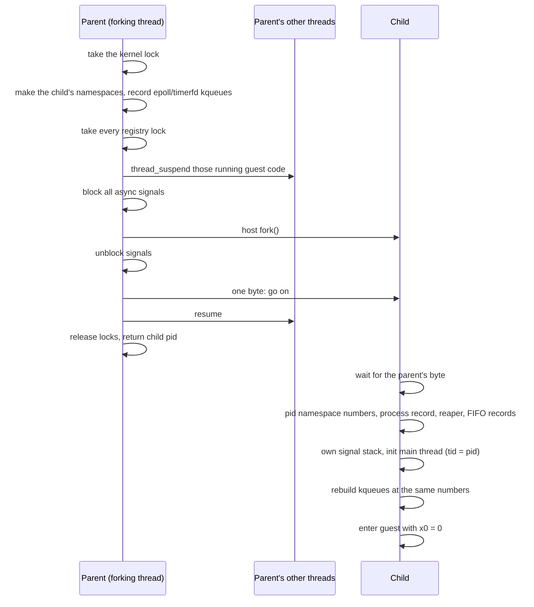

The child keeps the guest's blocked mask and alternate stack; pending
signals are not inherited, as on Linux. Descriptors are inherited by the
host fork; the process record, signal mailbox and System V attachments
are the child's own.

**vfork** (`CLONE_VM | CLONE_VFORK`, used by `posix_spawn`, `vfork`, Go's
`os/exec`): the same host fork with the guest's private memory inherited
by sharing. The parent waits on a close-on-exec pipe only the child holds,
so it resumes when the child execs or exits and sees what the child wrote.
fwe's own memory is not shared, so the child's `mmap` and `munmap` stay
its own. Natively, `CLONE_VM` without `CLONE_VFORK` is the same fork
without the wait; the VM backend refuses it (`ENOSYS`), since the same
memory MUST NOT be in two VMs at once.

**VM backend** (`crates/native/src/hv/fork.rs`): the child is a fresh
`fwe --hv-fork-child` started with `posix_spawn`. The parent hands it its
kernel state over a Mach port and its memory over a socket, and the child
builds its own VM around them:

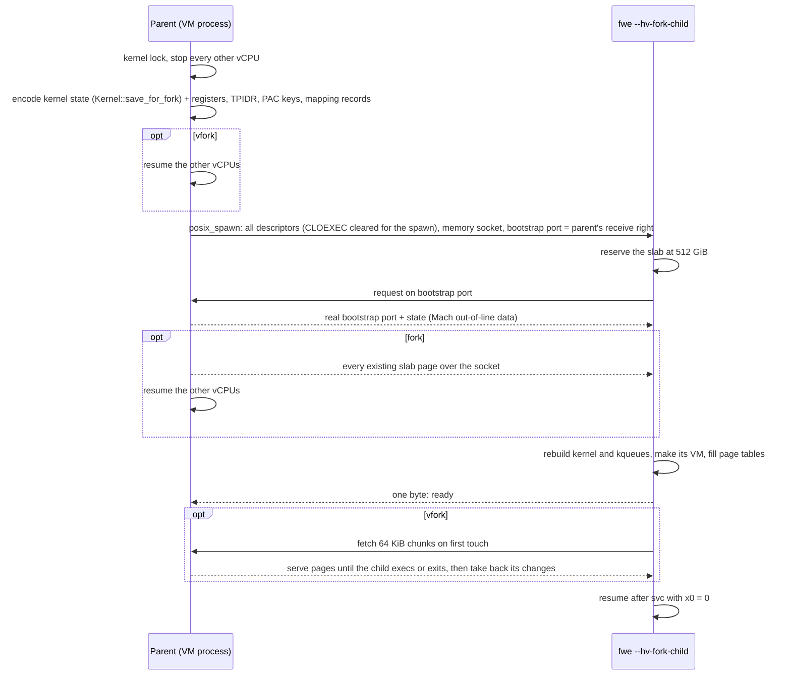

- No private page is ever in two VMs. Shared segments go to the child as
  their files, which it maps, so those pages are shared as on Linux.
- A `vfork` child fetches only the slab ranges the parent had in use, and
  only while it keeps them. Before it execs or ends it sends back the
  bytes it changed, and the parent resumes once they are in its memory.
  Its channel is one of fwe's reserved descriptors, out of reach of a
  child that moves descriptors into place before exec (Go's does).
- The VM itself and kqueues do not cross; kqueues are rebuilt from fwe's
  records.

#### Threads, clone and futexes

Linux's `clone` is far more general than `pthread_create`, and shared
futexes have no direct macOS counterpart:

| | Linux | macOS | fwe |
|---|---|---|---|
| Thread | a task sharing `mm`, files, handlers | a pthread | a host pthread running guest code (native; one an ended thread left runs the next) or a host thread with its own vCPU (VM) |
| `clone` flags | any combination | — | a thread needs `CLONE_VM` and a stack (`EINVAL` without either); in both backends `CLONE_VM`, `FS`, `FILES`, `SIGHAND`, `THREAD`, `SYSVSEM`, `SETTLS`, `PARENT_SETTID`, `CHILD_SETTID`, `CHILD_CLEARTID` and `DETACHED` are accepted and others fail with `ENOSYS` |
| `clone3` | `struct clone_args` | — | treated as the `clone` it describes; `CLONE_INTO_CGROUP` starts the child in that cgroup, `CLONE_CLEAR_SIGHAND` resets its handlers, `CLONE_PIDFD` returns a process descriptor; `set_tid` as [Process and thread calls](#process-and-thread-calls) has it |
| Per-thread state | in the task | — | in host thread-locals: tid, `set_tid_address` word, robust list, signal mask, alternate stack, pending set |
| Robust futex list | walked as a thread ends: words it owns marked `FUTEX_OWNER_DIED`, a waiter woken | — | the same, as a thread ends and for every thread as the process ends or calls `execve`; not for a native process ended by `SIGKILL`, nor one ended by a signal from outside fwe |
| futex, private | a wait queue per address | `__ulock_wait`/`__ulock_wake` (private) | fwe's wait queues per process, keyed by address, outside the kernel lock; a wake reports exactly how many it woke ([architecture.md](architecture.md#threads-and-futexes)) |
| futex, shared | keyed by the page's backing object | `__ulock_wait2` with `UL_COMPARE_AND_WAIT_SHARED` | a table every fwe process maps, keyed as Linux keys a shared futex (Mach memory object and offset) |
| futex, priority-inheriting (`FUTEX_LOCK_PI`) | a lock whose word holds its owner's thread id, handed to the top waiter as it is unlocked; the owner lent the waiters' priority | `os_unfair_lock` (an owner's id, its waiters' priority lent) | the waiters in the queues or the table above, the lock handed to the oldest as Linux hands it; no priority lent, as fwe schedules no thread by priority |

A new thread starts with its creator's registers and signal mask, `x0` =
0, the given stack and no alternate stack.

#### execve

Linux replaces the address space in place. fwe does so where it can
([Across execve](#across-execve) says when); otherwise it runs the host's
`execve` on `fwe` itself, passing what has to survive on the command line,
and the new fwe picks the backend:

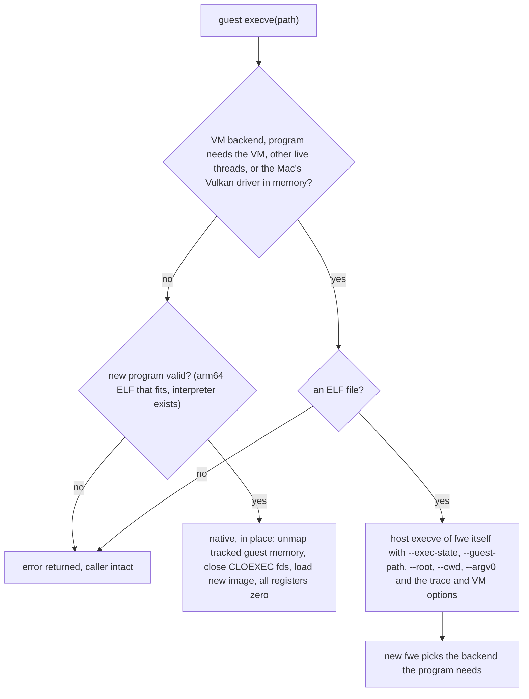

| State | How it crosses |
|---|---|
| pid, descriptors without `O_CLOEXEC`, signal mask, pending host signals, ignored dispositions | the host keeps them across its own exec; signals fwe held pending that the guest blocks are moved onto the host first |
| handled dispositions | reset to default, as on Linux |
| credentials, capabilities, `RLIMIT_NOFILE`, fwe's own rlimits, umask, mount namespace and root, mount origins of open files, seccomp filters, `no_new_privs`, personality; inotify, namespace, process, epoll, eventfd, timerfd and signalfd descriptors without `O_CLOEXEC`, and the signals a signalfd took | in place: kept in the process; re-exec: encoded in `--exec-state` |
| saved set-user/group ids | become the effective ones, as on Linux |
| thread and process keyrings | dropped; the session keyring stays |
| a program run from a descriptor (`execveat(fd, "", AT_EMPTY_PATH)`) | the descriptor kept and passed on with `--exe-fd` |

`execveat` turns its directory descriptor, path and flags into a guest
path and is then `execve`. A script (`#!interpreter [argument]`) runs
its interpreter as Linux's `binfmt_script` does, with the line's argument,
the script's path (`/dev/fd/N` for a descriptor) and the rest of the
arguments, nested up to five deep (`Kernel::exec_target`); the
interpreter, not the script, decides what set-ID bits grant. A script
given to fwe on its command line runs the same way, its path in the
guest's arguments the guest path inside the root.

#### wait

The children are real host processes, so waiting mostly passes through;
the flags and pid arguments need translating:

| | Linux | macOS | fwe |
|---|---|---|---|
| `wait4` pid argument | a pid, `-pgid`, 0, -1 | the same, host pids | mapped out of the guest's pid namespace (`ECHILD` for one not in it) |
| `WNOHANG`, `WUNTRACED` | 1, 2 | 1, 2 | passed through |
| `WCONTINUED` | 8 | `0x10` | translated |
| `__WALL`, `__WCLONE`, `__WNOTHREAD` | select which children | none | accepted; every child is an fwe process, so they change nothing |
| a reaper's `wait` | its children and adopted orphans | its children only | its host children, then the orphans fwe recorded for it ([orphans and reapers](#orphans-and-reapers)) |
| a tracer's `wait` | its tracees' stops and ends | its children only | tracees' stops and ends from their mailboxes first ([ptrace](#ptrace)) |
| `waitid(P_PIDFD, fd)` | the process a pidfd names | none | `P_PID` of the host pid the descriptor names; with `PIDFD_NONBLOCK` as `WNOHANG`, `EAGAIN` when nothing changed |

What comes back (the status word, `rusage`, `SIGCHLD`) is under
[Children ending](#children-ending).

#### Init, orphans and daemons

fwe boots no Linux system. No Linux init runs before a program, and
nothing is started at boot: a run is the program fwe is given and what it
starts. Which process is process 1, and who adopts an orphan, depends on
the pid namespace:

| | Linux | macOS | fwe |
|---|---|---|---|
| process 1 | the init the kernel starts (systemd, OpenRC's `init`, a container's init) | `launchd` | outside a pid namespace, the host's `launchd` (`/proc/1` shows its name and status, as another user's process); in a pid namespace fwe makes, the namespace's first process |
| an orphan's new parent | the nearest child subreaper, else its namespace's init | `launchd` | the same as Linux's, kept by fwe ([orphans and reapers](#orphans-and-reapers)); outside any reaper, 1, `launchd` |
| a namespace's init | takes only the signals it handles; its end kills the namespace | — | the same ([Sending a signal](#sending-a-signal), [Namespaces](#namespaces)) |
| a service manager | systemd, OpenRC, runit, s6 | `launchd` | none of fwe's: a program starts and supervises its daemons as on Linux, inside the run (conmon for podman's containers, containerd's shims) |

The tests run containers' first processes as their pid namespaces' inits
(runc's container init, and the command `podman run` and `docker run`
start), conmon adopting a container's processes as a subreaper, and
`catatonit` as podman's pause process. No test runs a Linux init system
(systemd, OpenRC, runit, s6).

A daemon that detaches (a double `fork` and `setsid`) is a host process
like any other, so it outlives the `fwe` command that started it, as a
Linux daemon outlives its shell. Its parent is then 1 (`launchd`), and on
the host it is an `fwe` process whose arguments name the program:

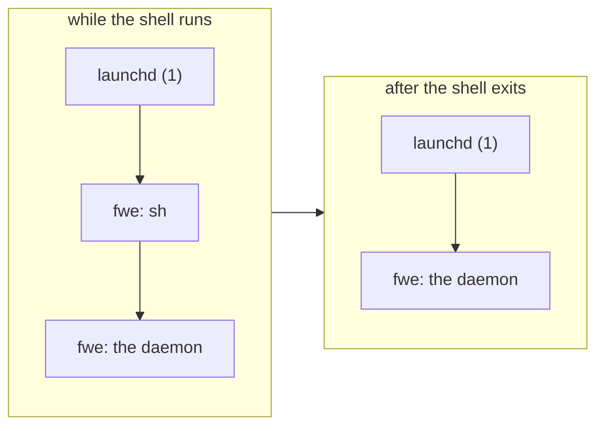

To keep a Linux daemon running as a service, a `launchd` job (a
LaunchAgent or LaunchDaemon) runs `fwe` with the daemon in the
foreground, as the program the job names; `launchd` then does what
systemd would:

| A service's need | systemd, on Linux | `launchd`, running fwe |
|---|---|---|
| start, and restart when it ends | `Restart=` | `KeepAlive`; the guest's exit status is `fwe`'s |
| stop | `SIGTERM`, then `SIGKILL` after `TimeoutStopSec` | `SIGTERM`, which the guest gets as Linux's ([A process killed from the host](#a-process-killed-from-the-host)), then `SIGKILL` after `ExitTimeOut` |
| its output | the journal | `StandardOutPath`, `StandardErrorPath` |
| sockets it is given (socket activation) | `LISTEN_FDS` | not passed: `launchd`'s `Sockets` reach a job only through `launch_activate_socket`, a macOS call a Linux program does not make |
| readiness (`sd_notify`) | `NOTIFY_SOCKET` | none |

A daemon that runs in the VM (a non-PIE program linked low) MUST end on
`SIGTERM` within the job's `ExitTimeOut`: the `SIGKILL` that follows ends
its process with its VM alive, which can bring the machine down
([hypervisor.md](hypervisor.md#never-end-a-vm-process-abnormally)).

#### ptrace

macOS gives no process another's memory or threads without the debugger
entitlement, so a tracee does its tracer's work: at a stop it writes its
registers and `siginfo` to a page they share and serves memory requests
until told to go on, so the tracee is never stopped on the host and the
tracer's `wait4`/`waitid` take its stops from that page first
(`crates/kernel/src/ptrace.rs`, [architecture.md](architecture.md#ptrace);
the calls under
[Debugging and sandboxing calls](#debugging-and-sandboxing-calls)). Only
fwe processes can be traced. Stops, single-stepping and attaching to
processes and threads work in both backends.

### Signals

Both kernels have signals with mostly the same behaviour, but different
numbers, different structures, and a different idea of what a blocked
signal keeps. This section covers the guest's side; how a host signal
reaches the guest is under [Host signals](#host-signals).

#### Numbers

Linux and macOS agree on signals 1–6, 8, 9, 11, 13–15, 21, 22 and 24–28.
fwe translates the rest both ways (`host::signal_to_host`,
`host::signal_to_linux`):

| Signal | Linux | macOS |
|---|---|---|
| `SIGBUS` | 7 | 10 |
| `SIGUSR1` / `SIGUSR2` | 10 / 12 | 30 / 31 |
| `SIGCHLD` | 17 | 20 |
| `SIGCONT` / `SIGSTOP` / `SIGTSTP` | 18 / 19 / 20 | 19 / 17 / 18 |
| `SIGURG` | 23 | 16 |
| `SIGIO` | 29 | 23 |
| `SIGSYS` | 31 | 12 |
| `SIGSTKFLT`, `SIGPWR` | 16, 30 | none |
| real-time `SIGRTMIN`..`SIGRTMAX` | 32–64 | none |
| `SIGEMT`, `SIGINFO` | none | 7, 29 |

fwe uses the two macOS-only signals itself: `SIGEMT` is its *wake signal*
and `SIGINFO` its *kill relay*
([Signals with no counterpart](#signals-with-no-counterpart)).

#### Dispositions, masks and frames

| | Linux | macOS | fwe |
|---|---|---|---|
| Dispositions | per process | per process, macOS numbers | in the kernel crate, each passed to the host as catch, default or ignore ([which](#who-acts-on-a-signal)) |
| Mask, alternate stack | per thread | per thread | per thread, in host thread-locals; the host thread's own mask is under [Who acts on a signal](#who-acts-on-a-signal) |
| Pending instances | one per standard signal; real-time signals queued | one per signal, `siginfo` lost while blocked | one per signal number; a standard signal keeps its first `siginfo`; real-time ones queued behind it, each with its own, up to `RLIMIT_SIGPENDING` counted per process (at most 4096); from another process, signals the host lacks wait in a queue of 64 in the target's mailbox, and stay there while it is at its limit |
| Signal frame | `rt_sigframe` with `ucontext`, `fpsimd_context` | Darwin `ucontext`, `mcontext64` | Linux's layout, on the guest stack or, under `SA_ONSTACK`, the alternate stack, with `x0`–`x2` set as `SA_SIGINFO` asks; return through `sa_restorer` or fwe's `rt_sigreturn` trampoline; how it is entered is under [A host signal reaching a guest thread](#a-host-signal-reaching-a-guest-thread) |

A signal ignored when fwe starts (`nohup`, a shell's background job)
starts out ignored in the guest, as across a Linux `execve`.

#### Sending a signal

A signal the host has goes out as a host signal. fwe records one the host
lacks, or one aimed at a single thread, itself, and wakes the target with
`SIGEMT`. To another process, once the pid is mapped out of the pid
namespace and permission checked as on Linux (below):

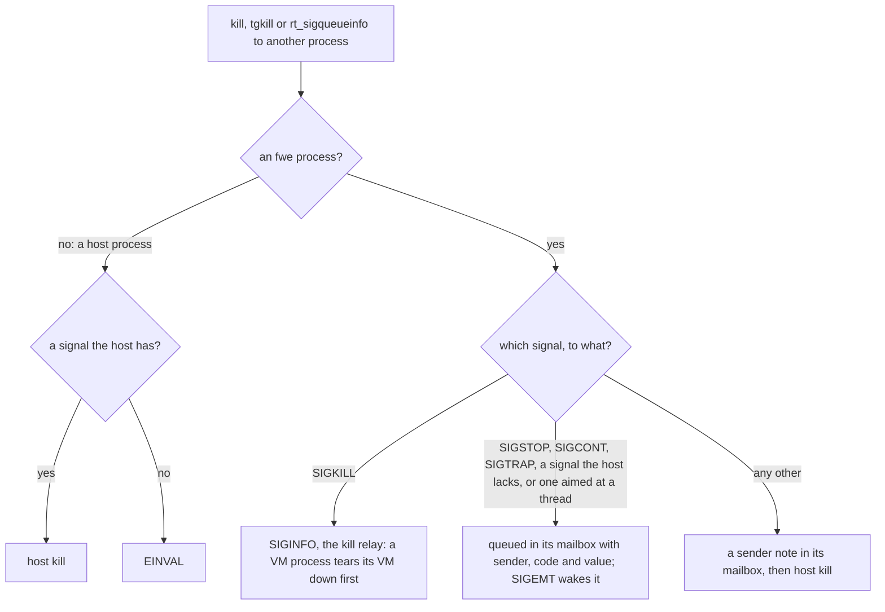

Call by call:

| Guest call | fwe | Host |
|---|---|---|
| `kill(pid, sig)` to another process, a signal the host has | a sender note left in the target's mailbox if it is an fwe process (`crates/kernel/src/signote.rs`) | `kill(<host pid>, <host signal>)` |
| `kill`/`rt_sigqueueinfo` with `SIGTRAP` to another fwe process | queued in its mailbox, as a signal the host lacks is: the host would merge a host `SIGTRAP` with the target's next system-call trap (fwe's `brk`, a `SIGTRAP` too), and it would be lost | `SIGEMT` to wake the target |
| `kill`/`tgkill` with `SIGSTOP` to an fwe process, this one too | queued in its mailbox (this one's pending set), dated by how many times it was continued; the process stops itself where it takes it, holding no lock other processes need, as Linux stops a task only on its way back to user mode ([architecture.md](architecture.md#signals)). The host's `SIGSTOP` would stop it wherever it was, a lock every other process needs held | `SIGEMT` to wake the target; its parent learns of the stop with `SIGCHLD` through its mailbox. One whose parent is a living process that is not fwe's (a shell) raises `SIGSTOP` on itself, for that parent to see |
| `kill` with `SIGCONT` to an fwe process | its count of continuations moved on first: a stop signal sent to it before is not taken, queued or pending, as Linux discards one as `SIGCONT` is sent; a stop signal sent drops a pending `SIGCONT`. The guest's `SIGCONT` goes through its mailbox, and the count ends a stop of fwe's; a process stopped on the host (whose parent is not fwe's) is sent the host's too, once, which its handler does not take for the guest's | the mailbox; `kill(<host pid>, SIGCONT)` for a stop on the host |
| `kill` of itself with a fault signal (`SIGSEGV`, `SIGBUS`, `SIGILL`, `SIGFPE`, `SIGTRAP`) | recorded directly, since macOS's `siginfo` cannot tell a sent one from a fault | none |
| `kill`/`tgkill`/`rt_sigqueueinfo` with a real-time signal (or `SIGSTKFLT`, `SIGPWR`) | recorded directly within the process; to another fwe process queued in its mailbox with the sender, code and value; to a process that is not fwe's `EINVAL` | `SIGEMT` to wake the target |
| `tgkill(tgid, tid, sig)`, a signal the guest catches or a fault signal | posted to that thread directly, which a relayed host signal could not target | `SIGEMT` to wake it |
| `tgkill`/`tkill` of a thread of another process | queued in its process's mailbox with the tid, and posted to that thread | `SIGEMT` to wake the process |
| `tgkill` of a signal the host acts on | — | `pthread_kill(<host thread>, <host signal>)` |
| `kill(-1, sig)` | only the caller's pid namespace or its run of fwe, never other host processes | `kill` of each |
| fwe's own signals to a process it keeps the pid of (a stop's end, a tracer's `SIGCHLD`, a cgroup's kill, a lease's or a message queue's notice) | sent only to one of fwe's processes, one that started when the record says: a pid kept from a process that ended might be the host's now; a refusal is told on the standard error | `kill` of a process of fwe's only |
| `kill(0, sig)`, `kill(-pgid, sig)` | the group's members listed from the host; each the caller is allowed to signal is sent the signal as one process would be (this one last), the others passed over; 0 if any took it, `EPERM` if the caller is allowed to signal none, as Linux's `kill_pgrp` | `proc_listpids(PROC_PGRP_ONLY)`, then `kill` of each |

- **Permission** follows Linux: `CAP_KILL`, or the caller's real or
  effective uid matching the target's real or saved one, or `SIGCONT`
  within the session; a process fwe has no record of counts as root's.
- A pid namespace's init takes only the signals it has a handler for, as
  Linux's `SIGNAL_UNKILLABLE`: one with its default action is dropped as
  it is delivered, from inside the namespace or above it, except a fault
  of its own. A `SIGKILL` or `SIGSTOP` sent to it from inside the
  namespace is dropped at the sender; from an ancestor namespace it acts,
  and a `SIGKILL` that ends an init takes its namespace with it.

### Files and descriptors

A Linux process sees a filesystem through its root and its mount
namespace; a macOS process sees the one host filesystem. What each file
call does is under [File calls](#file-calls); the mechanisms:

| Linux | macOS | fwe |
|---|---|---|
| a process's root (`chroot`) and mount table | one host filesystem | guest paths resolved component by component (`crates/kernel/src/fs.rs`): symlinks followed by fwe (40, then `ELOOP`), mounts entered, `..` clamped at the process's root, as `openat2(RESOLVE_IN_ROOT)` would; the final host `openat` has `O_NOFOLLOW` added |
| descriptor numbers | the same kind of table | guest descriptors are host descriptors; fwe's own live in a reserved range above the guest's (which ends at 16384 at most), out of the guest's reach (`EBADF`) ([architecture.md](architecture.md#descriptors)) |
| record locks (`F_SETLK`) | POSIX locks, different `struct flock`; any close of a file by the process drops its locks on it | translated; the host's, so they hold against host processes too; fwe reaches a guest's file by path for its own ends, but for the few it reads through a descriptor of its own, whose close drops them ([known limitations](architecture.md#known-limitations)) |
| OFD locks (`F_OFD_*`) | private `F_OFD_*` commands | translated to them; owned by the open file, shared by its duplicates |
| leases (`F_SETLEASE`) | none | a record every fwe process shares (`crates/kernel/src/leases.rs`): a conflicting open signals the holder and waits, up to `fs.lease-break-time` |
| `F_SETSIG`, thread owners | `SIGIO` to a process or group | kept per descriptor; how a host `SIGIO` arrives is under [Network events](#network-events) |
| pipe writes kept whole (`PIPE_BUF`): 4096 bytes | 512 bytes | up to 4096 bytes whole: writers of such a write to one pipe take turns (a lock of the pipe's every fwe process shares) |
| pipe size (`F_SETPIPE_SZ`) | fixed, 64 KiB at most | kept and reported as set; a smaller pipe holds no more than Linux's would, its writes cut to the room left and its write end not writable to `poll` or `epoll` while full; one set above 64 KiB holds no more than the host's |
| extended attributes | own namespace (`com.apple.`) | Linux names stored as host attributes of the same name, Linux's rules per namespace; only Linux's namespaces listed; `system.` ACLs not kept |
| mode bits; root passes them | owner's bits enforced on the owner | a mode denying its owner kept in an attribute (`UF_NODUMP` flags the file), the host file keeps owner read/write; a regular file made without the owner's read or write keeps its own mode until the host refuses root (`crates/kernel/src/modes.rs`) |
| terminals and ptys | `termios`, `/dev/ptmx` | see [Terminals and key strokes](#terminals-and-key-strokes) |

#### /proc, /sys and /dev

macOS has no `/proc` or `/sys`; fwe serves them as filesystems of its own:

- `proc` and `sysfs` mounts are generated from fwe's records and the host
  (`proc_pidinfo`, `sysctl`) (`crates/kernel/src/procfs.rs`, `procpid.rs`,
  `synthdir.rs`); what of the host shows there is under
  [Host identity and machine state](#host-identity-and-machine-state).
- `/proc/<pid>`, with its `task` directory, covers the processes of the
  reader's pid namespace:
  - A directory there counts its links as Linux's do: 2 and its
    subdirectories (`task`, 2 and the process's threads, which sandboxes
    read to tell a process is single-threaded). Each entry has an inode
    number of its own and its mount's device.
  - Each thread's `comm`, `stat` and `status` carry its own name, which
    crash reporters (crashpad) and `ps -L` read.
  - Another process's `mem` (and a thread's, `task/<tid>/mem`) is read
    and written as `process_vm_readv` reaches it, or through a stopped
    tracee's mailbox; its `auxv` is the vector its program started with
    (a fork child's, its parent's), its `environ` the strings that
    vector's stack holds. `pagemap` is the caller's own only.
  - Another process's `cwd`, `root`, `mountinfo` and `limits` are what it
    shares in fwe's process store as they change. Its `maps`, `smaps`,
    `environ`, `io`, `cwd` and `root` are refused (`EACCES`) to a reader
    not allowed to trace it, as Linux refuses them.
- `/proc/sys` writes reach the network and IPC namespaces' sysctls (the
  initial ones' too, fwe's own copy that never reaches the host), each
  user namespace's `user.max_*` limits, the UTS namespace's names, and
  the global ones fwe acts on.
- `/proc/net` is the reader's network namespace: a namespace of fwe's
  has `lo` alone; the initial one shows the host's interfaces
  (`getifaddrs`, `lo0` as `lo`). `route` and `ipv6_route` show the
  namespace's routes, as netlink's `RTM_GETROUTE` does
  ([Socket calls](#socket-calls)). The sockets are fwe's processes' in the
  namespace, as the host reports each (`PROC_PIDFDSOCKETINFO`), with the
  namespace's port numbers.
- `/proc/self/fd/N`, `cwd` and `root` behave as magic links.
- `/dev/null`, `zero`, `random`, `urandom` and `tty` are the host's,
  wherever the root filesystem's `/dev` is (a sandbox's `pivot_root`
  keeps the old root under the new one, and binds its nodes from there);
  `full`, `loop-control` and `loopN` are fwe's; `/dev/ptmx` and
  `/dev/pts` are fwe's pty layer; `/dev/fd`, `stdin`, `stdout`, `stderr`
  link into `/proc/self/fd`; `/dev/shm` and `/dev/mqueue` are fwe's
  mounts.

### Waiting and events

Linux has a family of descriptors for waiting on many things at once;
macOS has `kqueue`. fwe builds each Linux descriptor from a kqueue, a
pipe, or both:

| Linux | macOS | fwe |
|---|---|---|
| `epoll` | `kqueue` | a kqueue, each interest a filter (below); the events it returns under [Network events](#network-events) |
| `eventfd` | none | a pipe plus a 64-bit counter in shared memory every holder maps, so a fork child or a process it is passed to shares it; the pipe holds one byte exactly while the counter is non-zero, so `kqueue` sees readiness; a blocking write past the counter's maximum waits for a read (looked for each millisecond) or a signal |
| `timerfd` | none | a kqueue with one one-shot `EVFILT_TIMER` for the next expiry, in nanoseconds and on time (`NOTE_CRITICAL`); the schedule is fwe's |
| `signalfd` | none | a readiness pipe holding a byte while the process's queue of `signalfd_siginfo` records has a signal it watches (below) |
| inotify | `kqueue` vnode events (no names), FSEvents (paths, after the fact); neither reports open, read or close | fwe raises the events itself from every fwe process's file calls; an instance is a host datagram socket bound in fwe's private directory, so reading and `epoll` are the host's |
| pidfd (`pidfd_open`, `CLONE_PIDFD`) | `kqueue`'s `EVFILT_PROC` | a kqueue watching the process's exit, never read, so it stays readable once the process has ended (a zombie, which the host will not report again, gets a user event); a `PIDFD_THREAD` one of another thread of the process gets the user event as the thread exits |

An epoll interest becomes a kqueue filter (`epoll_event` is 16 bytes on
arm64, its `data` the filter's `udata`):

| epoll | kqueue |
|---|---|
| `EPOLLIN`, `EPOLLOUT` | `EVFILT_READ`, `EVFILT_WRITE` |
| `EPOLLET` | `EV_CLEAR`; a pipe's read end, which the host reports again after a read, is reported only once it holds more than when last seen, less what the process read through that descriptor since |
| `EPOLLONESHOT` | `EV_ONESHOT` |
| `EPOLLPRI` on a TCP socket | `EVFILT_EXCEPT` with `NOTE_OOB` (its urgent data) |
| `EPOLLEXCLUSIVE` | none: a count of a pipe's writes every fwe process shares, of which each woken set takes one to report it ([architecture.md](architecture.md#event-descriptors-and-inotify)) |

A signalfd's watched signals are always caught: creating or changing one
sets every host disposition again, so the host catches a watched signal
even where the guest's disposition would let the host drop it. A pending
signal the thread blocks and a signalfd watches moves onto the process's
queue when the thread next waits or returns from a call (a standard one
once), and the first read of a signalfd watching it takes it.

A host `fork` child gets no kqueues and an `execve` closes them, so epoll
interest lists, timerfd settings and process descriptors are recorded and
rebuilt at the same numbers in the child and across a re-executing
`execve`, an epoll set's duplicates too. A duplicate of an epoll
descriptor names the same kqueue on the host, and fwe treats it as the
same set, as Linux does.

### IPC

#### Sockets

Guest sockets are host sockets ([Socket calls](#socket-calls)), so
connections reach real networks and host programs. The differences are in
encoding: address families, the `sockaddr` header, flags folded into other
arguments, and Unix-socket names macOS does not support:

| Linux | macOS | fwe |
|---|---|---|
| `AF_INET6` = 10 | 30 | translated |
| `sockaddr` starts with a 2-byte family | a length byte, then a family byte | header rewritten in place |
| `MSG_NOSIGNAL` | `SO_NOSIGPIPE` | every socket gets `SO_NOSIGPIPE`; fwe raises `SIGPIPE` itself for a write or send without `MSG_NOSIGNAL` |
| `AF_UNIX` paths | 104-byte limit | resolved in the guest's root; a long one bound, connected or sent to from its directory with `pthread_fchdir_np`; connecting or sending needs write permission on the node, as fwe keeps its mode (`EACCES`) |
| abstract `AF_UNIX` names | none | socket nodes in `fwe-abstract` in the user's temporary directory, or in an fwe network namespace's own directory, named by a hash of the name; the names and who bound each in a record in memory every fwe process maps, one per network namespace; a name whose socket is gone is free to bind again |
| socket option numbers and layouts at `SOL_SOCKET`, `IPPROTO_IP`, `IPPROTO_IPV6`, `IPPROTO_TCP` and `IPPROTO_ICMPV6` | numbered apart (`IP_TOS` 1 and 3, `TCP_KEEPIDLE` 4 and `TCP_KEEPALIVE` 0x10, `ICMP6_FILTER` 1 and 18); `group_req` packed to 4 bytes; `ip_mreq_source` ordered apart; multicast TTL and loop a byte; an `icmp6_filter` bit blocks a type on Linux and passes it on macOS | each translated (`crates/kernel/src/sockopt.rs`); one the host lacks is `ENOPROTOOPT`, but `SO_NO_CHECK`, `SO_PRIORITY`, `SO_PASSCRED` (acted on, see [Socket calls](#socket-calls)), `IP_RECVERR`, `IPV6_RECVERR` and `SOL_RAW`'s `ICMP_FILTER` are kept and read back, and `SO_DOMAIN`/`SO_PROTOCOL` answered by fwe (the protocol from the host's `proc_pidfdinfo`, so a ping or raw socket's is its own); any other level is `ENOPROTOOPT`, so no Linux option reaches the host as another |
| `SOL_UDP` options | none (macOS's one, `UDP_NOCKSUM`, has `UDP_CORK`'s number) | fwe's: `UDP_CORK` holds sends back until cleared, then sends them as one datagram; `UDP_SEGMENT` cuts a send into datagrams of its size (64 at most, `EINVAL` past them); `UDP_GRO` joins nothing, as Linux need not; `UDP_NO_CHECK6_TX`/`RX` leave checksums to the host; `UDP_ENCAP` (IPsec) and the rest `ENOPROTOOPT` |
| `SO_SNDBUF`/`SO_RCVBUF` doubled, capped by `wmem_max`/`rmem_max`; the `FORCE` forms with `CAP_NET_ADMIN` | the size as given | Linux's arithmetic, the host's buffer given the result |
| a level a socket has no layer for | taken or `EINVAL` | `EOPNOTSUPP` to get, `ENOPROTOOPT` to set (`EOPNOTSUPP` on a Unix socket) |
| multicast membership on a TCP socket | refused | as Linux has it: `IP_ADD_MEMBERSHIP`, `IPV6_ADD_MEMBERSHIP` and their drops `EPROTO`; the source and `MCAST_*` options' groups, filter modes and sources kept by fwe and checked as Linux checks them (no multicast reaches one) |
| `MSG_MORE` | none | a TCP or UDP send's data held back and sent with the next send without it, as one segment or datagram |
| a later `connect` of a socket whose connect was interrupted or left in progress (`EINPROGRESS`) waits for the connection under way, then returns 0 (or its error); after that, `EISCONN` | it says `EALREADY` while the connection is made and `EISCONN` once it is | fwe marks the socket connecting and answers a later `connect` (its own rerun after a signal the guest does not see too) as Linux does, waiting for the host's connection if the socket blocks |
| `connect` to `AF_UNSPEC` | dissolves a datagram socket's peer, reporting an error | a datagram socket's peer forgotten; a TCP socket's connection reset and a fresh host socket put in its place |
| `IPV6_ADDRFORM` | none | an IPv6 socket with an IPv4-mapped peer reports its names as IPv4, and a reset makes it an IPv4 socket |
| interface requests (`SIOCGIFCONF`, `SIOCGIFFLAGS`, `SIOCGIFADDR`, `SIOCSIFMTU`, ...) | a 32-byte `ifreq`, other flag bits | in an fwe network namespace, answered for `lo`; elsewhere the host's interfaces, `lo0` as `lo`, their flags in Linux's numbering (`IFF_MULTICAST` moved, none for `lo`, `IFF_LOWER_UP` while running), which the guest cannot change (`EPERM`) |

#### Displays

A Linux program draws through an X server (or a Wayland compositor) it
reaches by a Unix socket. macOS has no Linux display of its own, but runs
X servers: XQuartz on the screen, Xvfb without one. fwe hands the guest
the one fwe's own `DISPLAY` names (`crates/kernel/src/x11.rs`):

| Linux | macOS | fwe |
|---|---|---|
| `DISPLAY=:N`, the server's socket `/tmp/.X11-unix/XN` and the abstract name `@/tmp/.X11-unix/XN` libxcb tries first | the host server's socket: Xvfb's or Xorg's `/tmp/.X11-unix/XN`, XQuartz's launchd socket `/private/tmp/com.apple.launchd.…/org.xquartz:N` | either name, in any root and from every process of the run (a VM's fork children too), reaches the host server's socket; the guest's `DISPLAY` is `:N` (XQuartz's path shortened to it) |
| another display, its socket in the guest's `/tmp/.X11-unix` (an Xwayland a compositor starts, an Xvfb the guest runs) | — | the guest's own, a Unix socket in its root like any other (a server's TCP port is the host's) |
| MIT-SHM's `ShmAttach`: the server attaches the client's System V segment by id | its own segments, which are not fwe's | sent as `ShmAttachFd` (MIT-SHM 1.2) with the segment's file, so the server draws from the guest's pages uncopied; a server without 1.2 gets the `ShmAttach` as it was |
| `DISPLAY=host:N` (TCP) | the host's network | a host connection, as any other |
| Wayland: a compositor's socket in `XDG_RUNTIME_DIR` | none | the guest's own compositor (Weston), drawing as an X client |
| GPU rendering: a Vulkan driver the loader finds by its manifest in `/usr/share/vulkan/icd.d` or `/etc/vulkan/icd.d`, which talks to the GPU's kernel driver through `/dev/dri` | Metal; Vulkan through MoltenVK or KosmicKrisp, in the process | fwe's Linux Vulkan driver in `/etc/vulkan/icd.d`, whose every command reaches the Mac's Vulkan driver in fwe's process through one ioctl on `/dev/fwe-gpu` (see [Devices](#devices)); OpenGL through Mesa's Zink on it; frames reach the X server as copies |

### Kernel-wide state

What Linux keeps in one kernel for every process lives, under fwe, in
memory every fwe process of the user maps (host shared memory objects),
never in files on the disk: a file's pages are written back to the disk,
and a file's making, opening and removal cost the host tens of
microseconds each, where memory is read and written at memory's speed.
What macOS has itself (a pipe, a socket, a wait on shared memory) is
macOS's.

| State | Where it is | Code |
|---|---|---|
| process records, thread ids, signal mailboxes, mapping lists, how processes ended, ptrace pages, shared futex waiters, pipe-write and `ETXTBSY` locks | the process store: one shared memory object, its entries read without a lock and written under one ([architecture.md](architecture.md#process-records-and-the-process-store)) | `procstore.rs` |
| mount tables, namespaces, System V IPC, POSIX message queues, keys, loop devices, inotify watches, abstract socket names and their binders | shared records: named slots of the process store, each a lock, a generation count and the data, with a journal of changes, so a change costs what it holds and a process reads again only after another changed it | `shared.rs` |
| a System V segment's memory, an eventfd's counter, an eBPF map or program, the VM's anonymous shared memory, a `process_vm_readv` or `process_vm_writev` request | a shared memory object each: a segment's and a request's named for it, the others with no name, held by their descriptors and mappings | `sysvipc.rs`, `specialfd.rs`, `memobj.rs`, `procvm.rs` |
| tmpfs, `/dev/shm`, memfds, the cgroup tree | fwe's file store: a filesystem's names, inodes, attributes and locks in a shared memory arena of its own, a regular file's data in shared memory objects, its extents ([architecture.md](architecture.md#fwes-file-store)); pages a cut or a punched hole frees are zeroed and left for macOS to take back first when it runs short (`MADV_ZERO`, `MADV_FREE_REUSABLE`: macOS takes no page of a shared object back for good), where Linux frees them | `filestore/` |
| a shared futex's wait | macOS's wait on the shared address, which keys on the memory as Linux's does | `futex.rs` |
| the channel of a FIFO or socket in a tmpfs, the sockets a descriptor is sent between processes on, an inotify instance's socket | macOS's pipes and Unix sockets, their nodes in fwe's private directory (`fwe-<uid>` in the user's temporary directory) | `storenodes.rs`, `signote.rs`, `inotify.rs` |

The name of each record and object carries a format number, so another
fwe build never reads it, and what no live process holds is collected
([architecture.md](architecture.md)).

What it costs (micro benchmarks of `tools/bench/run.py`, on CI's macOS 26
and Linux arm64 runners; the System V calls' budget is 3x macOS's):

| Benchmark | fwe | macOS | Linux |
|---|---|---|---|
| System V semaphore up+down | 1048 ns | 610 ns | 593 ns |
| System V message send+receive | 864 ns | 1301 ns | 785 ns |
| System V segment made, attached, written, detached, removed | 8.87 µs | 3.14 µs (a shared memory object made, mapped and removed: what fwe's segment costs the host) | 9.36 µs |
| eventfd write+read | 954 ns | none | 504 ns |
| shared futex wake, no one waiting | 89 ns | none | 287 ns |
| a small file's life in `/dev/shm` (made, 4 KiB written and read back, closed, removed) | 57.8 µs | none | 6.54 µs |
| the same file's life in `/tmp`, on the disk | 165 µs | 127 µs | 13.0 µs |
| a memfd's life (made, 4 KiB written and read back, closed) | 29.7 µs | none | 4.31 µs |
| a shared memory object's life in `/dev/shm` (made, sized to 64 KiB, mapped, written, removed) | 66.1 µs | none | 11.1 µs |

A file in fwe's store costs a third of the same file on the disk under
fwe, and under half of macOS's own disk file: memfds, `/dev/shm` and every
tmpfs are the store's.

Programs at work, on the same runners:

| Workload | fwe | macOS | Linux |
|---|---|---|---|
| LTP's IPC tests (System V and POSIX message queues), the 47 that pass | 37.0 s, 20.1 s of it `semop05`'s own sleep | none | — |
| Lua built from clean with `make -j4` (a fork-heavy build) | 1.89 s | 1.80 s | 2.12 s |
| PostgreSQL 18 (`tools/bench/workloads/postgres.sh`): `initdb`, a server, `pgbench` of 4 clients × 250 transactions, a `count(*)` its parallel workers scan (System V and POSIX shared memory, semaphores, signals) | 2.76 s | 1.66 s | 1.34 s |

### Namespaces

macOS has no namespaces. fwe makes each as a shared record the processes
in it name; a process in an initial namespace sees the host's (host name,
host pids). `clone` and `unshare` make them, `setns` joins one through a
`/proc/<pid>/ns/*` descriptor. As on Linux, each thread has its own
namespaces, and shares the root, working directory and umask with the
others unless it unshared `CLONE_FS` (which `CLONE_NEWNS` implies); a
thread it starts has a copy of its view, and a `fork` child or a program
it runs takes the calling thread's. A process made with `CLONE_FS` shares
them with its parent, as threads do, across `execve`, until either
unshares them ([architecture.md](architecture.md#namespaces)).
Namespaces belong to the kernel crate, which both backends share: a
program in the VM is in them, numbered, mapped and confined by them, as
a native one is.

| Namespace | What fwe does |
|---|---|
| pid (`pidns.rs`) | nested; numbers processes and threads from 1 in a record mapping each to its host pid; `getpid`, `kill`, `wait`, process groups and `siginfo` senders are translated; when its init ends, the rest are killed; its init's signals as under [Sending a signal](#sending-a-signal) |
| mount (`mounts.rs`) | a mount table per namespace; see [Mounts](#mounts) |
| user (`userns.rs`) | ids kept as the initial namespace's and seen through `uid_map`/`gid_map` (below); the creator has every capability in it, over what it owns only ([Credentials and capabilities](#credentials-and-capabilities)) |
| UTS | `uname`, `sethostname`, `setdomainname` use its names ([System-wide calls](#system-wide-calls)) |
| network (`netns.rs`) | a loopback interface of its own, its ports, abstract `AF_UNIX` names and sysctls (below) |
| IPC | its System V objects, POSIX queues and IPC sysctls; the initial one is fwe's, not the host's |
| cgroup | `/proc/<pid>/cgroup` of any process and `cgroup2` mounts show the tree from its root (a cgroup outside it through `/..`, as Linux shows it) |
| time | not made, as without `CONFIG_TIME_NS` ([roadmap](../ROADMAP.md), not planned for 1.0) |

**`uid_map`, `gid_map`** are written once, with Linux's rules: no
privilege needed, at most 340 lines, each extent within one of the parent
namespace's (`EPERM` for any writer), an unprivileged writer its own id
only, `gid_map` after `setgroups` `deny`. The initial namespace's maps
read as identity (writes `EPERM`).

**A network namespace** has a loopback interface, down until brought up,
and its sockets reach only loopback. Its ports are host loopback ports
(which host programs can reach) mapped through its table, so each
namespace has its own port 80 (a datagram socket's port the host chose
when it first sent too). A stream to a port nobody bound there is
refused, and a datagram to one goes to a host port fwe holds unread and
connected to itself, so it reaches no host program and a connected
sender gets `ECONNREFUSED`, as on Linux. A socket stays in the namespace
it was made in (recorded with its descriptor, and passed with it over a
Unix socket), whichever namespace uses it.

### cgroups

macOS has no cgroups and no unprivileged way to hold a process to a
memory or CPU budget. fwe keeps one cgroup v2 tree for all the user's fwe
processes, as a machine has one: a filesystem of fwe's store, in memory
([Kernel-wide state](#kernel-wide-state)), whose directories are the
cgroups and whose files their interface files, which a `cgroup2` mount
shows (`crates/kernel/src/cgroupfs.rs`). As kernfs's, a cgroup's
directory takes no other file (`EACCES`), loses none and is not renamed
(`EPERM`), and an open to cut one of its files cuts nothing. A process's
cgroup is in its process record, and a `fork` child starts in its
parent's. A member is a host process, native or running the VM alike.

| File | What fwe does | On the host |
|---|---|---|
| `mkdir`, `rmdir`, `cgroup.procs`, `cgroup.controllers`, `cgroup.subtree_control`, `cgroup.events`, `cgroup.stat`, `cgroup.max.depth`, `cgroup.max.descendants` | Linux's rules (below) | none: the store and a lock in the process store, the process records |
| moving a process (`cgroup.procs`, `CLONE_INTO_CGROUP`) | Linux's delegation: write access to `cgroup.procs` of the cgroup the source and destination are both in (`EACCES`), both inside the writer's cgroup namespace (`ENOENT`; the hierarchy is mounted `nsdelegate`) | none |
| `cgroup.type`, `cgroup.threads` | only domain cgroups: `threaded` is `EOPNOTSUPP`, and a thread moves only to the cgroup it is in | none |
| `pids.current`, `memory.current`, `cpu.stat` | the members' threads, resident memory, and user and system time, summed | each member's task information (`proc_pidinfo`) |
| `pids.max` | `max` or a whole number up to Linux's 4194304, with no suffix (`EINVAL`); enforced on `fork` and on a new thread natively, not on a VM thread (`EAGAIN` past it, counting threads, up the tree), each refusal counted in `pids.events`; a thread looks at the limits only after a process moved or a limit changed (a shared generation) | none |
| `cgroup.freeze` | stops and continues the members of the cgroup and every cgroup below it; a cgroup is frozen while one above it is (`cgroup.events`), and a process that joins one, or is forked into one, is stopped too; a frozen member is a stopped process, so a `SIGCONT` thaws it and its parent sees the stop | fwe's `SIGSTOP` to each ([Sending a signal](#sending-a-signal)) and its continue (a VM's vCPU threads wait with the process's other threads) |
| `cgroup.kill` | kills the members | `SIGKILL`, relayed so a process running the VM takes it down first |
| device programs (`BPF_PROG_TYPE_CGROUP_DEVICE`) | decide every device open and `mknod` of members, on fwe's eBPF interpreter (`bpf.rs`); kept with the cgroup's directory, where no listing shows them | none |
| `memory.max`, `memory.high`, `memory.low`, `memory.min`, `memory.swap.max`, `memory.oom.group`, `cpu.max`, `cpu.weight`, `io.*`, `cpuset.*`, `hugetlb.*`, `rdma.*`, `misc.*` | kept and read back (a memory limit parsed as Linux parses it, suffixes `K` to `E`, and kept in whole pages), not enforced; `memory.stat`, `memory.events` and `io.stat` read zeros | none: macOS has no such limit for a process |
| `*.pressure`, `/proc/pressure`; the `perf_event` controller | absent (`ENOENT`, as without `CONFIG_PSI`); not offered | none |

The tree keeps Linux's rules: no controllers for children of a cgroup
with processes, `EBUSY` removing one in use, `EAGAIN` for a cgroup past a
depth or descendant limit up the tree, and a write to
`cgroup.subtree_control` naming a controller Linux lacks `EINVAL` (one
the cgroup cannot use `ENOENT`) before anything changes. A new cgroup's
files are its creator's, a controller's whoever enables it. Lists read as
they are when opened (`cgroup.threads` lists every thread). Making,
removing and moving into a cgroup happen one at a time across processes,
as under Linux's `cgroup_mutex`.

### Mounts

macOS mounts are system-wide and need root; there are no mount
namespaces, no bind or overlay mounts of Linux's kind and no propagation.
fwe's mounts exist only in its tables (`crates/kernel/src/mounts.rs`,
`mountops.rs`, `mountapi.rs`, `overlay.rs`), which its path resolver
follows:

- a mount shows a host directory (rootfs, bind source), an overlay of
  several, a filesystem of fwe's store in memory (a tmpfs, `/dev/shm`,
  `cgroup2`), or one of fwe's own (`proc`, `sysfs`, `devpts`, `mqueue`);
- `ro`, `nosuid`, `nodev`, `noexec` and `nosymfollow` are enforced by fwe
  (`EROFS`, no privilege gained, `EACCES`, `EACCES` or `EPERM`, `ELOOP`),
  and so are `noatime`, `nodiratime` and `strictatime`; `relatime` is the
  host's, so a Mac program's read of a file (Spotlight indexing one soon
  after it is written) sets its access time as a read in the guest would,
  and a directory named `*.noindex` is not indexed; `sync`, `dirsync`,
  `lazytime` and `mand` are ignored (`mand` as on Linux since 5.15);
- an overlay is resolved as Linux's `overlay`: upper then lower layers,
  each a host directory or a tmpfs's of fwe's store, whiteouts (0:0
  device nodes) and opaque directories, copy-up as an APFS clone between
  host layers and as a copy otherwise, each change built in the work
  directory and renamed into place, a file made where a whiteout is
  taking its place at once;
  a directory opened in a bind mount of one stays in that mount, with what
  is mounted below it;
- a namespace's file (`/proc/<pid>/ns/<kind>`, a thread's under
  `task/<tid>`, or a descriptor of one) bound to a file is an `nsfs` mount
  that names the namespace: opening the path gives a descriptor of it,
  `stat` shows its inode, and it keeps the namespace from being collected
  until unmounted (Docker and `ip netns` keep network namespaces so).

### Credentials and capabilities

On macOS a process runs as the user who started it and only root can
change that. Linux programs, container runtimes above all, expect to be
root inside, to change ids and to hold capabilities. fwe keeps the
guest's identity virtual:

| Linux | macOS | fwe |
|---|---|---|
| real/effective/saved/fs uids and gids, groups | the host process's, changeable only by root | virtual (`crates/kernel/src/creds.rs`), per process (not per thread), default root (0), Linux's `set*id` and `setgroups` rules; the host process's never change |
| capability sets and securebits | none | the five sets (per process, not per thread) and securebits (`caps.rs`: `NOROOT`, `NO_SETUID_FIXUP`, `KEEP_CAPS`, `NO_CAP_AMBIENT_RAISE` and their locks; `SECBIT_EXEC_*` `EINVAL`, as on 6.12), changed by `capset`, `prctl` (`PR_CAPBSET_*`, `PR_CAP_AMBIENT`), `setuid`, `execve` as on Linux; every capability but `CAP_SYS_TIME` at the start; held in the process's user namespace and checked against the namespace that owns the object, as below |
| `chown` | changes the owner | kept in an attribute (`org.fwe.owner`, `crates/kernel/src/owners.rs`) under Linux's rules and shown by `stat`; a Unix socket node's, which macOS gives no attribute, in a file of fwe's named by the node's identity; the host file stays fwe's user's |
| a file made by a user other than root (`open` with `O_CREAT`, `mkdir`, `mknod`, `symlink`) | made with the host user's owner, given another after | made under a hidden name, given its owner and mode, then renamed onto its name only if none is there (`renameatx_np`, `RENAME_EXCL`): it is never seen as root's before its owner is set |
| permission bits for a caller that is not root | the host's, for the host user | fwe's check by the guest's owner, mode and file-system ids, and each directory's search bit along a path (in a root filesystem), with `CAP_DAC_OVERRIDE` and `CAP_DAC_READ_SEARCH` as Linux's |
| file capabilities, set-ID programs | set-ID bits, honoured only for root's files | `execve` acts on a program's `security.capability` attribute and its set-ID bits (the owner and group fwe keeps) with Linux's rules (below) |
| dumpable (`PR_SET_DUMPABLE`, `fs.suid_dumpable`) | none | set by `execve` and id changes as on Linux; decides tracing, `/proc/<pid>` ownership and core dumps |

**Set-ID programs and file capabilities**: an `execve` ([execve](#execve))
gives the new ids and capability sets as Linux computes them, clears the
ambient set, grants nothing on a `nosuid` mount, and sets `AT_SECURE`
([auxv, hwcaps and the vDSO](#auxv-hwcaps-and-the-vdso)). Under
`no_new_privs`, or while traced by a tracer without `CAP_SYS_PTRACE` over
the caller, it grants no capability beyond the caller's permitted ones,
and the set-ID ids only to a caller with `CAP_SETUID` not under
`no_new_privs`. The `security.capability` attribute needs `CAP_SETFCAP`
to write, is checked as it is written (revisions 2 and 3), is kept for
the root of the writer's user namespace, and is removed by `chown`, a
write or a truncation, as Linux removes it; set-ID bits are cleared so
too.

A capability counts in the user namespace it is held in, as Linux's
`ns_capable` has it (`userns::capable_in`): in the process's own
namespace by its effective set, in a namespace below it that its
effective user made (and every namespace below that) outright, and
nowhere else. Each check asks the namespace that owns what is acted on:

| What | The namespace asked |
|---|---|
| a file (permission bits, owner, mode, times, `chown`, set-ID bits, `security.capability`) | the caller's own, and only for a file whose owner and group are mapped there (`capable_wrt_inode_uidgid`) |
| a process (`kill`, `ptrace` and `/proc/<pid>` access, `setpriority`, `sched_setaffinity`, `prlimit`, timer slack) | the target's user namespace |
| mounts (`mount`, `umount2`, `pivot_root`, the mount API) | the owner of the caller's mount namespace; a new `proc`, `sysfs`, `mqueue` or `cgroup2` also the owner of the pid, network, IPC or cgroup namespace it shows |
| `setns`, `unshare` | the namespace joined (and its owner); the caller's own for a new one |
| the network (`CAP_NET_ADMIN`, `CAP_NET_BIND_SERVICE`, network sysctls) | the owner of the network namespace |
| System V and POSIX IPC, IPC sysctls | the owner of the IPC namespace |
| host and domain names | the owner of the UTS namespace |
| `reboot` | the owner of the pid namespace |
| the whole system's (the clock, modules, `bpf`, global sysctls, devices, `mknod`, `acct`, `syslog`, `vhangup`, raising hard limits, real-time scheduling, loop devices, `open_by_handle_at`) | the initial namespace only |

A mount namespace made for a less privileged user namespace locks the
mounts it copies, as Linux's `lock_mnt_tree`: their `ro`, `nosuid`,
`nodev` and `noexec` flags cannot be cleared and their access-time mode
cannot change (`EPERM`), and they cannot be unmounted, moved, or
uncovered by a bind without the mounts on them (`EINVAL`). Every
filesystem fwe mounts is one Linux lets a user namespace mount.

How host users and file owners look to the guest is under
[Host identity](#host-identity-and-machine-state).

### seccomp

macOS has no seccomp. fwe runs each filter, classic BPF over Linux's
`seccomp_data` (`AUDIT_ARCH_AARCH64`), before either backend routes a call
(`crates/kernel/src/seccomp.rs`), so none escapes it; the action of
highest precedence wins. Filters apply to every thread of the process and
are kept across `fork` and `execve`. The filters' instruction pointer,
like a `SIGSYS`'s call address and its handler's pc, is the address after
the `svc`, as Linux reports it (sandboxes compare the two).
`SECCOMP_RET_TRAP` raises `SIGSYS` with Linux's `_sigsys` fields;
`SECCOMP_RET_TRACE` stops a tracer that set
`PTRACE_O_TRACESECCOMP` (`PTRACE_EVENT_SECCOMP`, the filter's data as its
message), which can change the call or skip it (number -1), and the
filters then run again on what it left; without such a tracer it fails the
call with `ENOSYS`, as `SECCOMP_RET_USER_NOTIF` always does (there is no
listener). `SECCOMP_RET_LOG`, the kill actions, and the others from a
filter installed with `SECCOMP_FILTER_FLAG_LOG` write Linux's audit record
(`type=1326`) to the kernel log, which `dmesg` reads; the actions logged
are Linux's defaults, with no `/proc/sys/kernel/seccomp` (`ENOENT`).
`/proc/<pid>/status` counts the filters (`Seccomp_filters`). Strict mode
allows `read`, `write`, `exit` and `rt_sigreturn` and ends the process
with `SIGKILL` on any other call. `PR_SET_SECCOMP` and `PR_GET_SECCOMP`
reach the same code.

A filter is checked as Linux checks it and installed only under
`no_new_privs` or with `CAP_SYS_ADMIN` (`EACCES`). With no listener,
`SECCOMP_FILTER_FLAG_NEW_LISTENER` and `FLAG_WAIT_KILLABLE_RECV` are
`EINVAL` and `GET_ACTION_AVAIL` of `SECCOMP_RET_USER_NOTIF` `EOPNOTSUPP`,
where Linux has listeners whenever it has filters. `FLAG_TSYNC`,
`FLAG_TSYNC_ESRCH` and `FLAG_SPEC_ALLOW` change nothing: filters are
always the whole process's, and speculation is the host's.
`PTRACE_SECCOMP_GET_FILTER` is `EIO` and `PTRACE_O_SUSPEND_SECCOMP`
`EINVAL`, as without `CONFIG_CHECKPOINT_RESTORE`.

A container runtime turns its seccomp profile (Docker's default, podman's,
a pod's) into such a filter and installs it in the container's first
process, so the profile holds as on Linux: a call it refuses fails with
the profile's errno, kills, or raises `SIGSYS`; a profile with
`SCMP_ACT_NOTIFY` does not load. CI's crun test runs a
container with a profile and checks `Seccomp: 2` in its
`/proc/self/status`.

### Security modules: SELinux, AppArmor, Landlock

Linux's security modules (LSMs) add checks to the kernel's own: SELinux
labels every process and file and checks each access against a policy;
AppArmor confines a program to what its profile lists; Landlock lets a
process restrict itself. macOS's own (the sandbox, SIP) apply to the
`fwe` process as to any other and know nothing of the guest.

| Module | What fwe does | What a program sees |
|---|---|---|
| capabilities | Linux's five sets and securebits, enforced by fwe ([Credentials and capabilities](#credentials-and-capabilities)) | as on Linux |
| Landlock | enforced by fwe (`landlock.rs`, `landlockops.rs`; the rules under [Debugging and sandboxing calls](#debugging-and-sandboxing-calls)) | as on Linux, with the limits in [architecture.md](architecture.md#known-limitations) |
| SELinux | none; `security.selinux` attributes kept | no `/sys/fs/selinux` (`ENOENT`): SELinux is off, as on a distribution that does not use it |
| AppArmor | none | no `/sys/kernel/security/apparmor` (`ENOENT`): AppArmor is absent, as from a kernel without it |
| Yama | `kernel.yama.ptrace_scope` (1 by default) and `PR_SET_PTRACER`, enforced by fwe on every attach (`ptrace.rs`) | as on Linux |
| the list, process attributes | as under [System-wide calls](#system-wide-calls); no `/proc/<pid>/attr` (`ENOENT`) | only the modules that act |

podman, crun, runc and Docker apply an AppArmor profile or an SELinux
label only where the host has the module, so here they run without one
(`--security-opt label=...` and `apparmor=...` have nothing to act on),
as on a Linux host without them. Their seccomp profiles do apply.

### eBPF

On Linux, eBPF programs are loaded into the kernel, checked by its
verifier, compiled to machine code and attached to hooks: sockets,
cgroups, tracepoints, kprobes, network devices (XDP), the scheduler.
macOS has none of it. fwe implements the part container runtimes and
socket programs use (`crates/kernel/src/bpf.rs`, `bpfmap.rs`,
`bpfcheck.rs`):

- **Programs** are interpreted, not compiled. The interpreter checks
  every memory access against the context and stack at run time and
  stops a program after 2^20 steps, so a program can do nothing but
  answer.
- **Cgroup device programs** (`BPF_PROG_TYPE_CGROUP_DEVICE`), which runc,
  crun and Docker attach to a container's cgroup to say which devices it
  can use, run on every device open and `mknod` of the cgroup's members
  ([cgroups](#cgroups)).
- **Socket filters** (`BPF_PROG_TYPE_SOCKET_FILTER`, `SO_ATTACH_BPF`),
  checked when loaded by a verifier for the subset fwe runs
  (`bpfcheck.rs`: structure and bounds; a failure is `EACCES`, with a
  verifier log as Linux gives), run on what this process sends to the socket by any call,
  reading the data with `bpf_skb_load_bytes`.
- **Maps**: array and hash maps (others `EINVAL`), with the lookup, update
  and delete helpers (other helpers `EINVAL`). A loaded program or map is
  a host shared memory object that its descriptor is open on, so every
  process holding a descriptor, a fork child too, shares it.
- A program of any other type Linux has loads (libraries probe for support
  by loading one) but is never attached nor run (`EINVAL` to attach);
  runc's cilium/ebpf probes so. Tracing (kprobes, tracepoints,
  `perf_event_open`), XDP and traffic control, LSM programs, and the BPF
  filesystem are not there, so `bpftrace`, Cilium and the like do not
  work: other commands and pinning are `EINVAL` (`BPF_OBJ_PIN` too),
  mounting `bpf` `ENODEV`.
- Classic socket filters (`SO_ATTACH_FILTER`, `SO_LOCK_FILTER`) are
  `ENOPROTOOPT`.

### Isolation and security

Namespaces, cgroups, credentials, seccomp and Landlock are enforced by
fwe, between the guest's system calls and the host. That is enough to run
container runtimes and their containers as they expect, and to keep
well-behaved programs apart. It is not a boundary against a program that
sets out to cross it:

- **The native backend** runs the program inside the `fwe` process, with
  fwe's own code and data and macOS's libraries. Code that writes fwe's
  memory, jumps into `libSystem`, or makes macOS's own system calls (an
  `svc` fwe did not take for code) acts as the user who started `fwe`.
- **The VM backend** keeps the guest's memory apart from fwe's: the guest
  reaches the host only through its system calls and faults. That is a
  much smaller surface, but fwe's userspace kernel is not hardened as a
  sandbox's is.
- **Every guest process is the host user's.** Root in the guest, a
  container's user and any other guest user are the same macOS user: a
  file the guest cannot write because of its virtual owner is one the
  user's other programs can.
- **macOS's own protections** (the sandbox, SIP, privacy consent, the
  firewall) apply to `fwe` as to any program the user runs.

So fwe isolates as `chroot` does, not as a VM does. An untrusted program
SHOULD be run in a Linux VM instead ([comparisons.md](comparisons.md)).

### Devices

Device nodes on macOS can only be made by root, and Linux's device
numbers mean nothing there. fwe keeps its own:

- `mknod` of a device (`CAP_MKNOD` in the initial namespace, and what a
  cgroup's device program allows) makes an empty file flagged `UF_OPAQUE`
  with the Linux type and numbers in an attribute
  (`crates/kernel/src/devnodes.rs`); opening it opens the host device
  those numbers name (1:3, 1:5, 1:8, 1:9 and 5:0; 1:7, `full`, is the
  host's `/dev/zero` with writes failing `ENOSPC`), or fails with `ENXIO`.
- Loop devices are fwe's own block devices 7:N with `/dev/loop-control`
  (10:237), in a shared record (`loopdev.rs`); fwe carries out their
  reads, writes and requests on the attached file.
- The GPU is fwe's character device 10:241, `/dev/fwe-gpu`, which fwe's
  Linux Vulkan driver (`/etc/vulkan/icd.d/libvulkan_fwe.so`) opens, there
  where a Mac Vulkan driver is installed:

  | Linux (a Vulkan driver) | fwe |
  |---|---|
  | the loader finds the driver by its manifest | fwe's manifest and library in `/etc/vulkan/icd.d`, a directory fwe answers itself; the root's own drivers stay where they are |
  | a command, run by the driver in the process | its arguments packed into words and passed with one ioctl; fwe calls the Mac driver's function for it with them, in the same process, the guest's pointers the driver's to read and write |
  | the driver's descriptors and threads, in the process | the Mac driver's descriptors kept out of the guest's descriptor range; its threads take no signal of the guest's |
  | a swapchain of an X window (xcb, Xlib) | the Mac driver's swapchain of no window; each frame copied to the window with `xcb_put_image` |
  | robustness2's null descriptors | the Mac driver's, or stand-ins of fwe's where it has none (MoltenVK) |
  | host image copy, as the driver's image format queries report it | offered for an image only as the Mac driver's memory requirements back it: MoltenVK's give a depth-stencil attachment with host transfer no memory type, so fwe reports that unsupported, and reports host transfer as costly where it moves an image out of private memory |
  | the device after `fork` | unusable in the child (macOS's libraries do not work there): its calls `ENODEV` until it calls `execve` |

### Time, scheduling and limits

| Linux | macOS | fwe |
|---|---|---|
| sleeps and timeouts (`nanosleep`, `clock_nanosleep`, `poll`, `select`, the `epoll` waits, futex waits, timerfd), woken within the timer slack (50 µs by default) | coalesced: a millisecond or more late | a kqueue timer per thread with `NOTE_CRITICAL`, in nanoseconds, which wakes within tens of microseconds; the timer slack is kept, and changes nothing |
| nice, scheduling policies, affinity, I/O priorities | own scheduler | kept by fwe, the nice value given to the host ([Process and thread calls](#process-and-thread-calls)) |
| resource limits | absent or different | per limit, below (`crates/kernel/src/rlimits.rs`) |

| Limit | Status | fwe |
|---|---|---|
| `RLIMIT_CPU` | **enforced** | the soft limit the host's, the hard limit fwe's ([Where each signal comes from](#where-each-signal-comes-from)) |
| `RLIMIT_FSIZE` | **host** | `SIGXFSZ`, `EFBIG`; never above the host's hard limit |
| `RLIMIT_DATA` | **enforced** | kept by fwe (macOS refuses any finite one): the guest's writable private mappings, as Linux counts `data_vm`, at `mmap`, `mprotect`, `mremap` and `brk` (`ENOMEM`; `brk` stays), and the data segment with the break at `brk` and `PR_SET_MM`; a soft limit of 0 lets data up to the hard one, as Linux lets Valgrind's |
| `RLIMIT_STACK` | **emulated** natively; VM **kept** | the main stack's size ([auxv, hwcaps and the vDSO](#auxv-hwcaps-and-the-vdso)), and how far a `MAP_GROWSDOWN` mapping grows |
| `RLIMIT_CORE` | **emulated** | fwe writes core files and cuts them at it |
| `RLIMIT_RSS`, `RLIMIT_LOCKS`, `RLIMIT_RTTIME` | **kept** | Linux ignores the first two too; there is no real-time scheduling to time |
| `RLIMIT_NPROC` | **enforced** | the user's threads across fwe's processes, at `fork` (`EAGAIN`) and at a native thread's creation, not a VM thread's; a `set*uid` to a user past it fails the next `execve` (`EAGAIN`) while the user still is |
| `RLIMIT_NOFILE` | **enforced** | virtual, below fwe's reserved descriptors, capped by `fs.nr_open` |
| `RLIMIT_MEMLOCK` | **enforced** | `mlock*`, `MAP_LOCKED`, `MCL_FUTURE`, `SHM_LOCK`; `CAP_IPC_LOCK` exempt |
| `RLIMIT_AS` | **enforced** | kept by fwe (macOS refuses any finite one): the guest's mappings, at `mmap`, `mremap`, `brk` and a `MAP_GROWSDOWN` mapping's growth (`ENOMEM`, or the fault's `SIGSEGV`), not fwe's own reservations |
| `RLIMIT_SIGPENDING` | **enforced** | per process, not per user ([Dispositions, masks and frames](#dispositions-masks-and-frames)) |
| `RLIMIT_MSGQUEUE` | **enforced** | at `mq_open`, per user within the IPC namespace |
| `RLIMIT_NICE`, `RLIMIT_RTPRIO` | **enforced** | bound lowering nice and real-time priorities on the kept values |

The status words are those of [What fwe enforces](#what-fwe-enforces).
`prlimit` of another process is under
[Process and thread calls](#process-and-thread-calls).

### System calls by category

The tables below name, category by category, what fwe does with each
call and which host calls it makes; the sections above explain the
larger mechanisms. The calls that can block run without fwe's kernel
lock (`blocking_call` in `crates/kernel/src/lib.rs`). In the VM, pointer
arguments are translated to host addresses first; otherwise a call
behaves the same in both backends unless its row says so. A call not
listed fails with `ENOSYS` ([Not available](#not-available)).

#### File calls

fwe resolves every guest path itself and hands the host one component to
open from a directory it holds, or a run of components in which the host
follows no link ([Files and descriptors](#files-and-descriptors)).
The descriptor the host returns is the guest's, so I/O goes to the host
on it directly. fwe steps in for descriptors it stands in for (`/proc`
and `/sys` files, loop devices, eventfd and the like), for metadata the
host keeps differently (modes, owners, device numbers), and for results
the host reports differently.

| Calls | What fwe does | Host call(s) |
|---|---|---|
| `openat`, `openat2` | Resolves the path; `/proc`, `/sys`, `/dev/ptmx` and `/dev/pts/N` are served by fwe; checks permissions, read-only mounts, leases and `ETXTBSY`, copies an overlay file up to write it. `openat2` walks the path itself for its `resolve` rules, then opens as `openat`. | `openat` from the resolved directory, flags translated, `O_NOFOLLOW` added |
| `close`, `close_range` | Drops what fwe keeps for the descriptor (epoll interest, memfd, `O_TMPFILE` name, mount context, inotify, message queue) before closing. `close_range` covers the guest's open descriptors only; `CLOSE_RANGE_CLOEXEC` marks them. | `close`; `fcntl(F_SETFD)` |
| `dup`, `dup3` | `dup3` closes the target through fwe's `close` first (if the source is open); what fwe keeps for the source follows the copy. | `dup`, `dup2`, `fcntl(F_SETFD)` |
| `read`, `write`, `readv`, `writev`, `pread64`, `pwrite64` | Run without the kernel lock. Descriptors fwe stands in for are served first; pipe capacities and whole pipe writes as in [Files and descriptors](#files-and-descriptors); a sized tmpfs takes what fits; `pwrite64` on an `O_APPEND` file appends, as Linux does. | `read`, `write`, `readv`, `writev`, `pread`, `pwrite` |
| `preadv`, `pwritev`, `preadv2`, `pwritev2` | Offset -1 uses the file position; `RWF_NOWAIT` polls first (not for a regular file), `RWF_DSYNC`/`RWF_SYNC` sync after, `RWF_APPEND` sets `O_APPEND` for the call, `RWF_NOAPPEND` writes at the offset (or the file's position) of a descriptor opened to append; other flags `EOPNOTSUPP`. | `preadv`, `pwritev`, `readv`, `writev`, `poll`, `fsync` |
| `lseek` | Swaps `SEEK_DATA` and `SEEK_HOLE` (3 and 4, reversed on the host); fwe's directories, loop devices and overlay directories are seeked by fwe. | `lseek` |
| `newfstatat`, `fstat`, `statx` | Translated to the arm64 layout, with the mode and owner fwe keeps, Linux device numbers, a symlink's mode 0777. `statx` adds the immutable, append-only, no-dump and mount-root attributes, the mount id and the host's birth time (`STATX_BTIME`). | `fstatat`, `fstat` |
| `getdents64` | Entries built from the host's; an overlay directory merges its layers; `O_TMPFILE` names hidden; fwe's directories listed from memory; an entry's `d_off` is its position in the listing (APFS gives none), which `lseek` returns to by listing again, as `telldir` and `seekdir` need. | `__getdirentries64` |
| `faccessat`, `faccessat2` | fwe's permission check, as `open`'s, against the guest owner and mode, on the file and each directory searched: the real user and group (with the capabilities Linux gives a real root) by default, the effective ones with `AT_EACCESS`; `CAP_DAC_OVERRIDE` passes all but a file of no execute bit; `W_OK` on a read-only mount is `EROFS` for all but a device, FIFO or socket. | `fstatat`, `fstat` |
| `readlinkat` | `/proc` links answered by fwe; an `O_PATH` stand-in reads the link it names. | `readlinkat`, `readlink` |
| `mkdirat`, `mknodat` | Umask applied by fwe; a directory takes the permission and sticky bits of its mode, set-group-ID only from a set-group-ID parent; a mode denying its owner and the maker's ownership kept in attributes. `mknodat` makes a file, FIFO, socket node or one of fwe's device nodes ([Devices](#devices)); a device takes `CAP_MKNOD` but for a whiteout (0:0), as on Linux. | `mkdirat`, `openat(O_CREAT\|O_EXCL)`, `mkfifoat` |
| `unlinkat` | Overlays get whiteouts; a directory holding only `O_TMPFILE` names is removed with them; the host's `EPERM` for a directory becomes `EISDIR`. | `unlinkat` |
| `renameat`, `renameat2` | `RENAME_NOREPLACE` and `RENAME_EXCHANGE` atomic, `RENAME_WHITEOUT` leaves a 0:0 node; `EXDEV` across mounts; the working directory follows a rename of it. | `renameatx_np` (`RENAME_EXCL`, `RENAME_SWAP`) |
| `symlinkat`, `linkat` | `linkat` follows links itself; `AT_EMPTY_PATH` or a `/proc/self/fd` path names the descriptor's file (an `O_TMPFILE` one); `EXDEV` across mounts and `fs.protected_hardlinks` checked either way; a tmpfs's `nr_inodes=` counts the new name. | `symlinkat`, `linkat` (flags 0) |
| `fchmod`, `fchmodat`, `fchmodat2` | Linux's rules (owner or `CAP_FOWNER`); a symlink's mode `EOPNOTSUPP`; `F_SEAL_EXEC` checked; a socket's (its maker's) kept by fwe for `fstat` and the node it binds. | `fchmod`, `fchmodat`, `setxattr` (`org.fwe.mode`) |
| `fchown`, `fchownat` | Linux's rules; the owner recorded ([Credentials and capabilities](#credentials-and-capabilities)). | `setxattr`, `fsetxattr` (`org.fwe.owner`) |
| `utimensat` | `UTIME_NOW`/`UTIME_OMIT` mapped; Linux's permission rules; an append-only file can be touched. | `utimensat` |
| `truncate`, `ftruncate` | `truncate` checks as Linux (a directory `EISDIR`, another non-regular file `EINVAL`, a read-only mount, write permission, a running program), breaks leases and copies an overlay file up, then cuts the file by its path, never opening it (a close would drop the caller's record locks); fwe's `/proc` and cgroup files are opened to write as `openat` would; memfd seals and loop devices handled by fwe. | `truncate`, `ftruncate` |
| `fallocate` | Modes 0, `KEEP_SIZE` and `PUNCH_HOLE\|KEEP_SIZE`; others `EOPNOTSUPP`; memfd seals and a sized tmpfs checked. | `fcntl(F_PREALLOCATE)`, `ftruncate`, `fcntl(F_PUNCHHOLE)`, `pwrite` |
| `fadvise64`, `readahead` | Arguments checked as Linux's; `WILLNEED` reads ahead, `DONTNEED` writes back and drops cached pages (of a write-only descriptor, which cannot be mapped, only writes back); `readahead` only checks. | `fcntl(F_RDADVISE)`, `mmap` + `msync(MS_INVALIDATE)`, `fsync` |
| `fsync`, `fdatasync`, `sync_file_range` | A pipe, socket or character device is `EINVAL`; a loop device synced by fwe; `sync_file_range` with any flag syncs the whole file. | `fsync` |
| `sync`, `syncfs` | Every file system's writes: the host's are the guest's. `syncfs` checks its descriptor. | `sync` |
| `fcntl` | See below. | `fcntl` |
| `flock` | Without the kernel lock; a message-queue descriptor is not locked. | `flock` |
| `ioctl` | See below. | `ioctl`, `tcgetattr`/`tcsetattr`, `tcgetpgrp`/`tcsetpgrp` |
| `pipe2` | Flags set after; an unknown flag `EINVAL`, `O_NOTIFICATION_PIPE` `ENOPKG`, as without `CONFIG_WATCH_QUEUE`; `O_DIRECT` accepted, the pipe still a byte stream; the pipe's capacity recorded ([Files and descriptors](#files-and-descriptors)). | `pipe`, `fcntl` |
| `splice`, `tee`, `vmsplice` | Copied through a buffer of fwe's, without the kernel lock: from a pipe what it holds, into one what room it has. | `read`, `write`, `poll` |
| `sendfile`, `copy_file_range` | Copied through a buffer of fwe's, without the kernel lock, after Linux's checks. | `read`/`pread`, `write`/`pwrite`, `lseek` |
| `setxattr`, `getxattr`, `listxattr`, `removexattr`, their `l` and `f` forms, and their `at` forms (`setxattrat` and the rest, with `struct xattr_args`) | Linux's namespaces and rules ([Files and descriptors](#files-and-descriptors)); fwe's `/proc` files have none. | the host's attribute calls on the file's host path or descriptor |
| `file_getattr`, `file_setattr` | The inode flags (immutable, append-only, no-dump, no-access-time) as `fa_xflags`, Linux's checks of the size and flags, in Linux's order (owner, `CAP_LINUX_IMMUTABLE`, then what the filesystem keeps); a change `EROFS` through a read-only mount, an overlay file copied up first; what only XFS keeps (extent sizes, projects) is `EOPNOTSUPP` to set. | `fstatat`, `lchflags` by path (`fstat`, `fchflags` for a descriptor) |
| `name_to_handle_at`, `open_by_handle_at` | A handle is the host file system id and inode; opening needs `CAP_DAC_READ_SEARCH`, then opens as `openat` (permissions, read-only mounts, `O_PATH`) at the path the caller sees the file at in `mount_fd`'s mount, under its root; a file it cannot see so is `ESTALE`. | `fstatfs`, `fsgetpath`, then as `openat` |
| `memfd_create` | See [Shared memory and memfd](#shared-memory-and-memfd). | none; `shm_open`, `shm_unlink` for its data at its first write |
| `getcwd`, `chdir`, `fchdir` | The working directory is a path fwe keeps; the host's never changes. Search permission checked. See below. | `openat` (to check), `fcntl(F_GETPATH)` |
| `umask` | Kept and applied by fwe; fwe's host umask is 0. | none |

**`openat`**: `O_CREAT` is first tried with `O_EXCL`, so fwe knows whether
it made the file and records its owner and mode. `O_PATH`, which the host
lacks, is a read-only non-blocking open, the descriptor marked and refused
what Linux refuses; a FIFO, symlink, device or socket the host cannot open
that way gets a stand-in (`/dev/null`) that names it. `O_TMPFILE` makes a
file under a hidden name in the directory, counted as no link and gone
with its last descriptor. Linux flags the host lacks (`O_DIRECT`,
`O_NOATIME`, `O_LARGEFILE`, `O_ASYNC`) are not passed
(`host::open_flags_to_host`); `O_DIRECT` is ignored, and `O_NOATIME`
(owner or `CAP_FOWNER`) is kept by fwe, a read through it leaving the
access time.

**`getcwd`, `chdir`**: a run starts in the directory fwe was started in
(under `--root`, its path in the root, or `/` where it lies outside). A
directory of fwe's `/proc` or `/sys` can be the working directory or the
root (Chromium's and Firefox's sandboxes empty their roots so):
`/proc/self` is then the caller's directory, as Linux's walk finds it,
and once that process ends its directory holds nothing: a walk that
starts there fails, with `ESRCH` in its `fd` and `fdinfo` and `ENOENT`
elsewhere, as on Linux.

**`fcntl`**: `F_GETFL`/`F_SETFL` and `F_GETFD`/`F_SETFD` are translated;
`F_DUPFD` below the guest's limit only. macOS keeps few of an open's
flags, so fwe notes the flags each `open` was given and `F_GETFL` (and
`/proc/<pid>/fdinfo`) reports what Linux keeps of them: all but
`O_CREAT`, `O_EXCL`, `O_NOCTTY`, `O_TRUNC` and `O_CLOEXEC`, with
`O_LARGEFILE` (of an `O_PATH` descriptor, only `O_DIRECTORY` and
`O_NOFOLLOW` beside it); a pipe, a socket and the anonymous files
(epoll, eventfd, signalfd, timerfd, inotify, pidfd) have no
`O_LARGEFILE` and Linux's access mode for each. Record locks and `F_OFD_*` locks
are translated to the host's (macOS's private `F_OFD_*` numbers), a holder
`F_GETLK` reports by its pid in the caller's pid namespace. Owners
(`F_SETOWN_EX`), the `F_SETSIG` signal, leases, pipe sizes,
`F_CREATED_QUERY` and seals (`F_ADD_SEALS`, `F_GET_SEALS`) are fwe's own.
Any other command is `EINVAL`.

**`ioctl`**: fwe's loop devices, namespace descriptors and process
descriptors answer their requests first. Terminal requests (see [termios
and terminal requests](#termios-and-terminal-requests)), network interface
requests (`SIOCGIF*`) and `FIONREAD`, `FIONBIO`, `FIOCLEX`, `FIONCLEX`,
`FIOASYNC` are translated; `FS_IOC_GETFLAGS`/`SETFLAGS` map immutable and
append-only to the host's flags and record no-dump and no-access-time
beside the host flag that also marks a kept mode or owner (a change
`EROFS` through a read-only mount, an overlay file copied up first), and
`FS_IOC_FSGETXATTR`/`FSSETXATTR` give and take the same flags as XFS's;
`FICLONE`, `FICLONERANGE` and `FIDEDUPERANGE` are `EOPNOTSUPP`;
`RNDGETENTCNT` reports 256; `PROCMAP_QUERY` on a `maps` file is fwe's. Any
other request is `ENOTTY`.

**`sendfile`**, **`copy_file_range`**: no host call copies between two
descriptors of different kinds, so fwe reads into a buffer and writes it
out, at the given offsets (leaving the file position alone) or at the
file's; what is read and not written is put back by seeking the input.
`copy_file_range` takes regular files only; `sendfile` also takes a loop
device as input.

#### Mount calls

No guest mount reaches the host: every mount call acts on fwe's table
for the caller's mount namespace ([Mounts](#mounts)), a shared record
every process of the namespace sees, and fwe checks the privilege
(`CAP_SYS_ADMIN`, `CAP_SYS_CHROOT`).

| Calls | What fwe does | Host call(s) |
|---|---|---|
| `mount` | New mounts of `tmpfs`, `proc`, `sysfs`, `cgroup2`, `devpts`, `mqueue` and `overlay` (no cgroup v1: `cgroup` is `ENODEV`, as on a kernel without it); bind (keeping the source's per-mount flags, read-only too, and leaving unbindable submounts behind), move, remount and propagation changes. Other types `ENODEV`. A tmpfs's and a `proc`'s options are checked as Linux checks them (`EINVAL`), a user or group id kept as the initial namespace's. | none; a tmpfs is a new filesystem of fwe's store, in memory ([Kernel-wide state](#kernel-wide-state)) |
| `umount2` | `MNT_DETACH`, `MNT_FORCE`, `MNT_EXPIRE`, `UMOUNT_NOFOLLOW`; a mount in use is `EBUSY` unless detached (`MNT_FORCE` does not pass it, as on Linux's own file systems). | none |
| `pivot_root`, `chroot` | The root becomes a path in the namespace's view (a directory of fwe's `/proc` too, see `chdir`); the working directory follows `pivot_root` as Linux's. | none |
| `fsopen`, `fspick`, `fsconfig`, `fsmount` | A filesystem context is the process's, kept against an anonymous file's descriptor; `FSCONFIG_CMD_CREATE` makes the filesystem as `mount` does; reading the descriptor gives its messages. | an anonymous file |
| `open_tree`, `move_mount` | A detached tree (`fsmount`, `OPEN_TREE_CLONE`) is kept against an `O_PATH` descriptor of its root; `move_mount` attaches or moves, `MOVE_MOUNT_BENEATH` included. | none |
| `mount_setattr` | Sets and clears `ro`, `nosuid`, `nodev`, `noexec`, the access-time modes and `nosymfollow`, and propagation, on a mount or tree (`AT_RECURSIVE`); `MOUNT_ATTR_IDMAP` is `EINVAL`. | none |
| `statmount`, `listmount` | From the table, by unique mount id; a mount out of the caller's reach is `EPERM` without `CAP_SYS_ADMIN`. | none |
| `statfs`, `fstatfs` | Sizes and counts the host's; the type is the mount's (ext4 for the rootfs and its binds) with its flags; a tmpfs reports its size and inodes (by default half the memory, and an inode for every two of its pages) and how many are free, and the cgroup hierarchy cgroup2's type; a pipe, socket or anonymous descriptor reports Linux's pipefs, sockfs or anon-inode magic. | `fstatfs` |

**`mount`**: a bind of a directory or file in the guest's tree is a new
table entry showing it, named by its path or through a descriptor of it
(`/proc/self/fd/N`, as bubblewrap binds `/proc/sys` onto itself); a bind
of a standard device node fwe serves from the host shows that host file,
through a descriptor too (crun masks files with `/dev/null`), but never
the host file that stands in for one of fwe's own (`/dev/null` behind a
directory of its `/proc`). `MS_REMOUNT` keeps the mount's access-time
mode unless one is named. A mount made under a shared mount propagates to
its peers and slaves, in this namespace and others
(`crates/kernel/src/mounts.rs`).

**`statfs`**: the host's `struct statfs` is translated
(`host::statfs_to_linux`), then the type and flags replaced by those of the
mount the path or descriptor came through, which fwe remembers per
descriptor (`crates/kernel/src/fdmarks.rs`). A path in fwe's `/proc` or
`/sys` reports that mount's type.

#### Memory calls

The kernel crate checks each memory call and records it as Linux lists
mappings ([architecture.md](architecture.md#memory-bookkeeping)). The
native backend then makes the host's call on the same addresses; the VM
backend edits the guest's stage-1 tables over its slab, with no host call
on guest memory. The layout and the per-call differences are in
[Memory](#memory).

| Calls | What fwe does | Host call(s) |
|---|---|---|
| `mmap` | Linux's argument checks, then mapped and recorded; executable mappings are mapped writable, their code prepared, then given the asked protections ([The mmap family](#the-mmap-family)). | native: `mmap`, `mprotect`; VM: none (slab and stage 1; a `MAP_SHARED` segment is a host `mmap`) |
| `munmap`, `mprotect` | Refused on sealed memory (`EPERM`); `mprotect` takes the protection bits Linux's arm64 takes (read, write, execute, `PROT_SEM`, `PROT_BTI` where BTI is reported; `PROT_GROWSDOWN` from the start of a grows-down mapping; `EINVAL` otherwise); natively, translations of memory unmapped or reprotected are dropped. | native: `munmap`, `mprotect`; VM: stage-1 edit and TLB flush |
| `mremap` | Linux's checks, then shrink, grow in place, or move. | native: `mmap`, `mach_vm_remap`; VM: stage-1 edit |
| `brk` | Grows and shrinks inside a reservation made after the image at load. | native: `mmap` (`MAP_FIXED`) in the reservation; VM: stage-1 edit |
| `madvise` | Advice and each mapping checked as Linux checks them, then as [The mmap family](#the-mmap-family) lists; `MADV_HWPOISON`/`SOFT_OFFLINE` need `CAP_SYS_ADMIN`. | native: `mmap` (fresh pages), `madvise`, `mprotect`; VM: slab edit |
| `msync` | Flags and alignment checked; each mapping in the range synced, a hole `ENOMEM` after the rest; `MS_INVALIDATE` of locked memory `EBUSY`. | `msync` (VM: of shared segments) |
| `mincore` | One byte per guest page, from the host's residency (in the VM, by 16 KiB host pages). | `mincore` |
| `process_vm_readv`, `process_vm_writev` | Permission as for ptrace; the caller's own memory copied directly; another fwe process's copied by that process in its wake handler, through a request in a shared memory object both map, with the host's copies of its own task (an address with nothing behind it is an error, not a fault); a fault partway returns the bytes copied | `shm_open`, `mmap`; `mach_vm_read_overwrite`, `mach_vm_write` (in the target) |
| `pkey_alloc`, `pkey_free`, `pkey_mprotect` | As on a CPU without protection keys (arm64's need `FEAT_S1POE`): none to allocate (`ENOSPC`), none to free; `pkey_mprotect` with key -1 is `mprotect`. | `mprotect` |
| `mlock`, `mlock2`, `munlock`, `mlockall`, `munlockall` | Range and `RLIMIT_MEMLOCK` checked, pages read in and wired on the host (not with `MLOCK_ONFAULT`, which the host cannot do), marked locked; the host's wiring is as far as it lets a user process (`vm.user_wire_limit`), the guest's result Linux's. A mapping made locked (`MAP_LOCKED`, or after `MCL_FUTURE`) past `RLIMIT_MEMLOCK` fails with `EAGAIN`, and `MAP_LOCKED` with a limit of 0 with `EPERM`. | `mlock`, `munlock` |
| `mseal` | The mappings marked sealed in fwe's record; later changes to them fail with `EPERM`. | none |
| `remap_file_pages` | The range of one shared file mapping mapped again at page `pgoff` of its file. | `open`, then `mmap` as above |
| `membarrier` | Every command but the RSEQ ones; a barrier reads each other thread's registers, which makes the host stop it and orders its memory accesses (arm64 invalidates translations without interrupting other CPUs, so a change of protection is none). | `task_threads`, `thread_get_register_pointer_values` |

#### Process and thread calls

Each guest process is a host process and each guest thread a host thread,
so ids, sessions, process groups, usage and waits are the host's, mapped
through the guest's pid namespace. What the host has no counterpart for
(scheduling policies, most resource limits, thread ids, robust lists,
`personality`) fwe keeps in the process or in its process record.
`clone`, `clone3`, `execve`, `execveat`, `exit`, `wait4` and `waitid` are
the backend's ([Processes](#processes)); `futex` and `futex_waitv` run
without the kernel lock.

| Calls | What fwe does | Host call(s) |
|---|---|---|
| `clone`, `clone3` (and so `fork`, `vfork`, `pthread_create`, `posix_spawn`) | A thread is a new host thread ([Threads, clone and futexes](#threads-clone-and-futexes)); a process is a host `fork` natively, a new fwe process in the VM ([fork](#fork)). `clone3`'s structure is read into the same arguments; `set_tid` chooses the child's pids in fwe's pid namespaces (with `CAP_CHECKPOINT_RESTORE` or `CAP_SYS_ADMIN`; `EEXIST` for one taken; `EPERM` for one in the initial namespace, whose numbers are the host's; `EINVAL` for a thread's). | native: `pthread_create`, `fork`; VM: `pthread_create`, `posix_spawn` |
| `execve`, `execveat` | Natively in place when it can; otherwise fwe re-executes itself on the new program. | `execve` of fwe |
| `exit` | Robust list released, `clear_child_tid` cleared and woken, the host thread ended or (natively) kept for the next thread; the last thread ends the process. | `pthread_exit` / `_exit` |
| `exit_group` | A traced process's exit stop, then the process ends (in the VM after every vCPU and the VM are destroyed). | `_exit` |
| `wait4`, `waitid` | Run without the lock; as [wait](#wait) lists. | `wait4`, `waitid` |
| `getpid`, `gettid` | The process's and thread's ids as fwe numbers them (pid namespace; thread ids from a counter fwe's processes share, from 100000, never a host pid). | none |
| `getppid` | The parent, or the reaper that adopted the process; 0 for one outside the pid namespace. A process that asks often has a thread of fwe's watch the parent's end (`kqueue`, as for the parent-death signal) and the answer kept while the parent lives. | `getppid`, then `kqueue` |
| `getpgid`, `getsid`, `setpgid`, `setsid` | The host's ([Job control and ptys](#job-control-and-ptys)); `setpgid` of a child that has exec'd fails with `EACCES` first, as on Linux. | `getpgid`, `getsid`, `setpgid`, `setsid` |
| `set_tid_address`, `set_robust_list`, `get_robust_list` | Kept per thread; another thread's robust list, for a caller allowed to trace it, is read from the process's registry, or for another process from its entry in the process records' memory, which its threads write. | none |
| `futex` | `WAIT`, `WAKE`, their `_BITSET` forms, `REQUEUE`, `CMP_REQUEUE`, `WAKE_OP` (the second word changed with an atomic compare-and-swap); the priority-inheritance locks `LOCK_PI`, `LOCK_PI2`, `TRYLOCK_PI` and `UNLOCK_PI` (see futex, priority-inheriting); `WAIT_REQUEUE_PI` and `CMP_REQUEUE_PI` fail with `ENOSYS`, and `FUTEX_FD` too, as on every Linux since 2.6.26. | `__ulock_wait2`/`__ulock_wake` for shared futexes |
| `futex_waitv` | Up to 128 32-bit futexes, private and shared, on `CLOCK_MONOTONIC` or `CLOCK_REALTIME`. | as `futex` |
| `futex_wake`, `futex_wait`, `futex_requeue` | As `FUTEX_WAKE_BITSET`, `FUTEX_WAIT_BITSET` (an absolute timeout on the clock given) and `FUTEX_CMP_REQUEUE`, on 32-bit futexes (another size or NUMA `EINVAL`); a requeue's two futexes are both private or both shared (`EINVAL` otherwise). | as `futex` |
| `kcmp` | Memory, descriptor table, filesystem view, handlers, I/O context and undo list are shared only by a process's threads; two descriptors are one open file if they name the same socket or pipe, or the same file and (in the caller) share their status flags; `KCMP_EPOLL_TFD` for the caller's own epoll descriptors (`ENOENT` for another's); a caller allowed to trace neither process `EPERM`. | `proc_pidinfo`, `proc_pidfdinfo`, `fcntl` |
| `prctl` | Name, capabilities, keepcaps, securebits, child subreaper, `no_new_privs`, THP choice (kept), speculation (reported unaffected; setting it `ENXIO`), seccomp, timer slack, dumpable, Yama's `PR_SET_PTRACER`, parent-death signal, anonymous memory's names (`PR_SET_VMA_ANON_NAME`, shown in `maps`), `PR_GET_TID_ADDRESS`, `PR_SET_MM` (below); `PR_PAC_RESET_KEYS` in the VM only (natively `EINVAL`); others `EINVAL`. | none |
| `process_madvise` | The caller's own ranges as `madvise` takes them; another process's (with `CAP_SYS_NICE`, for a caller allowed to trace it) checked to be mapped, the hint given nothing to act on; only `MADV_WILLNEED`, `MADV_COLD`, `MADV_PAGEOUT` and `MADV_COLLAPSE` (`EINVAL` otherwise). | `madvise` for the caller's own |
| `sched_setscheduler`, `sched_setparam`, `sched_getscheduler`, `sched_getparam`, `sched_setattr`, `sched_getattr`, `sched_get_priority_max`/`min`, `sched_rr_get_interval` | Kept per process in its record with Linux's checks, inherited (`SCHED_RESET_ON_FORK` honoured); the host schedules every thread alike. | none |
| `sched_setaffinity`, `sched_getaffinity`, `getcpu` | The mask is checked (another user's process needs `CAP_SYS_NICE`) and kept in the process record of the process named (a thread names its process), where it and any other process read it, and a fork child inherits it; `getcpu` reports its first CPU, node 0 (macOS tells no thread the CPU it runs on). | `sysconf` (online CPUs) |
| `sched_yield` | The host's. | `sched_yield` |
| `getpriority`, `setpriority` | Nice values per thread, as Linux keeps them: the main thread's is the process's, kept in its record and given to the host process (raising it only, as the host lets a user), another thread's kept for it, a new thread starting with its creator's; Linux's checks and `RLIMIT_NICE`; `PRIO_USER`'s user as the caller's user namespace numbers it; a process fwe did not start gets the host's. | `setpriority`, `getpriority` |
| `ioprio_get`, `ioprio_set` | Linux's checks of class and level (`CAP_SYS_NICE` for the real-time class); the caller's priority kept and reported, another process's accepted without a permission check, not kept: the host takes no I/O priority from fwe. | none |
| `prlimit64`, `getrlimit`, `setrlimit` | `NOFILE` virtual, fwe's own limits in `rlimits.rs`, the rest the host's; each process publishes its limits in its record (at its start, at its fork from its parent's, and when they change), where another process's `prlimit` reads them (only of fwe's processes, `ESRCH` otherwise); one set on another process is left in its record and the process woken through its mailbox to take it up at its next system call. | `getrlimit`, `setrlimit` |
| `getrusage` | The host's usage; `RUSAGE_THREAD` the calling thread's own user and system time (the host's per-thread counts), with the process's largest resident size and no fault, switch or block counts (the host keeps those per process only). | `getrusage`, `thread_info` |
| `pidfd_open`, `pidfd_getfd` | A process descriptor is a kqueue watching the process's exit, of any host process the caller's pid namespace shows; `pidfd_getfd` asks the target for the descriptor through its signal mailbox, so a process fwe did not start gives `EPERM`. | `kqueue`/`kevent`, `sendmsg`/`recvmsg` |
| `process_mrelease` | 0 for a process on its way out (sent `SIGKILL` by an fwe process, exiting, or ended unreaped), `EINVAL` for one that is not; the host frees an ending process's memory itself. | `sysctl(KERN_PROC_PID)` for `P_WEXIT` |
| `restart_syscall` | `EINTR`: fwe restarts an interrupted call (or not) as it delivers the signal, so there is never one left to restart, as on Linux once a handler ran. | none |
| `personality` | Kept per process; `UNAME26` and `STICKY_TIMEOUTS` act; `PER_LINUX32` fails with `EINVAL`, as without 32-bit support. | none |
| `acct` | `CAP_SYS_PACCT`; the file opened as Linux opens it (for appending, a regular file); an ending process appends its `struct acct_v3` to the nearest pid namespace's, its own or one above, with accounting on | `open`, `write` |

**`prctl(PR_SET_MM)`** sets the memory layout with Linux's checks and
capabilities: a new argument range is what `cmdline` shows, as the
memory holds it then, and a new environment range what
`/proc/self/environ` reads; the auxiliary vector; the program file
(`EBUSY` while the old one is mapped); the break's start and end, kept,
the break staying where `brk` has it.

#### Signal calls

The guest's signal state (dispositions, per-thread masks, alternate stacks
and pending sets) lives in the kernel crate; the host is told only how to
treat each signal ([Who acts on a signal](#who-acts-on-a-signal)). How a
signal is sent is under [Sending a signal](#sending-a-signal).

| Calls | What fwe does | Host call(s) |
|---|---|---|
| `rt_sigaction` | keeps the action in the kernel's table; decides what the host does with the signal (catch, default, ignore) | `sigaction` with fwe's handler, `SIG_DFL` or `SIG_IGN` |
| `rt_sigprocmask` | changes the thread's guest mask (a thread-local) | none at the call; the thread's host mask follows from it (`host::host_mask_for`) |
| `rt_sigpending` | the thread's and process's pending signals plus the host's pending ones, masked by the guest mask | `sigpending` |
| `sigaltstack` | keeps the stack in a thread-local; fwe builds frames on it | none |
| `rt_sigreturn` | restores registers, FP/SIMD state, mask and alternate stack from the frame; an unreadable frame kills the process with `SIGSEGV` | none |
| `rt_sigsuspend` | replaces the mask; waits for a deliverable signal; `EINTR` | `pthread_sigmask`, `sigsuspend` |
| `rt_sigtimedwait` | has the host catch the awaited signals while it waits; takes one from the pending set | `sigaction`, `pselect` with no descriptors |
| `kill` | as [Sending a signal](#sending-a-signal) lists (another process's thread id names that process, as on Linux); a signal the process sends itself while the calling thread blocks it is made pending by fwe, so it is pending when `kill` returns (the host would give it to another thread, later) | `kill`; `SIGINFO` (the kill relay) for `SIGKILL` to an fwe process |
| `tkill`, `tgkill` | as [Sending a signal](#sending-a-signal) lists | `pthread_kill`; `kill` with `SIGEMT` |
| `rt_sigqueueinfo`, `rt_tgsigqueueinfo` | the caller's `siginfo` (code, value) posted, or sent with a note; to another process's other thread, queued for that thread in the process's mailbox | `kill`, or `SIGEMT` for a signal the host lacks or a thread of another process |
| `pidfd_send_signal` | `kill`, `tgkill`, `rt_sigqueueinfo` or a group `kill` of what the descriptor names (also a `/proc/<pid>` directory) | as those calls |
| `signalfd4` | a readiness pipe plus a queue of `signalfd_siginfo` ([Waiting and events](#waiting-and-events)); watched signals are always caught | `pipe`, `sigaction` |

**`rt_sigaction`**: the host disposition fwe installs is its handler,
with `SA_SIGINFO | SA_ONSTACK` and every signal blocked, or
`SIG_DFL`/`SIG_IGN`. `SIGKILL` and `SIGSTOP` are refused (`EINVAL`). The
fault signals and the signals the host lacks never reach the host's
table.

**`rt_sigqueueinfo`**: to another process, it cannot
claim a kernel code (`si_code >= 0`) or `SI_TKILL` (`EPERM`), and reaches
only that process's main thread. It delivers the caller's own `si_uid`
(taken in the caller's user namespace, shown in the receiver's) and,
to the caller itself or as a signal the host lacks, its `si_pid` (the
process it names in the caller's pid namespace, 0 for none); a host
signal to another process names the caller's own pid, which the host
gives with it.

**`rt_sigsuspend`, `rt_sigtimedwait`**: `rt_sigsuspend` blocks every
relayed host signal while it checks for a deliverable one, then calls the
host's `sigsuspend` with the host mask the new guest mask calls for, so a
signal arriving between the check and the wait is not lost; delivering the
signal restores the old mask. `rt_sigtimedwait` first has the host catch
every awaited signal whatever its disposition (`Kernel::catch_for_wait`),
so the signal arrives with its sender, then waits in the host's `pselect`
with no descriptors under a mask that leaves the awaited signals open; a
signal the guest handles that arrives instead gives `EINTR`.

#### Time calls

Clocks are read from the host clock of the same meaning
(`host::clock_to_host`, [Clocks and timers](#clocks-and-timers)), and
results are copied out through fwe's memory, because macOS's C library
writes them unchecked. Sleeps are waits on the thread's wake pipe, timed
as under [Time, scheduling and limits](#time-scheduling-and-limits).
Interval timers are the host's, their signals relayed; POSIX timers and
timerfds are fwe's own. There is
no vDSO, so every clock read is a system call
([auxv, hwcaps and the vDSO](#auxv-hwcaps-and-the-vdso)).

| Calls | What fwe does | Host call(s) |
|---|---|---|
| `clock_gettime` | maps the clock; a CPU-time clock id of another process or thread is read from its usage | `clock_gettime`; `proc_pidinfo` or the host thread's info for a pid's or tid's clock |
| `clock_getres` | Linux's values: 1 ns, or 4 ms for the coarse clocks and for a pid's or tid's CPU-time clock other than its scheduler clock | none |
| `gettimeofday` | time copied out; the timezone always zero | `gettimeofday` |
| `clock_settime`, `settimeofday`, `adjtimex`, `clock_adjtime` | Linux's argument checks, then `EPERM`, as for a process without `CAP_SYS_TIME`, which none holds; a read-only `adjtimex` reports an unsynchronised clock | `gettimeofday` (to read) |
| `nanosleep`, `clock_nanosleep` | an absolute time made relative to the host clock; a wait that a signal ends; the time left written back | `poll` on the wake pipe and a kqueue `EVFILT_TIMER` |
| `times` | ticks at 100 Hz from the process's and children's usage; returns the ticks since boot | `getrusage` |
| `getitimer`, `setitimer` | the host's timers; a value over 100,000,000 s clamped and read back as asked | `getitimer`, `setitimer` |
| `timer_create`, `timer_settime`, `timer_gettime`, `timer_getoverrun`, `timer_delete` | a timer thread of fwe's per process raises each timer's signal (`SI_TIMER`) | `clock_gettime`, `poll`, `nanosleep` in that thread |
| `timerfd_create`, `timerfd_settime`, `timerfd_gettime` | a kqueue holding one timer; reads return the expiry count; `TFD_IOC_SET_TICKS` sets the count the next read returns, readable at once; the `*_ALARM` clocks need `CAP_WAKE_ALARM` (`EPERM`) | `kqueue`, `kevent` (`EVFILT_TIMER`, `NOTE_NSECONDS \| NOTE_CRITICAL`) |

**`clock_nanosleep`** (and `nanosleep`, which is `clock_nanosleep` on
`CLOCK_MONOTONIC`): a `TIMER_ABSTIME` time already past returns 0, and an
interrupted relative sleep writes the time left. `CLOCK_THREAD_CPUTIME_ID`
cannot be slept on (`EOPNOTSUPP`). Neither call is restarted after a
handler.

**`timer_create`** (`crates/kernel/src/posixtimer.rs`): macOS has no POSIX
timers. Each process gets one fwe thread, started with its first timer
that signals, which blocks every host signal and sleeps until the next
timer is due (`nanosleep` under 2 ms, otherwise `poll` on a wake pipe).
A due timer's signal is posted for the process, or for one thread with
`SIGEV_THREAD_ID`, and the target woken with `SIGEMT`. `SIGEV_THREAD` is
sent as a signal to the process, which the C library acts on. A periodic
timer starts again only once its signal is taken; the intervals that
passed meanwhile are its overrun. The signal of a timer deleted or reset
while it waits is still delivered. The `*_ALARM` clocks need
`CAP_WAKE_ALARM`; `MONOTONIC_RAW` and the coarse clocks are refused
(`EOPNOTSUPP`). A CPU-time timer is checked at least every 10 ms. A fork
child has none of its parent's timers, and `execve` deletes them.

**`timerfd_settime`** (`crates/kernel/src/specialfd.rs`): kqueue timers are
relative, so fwe keeps each timer's schedule itself, on the host's
monotonic clock: a `TFD_TIMER_ABSTIME` time is measured against the
timerfd's own clock (`CLOCK_MONOTONIC`, `CLOCK_BOOTTIME`, `CLOCK_REALTIME`,
the `_ALARM` ones) when it is set, one already past expiring at once with
the intervals since counted; the first expiry is at `it_value`, then one
every `it_interval`. The kqueue holds a one-shot timer for the next expiry
not yet read, and a read returns how many fell due since the last read and
arms the next. `TFD_TIMER_CANCEL_ON_SET` is accepted
([limitations](architecture.md#known-limitations)).

#### Waiting and event calls

Each Linux event descriptor is built from a kqueue, a pipe or a socket
whose readiness the host reports ([Waiting and events](#waiting-and-events)),
so `poll` and `epoll` can mix them with ordinary descriptors. The waits
run without the kernel lock and watch the thread's wake pipe next to the
guest's descriptors, so a signal ends them however soon it lands.

| Calls | What fwe does | Host call(s) |
|---|---|---|
| `ppoll` | the guest's `pollfd` array polled, its bits translated; revents corrected to Linux's | `poll` |
| `pselect6` | the `fd_set` bitmaps turned into a `pollfd` array, results written back as bitmaps | `poll` |
| `epoll_ctl` | Linux's checks, in its order; each direction one kqueue filter ([Waiting and events](#waiting-and-events)) | `kevent` (`EVFILT_READ`, `EVFILT_WRITE`, `EV_RECEIPT`) |
| `epoll_pwait`, `epoll_pwait2` | a wait for the kqueue to be readable, then the events taken without waiting and translated | `poll`, then `kevent` with a zero timeout |
| `inotify_init1`, `inotify_add_watch`, `inotify_rm_watch` | an instance as under [Waiting and events](#waiting-and-events); watches in a record every fwe process shares | `socket(AF_UNIX, SOCK_DGRAM)`, `bind` |
| `fcntl(F_NOTIFY)` (dnotify) | a watch in inotify's record naming its owner and descriptor; an event is the descriptor's `F_SETSIG` signal with `si_fd` (or `SIGIO`), posted as the call that raises it runs, or sent to another process as a `SIGIO` note | `kill` (`SIGEMT`) for another process |
| `io_setup`, `io_submit`, `io_getevents`, `io_pgetevents`, `io_cancel`, `io_destroy` | a context is the process's, named by a read-only page of zeros it maps (libaio, finding no ring, makes the call); a request is carried out as it is submitted and its completion queued, a poll of a descriptor not yet ready held until `io_getevents` finds it ready; `IOCB_FLAG_RESFD` signals an eventfd | `pread`/`pwrite` and their vectored forms, `fsync`, `poll` |

The masked waits (`ppoll`, `pselect6`, `epoll_pwait`, `epoll_pwait2`) run
under the mask they are given, which stays replaced until a signal that
ended the wait is delivered, as with `rt_sigsuspend`.

**`poll` events**: Linux and macOS share the numbers of `POLLIN`,
`POLLPRI`, `POLLOUT`, `POLLERR`, `POLLHUP`, `POLLNVAL`, `POLLRDNORM` and
`POLLRDBAND`, not the rest:

| Bit | Linux | macOS |
|---|---|---|
| 0x100 | `POLLWRNORM` | `POLLWRBAND` |
| 0x200 | `POLLWRBAND` | `POLLEXTEND` |
| 0x400 | `POLLMSG` | `POLLATTRIB` |
| 0x2000 | `POLLRDHUP` | none |

fwe gives the host `POLLWRNORM` and `POLLWRBAND` by its numbers and
leaves `POLLMSG` and `POLLRDHUP` out, then reports what is ready by
Linux's numbers, only as asked (an error, hang-up or invalid descriptor
always). `POLLRDHUP` is fwe's: a stream socket the host reports readable
with nothing left to read (a peek of a byte returns 0) has had its
peer's writing side shut, so it is reported only with `POLLIN` asked
too. `epoll` takes `EPOLLRDNORM` as `EPOLLIN`, `EPOLLWRNORM` and
`EPOLLWRBAND` as `EPOLLOUT`, and reports them so (a socket's
`EPOLLWRBAND` when writable, as Linux's).

**`epoll_ctl` and the waits** (`crates/kernel/src/epoll.rs`): a socket
watched only for `EPOLLRDHUP` gets a read filter with a low-water mark no
read reaches. A TCP socket watched for `EPOLLPRI` gets the exception
filter for out-of-band data (`NOTE_OOB`), which also reports the end of
the peer's stream, with no `NOTE_OOB`, for as long as it lasts: no urgent
data can follow it, so that event turns the filter off until the socket's
next `epoll_ctl`. Events a wait has taken reach the guest even if a further
take to fill the guest's buffer is interrupted, so an edge-triggered event
is never lost (Go's runtime, interrupted by its own preemption signals,
would otherwise wait for ever on a pipe's end). Cases the host does not
report are looked at in slices: the read end of a named FIFO whose writers
have gone, a pty master whose slave hung up, a mounts file, and a pipe
smaller than the host's while it is full. The timeout is rounded up to
whole milliseconds, `epoll_pwait2`'s too.

**`ppoll`, `pselect6`**: `struct pollfd` is the same on both kernels, so
the array goes to the host `poll` with its bits translated as above, and
the answer is corrected where macOS's differs from Linux's:

- macOS gives `POLLPRI` and `POLLRDBAND` to a regular file, to a pipe
  holding data and to anything hung up, where Linux gives `POLLPRI` only
  for a TCP socket's urgent data (NSPR takes it on its pipe for an error,
  and Firefox's socket thread then remakes the pipe for ever), so fwe
  asks the host for neither and drops them from its answer.
- The host's `poll` does not report urgent data, so while it waits the
  thread's kqueue watches each TCP socket asked for `POLLPRI` with
  `EVFILT_EXCEPT`/`NOTE_OOB` (as `epoll` does), and the wait ends when it
  fires: a look of the host's own, an out-of-band `MSG_PEEK`, would take
  the socket off its mark.
- macOS reports `POLLHUP` on a TCP socket whose peer has shut its writing
  side; Linux only once the socket is shut both ways or closed, which fwe
  reads from its TCP state (`TCP_CONNECTION_INFO`). Such a socket not
  asked to read, which the host's `poll` would report at once each time,
  is looked at each millisecond instead.
- A hung-up FIFO with nothing left to read is not readable, and an
  eventfd that can be written is writable (its pipe's read end never is
  to the host).

`pselect6` turns its exception set into `POLLPRI`, so it sees a pipe
holding data as Linux does, not exceptional; it reads at most 1024
descriptors and fails with `EBADF` for one of fwe's own. Both write back
the time left unless the personality has `STICKY_TIMEOUTS`.

#### Socket calls

A guest socket is a host socket, and its descriptor is the host's.
fwe checks each call's arguments in Linux's order, then translates what
crosses the boundary: addresses, flags, option numbers and layouts, and
control messages ([Sockets](#sockets)). `AF_UNIX`, `AF_INET` and
`AF_INET6` reach the host; `AF_NETLINK` is fwe's; any other family
(`AF_PACKET`, `AF_VSOCK`, ...) fails with `EAFNOSUPPORT`.

| Calls | What fwe does | Host call(s) |
|---|---|---|
| `socket`, `socketpair` | family, type and protocol checked; `SOCK_NONBLOCK`/`SOCK_CLOEXEC` applied after; a raw IP socket needs `CAP_NET_RAW` in the user namespace owning the network namespace (`EPERM`; the host can still refuse it), an ICMP datagram (ping) socket a group in `net.ipv4.ping_group_range` (`EACCES`); a Unix socket gets Linux's 212,992-byte buffers; `SOCK_SEQPACKET` Unix sockets are framed streams (below); a Unix `SOCK_RAW` socket is a datagram one, as Linux makes it; `socketpair` of a non-Unix family is `EOPNOTSUPP` | `socket`, `socketpair`, `fcntl`, `setsockopt` |
| `socket(AF_NETLINK)` and calls on it | `NETLINK_ROUTE` only, `SOCK_RAW` or `SOCK_DGRAM`; fwe answers each request; `bind`, `connect`, `getsockname`, `getpeername` and `SOL_NETLINK` options are fwe's (Linux's options and checks, `ENOPROTOOPT` for others; flags and groups kept, `NETLINK_CAP_ACK` capping an error's acknowledgement) | `socketpair(AF_UNIX, SOCK_DGRAM)`, `send`, `recv` |
| `bind`, `connect` | address checked against the socket's family (an IPv4 address to an IPv6 datagram socket is its IPv4-mapped one) and translated; ports, Unix nodes and autobind below | `bind`, `connect`, `fchmodat` |
| `connect` to a Unix stream listener whose queue is full | Linux waits for room (`EAGAIN` if the socket does not block, or once its send timeout ends); macOS refuses (`ECONNREFUSED`), as where nothing listens: on a refusal fwe looks for a listener bound at the path in the host's list of Unix sockets (`net.local.stream.pcblist_n`) and, finding one, answers as Linux, trying the connect again every 2 ms | `connect`, `sysctl` |
| `listen` | the host given one more than the backlog, as Linux queues one connection past it (a negative backlog or one past the namespace's `net.core.somaxconn` taken as it) | `listen` |
| `accept`, `accept4` | peer address translated back; flags applied, an unknown one `EINVAL`; a `SOCK_SEQPACKET` listener's connection marked as one; past `RLIMIT_NOFILE` closed, `EMFILE` | `accept`, `fcntl`, `setsockopt` |
| `getsockname`, `getpeername` | host address translated back; a Unix path is reported as the guest gave it; namespace ports mapped back; `IPV6_ADDRFORM` view applied | `getsockname`, `getpeername` |
| `sendto`, `sendmsg`, `recvfrom`, `recvmsg` | flags mapped; addresses translated; control messages re-encoded; the flags the host lacks below | `sendmsg`, `recv`, `recvfrom`, `recvmsg` |
| `sendmmsg`, `recvmmsg` | one `sendmsg` or `recvmsg` per message (below) | as above |
| `setsockopt`, `getsockopt` | numbers and layouts translated, and what the host lacks kept or answered by fwe ([Sockets](#sockets)); `SO_PRIORITY` past 6 only with `CAP_NET_ADMIN`; `SO_LINGER` as the host's `SO_LINGER_SEC` (its `SO_LINGER` counts clock ticks), `SO_PEERCRED`, `SO_ATTACH_BPF`/`SO_DETACH_BPF`, `IPV6_ADDRFORM`, and `SO_TYPE` of a `SOCK_SEQPACKET` or netlink socket | `setsockopt`, `getsockopt` |
| `shutdown` | passed through; a Unix socket whose peer has gone shuts down (`0`, where the host says `ENOTCONN`) | `shutdown` |

**`bind`, `connect`**:

- A port below `ip_unprivileged_port_start` needs `CAP_NET_BIND_SERVICE`
  (`EACCES`). Ports are mapped in an fwe network namespace
  ([Namespaces](#namespaces)); in the host's, a port below 1024 on a
  loopback address (macOS keeps one for root, but on the wildcard
  address) is mapped to an ephemeral one that fwe's processes reach and
  see by its number.
- A bound Unix node gets the socket's mode (every bit, or its `fchmod`)
  less the umask, and the guest's owner.
- A Unix socket bound with its family alone, or passing credentials and
  connecting unbound, is given an abstract name of five hexadecimal
  digits (Linux's autobind).

**`sendto`, `recvfrom` and their kind**:

- `MSG_FASTOPEN` on an unconnected TCP socket connects to the address,
  then sends (the host has no client fast open, so the data follows the
  handshake; `EISCONN` once connected).
- `MSG_ERRQUEUE` on an IP or Unix socket is `EAGAIN` (the queue is never
  filled).
- `MSG_TRUNC` on a datagram socket returns the datagram's whole length
  (waited for, then measured with `SO_NREAD`: the host takes the flag as
  an output only).
- A peer's eBPF socket filter is applied on send.
- A Unix datagram socket passing credentials sends from an autobound
  name; an unnamed Unix sender is reported as no address (length 0).
- A ping socket's reply is received whole into a buffer of fwe's and
  given without the IP header macOS puts before it (`read` and `readv`
  too).

**`sendmsg`, `recvmsg`** (`crates/kernel/src/scm.rs`): Linux's `cmsghdr`
has a 64-bit `cmsg_len` and 8-byte alignment, macOS's a 32-bit one and
4-byte alignment, so fwe reads the guest's control messages as Linux's
`__scm_send` does (a length past the buffer, an unknown `SOL_SOCKET` type
or a short `ucred` is `EINVAL`, a descriptor not open `EBADF`; other
levels are passed over) and sends every `SCM_RIGHTS` message's
descriptors, up to Linux's 253 (`EINVAL` past them; the host takes 254),
as one host message, with `SCM_CREDENTIALS` (see below). On a socket that
is not a Unix one, descriptors and credentials are let by and the data
sent, as Linux's `__sock_cmsg_send` lets them by. A receive writes as many
descriptors as the guest's buffer holds and closes the others, setting
`MSG_CTRUNC`, as Linux does (the host installs them all whatever the
buffer); `MSG_CMSG_CLOEXEC` makes them close-on-exec. A received
`SOCK_SEQPACKET` socket is recognised by its buffer size and stays one.

A descriptor fwe stands in for keeps what it is in the process it is
passed to: the sender adds a *bundle*, a host datagram socket sent as the
last descriptor and holding a manifest and the host objects behind each
such descriptor, which the receiver takes and closes before the guest
sees the message:

| Passed descriptor | What the receiver gets |
|---|---|
| eventfd | the same counter (its shared memory mapped) and readiness pipe, shared with the sender |
| timerfd | a kqueue of its own (the host passes none) armed on the sender's schedule; expiries are counted apart |
| signalfd | a signalfd of its own with the same mask, reading the receiver's signals, as Linux's does |
| netlink socket | the same socket, answered through the same host end, for the namespace it was made in |
| process descriptor | a kqueue of its own watching the same process (a `PIDFD_THREAD` one of another process's thread watches that process) |
| `SOCK_SEQPACKET` socket | itself: its buffer size says what it is |
| a file of fwe's store (a memfd, a tmpfs or `/dev/shm` file) | the same open file description of the same file, its offset and flags shared; a process of the host's (an X server) is handed the shared memory object of the file's data instead, which it maps, writable only if the description allows writing: the file's first extent, which holds all of a file sized before it held data; one grown past it is refused (`EOPNOTSUPP`) |

macOS collects sockets in flight that it finds no process can reach,
emptying their data and the descriptors queued in them, and looks for
references only in sockets that are themselves in flight; one collection
runs whenever a Unix socket goes away. Linux collects only cycles no
process can reach. So:

- The sender holds the bundle's end until the receiver has emptied it. A
  sender that ends or changes program first moves the manifest of each
  bundle not yet read into a record every fwe process sees, by the
  bundle's host identity, where its receiver finds it; a bundle that
  comes empty never reaches the guest.
- A message that passes sockets always gets a bundle, which holds them
  too: a socket passed and then closed by its sender (Firefox's fork
  server's exec socket) would otherwise be emptied before its receiver
  takes it. The receiver closes those extra references as it takes the
  message, so its own close gives the socket's peer its end of file as on
  Linux.
- A peek (`MSG_PEEK`) of a message with descriptors gives its data and no
  descriptors: macOS hands none out on a peek, and the receive that takes
  the message gets them.

An epoll descriptor (a kqueue) cannot be passed (`EINVAL`), nor can a
receiver that is not an fwe process use a bundle (it sees one more
descriptor). What fwe keeps per process of other descriptors stays with
their maker: a passed inotify instance receives its events but takes no
watches (`EINVAL`), and a message queue, namespace, mount API, Landlock
ruleset, loop device, pseudo-terminal master or synthesized `/proc`
directory descriptor arrives as the host object behind it.

**`socket(AF_UNIX, SOCK_SEQPACKET)`**: macOS has none. fwe makes a stream
socket and frames each message with a 4-byte length; a send writes a whole
frame or nothing, a receive takes one frame, cut to the buffer with
`MSG_TRUNC`. Between processes sharing the socket, a lock in the memory
every fwe process maps keeps frames whole (`crates/kernel/src/seqpacket.rs`).

**`socket(AF_NETLINK)`**: the guest's descriptor is one end of a host
datagram pair, so `recv`, `poll` and `epoll` are the host's; a request
written to it is answered at once on the other end.

- **Links and addresses** (`RTM_GETLINK`, `RTM_GETADDR`; `RTM_NEWLINK`
  and `RTM_NEWADDR` with `CAP_NET_ADMIN`): in an fwe network namespace
  they describe and change `lo` (its MTU as `SIOCSIFMTU` set it; its
  addresses 127.0.0.1/8 and ::1, which bringing it up gives as Linux
  does, and `RTM_NEWADDR` gives as bubblewrap does). In the initial
  namespace they describe the host's interfaces and addresses (from
  `getifaddrs`, `lo0` as `lo`), as `SIOCGIFCONF` and the other interface
  requests do, so `getifaddrs` in the guest lists them; bringing `lo` up
  changes nothing, and any other change is `EPERM`.
- **Routes** (`RTM_GETROUTE`) dump the namespace's routes or find the one
  to an address (`ip route get`), as Linux's tables hold them
  (`crates/kernel/src/routes.rs`): each address's own routes (`local`,
  its network's broadcast, `ff00::/8` on an interface with IPv6) in the
  local table, and in the initial namespace the host's routes (`sysctl`
  `NET_RT_DUMP`) in the main one, without what macOS keeps there and
  Linux does not (the link layer's entries, other interfaces' default
  routes). GLib's network monitor reads them to tell the machine is
  online.
- **Neighbours** (`RTM_GETNEIGH`): none in an fwe namespace; in the
  initial one, the host's ARP and neighbour discovery entries
  (`NET_RT_FLAGS` of `RTF_LLINFO`), without its own addresses.
- An address or route dump of a family Linux has no handler for
  (`AF_PACKET`, as Firefox asks) gives every family's, as Linux falls
  back to `AF_UNSPEC`. Other requests are `EOPNOTSUPP`; multicast groups
  joined are kept ([Network events](#network-events)).

Such a socket also carries a POSIX message queue's `SIGEV_THREAD`
notification.

**`sendmmsg`, `recvmmsg`**: fwe runs `sendmsg` or `recvmsg` for each
message, at most 1024, writing each one's length into its `msg_len`, and
stops at the first failure (returning the count so far, or the error if
none went). `recvmmsg` honours `MSG_WAITFORONE`, checks its timeout after
each message as Linux does, and stops after urgent data.

**`getsockopt(SO_PEERCRED)`**: the peer process from the host's
`LOCAL_PEERPID`, its pid in the caller's pid namespace and its effective
user and group ids as fwe keeps them for it (what it set inside fwe), in
the caller's user namespace; a peer fwe did not start has its host ids
as the guest sees them
([Host identity](#host-identity-and-machine-state)). They are the peer's
as they were when the connection was made (`socketpair`, `connect`,
`accept`), as Linux keeps them, and outlast the peer; a descriptor of
the socket made by `dup`, kept through `execve` or received with
`SCM_RIGHTS` gives the same. A socket fwe did not see connected (one the
first program was started with) gives the peer's as they are when
asked. A socket with no peer process (not Unix, or netlink) gives pid 0
and ids -1. Under `SO_PASSCRED` a message carries the same credentials
when its sender gave none; the end of a stream carries Linux's empty ones
(pid 0, ids 0), the end of a `SOCK_SEQPACKET` socket none; and a datagram
socket whose peer has closed has nothing to receive (macOS's one
`ECONNRESET` is not the guest's).

**`SO_PEERGROUPS`** gives the same peer's supplementary
groups, which each fwe process publishes in its record (a host process's
from `LOCAL_PEERCRED`), `ERANGE` with the size needed for a buffer too
small and `ENODATA` with no peer, as Linux does; the record also gives
another process's `Groups:` in `/proc/<pid>/status`.

**`SO_PASSCRED`, `SCM_CREDENTIALS`**: the host attaches no credentials to
what is sent, so fwe does. Credentials a sender gives are checked as
Linux checks them (ids the sender's user namespace does not map
`EINVAL`; another pid without `CAP_SYS_ADMIN`, or ids other than its
real, effective or saved ones without `CAP_SETUID`/`CAP_SETGID`,
`EPERM`; a pid nobody has `ESRCH`) and travel in a bundle. A receiver
that set `SO_PASSCRED` gets an `SCM_CREDENTIALS` message first, as Linux
gives each message's sender: those given, else the sender's own, which
an fwe sender attaches where the receiver would not know it, else the
peer's as `SO_PEERCRED` gives them. To know where to attach its own, a
sender looks in a record every fwe process sees, naming the sockets that
asked and the processes that hold each: a bound datagram socket by its
address, any socket by its host identity (its protocol control block, as
`proc_pidfdinfo` gives it, the same to every process, and each end of a
connection the other's). It attaches them to a datagram for an address in
the record, and to anything it sends on an end it did not make (a `fork`
child's, or one it was passed: the end's maker is what its peer took at
the connection) whose peer is in the record; such a socket's `write`
then goes as a `sendmsg`. A netlink socket's credentials come from the
kernel (all 0), and a datagram from a program fwe did not start has pid
0 and the overflow ids.

#### Other IPC calls

macOS's System V IPC is one machine-wide set with small limits, and it
has no POSIX message queues or key retention service, so fwe implements
all three on shared records ([Kernel-wide state](#kernel-wide-state)):
one set per IPC namespace for System V objects and queues, one record for
every key. The initial namespace's records last until the host reboots.
How changes and waits work is in
[architecture.md](architecture.md#ipc).

| Calls | What fwe does | Host call(s) |
|---|---|---|
| `shmget`, `shmat`, `shmdt`, `shmctl` | a segment's state in the namespace's record, its memory a host shared memory object named for it, made at its first attachment; `shmat` maps the object shared, listed in `/proc/<pid>/maps` as `/SYSV<key> (deleted)`; `SHM_LOCK` charges the segment to the locker's `RLIMIT_MEMLOCK` within the IPC namespace and wires each attachment as far as the host lets a user; `SHM_HUGETLB` finds no huge pages (`ENOMEM`; `SHM_NORESERVE` gets ordinary pages) | `shm_open`, `ftruncate`, `mmap`, `shm_unlink` |
| `semget`, `semctl`, `semop`, `semtimedop` | values and `SEM_UNDO` adjustments in the record; a `semop` applies all its operations or none; waits run without the kernel lock | `__ulock_wait2`, `__ulock_wake` on the record's memory |
| `msgget`, `msgctl`, `msgsnd`, `msgrcv` | messages in the record; waits as for semaphores | as above |
| `kernel.msg_next_id`, `sem_next_id`, `shm_next_id` | the id the next object of the kind gets in the IPC namespace, used once | none |
| `mq_open`, `mq_unlink`, `mq_timedsend`, `mq_timedreceive`, `mq_notify`, `mq_getsetattr` | a record per queue in the namespace's directory; the descriptor stands on `/dev/null`, marked with the queue, and each process counts its descriptors of each queue in the queue's record, so an unlinked queue is freed once no process holds it; a notification is a signal carrying `SI_MESGQ` and the value, or for `SIGEV_THREAD` the cookie sent to the C library's netlink socket; `poll` finds a queue's descriptor always ready | `open` of `/dev/null`, `close`; waits as above |
| `add_key`, `request_key`, `keyctl` | every key, keyring (thread, process, session, user, persistent), permission and quota in one record shared by all fwe processes; the key types (`keyring`, `user`, `logon`, `big_key`, `dns_resolver`, `asymmetric`, `encrypted`) and their cryptography are fwe's, as Linux 6.12 computes it; quotas `EDQUOT`; with no `/sbin/request-key` upcall, a key `request_key` would construct is negative (`ENOKEY`) for a minute; `KEYCTL_WATCH_KEY` and unknown operations `EOPNOTSUPP` | none: the shared record in memory |

**`shmat`** maps the segment's file through fwe's own `mmap` with
`MAP_SHARED`, so every process attaching it shares its pages. `SHMLBA`
alignment holds with `SHM_RND`, and an address over existing memory needs
`SHM_REMAP`. A segment marked for removal goes with its last attachment.

**`semop`, `msgsnd`, `msgrcv`, `mq_timedsend`, `mq_timedreceive`**: an
operation is all or nothing across processes. One that cannot proceed
waits until another process changes the record; a signal ends the wait
with `EINTR`, the object's removal with `EIDRM`, a timeout with `EAGAIN`
(System V) or `ETIMEDOUT` (POSIX queues).

#### Credential and namespace calls

The guest's identity is virtual
([Credentials and capabilities](#credentials-and-capabilities)): ids are
mapped through the user namespace's `uid_map`/`gid_map` on the way in and
out. Namespaces are shared records that the processes in them name
([Namespaces](#namespaces)).

| Calls | What fwe does | Host call(s) |
|---|---|---|
| `getuid`, `geteuid`, `getgid`, `getegid`, `getresuid`, `getresgid`, `getgroups` | the virtual ids, mapped down the user namespace (an unmapped id is 65534) | none |
| `setuid`, `setreuid`, `setresuid`, `setgid`, `setregid`, `setresgid` | Linux's rules on the virtual ids (below); arguments mapped up (`EINVAL` if unmapped) | none |
| `setfsuid`, `setfsgid` | set if permitted; always the previous id back; an unmapped id changes nothing | none |
| `setgroups` | `CAP_SETGID`; up to 65536 groups, mapped up; `EPERM` in a user namespace whose `setgroups` is `deny` or whose `gid_map` is unwritten | none |
| `capget`, `capset` | effective, permitted and inheritable sets (below) | none |
| `unshare` | mount, UTS, IPC, network, cgroup, pid and user namespaces as new records, each owned by the caller's user namespace (a new one if it makes one too); `CAP_SYS_ADMIN` in that user namespace except for a user namespace; `CLONE_NEWTIME` is `EINVAL` | none |
| `setns` | joins the namespace a `/proc/<pid>/ns/*` descriptor names, or those of a pidfd's process; `CAP_SYS_ADMIN` in a user namespace it joins, and for another kind in the namespace's owner and in the caller's own (with `CAP_SYS_CHROOT` too for a mount namespace); the caller's own user namespace, or a pid namespace other than its own or one below it, is `EINVAL` | none |
| `clone`, `clone3` with `CLONE_NEW*` | the same namespaces made before the host `fork`, so the child inherits them | `fork` (by the backend) |

**`setuid` and the rest**: no host privilege is needed, since only fwe's
record of the ids changes; files on the host stay fwe's user's. A change
of uids clears or keeps capabilities as Linux does (`after_setuid`,
honouring securebits and keepcaps), and the ids are written to the
process's shared record so that other processes see them in
`/proc/<pid>/status` and in permission checks against this one.

**`capget`, `capset`**: a version-1 header reads or writes 32 bits of
each set, versions 2 and 3 64 bits; an unknown version is answered with
version 3 and `EINVAL`. Each process publishes its sets in its record
when a call changes them, which `capget` of another pid reads (`ESRCH`
for none); `capset` of another fails with `EPERM`.

**`unshare`, `clone`**: the process's record lists its namespaces.
`CLONE_NEWUSER` is refused to a process with other threads (`EINVAL`) and
in a `chroot` (`EPERM`). `CLONE_NEWPID` applies to children, and a second
one before a child is made fails with `EINVAL`. `CLONE_FILES`, `CLONE_FS`
and `CLONE_SYSVSEM` are accepted; `CLONE_THREAD`, `CLONE_SIGHAND` and
`CLONE_VM` too in a process with one thread, and refused (`EINVAL`) with
others, as Linux has it. A namespace's owner (`ns::set_owner`) is what
`NS_GET_USERNS` gives; the `user.max_*_namespaces` limits (`ENOSPC`) count
it, as Linux does, against the maker's user namespace and each one above
it, each counting the live namespaces of the kind owned by it or below
it. In a process
with other threads, the calling thread's namespaces change alone
([Namespaces](#namespaces)).

**`setns`**: a namespace descriptor names the namespace's record
(`crates/kernel/src/nsfd.rs`); an `nstype` other than 0 or its kind is `EINVAL`. A pidfd
joins each kind named in the flags that its process is in, the user
namespace first, all or none: if one fails, those joined before it are
undone. It changes the calling thread's namespaces only; a
mount namespace is refused (`EINVAL`) to a thread that shares its root
with others.

#### System-wide calls

These answer from fwe's own state or from host state read when asked; none
changes the Mac. A call that needs privilege checks the capability Linux
names, then does what Linux would where that is harmless, and nothing
otherwise.

| Calls | What fwe does | Host call(s) |
|---|---|---|
| `uname` | `Linux`, `6.12.0-fwe` (a 2.6 release under `UNAME26`), `#1 SMP PREEMPT`, `aarch64`; host and domain names from the UTS namespace | `gethostname` in the initial UTS namespace |
| `sethostname`, `setdomainname` | `CAP_SYS_ADMIN` in the user namespace owning the UTS namespace, at most 64 bytes; set in an fwe UTS namespace; `EPERM` in the initial one, even for root, where Linux would rename the machine: its names are the Mac's | none |
| `sysinfo` | host uptime, load averages and memory (as `/proc/meminfo`); `procs` the tasks of the processes the caller's pid namespace holds | `clock_gettime(CLOCK_MONOTONIC)`, `getloadavg`, `host_statistics64`, `sysctl` |
| `syslog` | the kernel log, every fwe process's, holding the audit records of logged seccomp actions; read, clear and console level need `CAP_SYSLOG` or `CAP_SYS_ADMIN`; the console level is `kernel.printk`'s | none |
| `getrandom` | flags checked (`GRND_RANDOM` with `GRND_INSECURE` is `EINVAL`); never waits; at most 32 MiB a call | `arc4random_buf` |
| `reboot` | `CAP_SYS_BOOT` in the user namespace owning the pid namespace, and the magic numbers checked; Ctrl-Alt-Del on/off accepted; restart, halt, power off, suspend and kexec `EPERM` | none |
| `vhangup` | `CAP_SYS_TTY_CONFIG`, then nothing | none |
| `lsm_list_modules`, `lsm_get_self_attr`, `lsm_set_self_attr` | Linux's capabilities, Landlock and Yama are the modules (`LSM_ID_CAPABILITY`, `LSM_ID_LANDLOCK`, `LSM_ID_YAMA`; `/sys/kernel/security/lsm` reads `capability,landlock,yama`); none keeps attributes of a process, so the attribute calls check their arguments and fail with `EOPNOTSUPP` | none |

**`uname`**: the release is fixed (`RELEASE` in
`crates/kernel/src/syscalls.rs`); `UNAME26` replaces its version numbers
as Linux's `override_release` does. In the initial UTS namespace the node
name is the host's ([Host identity](#host-identity-and-machine-state)) and
the domain name `(none)`.

#### Debugging and sandboxing calls

macOS has no seccomp or eBPF and gives no process another's memory or
threads, so all three are fwe's own, carried out inside the guest
processes and identical in both backends: seccomp filters and eBPF
programs run on fwe's interpreters, and a tracee does its tracer's work.

| Calls | What fwe does | Host call(s) |
|---|---|---|
| `ptrace` | `TRACEME`, `ATTACH`, `SEIZE` (without stopping the tracee), `INTERRUPT`, `LISTEN`, `PEEK`/`POKE` of text and data, `GETREGSET`/`SETREGSET` (`NT_PRSTATUS`, `NT_PRFPREG`, `NT_ARM_SYSTEM_CALL`, `NT_ARM_TLS`; no hardware breakpoints), `GET`/`SETSIGINFO`, `GET`/`SETSIGMASK`, `GET_SYSCALL_INFO`, `SETOPTIONS`, `GETEVENTMSG`, `CONT`, `SYSCALL`, `SINGLESTEP`, `DETACH`, `KILL`; a seized tracee's group-stops and interrupts are `PTRACE_EVENT_STOP`; `PEEKUSR`/`POKEUSR` and others fail with `EIO`. Who can trace whom as Linux's `ptrace_may_access`, Yama's `kernel.yama.ptrace_scope` and Landlock decide. Only fwe's processes can be traced. | `__ulock_wait2`/`__ulock_wake` on pages of the process store, `kill` |
| `seccomp` | Strict mode and filters, `GET_ACTION_AVAIL`, `GET_NOTIF_SIZES`; no listener ([seccomp](#seccomp)). | none |
| `landlock_create_ruleset`, `landlock_add_rule`, `landlock_restrict_self` | ABI 6: filesystem rights by path (`EACCES`, `REFER` `EXDEV`; truncation and device `ioctl` decided as a file is opened, for every descriptor of it), TCP bind and connect rules, and the abstract-socket and signal scopes (`EPERM`), checked by fwe before each call it restricts ([architecture.md](architecture.md#cgroups-ebpf-devices-and-landlock)); mounts refused in a domain that restricts files; tracing only within the domain; the domain is the process's, not the thread's, carried by `fork` and `execve` | the open file description's no-`SIGPIPE` flag (`F_SETNOSIGPIPE`) marks a refused truncation or `ioctl` |
| `bpf` | Needs `CAP_BPF` or `CAP_SYS_ADMIN` in the initial namespace (`EPERM`), but for maps and socket filters while `kernel.unprivileged_bpf_disabled` is 0 (2 by default, 1 for good). Program load, attach, detach, query and get-by-id for cgroup device programs and socket filters, array and hash maps and their element commands ([eBPF](#ebpf)); other commands `EINVAL`; an attribute larger than Linux 6.12's with a non-zero byte past it, or larger than a page, `E2BIG`. | `shm_open` and `mmap`: a shared memory object per program and per map |

## macOS to Linux

Things happen on the host that a Linux program expects to hear about from
its kernel: a key pressed, a signal sent, a child ending, data arriving, a
timer firing, a call failing. macOS reports each in its own terms, and
fwe turns the report into what a Linux kernel would have said, through
one of a few channels:

| Channel on macOS | What fwe does with it | What the guest gets |
|---|---|---|
| a host signal to the fwe process | caught by the backend's handler (`crates/native/src/trap.rs`: `on_async`, `on_fault`, `on_sigtrap`; the VM's `on_signal` in `hv/backend.rs`), translated and recorded pending | a Linux signal with a Linux `siginfo`, in a Linux frame |
| a host call's result | return value kept, `errno` translated, structures rewritten | `x0` = the result or minus a Linux errno, Linux layouts |
| a `kqueue` event | translated by the `epoll` waits and `timerfd` reads; a reaper's watcher follows process events | `epoll` events, timer counts, `SIGCHLD` for an adopted orphan |
| host state read when asked | `proc_pidinfo`, `sysctl`, `gethostname`, `sysconf` | `/proc`, `uname`, `sysinfo` |
| another fwe process | shared records and signal notes | what one Linux kernel would show |

The tables below read **on macOS | what fwe does | what the guest sees**.

### Host signals

Most host events reach a Linux program as signals: key strokes, a resized
terminal, a child ending, a timer expiring, a `kill` from a shell. They
arrive at the fwe process as macOS signals with a macOS `siginfo`, and
have to reach the right guest thread as Linux signals, with a Linux frame,
when Linux would deliver them.

#### Who acts on a signal

macOS empties the `siginfo` of a signal it holds blocked, while Linux
keeps the sender. So the host never blocks a signal fwe catches: fwe
catches each signal the guest needs to see with its sender, keeps it pending
itself while the guest blocks it, and leaves to the host only the actions
the host takes as Linux would (`Kernel::sync_host_signal`):

| Guest's disposition | Host disposition | Why |
|---|---|---|
| a handler | caught by fwe | to build Linux's frame |
| read by a `signalfd` or `rt_sigtimedwait` | caught by fwe, whatever the disposition, while it is read | to queue it there |
| default, and the default ends or stops the process (`SIGINT`, `SIGTERM`, `SIGHUP`, `SIGTSTP`, `SIGTTIN`, …) | caught by fwe, which carries the default out | so a thread whose guest mask blocks it keeps it pending, the parent sees Linux's status, and a VM process tears its VM down first |
| default, and the default ignores (`SIGCHLD`, `SIGURG`, `SIGWINCH`) | caught by fwe, which drops it unless the guest blocks it | macOS discards such a signal even while it is blocked; Linux keeps a blocked one pending |
| `SIGCONT`, whatever its disposition | caught by fwe | one from a process that is not fwe's (a shell's `fg`, a host `kill -CONT`) is the guest's `SIGCONT`, and ends a stop of fwe's; one from fwe's processes only ends a stop on the host, which it does caught or not ([Sending a signal](#sending-a-signal)) |
| ignored | host `SIG_IGN` | the host does the same, and keeps it ignored across `execve` |
| `SIGKILL`, `SIGSTOP` | the host's | they cannot be caught; fwe's processes send `SIGSTOP` to each other as fwe's ([Sending a signal](#sending-a-signal)) |
| fault signals (`SIGSEGV`, `SIGBUS`, `SIGILL`, `SIGFPE`, `SIGTRAP`) | fwe's fault handlers, always | see [Faults in guest code](#faults-in-guest-code) |

A guest thread runs under a host mask holding only the guest-blocked
signals whose action the host applies (`host::host_mask_for`;
[architecture.md](architecture.md#signals)). `SIGCHLD`'s `SA_NOCLDSTOP`
and `SA_NOCLDWAIT` are passed to the host with it.

#### A host signal reaching a guest thread

A caught signal runs fwe's handler on whichever thread macOS chose. What
happens next depends on whether that thread was running guest code or
waiting in a host call fwe made for the guest:

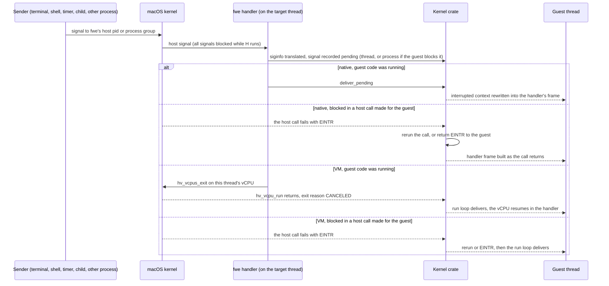

- **Running guest code:** natively, the handler delivers at once by
  rewriting the saved context, as Linux does on the way back to user
  space; in the VM it stops the vCPU
  ([Signals into a running vCPU](#signals-into-a-running-vcpu)).
- **Blocked in a host call:** the thread's guest mask is in force on the
  host, so a signal the guest takes interrupts the host call, and the
  handler only records it. The call runs again if no guest handler waits
  for the signal, or if the handler has `SA_RESTART` and the call is one
  Linux restarts (reads, writes, `wait4`, `waitid`, socket calls,
  `openat`, `ioctl`, `flock`, `fcntl`, message queue calls, a futex wait
  without a timeout); otherwise it fails with `EINTR`. A signal arriving
  between a call's start and its host wait is a
  [known limitation](architecture.md#known-limitations).
- **Process-wide or thread:** a signal landing on a thread whose guest
  mask blocks it is recorded against the process, and the other threads
  are woken with `SIGEMT` to take it. `SIGPIPE` and `SIGXFSZ`, which the
  host raises on the thread that caused them, stay with that thread.
- **Default actions** fwe carries out: one that ends the process resets
  the host signal to default and raises it (after tearing the VM down), so
  the parent's `wait` sees death by that signal; one that stops it raises
  the host stop signal until the process is continued, so the parent sees
  the stop.

#### siginfo and the sender

macOS's `siginfo` carries much what Linux's does, in different codes,
with host pids and uids, and sometimes nothing. fwe translates what macOS
gives and fills the gaps from notes fwe processes leave each other:

| On macOS | What fwe does (`host::signal_info`) | What the guest sees |
|---|---|---|
| `si_code` of a sent signal (`SI_USER` = `0x10001`, `SI_QUEUE`, `SI_TIMER`, `SI_ASYNCIO`, `SI_MESGQ`) | translated (`host::si_code_to_linux`); the `SIGCHLD` codes are the same on both | Linux's `si_code` (`SI_USER` = 0 …) |
| `si_pid` of the sender, a host pid | mapped into the guest's pid namespace | the sender's pid there, 0 for one outside it |
| `si_uid` of the sender | from an fwe process (this one too), its guest real uid, which it writes in its note; from any other, fwe's own host user → 0, any other → 65534; then through the receiver's user namespace | the sender's real uid as the receiver's user namespace has it |
| `si_uid` of a child's `SIGCHLD` (and `waitid`) | the child's guest real uid, read from its record, which is kept until it is reaped | the child's real uid |
| an fwe process sent it | the sender first wrote a note (pid, its guest uid, and for `SI_MESGQ` the code and value) into the target's mailbox, which the handler reads | the sender, even when macOS gave none |
| a `siginfo` macOS emptied (a signal that arrived while an fwe handler ran) | the note, if an fwe process sent it; for `SIGCHLD`, a `waitid(WNOHANG \| WNOWAIT)` finds the child and how it changed | the sender or child, as Linux tells it; none for a non-fwe sender |
| a `SIGIO` the host raised for a descriptor's readiness | no sender: `SI_KERNEL` | see [Network events](#network-events) |
| a fault | the fault address; the code as Linux decides it ([Faults in guest code](#faults-in-guest-code)) | `si_addr`, `si_code` |

#### Signals with no counterpart

macOS's two extra signals are fwe's own tools, so fwe decides what one
means when it comes from elsewhere; Linux's extra signals never come from
the host:

| On macOS | What fwe does | What the guest sees |
|---|---|---|
| `SIGEMT` (7), from fwe itself | the wake signal: interrupts a thread blocked in a host call so it notices a signal recorded for it | the signal it was woken for |
| `SIGEMT` from any other process | the same: it only interrupts | nothing; an interrupted call runs again |
| `SIGEMT` to a process that is not fwe's | never sent: its default action would end that process. fwe sends it only to a live process with an fwe record (`host::kill` refuses any other, `ESRCH`); what needs the target to answer refuses a process fwe did not start: `pidfd_getfd` and `process_vm_readv`/`writev` with `EPERM`, as for a process the caller is not allowed to trace; a signal the host lacks as under [Sending a signal](#sending-a-signal) | an error |
| `SIGINFO` (29), from another fwe process | the kill relay, sent instead of an uncatchable `SIGKILL`: a native process kills itself with `SIGKILL`, a VM process tears its VM down first ([hypervisor.md](hypervisor.md#never-end-a-vm-process-abnormally)) | death by `SIGKILL` |
| `SIGINFO` from anywhere else (`kill -INFO`, Ctrl-T) | no note came with it, so it is no relay: dropped | nothing |
| a child killed by a host signal with no Linux number | `host::signal_to_linux` gives `SIGABRT` | a child killed by `SIGABRT` |
| Linux's `SIGSTKFLT`, `SIGPWR` and real-time signals | never from the host; sent as under [Sending a signal](#sending-a-signal) | delivered with fwe's own `siginfo` |
| a guest killed by one of those (default action) | no host signal to die of: leaves its Linux status in its record's entry, then exits with 128 + the signal | an fwe parent sees it killed by that signal; a host shell sees 128 + the signal |

#### Where each signal comes from

| Host source | Host signal | What fwe does | What the guest sees |
|---|---|---|---|
| a key in the terminal | `SIGINT`, `SIGQUIT`, `SIGTSTP` | relayed | see [Terminals and key strokes](#terminals-and-key-strokes) |
| the terminal resized | `SIGWINCH` (28 on both) | relayed; the host's default (ignore) unless the guest catches it | `SIGWINCH`; `TIOCGWINSZ` reads the new size |
| the terminal closed or its session leader gone | `SIGHUP` | relayed | `SIGHUP`, death by default |
| a host shell's `kill`, `launchctl`, any process | any | relayed, sender translated | see [A process killed from the host](#a-process-killed-from-the-host) |
| a write to a pipe with no reader | `SIGPIPE` on the writing thread | relayed to that thread; with the guest ignoring it, only `EPIPE` | `SIGPIPE`, `EPIPE` |
| a write to a socket whose peer has gone | none (`SO_NOSIGPIPE`) | fwe raises `SIGPIPE` on the thread unless `MSG_NOSIGNAL` | `SIGPIPE`, `EPIPE` |
| a write past `RLIMIT_FSIZE` | `SIGXFSZ` on the writing thread | relayed to that thread | `SIGXFSZ`, `EFBIG` |
| CPU time past `RLIMIT_CPU`'s soft limit | `SIGXCPU` | relayed, and the host's soft limit raised a second; past the hard limit fwe ends the process with `SIGKILL`, which macOS does not send | `SIGXCPU` each second, then `SIGKILL` |
| an interval timer expiring | `SIGALRM`, `SIGVTALRM`, `SIGPROF` (same numbers) | relayed | the timer's signal |
| a child stopping, continuing or ending | `SIGCHLD` (20) | relayed as 17 | see [Children ending](#children-ending) |
| descriptor readiness under `O_ASYNC`, out-of-band data | `SIGIO` (23), `SIGURG` (16) | relayed as 29 and 23; `SIGIO` turned into the descriptor's `F_SETSIG` signal | see [Network events](#network-events) |
| guest code faulting | `SIGSEGV`, `SIGBUS`, `SIGILL`, `SIGFPE`, `SIGTRAP` (native) | fwe's fault handlers | see [Faults in guest code](#faults-in-guest-code) |

### Faults in guest code

When guest code touches an unmapped address, executes an undefined
instruction or hits a breakpoint, Linux sends it a signal. Natively the
fault is a host signal to fwe's fault handlers (`on_fault` and
`on_sigtrap` in `crates/native/src/trap.rs`), and some such signals are
fwe's own traps rather than faults meant for the guest:

| On macOS (native) | What fwe does | What the guest sees |
|---|---|---|
| `SIGTRAP` at `brk #0x4c58` | the rewritten `svc #0` (where no stub fits): a system call | the call's result |
| `SIGTRAP` at the gate's `brk #0x4c5a` | a system call the gate does not finish itself | the call's result, a signal delivered |
| `SIGSEGV`/`SIGBUS` at a system-call stub's first store | the guest's `sp` takes no store: the system call, run as the trap runs it | the call's result |
| `SIGTRAP` at any other `brk` | the guest's own breakpoint | `SIGTRAP`, `si_addr` the `brk` |
| `SIGTRAP` where the pc holds no `brk` | sent by another process | a relayed `SIGTRAP` |
| `SIGILL` at `mrs <Xt>, ctr_el0` | emulated | the value, as Linux lets EL0 read it |
| `SIGSEGV`/`SIGBUS` fetching code made executable at run time, or writing a page code was translated from; `SIGTRAP` at a translation's way out | the block translated, the translations dropped and the write retried, or the way out followed ([jit.md](jit.md)) | nothing |
| `SIGBUS` for an access the page's protection forbids (macOS reports some so) | turned into Linux's signal for it | `SIGSEGV` |
| `SIGSEGV`/`SIGBUS` for an access the page allows now (another thread changed its protection, or mapped it, after the fault) | the access tried again; again only if a mapping or protection changed since | nothing |
| `SIGBUS` for an access the protection allows that faults again with nothing changed (past a mapped file's end) | kept | `SIGBUS` |
| `SIGSEGV`/`SIGBUS` whose syndrome is no abort of the interrupted instruction (left pending by macOS while another signal was delivered) | dropped: the instruction faults again if it still does when it runs | nothing |
| a fault signal with a note from another fwe process | a sent signal, not a fault | that signal, with its sender |
| a fault in fwe's checked copy of guest memory | the copy stops at its recovery point | the call fails with `EFAULT` |
| a fault in fwe's own code anywhere else | fatal | the process dies of that signal |

In the VM a fault is an exception the run loop reads from `ESR_EL1`
([hypervisor.md](hypervisor.md#the-run-loop)); the host sends no signal:

| VM exception | What the guest sees |
|---|---|
| data or instruction abort, not a page still to fetch or a stale TLB entry | `SIGSEGV`, `si_addr` the faulting address; a misaligned access `SIGBUS` |
| stage-2 abort | `SIGSEGV` |
| PC or SP alignment | `SIGBUS` |
| `brk` | `SIGTRAP` |
| BTI, unknown or other exception | `SIGILL` |
| trapped `CNTPCT_EL0` read | the virtual counter's value |
| `wfi`, `wfe` | stepped over |

A fault's `si_code` is Linux's, decided as Linux decides it, not from
the host's page tables (which keep nothing for a page with no access, so
the processor reports every such fault as a translation fault):
`SEGV_ACCERR` where the guest has a mapping without the access,
`SEGV_MAPERR` where it has none; `BUS_ADRALN` for a misaligned pc, stack
or access, `BUS_MCEERR_AR` for poisoned memory, `BUS_ADRERR` otherwise;
`TRAP_BRKPT` for a breakpoint; `ILL_ILLOPC` for an unknown instruction.
A misaligned `sp` or `pc` is a `SIGBUS` with the `sp` or `pc` for its
address, as Linux gives it (macOS gives a `SIGSEGV` without an address
for `sp`).

A fault with a guest handler enters it with Linux's frame. With none, the
process dies of the signal (natively after a register and code dump under
`--strace`; in the VM after teardown), so the parent sees Linux's status.

### Terminals and key strokes

The terminal is the host's: the guest's standard descriptors are the
terminal's host descriptors, and the line discipline is macOS's, set from
the guest's `termios`. A key stroke that means a signal becomes a macOS
signal to the foreground process group, which fwe relays as above. Ctrl-C,
for each of the three things a guest can have chosen for `SIGINT`:

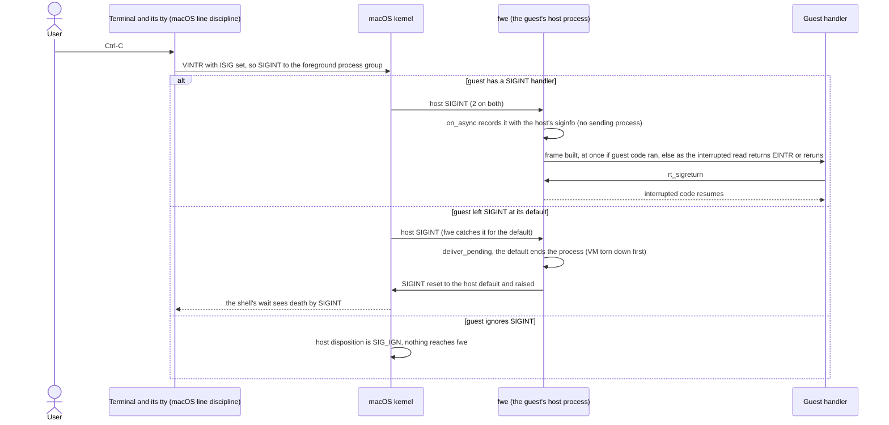

#### Key strokes

| On macOS | What fwe does | What the guest sees |
|---|---|---|
| Ctrl-C (`VINTR`, with `ISIG`): `SIGINT` to the foreground group | relayed (sequence above) | `SIGINT` |
| Ctrl-\\ (`VQUIT`): `SIGQUIT` | relayed; a default ends the process with the host `SIGQUIT` | `SIGQUIT`; a core file, as Linux writes one, if `RLIMIT_CORE` allows |
| Ctrl-Z (`VSUSP`): `SIGTSTP` (18) | relayed as 20; a default stop is fwe's: the shell's child stops itself with the host `SIGTSTP`, its children of fwe's stop in fwe | `SIGTSTP`; the shell sees the job stopped by `SIGTSTP` |
| `fg`/`bg`: `SIGCONT` (19) | caught: the host continues the shell's child, and every process of the job takes the guest's `SIGCONT`, which ends a stop of fwe's, a guest handler entered | `SIGCONT` (18) |
| Ctrl-T (`VSTATUS`, macOS only): `SIGINFO` to the foreground group | dropped ([Signals with no counterpart](#signals-with-no-counterpart)); once the guest sets its `termios`, which has no such key, Ctrl-T and Ctrl-Y (`VDSUSP`) are disabled (`_POSIX_VDISABLE`) | nothing; with the keys disabled, the character as input |
| Ctrl-D, Ctrl-S/Ctrl-Q, erase, kill, `VLNEXT` and the rest of canonical editing | done by the host's line discipline as the guest's `termios` sets it | the edited line; `read` returns 0 at end of file |
| a background job reads (or, with `TOSTOP`, writes) the terminal: `SIGTTIN`/`SIGTTOU` | relayed; a default stop is fwe's, as for `SIGTSTP` | the job stops |

#### termios and terminal requests

| Linux | macOS | fwe (`crates/kernel/src/term.rs`, `sys_ioctl`) |
|---|---|---|
| `TCGETS`, `TCSETS`/`TCSETSW`/`TCSETSF` | `tcgetattr`, `tcsetattr(TCSANOW / TCSADRAIN / TCSAFLUSH)` | translated field by field |
| 32-bit flag words | 64-bit `tcflag_t`, other bit positions | each flag both have mapped by name; `CSIZE` mapped |
| `c_cc[19]` in Linux's order | `c_cc[20]` in another order, with `VSTATUS` and `VDSUSP` | the 16 characters both have mapped by name; a guest's `TCSETS` writes the macOS-only ones as 0, which macOS takes as the NUL character (its "disabled" value is `0xff`) |
| baud in `c_cflag` | `c_ispeed`/`c_ospeed` | reported as `B38400`; set to 38400 |
| `TIOCGWINSZ`, `TIOCSWINSZ` | the same | passed through |
| `TIOCGPGRP`, `TIOCSPGRP` | `tcgetpgrp`, `tcsetpgrp` | the group mapped through the pid namespace; one not in it is `EPERM` |
| `TIOCSCTTY`, `TIOCNOTTY` | the same | passed through |

#### Job control and ptys

Process groups, sessions and the controlling terminal are the host's, so
a guest shell and a host shell share job control on one terminal:

| Linux | macOS | fwe |
|---|---|---|
| process groups and sessions (`setpgid`, `setsid`, `getpgid`, `getsid`) | the host's | the host's, with ids mapped through the guest's pid namespace; fwe records each process's group |
| the foreground group, the controlling terminal | the host tty's | the host tty's |
| `/dev/ptmx`, `TIOCGPTN`, `TIOCSPTLCK`, `/dev/pts/N` | `posix_openpt`, `grantpt`, `unlockpt`, `ptsname`, `/dev/ttysNNN` | `/dev/ptmx` allocates with `posix_openpt` and numbers the slave; `TIOCGPTN` returns that number; `TIOCSPTLCK` is accepted (the slave is unlocked already); `/dev/pts/N` opens the host slave (`crates/kernel/src/pty.rs`) |
| the slave's last holder closes it: the master reads what it wrote, then `EIO`; `poll` reports `POLLHUP` | unread output thrown away; the master reads 0 | the process that opens a master holds its slave too, out of the guest's reach (across `fork` and `execve`), so the output is kept; a slave a guest opened that no guest process holds any more is hung up: a master `read` with nothing left fails with `EIO`, and `read`, `poll`, `select` and `epoll` waits look between short slices |

### Children ending

A child guest process is a host child, so when it ends macOS tells the
parent with `SIGCHLD` and a status word in macOS's terms. fwe translates
both, and records how the child ended so that what macOS cannot show (a
Linux-only signal, an adopter) comes out right:

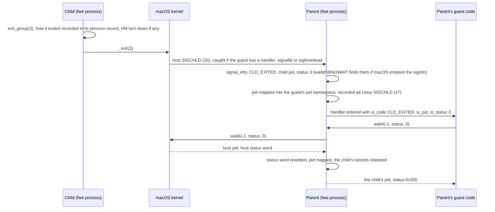

| On macOS | What fwe does | What the guest sees |
|---|---|---|
| a child exited with code *n* | status word kept | `n << 8` |
| a child killed by a host signal | the Linux status the child left in its record's entry (`procreg::ending`), with the core bit if fwe wrote a core; else the signal mapped (`host::signal_to_linux`) | Linux's signal number, `0x80` if a core was dumped |
| a child stopped | the stop signal mapped | `sig << 8 \| 0x7f` |
| a child continued | — | `0xffff` |
| a guest child ended by a Linux-only signal | it exited with 128 + the signal, leaving its Linux status in its record's entry | killed by that signal |
| `SIGCHLD` `siginfo`: `CLD_KILLED`/`CLD_DUMPED`/`CLD_STOPPED` | `si_status` mapped to Linux's signal | Linux's signal number |
| `SIGCHLD` `siginfo`: `CLD_STOPPED`/`CLD_CONTINUED` of a stop of fwe's | the child's note in the parent's mailbox, with the signal | Linux's `siginfo` |
| `SIGCHLD` `siginfo`: `CLD_CONTINUED` | `si_status` is what stopped it on macOS; set to what continued it | `SIGCONT`, as Linux reports |
| `rusage` from `wait4` | `ru_maxrss` from bytes to KiB | Linux's `rusage` |
| `waitid` | the host gives no `rusage` | zero-filled `rusage` |
| the guest ignores `SIGCHLD`, or set `SA_NOCLDWAIT` | the host reaps the children itself | no zombies, as on Linux |
| the parent ends | the child goes to `launchd` on the host | its Linux adopter, below; a `PR_SET_PDEATHSIG` signal, sent by a thread of fwe's in the child that waits on the parent's exit (`kqueue`, `crates/kernel/src/pdeath.rs`) |

#### Orphans and reapers

Linux gives an orphan to its nearest child subreaper
(`PR_SET_CHILD_SUBREAPER`) or its pid namespace's init. macOS gives every
orphan to `launchd`, and only a parent can `wait` for a process. fwe keeps
the adoption itself (`crates/kernel/src/reaper.rs`):

- each process record holds its line of ancestors and whether it is a
  subreaper, so `getppid` and `/proc/<pid>` name the adopter;
- a process that ends where a reaper might adopt it records how it ended
  (one killed by `SIGKILL` is recorded by whoever finds it gone);
- a reaper runs a watcher thread on `kqueue` process events, which raises
  `SIGCHLD` in the reaper, with a child's `siginfo`, for an adopted
  descendant's end (once it is gone, its record of how it ended written
  just before), stop or continue. It wakes every thread of the reaper, so
  the one that does not block the signal takes it (a wake the host gives
  one thread could land on one that blocks it). A stop or continue signal
  the reaper sends is told to its watcher first, which then looks for the
  stop even in a process it does not follow yet (the host tells it only
  of signals to the processes it follows);
- its `wait` looks at its own children, then the adopted ones;
- a child made with `CLONE_PARENT` is its creator's parent's, not its
  parent's on the host: its record says so, it tells that parent as it
  starts (a note in the parent's signal mailbox), and the parent then
  runs the watcher and waits for it as for one it adopted (runc makes
  each container's init so).

### A process killed from the host

Any host program can signal a guest process: a `kill` in a host shell,
Activity Monitor, `launchctl`. Such a sender leaves no note, so the guest
learns what macOS's `siginfo` says, and the signals fwe uses itself mean
what they mean to fwe (`kill -INFO` and `kill -EMT` as under
[Signals with no counterpart](#signals-with-no-counterpart)):

| On macOS | What fwe does | What the guest sees |
|---|---|---|
| `kill -TERM <pid>` (or `-INT`, `-HUP`, `-USR1` …) from a host shell or any process fwe does not run | a host signal like any other; the sender a host pid with no note | the signal, `si_code` `SI_USER`, `si_pid` the sender in the initial pid namespace (0 from inside a nested one), `si_uid` 0 if it runs as fwe's user, else 65534 |
| `kill -9` of a native process | none: the host ends it at once | its parent sees death by `SIGKILL`; a reaper that finds it gone records it |
| `kill -9` of a VM process | none: it ends with its VM alive, which can bring the machine down ([hypervisor.md](hypervisor.md#never-end-a-vm-process-abnormally)) | — |
| `kill -STOP`, `kill -CONT` | `SIGSTOP` the host's own, which stops the process on the host; `SIGCONT` caught, the guest's, ending a stop of the host's or of fwe's | the process stops and continues; a parent's `wait` with `WUNTRACED` sees the stop by `SIGSTOP` (19) |
| `kill -SEGV <pid>` (a fault signal) from a process fwe does not run | macOS gives it the thread's last fault, and no note says it was sent | taken as a fault ([limitations](architecture.md#known-limitations)) |

### Files changing on the host

The guest's files are host files, which host programs can change at any
time. Through a shared mapping the guest sees the change; through inotify
it sees only what fwe processes do, since fwe raises inotify events
itself:

| On macOS | What fwe does | What the guest sees |
|---|---|---|
| an fwe process changes, opens, reads or closes a watched file | raises Linux's inotify events from its own calls | the events |
| a program fwe does not run changes a watched file | nothing: no host event names it as Linux's events do | no inotify event |
| a host process writes a file the guest mapped `MAP_SHARED` | the mapping is a host shared mapping (native) or a segment of one (VM) | the change |
| a host process writes a file the guest mapped privately | native: a host private mapping; VM: a copy taken when mapped | native: as the host shows it; VM: never |
| a host process holds a POSIX record lock or an OFD lock | guest locks are host locks | the conflict |
| a guest's working directory renamed by another process | fwe keeps the path ([limitations](architecture.md#known-limitations)) | the old path |

### Network events

Guest sockets are host sockets: connections, data and the ports of the
initial network namespace are the host's (but for those fwe maps, under
[Socket calls](#socket-calls)). What arrives does so as
`kqueue` events, which fwe turns into `epoll` events with Linux's meaning
for each kind of descriptor:

| On macOS | What fwe does (`crates/kernel/src/epoll.rs`) | What the guest sees |
|---|---|---|
| a `kqueue` read filter fires | `EVFILT_READ` → `EPOLLIN` | `EPOLLIN` |
| a write filter fires | `EVFILT_WRITE` → `EPOLLOUT` | `EPOLLOUT` |
| `EV_EOF` on a socket's read filter (peer shut its writing side) | readable, and so marked | `EPOLLIN \| EPOLLRDHUP`, with `EPOLLHUP` for a Unix socket (Linux shuts both ways) |
| `EV_EOF` on both of a socket's filters | hung up | `EPOLLHUP` added |
| `EV_EOF` on a pipe's or terminal's read filter | hung up, readable while data is left | `EPOLLHUP`, `EPOLLIN` while data is left |
| `EV_EOF` on a pipe's write filter (readers gone) | an error to write | `EPOLLOUT \| EPOLLERR` |
| `EV_ERROR` | — | `EPOLLERR` |
| a FIFO's last writer gone (macOS reports nothing) | `select` asked between short slices (`crates/kernel/src/fifo.rs`) | `POLLHUP`/`EPOLLHUP` |
| a pty slave's last guest holder gone (fwe holds it, so macOS reports nothing) | the guest processes' descriptors looked at between short slices | `POLLHUP`/`EPOLLHUP` |
| readiness on an `O_ASYNC` descriptor: host `SIGIO` with no sender | the descriptor and its events found with `poll`; sent as the signal `F_SETSIG` chose, to the owner thread if one is set | that signal with `si_fd`, `si_band` and `POLL_IN`/`POLL_OUT`/`POLL_PRI`/`POLL_HUP` |
| out-of-band data: `SIGURG` (16) | relayed | `SIGURG` (23) |
| reading an unconnected Unix stream socket: `ENOTCONN` | Linux's answer | `EINVAL` |
| an interface or route changes | netlink outside an fwe network namespace describes the host's interfaces as they are when asked; no change is announced (no `RTNLGRP` messages) | nothing |
| the host's DNS settings | not read: the resolver reads the rootfs's `/etc/resolv.conf` and `/etc/hosts` | the rootfs's |

### Clocks and timers

The guest's time is the Mac's. `CLOCK_REALTIME`, `TAI`, the `*_COARSE` and
`*_ALARM` clocks read the host's realtime clock, which the guest cannot
set (`EPERM`); `MONOTONIC`, `BOOTTIME` and their variants read the host's
`CLOCK_MONOTONIC`, which counts time the Mac sleeps (Linux's `MONOTONIC`
does not), `MONOTONIC_RAW` its raw clock, and the CPU-time clocks
the host thread's or process's CPU time. The calls are under
[Time calls](#time-calls), the VM's counters under
[Counters and timers](#counters-and-timers).

### Memory pressure

macOS manages memory its own way (compression, swap files) and has no
OOM killer Linux programs could observe. fwe does not pass the host's
memory state through, but reports it:

| On macOS | What fwe does | What the guest sees |
|---|---|---|
| total, free, cached and swapped memory | read when asked (`hw.memsize`, `host_statistics64`, `vm.swapusage`) | `/proc/meminfo` and `sysinfo`: the total; free pages; free, inactive and purgeable as available; file-backed pages as cached; the swap files' size and room |
| a host `mmap` that cannot be satisfied | `ENOMEM` | `ENOMEM` |
| the guest stack running into its guard page | a fault | `SIGSEGV` |
| no OOM killer (Linux ranks processes to kill) | `oom_score_adj` kept per process, `oom_score` derived from it | the files, with Linux's rules for writing them |

### Errors

Host calls fail with macOS's `errno`; `host::errno_to_linux` turns each
into the Linux errno of the same meaning:

| On macOS | What the guest sees |
|---|---|
| an errno both have (`ENOENT`, `EAGAIN`, `ECONNREFUSED`, …), whatever its number on each | the Linux number of the same name |
| `ENOTSUP` (macOS's, beside `EOPNOTSUPP`) | `EOPNOTSUPP` |
| `ENOATTR` (no such extended attribute) | `ENODATA` |
| an errno Linux has no equivalent of (`EAUTH`, `EBADRPC`, `EPWROFF`, …) | `EIO` |
| `ENODEV` (`/dev/null`) or `EOPNOTSUPP` from a terminal request on a non-terminal | `ENOTTY` (`host::tty_error`) |

Where the two kernels give different errors for the same case, the call
answers as Linux does; each is listed with its call under
[System calls by category](#system-calls-by-category).

### Host identity and machine state

fwe presents the host user as root, as a rootless container does, and the
machine as a Linux machine with the host's CPUs, uptime and load:

| On macOS | What fwe does | What the guest sees |
|---|---|---|
| the user fwe runs as (uid 501, say) | root in the guest, as in a rootless container's user namespace (`host::uid_to_linux`) | its own ids virtual, root by default ([Credentials and capabilities](#credentials-and-capabilities)); files fwe's user owns owned by 0 |
| fwe's own group | `host::gid_to_linux` | group 0 |
| every other host user and group | `OVERFLOW_ID` | 65534 (`nobody`) |
| the host name (up to 255 bytes) | cut to Linux's 64 (`ns::host_name`) | `uname`'s `nodename`, `/proc/sys/kernel/hostname` |
| the macOS kernel | not shown | `uname` as [System-wide calls](#system-wide-calls) gives it |
| host pids | used as guest pids in the initial pid namespace | host pids; `/proc` lists only fwe's processes |
| online CPUs (`sysconf`) | counted | `/proc/cpuinfo`, `/proc/stat`, `sched_getaffinity`, `sysinfo` |
| CPU features (`hw.optional.*`) | `AT_HWCAP`/`AT_HWCAP2` ([auxv](#auxv-hwcaps-and-the-vdso)) | the hwcaps; `/proc/cpuinfo`'s `Features` names them |
| timer frequency, chip (`hw.tbfrequency`, `hw.cpufamily`, `hw.perflevel1.logicalcpu`) | read | `/proc/cpuinfo`'s BogoMIPS, and its CPU part for a chip Linux knows (the efficiency cores first) |
| kinds of core and their caches (`hw.perflevel<n>`: cores, L1 and L2 sizes, cores per L2; `hw.cachelinesize`) | read | `/sys/devices/system/cpu`: `online`, `possible`, `present`, and each CPU's `topology` (a cluster is the cores sharing an L2, in one package) and `cache/index0`-`2` (L1 data and instruction, L2), as Linux lays them out from a device tree; the associativity and frequencies, which the host does not tell, are left out, and `cpu_capacity` is 1024 for each |
| boot time, uptime, load averages, per-CPU times | read from the host | `/proc/uptime`, `/proc/loadavg`, `/proc/stat`, `sysinfo` |
| another process's state, times and memory (`proc_pidinfo`) | read from the host | `/proc/<pid>/stat` and the like |

## What fwe enforces

An index, area by area, of what becomes of each Linux mechanism under
fwe. The status words mean:

- **enforced**: fwe applies Linux's rule, refusing what Linux refuses.
- **emulated**: fwe implements the behaviour itself, on its own records
  or interpreters.
- **host**: macOS does it; the notes say where that differs from Linux.
- **kept**: accepted, stored and reported back, with no effect.
- **ignored**: accepted, with no effect, and not reported back.
- **refused**: fails with the errno given; the notes say whether Linux
  fails so when the feature is configured out.

The rules live in the kernel crate, so a row holds for both backends
unless it names one. The details are in the sections each area names;
a note here holds only what they do not. Where fwe falls short of Linux
in detail is in [architecture.md](architecture.md#known-limitations).

### Security

Details: [Credentials and capabilities](#credentials-and-capabilities),
[seccomp](#seccomp), [Security
modules](#security-modules-selinux-apparmor-landlock), [eBPF](#ebpf),
[Debugging and sandboxing calls](#debugging-and-sandboxing-calls),
[System-wide calls](#system-wide-calls).

| Mechanism | Status | Notes |
|---|---|---|
| Capability sets, securebits, keepcaps | **enforced** | |
| Capabilities in user namespaces | **enforced** | |
| seccomp strict mode; a filter's `ALLOW`, `ERRNO`, `TRAP`, `KILL_THREAD`, `KILL_PROCESS`; container seccomp profiles | **enforced** | |
| seccomp filters, `SECCOMP_RET_LOG`, `SECCOMP_FILTER_FLAG_LOG`, `SECCOMP_RET_TRACE` | **emulated** | |
| `SECCOMP_RET_USER_NOTIF`, `FLAG_NEW_LISTENER`, `FLAG_WAIT_KILLABLE_RECV`, `/proc/sys/kernel/seccomp`, `PTRACE_SECCOMP_GET_FILTER`, `PTRACE_O_SUSPEND_SECCOMP` | **refused** | |
| `FLAG_TSYNC`, `FLAG_TSYNC_ESRCH`, `FLAG_SPEC_ALLOW` | **ignored** | |
| Landlock | **enforced** | |
| AppArmor, SELinux | **refused** | `security.selinux` attributes **kept** |
| `lsm_list_modules`, `/sys/kernel/security/lsm` | **emulated** | |
| `lsm_get_self_attr`, `lsm_set_self_attr`, `/proc/<pid>/attr` | **refused** | |
| `bpf()` privilege, BPF cgroup device programs | **enforced** | |
| BPF socket filters, maps, helpers, verifier | **emulated** | |
| Other BPF program types (kprobe, tracepoint, XDP, tc, cgroup socket, LSM, ...) | **kept** | |
| Other BPF commands, pinning, the BPF filesystem, classic `SO_ATTACH_FILTER` and `SO_LOCK_FILTER` | **refused** | |
| ptrace access | **enforced** | Linux's `ptrace_may_access` (ids, dumpable, capabilities, `CAP_SYS_PTRACE` in the target's namespace) for `ptrace`, `/proc/<pid>/mem`, `process_vm_*` and `pidfd_getfd` ([ptrace](#ptrace)) |
| Yama, dumpable, `no_new_privs`, file capabilities | **enforced** | `no_new_privs` inherited and kept across `execve` |
| Set-ID programs, `AT_SECURE`, keyrings | **emulated** | |
| Audit (`NETLINK_AUDIT`, `loginuid`, `sessionid`) | **refused** | `EPROTONOSUPPORT`, `ENOENT`, as without `CONFIG_AUDIT` |
| `syslog`, `dmesg` | **emulated** | no `/dev/kmsg` |
| `kernel.dmesg_restrict`, `kptr_restrict`, `perf_event_paranoid`, `/proc/kallsyms` | **refused** | `ENOENT` |
| Kernel modules, `kexec` | **refused** | [Not available](#not-available) |
| Lockdown | **refused** | no `/sys/kernel/security/lockdown` (`ENOENT`), as without the lockdown module |
| Address-space randomisation | **host** | natively where macOS's `mmap` places things; in the VM none: first fit, the same every run; `kernel.randomize_va_space` `ENOENT`, `ADDR_NO_RANDOMIZE` **kept** |
| `vm.mmap_min_addr` | **enforced** | 65536: a fixed `mmap` or `mremap` below it is `EPERM` without `CAP_SYS_RAWIO`, in both backends |

### Identity and processes

Details: [Process and thread calls](#process-and-thread-calls),
[Processes](#processes), [Signals](#signals),
[Namespaces](#namespaces), [Memory calls](#memory-calls),
[The mmap family](#the-mmap-family),
[Time, scheduling and limits](#time-scheduling-and-limits),
[Time calls](#time-calls),
[Host identity](#host-identity-and-machine-state).

| Mechanism | Status | Notes |
|---|---|---|
| Pids in the initial pid namespace, the host user underneath | **host** | |
| Pid namespaces, `clone3`'s `set_tid` | **emulated** | `set_tid` in the initial namespace **refused** |
| `kernel.ns_last_pid` | **enforced** | in fwe's pid namespaces the last pid given, and written (with `CAP_SYS_ADMIN` or `CAP_CHECKPOINT_RESTORE` over the namespace) where the next number starts; in the initial one the host's highest pid in use, not fwe's to set (`EPERM`) |
| `kernel.pid_max` | **enforced** | for fwe's pid namespaces; host pids are macOS's |
| uids, gids, groups, overflow ids | **emulated** | |
| User namespaces, `uid_map`, `gid_map`, `setgroups` | **enforced** | |
| Signal permission | **enforced** | |
| Signals the host lacks, `siginfo` senders, `SIGSTOP` to an fwe process | **emulated** | |
| `SIGKILL`, and `SIGSTOP` from outside fwe | **host** | |
| Resource limits | per limit | [Time, scheduling and limits](#time-scheduling-and-limits) |
| `prlimit` of another process, `prctl` | **enforced** | |
| Nice | **emulated** | |
| Scheduling policies, `sched_setattr`, `SCHED_DEADLINE`, uclamp, CPU affinity, `PR_SET_THP_DISABLE` | **kept** | |
| `ioprio_set`, `ioprio_get` | **kept** for the caller; others **ignored** | |
| Autogroup | **refused** | `ENOENT`, as without `CONFIG_SCHED_AUTOGROUP` |
| Overcommit (`vm.overcommit_memory`) | **kept** | 0, read-only; the host decides |
| OOM score (`oom_score_adj`, `oom_adj`) | **kept** | [Memory pressure](#memory-pressure) |
| KSM (`MADV_MERGEABLE`, `PR_SET_MEMORY_MERGE`) | **refused** | `EINVAL`, as without `CONFIG_KSM` |
| NUMA policy calls, protection keys, `memfd_secret` | **refused** | |
| `mseal`, `mlock`, `mlock2`, `mlockall` | **enforced** | |
| Huge pages (`MAP_HUGETLB`, `SHM_HUGETLB`, `vm.nr_hugepages`) | **refused** | the pool is empty and stays so (`vm.nr_hugepages` takes a count and keeps 0; `/proc/meminfo` shows none): a mapping or segment that reserves them `ENOMEM`, an unknown size `EINVAL`, `MAP_HUGETLB` of a file `EINVAL`; one that reserves none (`MAP_NORESERVE`, `SHM_NORESERVE`) gets ordinary pages, where Linux would fault on first touch |
| `MADV_NORMAL`, `RANDOM`, `SEQUENTIAL`, `WILLNEED`, `FREE` | **host** natively; VM **ignored** | |
| `MADV_DONTNEED`, `DONTNEED_LOCKED` | **emulated** | |
| `MADV_REMOVE`, `DONTFORK`, `WIPEONFORK`, `DONTDUMP`, `GUARD_INSTALL`, `HWPOISON` (and their inverses) | **emulated** natively; VM **ignored** | |
| `MADV_HUGEPAGE`, `NOHUGEPAGE`, `COLD`, `PAGEOUT`, `POPULATE_READ`, `POPULATE_WRITE`, `COLLAPSE`, `SOFT_OFFLINE` | **ignored** | checked, nothing done; `COLD` and `PAGEOUT` of locked memory `EINVAL` |
| Clocks, `sysinfo` | **host** | |
| Setting the clock, time namespaces | **refused** | |
| Timer slack | **kept** | |
| `personality` | **kept**; `UNAME26`, `STICKY_TIMEOUTS` **emulated** | |
| Parent-death signal, child subreaper | **emulated** | the signal when the parent process ends, not its thread ([Orphans and reapers](#orphans-and-reapers)) |
| Process accounting (`acct`) | **emulated** | |
| Core dumps | **emulated** | fwe writes the ELF core (the dying thread's registers only), named by `kernel.core_pattern`; a pipe pattern dumps nothing; `coredump_filter` fixed |

### Filesystems

Details: [File calls](#file-calls), [Mount calls](#mount-calls),
[Files and descriptors](#files-and-descriptors), [Mounts](#mounts),
[Credentials and capabilities](#credentials-and-capabilities),
[Devices](#devices).

| Mechanism | Status | Notes |
|---|---|---|
| Permission bits, in a root filesystem | **enforced** | |
| Permission bits, without a root filesystem | **host** | the host user's own files pass fwe's check for any guest user |
| Modes the host would enforce on fwe, ownership, set-ID bits, umask | **emulated** | |
| Sticky directories | **enforced** | `EPERM`, overlays too |
| `fs.protected_symlinks`, `fs.protected_hardlinks` | **enforced** | off by default, Linux's built-in default; a link the path ends in, as Linux, by every walk (`openat2`'s too); a link by descriptor (`AT_EMPTY_PATH`) too |
| `fs.protected_fifos`, `fs.protected_regular` | **refused** | `ENOENT`; not applied, as Linux's built-in default |
| POSIX ACLs (`system.posix_acl_*`) | **refused** | `EOPNOTSUPP`, as a filesystem without ACLs |
| `user.` attributes | **enforced** | regular files and directories, by the permission bits; a sticky directory's changed by its owner (`EPERM`) |
| `trusted.` attributes | **enforced** | `CAP_SYS_ADMIN`; hidden without it |
| `security.` attributes | **enforced** | `CAP_SYS_ADMIN` to write (`CAP_SETFCAP` for capabilities); kept, read by no module but file capabilities |
| Immutable, append-only | **host** | |
| No-dump | **kept** | |
| `FS_NOATIME_FL`, `FS_IOC_FSGETXATTR`, `FS_IOC_FSSETXATTR` | **emulated** | a read of a file so flagged leaves its access time, as through `O_NOATIME`; a new file does not inherit the flag |
| Other inode flags (sync, compressed, project, extent sizes) | **refused** | `EOPNOTSUPP`, as tmpfs |
| Symlinks | **emulated** | |
| `O_NOFOLLOW`, `openat2` `RESOLVE_*` | **enforced** | `ELOOP`, `EXDEV`, `EAGAIN` as Linux; `openat2`'s walk holds to `nosymfollow` and `fs.protected_symlinks` too |
| Hard links | **enforced** | a directory `EPERM` |
| FIFOs, named pipes | **host** | opens wait without fwe's lock; hang-up in `poll` **emulated** |
| Device nodes, `O_TMPFILE` | **emulated** | |
| Unix socket nodes | **enforced** | |
| Case sensitivity | **host** | the volume's: APFS by default folds case ([known limitations](architecture.md#known-limitations)) |
| tmpfs | **emulated** | `size=` and `nr_inodes=` enforced (`ENOSPC`); `mode=`, `uid=`, `gid=` give the root (its maker's by default) |
| proc, sysfs, cgroup2, devpts, mqueue | **emulated** | `proc`'s `hidepid=` (with `gid=`) and `subset=pid` **enforced** (`ENOENT`, `EPERM`) |
| overlay, bind, move, propagation | **emulated** | |
| cgroup v1, ext4, btrfs, XFS, FUSE, NFS and other types; idmapped mounts | **refused** | |
| `ro`, `nosuid`, `nodev`, `noexec`, `nosymfollow` | **enforced** | |
| Access-time modes | **emulated**; `relatime` **host** | |
| `sync`, `dirsync`, `lazytime`, `mand`; mandatory locking | **ignored** | mandatory locking as Linux since 5.15 |
| `flock`, record locks, OFD locks | **host** | |
| Leases, inotify, dnotify | **emulated** | among fwe's processes ([Files changing on the host](#files-changing-on-the-host)) |
| fanotify, quotas | **refused** | |
| Timestamps | **host** | |
| `O_NOATIME`, memfd seals, `ETXTBSY` | **enforced** | |
| `O_DIRECT` | **ignored** | |
| `fallocate` | **host** | |
| `FICLONE`, `FICLONERANGE`, `FIDEDUPERANGE`, fs-verity, fscrypt | **refused** | `EOPNOTSUPP`, `ENOTTY`, as tmpfs |
| `statfs`, `name_to_handle_at`, `open_by_handle_at` | **emulated** | |
| `fsync`, `sync` | **host** | macOS flushes no drive cache without `F_FULLFSYNC` |
| `RENAME_NOREPLACE`, `RENAME_EXCHANGE`, `RENAME_WHITEOUT` | **host**; `WHITEOUT` **emulated** | |

### IPC and networking

Details: [Files and descriptors](#files-and-descriptors),
[Waiting and events](#waiting-and-events),
[Waiting and event calls](#waiting-and-event-calls),
[Socket calls](#socket-calls), [Sockets](#sockets),
[Other IPC calls](#other-ipc-calls), [Namespaces](#namespaces).

| Mechanism | Status | Notes |
|---|---|---|
| Pipes | **host** | smaller sizes **emulated**, larger **kept**; whole writes **emulated** |
| `fs.pipe-max-size` | **enforced** | `fs.pipe-user-pages-*` **kept** |
| `pipe2(O_DIRECT)` | **ignored** | |
| `O_NOTIFICATION_PIPE`, io_uring | **refused** | |
| eventfd, signalfd, timerfd, epoll, pidfd | **emulated** | `TFD_TIMER_CANCEL_ON_SET`, `EPOLLWAKEUP` **ignored**; `EPOLLEXCLUSIVE` wakes one waiter for a pipe only; an eventfd watched with `EPOLLET` raises an edge on every write, as Linux's |
| Linux AIO (`io_setup` and the rest) | **emulated** | `fs.aio-max-nr` enforced; POSIX AIO is the C library's, on threads |
| Unix stream and datagram sockets | **host** | |
| Unix `SOCK_SEQPACKET`, abstract names, autobind, Unix `SOCK_RAW`, `SCM_RIGHTS`, `SO_PEERCRED` | **emulated** | |
| `SCM_CREDENTIALS`, `SO_PASSCRED`, Unix socket nodes' permissions | **enforced** | |
| `SO_PEERSEC`, `SO_PASSSEC`, `SO_PEERPIDFD`, `SO_PASSPIDFD`, `SO_PEERGROUPS` | **refused** | `ENOPROTOOPT` |
| TCP and UDP, IPv4 and IPv6, their options | **host** | `MSG_MORE`, `MSG_FASTOPEN`, `SOL_UDP` **emulated** |
| Privileged ports | **enforced** | |
| Raw IP sockets | **enforced**, then **host** | macOS then needs fwe to run as root |
| ICMP ping sockets | **enforced**, then **host** | Linux's default `net.ipv4.ping_group_range` closes them |
| `AF_PACKET`, `AF_VSOCK`, `AF_ALG`, `AF_XDP`, `AF_KEY` and other families | **refused** | `EAFNOSUPPORT`, as without them |
| SCTP, MPTCP and other protocols | **refused** | `EPROTONOSUPPORT`, as without them |
| `SO_PRIORITY`, `SO_NO_CHECK`, `IP_RECVERR`, `IPV6_RECVERR`, `ICMP_FILTER`, `UDP_GRO` | **kept** | |
| `SO_REUSEPORT` | **host** | no load balancing, no same-user check |
| `SO_BINDTODEVICE`, `SO_MARK`, timestamping, busy poll, `SO_ZEROCOPY`, `IP_PKTINFO`, `IP_RECVTTL`, `IP_FREEBIND`, `IP_TRANSPARENT`, `IPV6_RECVPKTINFO`, `TCP_INFO`, `TCP_CONGESTION`, `TCP_USER_TIMEOUT`, `TCP_ULP`, `TCP_MD5SIG`, `TCP_REPAIR` | **refused** | `ENOPROTOOPT`; Linux has most of them in every configuration |
| `NETLINK_ROUTE`, network namespaces, interfaces (`SIOCGIF*`, `SIOCSIFFLAGS`, `SIOCSIFMTU`) | **emulated** | |
| Other netlink families (audit, netfilter, generic, uevent, sock_diag, xfrm) | **refused** | `EPROTONOSUPPORT`, as without them |
| Addresses, routes, veth, bridges, macvlan, `/dev/net/tun` | **refused** | `EOPNOTSUPP`, `ENODEV`, `ENOENT`/`ENXIO` ([roadmap](../ROADMAP.md#m8--virtual-networking)) |
| iptables, nftables | **refused** | `ENOPROTOOPT`, `EPROTONOSUPPORT`, as without netfilter |
| Network sysctls | **enforced** | `ip_unprivileged_port_start`, `ping_group_range`, `somaxconn`, `rmem_max`, `wmem_max` per namespace, the initial one's fwe's own copy; `ip_forward` **kept**; others `ENOENT` |
| System V shared memory, semaphores, messages; POSIX message queues | **emulated** | per IPC namespace, permissions and limits **enforced** |

### Namespaces and cgroups

Details: [Credential and namespace calls](#credential-and-namespace-calls),
[Namespaces](#namespaces), [cgroups](#cgroups).

| Mechanism | Status | Notes |
|---|---|---|
| Mount, UTS, IPC, network, pid, user and cgroup namespaces; `NS_GET_*` requests, `/proc/<pid>/ns`, nsfs binds | **emulated** | `NS_GET_NSTYPE`, `OWNER_UID`, `PARENT`, `USERNS`, `MNTNS_ID`; other requests `ENOTTY` |
| Time namespace | **refused** | |
| `user.max_*_namespaces`; `clone`, `unshare`, `setns` | **enforced** | |
| cgroup v2 tree, `cgroup.events`, `cgroup.stat`, `cgroup.freeze`, `cgroup.kill` | **emulated** | |
| Delegation, `mkdir`, `rmdir`, `cgroup.procs`, `cgroup.subtree_control`, `cgroup.max.*`, `pids.max`, device programs | **enforced** | |
| `pids.current`, `memory.current`, `cpu.stat` | **host** | |
| The other controllers' files (`memory.*`, `cpu.*`, `io.*`, `cpuset.*`, `hugetlb.*`, `rdma.*`, `misc.*`) | **kept** | |
| cgroup v1, threaded cgroups, pressure, the `perf_event` controller | **refused** | |

### /proc, /sys and /dev

Details: [/proc, /sys and /dev](#proc-sys-and-dev),
[Devices](#devices), [Host identity](#host-identity-and-machine-state).

| Mechanism | Status | Notes |
|---|---|---|
| `/proc/<pid>` | **emulated** | in the initial pid namespace only fwe's processes (another host process: its `stat` only) |
| `stat`, `status`, `statm`, `io` | **host** with **emulated** | state, times and the resident set from the host; the size (`VmSize`) of the guest's mappings, ids, capabilities, tracer and seccomp from fwe; `io` storage bytes only |
| `cmdline`, `environ`, `auxv`, `maps`, `smaps`, `mem`, `fd`, `fdinfo`, `ns`, `cgroup`, `limits`, `mountinfo`, `cwd`, `root`, `task` | **emulated** | |
| `uid_map`, `gid_map`, `setgroups` | **enforced** | |
| `oom_score_adj`, `timerslack_ns` | **kept** | |
| `coredump_filter` | **emulated** | constant; writes `EACCES` |
| `wchan`, `stack`, `syscall`, `sched`, `attr`, `loginuid`, `numa_maps`, `smaps_rollup`, `clear_refs`, `autogroup` | **refused** | `ENOENT` |
| `meminfo`, `cpuinfo`, `stat`, `uptime`, `loadavg` | **host** | counters the host lacks read 0 |
| `version`, `filesystems`, `config.gz`, `cmdline` | **emulated** | constant; `config.gz` sets the options of what fwe implements (cgroup controllers, message queues, `kcmp`, checkpoint/restore...) and says the rest is not set |
| `mounts`, `partitions`, `keys`, `sysvipc`, `net` | **emulated** | from fwe's records, per namespace |
| `modules`, `kallsyms`, `swaps`, `kmsg`, `vmstat`, `zoneinfo`, `interrupts`, `diskstats`, `locks`, `pressure` | **refused** | `ENOENT` |
| `/proc/sys` | **enforced** | the sysctls fwe acts on: network, IPC, `user.max_*`, UTS names, and global ones (`fs`, `kernel.keys`, `core_pattern`, `printk`, `yama`, `unprivileged_bpf_disabled`, `pid_max`, `vm.max_map_count`); `vm.drop_caches` **kept**; others constant (writes `EACCES`) or absent (`ENOENT`) |
| `/sys` | **emulated** | `fs/cgroup`, `kernel/security/lsm`, `devices/system/cpu` (host counts), the loop devices; `bus/cpu` and `class/block` linking to them (which sandboxes bind: WebKit's and Flatpak's `bwrap`); `bus` and `class` hold no others; `module`, `firmware`, `fs/bpf`, `kernel/mm` `ENOENT`; `debugfs`, `securityfs` mounts `ENODEV` |
| `/dev/null`, `zero`, `random`, `urandom`, `tty` | **host** | |
| `/dev/full`, `ptmx`, `pts`, `loop-control`, `loopN`, `shm`, `mqueue`, `fd` | **emulated** | |
| `/dev/kvm`, `fuse`, `net/tun`, `dri`, `mem`, `kmsg`, `console`, `userfaultfd` | **refused** | `ENOENT` (`ENXIO` for a node made for them) |

### Not available

These system calls are not dispatched in `crates/kernel/src/syscalls.rs`
and fail with `ENOSYS`, noted under `--strace`, in both backends:

- io_uring (`io_uring_setup`, `io_uring_enter`, `io_uring_register`),
  `perf_event_open`, `fanotify_init`, `fanotify_mark`, `userfaultfd`, the
  module calls (`init_module`, `finit_module`, `delete_module`),
  `kexec_load`, `kexec_file_load`, `swapon`, `swapoff`, `quotactl`,
  `quotactl_fd`, the NUMA calls (`mbind`, `get_mempolicy`,
  `set_mempolicy`, `set_mempolicy_home_node`, `migrate_pages`,
  `move_pages`), `rseq`, `rseq_slice_yield`, `memfd_secret`,
  `map_shadow_stack`: as on a kernel built without them, which
  `/proc/config.gz` says fwe's is for io_uring, perf events, fanotify,
  userfaultfd, modules, rseq, NUMA (so there is no
  `/sys/devices/system/node`), `memfd_secret` and time namespaces;
- `lookup_dcookie`, `nfsservctl`: `ENOSYS` on every Linux;
- `open_tree_attr`, `listns`: Linux has them in every configuration.

Some dispatched calls are refused whatever their arguments, once checked,
each as its row says: `clock_settime`, `settimeofday`, and `adjtimex`,
`clock_adjtime` with a change; `reboot` but Ctrl-Alt-Del on or off;
`pkey_alloc`; `lsm_get_self_attr`, `lsm_set_self_attr`; `futex`'s
requeue-PI operations and `FUTEX_FD`; `CLONE_NEWTIME`;
`personality(PER_LINUX32)`.
