# Linux on macOS

fwe runs Linux arm64 programs on macOS arm64. Everything that crosses
between the two kernels goes one of two ways, and this document is in two
parts to match:

- **[Linux to macOS](#linux-to-macos)**: what the guest asks for (a
  system call, an instruction, an address) and what it becomes on the host.
  For each Linux primitive: what Linux does, what macOS has, and how fwe
  translates it.
- **[macOS to Linux](#macos-to-linux)**: what happens on the host (a
  signal, a key stroke, a child ending, a file changing, a clock firing, an
  error) and what the guest sees of it.

How fwe's own parts are built is in [architecture.md](architecture.md);
where fwe still differs from Linux is in its
[known limitations](architecture.md#known-limitations); the hypervisor
backend's VM and its safety rules are in [hypervisor.md](hypervisor.md).

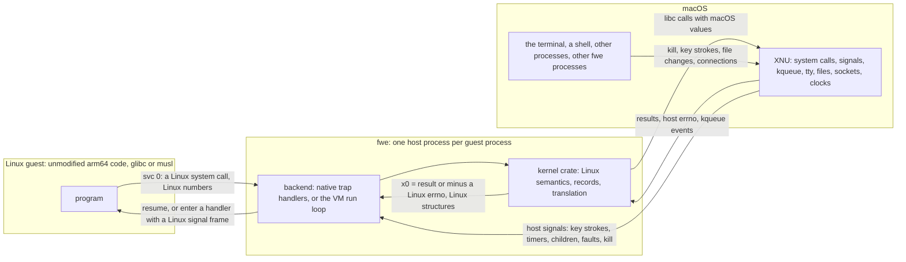

Both are arm64, so a guest's instructions run unchanged on the CPU. Only
what the two kernels define differently has to be bridged: the system-call
interface, a few registers macOS reserves, the address space, every kernel
object macOS lacks or shapes differently, and every event macOS reports in
its own terms.

Two execution backends do this:

| | Native backend | Hypervisor (VM) backend |
|---|---|---|
| Runs | every position-independent program, and `ET_EXEC` images linked at or above 4 GiB | non-PIE executables linked below 4 GiB |
| Guest code | in the `fwe` process, on the CPU, after rewriting | at EL0 in a Hypervisor.framework VM, unmodified |
| Page size the guest sees | 16 KiB (the host's) | 4 KiB (Linux's usual) |
| Guest addresses | host addresses | host addresses, except ranges the guest placed outside fwe's slab, which are translated |
| System calls go to | the kernel crate | the same kernel crate |
| Host signals reach the guest | handler rewrites the interrupted guest context | handler stops the vCPU, the run loop delivers |

## Contents

- [Linux to macOS](#linux-to-macos)
  - [The CPU](#the-cpu): system call entry and return, registers and
    errno, TLS, `x18`, cache maintenance, PAC and BTI, auxv and hwcaps,
    the vDSO
  - [Memory](#memory): layouts, pages and translation, the `mmap` family,
    write+exec memory, shared memory
  - [Processes](#processes): `fork`, `vfork`, threads and futexes,
    `execve`, the ELF loader, `wait`
  - [Signals](#signals): numbers, dispositions, masks and frames, sending
  - [Files and descriptors](#files-and-descriptors), [/proc, /sys and
    /dev](#proc-sys-and-dev)
  - [Waiting and events](#waiting-and-events): `epoll`, `eventfd`,
    `timerfd`, `signalfd`, inotify
  - [IPC](#ipc): sockets, System V IPC, POSIX message queues, keyrings
  - [Kernel-wide state](#kernel-wide-state),
    [namespaces](#namespaces), [cgroups](#cgroups), [mounts](#mounts),
    [credentials and capabilities](#credentials-and-capabilities),
    [seccomp](#seccomp), [devices](#devices)
  - [Time, scheduling and limits](#time-scheduling-and-limits)
  - [Not available](#not-available)
- [macOS to Linux](#macos-to-linux)
  - [Host signals](#host-signals): how one reaches a guest handler,
    `siginfo` and senders, signals with no counterpart, each signal's
    source
  - [Faults in guest code](#faults-in-guest-code)
  - [Terminals and key strokes](#terminals-and-key-strokes): Ctrl-C,
    Ctrl-Z, Ctrl-\\, Ctrl-T, window size, `termios`, job control, ptys
  - [Children ending](#children-ending): `SIGCHLD`, wait statuses,
    [orphans and reapers](#orphans-and-reapers)
  - [A process killed from the host](#a-process-killed-from-the-host)
  - [Files changing on the host](#files-changing-on-the-host)
  - [Network events](#network-events)
  - [Clocks and timers](#clocks-and-timers)
  - [Memory pressure](#memory-pressure)
  - [Errors](#errors)
  - [Host identity and machine state](#host-identity-and-machine-state)

## Linux to macOS

Each table below reads **Linux | macOS | fwe**: what the guest asks for,
what the host has, and what fwe makes of it. A few calls going in and the
host calls coming out:

| Guest call (Linux) | What fwe does | Host call(s) (macOS) |
|---|---|---|
| `openat(AT_FDCWD, "/etc/hosts", O_RDONLY \| O_CLOEXEC)` | resolves `/etc/hosts` component by component in the guest's root, following symlinks itself; translates the flags (`O_CLOEXEC` is `0x80000` on Linux, `0x1000000` on macOS) | `openat(<descriptor of the rootfs's etc>, "hosts", O_RDONLY \| O_CLOEXEC \| O_NOFOLLOW)`; the host descriptor is the guest's |
| `epoll_ctl(ep, EPOLL_CTL_ADD, fd, {EPOLLIN \| EPOLLET, data})` | the epoll descriptor is a kqueue | `kevent(ep, {fd, EVFILT_READ, EV_ADD \| EV_CLEAR, udata = data})` |
| `clock_gettime(CLOCK_BOOTTIME, &ts)` (no vDSO, so it traps) | maps the clock id | `clock_gettime(CLOCK_MONOTONIC, &ts)` |
| `kill(pid, SIGUSR1)` | maps the pid out of the guest's pid namespace and the signal number (10 to 30); leaves a sender note for an fwe target | `kill(<host pid>, 30)` |
| `write(fd, buf, n)` to a socket whose peer has gone | sockets are all `SO_NOSIGPIPE`, so fwe raises `SIGPIPE` itself | `write` fails with `EPIPE`; the guest gets `x0 = -32` and a pending `SIGPIPE` |

### The CPU

#### System call entry

| | Linux arm64 | macOS arm64 |
|---|---|---|
| Instruction | `svc #0` | `svc #0x80` |
| Number in | `x8` | `x16` |
| Arguments | `x0`–`x5` | `x0` and up |
| Error report | `x0` = −errno (−1 to −4095) | carry flag set, `x0` = errno (macOS numbering) |

A Linux `svc #0` executed in a macOS process would enter the macOS kernel
with a meaningless number, so fwe intercepts every guest system call:

- **Native backend:** before guest code becomes executable, each `svc #0`
  is rewritten to `brk #0x4c58` (`crates/native/src/rewrite.rs`). The
  `brk` raises `SIGTRAP`; fwe's handler reads `x8` and `x0`–`x5` from the
  saved context, runs the call and resumes after the `brk` with the result
  in `x0`.
- **VM backend:** the guest's `svc #0` takes an exception to EL1; fwe's
  vector runs `hvc #2`, the vCPU exits and the backend reads `ESR_EL1`
  (exception class `0x15`, SVC64). Nothing is rewritten.

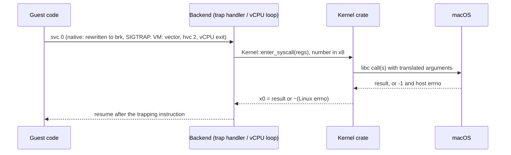

The kernel crate calls macOS through `libc`, so it sees `-1`/`errno`, never
the carry flag; how host errors become Linux ones is under
[Errors](#errors). Flag, structure and constant translations live in
`crates/kernel/src/host.rs`; the Linux values in `crates/abi`. A call
interrupted by a signal returns or restarts as described under
[Host signals](#a-host-signal-reaching-a-guest-thread).

#### Registers and the thread pointer

| Register | Linux | macOS | fwe, native | fwe, VM |
|---|---|---|---|---|
| `TPIDR_EL0` | the thread pointer (TLS), set with `msr` | not preserved for user code | every `mrs`/`msr` of it branches to a stub that keeps the guest's value in a slot of the host thread's TSD, found through `TPIDRRO_EL0` | the guest's own |
| `x18` | a scratch register | platform-reserved, cleared on every exception return, preemption included | every instruction naming `x18` branches to a stub that keeps the guest's `x18` in another TSD slot and uses an ordinary register instead | the guest's own |
| `CTR_EL0` | readable at EL0 | `mrs` of it traps | emulated in the `SIGILL` handler, reporting Apple Silicon's value without the bits that let code skip cache maintenance (`crates/native/src/hwcap.rs`) | read by the guest |
| `CNTPCT_EL0` | readable at EL0 | readable | read by the guest | trapped by the hypervisor, emulated from the virtual counter the guest sees |

`clone` with `CLONE_SETTLS` writes the new thread's TSD slot (native) or its
vCPU's `TPIDR_EL0` (VM). The `x18` rewriting, its coverage and the code
discovery it depends on are in
[architecture.md](architecture.md#rewriting-guest-code).

#### Cache maintenance, PAC and BTI

- **Cache maintenance** is allowed at EL0 on both systems, so a JIT's own
  `dc`/`ic` instructions work in the native backend. Code fwe itself writes
  into guest memory (images, file data, a fork child's memory) has the
  instruction cache invalidated, as Apple's cores do not keep it coherent
  with data writes.
- **Pointer authentication:** the native backend does not report it
  (`AT_HWCAP` has no `PACA`/`PACG`), since the host owns the keys. The VM
  backend enables it in `SCTLR_EL1` where the vCPUs offer it, with random
  keys per program, a thread's from its creator, a fork child's from its
  parent, new ones for `PR_PAC_RESET_KEYS`; it reports `PACA` and `PACG`.
- **BTI:** reported in `AT_HWCAP2` where the host has it. In the VM, code of
  a program built for BTI is mapped guarded (`PROT_BTI`) where Linux maps it
  so, a signal handler is entered as if by `blr`, and a branch-target
  exception is `SIGILL`.

#### auxv, hwcaps and the vDSO

- The initial stack is Linux's: strings, `AT_RANDOM` bytes, the auxiliary
  vector, `envp`, `argv`, `argc`, 16-byte aligned, on a fresh 8 MiB stack
  with a guard page (`crates/native/src/stack.rs`).
- The auxiliary vector carries `AT_PHDR`/`AT_PHENT`/`AT_PHNUM`, `AT_BASE`,
  `AT_ENTRY`, `AT_PAGESZ`, the ids, `AT_SECURE`, `AT_RANDOM`, `AT_EXECFN`,
  `AT_PLATFORM`, `AT_MINSIGSTKSZ` and `AT_HWCAP`/`AT_HWCAP2`.
- `AT_HWCAP`/`AT_HWCAP2` come from macOS's `hw.optional.*` sysctls: only
  features a guest can use directly. SVE and SME (kernel-managed state),
  `CPUID` (trapping ID-register reads) and, natively, PAC are left out.
- There is no vDSO (no `AT_SYSINFO_EHDR`): the C library falls back to real
  system calls for `clock_gettime` and `gettimeofday`, which trap like any
  other.

### Memory

#### Address-space layout

On Linux an arm64 process owns its whole lower address space: a non-PIE
program sits at its link address (often `0x400000`), the break follows the
image, `mmap` grows down from below the stack. macOS gives every arm64
process a mandatory 4 GiB `__PAGEZERO` at address 0, and its own loader,
libraries and heap share the space with the guest.

**Native backend** — guest and fwe in one host address space, guest
addresses equal to host addresses:

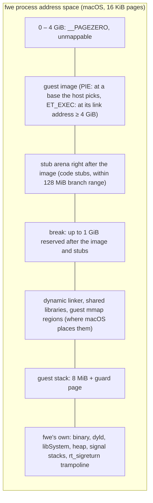

- An image linked below 4 GiB cannot be mapped at its address and carries
  no relocations to move it, so it needs the VM.
- The loader reserves the image's whole span first, then copies each
  segment in, so gaps stay inaccessible.
- Every guest range is recorded (`fwe_kernel::mm::track`); fwe's own
  memory never is, so `execve` can unmap exactly the old program.

**VM backend** — the guest has an address space of its own; its private
memory lives in one host range, the *slab*:

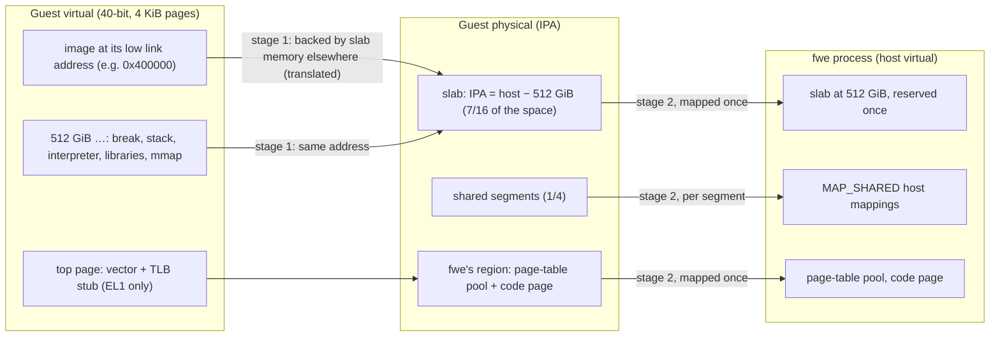

- The slab sits at host 512 GiB, the same address in every VM process, so
  a fork child can take its parent's memory at the same addresses.
- A mapping the guest did not place gets a slab range whose guest address
  is its host address. One placed outside the slab (the low image, a
  `MAP_FIXED` address) is backed by slab memory elsewhere and recorded as a
  translated range.

#### Pages and translation

| | Linux | macOS | fwe |
|---|---|---|---|
| Page size | 4 KiB on most arm64 kernels; 16 and 64 KiB exist | 16 KiB | native: the host's 16 KiB, reported in `AT_PAGESZ` (the arm64 ABI allows it); VM: 4 KiB |
| Translation | one stage, the kernel's tables | one stage, XNU's pmap | native: XNU's; VM: two stages, fwe's stage 1 and the framework's stage 2 |

In the VM, both stages are real hardware translation:

- **Stage 1** is fwe's own page tables (`crates/native/src/hv/pagetables.rs`):
  4 KiB granule, 40-bit space, level-3 pages only, each page's EL0
  permissions and BTI guard. Memory system calls edit them; taking access
  away is followed by a TLB invalidation before the guest relies on it.
- **Stage 2** is set up once and never changes while the VM runs: the slab,
  fwe's region, and a mapping per shared segment. The framework maps host
  memory in 16 KiB pages; a 4 KiB guest page is a quarter of one.
- The kernel crate never walks the tables. Guest pointers it uses go
  through `uaccess::g2h`, which looks up the translated ranges, after a
  check against the guest's mappings (the host can reach slab memory the
  guest cannot).

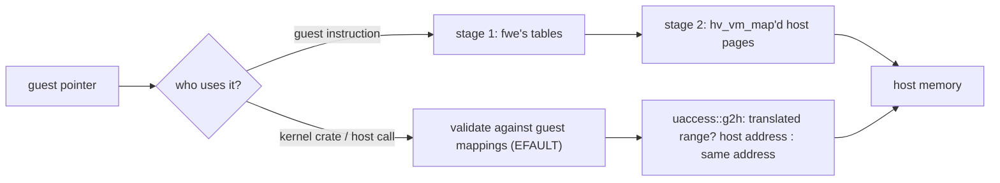

The low 4 GiB can never be identity-mapped (it is `__PAGEZERO` on the
host), so the low image is always one of the translated ranges. A host call
given one buffer that runs over the edge of a translated range has no
single host address and fails with `EINVAL`.

#### The mmap family

| Call | Linux | fwe, native | fwe, VM |
|---|---|---|---|
| `mmap` anonymous / private file | kernel VMA | host `mmap` at the guest's address or where macOS places it; offset must be a multiple of 16 KiB | slab range; a private file mapping is a copy of the file's data when mapped |
| `MAP_SHARED` | shared pages | host `MAP_SHARED`; an executable shared file mapping is made private, since its code is rewritten | a *segment*: a host shared mapping outside the slab (anonymous shared memory is an unlinked file), mapped into the VM once |
| `MAP_FIXED`, `MAP_FIXED_NOREPLACE` | replace / refuse to replace | host `MAP_FIXED`; `NOREPLACE` checks where macOS put it (`EEXIST`) | page-table edit; over slab memory at its own address, that memory is reused, zeroed |
| `munmap` | | host `munmap` | removes the pages from stage 1 and flushes TLBs; the slab range is zeroed before reuse |
| `mprotect` | | host `mprotect`; adding `PROT_EXEC` prepares the code first | stage-1 permission edit |
| `mremap` | grow, shrink, move | shrink only; growing fails with `ENOMEM`, and C libraries fall back to allocate-and-copy | private memory: shrink, grow in place, or move with `MREMAP_MAYMOVE`; a shared segment cannot grow (`ENOMEM`); no `MREMAP_FIXED`/`MREMAP_DONTUNMAP` (`EINVAL`) |
| `madvise(MADV_DONTNEED)` | private anonymous pages read as zero again | each private anonymous piece replaced by a fresh mapping (macOS's own keeps the data) | private pages read as zero again, or as the file for a private file mapping; shared memory keeps its contents |
| `mlock` family | wires pages | pages brought in and counted against `RLIMIT_MEMLOCK`, not wired | the same |
| `mincore` | residency per page | the host's residency | by 16 KiB host pages |

Every successful memory call is also recorded the way Linux lists it
(`crates/kernel/src/maps.rs`), for `/proc/<pid>/maps`, `smaps` and
`PROCMAP_QUERY`, with the protections the guest asked for.

#### Write+exec memory

Linux maps `PROT_WRITE | PROT_EXEC` memory freely (JIT compilers do).
macOS refuses it without `MAP_JIT`, and `MAP_JIT` memory is switched per
thread (`pthread_jit_write_protect_np`), which Linux code never calls. fwe
keeps such memory writable on the host and records it
(`crates/kernel/src/mm.rs`):

- **native:** the first instruction fetch from a page faults; fwe prepares
  the page's code (system calls and thread-pointer accesses rewritten) and
  makes it read-execute. A later write faults and makes it read-write
  again. A write fwe makes for the guest switches the page the same way.
- **VM:** stage 1 maps the memory writable and executable, so nothing
  faults.

#### Shared memory and memfd

| Linux | macOS | fwe |
|---|---|---|
| `memfd_create`: an anonymous file with a name and seals | no memfd, no seals | a file in fwe's private directory, unlinked at once; name and seals in extended attributes, so every holder sees them; `F_SEAL_WRITE` clones the file and swaps this process's descriptors for read-only ones of the clone |
| `/dev/shm` tmpfs (`shm_open`, `sem_open`) | no tmpfs at `/dev/shm` | a directory per rootfs in the user's temporary directory, shared by every fwe process on that root, treated by the resolver as a mount point |
| System V shared memory | own `shmget` | see [System V IPC](#system-v-ipc) |

### Processes

#### fork

| | Linux | fwe, native | fwe, VM |
|---|---|---|---|
| `fork` | copy-on-write of private pages | host `fork`: Mach copy-on-write for `MAP_PRIVATE` (`VM_INHERIT_COPY`), sharing for `MAP_SHARED` | no host fork and no copy-on-write: a fresh fwe process is sent a copy of every slab page that exists |
| `vfork` / `CLONE_VM \| CLONE_VFORK` | child borrows the parent's memory | host `fork` with the private ranges set to inherit by sharing (`minherit`) for that fork | child fetches pages on first touch and sends back what it changed |

Linux duplicates the calling thread into a new process with
copy-on-write memory. macOS's `fork` does too, but copies memory while the
parent's other threads keep running, gives the child none of the parent's
kqueues, and does not restore a signal mask from a handler frame the child
did not take. A VM cannot be forked at all.

**Native backend** (`crates/native/src/process.rs`, `quiesce.rs`):

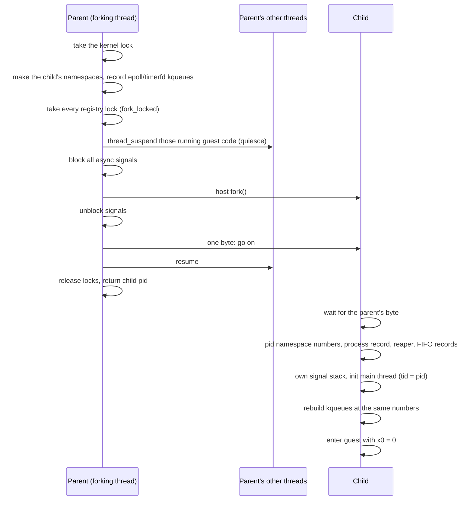

- The child keeps the guest's blocked mask and alternate stack; pending
  signals are not inherited, as on Linux.
- Descriptors are inherited by the host fork; the child's process record,
  signal mailbox and System V attachments are its own.

**vfork** (`CLONE_VM | CLONE_VFORK`, used by `posix_spawn`, `vfork`, Go's
`os/exec`): the same host fork with the guest's private memory set to
inherit by sharing for it. The parent waits on a close-on-exec pipe only
the child holds, so it resumes when the child execs or exits, and sees
what the child wrote meanwhile. fwe's own memory is not shared, so the
child's mappings (`mmap`, `munmap`) stay its own. In the native backend
`CLONE_VM` without `CLONE_VFORK` or `CLONE_THREAD` fails with `ENOSYS`; the
VM backend treats any clone without `CLONE_THREAD` as a `fork` or `vfork`.

**VM backend** (`crates/native/src/hv/fork.rs`): the child is a fresh
`fwe --hv-fork-child` started with `posix_spawn`, never a host fork.

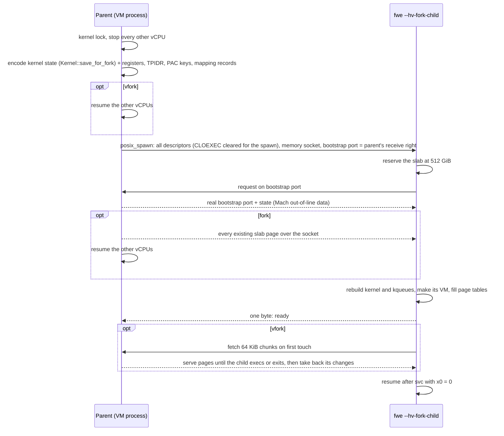

- No private page is ever in two VMs. Shared segments go to the child as
  their files, which it maps: those pages are in both, as Linux shares
  them.
- A `fork` child gets every slab page that exists
  (`mach_vm_page_range_query`), sent with the parent's vCPUs stopped so it
  sees one instant. The copy goes over a socket
  pair rather than through a file-backed slab, as elfuse does: an APFS
  clone writes the memory to disk and is some fifty times slower.
- A `vfork` child fetches only the slab ranges the parent had in use, and
  only while it keeps them: memory it gives back or maps anew is its own.
  Before it execs or ends it sends back the bytes it changed, compared with
  what it fetched, and the parent resumes once they are in its memory. Its
  channel is one of fwe's reserved descriptors, out of reach of a child
  that moves descriptors into place before exec (Go's does); a child that
  loses it ends with a message rather than run without its parent's memory.
- What cannot cross: the VM itself (a child cannot use its parent's), and
  kqueues, rebuilt from fwe's records.

#### Threads, clone and futexes

| | Linux | macOS | fwe |
|---|---|---|---|
| Thread | a task sharing `mm`, files, handlers | a pthread | a host pthread running guest code (native) or a host thread with its own vCPU (VM) |
| `clone` flags | any combination | — | a thread needs `CLONE_VM` and a stack (`EINVAL` without either in the VM; natively `EINVAL` without a stack, `ENOSYS` without `CLONE_VM`); the native backend accepts `CLONE_VM`, `FS`, `FILES`, `SIGHAND`, `THREAD`, `SYSVSEM`, `SETTLS`, `PARENT_SETTID`, `CHILD_SETTID`, `CHILD_CLEARTID`, `DETACHED` and fails others with `ENOSYS` |
| `clone3` | `struct clone_args` | — | read and treated as the `clone` it describes; `CLONE_PIDFD`, `CLONE_INTO_CGROUP`, `CLONE_CLEAR_SIGHAND` and `set_tid` fail with `ENOSYS` |
| Per-thread state | in the task | — | in host thread-locals: tid, `set_tid_address` word, robust list, signal mask, alternate stack, pending set |
| futex, private | a wait queue per address | `__ulock_wait`/`__ulock_wake` (private) | per-process wait queues, outside the kernel lock |
| futex, shared | keyed by the page's backing object | `__ulock_wait2` with `UL_COMPARE_AND_WAIT_SHARED` | a slot table every fwe process maps, keyed as Linux keys a shared futex (Mach memory object + offset); each waiter sleeps on its slot's word, so a wake knows whom it woke |

A new thread starts with its creator's registers and signal mask, `x0` = 0,
the given stack and no alternate stack. Its exit clears and wakes its
`clear_child_tid` futex; the last thread or `exit_group` ends the process.

#### execve

Linux replaces the address space in place, keeping the pid, descriptors
not marked close-on-exec, the signal mask, pending signals and ignored
dispositions. fwe does it one of two ways:

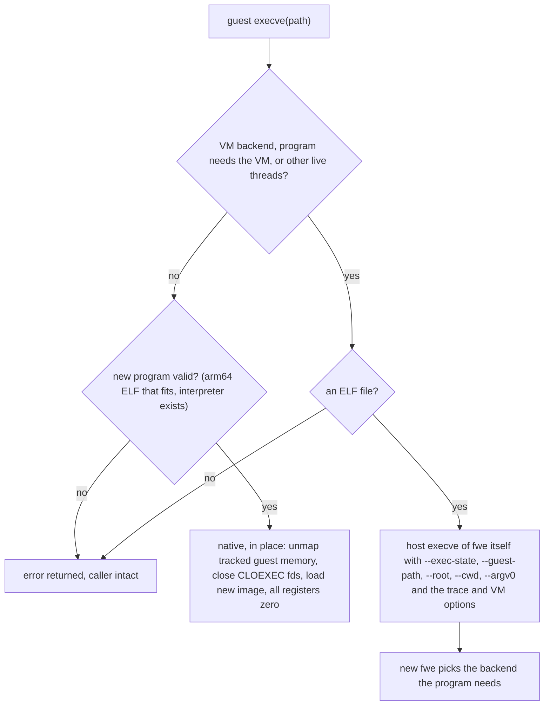

What crosses an `execve`:

| State | How |
|---|---|
| pid, descriptors without `O_CLOEXEC`, signal mask, pending host signals, ignored dispositions | the host keeps them across its own exec; signals fwe held pending that the guest blocks are moved onto the host first |
| handled dispositions | reset to default, as on Linux |
| credentials, capabilities, `RLIMIT_NOFILE`, fwe's own rlimits, umask, mount namespace and root, mount origins of open files, seccomp filters, `no_new_privs`, personality, inotify and namespace descriptors | in place: kept in the process; re-exec: encoded in `--exec-state` (`Kernel::exec_state`) |
| saved set-user/group ids | become the effective ones, as on Linux |
| thread and process keyrings | dropped; the session keyring stays |
| a program run from a descriptor (`execveat(fd, "", AT_EMPTY_PATH)`) | the descriptor is kept by fwe and passed on with `--exe-fd` |

`execveat` turns its directory descriptor, path and flags into a guest
path and is then `execve`.

#### The ELF loader and dynamic linker

- The loader (`crates/native/src/loader.rs`, the VM's in `hv/backend.rs`)
  maps each `PT_LOAD` segment, a PIE at a base it picks, code first
  writable so the native backend can rewrite it.
- A `PT_INTERP` (`/lib/ld-linux-aarch64.so.1`, `/lib/ld-musl-aarch64.so.1`)
  is resolved in the guest's root and loaded too; the guest starts at its
  entry with `AT_BASE` and `AT_ENTRY` set as Linux sets them.
- The dynamic linker then works as on Linux: it maps libraries through
  fwe's `openat` and `mmap`, relocates and sets the thread pointer. Real
  glibc and musl run unmodified.

#### wait

| | Linux | macOS | fwe |
|---|---|---|---|
| `wait4` pid argument | a pid, `-pgid`, 0, -1 | the same, host pids | mapped out of the guest's pid namespace (`ECHILD` for one not in it) |
| `WNOHANG`, `WUNTRACED` | 1, 2 | 1, 2 | passed through |
| `WCONTINUED` | 8 | `0x10` | translated |
| `__WALL`, `__WCLONE`, `__WNOTHREAD` | select which children | none | accepted; every child is an fwe process, so they change nothing |
| a reaper's `wait` | its children and adopted orphans | its children only | its host children, then the orphans fwe recorded for it ([orphans and reapers](#orphans-and-reapers)) |

Child pids are host pids (or their numbers in the guest's pid namespace),
so `wait`, `kill` and `setpgid` act on real processes. What comes back (the
status word, `rusage`, `SIGCHLD`) is under
[Children ending](#children-ending).

### Signals

#### Numbers

Linux and macOS agree on signals 1–6, 8, 9, 11, 13–15, 21, 22 and 24–28;
the rest differ. fwe translates every number both ways
(`host::signal_to_host`, `host::signal_to_linux`).

| Signal | Linux | macOS |
|---|---|---|
| `SIGBUS` | 7 | 10 |
| `SIGUSR1` / `SIGUSR2` | 10 / 12 | 30 / 31 |
| `SIGCHLD` | 17 | 20 |
| `SIGCONT` / `SIGSTOP` / `SIGTSTP` | 18 / 19 / 20 | 19 / 17 / 18 |
| `SIGURG` | 23 | 16 |
| `SIGIO` | 29 | 23 |
| `SIGSYS` | 31 | 12 |
| `SIGSTKFLT`, `SIGPWR` | 16, 30 | none |
| real-time `SIGRTMIN`..`SIGRTMAX` | 32–64 | none |
| `SIGEMT`, `SIGINFO` | none | 7, 29 |

fwe uses the two macOS-only signals for itself: `SIGEMT` is its *wake
signal* and `SIGINFO` its *kill relay*. What either does when it comes
from elsewhere is under
[Signals with no counterpart](#signals-with-no-counterpart).

#### Dispositions, masks and frames

| | Linux | macOS | fwe |
|---|---|---|---|
| Dispositions | per process | per process, macOS numbers | in the kernel crate, each passed to the host (`Platform::set_host_signal`) as catch, default or ignore ([which](#who-acts-on-a-signal)) |
| Mask, alternate stack | per thread | per thread | per thread, in host thread-locals; the host thread's own mask blocks only what the host must hold back |
| Pending instances | one per standard signal; real-time signals queued | one per signal, `siginfo` lost while blocked | one per signal number; a standard signal keeps its first `siginfo`, a real-time one its latest |
| Signal frame | `rt_sigframe` with `ucontext`, `fpsimd_context` | Darwin `ucontext`, `mcontext64` | Linux's layout, built on the guest stack (or alternate stack); return through `sa_restorer` or fwe's `rt_sigreturn` trampoline |

A signal ignored when fwe starts (`nohup`, a shell's background job)
starts out ignored in the guest, as across a Linux `execve`.

#### Sending a signal

| Guest call | fwe | Host |
|---|---|---|
| `kill(pid, sig)` to another process, for a signal the host has | pid mapped out of the pid namespace; permission checked as on Linux; a note of the sender left in the target's mailbox if it is an fwe process (`crates/kernel/src/signote.rs`) | `kill(<host pid>, <host signal>)` |
| `kill` with `SIGKILL` | the same | an fwe target is sent `SIGINFO` (the kill relay), so a VM process can tear its VM down first; any other process the real `SIGKILL` |
| `kill` of itself with a fault signal (`SIGSEGV`, `SIGBUS`, `SIGILL`, `SIGFPE`, `SIGTRAP`) | recorded directly, since macOS's `siginfo` cannot tell a sent one from a fault | none |
| `kill`/`tgkill` with a real-time signal (or `SIGSTKFLT`, `SIGPWR`) | recorded directly within the process; to another process `EINVAL` | `SIGEMT` to wake the target thread |
| `tgkill(tgid, tid, sig)`, a signal the guest catches or a fault signal | posted to that thread directly, which a relayed host signal could not target | `SIGEMT` to wake it |
| `tgkill` of a signal the host acts on | — | `pthread_kill(<host thread>, <host signal>)` |
| `kill(-1, sig)` | only the caller's pid namespace or its run of fwe, never other host processes | `kill` of each |

- **Permission to signal** follows Linux: `CAP_KILL`, or the caller's real
  or effective uid matching the target's real or saved one, or `SIGCONT`
  within the session; a process fwe has no record of counts as root's.
- A `SIGKILL` or `SIGSTOP` sent to a pid namespace's init from inside the
  namespace is dropped; a `SIGKILL` that ends an init takes its namespace
  with it.

### Files and descriptors

| Linux | macOS | fwe |
|---|---|---|
| a process's root (`chroot`) and mount table | one host filesystem | guest paths resolved by fwe component by component (`crates/kernel/src/fs.rs`): symlinks followed by fwe, mounts entered, `..` clamped at the process's root, as `openat2(RESOLVE_IN_ROOT)` would; the final host `openat` has `O_NOFOLLOW` added |
| `open` flags | other values | translated (`host::open_flags_to_host`) |
| descriptor numbers | the same kind of table | guest descriptors are host descriptors; fwe's own live in a reserved range at the top, out of the guest's reach (`EBADF`), with a virtual `RLIMIT_NOFILE` below it |
| `struct stat`, `statx` | different layout | translated |
| `statfs` | different layout, APFS | translated; the type reported as ext4, the sizes and counts the host's |
| `getdents64` | `getdirentries` | built from it |
| record locks (`F_SETLK`) | POSIX locks, different `struct flock` | translated; the host's, so they hold against host processes too |
| OFD locks (`F_OFD_*`) | private `F_OFD_*` commands | translated to them; owned by the open file, shared by its duplicates |
| leases (`F_SETLEASE`) | none | a record every fwe process shares (`crates/kernel/src/leases.rs`): a conflicting open signals the holder and waits for it, up to `fs.lease-break-time` |
| `F_SETSIG`, thread owners | `SIGIO` to a process or group | kept per descriptor (`crates/kernel/src/fdstate.rs`); see [Network events](#network-events) for how a host `SIGIO` arrives |
| pipe size (`F_SETPIPE_SZ`) | fixed, 64 KiB at most | reported from the host pipe; a size set above 64 KiB holds no more |
| extended attributes | own namespace (`com.apple.`) | Linux names stored as host attributes of the same name; Linux's rules per namespace; only Linux's namespaces are listed; `system.` ACLs not kept |
| mode bits; root passes them | owner's bits enforced on the owner | a mode denying its owner is kept in an attribute (`UF_NODUMP` flags the file), the host file keeps owner read/write (`crates/kernel/src/modes.rs`) |
| FIFO hang-up in `poll`/`epoll` | `POLLHUP` once the last writer goes | macOS reports nothing; fwe asks `select` between short slices (`crates/kernel/src/fifo.rs`) |
| `O_PATH` | none | the descriptor is marked and refused what Linux refuses; a FIFO, device, socket or symlink gets a stand-in that names it |
| terminals and ptys | `termios`, `/dev/ptmx` | see [Terminals and key strokes](#terminals-and-key-strokes) |

#### /proc, /sys and /dev

- `proc` and `sysfs` mounts are fwe's own filesystems
  (`crates/kernel/src/procfs.rs`, `procpid.rs`, `synthdir.rs`): content is
  generated from fwe's records and the host (`proc_pidinfo`, `sysctl`),
  served from an anonymous descriptor; directories are listed from memory.
  What of the host shows there is under
  [Host identity and machine state](#host-identity-and-machine-state).
- `/proc/<pid>` covers the processes of the reader's pid namespace, from
  their process records. `/proc/sys` writes reach the namespace sysctls fwe
  keeps (network, IPC) and the few it acts on.
- `/proc/self/fd/N`, `cwd` and `root` behave as magic links.
- `/dev/null`, `zero`, `random`, `urandom` and `tty` are the host's;
  `full`, `loop-control` and `loopN` are fwe's; `/dev/ptmx` and
  `/dev/pts` are fwe's pty layer; `/dev/fd`, `stdin`, `stdout`, `stderr`
  link into `/proc/self/fd`; `/dev/shm` and `/dev/mqueue` are fwe's mounts.

### Waiting and events

| Linux | macOS | fwe |
|---|---|---|
| `epoll` | `kqueue` | the epoll descriptor is a kqueue; `EPOLLIN`/`EPOLLOUT` become `EVFILT_READ`/`EVFILT_WRITE`, `EPOLLET` → `EV_CLEAR`, `EPOLLONESHOT` → `EV_ONESHOT`, data in `udata`; `epoll_event` is 16 bytes on arm64; how events come back is under [Network events](#network-events) |
| `eventfd` | none | a pipe plus a 64-bit counter; the pipe holds one byte exactly while the counter is non-zero, so `kqueue` sees readiness |
| `timerfd` | none | a kqueue with one `EVFILT_TIMER`, millisecond resolution |
| `signalfd` | none | a readiness pipe plus a queue of `signalfd_siginfo`; a pending signal the thread blocks and a signalfd watches moves onto it |
| inotify | `kqueue` vnode events (no names), FSEvents (paths, after the fact); neither reports open, read or close | fwe raises the events itself from every fwe process's file calls; an instance is a host datagram socket bound in fwe's private directory, so reading and `epoll` are the host's |

A host `fork` child gets no kqueues, so epoll interest lists and timerfd
settings are recorded and rebuilt in the child at the same numbers.

### IPC

#### Sockets

| Linux | macOS | fwe |
|---|---|---|
| `AF_INET6` = 10 | 30 | translated |
| `sockaddr` starts with a 2-byte family | a length byte, then a family byte | header rewritten in place |
| `SOCK_NONBLOCK`/`SOCK_CLOEXEC` in the type | none | applied with `fcntl` |
| `MSG_NOSIGNAL` | `SO_NOSIGPIPE` | every socket gets `SO_NOSIGPIPE`; fwe raises `SIGPIPE` itself for a write or a send without `MSG_NOSIGNAL` |
| `SCM_RIGHTS`: 64-bit `cmsg_len` | 32-bit | re-encoded |
| `AF_UNIX` paths | 104-byte limit | resolved in the guest's root; a long one bound or connected from its directory with `pthread_fchdir_np` |
| abstract `AF_UNIX` names | none | files in a per-host temporary directory, or in an fwe network namespace's own directory |
| `SOCK_SEQPACKET` Unix sockets | none | a stream socket with length-prefixed frames (`crates/kernel/src/seqpacket.rs`) |
| `AF_NETLINK`/`NETLINK_ROUTE` | none | in an fwe network namespace, answers for `lo`; elsewhere every request is `EOPNOTSUPP` |
| `SO_PEERCRED` | `LOCAL_PEERCRED` | peer pid in the caller's pid namespace, ids as the guest sees them |

#### System V IPC

macOS has System V IPC, but one set for the machine, with small limits.
fwe keeps its own per IPC namespace (`crates/kernel/src/sysvipc.rs`,
`ipcops.rs`): a shared record holding every object, a segment's memory a
file beside it that `shmat` maps shared. Each operation is one change of
the record under its lock, so `semop` is atomic across processes; waits
retry when the record changes. What a dead process leaves (attachments,
`SEM_UNDO`) is cleaned up by the next process that looks. The initial
namespace's record lasts until the host reboots.

#### POSIX message queues

macOS has no `mq_*`. fwe keeps each queue as a record in its IPC
namespace's directory (`crates/kernel/src/mqueue.rs`); the guest's
descriptor is a host descriptor of the queue's file, holding a shared
`flock`, so an unlinked queue is freed with its last descriptor.
Notifications go to the registering process: a signal carrying `SI_MESGQ`
and the value (via a signal note), or, for `SIGEV_THREAD`, the cookie sent
to the C library's netlink socket at a host address fwe gave it.

#### Keys and keyrings

macOS has no key retention service. fwe keeps every key in one record
shared by all fwe processes (`crates/kernel/src/keys.rs`): keys,
keyrings, permissions, quotas, and the thread, process, session, user and
persistent keyrings each process and user holds. The key types
(`keyring`, `user`, `logon`, `big_key`, `dns_resolver`, `asymmetric`,
`encrypted`) and their cryptography (`keycrypto.rs`, as Linux 6.12
computes it) are fwe's. `request_key` has no `/sbin/request-key` upcall:
a key it would construct is negative for a minute.

### Kernel-wide state

What Linux keeps in one kernel for every process — mount tables,
namespaces, the cgroup tree, loop devices, IPC objects, keys, inotify
watches, shared futexes — must be seen by every fwe process. It lives in
fwe's private directory on the host (`crates/kernel/src/shared.rs`): a
directory per record, its data replaced whole under a lock, and a mapped
generation count so a process rereads only after another changed it.

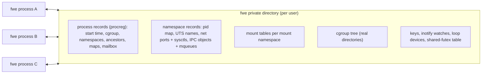

A record's name carries a format number, so another fwe build never reads
it. A record no live process holds is collected when a namespace is made
and when a fresh fwe starts.

### Namespaces

macOS has no namespaces. fwe makes each one as a shared record that the
processes in it name; a process in an initial namespace sees the host's
(host name, host pids). `clone` and `unshare` make them
(`crates/kernel/src/nsops.rs`), `setns` joins one through a
`/proc/<pid>/ns/*` descriptor (`nsfd.rs`).

| Namespace | What fwe does |
|---|---|
| pid (`pidns.rs`) | numbers processes and threads from 1 in a record mapping each to its host pid; `getpid`, `kill`, `wait`, process groups and `siginfo` senders are translated; when its init ends, the rest are killed; init ignores `SIGKILL`/`SIGSTOP` from inside |
| mount (`mounts.rs`) | a mount table per namespace; see [Mounts](#mounts) |
| user (`userns.rs`) | ids kept as the initial namespace's and seen through `uid_map`/`gid_map`, written once with Linux's rules; the creator has every capability in it |
| UTS | `uname`, `sethostname`, `setdomainname` use its names; in the initial one the host's name is read and never set (`EPERM`) |
| network (`netns.rs`) | a loopback interface, down until brought up; sockets reach only loopback; its ports are host loopback ports mapped through its table, so each namespace has its own port 80; abstract `AF_UNIX` names are its own; its sysctls are its own |
| IPC | its System V objects and POSIX queues |
| cgroup | `/proc/self/cgroup` and `cgroup2` mounts show the tree from its root |

### cgroups

macOS has no cgroups and no unprivileged way to hold a process to a
memory or CPU budget. fwe keeps one cgroup v2 tree for the user's fwe processes, as real
directories with interface files (`crates/kernel/src/cgroupfs.rs`):

- `mkdir`/`rmdir`, `cgroup.procs`, `cgroup.subtree_control` with Linux's
  rules; `cgroup.events`, `pids.current`, `memory.current` and `cpu.stat`
  read what is so when opened;
- `cgroup.freeze` stops and continues members, `cgroup.kill` kills them,
  `pids.max` limits `fork`;
- device programs (`BPF_PROG_TYPE_CGROUP_DEVICE`) decide every device open
  and `mknod` of members, run on fwe's eBPF interpreter (`bpf.rs`);
- the other limits are kept and read back, not enforced.

### Mounts

macOS mounts are system-wide and need root; there are no mount
namespaces, no bind or overlay mounts of Linux's kind and no propagation.
fwe's mounts exist only in its tables (`crates/kernel/src/mounts.rs`,
`mountops.rs`, `mountapi.rs`, `overlay.rs`):

- a mount shows a host directory (rootfs, bind source, a tmpfs's backing
  directory), an overlay of several, or one of fwe's filesystems (`proc`,
  `sysfs`, `cgroup2`, `devpts`, `mqueue`);
- `mount`, `umount2`, `pivot_root`, `chroot` and the new mount API
  (`fsopen`, `fsconfig`, `fsmount`, `fspick`, `open_tree`, `move_mount`,
  `mount_setattr`, `statmount`, `listmount`) act on the table;
- propagation as Linux's: peer groups, slaves, across namespaces;
- `nodev`, `noexec`, `nosymfollow`, `ro` and the access-time flags are
  enforced by fwe; busy mounts refuse `umount` (`EBUSY`);
- an overlay is resolved as Linux's `overlay`: upper then lower layers,
  whiteouts (0:0 device nodes) and opaque directories, copy-up as an APFS
  clone, each change built in the work directory and renamed into place.

### Credentials and capabilities

| Linux | macOS | fwe |
|---|---|---|
| real/effective/saved/fs uids and gids, groups | the host process's, changeable only by root | virtual (`crates/kernel/src/creds.rs`), default root (0), Linux's `set*id` rules |
| capability sets and securebits | none | the five sets and securebits (`caps.rs`), changed by `capset`, `prctl`, `setuid`, `execve` as on Linux; every capability but `CAP_SYS_TIME` at the start |
| `chown` | changes the owner | accepted for a privileged caller, not applied to the host file |
| file capabilities, set-ID programs | set-ID bits | none: `execve` follows Linux's rules for a file with neither |

How host users and file owners look to the guest is under
[Host identity](#host-identity-and-machine-state).

### seccomp

macOS has no seccomp. fwe runs each filter, classic BPF over
Linux's `seccomp_data` (`AUDIT_ARCH_AARCH64`), before either backend routes
a call (`crates/kernel/src/seccomp.rs`); the action of highest precedence
wins. Filters apply to every thread of the process and are kept across
`fork` and `execve`. `SECCOMP_RET_TRAP` raises `SIGSYS` with Linux's
`_sigsys` fields; `SECCOMP_RET_TRACE` and `SECCOMP_RET_USER_NOTIF` fail
with `ENOSYS`, as with no tracer or listener.

### Devices

- `mknod` of a device, which the host lets only its root do, makes an
  empty file flagged `UF_OPAQUE` with the Linux type and numbers in an
  attribute (`crates/kernel/src/devnodes.rs`); opening it opens the host
  device those numbers name, or fails with `ENXIO`.
- Loop devices are fwe's own block devices 7:N with `/dev/loop-control`
  (10:237), in a shared record (`loopdev.rs`); fwe carries out their reads,
  writes and requests on the attached file.

### Time, scheduling and limits

| Linux | macOS | fwe |
|---|---|---|
| clocks: `REALTIME`, `MONOTONIC`, `BOOTTIME`, `TAI`, `*_COARSE`, `*_ALARM`, CPU-time | fewer | mapped onto the host's realtime, monotonic, raw and CPU-time clocks (`host::clock_to_host`) |
| setting the clock (`CAP_SYS_TIME`) | root | refused with `EPERM` after Linux's argument checks, as in a container |
| interval timers (`setitimer`, `alarm`) | the same, at most 100,000,000 s | the host's |
| nice, scheduling policies | own scheduler | kept in the process record with Linux's checks, inherited; the host schedules every process alike |
| `RLIMIT_NICE`, `RTPRIO`, `MSGQUEUE`, `MEMLOCK`, … | absent or different | fwe's own (`crates/kernel/src/rlimits.rs`); `NOFILE` is virtual, below fwe's reserved descriptors; `CPU`, `FSIZE`, `DATA`, `STACK`, `CORE`, `NPROC`, `AS` are the host's |
| `personality` | none | kept per process; `UNAME26` and `STICKY_TIMEOUTS` act |

### Not available

These fail with `ENOSYS` (any call not dispatched in
`crates/kernel/src/syscalls.rs` does, noted under `--strace`):

- `ptrace` and `process_vm_readv`/`writev`;
- pidfds (`pidfd_open`, `pidfd_send_signal`, `pidfd_getfd`);
- POSIX timers (`timer_create` and the rest), `rt_sigqueueinfo`,
  `rt_tgsigqueueinfo`;
- `io_uring`, the AIO calls, `userfaultfd`, `perf_event_open`, `fanotify`,
  `kcmp`, `landlock`, `rseq`, `membarrier`, `futex_waitv`,
  `name_to_handle_at`/`open_by_handle_at`;
- `epoll_pwait2`, `sendmmsg`/`recvmmsg`, `times`, `getcpu`,
  `ioprio_get`/`ioprio_set`, the `pkey_*` calls, `process_madvise`,
  `process_mrelease`, `memfd_secret`, `cachestat`, `map_shadow_stack`,
  `remap_file_pages`, the `lsm_*` calls;
- `sync`, `syncfs`, `sync_file_range`, `readahead`;
- kernel modules, `kexec`, `reboot`, swap, quotas, NUMA policy, `acct`,
  `syslog`, `vhangup`.

## macOS to Linux

Things happen on the host that a Linux program expects to hear about from
its kernel: a key pressed, a signal sent, a child ending, data arriving, a
timer firing, a call failing. Each reaches the guest through one of a few
channels:

| Channel on macOS | What fwe does with it | What the guest gets |
|---|---|---|
| a host signal to the fwe process | caught by the backend's handler (`crates/native/src/trap.rs`: `on_async`, `on_fault`, `on_sigtrap`; the VM's `on_signal` in `hv/backend.rs`), translated and recorded pending | a Linux signal with a Linux `siginfo`, in a Linux frame |
| a host call's result | return value kept, `errno` translated, structures rewritten | `x0` = the result or minus a Linux errno, Linux layouts |
| a `kqueue` event | translated by `epoll_wait`, `timerfd` and inotify reads; a reaper's watcher follows process events | `epoll` events, timer counts, `SIGCHLD` for an adopted orphan |
| host state read when asked | `proc_pidinfo`, `sysctl`, `gethostname`, `sysconf` | `/proc`, `uname`, `sysinfo` |
| another fwe process | shared records and signal notes | what one Linux kernel would show |

The rows below read **on macOS | what fwe does | what the guest sees**.

### Host signals

#### Who acts on a signal

The host never blocks a signal fwe catches, whatever the guest's mask:
macOS empties the `siginfo` of a signal it holds blocked, and Linux keeps
the sender. So fwe catches each signal the guest must see with its sender,
keeps it pending itself while the guest blocks it, and leaves to the host
only the actions the host can take as Linux would (`Kernel::sync_host_signal`):

| Guest's disposition | Host disposition | Why |
|---|---|---|
| a handler | caught by fwe | to build Linux's frame |
| read by a `signalfd` or `rt_sigtimedwait` | caught by fwe, whatever the disposition, while it is read | to queue it there |
| default, and the default ends or stops the process (`SIGINT`, `SIGTERM`, `SIGHUP`, `SIGTSTP`, `SIGTTIN`, …) | caught by fwe, which carries the default out | so a thread whose guest mask blocks it keeps it pending, the parent sees Linux's status, and a VM process tears its VM down first |
| default, and the default ignores or continues (`SIGCHLD`, `SIGURG`, `SIGWINCH`, `SIGCONT`) | host default | the host does the same |
| ignored | host `SIG_IGN` | the host does the same, and keeps it ignored across `execve` |
| `SIGKILL`, `SIGSTOP` | the host's | they cannot be caught |
| fault signals (`SIGSEGV`, `SIGBUS`, `SIGILL`, `SIGFPE`, `SIGTRAP`) | fwe's fault handlers, always | see [Faults in guest code](#faults-in-guest-code) |

A guest thread runs under a host mask holding only the guest-blocked
signals whose action the host applies (`host::host_mask_for`); fwe's own
handlers run with every signal blocked. `SIGCHLD`'s `SA_NOCLDSTOP` and
`SA_NOCLDWAIT` are passed to the host with it.

#### A host signal reaching a guest thread

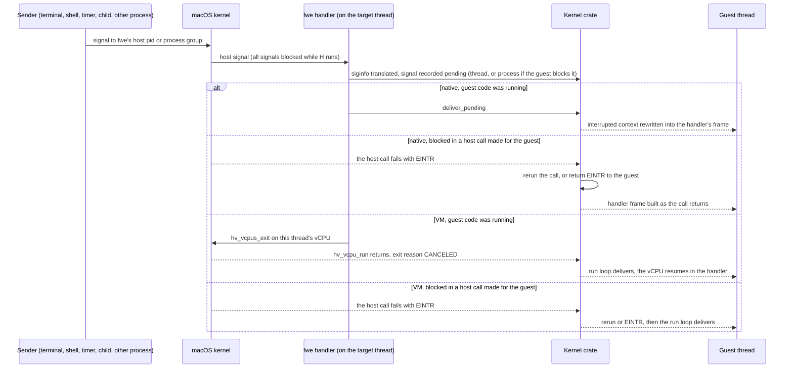

- **Running guest code:** natively, the handler interrupted the guest
  itself, so it delivers at once by rewriting the saved context, as Linux
  does on the way back to user space. In the VM it stops the vCPU, so a
  signal reaches even a guest spinning without system calls.
- **Blocked in a host call:** while fwe runs a call for the guest the
  thread's guest mask is in force on the host, so a signal the guest takes
  interrupts the host call. The handler only records it. The call then
  runs again if no guest handler waits for the signal, or if the handler
  has `SA_RESTART` and the call is one Linux restarts (reads, writes,
  `wait4`, `waitid`, socket calls, `openat`, `ioctl`, `flock`, `fcntl`,
  message queue calls, a futex wait without a timeout); otherwise it fails
  with `EINTR`. A signal arriving between a call's start and its host wait
  is a [known limitation](architecture.md#known-limitations).
- **Process-wide or thread:** a signal landing on a thread whose guest mask
  blocks it is recorded against the process (`thread::post_landed`), and
  the other threads are woken with `SIGEMT` to take it. `SIGPIPE` and
  `SIGXFSZ`, which the host raises on the thread that caused them, stay
  with that thread.
- **Default actions** fwe carries out: one that ends the process resets the
  host signal to default and raises it (after tearing the VM down), so the
  parent's `wait` sees death by that signal; one that stops it raises the
  host stop signal with its default action until the process is continued
  (`host::stop_with`), so the parent sees the stop.

#### siginfo and the sender

| On macOS | What fwe does (`host::signal_info`) | What the guest sees |
|---|---|---|
| `si_code` of a sent signal (`SI_USER` = `0x10001`, `SI_QUEUE`, `SI_TIMER`, `SI_ASYNCIO`, `SI_MESGQ`) | translated (`host::si_code_to_linux`); the `SIGCHLD` and fault codes are the same on both | Linux's `si_code` (`SI_USER` = 0 …) |
| `si_pid` of the sender, a host pid | mapped into the guest's pid namespace | the sender's pid there, 0 for one outside it |
| `si_uid` of the sender | fwe's own host user → 0, any other → 65534, then through the user namespace | the sender's uid as the guest's ids go |
| an fwe process sent it | the sender first wrote a note (pid, uid, and for `SI_MESGQ` the code and value) into the target's mailbox, which the handler reads | the sender, even when macOS gave none |
| a `siginfo` macOS emptied (a signal that arrived while an fwe handler ran) | the note, if an fwe process sent it; for `SIGCHLD`, a `waitid(WNOHANG \| WNOWAIT)` finds the child and how it changed | the sender or child, as Linux tells it; none for a non-fwe sender |
| a `SIGIO` the host raised for a descriptor's readiness | no sender: `SI_KERNEL` | see [Network events](#network-events) |
| a fault | the fault address | `si_addr` |

#### Signals with no counterpart

| On macOS | What fwe does | What the guest sees |
|---|---|---|
| `SIGEMT` (7), from fwe itself | the wake signal: interrupts a thread blocked in a host call so it notices a signal recorded for it; nothing is recorded | the signal it was woken for |
| `SIGEMT` from any other process | the same: it only interrupts | nothing; an interrupted call runs again |
| `SIGINFO` (29), from another fwe process | the kill relay, sent instead of an uncatchable `SIGKILL`: a native process kills itself with `SIGKILL`, a VM process tears its VM down first (see [hypervisor.md](hypervisor.md#never-end-a-vm-process-abnormally)) | death by `SIGKILL` |
| `SIGINFO` from anywhere else (`kill -INFO`, Ctrl-T in a terminal) | taken as the kill relay all the same | death by `SIGKILL` |
| a child killed by a host signal with no Linux number | `host::signal_to_linux` gives `SIGABRT` | a child killed by `SIGABRT` |
| Linux's `SIGSTKFLT`, `SIGPWR` and real-time signals | never come from the host; recorded and delivered within the process only | delivered with fwe's own `siginfo` |
| a guest killed by one of those (default action) | no host signal to die of: exits with 128 + the signal | the parent sees exit status 128 + the signal |

#### Where each signal comes from

| Host source | Host signal | What fwe does | What the guest sees |
|---|---|---|---|
| a key in the terminal | `SIGINT`, `SIGQUIT`, `SIGTSTP`, `SIGINFO` | relayed (`SIGINFO` is the kill relay) | see [Terminals and key strokes](#terminals-and-key-strokes) |
| the terminal resized | `SIGWINCH` (28 on both) | relayed; the host's default (ignore) unless the guest catches it | `SIGWINCH`; `TIOCGWINSZ` reads the new size |
| the terminal closed or its session leader gone | `SIGHUP` | relayed | `SIGHUP`, death by default |
| a host shell's `kill`, `launchctl`, any process | any | relayed, sender translated | see [A process killed from the host](#a-process-killed-from-the-host) |
| a write to a pipe with no reader | `SIGPIPE` on the writing thread | relayed to that thread; with the guest ignoring it, only `EPIPE` | `SIGPIPE`, `EPIPE` |
| a write to a socket whose peer has gone | none (`SO_NOSIGPIPE`) | fwe raises `SIGPIPE` on the thread unless `MSG_NOSIGNAL` | `SIGPIPE`, `EPIPE` |
| a write past `RLIMIT_FSIZE` | `SIGXFSZ` on the writing thread | relayed to that thread | `SIGXFSZ`, `EFBIG` |
| CPU time past `RLIMIT_CPU`'s soft limit | `SIGXCPU` | relayed; the host sends no `SIGKILL` at the hard limit | `SIGXCPU` |
| an interval timer expiring | `SIGALRM`, `SIGVTALRM`, `SIGPROF` (same numbers) | relayed | the timer's signal |
| a child stopping, continuing or ending | `SIGCHLD` (20) | relayed as 17 | see [Children ending](#children-ending) |
| descriptor readiness under `O_ASYNC`, out-of-band data | `SIGIO` (23), `SIGURG` (16) | relayed as 29 and 23; `SIGIO` turned into the descriptor's `F_SETSIG` signal | see [Network events](#network-events) |
| guest code faulting | `SIGSEGV`, `SIGBUS`, `SIGILL`, `SIGFPE`, `SIGTRAP` (native) | fwe's fault handlers | see [Faults in guest code](#faults-in-guest-code) |

### Faults in guest code

In the native backend a fault in guest code is a host signal to fwe's
fault handler (`on_fault` and `on_sigtrap` in `crates/native/src/trap.rs`).
In the VM it is an exception the run loop reads from `ESR_EL1`
([hypervisor.md](hypervisor.md#the-run-loop)); the host sends no signal.

| On macOS (native) | What fwe does | What the guest sees |
|---|---|---|
| `SIGTRAP` at `brk #0x4c58` | the rewritten `svc #0`: a system call | the call's result |
| `SIGTRAP` at any other `brk` | the guest's own breakpoint | `SIGTRAP`, `si_addr` the `brk` |
| `SIGTRAP` where the pc holds no `brk` | sent by another process | a relayed `SIGTRAP` |
| `SIGILL` at `mrs <Xt>, ctr_el0` | emulated | the value, as Linux lets EL0 read it |
| `SIGSEGV`/`SIGBUS` on write+exec memory | the page switched between writable and executable, the access retried | nothing |
| `SIGBUS` for an access the page's protection forbids (macOS reports some so) | turned into Linux's signal for it | `SIGSEGV` |
| `SIGBUS` for an access the protection allows (past a mapped file's end) | kept | `SIGBUS` |
| a fault signal with a note from another fwe process | a sent signal, not a fault | that signal, with its sender |
| a fault in fwe's checked copy of guest memory | the copy stops at its recovery point | the call fails with `EFAULT` |
| a fault in fwe's own code anywhere else | fatal | the process dies of that signal |

| VM exception | What the guest sees |
|---|---|
| data or instruction abort, not a page still to fetch or a stale TLB entry | `SIGSEGV`, `si_addr` the faulting address |
| stage-2 abort | `SIGSEGV` |
| PC or SP alignment | `SIGBUS` |
| `brk` | `SIGTRAP` |
| BTI, unknown or other exception | `SIGILL` |
| trapped `CNTPCT_EL0` read | the virtual counter's value |
| `wfi`, `wfe` | stepped over |

A fault with a guest handler enters it with Linux's frame. With none, the
process dies of the signal (natively after a register and code dump under
`--strace`; in the VM after teardown), so the parent sees Linux's status.

### Terminals and key strokes

The terminal is the host's: the guest's standard descriptors are the
terminal's host descriptors, and the line discipline that turns key
strokes into characters and signals is macOS's, set from the guest's
`termios`.

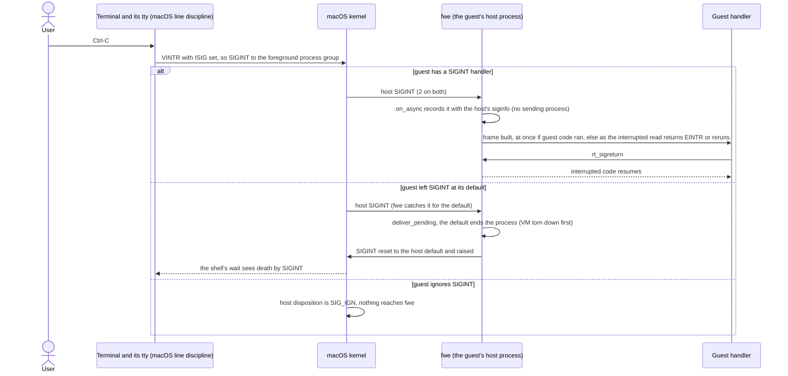

#### Key strokes

| On macOS | What fwe does | What the guest sees |
|---|---|---|
| Ctrl-C (`VINTR`, with `ISIG`): `SIGINT` to the foreground group | relayed (sequence above) | `SIGINT` |
| Ctrl-\\ (`VQUIT`): `SIGQUIT` | relayed; a default ends the process with the host `SIGQUIT` | `SIGQUIT`; no Linux core file |
| Ctrl-Z (`VSUSP`): `SIGTSTP` (18) | relayed as 20; a default stop is fwe's: it stops itself with the host `SIGTSTP` | `SIGTSTP`; the shell sees the job stopped by `SIGTSTP` |
| `fg`/`bg`: `SIGCONT` (19) | the host continues the process; a guest handler is entered | `SIGCONT` (18) |
| Ctrl-T (`VSTATUS`, macOS only, in canonical mode): `SIGINFO` to the foreground group | `SIGINFO` is the kill relay | death by `SIGKILL` |
| Ctrl-D, Ctrl-S/Ctrl-Q, erase, kill, `VLNEXT` and the rest of canonical editing | done by the host's line discipline as the guest's `termios` sets it | the edited line; `read` returns 0 at end of file |
| a background job reads (or, with `TOSTOP`, writes) the terminal: `SIGTTIN`/`SIGTTOU` | relayed; a default stop is fwe's, as for `SIGTSTP` | the job stops |
| the window resized: `SIGWINCH` | relayed | `SIGWINCH`; `TIOCGWINSZ` the new size |

#### termios and terminal requests

| Linux | macOS | fwe (`crates/kernel/src/term.rs`, `sys_ioctl`) |
|---|---|---|
| `TCGETS`, `TCSETS`/`TCSETSW`/`TCSETSF` | `tcgetattr`, `tcsetattr(TCSANOW / TCSADRAIN / TCSAFLUSH)` | translated field by field |
| 32-bit flag words | 64-bit `tcflag_t`, other bit positions | each flag Linux and macOS share mapped by name; `CSIZE` mapped |
| `c_cc[19]` in Linux's order | `c_cc[20]` in another order, with `VSTATUS` and `VDSUSP` | the 16 characters both have mapped by name; a guest's `TCSETS` writes the macOS-only ones as 0, which macOS takes as the NUL character (its "disabled" value is `0xff`) |
| baud in `c_cflag` | `c_ispeed`/`c_ospeed` | reported as `B38400`; set to 38400 |
| `TIOCGWINSZ`, `TIOCSWINSZ` | the same | passed through |
| `TIOCGPGRP`, `TIOCSPGRP` | `tcgetpgrp`, `tcsetpgrp` | the group mapped through the pid namespace; one not in it is `EPERM` |
| `TIOCSCTTY`, `TIOCNOTTY` | the same | passed through |
| a terminal request on something that is not a terminal | `ENODEV` (`/dev/null`) or `EOPNOTSUPP` | `ENOTTY`, as Linux answers |

#### Job control and ptys

| Linux | macOS | fwe |
|---|---|---|
| process groups and sessions (`setpgid`, `setsid`, `getpgid`, `getsid`) | the host's | the host's, with ids mapped through the guest's pid namespace; fwe records each process's group |
| the foreground group, the controlling terminal | the host tty's | the host tty's, so a host shell and a guest shell share job control |
| `/dev/ptmx`, `TIOCGPTN`, `TIOCSPTLCK`, `/dev/pts/N` | `posix_openpt`, `grantpt`, `unlockpt`, `ptsname`, `/dev/ttysNNN` | `/dev/ptmx` allocates with `posix_openpt` and numbers the slave; `TIOCGPTN` returns that number; `TIOCSPTLCK` is accepted (the slave is unlocked already); `/dev/pts/N` opens the host slave (`crates/kernel/src/pty.rs`) |

### Children ending

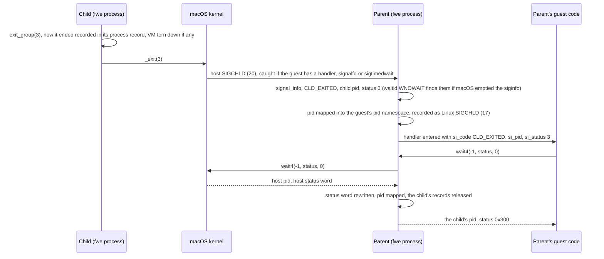

| On macOS | What fwe does | What the guest sees |
|---|---|---|
| a child exited with code *n* | status word kept | `n << 8` |
| a child killed by a host signal | the signal mapped (`host::signal_to_linux`), the core bit kept | Linux's signal number, `0x80` if a core was dumped |
| a child stopped | the stop signal mapped | `sig << 8 \| 0x7f` |
| a child continued | — | `0xffff` |
| a guest child ended by a Linux-only signal | it exited with 128 + the signal | exit status 128 + the signal |
| `SIGCHLD` `siginfo`: `CLD_KILLED`/`CLD_DUMPED`/`CLD_STOPPED` | `si_status` mapped to Linux's signal | Linux's signal number |
| `SIGCHLD` `siginfo`: `CLD_CONTINUED` | `si_status` is what stopped it on macOS; set to what continued it | `SIGCONT`, as Linux reports |
| `rusage` from `wait4` | `ru_maxrss` from bytes to KiB | Linux's `rusage` |
| `waitid` | the host gives no `rusage` | zero-filled `rusage` |
| the guest ignores `SIGCHLD`, or set `SA_NOCLDWAIT` | the host reaps the children itself | no zombies, as on Linux |
| the parent ends | the child goes to `launchd` on the host | its Linux adopter, below; `PR_SET_PDEATHSIG` is not sent ([limitations](architecture.md#known-limitations)) |

#### Orphans and reapers

Linux gives an orphan to its nearest child subreaper
(`PR_SET_CHILD_SUBREAPER`) or its pid namespace's init. macOS gives every
orphan to `launchd`, and only a parent may `wait` for a process. fwe keeps
the adoption itself (`crates/kernel/src/reaper.rs`):

- each process record holds its line of ancestors and whether it is a
  subreaper, so `getppid` and `/proc/<pid>` name the adopter;
- a process that ends where a reaper might adopt it records how it ended
  (one killed by `SIGKILL` is recorded by whoever finds it gone);
- a reaper runs a watcher thread on `kqueue` process events and raises
  `SIGCHLD` in itself for an adopted descendant's end, stop or continue,
  with a child's `siginfo`, and wakes its threads waiting in `wait`;
- its `wait` looks at its own children, then the adopted ones.

### A process killed from the host

| On macOS | What fwe does | What the guest sees |
|---|---|---|
| `kill -TERM <pid>` (or `-INT`, `-HUP`, `-USR1` …) from a host shell or any process fwe does not run | a host signal like any other; the sender is a host pid with no note | the signal, `si_code` `SI_USER`, `si_pid` the sender in the initial pid namespace (0 from inside a nested one), `si_uid` 0 if it runs as fwe's user, else 65534 |
| `kill -9` of a native process | none: the host ends it at once, no handler runs | its parent sees death by `SIGKILL`; a reaper that finds it gone records it |
| `kill -9` of a VM process | none: it ends with its VM alive, which can bring the machine down ([hypervisor.md](hypervisor.md#never-end-a-vm-process-abnormally)) | — |
| `kill -INFO <pid>` | the kill relay: `SIGKILL`, the VM torn down first | death by `SIGKILL` |
| `kill -EMT <pid>` | the wake signal: only interrupts | nothing |
| `kill -STOP`, `kill -CONT` | the host's own | the process stops and continues; a parent's `wait` with `WUNTRACED` sees the stop by `SIGSTOP` (19) |
| `kill -SEGV <pid>` (a fault signal) from a process fwe does not run | macOS gives it the thread's last fault, and no note says it was sent | taken as a fault ([limitations](architecture.md#known-limitations)) |

### Files changing on the host

| On macOS | What fwe does | What the guest sees |
|---|---|---|
| an fwe process changes, opens, reads or closes a watched file | raises Linux's inotify events from its own calls | the events |
| a program fwe does not run changes a watched file | nothing: no host event names it as Linux's events do | no inotify event |
| a host process writes a file the guest mapped `MAP_SHARED` | the mapping is a host shared mapping (native) or a segment of one (VM) | the change |
| a host process writes a file the guest mapped privately | native: a host private mapping; VM: a copy taken when mapped | native: as the host shows it; VM: never |
| a host process holds a POSIX record lock or an OFD lock | guest locks are host locks | the conflict |
| a file owned by another host user | owner translated | owner 65534 |
| a file fwe's user owns | owner translated | owner 0 (root) |
| the host's own extended attributes (`com.apple.*`) | not listed | only Linux's namespaces |
| a guest's working directory renamed by another process | fwe keeps the path ([limitations](architecture.md#known-limitations)) | the old path |

### Network events

Guest sockets are host sockets: connections, data and the ports in the
initial network namespace are the host's, shared with every host program.

| On macOS | What fwe does (`crates/kernel/src/epoll.rs`) | What the guest sees |
|---|---|---|
| a `kqueue` read filter fires | `EVFILT_READ` → `EPOLLIN` | `EPOLLIN` |
| a write filter fires | `EVFILT_WRITE` → `EPOLLOUT` | `EPOLLOUT` |
| `EV_EOF` on a socket's read filter (peer shut its writing side) | readable, and so marked | `EPOLLIN \| EPOLLRDHUP`, with `EPOLLHUP` for a Unix socket (Linux shuts both ways) |
| `EV_EOF` on both of a socket's filters | hung up | `EPOLLHUP` added |
| `EV_EOF` on a pipe's or terminal's read filter | hung up, readable while data is left | `EPOLLHUP`, `EPOLLIN` while data is left |
| `EV_EOF` on a pipe's write filter (readers gone) | an error to write | `EPOLLOUT \| EPOLLERR` |
| `EV_ERROR` | — | `EPOLLERR` |
| a FIFO's last writer gone (macOS reports nothing) | `select` asked between short slices | `POLLHUP`/`EPOLLHUP` |
| readiness on an `O_ASYNC` descriptor: host `SIGIO` with no sender | the descriptor and its events found with `poll`; sent as the signal `F_SETSIG` chose, to the owner thread if one is set | that signal with `si_fd`, `si_band` and `POLL_IN`/`POLL_OUT`/`POLL_PRI`/`POLL_HUP` |
| out-of-band data: `SIGURG` (16) | relayed | `SIGURG` (23) |
| reading an unconnected Unix stream socket: `ENOTCONN` | Linux's answer | `EINVAL` |
| an interface or route changes | no netlink outside an fwe network namespace (`EOPNOTSUPP`) | nothing |
| the host's DNS settings | not read: the resolver reads the rootfs's `/etc/resolv.conf` and `/etc/hosts` | the rootfs's |

### Clocks and timers

| On macOS | What fwe does | What the guest sees |
|---|---|---|
| the host's realtime clock, set by the user or NTP | `CLOCK_REALTIME`, `TAI`, `*_COARSE`, `*_ALARM` read it | the host's time; the guest cannot set it (`EPERM`) |
| the host's monotonic clocks | `MONOTONIC`, `BOOTTIME` and their variants read `CLOCK_MONOTONIC`; `MONOTONIC_RAW` reads `CLOCK_MONOTONIC_RAW` | the host's |
| a host thread's or process's CPU time | the CPU-time clocks | its CPU time |
| an interval timer expiring | relayed signal | `SIGALRM`, `SIGVTALRM`, `SIGPROF` |
| a timerfd's `EVFILT_TIMER` firing | counted | a readable timerfd and its expiration count, to the millisecond |
| a sleep interrupted by a signal the guest handles | `nanosleep`, `clock_nanosleep` are not restarted | `EINTR` |
| VM: the guest reads the counter | `CNTVCT_EL0` is the vCPU's virtual counter; a `CNTPCT_EL0` read is emulated from it | one counter, as on Linux |

### Memory pressure

| On macOS | What fwe does | What the guest sees |
|---|---|---|
| free memory, compression, swap | not read | `/proc/meminfo` and `sysinfo` report fixed values: 8 GiB total, 4 GiB free, 6 GiB available, no swap |
| a host `mmap` that cannot be satisfied | `ENOMEM` | `ENOMEM` |
| the guest stack running into its guard page | a fault | `SIGSEGV` |
| no OOM killer (Linux ranks processes to kill) | `oom_score_adj` kept per process, `oom_score` derived from it | the files, with Linux's rules for writing them |
| `mlock` | pages brought in, not wired | success within `RLIMIT_MEMLOCK` |

### Errors

Host calls fail with macOS's `errno`; `host::errno_to_linux` turns each
into the Linux errno of the same meaning, by a table searched in order:

| On macOS | What the guest sees |
|---|---|
| an errno both have (`ENOENT`, `EAGAIN`, `ECONNREFUSED`, …), whatever its number on each | the Linux number of the same name |
| `ENOTSUP` (macOS's, beside `EOPNOTSUPP`) | `EOPNOTSUPP` |
| `ENOATTR` (no such extended attribute) | `ENODATA` |
| an errno Linux has no equivalent of (`EAUTH`, `EBADRPC`, `EPWROFF`, …) | `EIO` |
| `ENODEV` or `EOPNOTSUPP` from a terminal request on a non-terminal | `ENOTTY` (`host::tty_error`) |

Where the two kernels give different errors for the same case, the call
answers as Linux does: reading an unconnected Unix stream socket is
`EINVAL` rather than `ENOTCONN`, `epoll_ctl` checks its arguments in
Linux's order, a kill of another process with a real-time signal is
`EINVAL`, and so on; each is documented with its call in
[architecture.md](architecture.md).

### Host identity and machine state

| On macOS | What fwe does | What the guest sees |
|---|---|---|
| the user fwe runs as (uid 501, say) | is root in the guest, as in a rootless container's user namespace (`host::uid_to_linux`) | its own ids are virtual, root by default, with every capability but `CAP_SYS_TIME`; files fwe's user owns are owned by 0 |
| fwe's own group | `host::gid_to_linux` | group 0 |
| every other host user and group | `OVERFLOW_ID` | 65534 (`nobody`) |
| the host name (up to 255 bytes) | cut to Linux's 64 (`ns::host_name`) | `uname`'s `nodename`, `/proc/sys/kernel/hostname`; `sethostname` in the initial UTS namespace fails with `EPERM` |
| the macOS kernel | not shown | `uname`: `Linux`, `6.12.0-fwe`, `#1 SMP PREEMPT`, `aarch64` |
| host pids | used as guest pids in the initial pid namespace | host pids; `/proc` lists only fwe's processes |
| online CPUs (`sysconf`) | counted | `/proc/cpuinfo`, `/proc/stat`, `sched_getaffinity`, `sysinfo` |
| CPU features (`hw.optional.*`) | `AT_HWCAP`/`AT_HWCAP2` ([auxv](#auxv-hwcaps-and-the-vdso)) | the hwcaps; `/proc/cpuinfo` lists `fp asimd` |
| boot time, uptime, load averages, per-CPU times | read from the host | `/proc/uptime`, `/proc/loadavg`, `/proc/stat`, `sysinfo` |
| another process's state, times and memory (`proc_pidinfo`) | read from the host | `/proc/<pid>/stat` and the like |
| a filesystem's type and sizes (`statfs`) | type reported as ext4 | ext4, the host's sizes |
