# Linux on macOS

## Summary

fwe runs Linux programs built for arm64 on a Mac with Apple Silicon. Both
sides use the same processor, so a Linux program's instructions can run
on the Mac's CPU as they are. What differs is everything around the
instructions: the two kernels. A Linux program asks the Linux kernel for
files, memory, processes and signals in Linux's terms, and expects to hear
back in Linux's terms about key strokes, children ending, data arriving and
errors. fwe stands in for that kernel. It catches each request the program
makes, carries it out with what macOS offers, and turns whatever macOS
reports back into what Linux would have said.

fwe does this one of two ways, and picks the way per program:

- **The native backend** runs the program inside the fwe process itself.
  Before any of the program's code may run, fwe rewrites the few
  instructions macOS cannot let a Linux program execute unchanged: the
  system-call instruction, accesses to the thread pointer, and uses of the
  `x18` register. Everything else runs unmodified on the CPU.
- **The VM backend** runs the program in a small virtual machine made with
  macOS's Hypervisor.framework. There the program has an address space of
  its own and nothing is rewritten; each system call leaves the VM and is
  served by the same code as in the native backend. fwe uses it only for
  programs the native backend cannot place in memory: non-position-
  independent executables linked below 4 GiB.

This document explains how that works, in two directions:

- **[Linux to macOS](#linux-to-macos)**: what the guest asks for (a system
  call, an instruction, an address) and what it becomes on the host. For
  each Linux primitive: what Linux does, what macOS has, and what fwe does
  to bridge them.
- **[macOS to Linux](#macos-to-linux)**: what happens on the host (a
  signal, a key stroke, a child ending, a file changing, a clock firing, an
  error) and what the guest sees of it.

Before those two parts, an overview of the two kernels and five sections
on how a program gets to run at all: which backend a binary gets and why,
which binaries need the least translation (with examples of real software
in each category), how common languages and runtimes fare, which
instructions the native backend rewrites, and how the VM backend uses the
hypervisor.

How fwe's own parts are built is in [architecture.md](architecture.md);
where fwe still differs from Linux is in its
[known limitations](architecture.md#known-limitations); running the VM
backend, its safety rules and its tests are in
[hypervisor.md](hypervisor.md).

## Contents

- [Two kernels, one CPU](#two-kernels-one-cpu)
- [Which binaries run where, and why](#which-binaries-run-where-and-why)
- [Which binaries need the least translation](#which-binaries-need-the-least-translation)
- [Languages and runtimes](#languages-and-runtimes): C and C++, musl,
  Rust, Go, Python, Node.js, Java, Wine
- [Which instructions get translated, and how](#which-instructions-get-translated-and-how)
- [How the VM is actually used](#how-the-vm-is-actually-used)
- [Linux to macOS](#linux-to-macos)
  - [The CPU](#the-cpu): system call entry and return, registers and
    errno, TLS, `x18`, cache maintenance, PAC and BTI, auxv and hwcaps,
    the vDSO
  - [Memory](#memory): layouts, pages and translation, the `mmap` family,
    write+exec memory, shared memory
  - [Processes](#processes): `fork`, `vfork`, threads and futexes,
    `execve`, the ELF loader, `wait`
  - [Signals](#signals): numbers, dispositions, masks and frames, sending
  - [Files and descriptors](#files-and-descriptors), [/proc, /sys and
    /dev](#proc-sys-and-dev)
  - [Waiting and events](#waiting-and-events): `epoll`, `eventfd`,
    `timerfd`, `signalfd`, inotify
  - [IPC](#ipc): sockets, System V IPC, POSIX message queues, keyrings
  - [Kernel-wide state](#kernel-wide-state),
    [namespaces](#namespaces), [cgroups](#cgroups), [mounts](#mounts),
    [credentials and capabilities](#credentials-and-capabilities),
    [seccomp](#seccomp), [devices](#devices)
  - [Time, scheduling and limits](#time-scheduling-and-limits)
  - [Not available](#not-available)
- [macOS to Linux](#macos-to-linux)
  - [Host signals](#host-signals): how one reaches a guest handler,
    `siginfo` and senders, signals with no counterpart, each signal's
    source
  - [Faults in guest code](#faults-in-guest-code)
  - [Terminals and key strokes](#terminals-and-key-strokes): Ctrl-C,
    Ctrl-Z, Ctrl-\\, Ctrl-T, window size, `termios`, job control, ptys
  - [Children ending](#children-ending): `SIGCHLD`, wait statuses,
    [orphans and reapers](#orphans-and-reapers)
  - [A process killed from the host](#a-process-killed-from-the-host)
  - [Files changing on the host](#files-changing-on-the-host)
  - [Network events](#network-events)
  - [Clocks and timers](#clocks-and-timers)
  - [Memory pressure](#memory-pressure)
  - [Errors](#errors)
  - [Host identity and machine state](#host-identity-and-machine-state)

## Two kernels, one CPU

Every guest process is one host process: a copy of `fwe` that holds the
guest's code and memory and a Linux kernel of its own making, the *kernel
crate*. The guest's code talks to the kernel crate through a *backend*,
which catches the guest's system calls and delivers signals into it; the
kernel crate talks to macOS through ordinary C library calls. Other fwe
processes are other guest processes, and what Linux keeps in one kernel
for all of them (mount tables, namespaces, IPC objects) fwe keeps in
records they share.

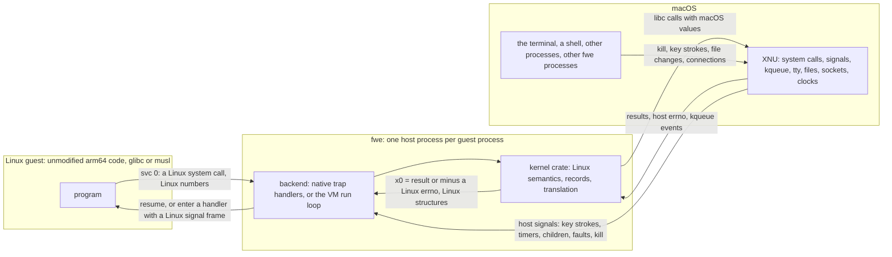

Because both sides are arm64, only what the two kernels define differently
has to be bridged: the system-call interface, a few registers macOS
reserves, the address space, every kernel object macOS lacks or shapes
differently, and every event macOS reports in its own terms. The two
backends bridge the first three differently and share the rest; the table
sums up where they differ, and the next sections explain each row.

| | Native backend | Hypervisor (VM) backend |
|---|---|---|
| Runs | every position-independent program, and `ET_EXEC` images linked at or above 4 GiB | non-PIE executables linked below 4 GiB |
| Guest code | in the `fwe` process, on the CPU, after rewriting | at EL0 in a Hypervisor.framework VM, unmodified |
| Page size the guest sees | 16 KiB (the host's) | 4 KiB (Linux's usual) |
| Guest addresses | host addresses | host addresses, except fixed-address ranges outside the memory fwe set aside for the VM (the *slab*), such as a low-linked image, which are translated |
| System calls go to | the kernel crate | the same kernel crate |
| Host signals reach the guest | handler rewrites the interrupted guest context | handler stops the vCPU, the run loop delivers |

## Which binaries run where, and why

fwe picks a backend for each program from its ELF headers alone. The
reason lies in how the two kernels lay out a process's memory.

### The low 4 GiB

On Linux, an arm64 process owns its whole lower address space. A program
that is not position-independent (an `ET_EXEC` ELF file) was linked to run
at one fixed address and carries no relocations that would let it run
anywhere else; the usual toolchains put it at `0x400000` (4 MiB), and Go
puts static programs at `0x10000` (64 KiB).

macOS gives every arm64 process a mandatory 4 GiB `__PAGEZERO` at address
0: nothing can be mapped below 4 GiB, and Apple's loader refuses a smaller
`__PAGEZERO` on Apple Silicon. Since the native backend runs the guest
inside the fwe process, at the addresses the guest uses, a program linked
below 4 GiB has nowhere to go there. Everything else does: a
position-independent program (`ET_DYN`, a PIE) can be placed wherever
macOS has room, and an `ET_EXEC` program linked at or above 4 GiB can be
placed at its own address.

### How fwe decides

When fwe starts a program it reads the ELF file and asks one question
(`needs_vm` in `crates/native/src/lib.rs`): is this a non-PIE executable
whose lowest loaded page lies below 4 GiB? If so, it runs in the VM; if
not, natively. Nothing else about the program matters: static or dynamic,
glibc or musl, C, Rust or Go.

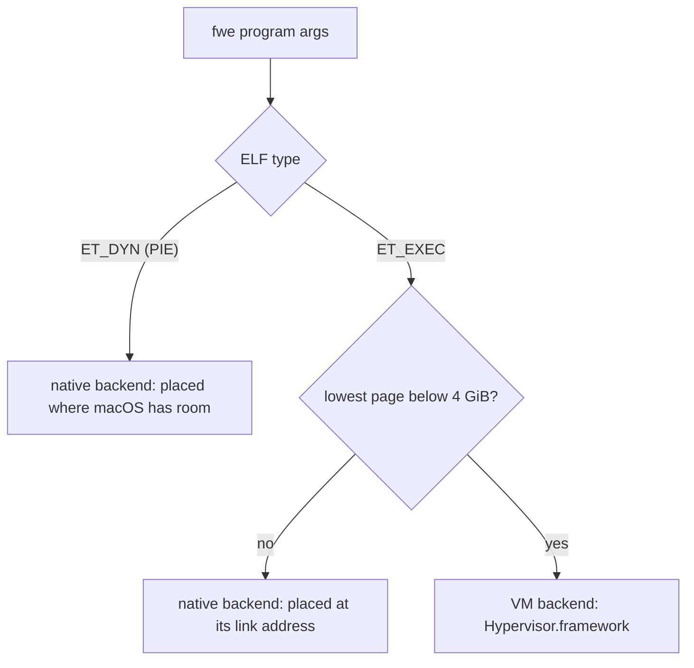

| Binary | Example | Backend |
|---|---|---|
| dynamic PIE | Debian's `bash`, `git`, coreutils, Node.js | native |
| static PIE | `musl-gcc -static-pie`, Rust's `+crt-static` with PIE | native |
| static non-PIE linked at or above 4 GiB | fwe's own test guests, linked at 1 TiB (`--image-base=0x10000000000`) | native |
| non-PIE linked below 4 GiB, dynamic | Debian's `python3.11`, GCC and clang, at `0x400000` | VM |
| non-PIE linked below 4 GiB, static | static Go programs at `0x10000`; fwe's "rust-low" test guests | VM |

"Low-linked" in this documentation and the tests means the last two rows.
fwe's test suite builds its Rust guests twice: once at 1 TiB to run
natively, and once at the toolchain's default (low) address, as
`target/guests/rust-low`, to exercise the VM backend with the same
programs.

The VM backend needs `fwe` signed with the hypervisor entitlement and a
bare-metal Mac. Without it, a low-linked program fails to start with a
message saying so and status 126 ([hypervisor.md](hypervisor.md#running-it-apple-silicon-no-root)).

### The dynamic linker

A dynamically linked program names its dynamic linker in a `PT_INTERP`
header (`/lib/ld-linux-aarch64.so.1` for glibc,
`/lib/ld-musl-aarch64.so.1` for musl). Linux loads both and starts the
dynamic linker, which then maps the program's libraries. fwe does the
same in both backends: it resolves the interpreter in the guest's root
filesystem, loads it beside the program and starts there, with `AT_BASE`
and `AT_ENTRY` set as Linux sets them. Dynamic linkers are always
position-independent, and fwe requires that (`ELIBBAD` from an `execve`
otherwise), so the interpreter never decides the backend: only the
program does. The libraries the dynamic linker maps later are PIC shared
objects, mapped through fwe's `openat` and `mmap` like any file; in the
native backend their code is rewritten as it is mapped executable.

### Across execve

A program can `execve` a program of the other kind: a shell in the VM can
run a native `ls`, and a native `make` can run a low-linked `gcc`. When
the new program needs the VM, when the caller is itself in the VM, or when
the caller has other live threads, fwe re-executes itself on the new
program: the host process image is replaced by a fresh `fwe`, which makes
the same decision again for the new program. A single-threaded native
process execing another native program replaces its program in place. What
crosses an `execve` either way is under [execve](#execve).

## Which binaries need the least translation

Every guest pays for the system calls it makes, since each one leaves
guest code and enters fwe. Beyond that, how much work fwe does for a
program depends on what kind of program it is, and the two backends charge
for different things. None of this changes what a program computes; it
changes how much fwe does at load time and how often the guest stops
running its own code.

### What the native backend charges for

Natively, cost comes from preparing code and from instructions that cannot
stay as they are:

- **Preparing code is a one-time scan.** Every executable section the
  program and its libraries map is scanned once, word by word, when it is
  mapped executable. A static program has one image to scan; a dynamic one
  also has its dynamic linker and every library it maps. Under `--strace`
  fwe notes what it found in the program and its dynamic linker as
  `prepared exe <addr>+<len>: N system calls, M stubs, K x18 uses left
  unrewritten` (`interp` for the dynamic linker).
- **`svc #0` costs nothing extra to rewrite**: it is replaced in place by
  one `brk` word, no stub. It does cost a trap each time it runs, which is
  the system call's own cost.
- **Thread-pointer and `x18` instructions need stubs.** Each `mrs`/`msr`
  of `TPIDR_EL0` and each instruction naming `x18` becomes a branch to a
  short stub and back: a few extra instructions every time it runs, no
  trap. Code that reads the thread pointer in a hot loop (thread-local
  variables) runs a few instructions slower there; code that uses `x18` as
  a general register (rare: Linux toolchains seldom allocate it) pays per
  use, and a few `x18` forms cannot be rewritten at all (counted as
  "left unrewritten", see [what is not translated](#what-is-not-translated)).
- **A trapped register read costs a host signal.** `mrs` of `CTR_EL0` traps
  on macOS and is emulated in fwe's `SIGILL` handler: code that reads it
  once (C libraries do, at startup) loses nothing, code that reads it
  often pays a trap each time.
- **Write+exec memory costs page flips.** A JIT compiler that maps memory
  writable and executable gets each page made executable on its first
  instruction fetch (with its code prepared) and writable again on its
  next write: two faults per round trip on one page
  ([Write+exec memory](#writeexec-memory)). JITs that keep writing code
  and data into the same pages pay for every switch.
- **`fork` is a host `fork`** with copy-on-write memory, after fwe has
  paused the parent's other guest threads ([fork](#fork)).
- **An image without section headers or unwind tables** is scanned whole,
  which is slower and less precise ([what is scanned](#what-is-scanned)).

### What the VM backend charges for

In the VM nothing is rewritten and nothing is scanned: the program's code
is loaded as it is and runs as it is. The costs move elsewhere:

- **Every system call is a VM exit**: the guest's `svc` enters fwe's
  vector, which leaves the VM, and fwe reads and writes the vCPU's
  registers through the framework before and after the call.
- **Every exception leaves the VM too**: faults, `brk`, a trapped
  `CNTPCT_EL0` read, `wfi`/`wfe`.
- **Memory calls edit page tables**, and one that takes access away
  (`munmap`, a narrowing `mprotect`) has every vCPU invalidate its TLBs
  before it resumes.
- **A private file mapping is a copy** of the file's data taken when it is
  mapped, rather than a host mapping of the file.
- **`fork` starts a new fwe process and sends it a copy of every page of
  guest memory that exists**, with the parent's vCPUs stopped while it is
  sent; `vfork` fetches pages on first touch instead ([fork](#fork)).
- **`execve` always re-executes fwe**, with a new VM.
- A JIT's write+exec memory and `x18` cost nothing extra here.

### Choosing, and what runs best

Since fwe picks the backend from the binary, the practical choice is how a
program is built. The table sets the two backends' costs side by side,
trait by trait.

| Program trait | Native | VM |
|---|---|---|
| static | one image prepared | loaded as is |
| dynamic | the dynamic linker and each library prepared as mapped | loaded as is; private file mappings copied |
| system call | a `brk` trap, a host signal handler | a vCPU exit and register transfers |
| thread-local variables (`TPIDR_EL0`) | a stub branch per access | the hardware register |
| code using `x18` | a stub branch per use; a few forms unrewritten | the hardware register |
| reading `CTR_EL0` | a trap per read | read by the guest |
| reading `CNTPCT_EL0` | read by the guest | a trap per read (`CNTVCT_EL0` is direct) |
| JIT, write+exec pages | a fault per switch between writing and running | no faults |
| `mmap`/`munmap` heavy | host calls | page-table edits, TLB invalidation on unmap |
| `fork` heavy | host `fork`, copy-on-write | new process, all memory copied |
| `posix_spawn`/`vfork` + `exec` | host `fork` sharing memory, then an in-place or re-exec `execve` | new process fetching pages, then a re-exec |

A program runs with the least translation when it is position-independent
(so it runs natively, where a system call does not leave a VM), keeps its
code apart from its data in sections the unwind table describes (as
compiler output does), leaves `x18` alone, and does not switch pages
between writing and executing. A program that only runs in the VM pays
nothing for its code, and its costs grow with how often it makes system
calls, maps and unmaps memory, and forks.

### Examples

The table puts real software in each of these categories. Most of it is
what fwe's end-to-end tests run (`crates/fwe/tests/guests.rs`, with the
binaries described in `guests/debian/README.md`, `guests/alpine/README.md`
and the fetch manifests beside them); the rows marked "not tested by fwe"
name software only for a well-known property that puts it in the
category, not as a claim that it runs.

| Category | Software | Why it is there |
|---|---|---|
| native, little rewriting | Debian's coreutils, bash, git, SQLite, lighttpd, apt (tested) | dynamic PIEs against glibc: the program, `ld-linux` and each library are scanned once as mapped; the rewrites are their system calls and thread-pointer accesses |
| native, Go built as PIE | Alpine's podman and containerd (tested) | Alpine builds its packages position-independent, Go programs included, so they run natively; Debian's podman, containerd and runc are non-PIE and would need the VM |
| native, C with musl | Alpine's crun, busybox from the Alpine root (tested) | musl PIEs; crun runs its sealed copy from a memfd, which fwe's `execveat` supports |
| native, many libraries | Debian's Rust toolchain: `cargo`, `rustc` with its LLVM library (tested) | a large dynamic PIE: preparation scans a few very large libraries once each |
| native, JIT | Debian's Node.js 18 with V8 (tested) | V8's generated code is prepared as JIT code each time it becomes executable (system calls and thread-pointer accesses only); OpenSSL's assembly in the same process keeps constant tables among its code, which the unwind-table rule leaves alone |
| native, JIT | the JVM (not tested by fwe) | a JIT compiler with a large code cache and many threads; see [Java](#java-and-the-jvm) |
| VM, interpreter | Debian's Python 3.11 (tested) | Debian links it non-PIE at `0x400000`; its C extension modules are loaded as they are |
| VM, compilers | Debian's GCC 12 (`gcc`, `cc1`, `collect2`) and clang 14 (tested) | non-PIE, linked low; GNU `as` and `ld`, which they run, are PIEs and run natively, so every compiler stage is an `execve` between the backends |
| VM, Go toolchain | Debian's Go 1.19: `go`, `compile`, `link`, and the static executables it builds by default (tested) | linked low, non-PIE; the `go` command starts its tools with `vfork` |
| fork and exec heavy | bash scripts, `apt` running `dpkg`, the GCC driver, the `go` command (tested) | each child is a host `fork` (native) or a new fwe process (VM); each `execve` that changes backend, or starts in the VM, re-executes fwe |
| system-call heavy | lighttpd serving files and CGI, git (tested) | many small reads, writes and `epoll` waits: each is a trap natively or a VM exit |
| uses `x18` as Linux allows | hand-written assembly that allocates it (rare in compiler output); Wine on arm64, which keeps the Windows thread block in `x18` (not tested by fwe) | natively each use goes through a stub, and JIT code's uses are not rewritten; in the VM `x18` is the guest's own |

## Languages and runtimes

fwe runs machine code and makes no distinction between languages. What
differs between them is how their programs are linked (which decides the
backend) and how their runtimes use the kernel: threads, signals, memory
and code generation. This section takes common languages and runtimes in
turn and says how fwe meets what each needs. Where something is not
tested by fwe, the text says so and infers only from mechanisms the code
has.

### C and C++ on glibc

The common case: a dynamically linked PIE naming `/lib/ld-linux-aarch64.so.1`.
fwe loads the program and glibc's dynamic linker
([The dynamic linker](#the-dynamic-linker)), and from there glibc runs as
it would on Linux: `ld.so` reads `/etc/ld.so.cache` and the libraries from
the guest's root filesystem, maps them with fwe's `mmap`, applies
relocations and RELRO, and sets up thread-local storage with `msr
tpidr_el0`, which the native backend rewrites. The guest's environment is
fwe's own, and `AT_SECURE` is 0, so `LD_LIBRARY_PATH`, `LD_PRELOAD` and
the rest act as on Linux. There is no vDSO, so `clock_gettime` and
`gettimeofday` are real system calls. A non-PIE glibc program linked low
runs the same way in the VM (tested with a small program of that shape
and with Debian's Python, GCC and clang). C++ adds nothing fwe sees:
`libstdc++` is one more library, and exceptions unwind in user space.

### musl and Alpine

A musl program names `/lib/ld-musl-aarch64.so.1`, which is musl's C
library and dynamic linker in one; static musl programs have no
interpreter at all. Both run natively when position-independent, as all
of Alpine's are (tested: Alpine's root filesystem, busybox and the
container engines). musl enters the kernel through the same `svc #0` as
glibc, so fwe treats the two alike.

### Rust

Rust programs are C-like to fwe. The default target
(`aarch64-unknown-linux-gnu`) builds dynamic PIEs against glibc, which run
natively; Debian's `rustc` and `cargo` are such programs and build and
test a project under fwe (tested). A static build for
`aarch64-unknown-linux-musl` is a PIE or not depending on how it is
linked: fwe's own test guests are static musl programs linked directly
with `ld.lld`, non-PIE, and they run natively only because they are given
an image base at 1 TiB; built again at the default address, as the
"rust-low" guests, they need the VM (both tested). Rust's standard library
uses threads and futexes through libc, both covered.

### Go

Go does not use the C library: its runtime makes system calls itself with
`svc #0`, starts its own threads with `clone`, parks them on futexes,
installs a handler for nearly every signal on an alternate stack, and preempts
long-running goroutines by sending the thread running them `SIGURG` with
`tgkill`. fwe meets each of these the same way as for C: the `svc`s are
rewritten (native) or trapped (VM), `clone` makes a host thread (with its
own vCPU in the VM), and a `tgkill` of a caught signal is posted to that
thread directly and the thread woken ([Sending a
signal](#sending-a-signal)), which in the VM stops its vCPU even in a
loop with no system calls.

Which backend a Go program gets depends on how it was linked. Debian's Go
1.19 toolchain is linked low, non-PIE, as are the static executables it
builds by default: all run in the VM (tested: the `go` command builds,
runs and tests a module with goroutines). Go programs built as PIEs, as
Alpine builds podman and containerd, run natively (tested). The `go`
command starts its tools with `vfork`, which fwe supports in both
backends.

### Python and other interpreters

An interpreter is an ordinary program to fwe; the scripts it runs are
data. Debian's Python 3.11 is linked non-PIE at `0x400000`, so it runs in
the VM, and its test covers C extension modules, threads, sockets,
asyncio, `ctypes` and libffi closures, signals, `fork`, `subprocess` and a
process pool sharing POSIX semaphores through `/dev/shm`. A Python built
as a PIE would run natively. bash, an interpreter of shell scripts, runs
natively (tested).

### Node.js and V8

Debian's Node.js 18 is a dynamic PIE and runs natively (tested: V8's JIT
on a hot function, ICU, OpenSSL digests, zlib, timers and promises, a
child process, an HTTP server and client, and a worker thread). V8
generates code at run time; each time a page of it becomes executable,
fwe prepares it as JIT code: system calls and thread-pointer accesses are
rewritten, `x18` is not, which suits V8 since it reserves `x18`
([What is scanned](#what-is-scanned)).

### Java and the JVM

Not tested by fwe. What follows is inferred from how a HotSpot JVM is
generally built and from fwe's mechanisms, not observed:

- **Backend:** a `java` launcher built as a PIE, as Debian builds its
  programs by default, would run natively; the JVM itself is a shared library (`libjvm.so`).
- **JIT code:** HotSpot generates code into a code cache. Natively, each
  page becomes executable through an `mprotect` or a write+exec fault,
  and is then prepared as JIT code. If its generated code uses `x18`
  (HotSpot treats `x18` as reserved only on platforms that reserve it,
  which Linux does not), those uses are not rewritten and would lose their
  value whenever macOS clears `x18`; this is the largest risk natively.
  In the VM, generated code would run as it is, but a PIE `java`
  launcher never goes to the VM.
- **Safepoints and null checks:** HotSpot relies on `SIGSEGV` from
  deliberately protected pages. fwe delivers a guest fault to the guest's
  handler with Linux's frame, and turns the `SIGBUS` macOS reports for
  some protection faults into the `SIGSEGV` Linux sends
  ([Faults in guest code](#faults-in-guest-code)).
- **Threads and memory sizing:** many threads with futexes are supported.
  The JVM sizes its heap from the machine's memory (`sysinfo`,
  `/proc/meminfo`) and cgroup limits, which under fwe are fixed figures and
  unenforced limits
  ([Memory pressure](#memory-pressure), [cgroups](#cgroups)).
- **Tools:** debugging and attach mechanisms that use `ptrace` or
  `process_vm_readv` fail with `ENOSYS` ([Not available](#not-available)).

### Wine

Not tested by fwe yet (it is on the
[roadmap](../ROADMAP.md#m4--compatibility)). This is an analysis of how
Wine for Linux would meet fwe's mechanisms, from how Wine is generally
built, not a claim that it works.

- **Which Wine:** fwe runs only arm64 Linux code, so it would have to be
  an arm64 build of Wine, which runs Windows programs built for ARM64.
  Running x86 or x64 Windows programs would additionally need an x86
  emulator inside the arm64 process (Wine on arm64 can load one, such as
  FEX, through its WoW64 and ARM64EC support), or an x64 Wine run under an
  x86-to-arm64 emulator such as box64; fwe adds no x86 emulation of its
  own.
- **Pages:** Wine assumes Windows' 4 KiB pages (Asahi Linux, whose kernel
  uses 16 KiB pages, runs Wine and x86 emulation in a 4 KiB-page VM).
  Natively the guest's pages are 16 KiB; in the VM they are 4 KiB.
- **Backend:** Wine's Linux builds have traditionally started Windows
  programs through `wine-preloader`, a static non-PIE executable linked at
  a fixed low address, which reserves the low address ranges Windows
  programs expect (with `MAP_FIXED` mappings) before it loads the dynamic
  linker and Wine itself. Linked low, it would run in the VM, the only
  backend that can give a program memory below 4 GiB. There a fixed
  mapping that ends below fwe's code page near 1 TiB is accepted, backed
  by slab memory (and translated when it lies outside the slab), and one
  beyond it fails with `ENOMEM`. Each reservation, even `PROT_NONE`, takes
  its size out of the slab, which is 7/16 of the guest-physical space the
  host offers (28 GiB on an M1 or M2).
- **`x18`:** the Windows ARM64 ABI keeps the thread's TEB in `x18`, which
  Wine's arm64 build follows. In the VM `x18` is the guest's own and
  survives. Natively, ELF code using it would go through stubs, and Windows
  code Wine writes into memory and then makes executable would be treated
  as JIT code, its `x18` uses left unrewritten. Another reason it belongs
  in the VM.
- **wineserver:** a separate process the Wine processes talk to over Unix
  sockets, passing descriptors with `SCM_RIGHTS` (supported; received
  descriptors are not held to `RLIMIT_NOFILE`), sharing memory through
  `MAP_SHARED` file mappings and memfds (supported; in the VM, shared
  mappings are segments), and signalling threads to suspend them (Wine
  uses ordinary signals for this, which fwe relays).
- **Signals:** Wine handles `SIGSEGV`, `SIGBUS`, `SIGILL` and `SIGTRAP`
  on an alternate stack to emulate Windows exceptions; fwe delivers
  faults to guest handlers with Linux frames and honours `sigaltstack`; in
  the VM a misaligned pc or sp is `SIGBUS` and a `brk` is `SIGTRAP`.
- **What would block parts of it:** there is no `ptrace`, no
  `process_vm_readv`/`writev` and no `/proc/<pid>/mem` under fwe, so
  whatever Wine implements with them (reading or writing another
  process's memory, debugging) would fail. Whether that blocks ordinary
  programs is unknown.

## Which instructions get translated, and how

This section is about the native backend; the VM backend translates no
instructions ([How the VM is actually used](#how-the-vm-is-actually-used)).

### What runs unchanged

Almost everything. Linux and macOS run on the same CPU with the same
instruction set, so arithmetic, loads and stores, branches, floating point
and SIMD, atomics and cache maintenance run directly on the processor, at
full speed, in the fwe process. Only instructions whose meaning depends on
which kernel is underneath need help, and there are four kinds.

| Instruction | What Linux expects | Why it cannot run unchanged on macOS | What fwe does |
|---|---|---|---|
| `svc #0` | a Linux system call, number in `x8` | it would enter the macOS kernel, which reads `x16` and other numbers | rewritten in place to `brk #0x4c58` |
| `mrs`/`msr` of `TPIDR_EL0` | the thread pointer, which the program owns | macOS does not preserve `TPIDR_EL0` for user code | rewritten to a branch to a stub |
| any instruction naming `x18` | an ordinary register | macOS clears `x18` on every exception return, preemption included | rewritten to a branch to a stub |
| `mrs <Xt>, ctr_el0` | readable at EL0 | macOS traps it | left alone; emulated when it traps |

### System calls: svc becomes brk

A Linux system call is `svc #0`. In a macOS process it would enter the
macOS kernel, which uses `svc #0x80`, takes the number from `x16` and
numbers its calls differently: the call would be wrong or fail. So before
guest code may execute, every `svc #0` is overwritten with a breakpoint
instruction carrying a mark of fwe's own (`0x4c58`, "LX"):

| | Assembly | Word | Bytes in memory |
|---|---|---|---|
| In the Linux binary | `svc #0` | `0xd4000001` | `01 00 00 d4` |
| In memory under fwe | `brk #0x4c58` | `0xd4298b00` | `00 8b 29 d4` |

Executing the `brk` raises `SIGTRAP` on the thread. fwe's handler
(`on_sigtrap` in `crates/native/src/trap.rs`) checks that the instruction
at the saved pc is its own `brk`, reads the number from `x8` and the
arguments from `x0`–`x5` in the saved context, runs the call, writes the
result into `x0`, advances the pc past the `brk` and returns from the
handler, which resumes the guest. A `brk` with any other immediate is the
guest's own breakpoint and becomes a `SIGTRAP` for the guest.

### The thread pointer: a stub per access

Linux programs keep their thread-local storage at the address in
`TPIDR_EL0` and read it with `mrs xN, tpidr_el0` wherever a thread-local
variable is used; the C library sets it with `msr`. macOS does not keep
that register for user code, so fwe keeps each guest thread's value in a
slot of the host thread's own thread-specific data (a `pthread` key fwe
created), which macOS points the read-only register `TPIDRRO_EL0` at.
Each access becomes a branch to a stub that uses the slot:

```text
Linux binary                  under fwe
------------                  ---------
mrs  x0, tpidr_el0            b    stub
                              ...
                         stub:
                              mrs  x0, tpidrro_el0      // host thread's TSD
                              and  x0, x0, #~7          // low three bits cleared
                              ldr  x0, [x0, #tp_slot]   // the guest's thread pointer
                              b    <next instruction>
```

A write (`msr tpidr_el0, xN`) saves a scratch register below `sp` (Linux
arm64 has no red zone, so nothing lives there), finds the slot the same
way, stores the value and restores the scratch register. A read into
`xzr` does nothing and becomes a `nop`.

### x18: a stub per use

On Linux `x18` is an ordinary register. macOS reserves it for itself and
clears it whenever the kernel returns to user code, including after
preemption, so a value the guest keeps there can vanish between any two
instructions. fwe therefore keeps the guest's `x18` in a second slot of
the host thread's data and rewrites every instruction that names `x18` to
use an ordinary register in its place:

```text
Linux binary                  under fwe
------------                  ---------
ldr  x0, [x18, #8]            b    stub
                              ...
                         stub:
                              str  x1, [sp, #-16]!      // two scratch registers
                              str  x2, [sp, #-16]!      // the instruction does not use
                              mrs  x2, tpidrro_el0
                              and  x2, x2, #~7
                              ldr  x1, [x2, #x18_slot]  // x1 = the guest's x18
                              ldr  x0, [x1, #8]         // the instruction, x18 -> x1
                              ldr  x2, [sp], #16
                              ldr  x1, [sp], #16
                              b    <next instruction>
```

An instruction that writes `x18` stores the scratch register back into the
slot before the scratch registers are restored. macOS preserves every
register but `x18`, so the scratch register holds its value across
preemption. Some forms need more than substitution, and
`crates/native/src/decode.rs` covers:

- every data-processing class (immediate, register, carry, logical,
  bitfield, conditional, one- to three-source), floating-point and vector
  element moves to and from general registers;
- every general and SIMD load/store form, structure loads and stores,
  exclusives, acquire/release and the LSE atomics;
- PC-relative forms (`adr`, `adrp`, literal loads), materialised from the
  original pc;
- compare- and test-branches, through a full-range branch in the stub;
- indirect branches through `x18`, via `x16`/`x17`;
- code using `sp`: the stub pushes 32 bytes, so a spill of `x18` through
  `sp` or `mov x18, sp` has its immediate adjusted, and where no immediate
  can absorb the push a third scratch register stands in for the original
  `sp`.

fwe's trap handlers keep the slot and the kernel's view of the registers
in step: a system call or a signal frame sees the guest's real `x18`,
`rt_sigreturn` restores it, and a new thread starts with its creator's.
macOS 26.4 has an opt-in mode that preserves `x18`; fwe only probes it
(`fwe --host-info`) and does not rely on it, since switching it at every
trap costs two host calls and one of them could hang.

### CTR_EL0: emulated when it traps

Linux lets user code read `CTR_EL0`, the cache-type register, to learn the
cache line sizes before flushing code it wrote. macOS traps the read,
which arrives as `SIGILL`. The instruction is not rewritten: fwe's fault
handler recognises `mrs <Xt>, ctr_el0` (`0xd53b0020` with `Xt` in the low
five bits), puts Apple Silicon's value in `Xt` without the bits that let
code skip cache maintenance (`crates/native/src/hwcap.rs`), and resumes
after it.

### When code is prepared

The rewriting happens whenever guest memory is about to become executable,
while it is still writable and before any thread can run it
(`crates/native/src/prepare.rs`):

- **Loading a program**: the loader copies each segment into writable
  memory, prepares the executable sections, then sets the segments' final
  protections. The dynamic linker is prepared the same way.
- **`mmap` with `PROT_EXEC`**: the dynamic linker mapping a library, or
  any program mapping code. For a file, fwe reads the file's section
  headers to prepare only its executable sections.
- **`mprotect` adding `PROT_EXEC`**: code a program made executable after
  writing it (a JIT's).
- **The first instruction fetch from write+exec memory**: such a page is
  kept writable on the host and prepared when it is first executed
  ([Write+exec memory](#writeexec-memory)).

Preparing code twice is harmless: a rewritten site no longer matches.
fwe's own `rt_sigreturn` trampoline (`movz x8, #139; svc #0`) is prepared
like guest code.

### What is scanned

arm64 instructions are aligned 4-byte words, so scanning aligned words
finds every instruction exactly. The risk is the other way: a data word
that happens to encode one of these instructions must not be patched.
So:

- only `SHF_EXECINSTR` sections are scanned (`Elf::exec_ranges`), so the
  tables that share an executable segment with the code are never
  touched; for a file-backed `mmap` the kernel maps the file for a moment
  to read its section headers (`Elf::exec_file_ranges`);
- inside them, `x18` is rewritten only within the ranges the unwind table
  (`.eh_frame`, `crates/elf/src/unwind.rs`) covers, since hand-written
  assembly keeps constant tables in `.text` (OpenSSL's `libcrypto` has
  over a thousand data words that decode as `x18` instructions); a literal
  load that is itself code marks its target as a literal pool;
- system calls and thread-pointer accesses are rewritten throughout the
  executable sections;
- without a usable unwind table, the whole of each executable section is
  code; without section headers, the whole executable segment is;
- code a guest makes executable after mapping it (a JIT's) has only system
  calls and thread-pointer accesses rewritten: JIT compilers for Linux
  arm64 leave `x18` alone (V8 reserves it) and their pages hold data.

### Where the stubs go

A stub must be within reach of a `b` instruction (128 MiB either way) from
the instruction it replaces. For a loaded program, fwe reserves stub space
right after the image, sized from a count of the sites it will need. For
code mapped later, it reserves regions near the code, searching outward
from it. If no room can be found the preparation fails: the guest's
`mmap` or `mprotect` gets `ENOMEM`, and `--strace` notes why.

### What is not translated

- Load/store writeback onto `sp`, writes to `sp`, `casp` and the
  pointer-authenticated loads that name `x18` are left alone and counted
  per image under `--strace` ("x18 uses left unrewritten").
- `x18` uses in JIT code, as above.
- Pointer authentication is not offered natively (`AT_HWCAP` has no
  `PACA`/`PACG`), since the host owns the keys; programs then use the
  instructions' no-op forms.
- Everything else, including cache maintenance (`dc`, `ic`), which macOS
  allows at EL0.

## How the VM is actually used

The VM backend does not run a Linux kernel in the VM. It uses the
hardware's virtualization only to give the guest an address space of its
own, starting at address 0, and to catch the guest's system calls and
faults. The VM has no devices, no firmware and no operating system: just
the guest's code at EL0, a page of fwe's code at EL1, and page tables fwe
writes. Every system call still goes to the same kernel crate as in the
native backend. The code is in `crates/native/src/hv/`.

### Hypervisor.framework in brief

macOS's Hypervisor.framework lets an ordinary process (signed with the
`com.apple.security.hypervisor` entitlement, no root) make one VM and run
virtual CPUs in it:

- `hv_vm_create` makes the VM for the process; `hv_vm_map` maps ranges of
  the process's memory into the VM's "physical" address space (the IPA
  space) — the *stage 2* translation, which the framework owns;
- `hv_vcpu_create` makes a vCPU on the calling thread, which alone may use
  it; `hv_vcpu_run` runs the guest on it until something makes it exit,
  and returns why;
- `hv_vcpus_exit` makes running vCPUs exit, from any thread.

Inside the VM the guest's own page tables — *stage 1* — translate its
virtual addresses to IPAs, as a Linux kernel's tables would. fwe writes
those tables itself.

### What fwe sets up

When a low-linked program starts, fwe:

1. reserves the **slab**, one range of host memory at 512 GiB that will
   hold all of the guest's private memory, and maps it into the VM once,
   with a region of fwe's own (a pool for page tables and a code page);
   stage 2 then stays as it is for the life of the VM, apart from shared
   memory ([Memory](#memory) has the layout);
2. writes the **code page**, which sits at the top of the guest's 40-bit
   address space and is mapped for EL1 only: an exception vector whose
   sixteen entries are each `hvc #2; b .`, and a TLB-invalidation stub
   (`tlbi vmalle1is; dsb ish; isb; eret`);
3. creates the first **vCPU** and sets its EL1 registers: the stage-1
   translation regime (4 KiB pages, 40-bit addresses, `TTBR0_EL1` at fwe's
   tables), `VBAR_EL1` at the vector, FP/SIMD enabled, EL0 allowed to read
   the counters and to do the cache maintenance, `dc zva` and `wfi`/`wfe`
   Linux allows user code, and pointer authentication and BTI as Linux
   enables them where the vCPU offers them;
4. **loads** the program at its link address (backed by slab memory and
   translated, since the slab is not at that address), the dynamic linker,
   the stack and the break, writing stage-1 entries for each;
5. **runs** the vCPU at EL0 at the entry point.

### A system call in the VM

The guest's `svc #0` is unchanged. At EL0 it takes an exception to EL1,
which runs fwe's vector entry, whose `hvc #2` makes the vCPU exit to fwe
(`hvc #0` is avoided, as the framework may take it for a firmware call).
fwe's run loop sees an exit caused by `hvc` and reads the reason the guest
entered EL1 from `ESR_EL1`: exception class `0x15`, a 64-bit `svc`. It
reads the guest's registers, runs the call, and resumes the vCPU after the
`svc` at EL0.

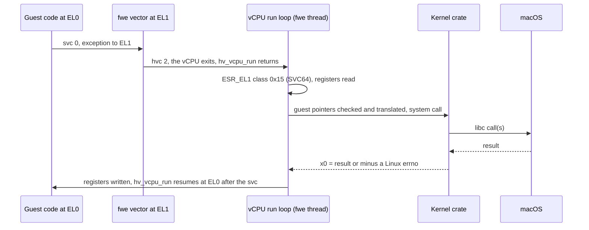

The kernel crate never walks the guest's page tables. Before a call, the
run loop checks each pointer argument against the guest's mappings
(`EFAULT` if the guest could not use it) and turns it into a host address:
the same address for most memory, or the slab address behind a translated
range such as the low-linked image ([Pages and
translation](#pages-and-translation)).

### Faults, breakpoints and other exits

Every other exception the guest takes at EL0 goes through the same vector
and `hvc`, and fwe reads its class from `ESR_EL1`: a data or instruction
abort, a `brk`, a misaligned pc or sp, an unknown instruction. Each becomes
the Linux signal Linux would send, except an abort that is only a page not
fetched yet (a `vfork` child's) or a stale TLB entry, which is fixed and
retried. A few things exit the vCPU directly instead of through the
vector: an access to an IPA nothing is mapped at (a stage-2 abort), `wfi`
or `wfe`, and a read of a system register the framework traps. The full
list is under [Faults in guest code](#faults-in-guest-code), and the run
loop's flow in [hypervisor.md](hypervisor.md#the-run-loop).

### Counters and timers

The guest reads time from the counter registers, as Linux programs do.
`CNTVCT_EL0`, the virtual counter, is read directly. Every vCPU of a
process uses the same virtual counter offset (a fork child takes its
parent's), so all threads see one clock. A read of `CNTPCT_EL0`, the
physical counter Linux also lets user code read, is trapped by the
framework and emulated from the host's counter minus that offset, so both
give the same time. The guest cannot program the timers itself; its
sleeps, interval timers and `timerfd`s are system calls fwe serves with
the host's, and a virtual-timer exit simply resumes the vCPU.

### Threads

Each guest thread is a host thread with a vCPU of its own, created on it,
since the framework lets only the creating thread use a vCPU. All vCPUs
share the VM, so they share the guest's page tables and memory. A new
thread's vCPU starts with its creator's registers, `x0` = 0, the new
stack, and `TPIDR_EL0` from `CLONE_SETTLS` (the guest's thread pointer and
`x18` are simply its own registers here).

### Signals into a running vCPU

A host signal for the guest arrives on a thread whose vCPU may be running
guest code, where no handler of fwe's could rewrite the guest's
registers. So fwe's handler records the signal pending and calls
`hv_vcpus_exit` on that thread's own vCPU; `hv_vcpu_run` returns with an
exit marked *canceled*, and the run loop delivers the signal by building
Linux's frame and resuming the vCPU in the guest's handler. This reaches
even a guest spinning without system calls. The framework's own threads
are created with every guest signal blocked, so the host delivers guest
signals only to vCPU threads, each running under the mask its guest
thread's mask calls for ([A host signal reaching a guest
thread](#a-host-signal-reaching-a-guest-thread)).

### Memory changes and the TLB

The guest's `mmap`, `munmap`, `mprotect` and `brk` edit stage 1 and
nothing else: slab memory is handed out and taken back, never replaced
behind the VM. Granting access needs nothing more, but taking it away
needs every vCPU's TLB invalidated before the guest relies on the change.
fwe counts such edits; a vCPU resuming after one runs the TLB stub at EL1
first, which invalidates the TLBs of every vCPU and returns to the guest
where it was. Memory and tables given back are reused only after such a
flush. The precise rules are in
[hypervisor.md](hypervisor.md#how-it-works).

### fork, execve and the end of a VM process

A VM belongs to one process: a host `fork` child could not use the
parent's VM, and would end with a VM it inherited. So a VM process never
forks on the host. A guest `fork` starts a fresh `fwe --hv-fork-child`
that builds a VM of its own and receives the parent's memory and kernel
state ([fork](#fork)); `execve` re-executes fwe, which picks the backend
the new program needs ([execve](#execve)).

A process that ends with its VM alive can bring the whole Mac down, so
every way out of a VM process (`exit_group`, the last thread's exit, a
fatal signal, fwe's own errors and panics, `execve`) first stops every
vCPU, has each thread destroy its own, and destroys the VM. Signals that
would end the process are caught so this can happen, and a guest's
`SIGKILL` to another fwe process is relayed as a catchable signal
(`SIGINFO`) for the same reason. Only a `SIGKILL` from outside fwe cannot
be intercepted. The rules and why they exist are in
[hypervisor.md](hypervisor.md#never-end-a-vm-process-abnormally).

## Linux to macOS

This part goes through Linux's primitives one by one. Most comparisons are
tables that read **Linux | macOS | fwe**: what the guest asks for, what the
host has, and what fwe makes of it, with the prose around each table
saying why. To give a feel for it, here are a few calls going in and the
host calls coming out:

| Guest call (Linux) | What fwe does | Host call(s) (macOS) |
|---|---|---|
| `openat(AT_FDCWD, "/etc/hosts", O_RDONLY \| O_CLOEXEC)` | resolves `/etc/hosts` component by component in the guest's root, following symlinks itself; translates the flags (`O_CLOEXEC` is `0x80000` on Linux, `0x1000000` on macOS) | `openat(<descriptor of the rootfs's etc>, "hosts", O_RDONLY \| O_CLOEXEC \| O_NOFOLLOW)`; the host descriptor is the guest's |
| `epoll_ctl(ep, EPOLL_CTL_ADD, fd, {EPOLLIN \| EPOLLET, data})` | the epoll descriptor is a kqueue | `kevent(ep, {fd, EVFILT_READ, EV_ADD \| EV_CLEAR, udata = data})` |
| `clock_gettime(CLOCK_BOOTTIME, &ts)` (no vDSO, so it traps) | maps the clock id | `clock_gettime(CLOCK_MONOTONIC, &ts)` |
| `kill(pid, SIGUSR1)` | maps the pid out of the guest's pid namespace and the signal number (10 to 30); leaves a sender note for an fwe target | `kill(<host pid>, 30)` |
| `write(fd, buf, n)` to a socket whose peer has gone | sockets are all `SO_NOSIGPIPE`, so fwe raises `SIGPIPE` itself | `write` fails with `EPIPE`; the guest gets `x0 = -32` and a pending `SIGPIPE` |

### The CPU

The processor is shared, so this section is about the conventions the two
kernels lay over it: how a program calls the kernel, which registers the
kernel lets it own, and what the kernel tells it about the CPU at
startup.

#### System call entry

Both kernels are entered with `svc`, but they agree on nothing else:

| | Linux arm64 | macOS arm64 |
|---|---|---|
| Instruction | `svc #0` | `svc #0x80` |
| Number in | `x8` | `x16` |
| Arguments | `x0`–`x5` | `x0` and up |
| Error report | `x0` = −errno (−1 to −4095) | carry flag set, `x0` = errno (macOS numbering) |

A Linux `svc #0` executed in a macOS process would enter the macOS kernel
with a meaningless number, so fwe intercepts every guest system call
before it gets there. The native backend rewrites each `svc #0` to a
`brk` that traps into fwe
([System calls: svc becomes brk](#system-calls-svc-becomes-brk)); in the
VM the `svc` takes an exception to fwe's vector, which leaves the VM
([A system call in the VM](#a-system-call-in-the-vm)). Either way the call
then takes the same path:

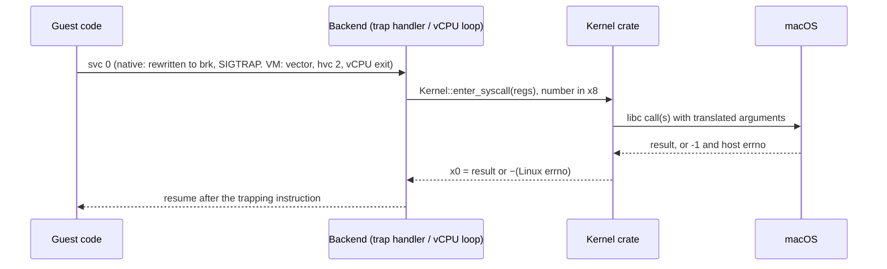

The kernel crate calls macOS through `libc`, so it sees `-1`/`errno`, never
the carry flag; how host errors become Linux ones is under
[Errors](#errors). Flag, structure and constant translations live in
`crates/kernel/src/host.rs`; the Linux values in `crates/abi`. A call
interrupted by a signal returns or restarts as described under
[Host signals](#a-host-signal-reaching-a-guest-thread).

#### Registers and the thread pointer

Linux gives user code every general register and the thread-pointer
register; macOS keeps two of them for itself and traps a register read
Linux allows. In the VM the guest has the CPU's registers to itself, so
only the native backend has to work around this:

| Register | Linux | macOS | fwe, native | fwe, VM |
|---|---|---|---|---|
| `TPIDR_EL0` | the thread pointer (TLS), set with `msr` | not preserved for user code | every `mrs`/`msr` of it branches to a stub that keeps the guest's value in a slot of the host thread's TSD, found through `TPIDRRO_EL0` | the guest's own |
| `x18` | a scratch register | platform-reserved, cleared on every exception return, preemption included | every instruction naming `x18` branches to a stub that keeps the guest's `x18` in another TSD slot and uses an ordinary register instead | the guest's own |
| `CTR_EL0` | readable at EL0 | `mrs` of it traps | emulated in the `SIGILL` handler, reporting Apple Silicon's value without the bits that let code skip cache maintenance (`crates/native/src/hwcap.rs`) | read by the guest |
| `CNTPCT_EL0` | readable at EL0 | readable | read by the guest | trapped by the hypervisor, emulated from the virtual counter the guest sees |

`clone` with `CLONE_SETTLS` writes the new thread's TSD slot (native) or its
vCPU's `TPIDR_EL0` (VM). How the stubs work is under
[Which instructions get translated](#which-instructions-get-translated-and-how).

#### Cache maintenance, PAC and BTI

Three CPU features depend on what the kernel allows or sets up:

- **Cache maintenance** is allowed at EL0 on both systems, so a JIT's own
  `dc`/`ic` instructions work in the native backend. Code fwe itself writes
  into guest memory (images, file data, a fork child's memory) has the
  instruction cache invalidated, as Apple's cores do not keep it coherent
  with data writes.
- **Pointer authentication:** the native backend does not report it
  (`AT_HWCAP` has no `PACA`/`PACG`), since the host owns the keys. The VM
  backend enables it in `SCTLR_EL1` where the vCPUs offer it, with random
  keys per program, a thread's from its creator, a fork child's from its
  parent, new ones for `PR_PAC_RESET_KEYS`; it reports `PACA` and `PACG`.
- **BTI:** reported in `AT_HWCAP2` where the host has it. In the VM, code of
  a program built for BTI is mapped guarded (`PROT_BTI`) where Linux maps it
  so, a signal handler is entered as if by `blr`, and a branch-target
  exception is `SIGILL`.

#### auxv, hwcaps and the vDSO

A Linux program learns about its machine from what the kernel puts on its
initial stack. fwe builds that stack as Linux does, in both backends:

- The initial stack is Linux's: strings, `AT_RANDOM` bytes, the auxiliary
  vector, `envp`, `argv`, `argc`, 16-byte aligned, on a fresh 8 MiB stack
  with a guard page (`crates/native/src/stack.rs`).
- The auxiliary vector carries `AT_PHDR`/`AT_PHENT`/`AT_PHNUM`, `AT_BASE`,
  `AT_ENTRY`, `AT_PAGESZ`, the ids, `AT_SECURE`, `AT_RANDOM`, `AT_EXECFN`,
  `AT_PLATFORM`, `AT_MINSIGSTKSZ` and `AT_HWCAP`/`AT_HWCAP2`.
- `AT_HWCAP`/`AT_HWCAP2` come from macOS's `hw.optional.*` sysctls: only
  features a guest can use directly. SVE and SME (kernel-managed state),
  `CPUID` (trapping ID-register reads) and, natively, PAC are left out.
- There is no vDSO (no `AT_SYSINFO_EHDR`): the C library falls back to real
  system calls for `clock_gettime` and `gettimeofday`, which trap like any
  other.

### Memory

A Linux process expects to own its address space, with 4 KiB pages and
memory it may map writable and executable at once. macOS gives a process
an address space it shares with its own loader and libraries, starting at
4 GiB, with 16 KiB pages and no write+exec memory. This section shows how
each backend lays the guest out, then goes through the memory calls.

#### Address-space layout

On Linux an arm64 process owns its whole lower address space: a non-PIE
program sits at its link address (often `0x400000`), the break follows the
image, `mmap` grows down from below the stack. macOS gives every arm64
process a mandatory 4 GiB `__PAGEZERO` at address 0, and its own loader,
libraries and heap share the space with the guest.

**Native backend** — guest and fwe in one host address space, guest
addresses equal to host addresses:

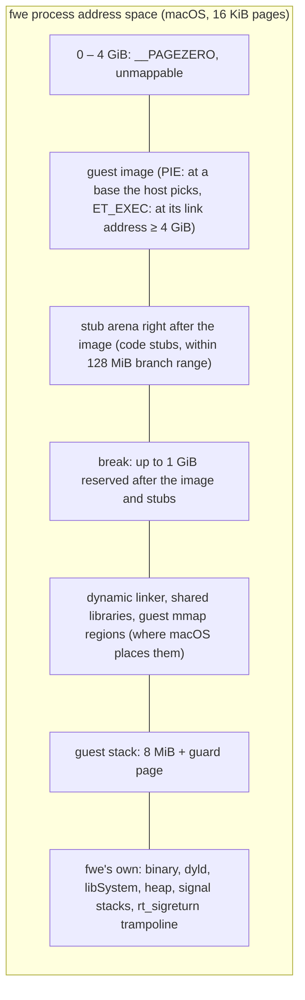

- An image linked below 4 GiB cannot be mapped at its address and carries
  no relocations to move it, so it needs the VM.
- The loader reserves the image's whole span first, then copies each
  segment in, so gaps stay inaccessible.
- Every guest range is recorded (`fwe_kernel::mm::track`); fwe's own
  memory never is, so `execve` can unmap exactly the old program.

**VM backend** — the guest has an address space of its own; its private
memory lives in one host range, the *slab*:

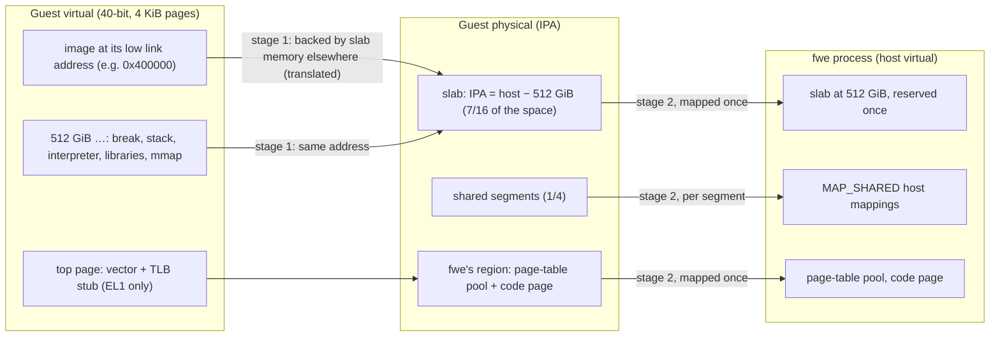

- The slab sits at host 512 GiB, the same address in every VM process, so
  a fork child can take its parent's memory at the same addresses.
- A mapping the guest did not place gets a slab range whose guest address
  is its host address. One placed outside the slab (the low image, a
  `MAP_FIXED` address) is backed by slab memory elsewhere and recorded as a
  translated range.
- The IPA space is as large as the host offers, up to 40 bits; an M1 or M2
  offers 36 bits (64 GiB), and the slab is 7/16 of it.

#### Pages and translation

The two backends differ most in how a guest address becomes a place in
memory:

| | Linux | macOS | fwe |
|---|---|---|---|
| Page size | 4 KiB on most arm64 kernels; 16 and 64 KiB exist | 16 KiB | native: the host's 16 KiB, reported in `AT_PAGESZ` (the arm64 ABI allows it); VM: 4 KiB |
| Translation | one stage, the kernel's tables | one stage, XNU's pmap | native: XNU's; VM: two stages, fwe's stage 1 and the framework's stage 2 |

Natively, a guest address is a host address and macOS translates it as it
does for any of its own processes. In the VM, both stages are real
hardware translation:

- **Stage 1** is fwe's own page tables (`crates/native/src/hv/pagetables.rs`):
  4 KiB granule, 40-bit space, level-3 pages only, each page's EL0
  permissions and BTI guard. Memory system calls edit them; taking access
  away is followed by a TLB invalidation before the guest relies on it.
- **Stage 2** is set up once and never changes while the VM runs: the slab,
  fwe's region, and a mapping per shared segment. The framework maps host
  memory in 16 KiB pages; a 4 KiB guest page is a quarter of one.
- The kernel crate never walks the tables. Guest pointers it uses go
  through `uaccess::g2h`, which looks up the translated ranges, after a
  check against the guest's mappings (the host can reach slab memory the
  guest cannot).

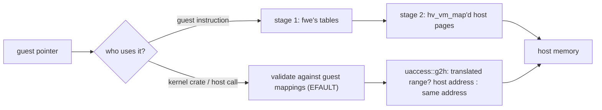

The low 4 GiB can never be identity-mapped (it is `__PAGEZERO` on the
host), so the low image is always one of the translated ranges. A host call
given one buffer that runs over the edge of a translated range has no
single host address and fails with `EINVAL`.

#### The mmap family

Linux's memory calls act on the kernel's records of a process's mappings.
Natively, fwe passes them to the host's own calls with the guest's
addresses, and fills in what macOS does differently; in the VM, it carries
them out on the slab and the guest's page tables:

| Call | Linux | fwe, native | fwe, VM |
|---|---|---|---|
| `mmap` anonymous / private file | kernel VMA | host `mmap` at the guest's address or where macOS places it; offset must be a multiple of 16 KiB | slab range; a private file mapping is a copy of the file's data when mapped |
| `MAP_SHARED` | shared pages | host `MAP_SHARED`; an executable shared file mapping is made private, since its code is rewritten | a *segment*: a host shared mapping outside the slab (anonymous shared memory is an unlinked file), mapped into the VM once |
| `MAP_FIXED`, `MAP_FIXED_NOREPLACE` | replace / refuse to replace | host `MAP_FIXED`; `NOREPLACE` checks where macOS put it (`EEXIST`) | page-table edit; over slab memory at its own address, that memory is reused, zeroed |
| `munmap` | | host `munmap` | removes the pages from stage 1 and flushes TLBs; the slab range is zeroed before reuse |
| `mprotect` | | host `mprotect`; adding `PROT_EXEC` prepares the code first | stage-1 permission edit |
| `mremap` | grow, shrink, move | shrink only; growing fails with `ENOMEM`, and C libraries fall back to allocate-and-copy | private memory: shrink, grow in place, or move with `MREMAP_MAYMOVE`; a shared segment cannot grow (`ENOMEM`); no `MREMAP_FIXED`/`MREMAP_DONTUNMAP` (`EINVAL`) |
| `madvise(MADV_DONTNEED)` | private anonymous pages read as zero again | each private anonymous piece replaced by a fresh mapping (macOS's own keeps the data) | private pages read as zero again, or as the file for a private file mapping; shared memory keeps its contents |
| `mlock` family | wires pages | pages brought in and counted against `RLIMIT_MEMLOCK`, not wired | the same |
| `mincore` | residency per page | the host's residency | by 16 KiB host pages |

Every successful memory call is also recorded the way Linux lists it
(`crates/kernel/src/maps.rs`), for `/proc/<pid>/maps`, `smaps` and
`PROCMAP_QUERY`, with the protections the guest asked for.

#### Write+exec memory

Linux maps `PROT_WRITE | PROT_EXEC` memory freely (JIT compilers do).
macOS refuses it without `MAP_JIT`, and `MAP_JIT` memory is switched per
thread (`pthread_jit_write_protect_np`), which Linux code never calls. fwe
keeps such memory writable on the host and records it
(`crates/kernel/src/mm.rs`):

- **native:** the first instruction fetch from a page faults; fwe prepares
  the page's code (system calls and thread-pointer accesses rewritten) and
  makes it read-execute. A later write faults and makes it read-write
  again. A write fwe makes for the guest switches the page the same way.
- **VM:** stage 1 maps the memory writable and executable, so nothing
  faults.

#### Shared memory and memfd

Linux has several kinds of shared memory macOS lacks or keeps
machine-wide. fwe builds each from files the fwe processes share:

| Linux | macOS | fwe |
|---|---|---|
| `memfd_create`: an anonymous file with a name and seals | no memfd, no seals | a file in fwe's private directory, unlinked at once; name and seals in extended attributes, so every holder sees them; `F_SEAL_WRITE` clones the file and swaps this process's descriptors for read-only ones of the clone |
| `/dev/shm` tmpfs (`shm_open`, `sem_open`) | no tmpfs at `/dev/shm` | a directory per rootfs in the user's temporary directory, shared by every fwe process on that root, treated by the resolver as a mount point |
| System V shared memory | own `shmget` | see [System V IPC](#system-v-ipc) |

### Processes

Each guest process is a host process, so process ids, parents and exit
statuses are real host ones and host tools see them. What needs work is
how processes are made and replaced: copying a process whose memory fwe
has rewritten or placed in a VM, and starting a new program in place.

#### fork

| | Linux | fwe, native | fwe, VM |
|---|---|---|---|
| `fork` | copy-on-write of private pages | host `fork`: Mach copy-on-write for `MAP_PRIVATE` (`VM_INHERIT_COPY`), sharing for `MAP_SHARED` | no host fork and no copy-on-write: a fresh fwe process is sent a copy of every slab page that exists |
| `vfork` / `CLONE_VM \| CLONE_VFORK` | child borrows the parent's memory | host `fork` with the private ranges set to inherit by sharing (`minherit`) for that fork | child fetches pages on first touch and sends back what it changed |

Linux duplicates the calling thread into a new process with
copy-on-write memory. macOS's `fork` does too, but copies memory while the
parent's other threads keep running, gives the child none of the parent's
kqueues, and does not restore a signal mask from a handler frame the child
did not take. A VM cannot be forked at all.

**Native backend** (`crates/native/src/process.rs`, `quiesce.rs`): fwe
holds every lock a child could need, pauses the parent's other threads
while they run guest code, and only then forks, so the child starts from
one consistent instant:

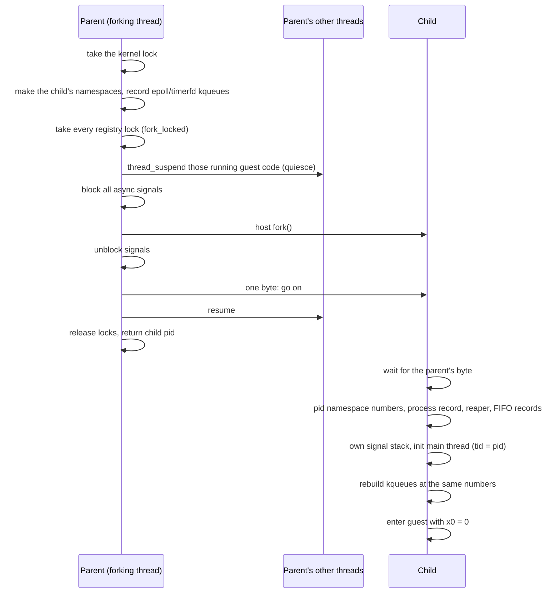

- The child keeps the guest's blocked mask and alternate stack; pending
  signals are not inherited, as on Linux.
- Descriptors are inherited by the host fork; the child's process record,
  signal mailbox and System V attachments are its own.

**vfork** (`CLONE_VM | CLONE_VFORK`, used by `posix_spawn`, `vfork`, Go's
`os/exec`): the same host fork with the guest's private memory set to
inherit by sharing for it. The parent waits on a close-on-exec pipe only
the child holds, so it resumes when the child execs or exits, and sees
what the child wrote meanwhile. fwe's own memory is not shared, so the
child's mappings (`mmap`, `munmap`) stay its own. In the native backend
`CLONE_VM` without `CLONE_VFORK` is the same fork without the wait: parent
and child share the memory mapped at the fork while both run. The VM
backend refuses it (`ENOSYS`), since the same memory may never be in two
VMs at once.

**VM backend** (`crates/native/src/hv/fork.rs`): the child is a fresh
`fwe --hv-fork-child` started with `posix_spawn`, never a host fork. The
parent hands it its kernel state over a Mach port and its memory over a
socket, and the child builds a VM of its own around them:

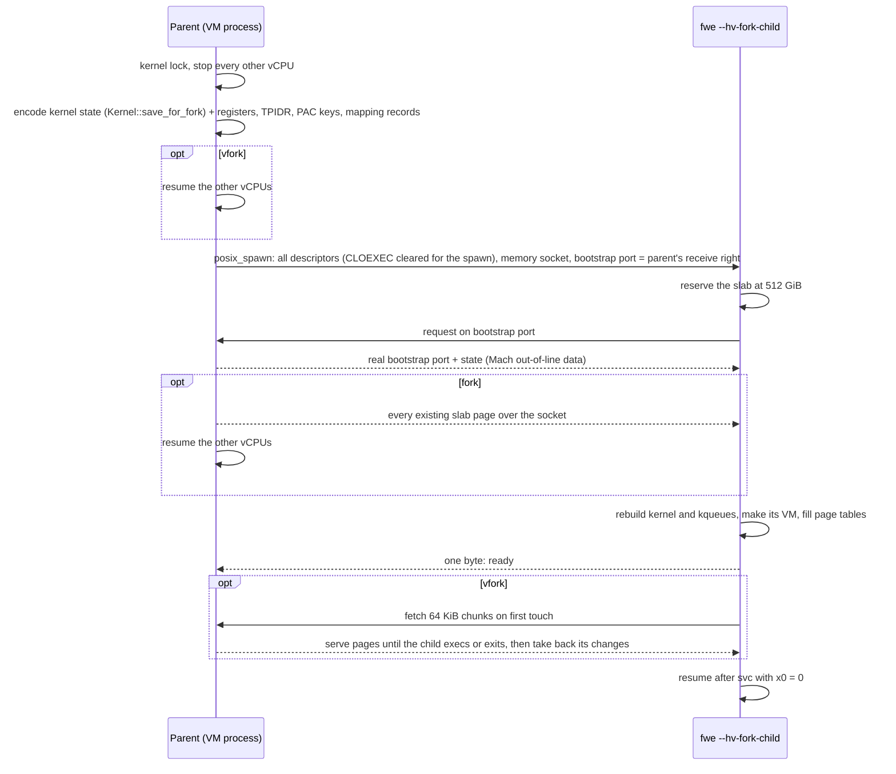

- No private page is ever in two VMs. Shared segments go to the child as
  their files, which it maps: those pages are in both, as Linux shares
  them.
- A `fork` child gets every slab page that exists
  (`mach_vm_page_range_query`), sent with the parent's vCPUs stopped so it
  sees one instant. The copy goes over a socket
  pair rather than through a file-backed slab, as elfuse does: an APFS
  clone writes the memory to disk and is some fifty times slower.
- A `vfork` child fetches only the slab ranges the parent had in use, and
  only while it keeps them: memory it gives back or maps anew is its own.
  Before it execs or ends it sends back the bytes it changed, compared with
  what it fetched, and the parent resumes once they are in its memory. Its
  channel is one of fwe's reserved descriptors, out of reach of a child
  that moves descriptors into place before exec (Go's does); a child that
  loses it ends with a message rather than run without its parent's memory.
- What cannot cross: the VM itself (a child cannot use its parent's), and
  kqueues, rebuilt from fwe's records.

#### Threads, clone and futexes

A Linux thread is a task that shares its process's memory and descriptors;
a guest thread is a host thread, so the host schedules it. Linux's `clone`
is far more general than macOS's `pthread_create`, and futexes have no
direct macOS counterpart for the shared case:

| | Linux | macOS | fwe |
|---|---|---|---|
| Thread | a task sharing `mm`, files, handlers | a pthread | a host pthread running guest code (native) or a host thread with its own vCPU (VM) |
| `clone` flags | any combination | — | a thread needs `CLONE_VM` and a stack (`EINVAL` without either in the VM; natively `EINVAL` without a stack, `ENOSYS` without `CLONE_VM`); the native backend accepts `CLONE_VM`, `FS`, `FILES`, `SIGHAND`, `THREAD`, `SYSVSEM`, `SETTLS`, `PARENT_SETTID`, `CHILD_SETTID`, `CHILD_CLEARTID`, `DETACHED` and fails others with `ENOSYS` |
| `clone3` | `struct clone_args` | — | read and treated as the `clone` it describes; `CLONE_INTO_CGROUP` starts the child in that cgroup, `CLONE_CLEAR_SIGHAND` resets its handlers, `CLONE_PIDFD` makes the parent a process descriptor of it before the fork and points it at the child after; `set_tid` fails with `ENOSYS` |
| Per-thread state | in the task | — | in host thread-locals: tid, `set_tid_address` word, robust list, signal mask, alternate stack, pending set |
| futex, private | a wait queue per address | `__ulock_wait`/`__ulock_wake` (private) | per-process wait queues, outside the kernel lock |
| futex, shared | keyed by the page's backing object | `__ulock_wait2` with `UL_COMPARE_AND_WAIT_SHARED` | a slot table every fwe process maps, keyed as Linux keys a shared futex (Mach memory object + offset); each waiter sleeps on its slot's word, so a wake knows whom it woke |

A new thread starts with its creator's registers and signal mask, `x0` = 0,
the given stack and no alternate stack. Its exit clears and wakes its
`clear_child_tid` futex; the last thread or `exit_group` ends the process.

#### execve

Linux replaces the address space in place, keeping the pid, descriptors
not marked close-on-exec, the signal mask, pending signals and ignored
dispositions. fwe does it one of two ways. When the new program can run
natively and the caller is a native process with no other threads, it
unmaps the old program and loads the new one in place. Otherwise it runs
the host's `execve` on `fwe` itself, passing what must survive on the
command line, and the new fwe picks the backend the new program needs:

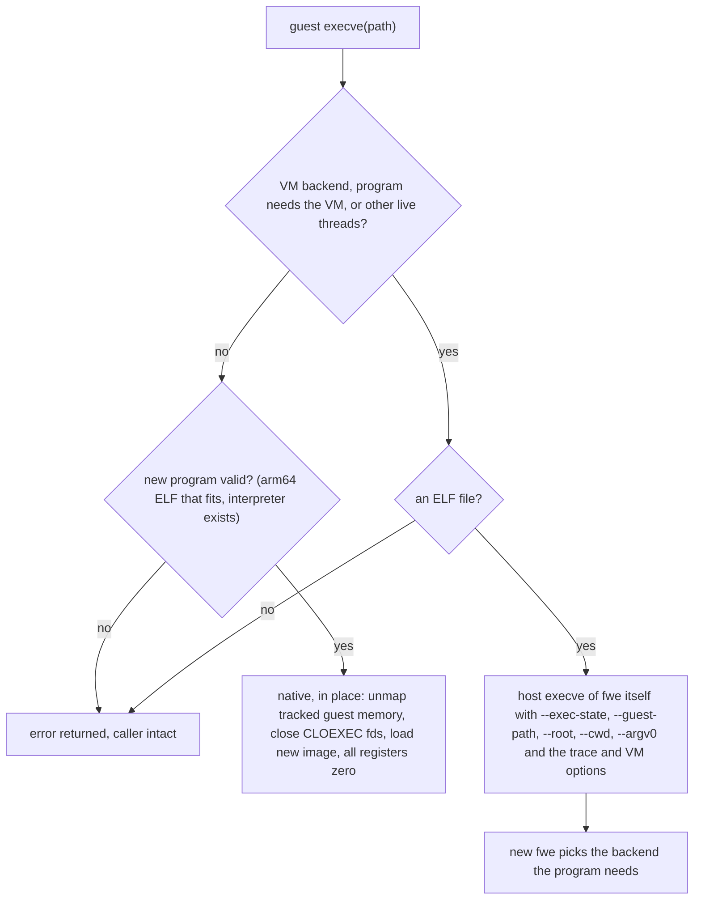

What crosses an `execve`, and how:

| State | How |
|---|---|
| pid, descriptors without `O_CLOEXEC`, signal mask, pending host signals, ignored dispositions | the host keeps them across its own exec; signals fwe held pending that the guest blocks are moved onto the host first |
| handled dispositions | reset to default, as on Linux |
| credentials, capabilities, `RLIMIT_NOFILE`, fwe's own rlimits, umask, mount namespace and root, mount origins of open files, seccomp filters, `no_new_privs`, personality, inotify and namespace descriptors | in place: kept in the process; re-exec: encoded in `--exec-state` (`Kernel::exec_state`) |
| saved set-user/group ids | become the effective ones, as on Linux |
| thread and process keyrings | dropped; the session keyring stays |
| a program run from a descriptor (`execveat(fd, "", AT_EMPTY_PATH)`) | the descriptor is kept by fwe and passed on with `--exe-fd` |

`execveat` turns its directory descriptor, path and flags into a guest
path and is then `execve`.

#### The ELF loader and dynamic linker

Linux's kernel loads the program and its dynamic linker; fwe's loader
(`crates/native/src/loader.rs`, the VM's in `hv/backend.rs`) does the same
job. It maps each `PT_LOAD` segment, a PIE at a base it picks, code first
writable so the native backend can rewrite it, then loads the dynamic
linker and starts there, as described under
[The dynamic linker](#the-dynamic-linker). From then on real glibc and
musl run unmodified: the dynamic linker maps libraries through fwe's
`openat` and `mmap`, relocates them and sets the thread pointer.

#### wait

Waiting for children mostly passes through, since the children are real
host processes; the flags and pid arguments need translating:

| | Linux | macOS | fwe |
|---|---|---|---|
| `wait4` pid argument | a pid, `-pgid`, 0, -1 | the same, host pids | mapped out of the guest's pid namespace (`ECHILD` for one not in it) |
| `WNOHANG`, `WUNTRACED` | 1, 2 | 1, 2 | passed through |
| `WCONTINUED` | 8 | `0x10` | translated |
| `__WALL`, `__WCLONE`, `__WNOTHREAD` | select which children | none | accepted; every child is an fwe process, so they change nothing |
| a reaper's `wait` | its children and adopted orphans | its children only | its host children, then the orphans fwe recorded for it ([orphans and reapers](#orphans-and-reapers)) |
| `waitid(P_PIDFD, fd)` | the process a pidfd names | none | `P_PID` of the host pid the descriptor names; with `PIDFD_NONBLOCK` as `WNOHANG`, `EAGAIN` when nothing changed |

Child pids are host pids (or their numbers in the guest's pid namespace),
so `wait`, `kill` and `setpgid` act on real processes. What comes back (the
status word, `rusage`, `SIGCHLD`) is under
[Children ending](#children-ending).

### Signals

Both kernels have signals, with the same idea and mostly the same
behaviour, but different numbers, different structures, and a different
idea of what a blocked signal keeps. This section covers the guest's side:
numbers, dispositions, and sending. How a signal from the host reaches the
guest is under [Host signals](#host-signals).

#### Numbers

Linux and macOS agree on signals 1–6, 8, 9, 11, 13–15, 21, 22 and 24–28;
the rest differ. fwe translates every number both ways
(`host::signal_to_host`, `host::signal_to_linux`).

| Signal | Linux | macOS |
|---|---|---|
| `SIGBUS` | 7 | 10 |
| `SIGUSR1` / `SIGUSR2` | 10 / 12 | 30 / 31 |
| `SIGCHLD` | 17 | 20 |
| `SIGCONT` / `SIGSTOP` / `SIGTSTP` | 18 / 19 / 20 | 19 / 17 / 18 |
| `SIGURG` | 23 | 16 |
| `SIGIO` | 29 | 23 |
| `SIGSYS` | 31 | 12 |
| `SIGSTKFLT`, `SIGPWR` | 16, 30 | none |
| real-time `SIGRTMIN`..`SIGRTMAX` | 32–64 | none |
| `SIGEMT`, `SIGINFO` | none | 7, 29 |

fwe uses the two macOS-only signals for itself: `SIGEMT` is its *wake
signal* and `SIGINFO` its *kill relay*. What either does when it comes
from elsewhere is under
[Signals with no counterpart](#signals-with-no-counterpart).

#### Dispositions, masks and frames

The guest's signal state lives in the kernel crate; the host's is set to
whatever lets fwe see each signal it must handle:

| | Linux | macOS | fwe |
|---|---|---|---|
| Dispositions | per process | per process, macOS numbers | in the kernel crate, each passed to the host (`Platform::set_host_signal`) as catch, default or ignore ([which](#who-acts-on-a-signal)) |
| Mask, alternate stack | per thread | per thread | per thread, in host thread-locals; the host thread's own mask blocks only what the host must hold back |
| Pending instances | one per standard signal; real-time signals queued | one per signal, `siginfo` lost while blocked | one per signal number; a standard signal keeps its first `siginfo`, a real-time one its latest; from another process, signals the host lacks wait in a queue of 64 in the target's mailbox |
| Signal frame | `rt_sigframe` with `ucontext`, `fpsimd_context` | Darwin `ucontext`, `mcontext64` | Linux's layout, built on the guest stack (or alternate stack); return through `sa_restorer` or fwe's `rt_sigreturn` trampoline |

A signal ignored when fwe starts (`nohup`, a shell's background job)
starts out ignored in the guest, as across a Linux `execve`.

#### Sending a signal

A signal the guest sends to another process becomes a host `kill`, with
the pid and number translated. Signals the host does not have, and
signals aimed at one thread, are recorded by fwe directly and the target
woken with the wake signal:

| Guest call | fwe | Host |
|---|---|---|
| `kill(pid, sig)` to another process, for a signal the host has | pid mapped out of the pid namespace; permission checked as on Linux; a note of the sender left in the target's mailbox if it is an fwe process (`crates/kernel/src/signote.rs`) | `kill(<host pid>, <host signal>)` |
| `kill` with `SIGKILL` | the same | an fwe target is sent `SIGINFO` (the kill relay), so a VM process can tear its VM down first; any other process the real `SIGKILL` |
| `kill` of itself with a fault signal (`SIGSEGV`, `SIGBUS`, `SIGILL`, `SIGFPE`, `SIGTRAP`) | recorded directly, since macOS's `siginfo` cannot tell a sent one from a fault | none |
| `kill`/`tgkill`/`rt_sigqueueinfo` with a real-time signal (or `SIGSTKFLT`, `SIGPWR`) | recorded directly within the process; to another fwe process queued in its mailbox with the sender, code and value (`signal::send_unhosted`); to a process that is not fwe's `EINVAL` | `SIGEMT` to wake the target |
| `tgkill(tgid, tid, sig)`, a signal the guest catches or a fault signal | posted to that thread directly, which a relayed host signal could not target | `SIGEMT` to wake it |
| `tgkill` of a signal the host acts on | — | `pthread_kill(<host thread>, <host signal>)` |
| `kill(-1, sig)` | only the caller's pid namespace or its run of fwe, never other host processes | `kill` of each |

- **Permission to signal** follows Linux: `CAP_KILL`, or the caller's real
  or effective uid matching the target's real or saved one, or `SIGCONT`
  within the session; a process fwe has no record of counts as root's.
- A `SIGKILL` or `SIGSTOP` sent to a pid namespace's init from inside the
  namespace is dropped; a `SIGKILL` that ends an init takes its namespace
  with it.

### Files and descriptors

A Linux process sees a filesystem through its root and its mount
namespace; a macOS process sees the one host filesystem. fwe resolves
every guest path itself, so that the guest's root, mounts and symlinks
behave as Linux's, and only then hands the host a single path component
to open. The descriptors it gets back are the guest's descriptors, so
reads and writes go straight to the host. The table lists each piece and
how it is bridged:

| Linux | macOS | fwe |
|---|---|---|
| a process's root (`chroot`) and mount table | one host filesystem | guest paths resolved by fwe component by component (`crates/kernel/src/fs.rs`): symlinks followed by fwe, mounts entered, `..` clamped at the process's root, as `openat2(RESOLVE_IN_ROOT)` would; the final host `openat` has `O_NOFOLLOW` added |
| `open` flags | other values | translated (`host::open_flags_to_host`) |
| descriptor numbers | the same kind of table | guest descriptors are host descriptors; fwe's own live in a reserved range at the top, out of the guest's reach (`EBADF`), with a virtual `RLIMIT_NOFILE` below it |
| `struct stat`, `statx` | different layout | translated |
| `statfs` | different layout, APFS | translated; the type reported as ext4, the sizes and counts the host's |
| `getdents64` | `getdirentries` | built from it |
| record locks (`F_SETLK`) | POSIX locks, different `struct flock` | translated; the host's, so they hold against host processes too |
| OFD locks (`F_OFD_*`) | private `F_OFD_*` commands | translated to them; owned by the open file, shared by its duplicates |
| leases (`F_SETLEASE`) | none | a record every fwe process shares (`crates/kernel/src/leases.rs`): a conflicting open signals the holder and waits for it, up to `fs.lease-break-time` |
| `F_SETSIG`, thread owners | `SIGIO` to a process or group | kept per descriptor (`crates/kernel/src/fdstate.rs`); see [Network events](#network-events) for how a host `SIGIO` arrives |
| pipe size (`F_SETPIPE_SZ`) | fixed, 64 KiB at most | reported from the host pipe; a size set above 64 KiB holds no more |
| extended attributes | own namespace (`com.apple.`) | Linux names stored as host attributes of the same name; Linux's rules per namespace; only Linux's namespaces are listed; `system.` ACLs not kept |
| mode bits; root passes them | owner's bits enforced on the owner | a mode denying its owner is kept in an attribute (`UF_NODUMP` flags the file), the host file keeps owner read/write (`crates/kernel/src/modes.rs`) |
| FIFO hang-up in `poll`/`epoll` | `POLLHUP` once the last writer goes | macOS reports nothing; fwe asks `select` between short slices (`crates/kernel/src/fifo.rs`) |
| `O_PATH` | none | the descriptor is marked and refused what Linux refuses; a FIFO, device, socket or symlink gets a stand-in that names it |
| terminals and ptys | `termios`, `/dev/ptmx` | see [Terminals and key strokes](#terminals-and-key-strokes) |

#### /proc, /sys and /dev

Linux programs read much of what they know about themselves and the
machine from `/proc` and `/sys`, which macOS does not have. fwe serves
them as filesystems of its own:

- `proc` and `sysfs` mounts are fwe's own filesystems
  (`crates/kernel/src/procfs.rs`, `procpid.rs`, `synthdir.rs`): content is
  generated from fwe's records and the host (`proc_pidinfo`, `sysctl`),
  served from an anonymous descriptor; directories are listed from memory.
  What of the host shows there is under
  [Host identity and machine state](#host-identity-and-machine-state).
- `/proc/<pid>` covers the processes of the reader's pid namespace, from
  their process records. `/proc/sys` writes reach the namespace sysctls fwe
  keeps (network, IPC) and the few it acts on.
- `/proc/self/fd/N`, `cwd` and `root` behave as magic links.
- `/dev/null`, `zero`, `random`, `urandom` and `tty` are the host's;
  `full`, `loop-control` and `loopN` are fwe's; `/dev/ptmx` and
  `/dev/pts` are fwe's pty layer; `/dev/fd`, `stdin`, `stdout`, `stderr`
  link into `/proc/self/fd`; `/dev/shm` and `/dev/mqueue` are fwe's mounts.

### Waiting and events

Linux has a family of descriptors for waiting on many things at once;
macOS has one mechanism, `kqueue`. fwe builds each Linux descriptor from
a kqueue, a pipe, or both, so that the guest can mix them in one `epoll`:

| Linux | macOS | fwe |
|---|---|---|
| `epoll` | `kqueue` | the epoll descriptor is a kqueue; `EPOLLIN`/`EPOLLOUT` become `EVFILT_READ`/`EVFILT_WRITE`, `EPOLLET` → `EV_CLEAR`, `EPOLLONESHOT` → `EV_ONESHOT`, data in `udata`; `epoll_event` is 16 bytes on arm64; how events come back is under [Network events](#network-events) |
| `eventfd` | none | a pipe plus a 64-bit counter; the pipe holds one byte exactly while the counter is non-zero, so `kqueue` sees readiness |
| `timerfd` | none | a kqueue with one `EVFILT_TIMER`, millisecond resolution |
| `signalfd` | none | a readiness pipe plus a queue of `signalfd_siginfo`; a pending signal the thread blocks and a signalfd watches moves onto it |
| inotify | `kqueue` vnode events (no names), FSEvents (paths, after the fact); neither reports open, read or close | fwe raises the events itself from every fwe process's file calls; an instance is a host datagram socket bound in fwe's private directory, so reading and `epoll` are the host's |
| pidfd (`pidfd_open`, `CLONE_PIDFD`) | `kqueue`'s `EVFILT_PROC` | a kqueue watching the process's exit, never read, so it stays readable once the process has ended (a zombie, which the host will not report again, gets a user event); a `PIDFD_THREAD` one of another thread of the process gets the user event as the thread exits |

A host `fork` child gets no kqueues, and an `execve` closes them, so epoll
interest lists, timerfd settings and process descriptors are recorded and
rebuilt at the same numbers in the child (and across an `execve` that
re-executes fwe).

### IPC

#### Sockets

Guest sockets are host sockets, so connections reach real networks and
real host programs. The differences are in encoding: address families,
the `sockaddr` header, flags folded into other arguments, and Unix-socket
names macOS does not support:

| Linux | macOS | fwe |
|---|---|---|
| `AF_INET6` = 10 | 30 | translated |
| `sockaddr` starts with a 2-byte family | a length byte, then a family byte | header rewritten in place |
| `SOCK_NONBLOCK`/`SOCK_CLOEXEC` in the type | none | applied with `fcntl` |
| `MSG_NOSIGNAL` | `SO_NOSIGPIPE` | every socket gets `SO_NOSIGPIPE`; fwe raises `SIGPIPE` itself for a write or a send without `MSG_NOSIGNAL` |
| `SCM_RIGHTS`: 64-bit `cmsg_len` | 32-bit | re-encoded |
| `AF_UNIX` paths | 104-byte limit | resolved in the guest's root; a long one bound or connected from its directory with `pthread_fchdir_np` |
| abstract `AF_UNIX` names | none | files in a per-host temporary directory, or in an fwe network namespace's own directory |
| `SOCK_SEQPACKET` Unix sockets | none | a stream socket with length-prefixed frames (`crates/kernel/src/seqpacket.rs`) |
| `AF_NETLINK`/`NETLINK_ROUTE` | none | in an fwe network namespace, answers for `lo`; elsewhere every request is `EOPNOTSUPP` |
| `SO_PEERCRED` | `LOCAL_PEERCRED` | peer pid in the caller's pid namespace, ids as the guest sees them |

#### System V IPC

macOS has System V IPC, but one set for the machine, with small limits.
fwe keeps its own per IPC namespace (`crates/kernel/src/sysvipc.rs`,
`ipcops.rs`): a shared record holding every object, a segment's memory a
file beside it that `shmat` maps shared. Each operation is one change of
the record under its lock, so `semop` is atomic across processes; waits
retry when the record changes. What a dead process leaves (attachments,
`SEM_UNDO`) is cleaned up by the next process that looks. The initial
namespace's record lasts until the host reboots.

#### POSIX message queues

macOS has no `mq_*`. fwe keeps each queue as a record in its IPC
namespace's directory (`crates/kernel/src/mqueue.rs`); the guest's
descriptor is a host descriptor of the queue's file, holding a shared
`flock`, so an unlinked queue is freed with its last descriptor.
Notifications go to the registering process: a signal carrying `SI_MESGQ`
and the value (via a signal note), or, for `SIGEV_THREAD`, the cookie sent
to the C library's netlink socket at a host address fwe gave it.

#### Keys and keyrings

macOS has no key retention service. fwe keeps every key in one record
shared by all fwe processes (`crates/kernel/src/keys.rs`): keys,
keyrings, permissions, quotas, and the thread, process, session, user and
persistent keyrings each process and user holds. The key types
(`keyring`, `user`, `logon`, `big_key`, `dns_resolver`, `asymmetric`,
`encrypted`) and their cryptography (`keycrypto.rs`, as Linux 6.12
computes it) are fwe's. `request_key` has no `/sbin/request-key` upcall:
a key it would construct is negative for a minute.

### Kernel-wide state

What Linux keeps in one kernel for every process — mount tables,
namespaces, the cgroup tree, loop devices, IPC objects, keys, inotify
watches, shared futexes — must be seen by every fwe process. It lives in
fwe's private directory on the host (`crates/kernel/src/shared.rs`): a
directory per record, its data replaced whole under a lock, and a mapped
generation count so a process rereads only after another changed it.

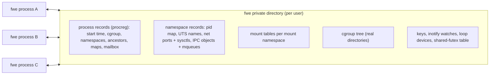

A record's name carries a format number, so another fwe build never reads
it. A record no live process holds is collected when a namespace is made
and when a fresh fwe starts.

The next sections build on these records: namespaces, cgroups and mounts
are the container features, followed by credentials, seccomp and devices.

### Namespaces

macOS has no namespaces. fwe makes each one as a shared record that the
processes in it name; a process in an initial namespace sees the host's
(host name, host pids). `clone` and `unshare` make them
(`crates/kernel/src/nsops.rs`), `setns` joins one through a
`/proc/<pid>/ns/*` descriptor (`nsfd.rs`). What each kind of namespace
holds:

| Namespace | What fwe does |
|---|---|
| pid (`pidns.rs`) | numbers processes and threads from 1 in a record mapping each to its host pid; `getpid`, `kill`, `wait`, process groups and `siginfo` senders are translated; when its init ends, the rest are killed; init ignores `SIGKILL`/`SIGSTOP` from inside |
| mount (`mounts.rs`) | a mount table per namespace; see [Mounts](#mounts) |
| user (`userns.rs`) | ids kept as the initial namespace's and seen through `uid_map`/`gid_map`, written once with Linux's rules; the creator has every capability in it |
| UTS | `uname`, `sethostname`, `setdomainname` use its names; in the initial one the host's name is read and never set (`EPERM`) |
| network (`netns.rs`) | a loopback interface, down until brought up; sockets reach only loopback; its ports are host loopback ports mapped through its table, so each namespace has its own port 80; abstract `AF_UNIX` names are its own; its sysctls are its own |
| IPC | its System V objects and POSIX queues |
| cgroup | `/proc/self/cgroup` and `cgroup2` mounts show the tree from its root |

### cgroups

macOS has no cgroups and no unprivileged way to hold a process to a
memory or CPU budget. fwe keeps one cgroup v2 tree for the user's fwe
processes, as real directories with interface files
(`crates/kernel/src/cgroupfs.rs`):

- `mkdir`/`rmdir`, `cgroup.procs`, `cgroup.subtree_control` with Linux's
  rules; `cgroup.events`, `pids.current`, `memory.current` and `cpu.stat`
  read what is so when opened;
- `cgroup.freeze` stops and continues members, `cgroup.kill` kills them,
  `pids.max` limits `fork`;
- device programs (`BPF_PROG_TYPE_CGROUP_DEVICE`) decide every device open
  and `mknod` of members, run on fwe's eBPF interpreter (`bpf.rs`);
- the other limits are kept and read back, not enforced.

### Mounts

macOS mounts are system-wide and need root; there are no mount
namespaces, no bind or overlay mounts of Linux's kind and no propagation.
fwe's mounts exist only in its tables (`crates/kernel/src/mounts.rs`,
`mountops.rs`, `mountapi.rs`, `overlay.rs`), and its path resolver
follows them:

- a mount shows a host directory (rootfs, bind source, a tmpfs's backing
  directory), an overlay of several, or one of fwe's filesystems (`proc`,
  `sysfs`, `cgroup2`, `devpts`, `mqueue`);
- `mount`, `umount2`, `pivot_root`, `chroot` and the new mount API
  (`fsopen`, `fsconfig`, `fsmount`, `fspick`, `open_tree`, `move_mount`,
  `mount_setattr`, `statmount`, `listmount`) act on the table;
- propagation as Linux's: peer groups, slaves, across namespaces;
- `nodev`, `noexec`, `nosymfollow`, `ro` and the access-time flags are
  enforced by fwe; busy mounts refuse `umount` (`EBUSY`);
- an overlay is resolved as Linux's `overlay`: upper then lower layers,
  whiteouts (0:0 device nodes) and opaque directories, copy-up as an APFS
  clone, each change built in the work directory and renamed into place.

### Credentials and capabilities

On macOS a process runs as the user who started it and only root can
change that. Linux programs, and container runtimes above all, expect to
be root inside, to change ids, and to hold capabilities. fwe keeps the
guest's identity virtual:

| Linux | macOS | fwe |
|---|---|---|
| real/effective/saved/fs uids and gids, groups | the host process's, changeable only by root | virtual (`crates/kernel/src/creds.rs`), default root (0), Linux's `set*id` rules |
| capability sets and securebits | none | the five sets and securebits (`caps.rs`), changed by `capset`, `prctl`, `setuid`, `execve` as on Linux; every capability but `CAP_SYS_TIME` at the start |
| `chown` | changes the owner | accepted for a privileged caller, not applied to the host file |
| file capabilities, set-ID programs | set-ID bits | none: `execve` follows Linux's rules for a file with neither |

How host users and file owners look to the guest is under
[Host identity](#host-identity-and-machine-state).

### seccomp

macOS has no seccomp. fwe runs each filter, classic BPF over
Linux's `seccomp_data` (`AUDIT_ARCH_AARCH64`), before either backend routes
a call (`crates/kernel/src/seccomp.rs`); the action of highest precedence
wins. Filters apply to every thread of the process and are kept across
`fork` and `execve`. `SECCOMP_RET_TRAP` raises `SIGSYS` with Linux's
`_sigsys` fields; `SECCOMP_RET_TRACE` and `SECCOMP_RET_USER_NOTIF` fail
with `ENOSYS`, as with no tracer or listener.

### Devices

Device nodes on macOS can only be made by root, and Linux's device numbers
mean nothing there. fwe keeps its own:

- `mknod` of a device, which the host lets only its root do, makes an
  empty file flagged `UF_OPAQUE` with the Linux type and numbers in an
  attribute (`crates/kernel/src/devnodes.rs`); opening it opens the host
  device those numbers name, or fails with `ENXIO`.
- Loop devices are fwe's own block devices 7:N with `/dev/loop-control`
  (10:237), in a shared record (`loopdev.rs`); fwe carries out their reads,
  writes and requests on the attached file.

### Time, scheduling and limits

Clocks, scheduling and resource limits exist on both sides with different
sets and rules. fwe maps what has a host counterpart and keeps the rest
itself:

| Linux | macOS | fwe |
|---|---|---|
| clocks: `REALTIME`, `MONOTONIC`, `BOOTTIME`, `TAI`, `*_COARSE`, `*_ALARM`, CPU-time | fewer | mapped onto the host's realtime, monotonic, raw and CPU-time clocks (`host::clock_to_host`) |
| setting the clock (`CAP_SYS_TIME`) | root | refused with `EPERM` after Linux's argument checks, as in a container |
| interval timers (`setitimer`, `alarm`) | the same, at most 100,000,000 s | the host's |
| nice, scheduling policies | own scheduler | kept in the process record with Linux's checks, inherited; the host schedules every process alike |
| `RLIMIT_NICE`, `RTPRIO`, `MSGQUEUE`, `MEMLOCK`, `CORE`, `STACK`, `CPU`, `NPROC`, … | absent or different | fwe's own (`crates/kernel/src/rlimits.rs`): `CORE` for fwe's core dumps, `STACK` for the guest's stack, `CPU`'s hard limit and `NPROC` enforced by fwe; `NOFILE` is virtual, below fwe's reserved descriptors; `FSIZE`, `DATA`, `AS` are the host's |
| `personality` | none | kept per process; `UNAME26` and `STICKY_TIMEOUTS` act |

### Not available

A few Linux facilities have no implementation yet. These fail with
`ENOSYS` (any call not dispatched in `crates/kernel/src/syscalls.rs` does,
noted under `--strace`):

- `ptrace` and `process_vm_readv`/`writev`;
- POSIX timers (`timer_create` and the rest);
- `io_uring`, the AIO calls, `userfaultfd`, `perf_event_open`, `fanotify`,
  `kcmp`, `landlock`, `rseq`,
  `name_to_handle_at`/`open_by_handle_at`;
- `sendmmsg`/`recvmmsg`, `times`, `ioprio_get`/`ioprio_set`, the `pkey_*`
  calls, `process_madvise`, `process_mrelease`, `memfd_secret`,
  `cachestat`, `map_shadow_stack`, the `lsm_*` calls;
- `sync`, `syncfs`;
- loading kernel modules (`delete_module` finds none), `kexec`, `reboot`,
  swap, quotas, NUMA policy, `acct`.

## macOS to Linux

Things happen on the host that a Linux program expects to hear about from
its kernel: a key pressed, a signal sent, a child ending, data arriving, a
timer firing, a call failing. macOS reports each of them in its own terms,
and fwe has to turn the report into what a Linux kernel would have said.
Each reaches the guest through one of a few channels:

| Channel on macOS | What fwe does with it | What the guest gets |
|---|---|---|
| a host signal to the fwe process | caught by the backend's handler (`crates/native/src/trap.rs`: `on_async`, `on_fault`, `on_sigtrap`; the VM's `on_signal` in `hv/backend.rs`), translated and recorded pending | a Linux signal with a Linux `siginfo`, in a Linux frame |
| a host call's result | return value kept, `errno` translated, structures rewritten | `x0` = the result or minus a Linux errno, Linux layouts |
| a `kqueue` event | translated by `epoll_wait`, `timerfd` and inotify reads; a reaper's watcher follows process events | `epoll` events, timer counts, `SIGCHLD` for an adopted orphan |
| host state read when asked | `proc_pidinfo`, `sysctl`, `gethostname`, `sysconf` | `/proc`, `uname`, `sysinfo` |
| another fwe process | shared records and signal notes | what one Linux kernel would show |

The sections below follow these channels, starting with the busiest:
signals. Their tables read **on macOS | what fwe does | what the guest
sees**.

### Host signals

Most host events reach a Linux program as signals: key strokes, a resized
terminal, a child ending, a timer expiring, a `kill` from a shell. They
arrive at the fwe process as macOS signals, with macOS numbers and a macOS
`siginfo`, and must reach the right guest thread as Linux signals, with a
Linux frame, at the moment Linux would deliver them.

#### Who acts on a signal

The first question for each signal is who carries out its action: the host
or fwe. The host never blocks a signal fwe catches, whatever the guest's
mask: macOS empties the `siginfo` of a signal it holds blocked, and Linux
keeps the sender. So fwe catches each signal the guest must see with its
sender, keeps it pending itself while the guest blocks it, and leaves to
the host only the actions the host can take as Linux would
(`Kernel::sync_host_signal`):

| Guest's disposition | Host disposition | Why |
|---|---|---|
| a handler | caught by fwe | to build Linux's frame |
| read by a `signalfd` or `rt_sigtimedwait` | caught by fwe, whatever the disposition, while it is read | to queue it there |
| default, and the default ends or stops the process (`SIGINT`, `SIGTERM`, `SIGHUP`, `SIGTSTP`, `SIGTTIN`, …) | caught by fwe, which carries the default out | so a thread whose guest mask blocks it keeps it pending, the parent sees Linux's status, and a VM process tears its VM down first |
| default, and the default ignores or continues (`SIGCHLD`, `SIGURG`, `SIGWINCH`, `SIGCONT`) | host default | the host does the same |
| ignored | host `SIG_IGN` | the host does the same, and keeps it ignored across `execve` |
| `SIGKILL`, `SIGSTOP` | the host's | they cannot be caught |
| fault signals (`SIGSEGV`, `SIGBUS`, `SIGILL`, `SIGFPE`, `SIGTRAP`) | fwe's fault handlers, always | see [Faults in guest code](#faults-in-guest-code) |

A guest thread runs under a host mask holding only the guest-blocked
signals whose action the host applies (`host::host_mask_for`); fwe's own
handlers run with every signal blocked. `SIGCHLD`'s `SA_NOCLDSTOP` and
`SA_NOCLDWAIT` are passed to the host with it.

#### A host signal reaching a guest thread

A caught signal runs fwe's handler on whichever thread macOS chose. What
happens next depends on what that thread was doing: running guest code,
or waiting in a host call fwe made for the guest. The diagram shows the
four cases:

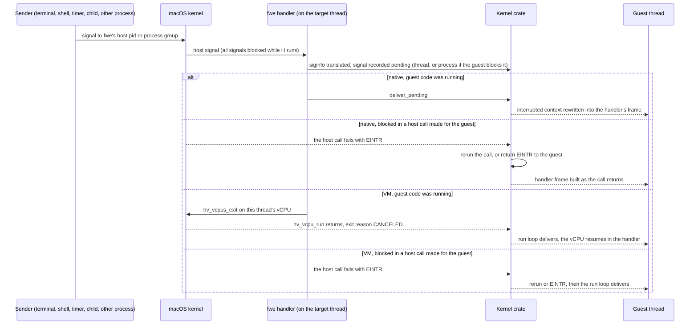

- **Running guest code:** natively, the handler interrupted the guest
  itself, so it delivers at once by rewriting the saved context, as Linux
  does on the way back to user space. In the VM it stops the vCPU, so a
  signal reaches even a guest spinning without system calls.
- **Blocked in a host call:** while fwe runs a call for the guest the
  thread's guest mask is in force on the host, so a signal the guest takes
  interrupts the host call. The handler only records it. The call then
  runs again if no guest handler waits for the signal, or if the handler
  has `SA_RESTART` and the call is one Linux restarts (reads, writes,
  `wait4`, `waitid`, socket calls, `openat`, `ioctl`, `flock`, `fcntl`,
  message queue calls, a futex wait without a timeout); otherwise it fails
  with `EINTR`. A signal arriving between a call's start and its host wait
  is a [known limitation](architecture.md#known-limitations).
- **Process-wide or thread:** a signal landing on a thread whose guest mask
  blocks it is recorded against the process (`thread::post_landed`), and
  the other threads are woken with `SIGEMT` to take it. `SIGPIPE` and
  `SIGXFSZ`, which the host raises on the thread that caused them, stay
  with that thread.
- **Default actions** fwe carries out: one that ends the process resets the
  host signal to default and raises it (after tearing the VM down), so the
  parent's `wait` sees death by that signal; one that stops it raises the
  host stop signal with its default action until the process is continued
  (`host::stop_with`), so the parent sees the stop.

#### siginfo and the sender

A Linux handler can ask who sent its signal and why. macOS's `siginfo`
carries much the same, in different codes and with host pids and uids,
and sometimes nothing at all. fwe translates what macOS gives and fills
the gaps from notes fwe processes leave each other:

| On macOS | What fwe does (`host::signal_info`) | What the guest sees |
|---|---|---|
| `si_code` of a sent signal (`SI_USER` = `0x10001`, `SI_QUEUE`, `SI_TIMER`, `SI_ASYNCIO`, `SI_MESGQ`) | translated (`host::si_code_to_linux`); the `SIGCHLD` and fault codes are the same on both | Linux's `si_code` (`SI_USER` = 0 …) |
| `si_pid` of the sender, a host pid | mapped into the guest's pid namespace | the sender's pid there, 0 for one outside it |
| `si_uid` of the sender | fwe's own host user → 0, any other → 65534, then through the user namespace | the sender's uid as the guest's ids go |
| an fwe process sent it | the sender first wrote a note (pid, uid, and for `SI_MESGQ` the code and value) into the target's mailbox, which the handler reads | the sender, even when macOS gave none |
| a `siginfo` macOS emptied (a signal that arrived while an fwe handler ran) | the note, if an fwe process sent it; for `SIGCHLD`, a `waitid(WNOHANG \| WNOWAIT)` finds the child and how it changed | the sender or child, as Linux tells it; none for a non-fwe sender |
| a `SIGIO` the host raised for a descriptor's readiness | no sender: `SI_KERNEL` | see [Network events](#network-events) |
| a fault | the fault address | `si_addr` |

#### Signals with no counterpart

Some signals exist on one side only. macOS's two extra signals are fwe's
own tools, so fwe must decide what one means when it comes from somewhere
else; Linux's extra signals never come from the host at all:

| On macOS | What fwe does | What the guest sees |
|---|---|---|
| `SIGEMT` (7), from fwe itself | the wake signal: interrupts a thread blocked in a host call so it notices a signal recorded for it; nothing is recorded | the signal it was woken for |
| `SIGEMT` from any other process | the same: it only interrupts | nothing; an interrupted call runs again |
| `SIGINFO` (29), from another fwe process | the kill relay, sent instead of an uncatchable `SIGKILL`: a native process kills itself with `SIGKILL`, a VM process tears its VM down first (see [hypervisor.md](hypervisor.md#never-end-a-vm-process-abnormally)) | death by `SIGKILL` |
| `SIGINFO` from anywhere else (`kill -INFO`) | no note came with it, so it is no relay: dropped, as Linux has no such signal | nothing |
| a child killed by a host signal with no Linux number | `host::signal_to_linux` gives `SIGABRT` | a child killed by `SIGABRT` |
| Linux's `SIGSTKFLT`, `SIGPWR` and real-time signals | never come from the host; recorded within the process, or queued in another fwe process's mailbox and that process woken with `SIGEMT` | delivered with fwe's own `siginfo` |
| a guest killed by one of those (default action) | no host signal to die of: leaves its Linux status beside its record, then exits with 128 + the signal | an fwe parent sees it killed by that signal; a host shell sees 128 + the signal |

#### Where each signal comes from

To close the signal story, here is each source on the host, the signal
macOS sends for it, and where its fuller explanation is:

| Host source | Host signal | What fwe does | What the guest sees |
|---|---|---|---|
| a key in the terminal | `SIGINT`, `SIGQUIT`, `SIGTSTP` | relayed | see [Terminals and key strokes](#terminals-and-key-strokes) |
| the terminal resized | `SIGWINCH` (28 on both) | relayed; the host's default (ignore) unless the guest catches it | `SIGWINCH`; `TIOCGWINSZ` reads the new size |
| the terminal closed or its session leader gone | `SIGHUP` | relayed | `SIGHUP`, death by default |
| a host shell's `kill`, `launchctl`, any process | any | relayed, sender translated | see [A process killed from the host](#a-process-killed-from-the-host) |
| a write to a pipe with no reader | `SIGPIPE` on the writing thread | relayed to that thread; with the guest ignoring it, only `EPIPE` | `SIGPIPE`, `EPIPE` |
| a write to a socket whose peer has gone | none (`SO_NOSIGPIPE`) | fwe raises `SIGPIPE` on the thread unless `MSG_NOSIGNAL` | `SIGPIPE`, `EPIPE` |
| a write past `RLIMIT_FSIZE` | `SIGXFSZ` on the writing thread | relayed to that thread | `SIGXFSZ`, `EFBIG` |
| CPU time past `RLIMIT_CPU`'s soft limit | `SIGXCPU` | relayed, and the host's soft limit raised a second; past the hard limit fwe ends the process with `SIGKILL`, which macOS does not send | `SIGXCPU` each second, then `SIGKILL` |
| an interval timer expiring | `SIGALRM`, `SIGVTALRM`, `SIGPROF` (same numbers) | relayed | the timer's signal |
| a child stopping, continuing or ending | `SIGCHLD` (20) | relayed as 17 | see [Children ending](#children-ending) |
| descriptor readiness under `O_ASYNC`, out-of-band data | `SIGIO` (23), `SIGURG` (16) | relayed as 29 and 23; `SIGIO` turned into the descriptor's `F_SETSIG` signal | see [Network events](#network-events) |
| guest code faulting | `SIGSEGV`, `SIGBUS`, `SIGILL`, `SIGFPE`, `SIGTRAP` (native) | fwe's fault handlers | see [Faults in guest code](#faults-in-guest-code) |

### Faults in guest code

When guest code does something the CPU refuses — touches an unmapped
address, executes an undefined instruction, hits a breakpoint — Linux
sends the program a signal. Under fwe the CPU's report reaches fwe
differently per backend. In the native backend a fault in guest code is a
host signal to fwe's fault handler (`on_fault` and `on_sigtrap` in
`crates/native/src/trap.rs`), and not every such signal is a fault the
guest should see: some are fwe's own traps.

| On macOS (native) | What fwe does | What the guest sees |
|---|---|---|
| `SIGTRAP` at `brk #0x4c58` | the rewritten `svc #0`: a system call | the call's result |
| `SIGTRAP` at any other `brk` | the guest's own breakpoint | `SIGTRAP`, `si_addr` the `brk` |
| `SIGTRAP` where the pc holds no `brk` | sent by another process | a relayed `SIGTRAP` |
| `SIGILL` at `mrs <Xt>, ctr_el0` | emulated | the value, as Linux lets EL0 read it |
| `SIGSEGV`/`SIGBUS` on write+exec memory | the page switched between writable and executable, the access retried | nothing |
| `SIGBUS` for an access the page's protection forbids (macOS reports some so) | turned into Linux's signal for it | `SIGSEGV` |
| `SIGBUS` for an access the protection allows (past a mapped file's end) | kept | `SIGBUS` |
| a fault signal with a note from another fwe process | a sent signal, not a fault | that signal, with its sender |
| a fault in fwe's checked copy of guest memory | the copy stops at its recovery point | the call fails with `EFAULT` |
| a fault in fwe's own code anywhere else | fatal | the process dies of that signal |

In the VM a fault is an exception the run loop reads from `ESR_EL1`
([hypervisor.md](hypervisor.md#the-run-loop)); the host sends no signal.
Each exception becomes Linux's signal for it:

| VM exception | What the guest sees |
|---|---|
| data or instruction abort, not a page still to fetch or a stale TLB entry | `SIGSEGV`, `si_addr` the faulting address |
| stage-2 abort | `SIGSEGV` |
| PC or SP alignment | `SIGBUS` |
| `brk` | `SIGTRAP` |
| BTI, unknown or other exception | `SIGILL` |
| trapped `CNTPCT_EL0` read | the virtual counter's value |
| `wfi`, `wfe` | stepped over |

A fault with a guest handler enters it with Linux's frame. With none, the
process dies of the signal (natively after a register and code dump under
`--strace`; in the VM after teardown), so the parent sees Linux's status.

### Terminals and key strokes

The terminal is the host's: the guest's standard descriptors are the
terminal's host descriptors, and the line discipline that turns key
strokes into characters and signals is macOS's, set from the guest's
`termios`. So a key stroke that means a signal (Ctrl-C, Ctrl-Z) becomes a
macOS signal to the foreground process group, which fwe then relays as
above. Ctrl-C makes a good example; the three branches are the three
things a guest can have chosen for `SIGINT`:

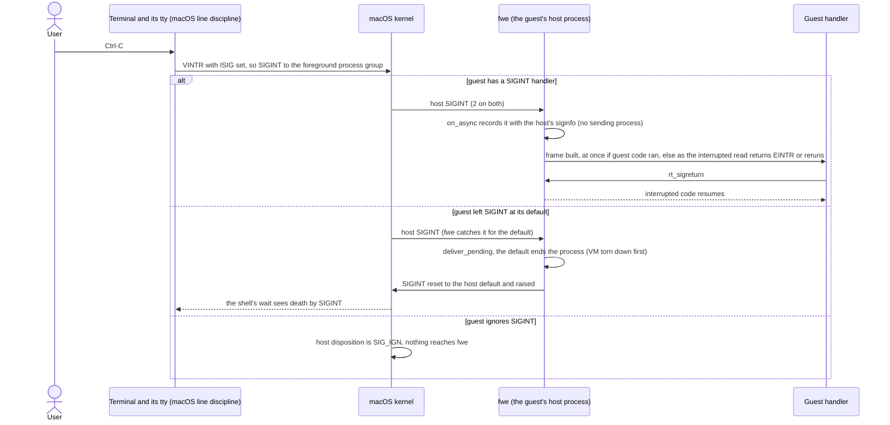

#### Key strokes

Each special key, what macOS does with it, and what the guest ends up
seeing:

| On macOS | What fwe does | What the guest sees |
|---|---|---|
| Ctrl-C (`VINTR`, with `ISIG`): `SIGINT` to the foreground group | relayed (sequence above) | `SIGINT` |
| Ctrl-\\ (`VQUIT`): `SIGQUIT` | relayed; a default ends the process with the host `SIGQUIT` | `SIGQUIT`; a core file, as Linux writes one, if `RLIMIT_CORE` allows |
| Ctrl-Z (`VSUSP`): `SIGTSTP` (18) | relayed as 20; a default stop is fwe's: it stops itself with the host `SIGTSTP` | `SIGTSTP`; the shell sees the job stopped by `SIGTSTP` |
| `fg`/`bg`: `SIGCONT` (19) | the host continues the process; a guest handler is entered | `SIGCONT` (18) |
| Ctrl-T (`VSTATUS`, macOS only): `SIGINFO` to the foreground group | no note came with it, so it is no kill relay: dropped; once the guest sets its `termios`, which has no such key, Ctrl-T and Ctrl-Y (`VDSUSP`) are disabled (`_POSIX_VDISABLE`) | nothing; with the keys disabled, the character as input |
| Ctrl-D, Ctrl-S/Ctrl-Q, erase, kill, `VLNEXT` and the rest of canonical editing | done by the host's line discipline as the guest's `termios` sets it | the edited line; `read` returns 0 at end of file |
| a background job reads (or, with `TOSTOP`, writes) the terminal: `SIGTTIN`/`SIGTTOU` | relayed; a default stop is fwe's, as for `SIGTSTP` | the job stops |
| the window resized: `SIGWINCH` | relayed | `SIGWINCH`; `TIOCGWINSZ` the new size |

#### termios and terminal requests

The guest configures the line discipline with Linux's `termios` and
`ioctl` requests, which fwe translates to macOS's:

| Linux | macOS | fwe (`crates/kernel/src/term.rs`, `sys_ioctl`) |
|---|---|---|
| `TCGETS`, `TCSETS`/`TCSETSW`/`TCSETSF` | `tcgetattr`, `tcsetattr(TCSANOW / TCSADRAIN / TCSAFLUSH)` | translated field by field |
| 32-bit flag words | 64-bit `tcflag_t`, other bit positions | each flag Linux and macOS share mapped by name; `CSIZE` mapped |
| `c_cc[19]` in Linux's order | `c_cc[20]` in another order, with `VSTATUS` and `VDSUSP` | the 16 characters both have mapped by name; a guest's `TCSETS` writes the macOS-only ones as 0, which macOS takes as the NUL character (its "disabled" value is `0xff`) |
| baud in `c_cflag` | `c_ispeed`/`c_ospeed` | reported as `B38400`; set to 38400 |
| `TIOCGWINSZ`, `TIOCSWINSZ` | the same | passed through |
| `TIOCGPGRP`, `TIOCSPGRP` | `tcgetpgrp`, `tcsetpgrp` | the group mapped through the pid namespace; one not in it is `EPERM` |
| `TIOCSCTTY`, `TIOCNOTTY` | the same | passed through |
| a terminal request on something that is not a terminal | `ENODEV` (`/dev/null`) or `EOPNOTSUPP` | `ENOTTY`, as Linux answers |

#### Job control and ptys

Process groups, sessions and the controlling terminal are the host's, so a
guest shell and a host shell share job control on one terminal. Linux's
pseudo-terminal interface is mapped onto macOS's:

| Linux | macOS | fwe |
|---|---|---|
| process groups and sessions (`setpgid`, `setsid`, `getpgid`, `getsid`) | the host's | the host's, with ids mapped through the guest's pid namespace; fwe records each process's group |
| the foreground group, the controlling terminal | the host tty's | the host tty's, so a host shell and a guest shell share job control |
| `/dev/ptmx`, `TIOCGPTN`, `TIOCSPTLCK`, `/dev/pts/N` | `posix_openpt`, `grantpt`, `unlockpt`, `ptsname`, `/dev/ttysNNN` | `/dev/ptmx` allocates with `posix_openpt` and numbers the slave; `TIOCGPTN` returns that number; `TIOCSPTLCK` is accepted (the slave is unlocked already); `/dev/pts/N` opens the host slave (`crates/kernel/src/pty.rs`) |

### Children ending

A child guest process is a host child process, so when it ends macOS
tells the parent with `SIGCHLD` and a status word, both in macOS's terms.
fwe translates the signal and the status, and records how the child ended
so that what Linux shows and macOS cannot (a Linux-only signal, an
adopter) comes out right:

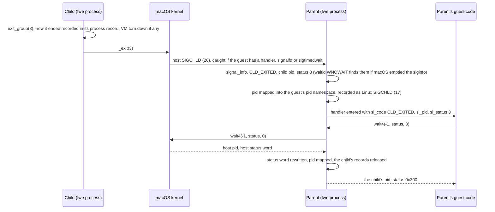

Each way a child can change, and what the parent's guest sees:

| On macOS | What fwe does | What the guest sees |
|---|---|---|
| a child exited with code *n* | status word kept | `n << 8` |
| a child killed by a host signal | the Linux status the child left beside its record (`procreg::ending`), with the core bit if fwe wrote a core; else the signal mapped (`host::signal_to_linux`) | Linux's signal number, `0x80` if a core was dumped |
| a child stopped | the stop signal mapped | `sig << 8 \| 0x7f` |
| a child continued | — | `0xffff` |
| a guest child ended by a Linux-only signal | it exited with 128 + the signal, leaving its Linux status beside its record | killed by that signal |
| `SIGCHLD` `siginfo`: `CLD_KILLED`/`CLD_DUMPED`/`CLD_STOPPED` | `si_status` mapped to Linux's signal | Linux's signal number |
| `SIGCHLD` `siginfo`: `CLD_CONTINUED` | `si_status` is what stopped it on macOS; set to what continued it | `SIGCONT`, as Linux reports |
| `rusage` from `wait4` | `ru_maxrss` from bytes to KiB | Linux's `rusage` |
| `waitid` | the host gives no `rusage` | zero-filled `rusage` |
| the guest ignores `SIGCHLD`, or set `SA_NOCLDWAIT` | the host reaps the children itself | no zombies, as on Linux |
| the parent ends | the child goes to `launchd` on the host | its Linux adopter, below; a `PR_SET_PDEATHSIG` signal, which a thread of fwe's in the child waits on the parent's exit (`kqueue`) to send (`crates/kernel/src/pdeath.rs`) |

#### Orphans and reapers

Linux gives an orphan to its nearest child subreaper
(`PR_SET_CHILD_SUBREAPER`) or its pid namespace's init. macOS gives every
orphan to `launchd`, and only a parent may `wait` for a process. fwe keeps
the adoption itself (`crates/kernel/src/reaper.rs`):

- each process record holds its line of ancestors and whether it is a
  subreaper, so `getppid` and `/proc/<pid>` name the adopter;
- a process that ends where a reaper might adopt it records how it ended
  (one killed by `SIGKILL` is recorded by whoever finds it gone);
- a reaper runs a watcher thread on `kqueue` process events and raises
  `SIGCHLD` in itself for an adopted descendant's end, stop or continue,
  with a child's `siginfo`, and wakes its threads waiting in `wait`;
- its `wait` looks at its own children, then the adopted ones.

### A process killed from the host

A guest process can be signalled by any host program, not only by other
guests: a `kill` in a host shell, Activity Monitor, `launchctl`. Such a
sender leaves no note, so the guest learns what macOS's `siginfo` says;
and the signals fwe uses for itself mean what they mean to fwe:

| On macOS | What fwe does | What the guest sees |
|---|---|---|
| `kill -TERM <pid>` (or `-INT`, `-HUP`, `-USR1` …) from a host shell or any process fwe does not run | a host signal like any other; the sender is a host pid with no note | the signal, `si_code` `SI_USER`, `si_pid` the sender in the initial pid namespace (0 from inside a nested one), `si_uid` 0 if it runs as fwe's user, else 65534 |
| `kill -9` of a native process | none: the host ends it at once, no handler runs | its parent sees death by `SIGKILL`; a reaper that finds it gone records it |
| `kill -9` of a VM process | none: it ends with its VM alive, which can bring the machine down ([hypervisor.md](hypervisor.md#never-end-a-vm-process-abnormally)) | — |
| `kill -INFO <pid>` | no note came with it, so it is no kill relay: dropped | nothing |
| `kill -EMT <pid>` | the wake signal: only interrupts | nothing |
| `kill -STOP`, `kill -CONT` | the host's own | the process stops and continues; a parent's `wait` with `WUNTRACED` sees the stop by `SIGSTOP` (19) |
| `kill -SEGV <pid>` (a fault signal) from a process fwe does not run | macOS gives it the thread's last fault, and no note says it was sent | taken as a fault ([limitations](architecture.md#known-limitations)) |

### Files changing on the host

The guest's files are host files, so host programs can change them at any
time. What the guest notices depends on how it looks: through a shared
mapping it sees the change, through inotify it sees only what other fwe
processes do, since fwe raises inotify events itself:

| On macOS | What fwe does | What the guest sees |
|---|---|---|
| an fwe process changes, opens, reads or closes a watched file | raises Linux's inotify events from its own calls | the events |
| a program fwe does not run changes a watched file | nothing: no host event names it as Linux's events do | no inotify event |
| a host process writes a file the guest mapped `MAP_SHARED` | the mapping is a host shared mapping (native) or a segment of one (VM) | the change |
| a host process writes a file the guest mapped privately | native: a host private mapping; VM: a copy taken when mapped | native: as the host shows it; VM: never |
| a host process holds a POSIX record lock or an OFD lock | guest locks are host locks | the conflict |
| a file owned by another host user | owner translated | owner 65534 |
| a file fwe's user owns | owner translated | owner 0 (root) |
| the host's own extended attributes (`com.apple.*`) | not listed | only Linux's namespaces |
| a guest's working directory renamed by another process | fwe keeps the path ([limitations](architecture.md#known-limitations)) | the old path |

### Network events

Guest sockets are host sockets: connections, data and the ports in the
initial network namespace are the host's, shared with every host program.
What arrives does so as `kqueue` events, which fwe turns into `epoll`
events with Linux's meaning for each kind of descriptor:

| On macOS | What fwe does (`crates/kernel/src/epoll.rs`) | What the guest sees |
|---|---|---|
| a `kqueue` read filter fires | `EVFILT_READ` → `EPOLLIN` | `EPOLLIN` |
| a write filter fires | `EVFILT_WRITE` → `EPOLLOUT` | `EPOLLOUT` |
| `EV_EOF` on a socket's read filter (peer shut its writing side) | readable, and so marked | `EPOLLIN \| EPOLLRDHUP`, with `EPOLLHUP` for a Unix socket (Linux shuts both ways) |
| `EV_EOF` on both of a socket's filters | hung up | `EPOLLHUP` added |
| `EV_EOF` on a pipe's or terminal's read filter | hung up, readable while data is left | `EPOLLHUP`, `EPOLLIN` while data is left |
| `EV_EOF` on a pipe's write filter (readers gone) | an error to write | `EPOLLOUT \| EPOLLERR` |
| `EV_ERROR` | — | `EPOLLERR` |
| a FIFO's last writer gone (macOS reports nothing) | `select` asked between short slices | `POLLHUP`/`EPOLLHUP` |
| readiness on an `O_ASYNC` descriptor: host `SIGIO` with no sender | the descriptor and its events found with `poll`; sent as the signal `F_SETSIG` chose, to the owner thread if one is set | that signal with `si_fd`, `si_band` and `POLL_IN`/`POLL_OUT`/`POLL_PRI`/`POLL_HUP` |
| out-of-band data: `SIGURG` (16) | relayed | `SIGURG` (23) |
| reading an unconnected Unix stream socket: `ENOTCONN` | Linux's answer | `EINVAL` |
| an interface or route changes | no netlink outside an fwe network namespace (`EOPNOTSUPP`) | nothing |
| the host's DNS settings | not read: the resolver reads the rootfs's `/etc/resolv.conf` and `/etc/hosts` | the rootfs's |

### Clocks and timers

Time comes from the host's clocks, so the guest's time is the Mac's. Linux
has more clocks than macOS; fwe reads each from the host clock that means
the same:

| On macOS | What fwe does | What the guest sees |
|---|---|---|
| the host's realtime clock, set by the user or NTP | `CLOCK_REALTIME`, `TAI`, `*_COARSE`, `*_ALARM` read it | the host's time; the guest cannot set it (`EPERM`) |
| the host's monotonic clocks | `MONOTONIC`, `BOOTTIME` and their variants read `CLOCK_MONOTONIC`; `MONOTONIC_RAW` reads `CLOCK_MONOTONIC_RAW` | the host's |
| a host thread's or process's CPU time | the CPU-time clocks | its CPU time |
| an interval timer expiring | relayed signal | `SIGALRM`, `SIGVTALRM`, `SIGPROF` |
| a timerfd's `EVFILT_TIMER` firing | counted | a readable timerfd and its expiration count, to the millisecond |
| a sleep interrupted by a signal the guest handles | `nanosleep`, `clock_nanosleep` are not restarted | `EINTR` |
| VM: the guest reads the counter | `CNTVCT_EL0` is the vCPU's virtual counter; a `CNTPCT_EL0` read is emulated from it | one counter, as on Linux |

### Memory pressure

macOS manages memory its own way (compression, swap files) and has no OOM
killer that Linux programs could observe. fwe does not pass the host's
memory state through:

| On macOS | What fwe does | What the guest sees |
|---|---|---|
| free memory, compression, swap | not read | `/proc/meminfo` and `sysinfo` report fixed values: 8 GiB total, 4 GiB free, 6 GiB available, no swap |
| a host `mmap` that cannot be satisfied | `ENOMEM` | `ENOMEM` |
| the guest stack running into its guard page | a fault | `SIGSEGV` |
| no OOM killer (Linux ranks processes to kill) | `oom_score_adj` kept per process, `oom_score` derived from it | the files, with Linux's rules for writing them |
| `mlock` | pages brought in, not wired | success within `RLIMIT_MEMLOCK` |

### Errors

Host calls fail with macOS's `errno`; `host::errno_to_linux` turns each
into the Linux errno of the same meaning, by a table searched in order:

| On macOS | What the guest sees |
|---|---|
| an errno both have (`ENOENT`, `EAGAIN`, `ECONNREFUSED`, …), whatever its number on each | the Linux number of the same name |
| `ENOTSUP` (macOS's, beside `EOPNOTSUPP`) | `EOPNOTSUPP` |
| `ENOATTR` (no such extended attribute) | `ENODATA` |
| an errno Linux has no equivalent of (`EAUTH`, `EBADRPC`, `EPWROFF`, …) | `EIO` |
| `ENODEV` or `EOPNOTSUPP` from a terminal request on a non-terminal | `ENOTTY` (`host::tty_error`) |

Where the two kernels give different errors for the same case, the call
answers as Linux does: reading an unconnected Unix stream socket is
`EINVAL` rather than `ENOTCONN`, `epoll_ctl` checks its arguments in
Linux's order, and so on; each is documented with its call in
[architecture.md](architecture.md).

### Host identity and machine state

Finally, what the guest learns about who it is and what machine it runs
on. fwe presents the host user as root, as a rootless container does, and
the machine as a Linux machine with the host's CPUs, uptime and load:

| On macOS | What fwe does | What the guest sees |
|---|---|---|
| the user fwe runs as (uid 501, say) | is root in the guest, as in a rootless container's user namespace (`host::uid_to_linux`) | its own ids are virtual, root by default, with every capability but `CAP_SYS_TIME`; files fwe's user owns are owned by 0 |
| fwe's own group | `host::gid_to_linux` | group 0 |
| every other host user and group | `OVERFLOW_ID` | 65534 (`nobody`) |
| the host name (up to 255 bytes) | cut to Linux's 64 (`ns::host_name`) | `uname`'s `nodename`, `/proc/sys/kernel/hostname`; `sethostname` in the initial UTS namespace fails with `EPERM` |
| the macOS kernel | not shown | `uname`: `Linux`, `6.12.0-fwe`, `#1 SMP PREEMPT`, `aarch64` |
| host pids | used as guest pids in the initial pid namespace | host pids; `/proc` lists only fwe's processes |
| online CPUs (`sysconf`) | counted | `/proc/cpuinfo`, `/proc/stat`, `sched_getaffinity`, `sysinfo` |
| CPU features (`hw.optional.*`) | `AT_HWCAP`/`AT_HWCAP2` ([auxv](#auxv-hwcaps-and-the-vdso)) | the hwcaps; `/proc/cpuinfo` lists `fp asimd` |
| boot time, uptime, load averages, per-CPU times | read from the host | `/proc/uptime`, `/proc/loadavg`, `/proc/stat`, `sysinfo` |
| another process's state, times and memory (`proc_pidinfo`) | read from the host | `/proc/<pid>/stat` and the like |
| a filesystem's type and sizes (`statfs`) | type reported as ext4 | ext4, the host's sizes |
