# Linux on macOS

## Summary

fwe runs Linux programs built for arm64 on a Mac with Apple Silicon. Both
sides use the same processor, so a Linux program's instructions run on the
Mac's CPU as they are. What differs is the kernel: a Linux program asks for
files, memory, processes and signals in Linux's terms and expects to hear
back in Linux's terms about key strokes, children ending, data arriving and
errors. fwe stands in for that kernel: it catches each request, carries it
out with what macOS offers, and turns what macOS reports into what Linux
would have said.

fwe runs a program one of two ways, chosen per program:

- **The native backend** runs it inside the fwe process. Before any of its
  code runs, fwe rewrites the few instructions macOS cannot let a Linux
  program execute: the system-call instruction, accesses to the thread
  pointer, and uses of `x18`. Everything else runs unmodified.
- **The VM backend** runs it in a small virtual machine made with
  Hypervisor.framework, with an address space of its own and nothing
  rewritten; each system call leaves the VM and is served by the same code
  as natively. It is used only for programs the native backend cannot
  place in memory: non-position-independent executables linked below
  4 GiB.

This document covers how a program gets to run (which backend, what it
costs, how languages fare, which instructions are rewritten, how the VM is
used), then both directions of the mapping:

- **[Linux to macOS](#linux-to-macos)**: for each Linux primitive, what
  Linux does, what macOS has, and what fwe does.
- **[macOS to Linux](#macos-to-linux)**: what happens on the host (a
  signal, a key stroke, a child ending, a file changing, a clock, an
  error) and what the guest sees of it.

How fwe's parts are built is in [architecture.md](architecture.md), where
fwe still differs from Linux in its
[known limitations](architecture.md#known-limitations), and running the VM
backend, its safety rules and its tests in [hypervisor.md](hypervisor.md).

## Contents

- [Two kernels, one CPU](#two-kernels-one-cpu)
- [Which binaries run where, and why](#which-binaries-run-where-and-why)
- [Which binaries need the least translation](#which-binaries-need-the-least-translation)
- [Languages and runtimes](#languages-and-runtimes): C and C++, musl,
  Rust, Go, Python, Node.js, Java, Wine
- [Which instructions get translated, and how](#which-instructions-get-translated-and-how)
- [How the VM is actually used](#how-the-vm-is-actually-used)
- [Linux to macOS](#linux-to-macos)
  - [System calls by category](#system-calls-by-category)
  - [The CPU](#the-cpu): system call entry and return, registers and
    errno, TLS, `x18`, cache maintenance, PAC and BTI, auxv and hwcaps,
    the vDSO
  - [Memory](#memory): layouts, pages and translation, the `mmap` family,
    write+exec memory, shared memory
  - [Processes](#processes): `fork`, `vfork`, threads and futexes,
    `execve`, the ELF loader, `wait`, `ptrace`
  - [Signals](#signals): numbers, dispositions, masks and frames, sending
  - [Files and descriptors](#files-and-descriptors), [/proc, /sys and
    /dev](#proc-sys-and-dev)
  - [Waiting and events](#waiting-and-events): `epoll`, `eventfd`,
    `timerfd`, `signalfd`, inotify, pidfds
  - [IPC](#ipc): sockets, System V IPC, POSIX message queues, keyrings
  - [Kernel-wide state](#kernel-wide-state),
    [namespaces](#namespaces), [cgroups](#cgroups), [mounts](#mounts),
    [credentials and capabilities](#credentials-and-capabilities),
    [seccomp](#seccomp), [security modules](#security-modules-selinux-apparmor-landlock),
    [seccomp profiles](#seccomp-profiles), [eBPF](#ebpf),
    [isolation and security](#isolation-and-security), [devices](#devices)
  - [Time, scheduling and limits](#time-scheduling-and-limits)
  - [Not available](#not-available)
- [macOS to Linux](#macos-to-linux)
  - [Host signals](#host-signals): how one reaches a guest handler,
    `siginfo` and senders, signals with no counterpart, each signal's
    source
  - [Faults in guest code](#faults-in-guest-code)
  - [Terminals and key strokes](#terminals-and-key-strokes): Ctrl-C,
    Ctrl-Z, Ctrl-\\, Ctrl-T, window size, `termios`, job control, ptys
  - [Children ending](#children-ending): `SIGCHLD`, wait statuses,
    [orphans and reapers](#orphans-and-reapers)
  - [A process killed from the host](#a-process-killed-from-the-host)
  - [Files changing on the host](#files-changing-on-the-host)
  - [Network events](#network-events)
  - [Clocks and timers](#clocks-and-timers)
  - [Memory pressure](#memory-pressure)
  - [Errors](#errors)
  - [Host identity and machine state](#host-identity-and-machine-state)

## Two kernels, one CPU

Every guest process is one host process: a copy of `fwe` holding the
guest's code and memory and a Linux kernel of fwe's making, the *kernel
crate*. The guest reaches the kernel crate through a *backend*, which
catches its system calls and delivers signals into it; the kernel crate
reaches macOS through ordinary C library calls. What Linux keeps in one
kernel for all processes (mount tables, namespaces, IPC objects) fwe keeps
in records its processes share.

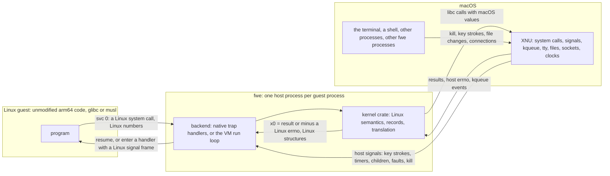

Only what the two kernels define differently needs bridging: the
system-call interface, a few registers macOS reserves, the address space,
the kernel objects macOS lacks or shapes differently, and the events it
reports in its own terms. The backends bridge the first three differently
and share the rest:

| | Native backend | VM backend |
|---|---|---|
| Runs | every position-independent program, and `ET_EXEC` images linked at or above 4 GiB | non-PIE executables linked below 4 GiB, and under `--vm` every program of the run |
| Guest code | in the `fwe` process, after rewriting | at EL0 in a Hypervisor.framework VM, unmodified |
| Page size the guest sees | 16 KiB (the host's) | 4 KiB |
| Guest addresses | host addresses | host addresses, except fixed-address ranges outside the memory set aside for the VM (the *slab*), such as a low-linked image, which are translated |
| System calls go to | the kernel crate | the same kernel crate |
| Host signals reach the guest | the handler rewrites the interrupted guest context | the handler stops the vCPU, the run loop delivers |

## Which binaries run where, and why

fwe picks a backend for each program from its ELF headers alone, because
of how the two kernels lay out a process's memory.

### The low 4 GiB

On Linux an arm64 process owns its whole lower address space. A program
that is not position-independent (an `ET_EXEC` file) runs only at the
address it was linked for: the usual toolchains use `0x400000` (4 MiB), Go
uses `0x10000` (64 KiB) for static programs.

macOS gives every arm64 process a mandatory 4 GiB `__PAGEZERO` at address
0, so nothing can be mapped below 4 GiB, and Apple's loader refuses a
smaller one. The native backend runs the guest at the guest's own
addresses inside the fwe process, so a program linked below 4 GiB has
nowhere to go there. A position-independent program (`ET_DYN`, a PIE) goes
wherever macOS has room, and an `ET_EXEC` program linked at or above 4 GiB
at its own address.

### How fwe decides

`needs_vm` (`crates/native/src/lib.rs`) asks one question: is this a
non-PIE executable whose lowest loaded page lies below 4 GiB? If so it
runs in the VM, otherwise natively. `fwe --vm` runs every program of the
run in the VM instead (each fwe it starts is given `--vm` too), for
programs that need 4 KiB pages, such as Wine; a position-independent one
is placed in the slab. Static or dynamic, glibc or musl, C,
Rust or Go make no difference. A guest's `execve` of such a program where
there is no VM to run it (no stand-in, and fwe without the hypervisor
entitlement or the Mac without `kern.hv_support`, both asked of the
kernel) fails with `ENOEXEC` while the caller is intact, so it can go on:
podman's pause process, whose `catatonit` is one, then waits in a loop of
its own.

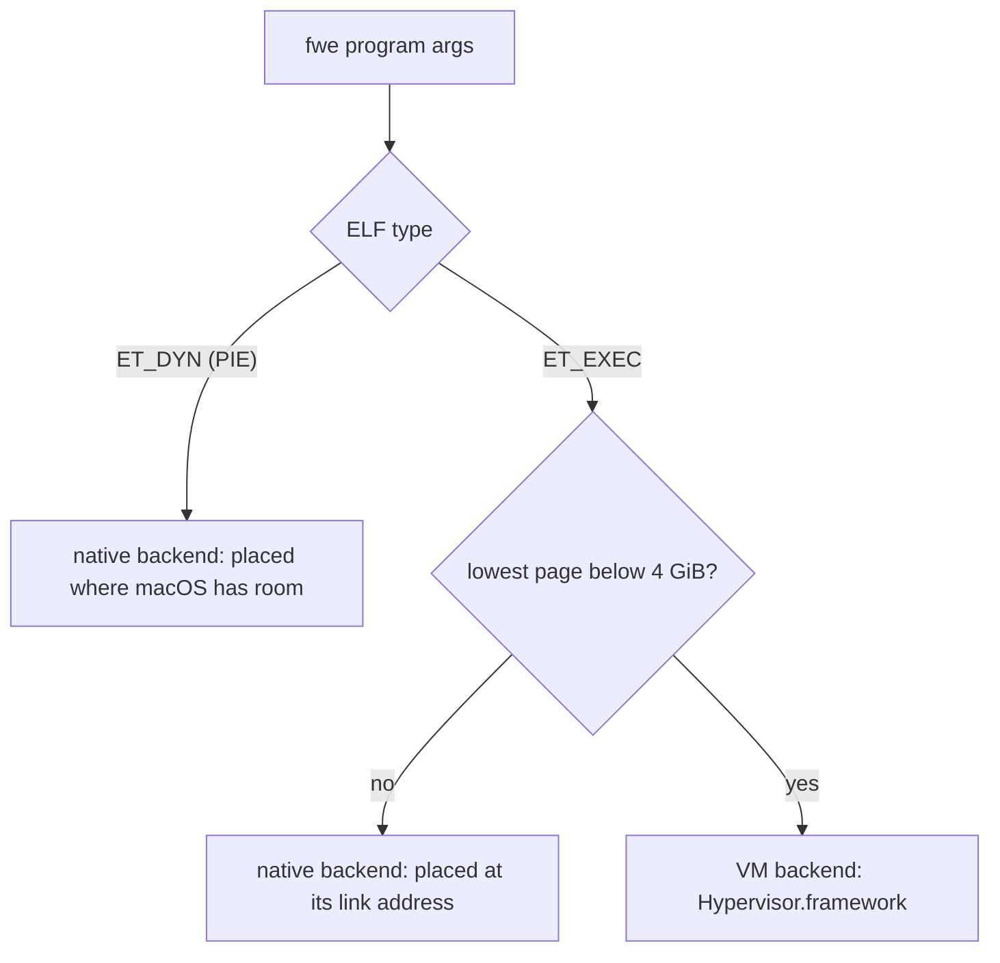

| Binary | Example | Backend |
|---|---|---|
| dynamic PIE | Debian's `bash`, `git`, coreutils, Node.js | native |
| static PIE | `musl-gcc -static-pie`, Rust's `+crt-static` with PIE | native |
| static non-PIE linked at or above 4 GiB | fwe's test guests, linked at 1 TiB (`--image-base=0x10000000000`) | native |
| non-PIE linked below 4 GiB, dynamic | Debian's `python3.11`, GCC and clang, at `0x400000` | VM |
| non-PIE linked below 4 GiB, static | static Go programs at `0x10000`; fwe's `rust-low` test guests | VM |

"Low-linked" in this documentation and the tests means the last two rows.
The test suite builds its Rust guests twice: at 1 TiB to run natively, and
at the toolchain's default address (`target/guests/rust-low`) to run the
same programs in the VM.

The VM backend needs `fwe` signed with the hypervisor entitlement and a
bare-metal Mac; without them a low-linked program fails to start with a
message saying so and status 126
([hypervisor.md](hypervisor.md#running-it-apple-silicon-no-root)).

### The dynamic linker

A dynamically linked program names its dynamic linker in `PT_INTERP`
(`/lib/ld-linux-aarch64.so.1` for glibc, `/lib/ld-musl-aarch64.so.1` for
musl). As Linux does, fwe resolves it in the guest's root filesystem,
loads it beside the program and starts there, with `AT_BASE` and
`AT_ENTRY` set. The interpreter must be position-independent (`ELIBBAD`
from `execve` otherwise), so it never decides the backend. The libraries
it maps later go through fwe's `openat` and `mmap` like any file; natively
their code is rewritten as it is mapped executable.

### Across execve

A program can `execve` one of the other kind: a shell in the VM runs a
native `ls`, a native `make` runs a low-linked `gcc`. When the new program
needs the VM, the caller is in the VM, or the caller has other live
threads, fwe re-executes itself on the new program and the fresh `fwe`
decides again. A single-threaded native process execing a native program
replaces it in place. What crosses is under [execve](#execve).

## Which binaries need the least translation

Every system call leaves guest code and enters fwe. Beyond that, the two
backends charge for different things; none of it changes what a program
computes, only how much fwe does at load time and how often the guest
stops running its own code.

### What the native backend charges for

- **Preparing code is a one-time scan** of each executable section the
  program and its libraries map, as it is mapped executable. Under
  `--strace` fwe notes for the program and its dynamic linker
  `prepared exe <addr>+<len>: N system calls, M stubs, K x18 uses left
  unrewritten` (`interp` for the dynamic linker). An image without an
  unwind table has every executable byte taken as code, which is slower
  and less precise ([What is scanned](#what-is-scanned)).
- **`svc #0`** branches to a stub that calls fwe's system-call gate: a
  plain call costs a function call into fwe and back, no trap and no host
  signal (`getpid` about 150 ns). Where no stub can be placed it is a
  `brk` instead, which costs a trap each time it runs.
- **`TPIDR_EL0` and `x18` instructions** branch to a short stub and back:
  a few extra instructions per execution, no trap. Linux toolchains seldom
  allocate `x18`, and a handful of absurd `x18` forms are left alone
  ([What is not translated](#what-is-not-translated)).
- **`CTR_EL0`** is emulated in fwe's `SIGILL` handler: C libraries read it
  once at startup; code that reads it often pays a trap each time.
- **Write+exec memory** costs two faults per round trip between writing
  and running a page ([Write+exec memory](#writeexec-memory)).
- **`fork`** is a host `fork` with copy-on-write memory, after fwe has
  paused the parent's other guest threads ([fork](#fork)).

### What the VM backend charges for

Nothing is rewritten or scanned; the costs move elsewhere:

- **Every system call and exception is a VM exit** (faults, `brk`, a
  trapped `CNTPCT_EL0` read, `wfi`/`wfe`), with the vCPU's registers read
  and written through the framework.
- **Memory calls edit page tables**, and one that takes access away
  (`munmap`, a narrowing `mprotect`) has every vCPU invalidate its TLBs
  before it resumes.
- **A private file mapping is a copy** of the file's data taken when
  mapped.
- **`fork` sends a new fwe process every page of guest memory that
  exists**, with the parent's vCPUs stopped; `vfork` fetches pages on
  first touch instead ([fork](#fork)). **`execve`** always re-executes fwe
  with a new VM.

### Choosing, and what runs best

fwe picks the backend from the binary, so the practical choice is how a
program is built:

| Program trait | Native | VM |
|---|---|---|
| static | one image prepared | loaded as is |
| dynamic | the dynamic linker and each library prepared as mapped | loaded as is; private file mappings copied |
| system call | a call into fwe's gate (a `brk` trap for what changes more than `x0`) | a vCPU exit and register transfers |
| thread-local variables (`TPIDR_EL0`) | a stub branch per access | the hardware register |
| code using `x18` | a stub branch per use | the hardware register |
| reading `CTR_EL0` | a trap per read | read by the guest |
| reading `CNTPCT_EL0` | read by the guest | a trap per read (`CNTVCT_EL0` is direct) |
| JIT, write+exec pages | a fault per switch between writing and running | no faults |
| `mmap`/`munmap` heavy | host calls | page-table edits, TLB invalidation on unmap |
| `fork` heavy | host `fork`, copy-on-write | new process, all memory copied |
| `posix_spawn`/`vfork` + `exec` | host `fork` sharing memory, then an in-place or re-exec `execve` | new process fetching pages, then a re-exec |

A program runs with the least translation when it is position-independent
(so a system call does not leave a VM), keeps its code apart from its data
in sections the unwind table describes (as compiler output does), leaves
`x18` alone, and does not switch pages between writing and executing. A
program that runs in the VM pays nothing for its code; its costs grow with
its system calls, memory mapping and forks.

### Examples

Most of these are what fwe's end-to-end tests run
(`crates/fwe/tests/guests.rs`, binaries described in
`guests/debian/README.md`, `guests/alpine/README.md` and the fetch
manifests beside them); rows marked "not tested by fwe" name software only
for a well-known property that puts it in the category.

| Category | Software | Why it is there |
|---|---|---|
| native, little rewriting | Debian's coreutils, bash, git, SQLite, lighttpd, apt (tested) | dynamic PIEs against glibc: the program, `ld-linux` and each library scanned once as mapped; the rewrites are system calls and thread-pointer accesses |
| native, Go built as PIE | Alpine's podman (building, pushing, pulling, rootless), containerd and Docker with BuildKit and Compose (tested) | Alpine builds its packages as PIEs, Go included; Debian's podman, containerd and runc are non-PIE and need the VM |
| native, C with musl | Alpine's crun, busybox (tested) | musl PIEs; crun runs its sealed copy from a memfd through `execveat` |
| native, many libraries | Debian's `cargo` and `rustc` with its LLVM library (tested) | a large dynamic PIE: a few very large libraries scanned once each |
| native, JIT | Debian's Node.js 18 with V8 (tested) | V8's generated code prepared as JIT code each time it becomes executable; OpenSSL's assembly keeps constant tables among its code, which the unwind-table rule leaves alone |
| native, JIT | the JVM (not tested by fwe) | a large code cache and many threads; see [Java](#java-and-the-jvm) |
| VM, interpreter | Debian's Python 3.11 (tested) | non-PIE at `0x400000`; its C extension modules loaded as they are |
| VM, compilers | Debian's GCC 12 (`gcc`, `cc1`, `collect2`) and clang 14 (tested) | non-PIE, linked low; GNU `as` and `ld` are PIEs and run natively, so every compiler stage is an `execve` between the backends |
| VM, Go toolchain | Debian's Go 1.19: `go`, `compile`, `link`, and the static executables it builds by default (tested) | linked low, non-PIE; `go` starts its tools with `vfork` |
| VM, container engine | Debian's podman 4.3 with its conmon and crun (tested) | podman is non-PIE, linked low; conmon and crun are PIEs and run natively; the pause process's `catatonit` is static and non-PIE, in the VM too |
| fork and exec heavy | bash scripts, `apt` running `dpkg`, the GCC driver, the `go` command (tested) | each child a host `fork` (native) or a new fwe process (VM); each `execve` that changes backend or starts in the VM re-executes fwe |
| system-call heavy | lighttpd serving files and CGI, git (tested) | many small reads, writes and `epoll` waits: each a trap natively or a VM exit |
| uses `x18` as Linux allows | hand-written assembly that allocates it; Wine on arm64, which keeps the Windows thread block in `x18` (tested, in the VM) | natively each use goes through a stub, and JIT code's uses are not rewritten; in the VM `x18` is the guest's own |

## Languages and runtimes

fwe runs machine code and does not distinguish languages. What differs is
how their programs are linked, which decides the backend, and how their
runtimes use threads, signals, memory and code generation. Where something
is not tested by fwe, the text says so and infers only from mechanisms the
code has.

### C and C++ on glibc

The common case is a dynamic PIE naming `/lib/ld-linux-aarch64.so.1`. From
the [dynamic linker](#the-dynamic-linker) on, glibc runs as on Linux:
`ld.so` reads `/etc/ld.so.cache` and the libraries from the guest's root,
maps them with fwe's `mmap`, applies relocations and RELRO, and sets the
thread pointer with `msr tpidr_el0` (rewritten natively). `AT_SECURE` is
0, so `LD_LIBRARY_PATH`, `LD_PRELOAD` and the rest act as on Linux. With
no vDSO, `clock_gettime` and `gettimeofday` are real system calls. A
low-linked glibc program runs the same way in the VM (tested with a small
program and with Debian's Python, GCC and clang). C++ adds nothing fwe
sees: `libstdc++` is one more library, and exceptions unwind in user
space.

### musl and Alpine

`/lib/ld-musl-aarch64.so.1` is musl's C library and dynamic linker in one;
static musl programs have no interpreter. Both run natively when
position-independent, as all of Alpine's are (tested: Alpine's root
filesystem, busybox and the container engines). musl enters the kernel
through the same `svc #0` as glibc.

### Rust

Rust programs are C-like to fwe. The default target
(`aarch64-unknown-linux-gnu`) builds dynamic PIEs against glibc, which run
natively; Debian's `rustc` and `cargo` build and test a project under fwe
(tested). A static `aarch64-unknown-linux-musl` build is a PIE or not
depending on how it is linked: fwe's test guests are non-PIE, linked with
`ld.lld` at 1 TiB to run natively, and at the default address (the
`rust-low` guests) to run in the VM (both tested). The standard library's
threads and futexes go through libc.

### Go

Go's runtime makes system calls itself with `svc #0`, starts threads with
`clone`, parks them on futexes, handles nearly every signal on an
alternate stack, and preempts goroutines by sending `SIGURG` to a thread
with `tgkill`. fwe meets these as for C: the `svc`s are rewritten (native)
or trapped (VM), `clone` makes a host thread (with its own vCPU in the
VM), and a `tgkill` of a caught signal is posted to that thread and the
thread woken ([Sending a signal](#sending-a-signal)), which in the VM stops
its vCPU even in a loop with no system calls.

Debian's Go 1.19 toolchain and the static executables it builds by default
are linked low, non-PIE, and run in the VM (tested: `go` builds, runs and
tests a module with goroutines). Go programs built as PIEs, as Alpine
builds podman, containerd and Docker, run natively (tested). `go` starts its tools
with `vfork`, supported in both backends.

### Python and other interpreters

An interpreter is an ordinary program to fwe; its scripts are data.
Debian's Python 3.11 is linked non-PIE at `0x400000` and runs in the VM;
its test covers C extension modules, threads, sockets, asyncio, `ctypes`
and libffi closures, signals, `fork`, `subprocess` and a process pool
sharing POSIX semaphores through `/dev/shm`. A Python built as a PIE would
run natively, as bash does (tested).

### Node.js and V8

Debian's Node.js 18 is a dynamic PIE and runs natively (tested: V8's JIT
on a hot function, ICU, OpenSSL digests, zlib, timers and promises, a
child process, an HTTP server and client, and a worker thread). Each time
a page of V8's generated code becomes executable, fwe prepares it as JIT
code: system calls and thread-pointer accesses are rewritten, `x18` is
not, which suits V8 since it reserves `x18`
([What is scanned](#what-is-scanned)).

### Java and the JVM

Not tested by fwe. Inferred from how a HotSpot JVM is generally built and
from fwe's mechanisms:

- **Backend:** a `java` launcher built as a PIE, as Debian builds its
  programs, runs natively; the JVM itself is a shared library
  (`libjvm.so`).
- **JIT code:** each page of HotSpot's code cache becomes executable
  through an `mprotect` or a write+exec fault and is prepared as JIT code.
  If the generated code uses `x18` (HotSpot reserves it only on platforms
  that do, which Linux does not), those uses are not rewritten and lose
  their value whenever macOS clears `x18`: the largest risk.
- **Safepoints and null checks** rely on `SIGSEGV` from protected pages.
  fwe delivers guest faults to the guest's handler with Linux's frame, and
  turns the `SIGBUS` macOS reports for some protection faults into Linux's
  `SIGSEGV` ([Faults in guest code](#faults-in-guest-code)).
- **Threads and memory sizing:** many threads with futexes are supported.
  The JVM sizes its heap from `sysinfo`, `/proc/meminfo` and cgroup
  limits, which under fwe are fixed figures and unenforced limits
  ([Memory pressure](#memory-pressure), [cgroups](#cgroups)).
- **Tools:** attach mechanisms that use `ptrace` work between fwe
  processes ([ptrace](#ptrace)), and so do `process_vm_readv`/`writev`.

### Wine

Tested: Alpine's arm64 Wine 11 runs under `fwe --vm` (in CI on the
software stand-in for Hypervisor.framework). `wineboot` makes a prefix,
`wine cmd /c` runs a batch command, and a C program built for ARM64
Windows writes, reads and deletes a file, runs threads, has an exception
taken by a vectored handler, and starts itself as a child process. How
Wine meets fwe's mechanisms:

- **Which Wine:** fwe runs only arm64 Linux code, so an arm64 build of
  Wine, which runs Windows programs built for ARM64. x86 or x64 Windows
  programs would need an x86 emulator inside the arm64 process (Wine on
  arm64 can load one, such as FEX, through WoW64 and ARM64EC), or an x64
  Wine under an emulator such as box64; fwe has no x86 emulation.
- **Backend:** Wine is position-independent throughout (the loader,
  `wineserver`, and `wine-preloader`, a static PIE that reserves the low
  ranges Windows programs expect, with `MAP_FIXED`, before loading the
  dynamic linker and Wine), so by default fwe would run it natively, with
  16 KiB pages. Windows images assume 4 KiB pages, so Wine runs under
  `fwe --vm`, which puts every program of the run in the VM, where pages
  are 4 KiB. There a fixed mapping ending below fwe's code page near
  1 TiB is accepted, backed by slab memory (translated outside the slab),
  and one beyond it fails with `ENOMEM`. Each reservation, even
  `PROT_NONE`, takes its size out of the slab, 7/16 of the guest-physical
  space the host offers (28 GiB on an M1 or M2), but host memory only for
  the pages touched; a reservation mapped over is zeroed only where its
  pages held data.
- **`x18`:** the Windows ARM64 ABI keeps the thread's TEB in `x18`. In the
  VM `x18` is the guest's own. Natively, ELF code using it goes through
  stubs, and Windows code Wine loads and makes executable is treated as
  JIT code, its `x18` uses unrewritten: another reason it belongs in the
  VM.
- **wineserver** talks to Wine processes over Unix sockets, passing
  descriptors with `SCM_RIGHTS` (received descriptors are not held to
  `RLIMIT_NOFILE`), and suspends threads with ordinary signals, which fwe
  relays. It stays a while after its last client leaves; `wineserver -w`
  waits for it.
- **Shared memory:** wineserver shares session and object memory through
  files it creates and unlinks, which Wine processes map private and
  writable. On Linux such a mapping shows the file's later writes on each
  page until the process writes that page itself; fwe gives a private
  mapping of a file with no name the same behaviour
  ([The mmap family](#the-mmap-family)).
- **Signals:** Wine handles `SIGSEGV`, `SIGBUS`, `SIGILL` and `SIGTRAP` on
  an alternate stack to emulate Windows exceptions; fwe delivers faults to
  guest handlers with Linux frames and honours `sigaltstack`; in the VM a
  misaligned pc or sp is `SIGBUS` and a `brk` is `SIGTRAP`.
- **Fonts and display:** Alpine's Wine package does not depend on
  FreeType or X11, and Wine says so on each run; console programs need
  neither. Graphical programs are not planned.

## Which instructions get translated, and how

This section is about the native backend; the VM backend translates no
instructions ([How the VM is actually used](#how-the-vm-is-actually-used)).
The code that does it is described in
[architecture.md](architecture.md#rewriting-guest-code).

### What runs unchanged

Almost everything: arithmetic, loads and stores, branches, floating point
and SIMD, atomics and cache maintenance run directly on the processor.
Only instructions whose meaning depends on the kernel need help:

| Instruction | What Linux expects | Why it cannot run unchanged on macOS | What fwe does |
|---|---|---|---|
| `svc #0` (any `svc`: Linux ignores the immediate) | a Linux system call, number in `x8` | it would enter the macOS kernel, which reads `x16` and other numbers | rewritten to a branch to a stub that calls fwe's gate (`brk #0x4c58` where no stub fits); an `svc` with another immediate only where the image's unwind table says there is code |
| `mrs`/`msr` of `TPIDR_EL0` | the thread pointer, which the program owns | macOS does not preserve `TPIDR_EL0` for user code | rewritten to a branch to a stub |
| any instruction naming `x18` | an ordinary register | macOS clears `x18` on every exception return, preemption included | rewritten to a branch to a stub |
| `mrs <Xt>, ctr_el0` | readable at EL0 | macOS traps it | left alone; emulated when it traps |

### System calls: svc calls fwe's gate

macOS's own system calls use `svc #0x80` with the number in `x16`, so a
Linux `svc #0` would make a wrong call. Before guest code may execute,
every `svc #0` is overwritten with a branch to a stub of its own, which
calls fwe's system-call gate (`crates/native/src/gate.rs`). Linux takes an
`svc` with any immediate as a system call, which compilers never emit
but hand-written code may: such an `svc` is rewritten the same way in
code the image's unwind table covers, where it cannot be a constant
(elsewhere a data word could match it far more often than `svc #0`):

```
site:  b     stub                  ; was svc #0
stub:  stp   x30, x0, [sp, #-32]!  ; below the guest's sp
       ldr   x30, =gate
       blr   x30
       ldr   x30, [sp], #32
       b     site + 4
```

The gate saves the guest's registers in a per-thread block, switches to a
stack of fwe's, and runs the call with the number from `x8` and arguments
from `x0`–`x5`. A call that changes nothing but `x0` and the signal
mask, with no signal to deliver, returns straight back: no exception, no
host signal (a changed mask is set on the host thread with
`pthread_sigmask`). A new thread is made, and a thread that is not the
last ends, from the gate too. Every other outcome (a call that changes
the pc or `sp`, a signal to deliver, a traced or filtered call, a new
process, `execve`, the waits fwe runs outside its lock) takes a trap from
the gate (`brk #0x4c5a`): fwe's `SIGTRAP` handler (`on_sigtrap`,
`crates/native/src/trap.rs`) takes the guest's state from the block and
installs whatever the call left.

A system call needs no usable stack on Linux (musl's thread exit unmaps
its own stack before its `exit`): there the stub's first store faults,
and fwe's fault handler runs the call as the trap does. Where no stub can
be placed within branch range, the `svc #0` is overwritten with a
breakpoint carrying fwe's mark (`0x4c58`, "LX") instead:

| | Assembly | Word | Bytes in memory |
|---|---|---|---|
| In the Linux binary | `svc #0` | `0xd4000001` | `01 00 00 d4` |
| In memory under fwe | `brk #0x4c58` | `0xd4298b00` | `00 8b 29 d4` |

That `brk` raises `SIGTRAP`, and `on_sigtrap` runs the call the same way.
A `brk` with any other immediate is the guest's own breakpoint and
becomes a `SIGTRAP` for the guest.

### The thread pointer: a stub per access

Linux programs keep thread-local storage at the address in `TPIDR_EL0`,
read with `mrs xN, tpidr_el0` and set by the C library with `msr`. macOS
does not keep that register for user code, so fwe keeps each guest
thread's value in a slot of the host thread's thread-specific data (a
`pthread` key), which macOS points the read-only `TPIDRRO_EL0` at:

```text
Linux binary                  under fwe
------------                  ---------
mrs  x0, tpidr_el0            b    stub
                              ...
                         stub:
                              mrs  x0, tpidrro_el0      // host thread's TSD
                              and  x0, x0, #~7          // low three bits cleared
                              ldr  x0, [x0, #tp_slot]   // the guest's thread pointer
                              b    <next instruction>
```

A write (`msr tpidr_el0, xN`) saves a scratch register below `sp` (Linux
arm64 has no red zone), finds the slot the same way, stores the value and
restores the scratch register. A read into `xzr` becomes a `nop`.

### x18: a stub per use

On Linux `x18` is an ordinary register. macOS clears it whenever the
kernel returns to user code, preemption included, so a value kept there
can vanish between any two instructions. fwe keeps the guest's `x18` in a
second TSD slot and rewrites every instruction naming `x18` to use an
ordinary register instead:

```text
Linux binary                  under fwe
------------                  ---------
ldr  x0, [x18, #8]            b    stub
                              ...
                         stub:
                              str  x1, [sp, #-16]!      // two scratch registers
                              str  x2, [sp, #-16]!      // the instruction does not use
                              mrs  x2, tpidrro_el0
                              and  x2, x2, #~7
                              ldr  x1, [x2, #x18_slot]  // x1 = the guest's x18
                              ldr  x0, [x1, #8]         // the instruction, x18 -> x1
                              ldr  x2, [sp], #16
                              ldr  x1, [sp], #16
                              b    <next instruction>
```

An instruction that writes `x18` stores the scratch register back into the
slot; macOS preserves every register but `x18`, so the scratch register
survives preemption. The rewrite covers every data-processing, load/store,
exclusive, acquire/release and LSE atomic form, system-register moves and
`sys` (`dc civac, x18`), the thread pointer moved through `x18`, the
pointer-authentication forms, PC-relative forms (materialised from the
original pc), compare- and test-branches, indirect branches through `x18`
(authenticated ones too), and code using `sp` (offsets adjusted for the
stub's push, or `sp` in a scratch register). Some forms have stubs of
their own:

- `casp` with `x18` in a pair: a free even-numbered pair stands in for it;
- a load or store of `x18` written back onto `sp` (`str x18, [sp, #-16]!`):
  the access is made without the writeback, below the stub's saved
  registers, and `sp` is moved by the immediate after;
- `sp` written from `x18` (`mov sp, x18`): the new `sp` is computed in a
  scratch register and set last, and the two scratch registers are read
  back after it from where they were saved, below the old `sp`. A signal
  delivered on those two loads finishes them first, since its frame goes
  below the new `sp` and could cover them.

A system call or signal frame sees the guest's real `x18`, `rt_sigreturn`
restores it, and a new thread starts with its creator's.

### CTR_EL0: emulated when it traps

Linux lets user code read `CTR_EL0`, the cache-type register, to learn
cache line sizes before flushing code it wrote. macOS traps the read as
`SIGILL`. fwe's fault handler recognises `mrs <Xt>, ctr_el0`
(`0xd53b0020` with `Xt` in the low five bits), puts Apple Silicon's value
in `Xt` without the bits that let code skip cache maintenance
(`crates/native/src/hwcap.rs`), and resumes after it.

### When code is prepared

Code is rewritten whenever guest memory is about to become executable,
while it is still writable and before any thread can run it
(`crates/native/src/prepare.rs`):

- **loading a program** or its dynamic linker: segments copied into
  writable memory, executable sections prepared, final protections set;
- **`mmap` with `PROT_EXEC`**: for a file, only the sections its section
  headers mark executable;
- **`mprotect` adding `PROT_EXEC`**: code written first, as a JIT does;
- **the first instruction fetch from write+exec memory**
  ([Write+exec memory](#writeexec-memory)).

Preparing code twice is harmless: a rewritten site no longer matches.
fwe's own `rt_sigreturn` trampoline is written already rewritten, as
`movz x8, #139; brk #0x4c58`: the trap, not a branch to a stub, since the
trampoline is fwe's and outlives the program's memory (its stub regions
included) across `execve`, and `rt_sigreturn` always takes the trap.

### What is scanned

arm64 instructions are aligned 4-byte words, so scanning aligned words
finds every instruction. The risk is a data word that happens to encode
one of these instructions, so:

- only `SHF_EXECINSTR` sections are scanned, never the tables sharing an
  executable segment with the code (for a file `mmap`, fwe reads the
  file's section headers);
- `x18` is rewritten only within the ranges the unwind table (`.eh_frame`)
  covers, since hand-written assembly keeps constant tables in `.text`
  (OpenSSL's `libcrypto` has over a thousand data words that decode as
  `x18` instructions); a literal load marks its target as a literal pool.
  That holds where the table describes most of the section: one that
  describes less than half of it (musl, built without unwind tables, has
  entries only for its assembly) leaves all of it code;
- system calls and thread-pointer accesses are rewritten throughout the
  executable sections;
- without section headers, the whole executable segment is scanned, and
  the unwind table is found through `PT_GNU_EH_FRAME`, whose
  `.eh_frame_hdr` points at it; without a usable unwind table, every
  scanned word is taken as code;
- code made executable after mapping (a JIT's) has only system calls and
  thread-pointer accesses rewritten: Linux arm64 JITs leave `x18` alone
  (V8 reserves it) and their pages hold data.

### Where the stubs go

A stub must be within a `b` instruction's reach (128 MiB either way). For
a loaded program, stub space follows the image, sized from a count of the
sites; for code mapped later, fwe reserves regions near the code. If none
can be found the preparation fails: the guest's `mmap` or `mprotect` gets
`ENOMEM`, and `--strace` notes why.

### What is not translated

- The memory-tagging instructions with an `sp` operand and `x18` (no
  Apple CPU runs them), `casp` on `sp` with `x18`, an authenticated load
  of `x18` written back onto `sp`, and `blraa x18, x30` (whose stub would
  set the link register before the branch reads it as the modifier),
  counted per image under `--strace` ("x18 uses left unrewritten").
- `x18` uses in JIT code.
- Pointer authentication is not offered natively (`AT_HWCAP` has no
  `PACA`/`PACG`), since the host owns the keys; programs use the
  instructions' no-op forms.

## How the VM is actually used

The VM backend runs no Linux kernel in the VM. It uses the hardware's
virtualization only to give the guest an address space of its own,
starting at 0, and to catch its system calls and faults. The VM has no
devices, firmware or operating system: the guest's code at EL0, a page of
fwe's code at EL1, and page tables fwe writes. System calls go to the same
kernel crate as natively. The code is in `crates/native/src/hv/`; the
rules it keeps are in [hypervisor.md](hypervisor.md#how-it-works).

### Hypervisor.framework in brief

The framework lets an ordinary process (signed with the
`com.apple.security.hypervisor` entitlement, no root) make one VM and run
virtual CPUs in it:

- `hv_vm_create` makes the VM; `hv_vm_map` maps ranges of the process's
  memory into the VM's "physical" address space (the IPA space): the
  *stage 2* translation, which the framework owns;
- `hv_vcpu_create` makes a vCPU on the calling thread, which alone may use
  it; `hv_vcpu_run` runs the guest until something makes it exit, and
  returns why;
- `hv_vcpus_exit` makes running vCPUs exit, from any thread.

Inside the VM the guest's *stage 1* page tables translate its virtual
addresses to IPAs, as a Linux kernel's would; fwe writes them.

### What fwe sets up

When a low-linked program starts, fwe:

1. reserves the **slab**, one range of host memory at 512 GiB holding all
   the guest's private memory, and maps it into the VM once, with a region
   of fwe's own (a page-table pool and a code page); stage 2 then stays as
   it is apart from shared memory ([Memory](#memory) has the layout);
2. writes the **code page** at the top of the guest's 40-bit address
   space, mapped for EL1 only: an exception vector whose sixteen entries
   are each `hvc #2; b .`, and a TLB-invalidation stub
   (`tlbi vmalle1is; dsb ish; isb; eret`);
3. creates the first **vCPU** and sets its EL1 registers: stage 1 with
   4 KiB pages and 40-bit addresses, `VBAR_EL1` at the vector, FP/SIMD
   enabled, EL0 allowed the counters, cache maintenance, `dc zva` and
   `wfi`/`wfe` Linux allows user code, and pointer authentication and BTI
   as Linux enables them where the vCPU offers them;
4. **loads** the program at its link address (backed by slab memory and
   translated), the dynamic linker, the stack and the break;
5. **runs** the vCPU at EL0 at the entry point.

### A system call in the VM

The guest's `svc #0` takes an exception to EL1, where fwe's vector entry
executes `hvc #2` and the vCPU exits to fwe (`hvc #0` is avoided, as the
framework may take it for a firmware call). The run loop reads why the
guest entered EL1 from `ESR_EL1` (class `0x15`, a 64-bit `svc`), runs the
call, and resumes the vCPU at EL0 after the `svc`.

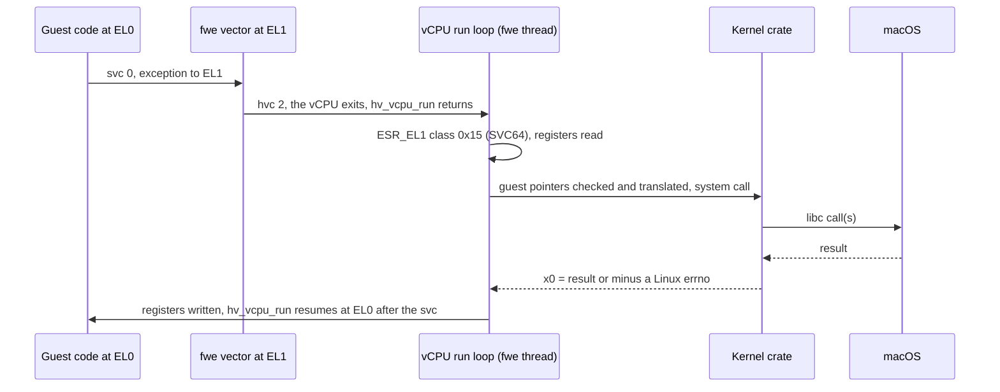

The kernel crate never walks the guest's page tables. Each pointer
argument is checked against the guest's mappings (`EFAULT` if the guest
could not use it) and turned into a host address
([Pages and translation](#pages-and-translation)).

### Faults, breakpoints and other exits

Every other exception the guest takes at EL0 goes through the same vector
and `hvc`: an abort, a `brk`, a misaligned pc or sp, an unknown
instruction. Each becomes the signal Linux would send, except an abort
that is only a page not fetched yet (a `vfork` child's) or a stale TLB
entry, which is fixed and retried. A stage-2 abort, `wfi`/`wfe` and a
trapped system-register read exit the vCPU directly. The full list is
under [Faults in guest code](#faults-in-guest-code), the run loop in
[hypervisor.md](hypervisor.md#the-run-loop).

### Counters and timers

`CNTVCT_EL0`, the virtual counter, is read directly; every vCPU of a
process (and a fork child) uses the same offset, so all threads see one
clock. A read of `CNTPCT_EL0`, which Linux also lets user code make, is
trapped and emulated from the host's counter minus that offset. The guest
cannot program the timers; its sleeps, interval timers and `timerfd`s are
system calls served with the host's, and a virtual-timer exit just resumes
the vCPU.

### Threads

Each guest thread is a host thread with a vCPU of its own, created on it.
All vCPUs share the VM, its page tables and memory. A new thread's vCPU
starts with its creator's registers, `x0` = 0, the new stack, and
`TPIDR_EL0` from `CLONE_SETTLS`; the thread pointer and `x18` are simply
its own registers.

### Signals into a running vCPU

A host signal for the guest may arrive while the thread's vCPU runs guest
code, where no handler could rewrite the guest's registers. fwe's handler
records the signal pending and calls `hv_vcpus_exit` on that thread's
vCPU; `hv_vcpu_run` returns with a *canceled* exit, and the run loop
builds Linux's frame and resumes the vCPU in the guest's handler. This
reaches even a guest spinning without system calls. The framework's own
threads block every guest signal, so the host delivers guest signals only
to vCPU threads, each under the mask its guest thread calls for
([A host signal reaching a guest thread](#a-host-signal-reaching-a-guest-thread)).

### Memory changes and the TLB

The guest's `mmap`, `munmap`, `mprotect` and `brk` edit stage 1 only: slab
memory is handed out and taken back, never replaced behind the VM. Taking
access away needs every vCPU's TLB invalidated before the guest relies on
it: a vCPU resuming after such an edit first runs the TLB stub at EL1,
which invalidates every vCPU's TLBs and returns to the guest. Memory and
tables given back are reused only after such a flush.

### fork, execve and the end of a VM process

A host `fork` child could not use its parent's VM and would end with one
it inherited, so a VM process never forks on the host. A guest `fork`
starts a fresh `fwe --hv-fork-child` that builds its own VM and receives
the parent's memory and kernel state ([fork](#fork)); `execve`
re-executes fwe, which picks the backend the new program needs
([execve](#execve)).

A process that ends with its VM alive can bring the whole Mac down, so
every way out of a VM process (`exit_group`, the last thread's exit, a
fatal signal, fwe's errors and panics, `execve`) first stops every vCPU,
has each thread destroy its own, and destroys the VM. Signals that would
end the process are caught for this, and a guest's `SIGKILL` to another
fwe process is relayed as a catchable `SIGINFO`. Only a `SIGKILL` from
outside fwe cannot be intercepted
([hypervisor.md](hypervisor.md#never-end-a-vm-process-abnormally)).

## Linux to macOS

This part goes through Linux's primitives one by one, mostly in tables
that read **Linux | macOS | fwe**. A few calls going in and the host calls
coming out:

| Guest call (Linux) | What fwe does | Host call(s) (macOS) |
|---|---|---|
| `openat(AT_FDCWD, "/etc/hosts", O_RDONLY \| O_CLOEXEC)` | resolves `/etc/hosts` component by component in the guest's root, following symlinks itself; translates the flags (`O_CLOEXEC` is `0x80000` on Linux, `0x1000000` on macOS) | `openat(<descriptor of the rootfs's etc>, "hosts", O_RDONLY \| O_CLOEXEC \| O_NOFOLLOW)`; the host descriptor is the guest's |
| `epoll_ctl(ep, EPOLL_CTL_ADD, fd, {EPOLLIN \| EPOLLET, data})` | the epoll descriptor is a kqueue | `kevent(ep, {fd, EVFILT_READ, EV_ADD \| EV_CLEAR, udata = data})` |
| `clock_gettime(CLOCK_BOOTTIME, &ts)` (no vDSO, so it traps) | maps the clock id | `clock_gettime(CLOCK_MONOTONIC, &ts)` |
| `kill(pid, SIGUSR1)` | maps the pid out of the guest's pid namespace and the signal number (10 to 30); leaves a sender note for an fwe target | `kill(<host pid>, 30)` |
| `write(fd, buf, n)` to a socket whose peer has gone | sockets are all `SO_NOSIGPIPE`, so fwe raises `SIGPIPE` itself | `write` fails with `EPIPE`; the guest gets `x0 = -32` and a pending `SIGPIPE` |

### System calls by category

Every guest system call reaches fwe's kernel
([System call entry](#system-call-entry)), which handles it in one of
three ways: it passes the call to the host with its flags, structures
and errors translated; it serves the call itself from state it keeps
(mounts, namespaces, credentials, System V objects, `/proc`); or it does
both, building Linux's behaviour out of several host calls. The tables
below name, category by category, what fwe does with each call and which
host calls it makes; the sections after them explain the larger
mechanisms. A call not listed here is not dispatched and fails with
`ENOSYS` ([Not available](#not-available)).

#### File calls

fwe resolves every guest path itself and hands the host one component to
open from a directory it holds, or a run of components the host must
follow no link in ([Files and descriptors](#files-and-descriptors));
the descriptor the host returns is the guest's, so I/O goes to the host on
it directly. fwe steps in for descriptors it stands in for (`/proc` and
`/sys` files, loop devices, eventfd and the like), for metadata the host
keeps differently (modes, owners, device numbers), and for Linux results the
host reports differently.

| Calls | What fwe does | Host call(s) |
|---|---|---|
| `openat`, `openat2` | Resolves the path; `/proc`, `/sys`, `/dev/ptmx` and `/dev/pts/N` are served by fwe; checks permissions, read-only mounts, leases and `ETXTBSY`, copies an overlay file up to write it. `openat2` walks the path itself for its `resolve` rules, then opens as `openat`. | `openat` from the resolved directory, flags translated, `O_NOFOLLOW` added |
| `close`, `close_range` | Drops what fwe keeps for the descriptor (epoll interest, memfd, `O_TMPFILE` name, mount context, inotify, message queue) before closing. `close_range` covers the guest's open descriptors only; `CLOSE_RANGE_CLOEXEC` marks them. | `close`; `fcntl(F_SETFD)` |
| `dup`, `dup3` | `dup3` closes the target through fwe's `close` first (if the source is open); what fwe keeps for the source follows the copy. | `dup`, `dup2`, `fcntl(F_SETFD)` |
| `read`, `write`, `readv`, `writev`, `pread64`, `pwrite64` | Run without the kernel lock. Descriptors fwe stands in for are served first; pipe capacities and whole pipe writes as in [Files and descriptors](#files-and-descriptors); a sized tmpfs takes what fits; `pwrite64` on an `O_APPEND` file appends, as Linux does. | `read`, `write`, `readv`, `writev`, `pread`, `pwrite` |
| `preadv`, `pwritev`, `preadv2`, `pwritev2` | Offset -1 uses the file position; `RWF_NOWAIT` polls first (not for a regular file), `RWF_DSYNC`/`RWF_SYNC` sync after, `RWF_APPEND` sets `O_APPEND` for the call; other flags `EOPNOTSUPP`. | `preadv`, `pwritev`, `readv`, `writev`, `poll`, `fsync` |
| `lseek` | Swaps `SEEK_DATA` and `SEEK_HOLE` (3 and 4, reversed on the host); fwe's directories, loop devices and overlay directories are seeked by fwe. | `lseek` |
| `newfstatat`, `fstat`, `statx` | Translated to the arm64 layout, with the mode and owner fwe keeps, Linux device numbers, a symlink's mode 0777. `statx` adds the immutable, append-only, no-dump and mount-root attributes and the mount id; no birth time. | `fstatat`, `fstat` |
| `getdents64` | Entries built from the host's; an overlay directory merges its layers; `O_TMPFILE` names and fwe's cgroup files hidden; fwe's directories listed from memory. | `__getdirentries64` |
| `faccessat`, `faccessat2` | fwe's check against the kept mode; `CAP_DAC_OVERRIDE` passes all but a missing execute bit; `W_OK` on a read-only mount is `EROFS`. | `faccessat`, `access` |
| `readlinkat` | `/proc` links answered by fwe; an `O_PATH` stand-in reads the link it names. | `readlinkat`, `readlink` |
| `mkdirat`, `mknodat` | Umask applied by fwe; a mode denying its owner and the maker's ownership kept in attributes. `mknodat` makes a file, FIFO, socket node or one of fwe's device nodes ([Devices](#devices)); a device takes `CAP_MKNOD` but for a whiteout (0:0), as on Linux. | `mkdirat`, `openat(O_CREAT\|O_EXCL)`, `mkfifoat` |
| `unlinkat` | Overlays get whiteouts; a directory holding only `O_TMPFILE` names is removed with them; the host's `EPERM` for a directory becomes `EISDIR`. | `unlinkat` |
| `renameat`, `renameat2` | `RENAME_NOREPLACE` and `RENAME_EXCHANGE` atomic, `RENAME_WHITEOUT` leaves a 0:0 node; `EXDEV` across mounts; the working directory follows a rename of it. | `renameatx_np` (`RENAME_EXCL`, `RENAME_SWAP`) |
| `symlinkat`, `linkat` | `linkat` follows links itself; `AT_EMPTY_PATH` or a `/proc/self/fd` path names the descriptor's file (an `O_TMPFILE` one); `EXDEV` across mounts; `fs.protected_hardlinks` checked. | `symlinkat`, `linkat` (flags 0) |
| `fchmod`, `fchmodat`, `fchmodat2` | Linux's rules (owner or `CAP_FOWNER`); a symlink's mode `EOPNOTSUPP`; `F_SEAL_EXEC` checked. | `fchmod`, `fchmodat`, `setxattr` (`org.fwe.mode`) |
| `fchown`, `fchownat` | Linux's rules; the owner is recorded, the host file stays the user's. | `setxattr`, `fsetxattr` (`org.fwe.owner`) |
| `utimensat` | `UTIME_NOW`/`UTIME_OMIT` mapped; Linux's permission rules; an append-only file may be touched. | `utimensat` |
| `truncate`, `ftruncate` | `truncate` opens the path for writing as `openat` would; memfd seals and loop devices handled by fwe. | `ftruncate` |
| `fallocate` | Modes 0, `KEEP_SIZE` and `PUNCH_HOLE\|KEEP_SIZE`; others `EOPNOTSUPP`; memfd seals and a sized tmpfs checked. | `fcntl(F_PREALLOCATE)`, `ftruncate`, `fcntl(F_PUNCHHOLE)`, `pwrite` |
| `fadvise64`, `readahead` | Arguments checked as Linux's; `WILLNEED` reads ahead, `DONTNEED` writes back and drops cached pages; `readahead` only checks. | `fcntl(F_RDADVISE)`, `mmap` + `msync(MS_INVALIDATE)` |
| `fsync`, `fdatasync`, `sync_file_range` | A pipe, socket or character device is `EINVAL`; a loop device synced by fwe; `sync_file_range` with any flag syncs the whole file. | `fsync` |
| `sync`, `syncfs` | Every file system's writes: the host's are the guest's. `syncfs` checks its descriptor. | `sync` |
| `fcntl` | See below. | `fcntl` |
| `flock` | Without the kernel lock; a message-queue descriptor is not locked. | `flock` |
| `ioctl` | See below. | `ioctl`, `tcgetattr`/`tcsetattr`, `tcgetpgrp`/`tcsetpgrp` |
| `pipe2` | Flags set after; the pipe's capacity recorded ([Files and descriptors](#files-and-descriptors)). | `pipe`, `fcntl` |
| `splice`, `tee`, `vmsplice` | Copied through a buffer of fwe's, without the kernel lock: from a pipe what it holds, into one what room it has. | `read`, `write`, `poll` |
| `sendfile`, `copy_file_range` | Copied through a buffer of fwe's, without the kernel lock, after Linux's checks. | `read`/`pread`, `write`/`pwrite`, `lseek` |
| `setxattr`, `getxattr`, `listxattr`, `removexattr` and their `l` and `f` forms | Linux's namespaces and rules ([Files and descriptors](#files-and-descriptors)); fwe's `/proc` files have none. | the host's attribute calls on the file's host path or descriptor |
| `file_getattr`, `file_setattr` | The inode flags (immutable, append-only, no-dump) as `fa_xflags`, Linux's checks of the size and flags; what only XFS keeps (extent sizes, projects) is `EOPNOTSUPP` to set. | `fstat`, `fchflags` |
| `name_to_handle_at`, `open_by_handle_at` | A handle is the host file system id and inode; opening needs `CAP_DAC_READ_SEARCH`. | `fstatfs`, `fsgetpath`, `open` |
| `memfd_create` | See [Shared memory and memfd](#shared-memory-and-memfd). | `open(O_CREAT\|O_EXCL)`, `unlink` |
| `getcwd`, `chdir`, `fchdir` | The working directory is a path fwe keeps; the host's never changes. A run starts in the directory fwe was started in (under `--root`, its path in the root, or `/` where it lies outside). Search permission checked. | `openat` (to check), `fcntl(F_GETPATH)` |
| `umask` | Kept and applied by fwe; fwe's host umask is 0. | none |

**`openat`**: after resolution, an existing file is checked against
the caller's credentials, a lease on it is broken, and a file a running
program uses fails a write open with `ETXTBSY`. `O_CREAT` is first tried
with `O_EXCL`, so fwe knows whether it made the file and records its owner
and mode. `O_PATH`, which the host lacks, is a read-only non-blocking
open; a FIFO, symlink, device or socket the host cannot open that way gets
a stand-in (`/dev/null`) that names it. `O_TMPFILE` makes a file under a
hidden name in the directory. A FIFO open that waits for the other end
runs without the kernel lock (`crates/kernel/src/lib.rs`,
`blocking_call`). Linux flags the host lacks (`O_DIRECT`, `O_NOATIME`,
`O_LARGEFILE`, `O_ASYNC`) are not passed (`host::open_flags_to_host`);
`O_NOATIME` is kept by fwe.

**`fcntl`**: `F_GETFL`/`F_SETFL` and `F_GETFD`/`F_SETFD` are translated;
`F_DUPFD` below the guest's limit only. Record locks and `F_OFD_*` locks
are translated to the host's (macOS's private `F_OFD_*` numbers); the
waiting forms run without the kernel lock. Owners (`F_SETOWN_EX`), the
`F_SETSIG` signal, leases, pipe sizes, `F_CREATED_QUERY` and seals
(`F_ADD_SEALS`, `F_GET_SEALS`) are fwe's own. Any other command is
`EINVAL`.

**`ioctl`**: fwe's loop devices, namespace descriptors and process
descriptors answer their requests first. Terminal requests (`TCGETS`,
`TCSETS*`, `TIOCGWINSZ`, `TIOCSPGRP` and the rest, see
[termios and terminal requests](#termios-and-terminal-requests)), network
interface requests (`SIOCGIF*`) and `FIONREAD`, `FIONBIO`, `FIOCLEX`,
`FIONCLEX`, `FIOASYNC` are translated; `FS_IOC_GETFLAGS`/`SETFLAGS` map
immutable, append-only and no-dump to the host's flags; `FICLONE`,
`FICLONERANGE` and `FIDEDUPERANGE` are `EOPNOTSUPP`; `RNDGETENTCNT`
reports 256; `PROCMAP_QUERY` on a `maps` file is fwe's. Any other request
is `ENOTTY`.

**`statx`**: built from the host's `stat` or fwe's record of a `/proc`,
namespace or process descriptor, with the owner and mode fwe keeps;
`STATX_MNT_ID` or `STATX_MNT_ID_UNIQUE` reports the mount the path is in
from fwe's table.

**`sendfile`**, **`copy_file_range`**: no host call copies between two
descriptors of different kinds, so fwe reads into a buffer and writes it
out, at the given offsets (leaving the file position alone) or at the
file's; what is read and not written is put back by seeking the input.
`copy_file_range` takes regular files only; `sendfile` also takes a loop
device as input.

#### Mount calls

macOS mounts are the system's and need root, so no guest mount reaches the
host: every mount call acts on fwe's table for the caller's mount
namespace, which the path resolver follows ([Mounts](#mounts)). The table
is kept in a file every process of the namespace shares and rereads when
another changes it. Privilege (`CAP_SYS_ADMIN`, `CAP_SYS_CHROOT`) is
checked by fwe.

| Calls | What fwe does | Host call(s) |
|---|---|---|
| `mount` | New mounts of `tmpfs`, `proc`, `sysfs`, `cgroup2` (`cgroup` too), `devpts`, `mqueue` and `overlay`; bind, move, remount and propagation changes. Other types `ENODEV`. | none; a tmpfs gets a new directory (`mkdir`) in fwe's private directory |
| `umount2` | `MNT_DETACH`, `MNT_FORCE`, `MNT_EXPIRE`, `UMOUNT_NOFOLLOW`; a mount in use is `EBUSY` unless detached or forced. | none |
| `pivot_root`, `chroot` | The root becomes a path in the namespace's view; the working directory follows `pivot_root` as Linux's. | none |
| `fsopen`, `fspick`, `fsconfig`, `fsmount` | A filesystem context is the process's, kept against an anonymous file's descriptor; `FSCONFIG_CMD_CREATE` makes the filesystem as `mount` does; reading the descriptor gives its messages. | an anonymous file |
| `open_tree`, `move_mount` | A detached tree (`fsmount`, `OPEN_TREE_CLONE`) is kept against an `O_PATH` descriptor of its root; `move_mount` attaches or moves, `MOVE_MOUNT_BENEATH` included. | none |
| `mount_setattr` | Sets and clears `ro`, `nosuid`, `nodev`, `noexec`, the access-time modes and `nosymfollow`, and propagation, on a mount or tree (`AT_RECURSIVE`); `MOUNT_ATTR_IDMAP` is `EINVAL`. | none |
| `statmount`, `listmount` | From the table, by unique mount id; a mount out of the caller's reach is `EPERM` without `CAP_SYS_ADMIN`. | none |
| `statfs`, `fstatfs` | Sizes and counts the host's; the type is the mount's (ext4 for the rootfs and its binds) with its flags; a sized tmpfs reports its size; a pipe, socket or anonymous descriptor reports Linux's pipefs, sockfs or anon-inode magic. | `fstatfs` |

**`mount`**: a bind of a directory or file in the guest's tree is a new
table entry showing it; a bind of a standard device node fwe serves from
the host shows that host file. `MS_REMOUNT` keeps the mount's access-time
mode unless one is named. A mount made under a shared mount propagates to
its peers and slaves, in this namespace and others
(`crates/kernel/src/mounts.rs`).

**`statfs`**: the host's `struct statfs` is translated
(`host::statfs_to_linux`), then the type and flags replaced by those of the
mount the path or descriptor came through, which fwe remembers per
descriptor (`crates/kernel/src/fdmarks.rs`). A path in fwe's `/proc` or
`/sys` reports that mount's type.

#### Memory calls

The memory calls are checked and recorded in `crates/kernel/src/mm.rs`,
which keeps Linux's view of the mappings (`crates/kernel/src/maps.rs`) for
`/proc/<pid>/maps`, sealing and locking. The native backend then makes the
host's call on the same addresses; the VM backend takes the call over
(`Platform::memory`, `crates/native/src/hv/mem.rs`) and edits the guest's
stage-1 tables over its slab, with no host call on guest memory. The layout
and the per-call differences are in [Address-space layout](#address-space-layout),
[The mmap family](#the-mmap-family) and [Write+exec memory](#writeexec-memory).

| Calls | What fwe does | Host call(s) |
|---|---|---|
| `mmap` | Linux's argument checks, then mapped and recorded; executable mappings are mapped writable, their code prepared, then given the asked protections. A mapping the guest leaves to the host is hinted at 2 TiB natively. | native: `mmap`, `mprotect`; VM: none (slab and stage 1; a `MAP_SHARED` segment is a host `mmap`) |
| `munmap`, `mprotect` | Refused on sealed memory (`EPERM`); `mprotect` adding `PROT_EXEC` prepares the code first. | native: `munmap`, `mprotect`; VM: stage-1 edit and TLB flush |
| `mremap` | Linux's checks, then shrink, grow in place, or move. | native: `mmap`, `mach_vm_remap`; VM: stage-1 edit |
| `brk` | Grows and shrinks inside a reservation made after the image at load. | native: `mmap` (`MAP_FIXED`) in the reservation; VM: stage-1 edit |
| `madvise` | Advice and each mapping checked as Linux checks them; `MADV_DONTNEED` zero-fills private anonymous memory; `MADV_HWPOISON`/`SOFT_OFFLINE` need `CAP_SYS_ADMIN`. | native: `mmap` (fresh pages), `madvise`, `mprotect`; VM: slab edit |
| `msync` | Flags and alignment checked; each mapping in the range synced, a hole `ENOMEM` after the rest; `MS_INVALIDATE` of locked memory `EBUSY`. | `msync` (VM: of shared segments) |
| `mincore` | One byte per guest page, from the host's residency. | `mincore` |
| `process_vm_readv`, `process_vm_writev` | Permission as for ptrace; the caller's own memory copied directly; another fwe process's copied by that process in its wake handler, from a request file of fwe's, with the host's copies of its own task (an address with nothing behind it is an error, not a fault); a fault partway returns the bytes copied | `mach_vm_read_overwrite`, `mach_vm_write` (in the target), `pread`/`pwrite` |
| `pkey_alloc`, `pkey_free`, `pkey_mprotect` | As on a CPU without protection keys (arm64's need `FEAT_S1POE`): none to allocate (`ENOSPC`), none to free; `pkey_mprotect` with key -1 is `mprotect`. | `mprotect` |
| `mlock`, `mlock2`, `munlock`, `mlockall`, `munlockall` | Range and `RLIMIT_MEMLOCK` checked, pages read in (not with `MLOCK_ONFAULT`), marked locked; nothing wired. | none |
| `mseal` | The mappings marked sealed in fwe's record; later changes to them fail with `EPERM`. | none |
| `remap_file_pages` | The range of one shared file mapping mapped again at page `pgoff` of its file. | `open`, then `mmap` as above |
| `membarrier` | Every command but the RSEQ ones; a barrier is an `mprotect` of a page of fwe's, which makes the host interrupt the process's other CPUs. | `mprotect` |

**`mmap`**: a file offset must be a multiple of the backend's page size
(16 KiB natively, 4 KiB in the VM). Natively, `MAP_SHARED` of an executable
file is mapped private, since its code is rewritten, and
`MAP_FIXED_NOREPLACE` is checked against where the host put the mapping
(`EEXIST`). In the VM a private file mapping is a copy of the file's
contents when mapped; a shared one is a segment, mapped into the VM once
([The mmap family](#the-mmap-family)).

**`mremap`**: natively a move takes the pages, contents and sharing with
`mach_vm_remap`, including `MREMAP_FIXED` and `MREMAP_DONTUNMAP`, and
growing a file mapping continues the same file; code (an executable
mapping) is not grown or moved (`ENOMEM`). The VM grows and moves private
memory only, and refuses `MREMAP_FIXED`/`MREMAP_DONTUNMAP` (`EINVAL`).

**`madvise(MADV_DONTNEED)`**: macOS's own keeps the contents, so natively
each private anonymous piece of the range is replaced by a fresh mapping of
the same protection; shared and file memory is left alone. In the VM the
slab pages are zeroed, or refilled from the file for a private file mapping.
`MADV_WIPEONFORK`, `MAP_GROWSDOWN` growth and `MADV_HWPOISON` act natively
only.

#### Process and thread calls

Each guest process is a host process and each guest thread a host thread,
so ids, sessions, process groups, usage and waits are the host's, mapped
through the guest's pid namespace (`crates/kernel/src/pidns.rs`). What the
host has no counterpart for (scheduling policies, most resource limits,
thread ids, robust lists, `personality`) fwe keeps in the process or in its
process record (`crates/kernel/src/procreg.rs`). `clone`, `clone3`,
`execve`, `execveat`, `exit`, `wait4` and `waitid` are the backend's
(`crates/native/src/trap.rs`, `crates/native/src/hv/backend.rs`); `futex`
and `futex_waitv` run without the kernel lock.

| Calls | What fwe does | Host call(s) |
|---|---|---|
| `clone`, `clone3` (and so `fork`, `vfork`, `pthread_create`, `posix_spawn`) | A thread is a new host thread; a process is a host `fork` natively, a new fwe process in the VM. `clone3`'s structure is read into the same arguments; `set_tid` fails with `ENOSYS`. | native: `pthread_create`, `fork`; VM: `pthread_create`, `posix_spawn` |
| `execve`, `execveat` | Natively in place when it can; otherwise fwe re-executes itself on the new program. | `execve` of fwe |
| `exit` | Robust list released, `clear_child_tid` cleared and woken, the host thread ended or (natively) kept for the next thread; the last thread ends the process. | `pthread_exit` / `_exit` |
| `exit_group` | A traced process's exit stop, then the process ends (in the VM after every vCPU and the VM are destroyed). | `_exit` |
| `wait4`, `waitid` | Run without the lock; pids, options and status translated; a tracer sees its tracees' stops first. | `wait4`, `waitid` |
| `getpid`, `gettid` | The process's and thread's ids as fwe numbers them (pid namespace; thread ids from a shared counter). | none |
| `getppid` | The parent, or the reaper that adopted the process; 0 for one outside the pid namespace. | `getppid` |
| `getpgid`, `getsid`, `setpgid`, `setsid` | The host's, ids mapped through the pid namespace; `setpgid` of a child that has exec'd fails with `EACCES` first, as on Linux. | `getpgid`, `getsid`, `setpgid`, `setsid` |
| `set_tid_address`, `set_robust_list`, `get_robust_list` | Kept per thread; another process's robust list is read from the record its threads publish, for a caller that may trace it. | none |
| `futex` | `WAIT`, `WAKE`, their `_BITSET` forms, `REQUEUE`, `CMP_REQUEUE`; other operations (PI, `WAKE_OP`) fail with `ENOSYS`. | `__ulock_wait2`/`__ulock_wake` for shared futexes |
| `futex_waitv` | Up to 128 32-bit futexes, private and shared, on `CLOCK_MONOTONIC` or `CLOCK_REALTIME`. | as `futex` |
| `prctl` | Name, capabilities, keepcaps, securebits, child subreaper, `no_new_privs`, THP choice, speculation (reported unaffected), seccomp, timer slack, dumpable, parent-death signal; `PR_PAC_RESET_KEYS` in the VM only; others `EINVAL`. | none |
| `sched_setscheduler`, `sched_setparam`, `sched_getscheduler`, `sched_getparam`, `sched_setattr`, `sched_getattr`, `sched_get_priority_max`/`min`, `sched_rr_get_interval` | Kept per process in its record with Linux's checks, inherited; the host schedules as before. | none |
| `sched_setaffinity`, `sched_getaffinity`, `getcpu` | The mask is checked and remembered; `getcpu` reports its first CPU, node 0. | `sysconf` (online CPUs) |
| `sched_yield` | The host's. | `sched_yield` |
| `getpriority`, `setpriority` | Nice values kept in the process records with Linux's checks and `RLIMIT_NICE`; a process fwe did not start gets the host's. | `setpriority` (non-fwe processes) |
| `ioprio_get`, `ioprio_set` | Linux's checks of class and level (`CAP_SYS_NICE` for the real-time class); the caller's priority kept and reported, another process's accepted, not kept: the host takes no I/O priority from fwe. | none |
| `prlimit64`, `getrlimit`, `setrlimit` | `NOFILE` virtual, fwe's own limits in `rlimits.rs`, the rest the host's; another process's is left for it to take up. | `getrlimit`, `setrlimit` |
| `getrusage`, `times` | The host's usage; `RUSAGE_THREAD` reports the process's; `times` in 100 Hz ticks since boot. | `getrusage` |
| `pidfd_open`, `pidfd_getfd` | A process descriptor is a kqueue watching the process's exit; `pidfd_getfd` asks the target for the descriptor through its signal mailbox. | `kqueue`/`kevent`, `sendmsg`/`recvmsg` |
| `personality` | Kept per process; `PER_LINUX32` fails with `EINVAL`. | none |
| `acct` | `CAP_SYS_PACCT`; the file opened as Linux opens it (for appending, a regular file); an ending process appends its `struct acct_v3` to the nearest pid namespace's, its own or one above, with accounting on | `open`, `write` |

**`clone` of a thread**: the new thread starts with its creator's
registers, `x0` = 0, the given stack, the creator's signal mask, and
`TPIDR_EL0` from `CLONE_SETTLS`. Natively it is a host pthread entering
guest code directly; the thread pointer goes into a TSD slot the rewritten
`TPIDR_EL0` accesses read, and only the pthread set of flags is accepted
(`ENOSYS` for others). In the VM it is a host thread with a vCPU of its own,
made on that thread; there are no flag restrictions beyond Linux's own
checks (`crates/kernel/src/cloneargs.rs`). See
[Threads, clone and futexes](#threads-clone-and-futexes) and
[Threads](#threads).

**`clone` of a process**: natively a host `fork` with every registry lock
held and the other guest threads suspended; `CLONE_VM` makes the private
memory inherit by sharing for that fork and `CLONE_VFORK` makes the parent
wait on a pipe until the child execs or exits (made, and the parent's write
end closed, under the kernel lock, so no child another thread forks
meanwhile holds it). In the VM no host fork
happens: a fresh `fwe --hv-fork-child` gets the kernel state over a Mach
port (with fwe's private directory, where the run's records and signal
mailboxes are: the host's lookup of the user's temporary directory gives
another one there) and every slab page over a socket (a `vfork` child
fetches pages as it touches them); `CLONE_VM` without `CLONE_VFORK` fails with `ENOSYS`. See
[fork](#fork).

**`execve`**: a native process with no other threads, running a program
that runs natively, unmaps the old program and loads the new one in place.
Otherwise, and always in the VM, fwe runs the host's `execve` on itself
with the state to keep on its command line, and the new fwe picks the
backend. See [execve](#execve).

**`wait4`, `waitid`**: the children are host processes, so the host's
calls do the waiting; `WCONTINUED` and the status word are translated,
`__WALL` and the like accepted, `waitid(P_PIDFD)` becomes `P_PID` of the
descriptor's process, and a reaper also reaps the orphans fwe recorded for
it. `waitid` reports no resource usage. See [wait](#wait) and
[Children ending](#children-ending).

**`futex`**: a private futex waits in a per-process queue keyed by
address, which a wake marks woken, so it reports exactly how many it woke.
A shared futex takes a slot in a table every fwe process maps, keyed by
the Mach memory object and offset of the word, and sleeps on the slot's
word with `__ulock_wait2(UL_COMPARE_AND_WAIT_SHARED)`
(`crates/kernel/src/sharedfutex.rs`). See
[Threads, clone and futexes](#threads-clone-and-futexes).

#### Signal calls

The guest's signal state (dispositions, per-thread masks, alternate stacks
and pending sets) lives in the kernel crate. The host is told only how to
treat each signal so that fwe sees the ones it must handle. A signal the
host has goes out as a host signal. fwe records one the host lacks, or one
aimed at a single thread, itself and wakes the target with `SIGEMT`. Numbers
and the frame are under [Numbers](#numbers) and
[Dispositions, masks and frames](#dispositions-masks-and-frames).

| Calls | What fwe does | Host call(s) |
|---|---|---|
| `rt_sigaction` | keeps the action in the kernel's table; decides what the host does with the signal (catch, default, ignore) | `sigaction` with fwe's handler, `SIG_DFL` or `SIG_IGN` |
| `rt_sigprocmask` | changes the thread's guest mask (a thread-local) | none at the call; the thread's host mask follows from it (`host::host_mask_for`) |
| `rt_sigpending` | the thread's and process's pending signals plus the host's pending ones, masked by the guest mask | `sigpending` |
| `sigaltstack` | keeps the stack in a thread-local; fwe builds frames on it | none |
| `rt_sigreturn` | restores registers, FP/SIMD state, mask and alternate stack from the frame; an unreadable frame kills the process with `SIGSEGV` | none |
| `rt_sigsuspend` | replaces the mask; waits for a deliverable signal; `EINTR` | `pthread_sigmask`, `sigsuspend` |
| `rt_sigtimedwait` | has the host catch the awaited signals while it waits; takes one from the pending set | `sigaction`, `pselect` with no descriptors |
| `kill` | pid mapped out of the pid namespace, permission checked as on Linux, a sender note left in an fwe target's mailbox | `kill`; `SIGINFO` (the kill relay) for `SIGKILL` to an fwe process |
| `tkill`, `tgkill` | a thread of this process: host signal to the thread, or posted to it directly; a thread of another process: queued in that process's mailbox | `pthread_kill`; `kill` with `SIGEMT` |
| `rt_sigqueueinfo`, `rt_tgsigqueueinfo` | the caller's `siginfo` (code, value) posted, or sent with a note; real-time signals queue, each with its own `siginfo` | `kill`, or `SIGEMT` for a signal the host lacks |
| `pidfd_send_signal` | `kill`, `tgkill`, `rt_sigqueueinfo` or a group `kill` of what the descriptor names (also a `/proc/<pid>` directory) | as those calls |
| `signalfd4` | a readiness pipe plus a queue of `signalfd_siginfo`; watched signals are always caught | `pipe`, `sigaction` |

**`rt_sigaction`**: the action goes into the kernel's table and
`Kernel::sync_host_signal` picks the host disposition
(`crates/kernel/src/signal.rs`). The backend then installs it with
`sigaction`, the same way in both backends: fwe's handler with
`SA_SIGINFO | SA_ONSTACK` and every signal blocked, or `SIG_DFL`/`SIG_IGN`
(`set_host_signal` in `crates/native/src/trap.rs`, which
`crates/native/src/hv/backend.rs` calls too). Which disposition the host
gets for which guest disposition is under
[Who acts on a signal](#who-acts-on-a-signal). `SIGKILL` and `SIGSTOP` are
refused (`EINVAL`). The fault signals and the signals the host lacks never
reach the host's table.

**`kill`, `tgkill`, `rt_sigqueueinfo`**: [Sending a signal](#sending-a-signal)
lists what each sends where. `tgkill` posts a signal fwe catches straight
to the target thread and wakes it with `SIGEMT`. As a host signal, the
signal could land on a thread that blocks it and be counted as the
process's. `tkill` is `tgkill` with no process named. `kill(-1, …)` signals
only the caller's pid namespace or run of fwe. `rt_sigqueueinfo` to another
process may not claim a kernel code (`si_code >= 0`) or `SI_TKILL`
(`EPERM`), and reaches only that process's main thread. A signal the host
lacks goes to another fwe process's mailbox (`signal::send_unhosted`), or
fails with `EINVAL` for a process that is not fwe's
([Signals with no counterpart](#signals-with-no-counterpart)).

**`rt_sigsuspend`, `rt_sigtimedwait`**: both run without the kernel lock.
`rt_sigsuspend` blocks every relayed host signal while it checks for a
deliverable one, then calls the host's `sigsuspend` with the host mask the
new guest mask calls for, so a signal arriving between the check and the
wait is not lost. Delivering the signal restores the old mask.
`rt_sigtimedwait` is handled by each backend
(`crates/native/src/trap.rs`, `crates/native/src/hv/backend.rs`): first
`Kernel::catch_for_wait` has the host catch every awaited signal whatever
its disposition, so the signal arrives with its sender. The wait is the
host's `pselect` with no descriptors, under a mask that leaves the awaited
signals open. A signal the guest handles that arrives instead gives
`EINTR`.

**`signalfd4`**: a signalfd is a pipe for readiness and a queue of 128-byte
`signalfd_siginfo` records (`crates/kernel/src/signalfd.rs`). Creating or
changing one re-syncs every host disposition, so the host catches a
watched signal even when its disposition would let the host drop it. A
pending signal that the thread blocks and a signalfd watches moves onto
that signalfd (`signal::drain_to_signalfd`) when the thread next waits or
returns from a call. A `read` of it runs without the kernel lock.

**Delivery, native and VM**: a frame is built on the guest stack, or on
the alternate stack, as Linux builds it, and returns through `sa_restorer`
or fwe's `rt_sigreturn` trampoline. Natively, the host handler rewrites the
interrupted context. In the VM it stops the vCPU (`hv_vcpus_exit`) and the
run loop delivers ([Signals into a running vCPU](#signals-into-a-running-vcpu)).
With BTI on in the VM, the handler is entered as if by `blr`
(`signal::set_bti`). In the VM, pointer arguments are translated to host
addresses before the call (`uaccess::host_arg`).

#### Time calls

Clocks are read from the host clock with the same meaning
(`host::clock_to_host`), and results are copied out through fwe's memory,
because macOS's C library writes them unchecked. Sleeps are waits on the
thread's wake pipe, timed by a kqueue timer with `NOTE_CRITICAL`. Interval
timers are the host's; POSIX timers and timerfds are fwe's own. There is no
vDSO, so every clock read traps
([auxv, hwcaps and the vDSO](#auxv-hwcaps-and-the-vdso)).

| Calls | What fwe does | Host call(s) |
|---|---|---|
| `clock_gettime` | maps the clock; a CPU-time clock id of another process or thread is read from its usage | `clock_gettime`; `proc_pidinfo` or the host thread's info for a pid's or tid's clock |
| `clock_getres` | Linux's values: 1 ns, or 4 ms for the coarse clocks and for a pid's or tid's CPU-time clock other than its scheduler clock | none |
| `gettimeofday` | time copied out; the timezone always zero | `gettimeofday` |
| `clock_settime`, `settimeofday`, `adjtimex`, `clock_adjtime` | Linux's argument checks, then `EPERM`; a read-only `adjtimex` reports an unsynchronised clock | `gettimeofday` (to read) |
| `nanosleep`, `clock_nanosleep` | an absolute time made relative to the host clock; a wait that a signal ends; the time left written back | `poll` on the wake pipe and a kqueue `EVFILT_TIMER` |
| `times` | ticks at 100 Hz from the process's and children's usage; returns the ticks since boot | `getrusage` |
| `getitimer`, `setitimer` | the host's timers; a value over 100,000,000 s clamped and read back as asked | `getitimer`, `setitimer` |
| `timer_create`, `timer_settime`, `timer_gettime`, `timer_getoverrun`, `timer_delete` | a timer thread of fwe's per process raises each timer's signal (`SI_TIMER`) | `clock_gettime`, `poll`, `nanosleep` in that thread |
| `timerfd_create`, `timerfd_settime`, `timerfd_gettime` | a kqueue holding one timer; reads return the expiry count | `kqueue`, `kevent` (`EVFILT_TIMER`, `NOTE_NSECONDS \| NOTE_CRITICAL`) |

**`clock_nanosleep`** (and `nanosleep`, which is `clock_nanosleep` on
`CLOCK_MONOTONIC`): a `TIMER_ABSTIME` request is turned into a relative
wait against the host clock the Linux clock maps to; a time already past
returns 0. The wait is `thread::wait_ready_ns` with no descriptors. The
thread's kqueue timer is armed with `NOTE_NSECONDS | NOTE_CRITICAL`, so the
wait ends on time and not coalesced, and the thread's wake pipe ends it for
a signal however soon the signal lands. An interrupted relative sleep
writes the time left. `CLOCK_THREAD_CPUTIME_ID` cannot be slept on
(`EOPNOTSUPP`). Both calls run without the kernel lock, and neither is
restarted after a handler.

**`timer_create`** (`crates/kernel/src/posixtimer.rs`): macOS has no POSIX
timers. Each process gets one fwe thread, started with its first timer that
signals, which blocks every host signal and sleeps until the next timer is
due. It sleeps with `nanosleep` when that is under 2 ms, otherwise with
`poll` on a wake pipe. When a timer is due the thread posts its signal for
the process, or for one thread with `SIGEV_THREAD_ID`, and wakes the
target with `SIGEMT`. `SIGEV_THREAD` is sent as a signal to the process,
which the C library acts on. A periodic timer starts again only once its
signal is taken; the intervals that passed meanwhile are its overrun. The
clocks map onto the host's realtime, monotonic and CPU-time clocks. The
`*_ALARM` clocks need `CAP_WAKE_ALARM`. `MONOTONIC_RAW` and the coarse
clocks are refused (`EOPNOTSUPP`). A CPU-time timer is checked again at
least every 10 ms.

**`timerfd_settime`** (`crates/kernel/src/specialfd.rs`): the timer is a
one-shot or periodic `EVFILT_TIMER` in nanoseconds. kqueue timers are
relative, so `TFD_TIMER_ABSTIME` is converted against `CLOCK_REALTIME`
whatever the timerfd's clock. A periodic timer fires first after its
interval, not after `it_value`. `TFD_TIMER_CANCEL_ON_SET` is accepted. A
host fork child gets no kqueues, so the setting is recorded and the timer
rebuilt in the child ([Waiting and events](#waiting-and-events)).

**`setitimer`**: the host's interval timer sends the host's `SIGALRM`,
`SIGVTALRM` or `SIGPROF` (same numbers on both), relayed like any host
signal ([Clocks and timers](#clocks-and-timers)). The host refuses values
over 100,000,000 s, so fwe gives it that maximum and keeps what was asked,
so that `getitimer` and the old value read as on Linux.

Native and VM: the same in both. The VM's counters are covered under
[Counters and timers](#counters-and-timers).

#### Waiting and event calls

Each Linux event descriptor is built from a kqueue, a pipe or a socket
whose readiness the host reports, so `poll` and `epoll` can mix them with
ordinary descriptors. The waits run without the kernel lock and watch the
thread's wake pipe next to the guest's descriptors, so a signal ends them
however soon it lands. The mapping of each descriptor is under
[Waiting and events](#waiting-and-events).

| Calls | What fwe does | Host call(s) |
|---|---|---|
| `ppoll` | the guest's `pollfd` array polled as is; revents corrected to Linux's; time left written back | `poll` |
| `pselect6` | the `fd_set` bitmaps turned into a `pollfd` array, results written back as bitmaps; time left written back | `poll` |
| `epoll_create1` | a kqueue, with an interest list recorded beside it | `kqueue` |
| `epoll_ctl` | Linux's checks, in its order; each direction one kqueue filter, `data` in `udata` | `kevent` (`EVFILT_READ`, `EVFILT_WRITE`, `EV_RECEIPT`) |
| `epoll_pwait`, `epoll_pwait2` | a wait for the kqueue to be readable, then the events taken without waiting and translated | `poll`, then `kevent` with a zero timeout |
| `eventfd2` | a pipe holding one byte while a counter in a shared page is non-zero | `pipe`, `mmap` |
| `inotify_init1`, `inotify_add_watch`, `inotify_rm_watch` | an instance is a datagram socket in fwe's private directory; watches in a record every fwe process shares; fwe's file calls send the events | `socket(AF_UNIX, SOCK_DGRAM)`, `bind` |
| `fcntl(F_NOTIFY)` (dnotify) | a watch in inotify's record naming its owner and descriptor; an event is the descriptor's `F_SETSIG` signal with `si_fd` (or `SIGIO`), posted as the call that raises it runs, or sent to another process as a `SIGIO` note | `kill` (`SIGEMT`) for another process |
| `io_setup`, `io_submit`, `io_getevents`, `io_pgetevents`, `io_cancel`, `io_destroy` | a context is the process's, named by a read-only page of zeros it maps (libaio, finding no ring, makes the call); a request is carried out as it is submitted and its completion queued, a poll of a descriptor not yet ready held until `io_getevents` finds it ready; `IOCB_FLAG_RESFD` signals an eventfd | `pread`/`pwrite` and their vectored forms, `fsync`, `poll` |

The masked waits (`ppoll`, `pselect6`, `epoll_pwait`, `epoll_pwait2`) run
under the mask they are given (`signal::with_call_mask`). The mask stays
replaced until a signal that ended the wait is delivered, as
`rt_sigsuspend` does.

**`epoll_ctl` and the waits**: an epoll descriptor is a kqueue
(`crates/kernel/src/epoll.rs`). `EPOLLIN` and `EPOLLOUT` become
`EVFILT_READ` and `EVFILT_WRITE`, `EPOLLET` becomes `EV_CLEAR` and
`EPOLLONESHOT` becomes `EV_ONESHOT`. A socket watched only for `EPOLLRDHUP`
gets a read filter with a low-water mark no read reaches. A wait polls the
kqueue descriptor itself, together with the wake pipe
(`thread::wait_ready`), then takes the events with a zero-timeout `kevent`
and turns `EV_EOF` into `EPOLLHUP`/`EPOLLRDHUP` as Linux reports them.
Events it has taken reach the guest even if a further take to fill the
guest's buffer is interrupted: an edge-triggered one is not reported again
(Go's runtime, interrupted by its own preemption signals, would wait for
ever on a pipe's end). Several cases the host does not report are looked
at in slices:

- the read end of a named FIFO whose writers have gone;
- a mounts file;
- a pipe smaller than the host's, while it is full.

`EPOLLEXCLUSIVE` is a count shared between processes
(`crates/kernel/src/exclusive.rs`). The wait's timeout is rounded up to
whole milliseconds, `epoll_pwait2`'s too. `epoll_event` is 16 bytes on
arm64.

**`ppoll`, `pselect6`**: `struct pollfd` and the `POLL*` bits are the same on
both kernels, so the array goes to the host `poll`. Then `linux_revents`
turns what the host reported into Linux's answer:

- a regular file loses `POLLPRI`;
- a hung-up FIFO with nothing left to read is not readable.

An eventfd that can be written to is reported writable, which its pipe's
read end never is to the host. `pselect6` reads at most 1024 descriptors, and
fails with `EBADF` for one of fwe's own. Both write back the time left
unless the personality has `STICKY_TIMEOUTS`.

**`eventfd2`**: macOS has no eventfd. The guest's descriptor is the read
end of a pipe, and the write end is fwe's, in its reserved range. The
counter is in a shared page with a lock word, so a fork child shares it.
The pipe holds one byte exactly while the counter is non-zero, so the host
sees the descriptor readable when a read would succeed. `read` and `write`
on it run without the kernel lock (`specialfd::try_read`, `try_write`).

**`inotify_*`**: the host's file events never report open, read or close.
So fwe raises Linux's events itself from every fwe process's file calls
on a watched file or directory (`crates/kernel/src/inotify.rs`), one
datagram per event to the instance's socket. Reading, `poll` and `epoll`
on the instance are the host's socket operations. Changes made by programs
fwe does not run raise no event.

Native and VM: the same in both; in the VM the call's pointers are
translated to host addresses first.

#### Socket calls

A guest socket is a host socket, and its descriptor is the host's.
fwe checks each call's arguments in Linux's order, then translates what
crosses the boundary: addresses, flags, option numbers and layouts, and
control messages ([Sockets](#sockets)). `AF_UNIX`, `AF_INET` and
`AF_INET6` reach the host; `AF_NETLINK` is fwe's; any other family
(`AF_PACKET`, `AF_VSOCK`, ...) fails with `EAFNOSUPPORT`. The calls that
can block run without the kernel lock (`blocking_call` in
`crates/kernel/src/lib.rs`).

| Calls | What fwe does | Host call(s) |
|---|---|---|
| `socket`, `socketpair` | family, type and protocol checked; `SOCK_NONBLOCK`/`SOCK_CLOEXEC` applied after; every socket `SO_NOSIGPIPE`; a Unix socket gets Linux's 212,992-byte buffers; `SOCK_SEQPACKET` Unix sockets are framed streams; `socketpair` of a non-Unix family is `EOPNOTSUPP` | `socket`, `socketpair`, `fcntl`, `setsockopt` |
| `socket(AF_NETLINK)` and calls on it | `NETLINK_ROUTE` only, `SOCK_RAW` or `SOCK_DGRAM`; fwe answers each request; `bind`, `connect`, `getsockname`, `getpeername` and `SOL_NETLINK` options are fwe's | `socketpair(AF_UNIX, SOCK_DGRAM)`, `send`, `recv` |
| `bind`, `connect` | address checked against the socket's family and translated; a port below `ip_unprivileged_port_start` needs `CAP_NET_BIND_SERVICE` (`EACCES`); ports mapped in an fwe network namespace, and in the host's a port below 1024 on a loopback address (macOS keeps one for root, but on the wildcard address) mapped to an ephemeral one that fwe's processes reach and see by its number; a bound Unix node gets the socket's mode less the umask, and the guest's owner; `connect` to `AF_UNSPEC` disconnects | `bind`, `connect` (from the path's directory with `pthread_fchdir_np` for a long path), `fchmodat` |
| `listen` | the host given one more than the backlog, as Linux queues one connection past it (a negative backlog or one past `somaxconn` taken as 4096) | `listen` |
| `accept`, `accept4` | peer address translated back; flags applied; a `SOCK_SEQPACKET` listener's connection marked as one; past `RLIMIT_NOFILE` closed, `EMFILE` | `accept`, `fcntl`, `setsockopt` |
| `getsockname`, `getpeername` | host address translated back; a Unix path is reported as the guest gave it; namespace ports mapped back; `IPV6_ADDRFORM` view applied | `getsockname`, `getpeername` |
| `sendto`, `sendmsg`, `recvfrom`, `recvmsg` | flags mapped; addresses translated; `SCM_RIGHTS` re-encoded; `MSG_MORE` held back on TCP and UDP; `MSG_ERRQUEUE` on an IP socket `EAGAIN`; a peer's eBPF socket filter applied on send; `SIGPIPE` raised by fwe unless `MSG_NOSIGNAL` | `sendmsg`, `recv`, `recvfrom`, `recvmsg` |
| `sendmmsg`, `recvmmsg` | one `sendmsg` or `recvmsg` per message | as above |
| `setsockopt`, `getsockopt` | numbers and layouts translated (`sockopt.rs`); fwe answers `SO_SNDBUF`/`SO_RCVBUF` arithmetic, `SO_DOMAIN`, `SO_PROTOCOL`, kept `SO_NO_CHECK`/`SO_PRIORITY`/`SO_PASSCRED`, `SO_PEERCRED`, `SO_ATTACH_BPF`/`SO_DETACH_BPF`, `IPV6_ADDRFORM`, and `SO_TYPE` of a `SOCK_SEQPACKET` or netlink socket | `setsockopt`, `getsockopt` |
| `shutdown` | passed through; a Unix socket whose peer has gone shuts down (`0`, where the host says `ENOTCONN`) | `shutdown` |

**`bind`, `connect`, `sendto`**: a Linux `sockaddr` (2-byte family) is
rewritten to the host's (length byte, family byte), and `AF_INET6` 10
becomes 30. An `AF_UNIX` path resolves in the guest's root as a file path
does; an abstract name (a leading NUL) becomes a file in a per-host
temporary directory, with the name kept beside it for `getsockname`. An
IPv4 address given to an IPv6 datagram socket becomes its IPv4-mapped
address. The table of what is translated is under [Sockets](#sockets).

**`sendmsg`, `recvmsg`**: only `SCM_RIGHTS` crosses. Linux's `cmsghdr`
has a 64-bit `cmsg_len` and 8-byte alignment, macOS's a 32-bit one and
4-byte alignment, so fwe re-encodes the first `SCM_RIGHTS` message into a
256-byte host buffer (up to 61 descriptors) and back. Other control
messages, `SCM_CREDENTIALS` among them, are not sent. A receive whose
control buffer is too small for the descriptors sets `MSG_CTRUNC`. A
`SOCK_SEQPACKET` socket received this way is recognised by its buffer
size and stays one (`seqpacket::adopt`).

**`socket(AF_UNIX, SOCK_SEQPACKET)`**: macOS has none. fwe makes a
stream socket and frames each message with a 4-byte length; a send writes
a whole frame or nothing, a receive takes one frame, cut to the buffer
with `MSG_TRUNC`. Between processes sharing the socket, a byte-range lock
on a file of fwe's keeps frames whole (`crates/kernel/src/seqpacket.rs`).

**`socket(AF_NETLINK)`**: the guest's descriptor is one end of a host
datagram pair, so `recv`, `poll` and `epoll` are the host's. A request
written to it is answered at once on the other end. In an fwe network
namespace, `RTM_GETLINK`, `RTM_NEWLINK` (with `CAP_NET_ADMIN`) and
`RTM_GETADDR` describe and change `lo`; in the initial namespace they
describe the host's loopback as `lo`, always up (taking it down is
`EPERM`), and no other interface. Such a socket also carries a POSIX
message queue's `SIGEV_THREAD` notification
([POSIX message queues](#posix-message-queues)).

**`sendmmsg`, `recvmmsg`**: the host has neither. fwe runs `sendmsg` or
`recvmsg` for each message, at most 1024, writing each one's length into
its `msg_len`, and stops at the first failure (the count so far, or the
error if none went). `recvmmsg` honours `MSG_WAITFORONE`, checks its
timeout after each message as Linux does, and stops after urgent data.

**`getsockopt(SO_PEERCRED)`**: from the host's `LOCAL_PEERPID` and
`LOCAL_PEERCRED`: the peer's pid in the caller's pid namespace and its
host ids as the guest sees them
([Host identity](#host-identity-and-machine-state)). A socket with no
peer process (not Unix, or netlink) gives pid 0 and ids -1.

#### Other IPC calls

macOS's System V IPC is one machine-wide set with small limits, and it
has no POSIX message queues or key retention service, so fwe implements
all three on shared records ([Kernel-wide state](#kernel-wide-state)):
one set per IPC namespace for System V objects and queues, one record for
every key. A change is made under the record's `flock`; a call that must
wait sleeps on the record's mapped generation word until another process
changes it.

| Calls | What fwe does | Host call(s) |
|---|---|---|
| `shmget`, `shmat`, `shmdt`, `shmctl` | a segment's state in the namespace's record, its memory a file beside it; `shmat` maps the file shared, listed in `/proc/<pid>/maps` as `/SYSV<key> (deleted)`; `SHM_HUGETLB` refused (`EINVAL`) | `open`, `ftruncate`, `mmap`, `unlink` |
| `semget`, `semctl`, `semop`, `semtimedop` | values and `SEM_UNDO` adjustments in the record; a `semop` applies all its operations or none; waits run without the kernel lock | `flock`, `__ulock_wait2`, `__ulock_wake` |
| `msgget`, `msgctl`, `msgsnd`, `msgrcv` | messages in the record; waits as for semaphores | as above |
| `kernel.msg_next_id`, `sem_next_id`, `shm_next_id` | the id the next object of the kind gets in the IPC namespace, used once | none |
| `mq_open`, `mq_unlink`, `mq_timedsend`, `mq_timedreceive`, `mq_notify`, `mq_getsetattr` | a record per queue in the namespace's directory; the descriptor is a host descriptor of the queue's file | `open`, `flock`, `close`; waits as above |
| `add_key`, `request_key`, `keyctl` | every key, keyring and quota in one record shared by all fwe processes; the key types and their cryptography are fwe's | the record's files only |

**`shmat`**: the segment's memory is a file in fwe's private directory,
made with `ftruncate` at `shmget`. `shmat` opens it with the access the
flags ask for and maps it through fwe's own `mmap` with `MAP_SHARED`, so
every process attaching the segment shares its pages. `SHMLBA` alignment
holds with `SHM_RND`, and an address over existing memory needs
`SHM_REMAP`. A segment marked for removal goes with its last attachment,
and what a process that has gone leaves attached is detached by the next
process that looks ([System V IPC](#system-v-ipc)).

**`semop`, `msgsnd`, `msgrcv`, `mq_timedsend`, `mq_timedreceive`**: each
try is one change of the record under its lock, so an operation is all or
nothing across processes. One that cannot proceed waits on the record's
generation word with `__ulock_wait2` (`UL_COMPARE_AND_WAIT_SHARED`), which
any process's change wakes, in slices so that a signal ends the wait with
`EINTR`; the object going ends it with `EIDRM`, a timeout with `EAGAIN`
(System V) or `ETIMEDOUT` (POSIX queues).

**`mq_open`**: the descriptor is a host descriptor of a file in the
queue's directory, holding a shared `flock` that lasts as long as any
descriptor of that open, so an unlinked queue is freed with its last
descriptor ([POSIX message queues](#posix-message-queues)).

**`keyctl`**: every operation is fwe's, on the shared record. With no
`/sbin/request-key` helper, a key `request_key` would construct is
negative for a minute. `KEYCTL_WATCH_KEY` and unknown operations fail
with `EOPNOTSUPP` ([Keys and keyrings](#keys-and-keyrings)).

#### Credential and namespace calls

The guest's identity is virtual: fwe keeps uids, gids, groups,
capabilities and securebits per process (`crates/kernel/src/creds.rs`,
`caps.rs`) with Linux's rules, and never changes the host process's
([Credentials and capabilities](#credentials-and-capabilities)). Ids are
kept as the initial namespace's and mapped through the user namespace's
`uid_map`/`gid_map` on the way in and out. Namespaces are shared records
that the processes in them name ([Namespaces](#namespaces)).

| Calls | What fwe does | Host call(s) |
|---|---|---|
| `getuid`, `geteuid`, `getgid`, `getegid`, `getresuid`, `getresgid`, `getgroups` | the virtual ids, mapped down the user namespace (an unmapped id is 65534) | none |
| `setuid`, `setreuid`, `setresuid`, `setgid`, `setregid`, `setresgid` | Linux's rules on the virtual ids; arguments mapped up (`EINVAL` if unmapped); capabilities adjusted as Linux adjusts them; new ids published to the process record | none |
| `setfsuid`, `setfsgid` | set if permitted; always the previous id back; an unmapped id changes nothing | none |
| `setgroups` | `CAP_SETGID`; up to 65536 groups, mapped up; `EPERM` in a user namespace whose `setgroups` is `deny` or whose `gid_map` is unwritten | none |
| `capget`, `capset` | effective, permitted and inheritable sets, header versions 1 to 3; the caller's process only | none |
| `unshare` | mount, UTS, IPC, network, cgroup, pid and user namespaces as new records; `CAP_SYS_ADMIN` except for a user namespace; `CLONE_NEWTIME` is `EINVAL` | none |
| `setns` | joins the namespace a `/proc/<pid>/ns/*` descriptor names, or those of a pidfd's process; `CAP_SYS_ADMIN`, for a user namespace in that one (a user has it in one it made) | none |
| `clone`, `clone3` with `CLONE_NEW*` | the same namespaces made before the host `fork`, so the child inherits them | `fork` (by the backend) |

**`setuid` and the rest**: no host privilege is needed, since only fwe's
record of the ids changes; files on the host stay fwe's user's. A change
of uids clears or keeps capabilities as Linux does (`after_setuid`,
honouring securebits and keepcaps), and the ids are written to the
process's shared record so that other processes see them in
`/proc/<pid>/status` and in permission checks against this one.

**`capget`, `capset`**: a version-1 header reads or writes 32 bits of
each set, versions 2 and 3 64 bits; an unknown version is answered with
version 3 and `EINVAL`. fwe holds no other process's capabilities:
`capget` of another pid fails with `ESRCH`, `capset` of one with `EPERM`.

**`unshare`, `clone`**: a new namespace is a fresh shared record, and
the process's record lists its namespaces. `CLONE_NEWUSER` needs no
privilege, gives the caller every capability in the new namespace, and
is refused (`EINVAL`) to a process with other threads; the other kinds
need `CAP_SYS_ADMIN`. `CLONE_NEWPID` applies to children, and a second
one before a child is made fails with `EINVAL`. `CLONE_FILES`, `CLONE_FS`,
`CLONE_SYSVSEM`, `CLONE_SIGHAND` and `CLONE_VM` are accepted. In a process
with other threads, the caller's namespaces change alone, and
`CLONE_FS` (which `CLONE_NEWNS` implies) gives it a root, working
directory and umask of its own ([Namespaces](#namespaces)).

**`setns`**: a namespace descriptor names the namespace's record
(`crates/kernel/src/nsfd.rs`); `nstype` must be 0 or its kind. A pidfd
joins each kind named in the flags that its process is in, the user
namespace first. It changes the calling thread's namespaces only; a
mount namespace is refused (`EINVAL`) to a thread that shares its root
with others.

#### System-wide calls

These answer from fwe's own state or from host state read when asked; none
changes the Mac. A call that needs privilege checks the capability Linux
names, then does what Linux would where that is harmless, and nothing
otherwise.

| Calls | What fwe does | Host call(s) |
|---|---|---|
| `uname` | `Linux`, `6.12.0-fwe` (a 2.6 release under `UNAME26`), `#1 SMP PREEMPT`, `aarch64`; host and domain names from the UTS namespace | `gethostname` in the initial UTS namespace |
| `sethostname`, `setdomainname` | `CAP_SYS_ADMIN`, at most 64 bytes; set in an fwe UTS namespace; `EPERM` in the initial one | none |
| `sysinfo` | host uptime and load averages; fixed memory figures (8 GiB total, 4 GiB free), no swap, `procs` 1 | `clock_gettime(CLOCK_MONOTONIC)`, `getloadavg` |
| `syslog` | an empty kernel log; read, clear and console level need `CAP_SYSLOG` or `CAP_SYS_ADMIN`; the console level is `kernel.printk`'s | none |
| `getrandom` | flags checked (`GRND_RANDOM` with `GRND_INSECURE` is `EINVAL`); never waits; at most 32 MiB a call | `arc4random_buf` |
| `reboot` | `CAP_SYS_BOOT` and the magic numbers checked; Ctrl-Alt-Del on/off accepted; restart, halt, power off, suspend and kexec `EPERM` | none |
| `vhangup` | `CAP_SYS_TTY_CONFIG`, then nothing | none |
| `delete_module` | `CAP_SYS_MODULE`, the name read, then `ENOENT`: no module is loaded | none |
| `lsm_list_modules`, `lsm_get_self_attr`, `lsm_set_self_attr` | Linux's capabilities and Landlock are the modules (`LSM_ID_CAPABILITY`, `LSM_ID_LANDLOCK`; `/sys/kernel/security/lsm` reads `capability,landlock`); neither keeps attributes of a process, so the attribute calls check their arguments and fail with `EOPNOTSUPP` | none |

**`uname`**: the release is fixed (`RELEASE` in
`crates/kernel/src/syscalls.rs`), with `UNAME26` replacing its version
numbers as Linux's `override_release` does. In the initial UTS namespace
the node name is the host's, cut to 64 bytes, and the domain name
`(none)` ([Host identity](#host-identity-and-machine-state)).

**`reboot`**: a guest never stops the Mac. After Linux's checks, the
Ctrl-Alt-Del setting is accepted and changes nothing; every command that
would stop or replace the kernel fails with `EPERM`
([Time, scheduling and limits](#time-scheduling-and-limits)).

#### Debugging and sandboxing calls

macOS has no seccomp or eBPF and gives no process another's memory or
threads, so all three are fwe's own, carried out inside the guest
processes and identical in both backends: seccomp filters and eBPF
programs run on fwe's interpreters, and a tracee does its tracer's work.

| Calls | What fwe does | Host call(s) |
|---|---|---|
| `ptrace` | `TRACEME`, `ATTACH`, `SEIZE` (without stopping the tracee), `INTERRUPT`, `LISTEN`, `PEEK`/`POKE` of text and data, `GETREGSET`/`SETREGSET` (`NT_PRSTATUS`, `NT_PRFPREG`, `NT_ARM_SYSTEM_CALL`, `NT_ARM_TLS`; no hardware breakpoints), `GET`/`SETSIGINFO`, `GET`/`SETSIGMASK`, `GET_SYSCALL_INFO`, `SETOPTIONS`, `GETEVENTMSG`, `CONT`, `SYSCALL`, `SINGLESTEP`, `DETACH`, `KILL`; a seized tracee's group-stops and interrupts are `PTRACE_EVENT_STOP`; `PEEKUSR`/`POKEUSR` and others fail with `EIO`. Only fwe's processes can be traced. | `mmap` of a shared page, `__ulock_wait2`/`__ulock_wake`, `kill` |
| `seccomp` | Strict mode and filters, `GET_ACTION_AVAIL`, `GET_NOTIF_SIZES`; no listener (`SECCOMP_FILTER_FLAG_NEW_LISTENER` fails with `EINVAL`). | none |
| `landlock_create_ruleset`, `landlock_add_rule`, `landlock_restrict_self` | ABI 6: filesystem rights by path, TCP port rules, and the abstract-socket and signal scopes, checked by fwe before each call it restricts (see [architecture.md](architecture.md)); the domain is the process's, carried by `fork` and `execve` | none |
| `bpf` | Needs `CAP_BPF` or `CAP_SYS_ADMIN`. Program load, attach, detach, query and get-by-id for cgroup device programs; socket filters, a map access at a known offset outside the value refused as they load (`EACCES`, with the verifier's log); array and hash maps and their element commands; other commands `EINVAL`. | a file per program and per map |

**`ptrace`**: each traced thread has a mailbox, a page in fwe's private
directory that it and its tracer map. At a stop (a signal about to be
delivered, a system call's entry or exit under `PTRACE_SYSCALL`, an
`execve`, a fork, clone or exit event) the tracee writes its registers,
wait status and `siginfo` there, tells its tracer through the tracer's
inbox page, `SIGCHLD` and fwe's wake signal, and serves requests until told
to go on. The tracer reads and writes registers and `siginfo` in the
mailbox itself and asks the tracee for memory, a word or 2 KiB at a time
(`/proc/<pid>/mem`, `process_vm_readv`). `PTRACE_SEIZE` and
`PTRACE_INTERRUPT` nudge the tracee with a `SIGSTOP` of fwe's own queue
that no guest sees, which ends a wait it is in. The tracee is
never stopped on the host, so the tracer's `wait4`/`waitid` take a stop
from the inbox before asking the host. Single-stepping plants
`brk #0x4c59` where the instruction may go next. Details are in
[architecture.md](architecture.md#ptrace).

**`seccomp`**: both backends run the filters before routing any call, so
none escapes them. Filters are classic BPF over Linux's `seccomp_data`
(`AUDIT_ARCH_AARCH64`); the action of highest precedence wins;
`SECCOMP_RET_TRACE` and `SECCOMP_RET_USER_NOTIF` fail the call with
`ENOSYS`. Strict mode allows `read`, `write`, `exit` and `rt_sigreturn`
and ends the process with `SIGKILL` on any other call. `PR_SET_SECCOMP`
and `PR_GET_SECCOMP` reach the same code. See [seccomp](#seccomp).

**`bpf`**: a loaded program or map is an unlinked file of fwe's that the
descriptor is open on, so a fork child shares it. Device programs attached
to a cgroup are kept in the cgroup's directory and run on each device
access; a socket filter attached with `SO_ATTACH_BPF` runs on what the
process sends to the socket's peer. The interpreter checks every access
and stops a program after 2^20 steps (`crates/kernel/src/bpf.rs`).

### The CPU

The processor is shared; what differs is how a program calls the kernel,
which registers the kernel lets it own, and what the kernel tells it about
the CPU at startup.

#### System call entry

| | Linux arm64 | macOS arm64 |
|---|---|---|
| Instruction | `svc #0` | `svc #0x80` |
| Number in | `x8` | `x16` |
| Arguments | `x0`–`x5` | `x0` and up |
| Error report | `x0` = −errno (−1 to −4095) | carry flag set, `x0` = errno (macOS numbering) |

fwe intercepts every guest system call before it reaches macOS: natively
each `svc #0` calls fwe's gate
([System calls: svc calls fwe's gate](#system-calls-svc-calls-fwes-gate)); in the
VM the `svc` takes an exception to fwe's vector, which leaves the VM
([A system call in the VM](#a-system-call-in-the-vm)). Then:

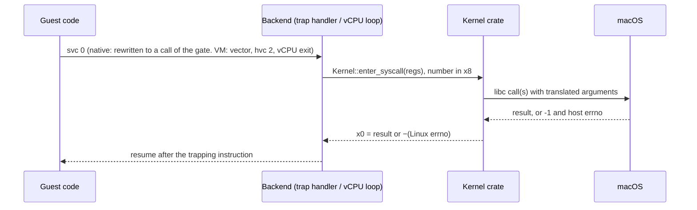

The kernel crate calls macOS through `libc`, so it sees `-1`/`errno`,
never the carry flag ([Errors](#errors)). Flag, structure and constant
translations live in `crates/kernel/src/host.rs`, the Linux values in
`crates/abi`. A call interrupted by a signal returns or restarts as under
[A host signal reaching a guest thread](#a-host-signal-reaching-a-guest-thread).

#### Registers and the thread pointer

Linux gives user code every general register and the thread pointer;
macOS keeps two for itself and traps a register read Linux allows. In the
VM the guest has the registers to itself:

| Register | Linux | macOS | fwe, native | fwe, VM |
|---|---|---|---|---|
| `TPIDR_EL0` | the thread pointer (TLS), set with `msr` | not preserved for user code | every `mrs`/`msr` of it branches to a stub using a slot of the host thread's TSD, found through `TPIDRRO_EL0` | the guest's own |
| `x18` | a scratch register | platform-reserved, cleared on every exception return | every instruction naming it branches to a stub that keeps it in another TSD slot | the guest's own |
| `CTR_EL0` | readable at EL0 | `mrs` of it traps | emulated in the `SIGILL` handler, without the bits that let code skip cache maintenance | read by the guest |
| `CNTPCT_EL0` | readable at EL0 | readable | read by the guest | trapped, emulated from the virtual counter |

`clone` with `CLONE_SETTLS` writes the new thread's TSD slot (native) or
its vCPU's `TPIDR_EL0` (VM). The stubs are under
[Which instructions get translated](#which-instructions-get-translated-and-how).

#### Cache maintenance, PAC and BTI

- **Cache maintenance** is allowed at EL0 on both systems, so a JIT's own
  `dc`/`ic` work natively. Code fwe writes into guest memory (images, file
  data, a fork child's memory) has the instruction cache invalidated, as
  Apple's cores do not keep it coherent with data writes.
- **Pointer authentication:** not reported natively (no `PACA`/`PACG` in
  `AT_HWCAP`), since the host owns the keys. The VM backend enables it in
  `SCTLR_EL1` where the vCPUs offer it and reports `PACA` and `PACG`, with
  random keys per program, a thread's from its creator, a fork child's
  from its parent, new ones for `PR_PAC_RESET_KEYS`.
- **BTI:** reported in `AT_HWCAP2` where the host has it. In the VM, code
  of a program built for BTI is mapped guarded (`PROT_BTI`) where Linux
  maps it so, a signal handler is entered as if by `blr`, and a
  branch-target exception is `SIGILL`.

#### auxv, hwcaps and the vDSO

A Linux program learns about its machine from its initial stack, which
fwe builds as Linux does in both backends:

- strings, `AT_RANDOM` bytes, the auxiliary vector, `envp`, `argv`,
  `argc`, 16-byte aligned, on a fresh 8 MiB stack with a guard page
  (`crates/native/src/stack.rs`);
- the auxiliary vector carries `AT_PHDR`/`AT_PHENT`/`AT_PHNUM`, `AT_BASE`,
  `AT_ENTRY`, `AT_PAGESZ`, the ids, `AT_SECURE`, `AT_RANDOM`, `AT_EXECFN`,
  `AT_PLATFORM`, `AT_MINSIGSTKSZ` and `AT_HWCAP`/`AT_HWCAP2`;
- `AT_HWCAP`/`AT_HWCAP2` come from macOS's `hw.optional.*` sysctls, only
  features a guest can use directly: SVE and SME (kernel-managed state),
  `CPUID` (trapping ID-register reads) and, natively, PAC are left out;
- there is no vDSO (no `AT_SYSINFO_EHDR`): the C library makes real
  system calls for `clock_gettime` and `gettimeofday`.

### Memory

A Linux process expects to own its address space, with 4 KiB pages and
memory it may map writable and executable at once. macOS gives a process
an address space shared with its own loader and libraries, starting at
4 GiB, with 16 KiB pages and no write+exec memory.

#### Address-space layout

On Linux an arm64 process owns its whole lower address space: a non-PIE
program sits at its link address (often `0x400000`), the break follows
the image, `mmap` grows down from below the stack. macOS reserves the
first 4 GiB (`__PAGEZERO`), and its loader, libraries and heap share the
space with the guest.

**Native backend**: guest and fwe in one host address space, guest
addresses equal to host addresses:

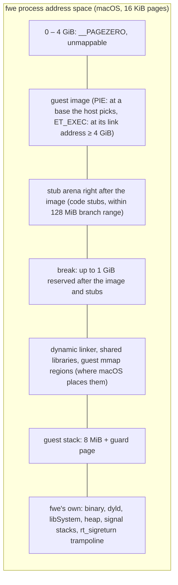

- The loader reserves the image's whole span, then copies each segment
  in, so gaps stay inaccessible.
- Every guest range is recorded (`fwe_kernel::mm::track`) and fwe's own
  memory never is, so `execve` unmaps exactly the old program.

**VM backend**: the guest has an address space of its own; its private
memory lives in one host range, the *slab*:

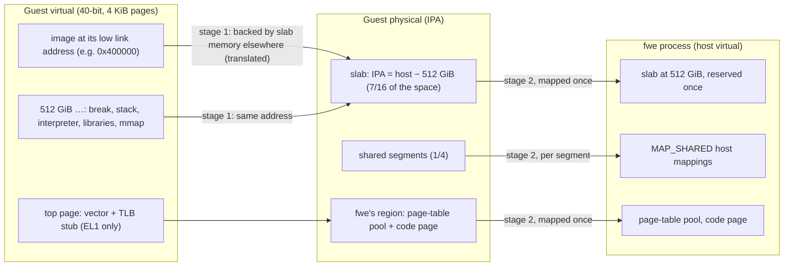

- The slab sits at host 512 GiB in every VM process, so a fork child takes
  its parent's memory at the same addresses.
- A mapping the guest did not place gets a slab range whose guest address
  is its host address. One placed outside the slab (the low image, a
  `MAP_FIXED` address) is backed by slab memory elsewhere and recorded as
  a translated range.
- The IPA space is as large as the host offers, up to 40 bits; an M1 or M2
  offers 36 bits (64 GiB).

#### Pages and translation

| | Linux | macOS | fwe |
|---|---|---|---|
| Page size | 4 KiB on most arm64 kernels; 16 and 64 KiB exist | 16 KiB | native: the host's 16 KiB, reported in `AT_PAGESZ` (the arm64 ABI allows it); VM: 4 KiB |
| Translation | one stage, the kernel's tables | one stage, XNU's pmap | native: XNU's; VM: fwe's stage 1 and the framework's stage 2 |

Natively, a guest address is a host address. In the VM both stages are
hardware translation:

- **Stage 1** is fwe's page tables (`crates/native/src/hv/pagetables.rs`):
  4 KiB granule, 40-bit space, level-3 pages, each page's EL0 permissions
  and BTI guard. Memory calls edit them; taking access away is followed by
  a TLB invalidation.
- **Stage 2** is set up once: the slab, fwe's region, and a mapping per
  shared segment. The framework maps host memory in 16 KiB pages; a 4 KiB
  guest page is a quarter of one.
- Guest pointers the kernel crate uses are checked against the guest's
  mappings (the host can reach slab memory the guest cannot) and go
  through `uaccess::g2h`, which looks up the translated ranges.

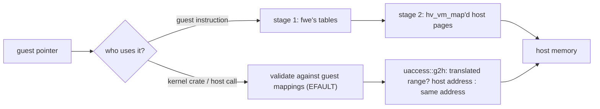

The low 4 GiB can never be identity-mapped (it is `__PAGEZERO` on the
host), so the low image is always translated. A host call given one
buffer that runs over the edge of a translated range has no single host
address and fails with `EINVAL`.

#### The mmap family

Natively, fwe passes memory calls to the host's with the guest's
addresses and fills in what macOS does differently; in the VM it carries
them out on the slab and the guest's page tables:

| Call | Linux | fwe, native | fwe, VM |
|---|---|---|---|
| `mmap` anonymous / private file | kernel VMA | host `mmap` at the guest's address or where macOS places it; offset a multiple of 16 KiB; a private mapping of a file with no name (a memfd, an unlinked file: memory shared through it) is a shared host mapping kept unwritable, each page made a copy of itself when first written (by the guest, by fwe for it, or by a `read` into it), so a page not yet written shows what others write to the file (the host's private mapping is a copy from the start) | slab range; a private file mapping is a copy of the file's data when mapped, but one of a file with no name is a segment of the file kept unwritable in stage 1, each 4 KiB page made a copy in the slab when first written |
| `MAP_SHARED` | shared pages | host `MAP_SHARED`; an executable shared file mapping is made private, since its code is rewritten | a *segment*: a host shared mapping outside the slab (anonymous shared memory is an unlinked file), mapped into the VM once |
| `MAP_FIXED`, `MAP_FIXED_NOREPLACE` | replace / refuse to replace | host `MAP_FIXED`; `NOREPLACE` checks where macOS put it (`EEXIST`) | page-table edit; slab memory at its own address is reused, zeroed |
| `munmap` | | host `munmap` | pages removed from stage 1, TLBs flushed; the slab range zeroed before reuse |
| `mprotect` | | host `mprotect`; adding `PROT_EXEC` prepares the code first | stage-1 permission edit |
| `mremap` | grow, shrink, move | shrink; grow in place where the space after it is free (a file mapping with the file's next part); move with `mach_vm_remap`, which takes the pages, contents and sharing along, `MREMAP_FIXED` and `MREMAP_DONTUNMAP` included; code is not grown or moved (`ENOMEM`) | private memory: shrink, grow in place, or move with `MREMAP_MAYMOVE`; a shared segment cannot grow (`ENOMEM`); no `MREMAP_FIXED`/`MREMAP_DONTUNMAP` (`EINVAL`) |
| `madvise(MADV_DONTNEED)` | private anonymous pages read as zero again | each private anonymous piece replaced by a fresh mapping (macOS's own keeps the data) | private pages read as zero again, or as the file for a private file mapping; shared memory keeps its contents |
| `madvise` other advice | hints; `MADV_FREE`, `MADV_REMOVE`, `MADV_WIPEONFORK` | hints passed to the host, never failing for mapped memory; advice and mappings checked as Linux checks them; `MADV_WIPEONFORK` ranges zeroed in a fork child | the same, but a fork child keeps `MADV_WIPEONFORK` memory |
| `MAP_GROWSDOWN` | a stack that grows down on a fault below it, up to a guard gap of 256 pages | a fault below one maps the pages down to it, if nothing is within the gap | not grown |
| `MADV_HWPOISON` | an access is `SIGBUS` | the pages made inaccessible, an access a `SIGBUS` | not poisoned |
| `MAP_SHARED` of `/dev/zero` | shared anonymous memory | shared anonymous memory (macOS cannot map the device) | the same |
| `mlock` family | wires pages | pages brought in and counted against `RLIMIT_MEMLOCK`, not wired | the same |
| `mincore` | residency per page | the host's residency | by 16 KiB host pages |

Every successful memory call is also recorded as Linux lists it
(`crates/kernel/src/maps.rs`), for `/proc/<pid>/maps`, `smaps` and
`PROCMAP_QUERY`, with the protections the guest asked for.

#### Write+exec memory

Linux maps `PROT_WRITE | PROT_EXEC` memory freely. macOS refuses it
without `MAP_JIT`, whose memory is switched per thread
(`pthread_jit_write_protect_np`), which Linux code never calls. fwe keeps
such memory writable on the host and records it
(`crates/kernel/src/mm.rs`):

- **native:** the first instruction fetch from a page faults; fwe prepares
  its code and makes it read-execute. A later write, the guest's or one
  fwe makes for it, makes it read-write again.
- **VM:** stage 1 maps it writable and executable; nothing faults.

#### Shared memory and memfd

| Linux | macOS | fwe |
|---|---|---|
| `memfd_create`: an anonymous file with a name and seals | no memfd, no seals | a file in fwe's private directory, unlinked at once; name and seals in extended attributes, so every holder sees them; `F_SEAL_WRITE` clones the file and swaps this process's descriptors for read-only ones of the clone |
| `/dev/shm` tmpfs (`shm_open`, `sem_open`) | no tmpfs at `/dev/shm` | a directory per rootfs in the user's temporary directory, shared by every fwe process on that root, a mount point to the resolver |
| System V shared memory | own `shmget` | see [System V IPC](#system-v-ipc) |

### Processes

Each guest process is a host process, so process ids, parents and exit
statuses are real host ones. What needs work is copying a process whose
memory fwe has rewritten or placed in a VM, and starting a new program in
place.

#### fork

| | Linux | fwe, native | fwe, VM |
|---|---|---|---|
| `fork` | copy-on-write of private pages | host `fork`: copy-on-write for `MAP_PRIVATE`, sharing for `MAP_SHARED` | no host fork: a fresh fwe process is sent a copy of every slab page that exists |
| `vfork` / `CLONE_VM \| CLONE_VFORK` | child borrows the parent's memory | host `fork` with the private ranges set to inherit by sharing (`minherit`) | child fetches pages on first touch and sends back what it changed |

macOS's `fork` copies memory while the parent's other threads keep
running, gives the child none of the parent's kqueues, and does not
restore a signal mask from a handler frame the child did not take. A VM
cannot be forked at all.

**Native backend** (`crates/native/src/process.rs`, `quiesce.rs`): fwe
holds every lock a child could need and pauses the parent's other threads
running guest code before it forks, so the child starts from one
consistent instant:

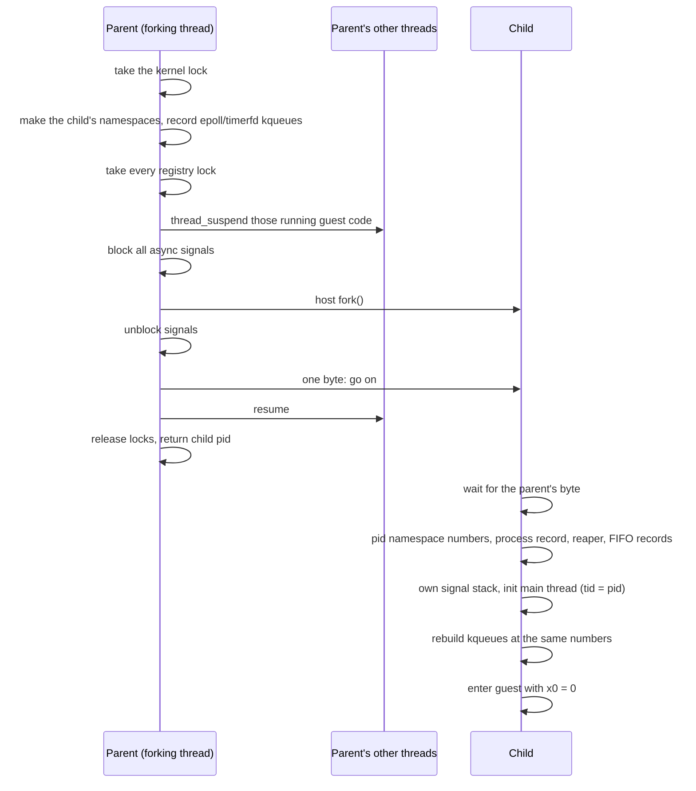

The child keeps the guest's blocked mask and alternate stack; pending
signals are not inherited, as on Linux. Descriptors are inherited by the
host fork; the process record, signal mailbox and System V attachments
are the child's own.

**vfork** (`CLONE_VM | CLONE_VFORK`, used by `posix_spawn`, `vfork`, Go's
`os/exec`): the same host fork with the guest's private memory inherited
by sharing. The parent waits on a close-on-exec pipe only the child holds,
so it resumes when the child execs or exits and sees what the child wrote.
fwe's own memory is not shared, so the child's `mmap` and `munmap` stay
its own. Natively, `CLONE_VM` without `CLONE_VFORK` is the same fork
without the wait; the VM backend refuses it (`ENOSYS`), since the same
memory may never be in two VMs at once.

**VM backend** (`crates/native/src/hv/fork.rs`): the child is a fresh
`fwe --hv-fork-child` started with `posix_spawn`. The parent hands it its
kernel state over a Mach port and its memory over a socket, and the child
builds its own VM around them:

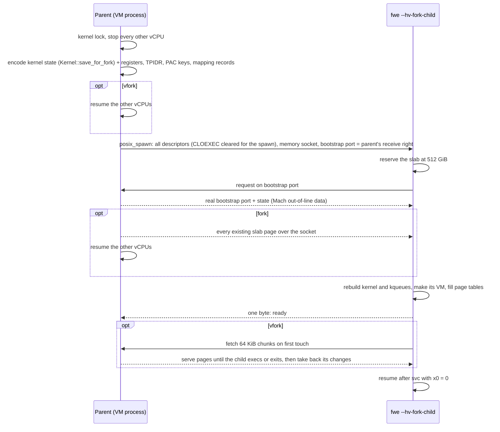

- No private page is ever in two VMs. Shared segments go to the child as
  their files, which it maps, so those pages are shared as on Linux.
- A `fork` child gets every slab page that exists, sent with the parent's
  vCPUs stopped so it sees one instant.
- A `vfork` child fetches only the slab ranges the parent had in use, and
  only while it keeps them. Before it execs or ends it sends back the
  bytes it changed, and the parent resumes once they are in its memory.
  Its channel is one of fwe's reserved descriptors, out of reach of a
  child that moves descriptors into place before exec (Go's does).
- The VM itself and kqueues do not cross; kqueues are rebuilt from fwe's
  records.

#### Threads, clone and futexes

A guest thread is a host thread, scheduled by the host. Linux's `clone` is
far more general than `pthread_create`, and shared futexes have no direct
macOS counterpart:

| | Linux | macOS | fwe |
|---|---|---|---|
| Thread | a task sharing `mm`, files, handlers | a pthread | a host pthread running guest code (native; one an ended thread left runs the next) or a host thread with its own vCPU (VM) |
| `clone` flags | any combination | — | a thread needs `CLONE_VM` and a stack (`EINVAL` without either in the VM; natively `EINVAL` without a stack, `ENOSYS` without `CLONE_VM`); natively `CLONE_VM`, `FS`, `FILES`, `SIGHAND`, `THREAD`, `SYSVSEM`, `SETTLS`, `PARENT_SETTID`, `CHILD_SETTID`, `CHILD_CLEARTID` and `DETACHED` are accepted and others fail with `ENOSYS` |
| `clone3` | `struct clone_args` | — | treated as the `clone` it describes; `CLONE_INTO_CGROUP` starts the child in that cgroup, `CLONE_CLEAR_SIGHAND` resets its handlers, `CLONE_PIDFD` returns a process descriptor; `set_tid` fails with `ENOSYS` |
| Per-thread state | in the task | — | in host thread-locals: tid, `set_tid_address` word, robust list, signal mask, alternate stack, pending set |
| Robust futex list | walked as a thread ends: words it owns marked `FUTEX_OWNER_DIED`, a waiter woken | — | the same, as a thread ends and for every thread as the process ends or calls `execve`; not for a native process ended by `SIGKILL`, nor one ended by a signal from outside fwe |
| `get_robust_list` of another thread | the target's head, to a caller that may trace it | — | the process's other threads' heads from its registry, another process's from a shared record each thread writes |
| futex, private | a wait queue per address | `__ulock_wait`/`__ulock_wake` (private) | per-process wait queues, outside the kernel lock |
| futex, shared | keyed by the page's backing object | `__ulock_wait2` with `UL_COMPARE_AND_WAIT_SHARED` | a slot table every fwe process maps, keyed as Linux keys a shared futex (Mach memory object + offset); each waiter sleeps on its slot's word, so a wake knows whom it woke |

A new thread starts with its creator's registers and signal mask, `x0` =
0, the given stack and no alternate stack. Its exit clears and wakes its
`clear_child_tid` futex; the last thread or `exit_group` ends the process.

#### execve

Linux replaces the address space in place, keeping the pid, descriptors
not marked close-on-exec, the signal mask, pending signals and ignored
dispositions. When the new program can run natively and the caller is a
native process with no other threads, fwe unmaps the old program and
loads the new one in place. Otherwise it runs the host's `execve` on
`fwe` itself, passing what must survive on the command line, and the new
fwe picks the backend:

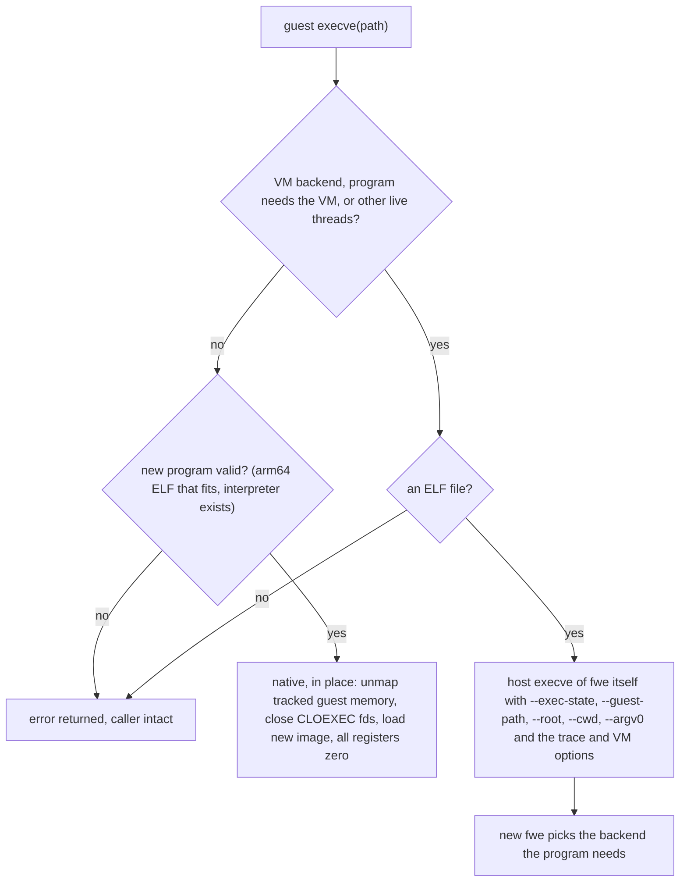

| State | How it crosses |
|---|---|
| pid, descriptors without `O_CLOEXEC`, signal mask, pending host signals, ignored dispositions | the host keeps them across its own exec; signals fwe held pending that the guest blocks are moved onto the host first |
| handled dispositions | reset to default, as on Linux |
| credentials, capabilities, `RLIMIT_NOFILE`, fwe's own rlimits, umask, mount namespace and root, mount origins of open files, seccomp filters, `no_new_privs`, personality, inotify and namespace descriptors | in place: kept in the process; re-exec: encoded in `--exec-state` |
| saved set-user/group ids | become the effective ones, as on Linux |
| thread and process keyrings | dropped; the session keyring stays |
| a program run from a descriptor (`execveat(fd, "", AT_EMPTY_PATH)`) | the descriptor kept and passed on with `--exe-fd` |

`execveat` turns its directory descriptor, path and flags into a guest
path and is then `execve`. A script (`#!interpreter [argument]`) runs
its interpreter as Linux's `binfmt_script` does, with the line's argument,
the script's path (`/dev/fd/N` for a descriptor) and the rest of the
arguments, nested up to five deep (`Kernel::exec_target`); the
interpreter, not the script, decides what set-ID bits grant.

#### The ELF loader and dynamic linker

fwe's loader (`crates/native/src/loader.rs`, the VM's in
`hv/backend.rs`) does the Linux kernel's job: it maps each `PT_LOAD`
segment (a PIE at a base it picks, code first writable so the native
backend can rewrite it), then loads the dynamic linker and starts there
([The dynamic linker](#the-dynamic-linker)). From then on glibc and musl
run unmodified.

#### wait

The children are real host processes, so waiting mostly passes through;
the flags and pid arguments need translating:

| | Linux | macOS | fwe |
|---|---|---|---|
| `wait4` pid argument | a pid, `-pgid`, 0, -1 | the same, host pids | mapped out of the guest's pid namespace (`ECHILD` for one not in it) |
| `WNOHANG`, `WUNTRACED` | 1, 2 | 1, 2 | passed through |
| `WCONTINUED` | 8 | `0x10` | translated |
| `__WALL`, `__WCLONE`, `__WNOTHREAD` | select which children | none | accepted; every child is an fwe process, so they change nothing |
| a reaper's `wait` | its children and adopted orphans | its children only | its host children, then the orphans fwe recorded for it ([orphans and reapers](#orphans-and-reapers)) |
| a tracer's `wait` | its tracees' stops and ends | its children only | tracees' stops and ends from their mailboxes first ([ptrace](#ptrace)) |
| `waitid(P_PIDFD, fd)` | the process a pidfd names | none | `P_PID` of the host pid the descriptor names; with `PIDFD_NONBLOCK` as `WNOHANG`, `EAGAIN` when nothing changed |

What comes back (the status word, `rusage`, `SIGCHLD`) is under
[Children ending](#children-ending).

#### ptrace

| Linux | macOS | fwe |
|---|---|---|
| a tracer reads and writes a stopped tracee's registers and memory, and resumes it | `ptrace` for a few requests; no access to another process's memory or threads without the debugger entitlement | the tracee does its tracer's work: at a stop it writes its registers and `siginfo` to a page they share and serves memory requests until told to go on (`crates/kernel/src/ptrace.rs`); only fwe processes can be traced |

Stops (signals, system-call entry and exit, `execve`, fork, clone and exit
events), single-stepping and attaching to processes and threads work in
both backends; [architecture.md](architecture.md#ptrace) has the
mechanism and its limits.

### Signals

Both kernels have signals with mostly the same behaviour, but different
numbers, different structures, and a different idea of what a blocked
signal keeps. This section covers the guest's side; how a host signal
reaches the guest is under [Host signals](#host-signals).

#### Numbers

Linux and macOS agree on signals 1–6, 8, 9, 11, 13–15, 21, 22 and 24–28.
fwe translates the rest both ways (`host::signal_to_host`,
`host::signal_to_linux`):

| Signal | Linux | macOS |
|---|---|---|
| `SIGBUS` | 7 | 10 |
| `SIGUSR1` / `SIGUSR2` | 10 / 12 | 30 / 31 |
| `SIGCHLD` | 17 | 20 |
| `SIGCONT` / `SIGSTOP` / `SIGTSTP` | 18 / 19 / 20 | 19 / 17 / 18 |
| `SIGURG` | 23 | 16 |
| `SIGIO` | 29 | 23 |
| `SIGSYS` | 31 | 12 |
| `SIGSTKFLT`, `SIGPWR` | 16, 30 | none |
| real-time `SIGRTMIN`..`SIGRTMAX` | 32–64 | none |
| `SIGEMT`, `SIGINFO` | none | 7, 29 |

fwe uses the two macOS-only signals itself: `SIGEMT` is its *wake signal*
and `SIGINFO` its *kill relay*
([Signals with no counterpart](#signals-with-no-counterpart)).

#### Dispositions, masks and frames

| | Linux | macOS | fwe |
|---|---|---|---|
| Dispositions | per process | per process, macOS numbers | in the kernel crate, each passed to the host as catch, default or ignore ([which](#who-acts-on-a-signal)) |
| Mask, alternate stack | per thread | per thread | per thread, in host thread-locals; the host thread's own mask blocks only what the host must hold back |
| Pending instances | one per standard signal; real-time signals queued | one per signal, `siginfo` lost while blocked | one per signal number; a standard signal keeps its first `siginfo`, a real-time one its latest; from another process, signals the host lacks wait in a queue of 64 in the target's mailbox |
| Signal frame | `rt_sigframe` with `ucontext`, `fpsimd_context` | Darwin `ucontext`, `mcontext64` | Linux's layout, on the guest stack or alternate stack; return through `sa_restorer` or fwe's `rt_sigreturn` trampoline |

A signal ignored when fwe starts (`nohup`, a shell's background job)
starts out ignored in the guest, as across a Linux `execve`.

#### Sending a signal

A signal to another process becomes a host `kill` with the pid and number
translated. Signals the host lacks, and signals aimed at one thread, are
recorded by fwe and the target woken with the wake signal:

| Guest call | fwe | Host |
|---|---|---|
| `kill(pid, sig)` to another process, a signal the host has | pid mapped out of the pid namespace; permission checked as on Linux; a sender note left in the target's mailbox if it is an fwe process (`crates/kernel/src/signote.rs`) | `kill(<host pid>, <host signal>)` |
| `kill`/`rt_sigqueueinfo` with `SIGTRAP` to another fwe process | queued in its mailbox, as a signal the host lacks is: the host would merge a host `SIGTRAP` with the target's next system-call trap (fwe's `brk`, a `SIGTRAP` too), and it would be lost | `SIGEMT` to wake the target |
| `kill` with `SIGKILL` | the same | an fwe target is sent `SIGINFO` (the kill relay), so a VM process can tear its VM down first; any other process the real `SIGKILL` |
| `kill` of itself with a fault signal (`SIGSEGV`, `SIGBUS`, `SIGILL`, `SIGFPE`, `SIGTRAP`) | recorded directly, since macOS's `siginfo` cannot tell a sent one from a fault | none |
| `kill`/`tgkill`/`rt_sigqueueinfo` with a real-time signal (or `SIGSTKFLT`, `SIGPWR`) | recorded directly within the process; to another fwe process queued in its mailbox with the sender, code and value; to a process that is not fwe's `EINVAL` | `SIGEMT` to wake the target |
| `tgkill(tgid, tid, sig)`, a signal the guest catches or a fault signal | posted to that thread directly, which a relayed host signal could not target | `SIGEMT` to wake it |
| `tgkill`/`tkill` of a thread of another process | queued in its process's mailbox with the tid, and posted to that thread | `SIGEMT` to wake the process |
| `tgkill` of a signal the host acts on | — | `pthread_kill(<host thread>, <host signal>)` |
| `kill(-1, sig)` | only the caller's pid namespace or its run of fwe, never other host processes | `kill` of each |

- **Permission** follows Linux: `CAP_KILL`, or the caller's real or
  effective uid matching the target's real or saved one, or `SIGCONT`
  within the session; a process fwe has no record of counts as root's.
- A `SIGKILL` or `SIGSTOP` sent to a pid namespace's init from inside the
  namespace is dropped; a `SIGKILL` that ends an init takes its namespace
  with it.

### Files and descriptors

A Linux process sees a filesystem through its root and its mount
namespace; a macOS process sees the one host filesystem. fwe resolves
every guest path itself, so the guest's root, mounts and symlinks behave
as Linux's, and hands the host a single path component to open. The
descriptors it gets back are the guest's, so reads and writes go straight
to the host.

| Linux | macOS | fwe |
|---|---|---|
| a process's root (`chroot`) and mount table | one host filesystem | guest paths resolved component by component (`crates/kernel/src/fs.rs`): symlinks followed by fwe, mounts entered, `..` clamped at the process's root, as `openat2(RESOLVE_IN_ROOT)` would; the final host `openat` has `O_NOFOLLOW` added |
| `open` flags | other values | translated (`host::open_flags_to_host`) |
| descriptor numbers | the same kind of table | guest descriptors are host descriptors; fwe's own live in a reserved range above the guest's (which ends at 16384 at most), out of the guest's reach (`EBADF`), the guest's below it whatever its virtual `RLIMIT_NOFILE` |
| `struct stat`, `statx` | different layout | translated |
| `statfs` | different layout, APFS | translated; type ext4, sizes and counts the host's |
| `getdents64` | `getdirentries` | built from it |
| record locks (`F_SETLK`) | POSIX locks, different `struct flock` | translated; the host's, so they hold against host processes too |
| OFD locks (`F_OFD_*`) | private `F_OFD_*` commands | translated to them; owned by the open file, shared by its duplicates |
| leases (`F_SETLEASE`) | none | a record every fwe process shares (`crates/kernel/src/leases.rs`): a conflicting open signals the holder and waits, up to `fs.lease-break-time` |
| `F_SETSIG`, thread owners | `SIGIO` to a process or group | kept per descriptor; how a host `SIGIO` arrives is under [Network events](#network-events) |
| pipe writes kept whole (`PIPE_BUF`): 4096 bytes | 512 bytes | up to 4096 bytes whole: writers of such a write to one pipe take turns (a lock of the pipe's every fwe process shares) |
| pipe size (`F_SETPIPE_SZ`) | fixed, 64 KiB at most | kept and reported as set; a smaller pipe holds no more than Linux's would, its writes cut to the room left and its write end not writable to `poll` or `epoll` while full; one set above 64 KiB holds no more than the host's |
| extended attributes | own namespace (`com.apple.`) | Linux names stored as host attributes of the same name, Linux's rules per namespace; only Linux's namespaces listed; `system.` ACLs not kept |
| mode bits; root passes them | owner's bits enforced on the owner | a mode denying its owner kept in an attribute (`UF_NODUMP` flags the file), the host file keeps owner read/write (`crates/kernel/src/modes.rs`) |
| FIFO hang-up in `poll`/`epoll` | `POLLHUP` once the last writer goes | macOS reports nothing; fwe asks `select` between short slices (`crates/kernel/src/fifo.rs`) |
| `O_PATH` | none | the descriptor marked and refused what Linux refuses; a FIFO, device, socket or symlink gets a stand-in that names it |
| terminals and ptys | `termios`, `/dev/ptmx` | see [Terminals and key strokes](#terminals-and-key-strokes) |

#### /proc, /sys and /dev

macOS has no `/proc` or `/sys`; fwe serves them as filesystems of its own:

- `proc` and `sysfs` mounts are generated from fwe's records and the host
  (`proc_pidinfo`, `sysctl`) (`crates/kernel/src/procfs.rs`, `procpid.rs`,
  `synthdir.rs`); what of the host shows there is under
  [Host identity and machine state](#host-identity-and-machine-state).
- `/proc/<pid>`, with its `task` directory, covers the processes of the
  reader's pid namespace. Another process's `mem` (and a thread's,
  `task/<tid>/mem`) is read and written as `process_vm_readv` reaches it,
  or through a stopped tracee's mailbox, and its `auxv` is the vector
  its program started with (a fork child's, its parent's); `pagemap` is
  the caller's own only. `/proc/sys` writes reach the namespace sysctls fwe
  keeps (network, IPC) and the few it acts on.
- `/proc/self/fd/N`, `cwd` and `root` behave as magic links.
- `/dev/null`, `zero`, `random`, `urandom` and `tty` are the host's;
  `full`, `loop-control` and `loopN` are fwe's; `/dev/ptmx` and
  `/dev/pts` are fwe's pty layer; `/dev/fd`, `stdin`, `stdout`, `stderr`
  link into `/proc/self/fd`; `/dev/shm` and `/dev/mqueue` are fwe's
  mounts.

### Waiting and events

Linux has a family of descriptors for waiting on many things at once;
macOS has `kqueue`. fwe builds each Linux descriptor from a kqueue, a
pipe, or both, so the guest can mix them in one `epoll`:

| Linux | macOS | fwe |
|---|---|---|
| `epoll` | `kqueue` | the epoll descriptor is a kqueue; `EPOLLIN`/`EPOLLOUT` become `EVFILT_READ`/`EVFILT_WRITE`, `EPOLLET` → `EV_CLEAR` (a pipe's read end, which the host reports again after a read, is reported only once it holds more than when last seen), `EPOLLONESHOT` → `EV_ONESHOT`, `EPOLLEXCLUSIVE` → a count of a pipe's writes every fwe process shares, of which each woken set must take one to report it, data in `udata`; `epoll_event` is 16 bytes on arm64; returned events under [Network events](#network-events) |
| `eventfd` | none | a pipe plus a 64-bit counter in a shared page, so a fork child shares it; the pipe holds one byte exactly while the counter is non-zero, so `kqueue` sees readiness |
| `timerfd` | none | a kqueue with one `EVFILT_TIMER`, in nanoseconds and on time (`NOTE_CRITICAL`) |
| `signalfd` | none | a readiness pipe plus a queue of `signalfd_siginfo`; a pending signal the thread blocks and a signalfd watches moves onto it |
| inotify | `kqueue` vnode events (no names), FSEvents (paths, after the fact); neither reports open, read or close | fwe raises the events itself from every fwe process's file calls; an instance is a host datagram socket bound in fwe's private directory, so reading and `epoll` are the host's |
| pidfd (`pidfd_open`, `CLONE_PIDFD`) | `kqueue`'s `EVFILT_PROC` | a kqueue watching the process's exit, never read, so it stays readable once the process has ended (a zombie, which the host will not report again, gets a user event); a `PIDFD_THREAD` one of another thread of the process gets the user event as the thread exits |

A host `fork` child gets no kqueues and an `execve` closes them, so epoll
interest lists, timerfd settings and process descriptors are recorded and
rebuilt at the same numbers in the child and across a re-executing
`execve`.

### IPC

#### Sockets

Guest sockets are host sockets, so connections reach real networks and
host programs. The differences are in encoding: address families, the
`sockaddr` header, flags folded into other arguments, and Unix-socket
names macOS does not support:

| Linux | macOS | fwe |
|---|---|---|
| `AF_INET6` = 10 | 30 | translated |
| `sockaddr` starts with a 2-byte family | a length byte, then a family byte | header rewritten in place |
| `SOCK_NONBLOCK`/`SOCK_CLOEXEC` in the type | none | applied with `fcntl` |
| `MSG_NOSIGNAL` | `SO_NOSIGPIPE` | every socket gets `SO_NOSIGPIPE`; fwe raises `SIGPIPE` itself for a write or send without `MSG_NOSIGNAL` |
| `SCM_RIGHTS`: 64-bit `cmsg_len` | 32-bit | re-encoded |
| `AF_UNIX` paths | 104-byte limit | resolved in the guest's root; a long one bound, connected or sent to from its directory with `pthread_fchdir_np`; connecting or sending needs write permission on the node, as fwe keeps its mode |
| abstract `AF_UNIX` names | none | files in a per-host temporary directory, or in an fwe network namespace's own directory, each with its name beside it; a name whose socket is gone is free to bind again |
| socket option numbers and layouts at `SOL_SOCKET`, `IPPROTO_IP`, `IPPROTO_IPV6` and `IPPROTO_TCP` | numbered apart (`IP_TOS` 1 and 3, `TCP_KEEPIDLE` 4 and `TCP_KEEPALIVE` 0x10); `group_req` packed to 4 bytes; `ip_mreq_source` ordered apart; multicast TTL and loop a byte | each translated (`crates/kernel/src/sockopt.rs`); one the host lacks is `ENOPROTOOPT`, but `SO_NO_CHECK`, `SO_PRIORITY` and `SO_PASSCRED` are kept and read back, and `SO_DOMAIN`/`SO_PROTOCOL` answered by fwe |
| `SO_SNDBUF`/`SO_RCVBUF` doubled, capped by `wmem_max`/`rmem_max`; the `FORCE` forms with `CAP_NET_ADMIN` | the size as given | Linux's arithmetic, the host's buffer given the result |
| a level a socket has no layer for | taken or `EINVAL` | `EOPNOTSUPP` to get, `ENOPROTOOPT` to set (`EOPNOTSUPP` on a Unix socket) |
| multicast membership on a TCP socket | refused | kept by fwe (no multicast reaches one) |
| `MSG_MORE` | none | a TCP or UDP send's data held back and sent with the next send without it, as one segment or datagram |
| `MSG_ERRQUEUE` | none | an IP socket's error queue is empty (`EAGAIN`) |
| `sendmmsg`, `recvmmsg` | none | one `sendmsg` or `recvmsg` per message |
| `connect` to `AF_UNSPEC` | dissolves a datagram socket's peer, reporting an error | a datagram socket's peer forgotten; a TCP socket's connection reset and a fresh host socket put in its place |
| `IPV6_ADDRFORM` | none | an IPv6 socket with an IPv4-mapped peer reports its names as IPv4, and a reset makes it an IPv4 socket |
| `socket`, `bind`, `connect` arguments | checked by the BSD stack | checked first in Linux's order: family, type and protocol; an address's length and family against the socket's (an IPv4 address to an IPv6 datagram socket is its IPv4-mapped one); a port below `ip_unprivileged_port_start` without `CAP_NET_BIND_SERVICE` |
| interface requests (`SIOCGIFCONF`, `SIOCGIFFLAGS`, `SIOCGIFADDR`, `SIOCSIFMTU`, ...) | a 32-byte `ifreq`, other flag bits | in an fwe network namespace, answered for `lo`; elsewhere the host's interfaces, `lo0` as `lo`, which the guest cannot change |
| `SOCK_SEQPACKET` Unix sockets | none | a stream socket with length-prefixed frames (`crates/kernel/src/seqpacket.rs`) |
| `AF_NETLINK`/`NETLINK_ROUTE` | none | in an fwe network namespace, answers for `lo`; in the initial one, for the host's loopback as `lo` |
| `SO_PEERCRED` | `LOCAL_PEERCRED` | peer pid in the caller's pid namespace, ids as the guest sees them |

#### System V IPC

macOS has System V IPC, but one set for the machine, with small limits.
fwe keeps its own per IPC namespace (`crates/kernel/src/sysvipc.rs`,
`ipcops.rs`): a shared record holding every object, and a segment's
memory in a file beside it that `shmat` maps shared. Each operation is one
change of the record under its lock, so `semop` is atomic across
processes. What a dead process leaves (attachments, `SEM_UNDO`) is cleaned
up by the next process that looks. The initial namespace's record lasts
until the host reboots.

#### POSIX message queues

macOS has no `mq_*`. Each queue is a record in its IPC namespace's
directory (`crates/kernel/src/mqueue.rs`); the guest's descriptor is a
host descriptor of the queue's file holding a shared `flock`, so an
unlinked queue is freed with its last descriptor. Notifications go to the
registering process: a signal carrying `SI_MESGQ` and the value, or, for
`SIGEV_THREAD`, the cookie sent to the C library's netlink socket.

#### Keys and keyrings

macOS has no key retention service. fwe keeps every key in one record
shared by all fwe processes (`crates/kernel/src/keys.rs`): keys, keyrings,
permissions, quotas, and the thread, process, session, user and persistent
keyrings. The key types (`keyring`, `user`, `logon`, `big_key`,
`dns_resolver`, `asymmetric`, `encrypted`) and their cryptography
(`keycrypto.rs`, as Linux 6.12 computes it) are fwe's. `request_key` has
no `/sbin/request-key` upcall: a key it would construct is negative for a
minute.

### Kernel-wide state

What Linux keeps in one kernel for every process (mount tables,
namespaces, the cgroup tree, loop devices, IPC objects, keys, inotify
watches, shared futexes) lives in fwe's private directory on the host
(`crates/kernel/src/shared.rs`): a directory per record, its data changed
under a lock, and a mapped generation count so a process rereads only
after another changed it.

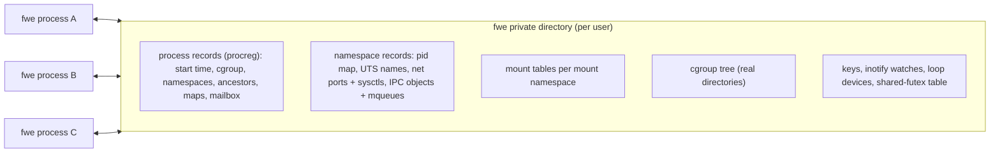

A record's name carries a format number, so another fwe build never reads
it. A record no live process holds is collected when a namespace is made
and when a fresh fwe starts, at most once a minute (records younger than
that are spared anyway), with the files a gone process left beside its
record, the `/dev/shm` directory of a rootfs no mount table shows, and
the tracing mailboxes of processes that are gone. A fresh start leaves
that work to a process of its own, which nothing waits for. A process
fwe starts for a guest's `execve` is handed the private directory
rather than asking macOS for the user's temporary directory again (the
host takes about a millisecond to answer).

### Namespaces

macOS has no namespaces. fwe makes each as a shared record the processes
in it name; a process in an initial namespace sees the host's (host name,
host pids). `clone` and `unshare` make them (`crates/kernel/src/nsops.rs`),
`setns` joins one through a `/proc/<pid>/ns/*` descriptor (`nsfd.rs`).
As on Linux, each thread has its own: one that changes them while other
threads run takes a copy of the process's view (`threadfs.rs`), which its
sockets and IPC act in, and which goes once it is back in the process's
namespaces; it shares the root, working directory and umask with the
others unless it unshared `CLONE_FS`, and a thread it starts has a copy
of its view. A `fork` child or a program it runs takes the calling
thread's.


| Namespace | What fwe does |
|---|---|
| pid (`pidns.rs`) | numbers processes and threads from 1 in a record mapping each to its host pid; `getpid`, `kill`, `wait`, process groups and `siginfo` senders are translated; when its init ends, the rest are killed; init ignores `SIGKILL`/`SIGSTOP` from inside |
| mount (`mounts.rs`) | a mount table per namespace; see [Mounts](#mounts) |
| user (`userns.rs`) | ids kept as the initial namespace's and seen through `uid_map`/`gid_map`, written once with Linux's rules; the creator has every capability in it |
| UTS | `uname`, `sethostname`, `setdomainname` use its names; in the initial one the host's name is read and never set (`EPERM`) |
| network (`netns.rs`) | a loopback interface, down until brought up; sockets reach only loopback; its ports are host loopback ports mapped through its table, so each namespace has its own port 80; its abstract `AF_UNIX` names and sysctls are its own |
| IPC | its System V objects and POSIX queues |
| cgroup | `/proc/self/cgroup` and `cgroup2` mounts show the tree from its root |

### cgroups

macOS has no cgroups and no unprivileged way to hold a process to a
memory or CPU budget. fwe keeps one cgroup v2 tree for the user's fwe
processes, as real directories with interface files
(`crates/kernel/src/cgroupfs.rs`):

- `mkdir`/`rmdir`, `cgroup.procs`, `cgroup.subtree_control` with Linux's
  rules; `cgroup.events`, `pids.current`, `memory.current` and `cpu.stat`
  read what is so when opened;
- `cgroup.freeze` stops and continues members, `cgroup.kill` kills them,
  `pids.max` limits `fork`;
- device programs (`BPF_PROG_TYPE_CGROUP_DEVICE`) decide every device open
  and `mknod` of members, run on fwe's eBPF interpreter (`bpf.rs`);
- the other limits are kept and read back, not enforced.

### Mounts

macOS mounts are system-wide and need root; there are no mount
namespaces, no bind or overlay mounts of Linux's kind and no propagation.
fwe's mounts exist only in its tables (`crates/kernel/src/mounts.rs`,
`mountops.rs`, `mountapi.rs`, `overlay.rs`), which its path resolver
follows:

- a mount shows a host directory (rootfs, bind source, a tmpfs's backing
  directory), an overlay of several, or one of fwe's filesystems (`proc`,
  `sysfs`, `cgroup2`, `devpts`, `mqueue`);
- `mount`, `umount2`, `pivot_root`, `chroot` and the mount API (`fsopen`,
  `fsconfig`, `fsmount`, `fspick`, `open_tree`, `move_mount`,
  `mount_setattr`, `statmount`, `listmount`) act on the table;
- propagation as Linux's: peer groups, slaves, across namespaces;
- `nosuid`, `nodev`, `noexec`, `nosymfollow`, `ro` and the access-time
  flags are enforced by fwe; busy mounts refuse `umount` (`EBUSY`);
- an overlay is resolved as Linux's `overlay`: upper then lower layers,
  whiteouts (0:0 device nodes) and opaque directories, copy-up as an APFS
  clone, each change built in the work directory and renamed into place;
  a directory opened in a bind mount of one stays in that mount, with what
  is mounted below it;
- a namespace's file (`/proc/<pid>/ns/<kind>`, a thread's under
  `task/<tid>`, or a descriptor of one) bound to a file is an `nsfs` mount
  that names the namespace: opening the path gives a descriptor of it,
  `stat` shows its inode, and it keeps the namespace from being collected
  until unmounted (Docker and `ip netns` keep network namespaces so).

### Credentials and capabilities

On macOS a process runs as the user who started it and only root can
change that. Linux programs, container runtimes above all, expect to be
root inside, to change ids and to hold capabilities. fwe keeps the
guest's identity virtual:

| Linux | macOS | fwe |
|---|---|---|
| real/effective/saved/fs uids and gids, groups | the host process's, changeable only by root | virtual (`crates/kernel/src/creds.rs`), default root (0), Linux's `set*id` rules |
| capability sets and securebits | none | the five sets and securebits (`caps.rs`), changed by `capset`, `prctl`, `setuid`, `execve` as on Linux; every capability but `CAP_SYS_TIME` at the start |
| `chown` | changes the owner | kept in an attribute (`org.fwe.owner`, `crates/kernel/src/owners.rs`) under Linux's rules and shown by `stat`; the host file stays fwe's user's |
| permission bits for a caller that is not root | the host's, for the host user | fwe's check by the guest's owner, mode and file-system ids, and each directory's search bit along a path (in a root filesystem) |
| file capabilities, set-ID programs | set-ID bits, honoured only for root's files | `execve` acts on a program's `security.capability` attribute and its set-ID bits (the owner and group fwe keeps) with Linux's rules: the new ids and capability sets, the ambient set cleared, and nothing gained under `no_new_privs`, on a `nosuid` mount or while traced |

How host users and file owners look to the guest is under
[Host identity](#host-identity-and-machine-state).

### seccomp

macOS has no seccomp. fwe runs each filter, classic BPF over Linux's
`seccomp_data` (`AUDIT_ARCH_AARCH64`), before either backend routes a call
(`crates/kernel/src/seccomp.rs`); the action of highest precedence wins.
Filters apply to every thread of the process and are kept across `fork`
and `execve`. `SECCOMP_RET_TRAP` raises `SIGSYS` with Linux's `_sigsys`
fields; `SECCOMP_RET_TRACE` and `SECCOMP_RET_USER_NOTIF` fail with
`ENOSYS`, as with no tracer or listener.

### Security modules: SELinux, AppArmor, Landlock

Linux's security modules (LSMs) add checks to the kernel's own: SELinux
labels every process and file and checks each access against a policy;
AppArmor confines a program to what its profile lists; Landlock lets a
process restrict itself. macOS has its own (the sandbox, SIP), which
apply to the `fwe` process as to any other and know nothing of the
guest.

| Module | What fwe does | What a program sees |
|---|---|---|
| capabilities | Linux's five sets and securebits, enforced by fwe ([Credentials and capabilities](#credentials-and-capabilities)) | as on Linux |
| Landlock | ABI 6: file rights by path, TCP ports, abstract sockets and signals, enforced by fwe (`landlock.rs`, `landlockops.rs`) | as on Linux, with the limits in [architecture.md](architecture.md#known-limitations) |
| SELinux | none | no `/sys/fs/selinux`: SELinux is off, as on a distribution that does not use it |
| AppArmor | none | no `/sys/kernel/security/apparmor`: AppArmor is absent |
| the list | `/sys/kernel/security/lsm` and `lsm_list_modules` name `capability,landlock` | only the modules that act |

Container tools look before they use a module: podman, crun, runc and
Docker apply an AppArmor profile or an SELinux label only where the host
has the module, so here they run without one (`--security-opt
label=...` and `apparmor=...` have nothing to act on), as on a Linux host
without them. Their seccomp profiles do apply: see the next section.

### Seccomp profiles

A container runtime turns a seccomp profile (Docker's default, podman's,
or a pod's) into a classic BPF filter and installs it in the container's
first process with `seccomp(SECCOMP_SET_MODE_FILTER)`. fwe runs the
filter on every system call before either backend routes it
([seccomp](#seccomp)), so the profile holds as it would on Linux: a call
it refuses fails with the profile's errno, kills, or raises `SIGSYS`.
CI's crun test runs a container with a profile and checks `Seccomp: 2` in
its `/proc/self/status`. Two actions have no counterpart: a filter that
answers `SECCOMP_RET_TRACE` or `SECCOMP_RET_USER_NOTIF` fails the call
with `ENOSYS`, as Linux does with no tracer or listener.

### eBPF

On Linux, eBPF programs are loaded into the kernel, checked by its
verifier, compiled to machine code and attached to hooks: sockets,
cgroups, tracepoints, kprobes, network devices (XDP), the scheduler.
macOS has none of it. fwe implements the part container runtimes and
socket programs use (`crates/kernel/src/bpf.rs`, `bpfmap.rs`,
`bpfcheck.rs`):

- **Programs** are interpreted, not compiled. The interpreter checks
  every memory access against the context and stack at run time and
  stops a program after 2^20 steps, so a program can do nothing but
  answer.
- **Cgroup device programs** (`BPF_PROG_TYPE_CGROUP_DEVICE`), which runc,
  crun and Docker attach to a container's cgroup to say which devices it
  may use, run on every device open and `mknod` of the cgroup's members
  ([cgroups](#cgroups)).
- **Socket filters** (`BPF_PROG_TYPE_SOCKET_FILTER`, `SO_ATTACH_BPF`),
  checked when loaded by a verifier for the subset fwe runs
  (`bpfcheck.rs`, with a verifier log as Linux gives), run on what this
  process sends to the socket.
- **Maps**: array and hash maps, with the lookup, update and delete
  helpers, kept in files of fwe's that every process holding a
  descriptor shares.
- A program of any other type loads and has an id, but is never
  attached. Tracing (kprobes, tracepoints, `perf_event_open`), XDP and
  traffic control, LSM programs, and the BPF filesystem are not there, so
  `bpftrace`, Cilium and the like do not work.

### Isolation and security

Namespaces, cgroups, credentials, seccomp and Landlock are enforced by
fwe, between the guest's system calls and the host. That is enough to
run container runtimes and their containers as they expect, and to keep
well-behaved programs apart (their own pids, mounts, network, ids). It
is not a boundary against a program that sets out to cross it:

- **The native backend** runs the program inside the `fwe` process. Its
  code shares the address space with fwe's own code and data and with
  macOS's libraries, so code that writes fwe's memory, jumps into
  `libSystem`, or makes macOS's own system calls (an `svc` fwe did not
  take for code) acts as the user who started `fwe`, with nothing of
  fwe's in the way.
- **The VM backend** keeps the guest's memory apart from fwe's: the guest
  reaches the host only through its system calls and faults, which fwe
  answers. That is a much smaller surface, but fwe's userspace kernel is
  not hardened as a sandbox's is.
- **Every guest process is the host user's.** What the guest thinks of
  as root, a container's own user, or another user is the same macOS user
  to the Mac: a file the guest may not write because of its virtual
  owner is one the user's other programs can.
- **macOS's own protections** (the sandbox, SIP, privacy consent, the
  firewall) apply to `fwe` as to any program the user runs.

So fwe isolates as a convenience, as `chroot` does, not as a security
boundary, as a VM does. A program that must not be trusted is better run
in a Linux VM (Lima, Colima, Apple's `container`; see
[comparisons.md](comparisons.md)).

### Devices

Device nodes on macOS can only be made by root, and Linux's device
numbers mean nothing there. fwe keeps its own:

- `mknod` of a device makes an empty file flagged `UF_OPAQUE` with the
  Linux type and numbers in an attribute (`crates/kernel/src/devnodes.rs`);
  opening it opens the host device those numbers name, or fails with
  `ENXIO`.
- Loop devices are fwe's own block devices 7:N with `/dev/loop-control`
  (10:237), in a shared record (`loopdev.rs`); fwe carries out their
  reads, writes and requests on the attached file.

### Time, scheduling and limits

| Linux | macOS | fwe |
|---|---|---|
| clocks: `REALTIME`, `MONOTONIC`, `BOOTTIME`, `TAI`, `*_COARSE`, `*_ALARM`, CPU-time | fewer | mapped onto the host's realtime, monotonic, raw and CPU-time clocks (`host::clock_to_host`) |
| setting the clock (`CAP_SYS_TIME`) | root | refused with `EPERM` after Linux's argument checks, as in a container |
| `reboot` (`CAP_SYS_BOOT`) | root | Linux's checks; Ctrl-Alt-Del's setting taken, a restart, halt or power off refused with `EPERM`: a guest never stops the Mac |
| interval timers (`setitimer`, `alarm`) | the same, at most 100,000,000 s | the host's |
| POSIX timers (`timer_create` and the rest) on any clock, with overruns | none | a thread of fwe's per process raises each timer's signal when due; a periodic timer goes again when its signal is taken, its overrun the intervals that passed (`crates/kernel/src/posixtimer.rs`) |
| sleeps and timeouts (`nanosleep`, `clock_nanosleep`, `poll`, `select`, the `epoll` waits, futex waits, timerfd), woken within the timer slack (50 µs by default) | coalesced: a millisecond or more late | a kqueue timer per thread with `NOTE_CRITICAL`, in nanoseconds, which wakes within tens of microseconds |
| nice, scheduling policies | own scheduler | kept in the process record with Linux's checks, inherited; the host schedules every process alike |
| `RLIMIT_NICE`, `RTPRIO`, `MSGQUEUE`, `MEMLOCK`, `CORE`, `STACK`, `CPU`, `NPROC`, … | absent or different | fwe's own (`crates/kernel/src/rlimits.rs`): `CORE` for fwe's core dumps, `STACK` for the guest's stack, `CPU`'s hard limit and `NPROC` enforced by fwe; `NOFILE` is virtual, below fwe's reserved descriptors; `FSIZE`, `DATA`, `AS` are the host's |
| `personality` | none | kept per process; `UNAME26` and `STICKY_TIMEOUTS` act |

### Not available

Any call not dispatched in `crates/kernel/src/syscalls.rs` fails with
`ENOSYS`, noted under `--strace`. These are:

- `kcmp`;
- `io_uring_setup` and the rest;
- `userfaultfd`, `perf_event_open`, `fanotify_init`/`fanotify_mark`;
- `rseq`;
- the `futex_wait`, `futex_wake` and `futex_requeue` calls (`futex` and
  `futex_waitv` work);
- the `*xattrat` calls, `open_tree_attr`, `listns`;
- `process_madvise`, `process_mrelease`, `memfd_secret`,
  `map_shadow_stack`;
- loading kernel modules (`init_module`, `finit_module`; `delete_module`
  finds none), `kexec_load`/`kexec_file_load`, `swapon`/`swapoff`,
  `quotactl`/`quotactl_fd`, the NUMA policy calls.

## macOS to Linux

Things happen on the host that a Linux program expects to hear about from
its kernel: a key pressed, a signal sent, a child ending, data arriving, a
timer firing, a call failing. macOS reports each in its own terms, and
fwe turns the report into what a Linux kernel would have said, through
one of a few channels:

| Channel on macOS | What fwe does with it | What the guest gets |
|---|---|---|
| a host signal to the fwe process | caught by the backend's handler (`crates/native/src/trap.rs`: `on_async`, `on_fault`, `on_sigtrap`; the VM's `on_signal` in `hv/backend.rs`), translated and recorded pending | a Linux signal with a Linux `siginfo`, in a Linux frame |
| a host call's result | return value kept, `errno` translated, structures rewritten | `x0` = the result or minus a Linux errno, Linux layouts |
| a `kqueue` event | translated by `epoll_wait`, `timerfd` and inotify reads; a reaper's watcher follows process events | `epoll` events, timer counts, `SIGCHLD` for an adopted orphan |
| host state read when asked | `proc_pidinfo`, `sysctl`, `gethostname`, `sysconf` | `/proc`, `uname`, `sysinfo` |
| another fwe process | shared records and signal notes | what one Linux kernel would show |

The tables below read **on macOS | what fwe does | what the guest sees**.

### Host signals

Most host events reach a Linux program as signals: key strokes, a resized
terminal, a child ending, a timer expiring, a `kill` from a shell. They
arrive at the fwe process as macOS signals with a macOS `siginfo`, and
must reach the right guest thread as Linux signals, with a Linux frame,
when Linux would deliver them.

#### Who acts on a signal

macOS empties the `siginfo` of a signal it holds blocked, while Linux
keeps the sender. So the host never blocks a signal fwe catches: fwe
catches each signal the guest must see with its sender, keeps it pending
itself while the guest blocks it, and leaves to the host only the actions
the host takes as Linux would (`Kernel::sync_host_signal`):

| Guest's disposition | Host disposition | Why |
|---|---|---|
| a handler | caught by fwe | to build Linux's frame |
| read by a `signalfd` or `rt_sigtimedwait` | caught by fwe, whatever the disposition, while it is read | to queue it there |
| default, and the default ends or stops the process (`SIGINT`, `SIGTERM`, `SIGHUP`, `SIGTSTP`, `SIGTTIN`, …) | caught by fwe, which carries the default out | so a thread whose guest mask blocks it keeps it pending, the parent sees Linux's status, and a VM process tears its VM down first |
| default, and the default ignores (`SIGCHLD`, `SIGURG`, `SIGWINCH`) | caught by fwe, which drops it unless the guest blocks it | macOS discards such a signal even while it is blocked; Linux keeps a blocked one pending |
| default `SIGCONT` | host default | the host does the same |
| ignored | host `SIG_IGN` | the host does the same, and keeps it ignored across `execve` |
| `SIGKILL`, `SIGSTOP` | the host's | they cannot be caught |
| fault signals (`SIGSEGV`, `SIGBUS`, `SIGILL`, `SIGFPE`, `SIGTRAP`) | fwe's fault handlers, always | see [Faults in guest code](#faults-in-guest-code) |

A guest thread runs under a host mask holding only the guest-blocked
signals whose action the host applies (`host::host_mask_for`); fwe's
handlers run with every signal blocked, and what a handler does for a
signal that interrupted fwe's own code allocates nothing (it may have
interrupted the allocator). `SIGCHLD`'s `SA_NOCLDSTOP` and `SA_NOCLDWAIT`
are passed to the host with it.

#### A host signal reaching a guest thread

A caught signal runs fwe's handler on whichever thread macOS chose. What
happens next depends on whether that thread was running guest code or
waiting in a host call fwe made for the guest:

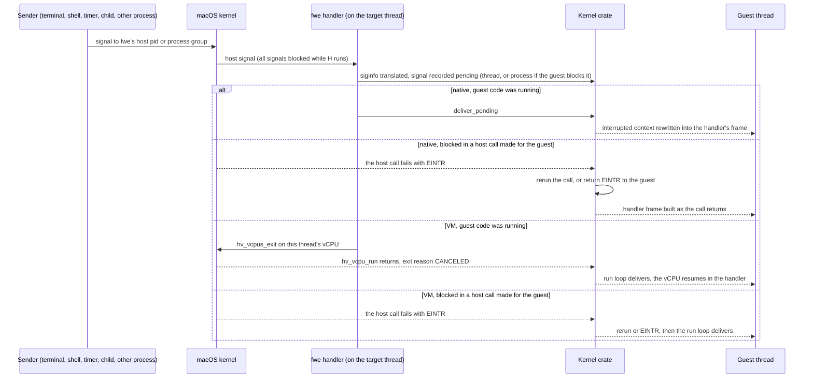

- **Running guest code:** natively, the handler delivers at once by
  rewriting the saved context, as Linux does on the way back to user
  space. In the VM it stops the vCPU, so a signal reaches even a guest
  spinning without system calls.
- **Blocked in a host call:** the thread's guest mask is in force on the
  host, so a signal the guest takes interrupts the host call, and the
  handler only records it. The call runs again if no guest handler waits
  for the signal, or if the handler has `SA_RESTART` and the call is one
  Linux restarts (reads, writes, `wait4`, `waitid`, socket calls,
  `openat`, `ioctl`, `flock`, `fcntl`, message queue calls, a futex wait
  without a timeout); otherwise it fails with `EINTR`. A signal arriving
  between a call's start and its host wait is a
  [known limitation](architecture.md#known-limitations).
- **Process-wide or thread:** a signal landing on a thread whose guest
  mask blocks it is recorded against the process, and the other threads
  are woken with `SIGEMT` to take it. `SIGPIPE` and `SIGXFSZ`, which the
  host raises on the thread that caused them, stay with that thread.
- **Default actions** fwe carries out: one that ends the process resets
  the host signal to default and raises it (after tearing the VM down), so
  the parent's `wait` sees death by that signal; one that stops it raises
  the host stop signal until the process is continued, so the parent sees
  the stop.

#### siginfo and the sender

macOS's `siginfo` carries much what Linux's does, in different codes,
with host pids and uids, and sometimes nothing. fwe translates what macOS
gives and fills the gaps from notes fwe processes leave each other:

| On macOS | What fwe does (`host::signal_info`) | What the guest sees |
|---|---|---|
| `si_code` of a sent signal (`SI_USER` = `0x10001`, `SI_QUEUE`, `SI_TIMER`, `SI_ASYNCIO`, `SI_MESGQ`) | translated (`host::si_code_to_linux`); the `SIGCHLD` and fault codes are the same on both | Linux's `si_code` (`SI_USER` = 0 …) |
| `si_pid` of the sender, a host pid | mapped into the guest's pid namespace | the sender's pid there, 0 for one outside it |
| `si_uid` of the sender | fwe's own host user → 0, any other → 65534, then through the user namespace | the sender's uid as the guest's ids go |
| an fwe process sent it | the sender first wrote a note (pid, uid, and for `SI_MESGQ` the code and value) into the target's mailbox, which the handler reads | the sender, even when macOS gave none |
| a `siginfo` macOS emptied (a signal that arrived while an fwe handler ran) | the note, if an fwe process sent it; for `SIGCHLD`, a `waitid(WNOHANG \| WNOWAIT)` finds the child and how it changed | the sender or child, as Linux tells it; none for a non-fwe sender |
| a `SIGIO` the host raised for a descriptor's readiness | no sender: `SI_KERNEL` | see [Network events](#network-events) |
| a fault | the fault address | `si_addr` |

#### Signals with no counterpart

macOS's two extra signals are fwe's own tools, so fwe decides what one
means when it comes from elsewhere; Linux's extra signals never come from
the host:

| On macOS | What fwe does | What the guest sees |
|---|---|---|
| `SIGEMT` (7), from fwe itself | the wake signal: interrupts a thread blocked in a host call so it notices a signal recorded for it | the signal it was woken for |
| `SIGEMT` from any other process | the same: it only interrupts | nothing; an interrupted call runs again |
| `SIGINFO` (29), from another fwe process | the kill relay, sent instead of an uncatchable `SIGKILL`: a native process kills itself with `SIGKILL`, a VM process tears its VM down first ([hypervisor.md](hypervisor.md#never-end-a-vm-process-abnormally)) | death by `SIGKILL` |
| `SIGINFO` from anywhere else (`kill -INFO`) | no note came with it, so it is no relay: dropped | nothing |
| a child killed by a host signal with no Linux number | `host::signal_to_linux` gives `SIGABRT` | a child killed by `SIGABRT` |
| Linux's `SIGSTKFLT`, `SIGPWR` and real-time signals | never from the host; recorded within the process, or queued in another fwe process's mailbox and that process woken with `SIGEMT` | delivered with fwe's own `siginfo` |
| a guest killed by one of those (default action) | no host signal to die of: leaves its Linux status beside its record, then exits with 128 + the signal | an fwe parent sees it killed by that signal; a host shell sees 128 + the signal |

#### Where each signal comes from

| Host source | Host signal | What fwe does | What the guest sees |
|---|---|---|---|
| a key in the terminal | `SIGINT`, `SIGQUIT`, `SIGTSTP` | relayed | see [Terminals and key strokes](#terminals-and-key-strokes) |
| the terminal resized | `SIGWINCH` (28 on both) | relayed; the host's default (ignore) unless the guest catches it | `SIGWINCH`; `TIOCGWINSZ` reads the new size |
| the terminal closed or its session leader gone | `SIGHUP` | relayed | `SIGHUP`, death by default |
| a host shell's `kill`, `launchctl`, any process | any | relayed, sender translated | see [A process killed from the host](#a-process-killed-from-the-host) |
| a write to a pipe with no reader | `SIGPIPE` on the writing thread | relayed to that thread; with the guest ignoring it, only `EPIPE` | `SIGPIPE`, `EPIPE` |
| a write to a socket whose peer has gone | none (`SO_NOSIGPIPE`) | fwe raises `SIGPIPE` on the thread unless `MSG_NOSIGNAL` | `SIGPIPE`, `EPIPE` |
| a write past `RLIMIT_FSIZE` | `SIGXFSZ` on the writing thread | relayed to that thread | `SIGXFSZ`, `EFBIG` |
| CPU time past `RLIMIT_CPU`'s soft limit | `SIGXCPU` | relayed, and the host's soft limit raised a second; past the hard limit fwe ends the process with `SIGKILL`, which macOS does not send | `SIGXCPU` each second, then `SIGKILL` |
| an interval timer expiring | `SIGALRM`, `SIGVTALRM`, `SIGPROF` (same numbers) | relayed | the timer's signal |
| a child stopping, continuing or ending | `SIGCHLD` (20) | relayed as 17 | see [Children ending](#children-ending) |
| descriptor readiness under `O_ASYNC`, out-of-band data | `SIGIO` (23), `SIGURG` (16) | relayed as 29 and 23; `SIGIO` turned into the descriptor's `F_SETSIG` signal | see [Network events](#network-events) |
| guest code faulting | `SIGSEGV`, `SIGBUS`, `SIGILL`, `SIGFPE`, `SIGTRAP` (native) | fwe's fault handlers | see [Faults in guest code](#faults-in-guest-code) |

### Faults in guest code

When guest code touches an unmapped address, executes an undefined
instruction or hits a breakpoint, Linux sends it a signal. Natively the
fault is a host signal to fwe's fault handlers (`on_fault` and
`on_sigtrap` in `crates/native/src/trap.rs`), and some such signals are
fwe's own traps rather than faults the guest should see:

| On macOS (native) | What fwe does | What the guest sees |
|---|---|---|
| `SIGTRAP` at `brk #0x4c58` | the rewritten `svc #0` (where no stub fits): a system call | the call's result |
| `SIGTRAP` at the gate's `brk #0x4c5a` | a system call the gate does not finish itself | the call's result, a signal delivered |
| `SIGSEGV`/`SIGBUS` at a system-call stub's first store | the guest's `sp` takes no store: the system call, run as the trap runs it | the call's result |
| `SIGTRAP` at any other `brk` | the guest's own breakpoint | `SIGTRAP`, `si_addr` the `brk` |
| `SIGTRAP` where the pc holds no `brk` | sent by another process | a relayed `SIGTRAP` |
| `SIGILL` at `mrs <Xt>, ctr_el0` | emulated | the value, as Linux lets EL0 read it |
| `SIGSEGV`/`SIGBUS` on write+exec memory | the page switched between writable and executable, the access retried | nothing |
| `SIGBUS` for an access the page's protection forbids (macOS reports some so) | turned into Linux's signal for it | `SIGSEGV` |
| `SIGBUS` for an access the protection allows (past a mapped file's end) | kept | `SIGBUS` |
| a fault signal with a note from another fwe process | a sent signal, not a fault | that signal, with its sender |
| a fault in fwe's checked copy of guest memory | the copy stops at its recovery point | the call fails with `EFAULT` |
| a fault in fwe's own code anywhere else | fatal | the process dies of that signal |

In the VM a fault is an exception the run loop reads from `ESR_EL1`
([hypervisor.md](hypervisor.md#the-run-loop)); the host sends no signal:

| VM exception | What the guest sees |
|---|---|
| data or instruction abort, not a page still to fetch or a stale TLB entry | `SIGSEGV`, `si_addr` the faulting address |
| stage-2 abort | `SIGSEGV` |
| PC or SP alignment | `SIGBUS` |
| `brk` | `SIGTRAP` |
| BTI, unknown or other exception | `SIGILL` |
| trapped `CNTPCT_EL0` read | the virtual counter's value |
| `wfi`, `wfe` | stepped over |

A fault with a guest handler enters it with Linux's frame. With none, the
process dies of the signal (natively after a register and code dump under
`--strace`; in the VM after teardown), so the parent sees Linux's status.

### Terminals and key strokes

The terminal is the host's: the guest's standard descriptors are the
terminal's host descriptors, and the line discipline is macOS's, set from
the guest's `termios`. A key stroke that means a signal becomes a macOS
signal to the foreground process group, which fwe relays as above. Ctrl-C,
for each of the three things a guest can have chosen for `SIGINT`:

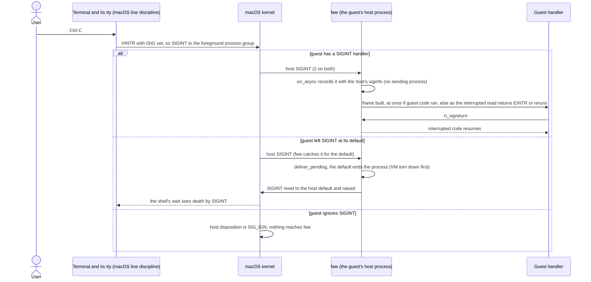

#### Key strokes

| On macOS | What fwe does | What the guest sees |
|---|---|---|
| Ctrl-C (`VINTR`, with `ISIG`): `SIGINT` to the foreground group | relayed (sequence above) | `SIGINT` |
| Ctrl-\\ (`VQUIT`): `SIGQUIT` | relayed; a default ends the process with the host `SIGQUIT` | `SIGQUIT`; a core file, as Linux writes one, if `RLIMIT_CORE` allows |
| Ctrl-Z (`VSUSP`): `SIGTSTP` (18) | relayed as 20; a default stop is fwe's: it stops itself with the host `SIGTSTP` | `SIGTSTP`; the shell sees the job stopped by `SIGTSTP` |
| `fg`/`bg`: `SIGCONT` (19) | the host continues the process; a guest handler is entered | `SIGCONT` (18) |
| Ctrl-T (`VSTATUS`, macOS only): `SIGINFO` to the foreground group | no note came with it, so it is no kill relay: dropped; once the guest sets its `termios`, which has no such key, Ctrl-T and Ctrl-Y (`VDSUSP`) are disabled (`_POSIX_VDISABLE`) | nothing; with the keys disabled, the character as input |
| Ctrl-D, Ctrl-S/Ctrl-Q, erase, kill, `VLNEXT` and the rest of canonical editing | done by the host's line discipline as the guest's `termios` sets it | the edited line; `read` returns 0 at end of file |
| a background job reads (or, with `TOSTOP`, writes) the terminal: `SIGTTIN`/`SIGTTOU` | relayed; a default stop is fwe's, as for `SIGTSTP` | the job stops |
| the window resized: `SIGWINCH` | relayed | `SIGWINCH`; `TIOCGWINSZ` the new size |

#### termios and terminal requests

| Linux | macOS | fwe (`crates/kernel/src/term.rs`, `sys_ioctl`) |
|---|---|---|
| `TCGETS`, `TCSETS`/`TCSETSW`/`TCSETSF` | `tcgetattr`, `tcsetattr(TCSANOW / TCSADRAIN / TCSAFLUSH)` | translated field by field |
| 32-bit flag words | 64-bit `tcflag_t`, other bit positions | each flag both have mapped by name; `CSIZE` mapped |
| `c_cc[19]` in Linux's order | `c_cc[20]` in another order, with `VSTATUS` and `VDSUSP` | the 16 characters both have mapped by name; a guest's `TCSETS` writes the macOS-only ones as 0, which macOS takes as the NUL character (its "disabled" value is `0xff`) |
| baud in `c_cflag` | `c_ispeed`/`c_ospeed` | reported as `B38400`; set to 38400 |
| `TIOCGWINSZ`, `TIOCSWINSZ` | the same | passed through |
| `TIOCGPGRP`, `TIOCSPGRP` | `tcgetpgrp`, `tcsetpgrp` | the group mapped through the pid namespace; one not in it is `EPERM` |
| `TIOCSCTTY`, `TIOCNOTTY` | the same | passed through |
| a terminal request on something that is not a terminal | `ENODEV` (`/dev/null`) or `EOPNOTSUPP` | `ENOTTY`, as Linux answers |

#### Job control and ptys

Process groups, sessions and the controlling terminal are the host's, so
a guest shell and a host shell share job control on one terminal:

| Linux | macOS | fwe |
|---|---|---|
| process groups and sessions (`setpgid`, `setsid`, `getpgid`, `getsid`) | the host's | the host's, with ids mapped through the guest's pid namespace; fwe records each process's group |
| the foreground group, the controlling terminal | the host tty's | the host tty's |
| `/dev/ptmx`, `TIOCGPTN`, `TIOCSPTLCK`, `/dev/pts/N` | `posix_openpt`, `grantpt`, `unlockpt`, `ptsname`, `/dev/ttysNNN` | `/dev/ptmx` allocates with `posix_openpt` and numbers the slave; `TIOCGPTN` returns that number; `TIOCSPTLCK` is accepted (the slave is unlocked already); `/dev/pts/N` opens the host slave (`crates/kernel/src/pty.rs`) |

### Children ending

A child guest process is a host child, so when it ends macOS tells the
parent with `SIGCHLD` and a status word in macOS's terms. fwe translates
both, and records how the child ended so that what macOS cannot show (a
Linux-only signal, an adopter) comes out right:

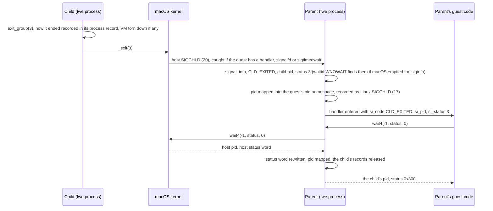

| On macOS | What fwe does | What the guest sees |
|---|---|---|
| a child exited with code *n* | status word kept | `n << 8` |
| a child killed by a host signal | the Linux status the child left beside its record (`procreg::ending`), with the core bit if fwe wrote a core; else the signal mapped (`host::signal_to_linux`) | Linux's signal number, `0x80` if a core was dumped |
| a child stopped | the stop signal mapped | `sig << 8 \| 0x7f` |
| a child continued | — | `0xffff` |
| a guest child ended by a Linux-only signal | it exited with 128 + the signal, leaving its Linux status beside its record | killed by that signal |
| `SIGCHLD` `siginfo`: `CLD_KILLED`/`CLD_DUMPED`/`CLD_STOPPED` | `si_status` mapped to Linux's signal | Linux's signal number |
| `SIGCHLD` `siginfo`: `CLD_CONTINUED` | `si_status` is what stopped it on macOS; set to what continued it | `SIGCONT`, as Linux reports |
| `rusage` from `wait4` | `ru_maxrss` from bytes to KiB | Linux's `rusage` |
| `waitid` | the host gives no `rusage` | zero-filled `rusage` |
| the guest ignores `SIGCHLD`, or set `SA_NOCLDWAIT` | the host reaps the children itself | no zombies, as on Linux |
| the parent ends | the child goes to `launchd` on the host | its Linux adopter, below; a `PR_SET_PDEATHSIG` signal, sent by a thread of fwe's in the child that waits on the parent's exit (`kqueue`, `crates/kernel/src/pdeath.rs`) |

#### Orphans and reapers

Linux gives an orphan to its nearest child subreaper
(`PR_SET_CHILD_SUBREAPER`) or its pid namespace's init. macOS gives every
orphan to `launchd`, and only a parent may `wait` for a process. fwe keeps
the adoption itself (`crates/kernel/src/reaper.rs`):

- each process record holds its line of ancestors and whether it is a
  subreaper, so `getppid` and `/proc/<pid>` name the adopter;
- a process that ends where a reaper might adopt it records how it ended
  (one killed by `SIGKILL` is recorded by whoever finds it gone);
- a reaper runs a watcher thread on `kqueue` process events and raises
  `SIGCHLD` in itself for an adopted descendant's end (once it is gone:
  its record of how it ended comes just before), stop or continue,
  with a child's `siginfo`, and wakes every one of its threads, so the
  one that does not block it takes it (a wake the host gives one thread
  could land on one that blocks it); a stop or continue signal the reaper
  sends itself is told to its watcher first, which looks for the stop it
  makes even in a process it did not follow yet (the host tells it only of
  signals to the processes it follows);
- its `wait` looks at its own children, then the adopted ones;
- a child made with `CLONE_PARENT` is its creator's parent's, not its
  parent's on the host: its record says so, it tells that parent as it
  starts (a note in the parent's signal mailbox), and the parent then
  runs the watcher and waits for it as for one it adopted (runc makes
  each container's init so).

### A process killed from the host

Any host program can signal a guest process: a `kill` in a host shell,
Activity Monitor, `launchctl`. Such a sender leaves no note, so the guest
learns what macOS's `siginfo` says, and the signals fwe uses itself mean
what they mean to fwe:

| On macOS | What fwe does | What the guest sees |
|---|---|---|
| `kill -TERM <pid>` (or `-INT`, `-HUP`, `-USR1` …) from a host shell or any process fwe does not run | a host signal like any other; the sender a host pid with no note | the signal, `si_code` `SI_USER`, `si_pid` the sender in the initial pid namespace (0 from inside a nested one), `si_uid` 0 if it runs as fwe's user, else 65534 |
| `kill -9` of a native process | none: the host ends it at once | its parent sees death by `SIGKILL`; a reaper that finds it gone records it |
| `kill -9` of a VM process | none: it ends with its VM alive, which can bring the machine down ([hypervisor.md](hypervisor.md#never-end-a-vm-process-abnormally)) | — |
| `kill -INFO <pid>` | no note came with it, so it is no kill relay: dropped | nothing |
| `kill -EMT <pid>` | the wake signal: only interrupts | nothing |
| `kill -STOP`, `kill -CONT` | the host's own | the process stops and continues; a parent's `wait` with `WUNTRACED` sees the stop by `SIGSTOP` (19) |
| `kill -SEGV <pid>` (a fault signal) from a process fwe does not run | macOS gives it the thread's last fault, and no note says it was sent | taken as a fault ([limitations](architecture.md#known-limitations)) |

### Files changing on the host

The guest's files are host files, which host programs can change at any
time. Through a shared mapping the guest sees the change; through inotify
it sees only what fwe processes do, since fwe raises inotify events
itself:

| On macOS | What fwe does | What the guest sees |
|---|---|---|
| an fwe process changes, opens, reads or closes a watched file | raises Linux's inotify events from its own calls | the events |
| a program fwe does not run changes a watched file | nothing: no host event names it as Linux's events do | no inotify event |
| a host process writes a file the guest mapped `MAP_SHARED` | the mapping is a host shared mapping (native) or a segment of one (VM) | the change |
| a host process writes a file the guest mapped privately | native: a host private mapping; VM: a copy taken when mapped | native: as the host shows it; VM: never |
| a host process holds a POSIX record lock or an OFD lock | guest locks are host locks | the conflict |
| a file owned by another host user | owner translated | owner 65534 |
| a file fwe's user owns | owner translated | owner 0 (root), or the owner the guest gave it |
| the host's own extended attributes (`com.apple.*`) | not listed | only Linux's namespaces |
| a guest's working directory renamed by another process | fwe keeps the path ([limitations](architecture.md#known-limitations)) | the old path |

### Network events

Guest sockets are host sockets: connections, data and the ports of the
initial network namespace are the host's (but for a port below 1024 on a
loopback address, which only fwe's processes reach by its number when fwe
is not root). What arrives does so as
`kqueue` events, which fwe turns into `epoll` events with Linux's meaning
for each kind of descriptor:

| On macOS | What fwe does (`crates/kernel/src/epoll.rs`) | What the guest sees |
|---|---|---|
| a `kqueue` read filter fires | `EVFILT_READ` → `EPOLLIN` | `EPOLLIN` |
| a write filter fires | `EVFILT_WRITE` → `EPOLLOUT` | `EPOLLOUT` |
| `EV_EOF` on a socket's read filter (peer shut its writing side) | readable, and so marked | `EPOLLIN \| EPOLLRDHUP`, with `EPOLLHUP` for a Unix socket (Linux shuts both ways) |
| `EV_EOF` on both of a socket's filters | hung up | `EPOLLHUP` added |
| `EV_EOF` on a pipe's or terminal's read filter | hung up, readable while data is left | `EPOLLHUP`, `EPOLLIN` while data is left |
| `EV_EOF` on a pipe's write filter (readers gone) | an error to write | `EPOLLOUT \| EPOLLERR` |
| `EV_ERROR` | — | `EPOLLERR` |
| a FIFO's last writer gone (macOS reports nothing) | `select` asked between short slices | `POLLHUP`/`EPOLLHUP` |
| readiness on an `O_ASYNC` descriptor: host `SIGIO` with no sender | the descriptor and its events found with `poll`; sent as the signal `F_SETSIG` chose, to the owner thread if one is set | that signal with `si_fd`, `si_band` and `POLL_IN`/`POLL_OUT`/`POLL_PRI`/`POLL_HUP` |
| out-of-band data: `SIGURG` (16) | relayed | `SIGURG` (23) |
| reading an unconnected Unix stream socket: `ENOTCONN` | Linux's answer | `EINVAL` |
| an interface or route changes | netlink outside an fwe network namespace describes only the host's loopback | nothing |
| the host's DNS settings | not read: the resolver reads the rootfs's `/etc/resolv.conf` and `/etc/hosts` | the rootfs's |

### Clocks and timers

The guest's time is the Mac's. Linux has more clocks than macOS; fwe reads
each from the host clock that means the same:

| On macOS | What fwe does | What the guest sees |
|---|---|---|
| the host's realtime clock, set by the user or NTP | `CLOCK_REALTIME`, `TAI`, `*_COARSE`, `*_ALARM` read it | the host's time; the guest cannot set it (`EPERM`) |
| the host's monotonic clocks | `MONOTONIC`, `BOOTTIME` and their variants read `CLOCK_MONOTONIC`; `MONOTONIC_RAW` reads `CLOCK_MONOTONIC_RAW` | the host's |
| a host thread's or process's CPU time | the CPU-time clocks | its CPU time |
| an interval timer expiring | relayed signal | `SIGALRM`, `SIGVTALRM`, `SIGPROF` |
| a POSIX timer falling due | fwe's timer thread raises its signal | the timer's signal, with its overrun count |
| a timerfd's `EVFILT_TIMER` firing | counted | a readable timerfd and its expiration count |
| a sleep interrupted by a signal the guest handles | `nanosleep`, `clock_nanosleep` are not restarted | `EINTR` |
| VM: the guest reads the counter | `CNTVCT_EL0` is the vCPU's virtual counter; a `CNTPCT_EL0` read is emulated from it | one counter, as on Linux |

### Memory pressure

macOS manages memory its own way (compression, swap files) and has no
OOM killer Linux programs could observe. fwe does not pass the host's
memory state through:

| On macOS | What fwe does | What the guest sees |
|---|---|---|
| free memory, compression, swap | not read | `/proc/meminfo` and `sysinfo` report fixed values: 8 GiB total, 4 GiB free, 6 GiB available, no swap |
| a host `mmap` that cannot be satisfied | `ENOMEM` | `ENOMEM` |
| the guest stack running into its guard page | a fault | `SIGSEGV` |
| no OOM killer (Linux ranks processes to kill) | `oom_score_adj` kept per process, `oom_score` derived from it | the files, with Linux's rules for writing them |
| `mlock` | pages brought in, not wired | success within `RLIMIT_MEMLOCK` |

### Errors

Host calls fail with macOS's `errno`; `host::errno_to_linux` turns each
into the Linux errno of the same meaning:

| On macOS | What the guest sees |
|---|---|
| an errno both have (`ENOENT`, `EAGAIN`, `ECONNREFUSED`, …), whatever its number on each | the Linux number of the same name |
| `ENOTSUP` (macOS's, beside `EOPNOTSUPP`) | `EOPNOTSUPP` |
| `ENOATTR` (no such extended attribute) | `ENODATA` |
| an errno Linux has no equivalent of (`EAUTH`, `EBADRPC`, `EPWROFF`, …) | `EIO` |
| `ENODEV` or `EOPNOTSUPP` from a terminal request on a non-terminal | `ENOTTY` (`host::tty_error`) |

Where the two kernels give different errors for the same case, the call
answers as Linux does (an unconnected Unix stream socket's read is
`EINVAL`, not `ENOTCONN`; `epoll_ctl` checks its arguments in Linux's
order); each is documented with its call in
[architecture.md](architecture.md).

### Host identity and machine state

fwe presents the host user as root, as a rootless container does, and the
machine as a Linux machine with the host's CPUs, uptime and load:

| On macOS | What fwe does | What the guest sees |
|---|---|---|
| the user fwe runs as (uid 501, say) | root in the guest, as in a rootless container's user namespace (`host::uid_to_linux`) | its own ids virtual, root by default, with every capability but `CAP_SYS_TIME`; files fwe's user owns owned by 0 |
| fwe's own group | `host::gid_to_linux` | group 0 |
| every other host user and group | `OVERFLOW_ID` | 65534 (`nobody`) |
| the host name (up to 255 bytes) | cut to Linux's 64 (`ns::host_name`) | `uname`'s `nodename`, `/proc/sys/kernel/hostname`; `sethostname` in the initial UTS namespace fails with `EPERM` |
| the macOS kernel | not shown | `uname`: `Linux`, `6.12.0-fwe`, `#1 SMP PREEMPT`, `aarch64` |
| host pids | used as guest pids in the initial pid namespace | host pids; `/proc` lists only fwe's processes |
| online CPUs (`sysconf`) | counted | `/proc/cpuinfo`, `/proc/stat`, `sched_getaffinity`, `sysinfo` |
| CPU features (`hw.optional.*`) | `AT_HWCAP`/`AT_HWCAP2` ([auxv](#auxv-hwcaps-and-the-vdso)) | the hwcaps; `/proc/cpuinfo` lists `fp asimd` |
| boot time, uptime, load averages, per-CPU times | read from the host | `/proc/uptime`, `/proc/loadavg`, `/proc/stat`, `sysinfo` |
| another process's state, times and memory (`proc_pidinfo`) | read from the host | `/proc/<pid>/stat` and the like |
| a filesystem's type and sizes (`statfs`) | type reported as ext4 | ext4, the host's sizes |
