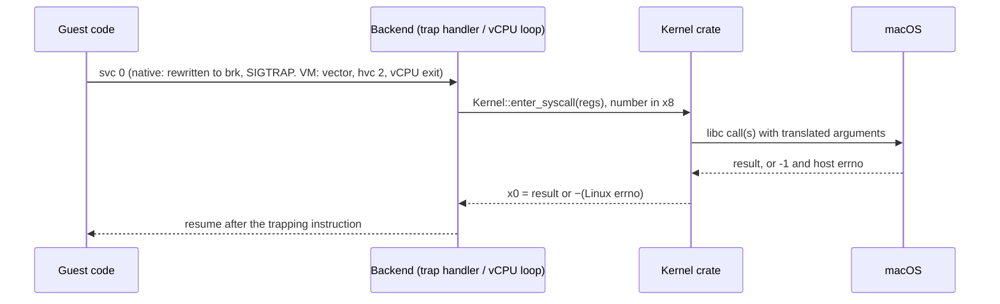
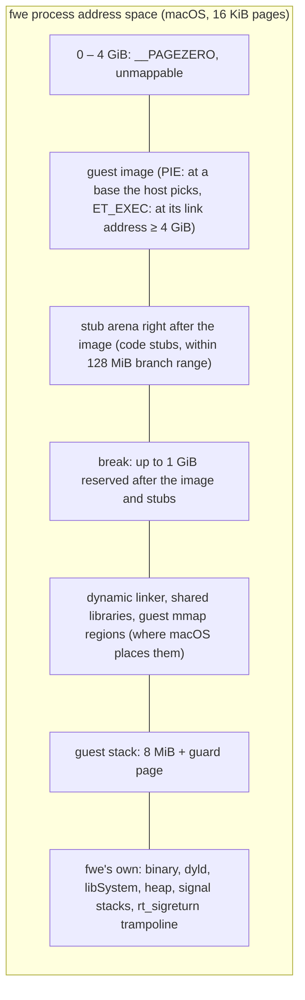
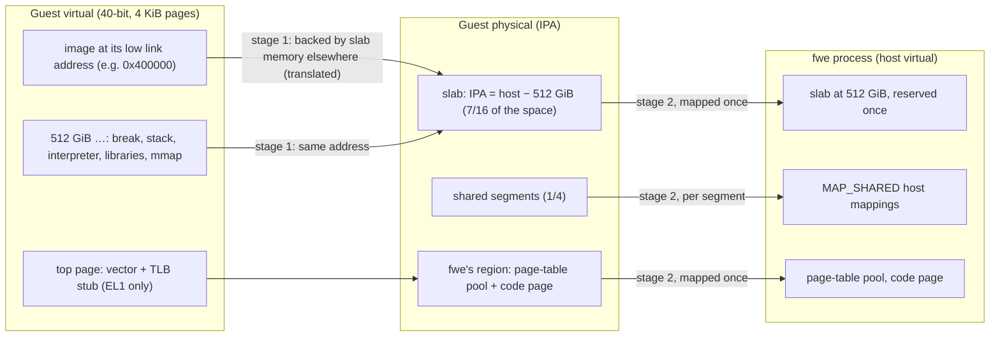
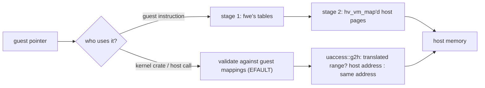
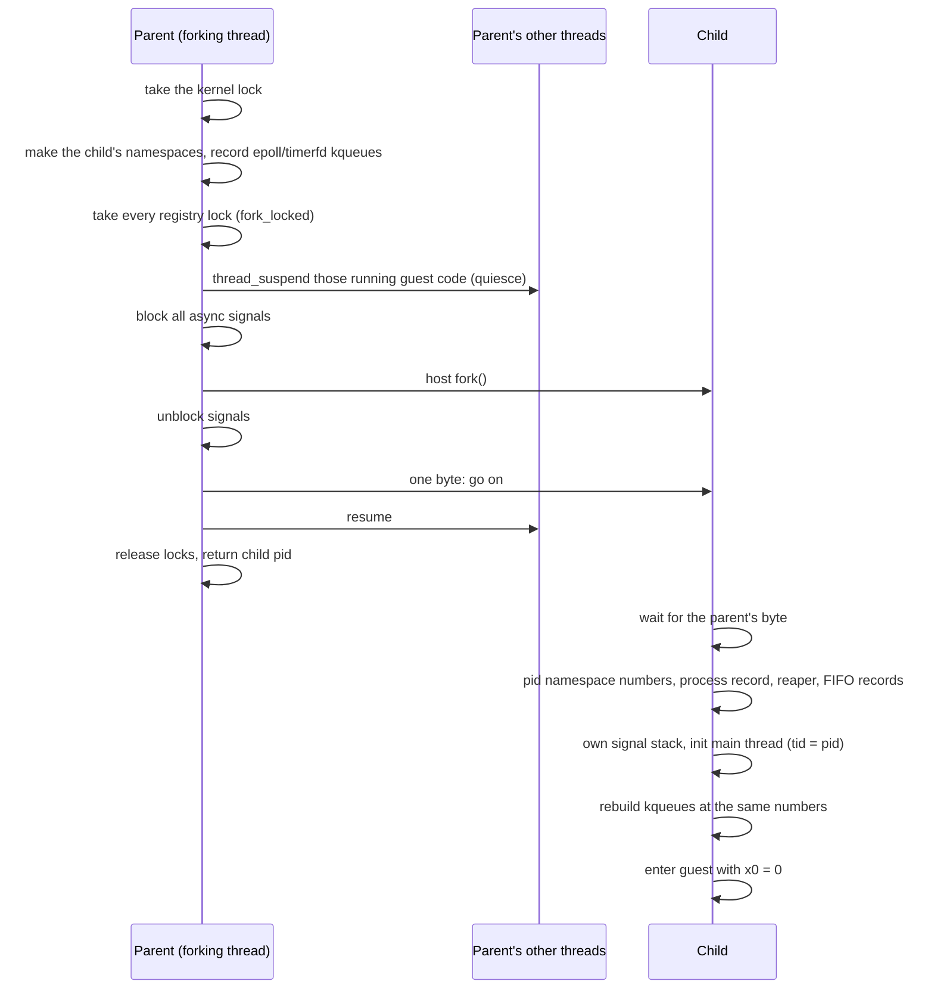
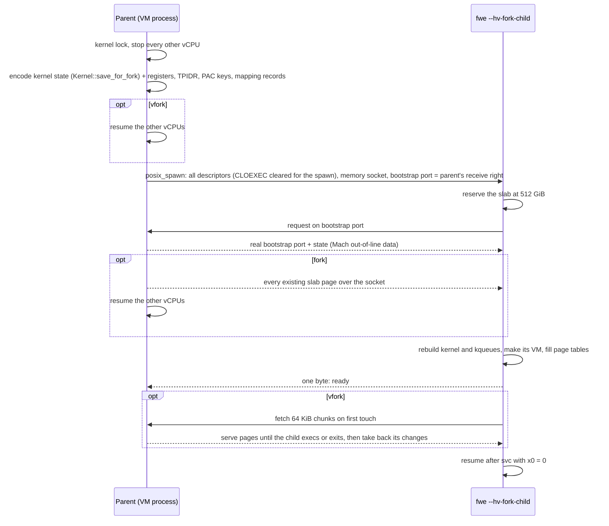
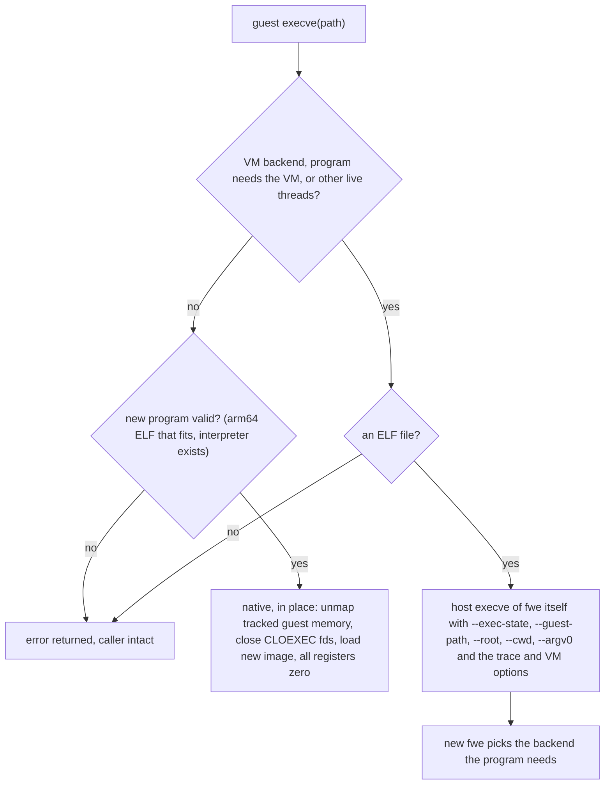
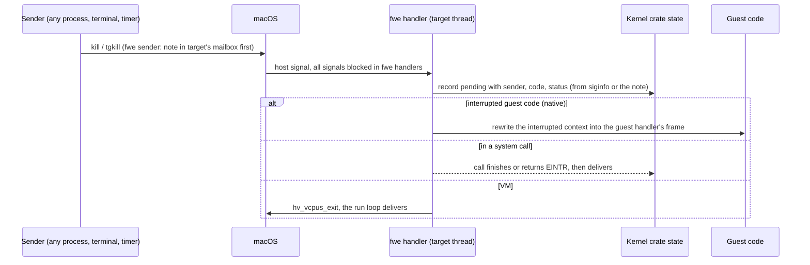
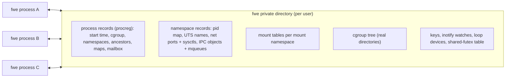

# Linux on macOS

How each Linux concept a guest program relies on maps onto macOS on Apple
Silicon, and what fwe does to bridge the two. Each section says what Linux
does, what macOS has, and what fwe does. How fwe's own parts are built is in
[architecture.md](architecture.md); where fwe still differs from Linux is in
its [known limitations](architecture.md#known-limitations); the hypervisor
backend's VM and its safety rules are in [hypervisor.md](hypervisor.md).

Both are arm64, so a guest's instructions run unchanged on the CPU. Only
what the two kernels define differently has to be bridged: the system-call
interface, a few registers macOS reserves, the address space, and every
kernel object macOS lacks or shapes differently.

Two execution backends do this:

| | Native backend | Hypervisor (VM) backend |
|---|---|---|
| Runs | every position-independent program, and `ET_EXEC` images linked at or above 4 GiB | non-PIE executables linked below 4 GiB |
| Guest code | in the `fwe` process, on the CPU, after rewriting | at EL0 in a Hypervisor.framework VM, unmodified |
| Page size the guest sees | 16 KiB (the host's) | 4 KiB (Linux's usual) |
| Guest addresses | host addresses | host addresses, except ranges the guest placed outside fwe's slab, which are translated |
| System calls go to | the kernel crate | the same kernel crate |

## Contents

- [The CPU](#the-cpu): system calls, registers and errno, TLS, `x18`,
  cache maintenance, PAC and BTI, auxv and hwcaps, the vDSO
- [Memory](#memory): layouts, pages and translation, the `mmap` family,
  write+exec memory, shared memory, `fork`'s copies
- [Processes](#processes): `fork`, `vfork`, threads, `execve`, the ELF
  loader, `wait` and exit status, orphans
- [Signals](#signals)
- [Files and descriptors](#files-and-descriptors)
- [Waiting and events](#waiting-and-events): `epoll`, `eventfd`, `timerfd`,
  `signalfd`, inotify, futexes
- [IPC](#ipc): sockets, System V IPC, POSIX message queues, keyrings
- [Kernel-wide state](#kernel-wide-state)
- [Namespaces](#namespaces), [cgroups](#cgroups),
  [mounts](#mounts), [credentials and capabilities](#credentials-and-capabilities),
  [seccomp](#seccomp), [devices](#devices)
- [Time, scheduling and limits](#time-scheduling-and-limits)
- [Not available](#not-available)

## The CPU

### System call entry

| | Linux arm64 | macOS arm64 |
|---|---|---|
| Instruction | `svc #0` | `svc #0x80` |
| Number in | `x8` | `x16` |
| Arguments | `x0`–`x5` | `x0` and up |
| Error report | `x0` = −errno (−1 to −4095) | carry flag set, `x0` = errno (macOS numbering) |

A Linux `svc #0` executed in a macOS process would enter the macOS kernel
with a meaningless number, so fwe intercepts every guest system call:

- **Native backend:** before guest code becomes executable, each `svc #0`
  is rewritten to `brk #0x4c58` (`crates/native/src/rewrite.rs`). The
  `brk` raises `SIGTRAP`; fwe's handler reads `x8` and `x0`–`x5` from the
  saved context, runs the call and resumes after the `brk` with the result
  in `x0`.
- **VM backend:** the guest's `svc #0` takes an exception to EL1; fwe's
  vector runs `hvc #2`, the vCPU exits and the backend reads `ESR_EL1`
  (exception class `0x15`, SVC64). Nothing is rewritten.

The kernel crate calls macOS through `libc`, so it sees `-1`/`errno`, never
the carry flag; `host::errno_to_linux` turns each host errno into the Linux
one of the same meaning (`EIO` for one with none; `ENOATTR` becomes
`ENODATA`). Flag, structure and constant translations live in
`crates/kernel/src/host.rs`; the Linux values in `crates/abi`.

### Registers and the thread pointer

| Register | Linux | macOS | fwe, native | fwe, VM |
|---|---|---|---|---|
| `TPIDR_EL0` | the thread pointer (TLS), set with `msr` | not preserved for user code | every `mrs`/`msr` of it branches to a stub that keeps the guest's value in a slot of the host thread's TSD, found through `TPIDRRO_EL0` | the guest's own |
| `x18` | a scratch register | platform-reserved, cleared on every exception return, preemption included | every instruction naming `x18` branches to a stub that keeps the guest's `x18` in another TSD slot and uses an ordinary register instead | the guest's own |
| `CTR_EL0` | readable at EL0 | `mrs` of it traps | emulated in the `SIGILL` handler, reporting Apple Silicon's value without the bits that let code skip cache maintenance (`crates/native/src/hwcap.rs`) | read by the guest |

`clone` with `CLONE_SETTLS` writes the new thread's TSD slot (native) or its
vCPU's `TPIDR_EL0` (VM). The `x18` rewriting, its coverage and the code
discovery it depends on are in
[architecture.md](architecture.md#rewriting-guest-code).

### Cache maintenance, PAC and BTI

- **Cache maintenance** is allowed at EL0 on both systems, so a JIT's own
  `dc`/`ic` instructions work in the native backend. Code fwe itself writes
  into guest memory (images, file data, a fork child's memory) has the
  instruction cache invalidated, as Apple's cores do not keep it coherent
  with data writes.
- **Pointer authentication:** the native backend does not report it
  (`AT_HWCAP` has no `PACA`/`PACG`), since the host owns the keys. The VM
  backend enables it in `SCTLR_EL1` where the vCPUs offer it, with random
  keys per program, a thread's from its creator, a fork child's from its
  parent, new ones for `PR_PAC_RESET_KEYS`; it reports `PACA` and `PACG`.
- **BTI:** reported in `AT_HWCAP2` where the host has it. In the VM, code of
  a program built for BTI is mapped guarded (`PROT_BTI`) where Linux maps it
  so, a signal handler is entered as if by `blr`, and a branch-target
  exception is `SIGILL`.

### auxv, hwcaps and the vDSO

- The initial stack is Linux's: strings, `AT_RANDOM` bytes, the auxiliary
  vector, `envp`, `argv`, `argc`, 16-byte aligned, on a fresh 8 MiB stack
  with a guard page (`crates/native/src/stack.rs`).
- The auxiliary vector carries `AT_PHDR`/`AT_PHENT`/`AT_PHNUM`, `AT_BASE`,
  `AT_ENTRY`, `AT_PAGESZ`, the ids, `AT_SECURE`, `AT_RANDOM`, `AT_EXECFN`,
  `AT_PLATFORM`, `AT_MINSIGSTKSZ` and `AT_HWCAP`/`AT_HWCAP2`.
- `AT_HWCAP`/`AT_HWCAP2` come from macOS's `hw.optional.*` sysctls: only
  features a guest can use directly. SVE and SME (kernel-managed state),
  `CPUID` (trapping ID-register reads) and, natively, PAC are left out.
- There is no vDSO (no `AT_SYSINFO_EHDR`): the C library falls back to real
  system calls for `clock_gettime` and `gettimeofday`, which trap like any
  other.

## Memory

### Address-space layout

On Linux an arm64 process owns its whole lower address space: a non-PIE
program sits at its link address (often `0x400000`), the break follows the
image, `mmap` grows down from below the stack. macOS gives every arm64
process a mandatory 4 GiB `__PAGEZERO` at address 0, and its own loader,
libraries and heap share the space with the guest.

**Native backend** — guest and fwe in one host address space, guest
addresses equal to host addresses:

- An image linked below 4 GiB cannot be mapped at its address and carries
  no relocations to move it, so it needs the VM.
- The loader reserves the image's whole span first, then copies each
  segment in, so gaps stay inaccessible.
- Every guest range is recorded (`fwe_kernel::mm::track`); fwe's own
  memory never is, so `execve` can unmap exactly the old program.

**VM backend** — the guest has an address space of its own; its private
memory lives in one host range, the *slab*:

- The slab sits at host 512 GiB, the same address in every VM process, so
  a fork child can take its parent's memory at the same addresses.
- A mapping the guest did not place gets a slab range whose guest address
  is its host address. One placed outside the slab (the low image, a
  `MAP_FIXED` address) is backed by slab memory elsewhere and recorded as a
  translated range.

### Pages and translation

| | Linux | macOS | fwe |
|---|---|---|---|
| Page size | 4 KiB on most arm64 kernels; 16 and 64 KiB exist | 16 KiB | native: the host's 16 KiB, reported in `AT_PAGESZ` (the arm64 ABI allows it); VM: 4 KiB |
| Translation | one stage, the kernel's tables | one stage, XNU's pmap | native: XNU's; VM: two stages, fwe's stage 1 and the framework's stage 2 |

In the VM, both stages are real hardware translation:

- **Stage 1** is fwe's own page tables (`crates/native/src/hv/pagetables.rs`):
  4 KiB granule, 40-bit space, level-3 pages only, each page's EL0
  permissions and BTI guard. Memory system calls edit them; taking access
  away is followed by a TLB invalidation before the guest relies on it.
- **Stage 2** is set up once and never changes while the VM runs: the slab,
  fwe's region, and a mapping per shared segment. The framework maps host
  memory in 16 KiB pages; a 4 KiB guest page is a quarter of one.
- The kernel crate never walks the tables. Guest pointers it uses go
  through `uaccess::g2h`, which looks up the translated ranges, after a
  check against the guest's mappings (the host can reach slab memory the
  guest cannot).

The low 4 GiB can never be identity-mapped (it is `__PAGEZERO` on the
host), so the low image is always one of the translated ranges. A host call
given one buffer that runs over the edge of a translated range has no
single host address and fails with `EINVAL`.

### The mmap family

| Call | Linux | fwe, native | fwe, VM |
|---|---|---|---|
| `mmap` anonymous / private file | kernel VMA | host `mmap` at the guest's address or where macOS places it; offset must be a multiple of 16 KiB | slab range; a private file mapping is a copy of the file's data when mapped |
| `MAP_SHARED` | shared pages | host `MAP_SHARED`; an executable shared file mapping is made private, since its code is rewritten | a *segment*: a host shared mapping outside the slab (anonymous shared memory is an unlinked file), mapped into the VM once |
| `MAP_FIXED`, `MAP_FIXED_NOREPLACE` | replace / refuse to replace | host `MAP_FIXED`; `NOREPLACE` checks where macOS put it (`EEXIST`) | page-table edit; over slab memory at its own address, that memory is reused, zeroed |
| `munmap` | | host `munmap` | removes the pages from stage 1 and flushes TLBs; the slab range is zeroed before reuse |
| `mprotect` | | host `mprotect`; adding `PROT_EXEC` prepares the code first | stage-1 permission edit |
| `mremap` | grow, shrink, move | shrink only; growing fails with `ENOMEM`, and C libraries fall back to allocate-and-copy | private memory: shrink, grow in place, or move with `MREMAP_MAYMOVE`; a shared segment cannot grow (`ENOMEM`); no `MREMAP_FIXED`/`MREMAP_DONTUNMAP` (`EINVAL`) |
| `madvise(MADV_DONTNEED)` | private anonymous pages read as zero again | each private anonymous piece replaced by a fresh mapping (macOS's own keeps the data) | private pages read as zero again, or as the file for a private file mapping; shared memory keeps its contents |
| `mlock` family | wires pages | pages brought in and counted against `RLIMIT_MEMLOCK`, not wired | the same |
| `mincore` | residency per page | the host's residency | by 16 KiB host pages |

Every successful memory call is also recorded the way Linux lists it
(`crates/kernel/src/maps.rs`), for `/proc/<pid>/maps`, `smaps` and
`PROCMAP_QUERY`, with the protections the guest asked for.

### Write+exec memory

Linux maps `PROT_WRITE | PROT_EXEC` memory freely (JIT compilers do).
macOS refuses it without `MAP_JIT`, and `MAP_JIT` memory is switched per
thread (`pthread_jit_write_protect_np`), which Linux code never calls. fwe
keeps such memory writable on the host and records it
(`crates/kernel/src/mm.rs`):

- **native:** the first instruction fetch from a page faults; fwe prepares
  the page's code (system calls and thread-pointer accesses rewritten) and
  makes it read-execute. A later write faults and makes it read-write
  again. A write fwe makes for the guest switches the page the same way.
- **VM:** stage 1 maps the memory writable and executable, so nothing
  faults.

### Shared memory and memfd

| Linux | macOS | fwe |
|---|---|---|
| `memfd_create`: an anonymous file with a name and seals | no memfd, no seals | a file in fwe's private directory, unlinked at once; name and seals in extended attributes, so every holder sees them; `F_SEAL_WRITE` clones the file and swaps this process's descriptors for read-only ones of the clone |
| `/dev/shm` tmpfs (`shm_open`, `sem_open`) | no tmpfs at `/dev/shm` | a directory per rootfs in the user's temporary directory, shared by every fwe process on that root, treated by the resolver as a mount point |
| System V shared memory | own `shmget` | see [System V IPC](#system-v-ipc) |

### fork and copy-on-write

| | Linux | fwe, native | fwe, VM |
|---|---|---|---|
| `fork` | copy-on-write of private pages | host `fork`: Mach copy-on-write for `MAP_PRIVATE` (`VM_INHERIT_COPY`), sharing for `MAP_SHARED` | no copy-on-write: the child is sent a copy of every slab page that exists |
| `vfork` / `CLONE_VM \| CLONE_VFORK` | child borrows the parent's memory | host `fork` with the private ranges set to inherit by sharing (`minherit`) for that fork | child fetches pages on first touch and sends back what it changed |

Details are under [Processes](#processes).

## Processes

### fork

Linux duplicates the calling thread into a new process with
copy-on-write memory. macOS's `fork` does too, but copies memory while the
parent's other threads keep running, gives the child none of the parent's
kqueues, and does not restore a signal mask from a handler frame the child
did not take. A VM cannot be forked at all.

**Native backend** (`crates/native/src/process.rs`, `quiesce.rs`):

- The child keeps the guest's blocked mask and alternate stack; pending
  signals are not inherited, as on Linux.
- Descriptors are inherited by the host fork; the child's process record,
  signal mailbox and System V attachments are its own.

**vfork** (`CLONE_VM | CLONE_VFORK`, used by `posix_spawn`, `vfork`, Go's
`os/exec`): the same host fork with the guest's private memory set to
inherit by sharing for it. The parent waits on a close-on-exec pipe only
the child holds, so it resumes when the child execs or exits, and sees
what the child wrote meanwhile. fwe's own memory is not shared, so the
child's mappings (`mmap`, `munmap`) stay its own. In the native backend
`CLONE_VM` without `CLONE_VFORK` or `CLONE_THREAD` fails with `ENOSYS`; the
VM backend treats any clone without `CLONE_THREAD` as a `fork` or `vfork`.

**VM backend** (`crates/native/src/hv/fork.rs`): the child is a fresh
`fwe --hv-fork-child` started with `posix_spawn`, never a host fork.

- No private page is ever in two VMs. Shared segments go to the child as
  their files, which it maps: those pages are in both, as Linux shares
  them.
- A `fork` child gets every slab page that exists
  (`mach_vm_page_range_query`), sent with the parent's vCPUs stopped so it
  sees one instant: about 60 ms for 512 MiB. The copy goes over a socket
  pair rather than through a file-backed slab, as elfuse does: an APFS
  clone writes the memory to disk and is some fifty times slower.
- A `vfork` child fetches only the slab ranges the parent had in use, and
  only while it keeps them: memory it gives back or maps anew is its own.
  Before it execs or ends it sends back the bytes it changed, compared with
  what it fetched, and the parent resumes once they are in its memory. Its
  channel is one of fwe's reserved descriptors, out of reach of a child
  that moves descriptors into place before exec (Go's does); a child that
  loses it ends with a message rather than run without its parent's memory.
- What cannot cross: the VM itself (a child cannot use its parent's), and
  kqueues, rebuilt from fwe's records.

### Threads and clone

| | Linux | fwe |
|---|---|---|
| Thread | a task sharing `mm`, files, handlers | a host pthread running guest code (native) or a host thread with its own vCPU (VM) |
| `clone` flags | any combination | a thread needs `CLONE_VM` and a stack (`EINVAL` without either in the VM; natively `EINVAL` without a stack, `ENOSYS` without `CLONE_VM`); the native backend accepts `CLONE_VM`, `FS`, `FILES`, `SIGHAND`, `THREAD`, `SYSVSEM`, `SETTLS`, `PARENT_SETTID`, `CHILD_SETTID`, `CHILD_CLEARTID`, `DETACHED` and fails others with `ENOSYS` |
| `clone3` | `struct clone_args` | read and treated as the `clone` it describes; `CLONE_PIDFD`, `CLONE_INTO_CGROUP`, `CLONE_CLEAR_SIGHAND` and `set_tid` fail with `ENOSYS` |
| Per-thread state | in the task | in host thread-locals: tid, `set_tid_address` word, robust list, signal mask, alternate stack, pending set |

A new thread starts with its creator's registers and signal mask, `x0` = 0,
the given stack and no alternate stack. Its exit clears and wakes its
`clear_child_tid` futex; the last thread or `exit_group` ends the process.

### execve

Linux replaces the address space in place, keeping the pid, descriptors
not marked close-on-exec, the signal mask, pending signals and ignored
dispositions. fwe does it one of two ways:

What crosses an `execve`:

| State | How |
|---|---|
| pid, descriptors without `O_CLOEXEC`, signal mask, pending host signals, ignored dispositions | the host keeps them across its own exec; signals fwe held pending that the guest blocks are moved onto the host first |
| handled dispositions | reset to default, as on Linux |
| credentials, capabilities, `RLIMIT_NOFILE`, fwe's own rlimits, umask, mount namespace and root, mount origins of open files, seccomp filters, `no_new_privs`, personality, inotify and namespace descriptors | in place: kept in the process; re-exec: encoded in `--exec-state` (`Kernel::exec_state`) |
| saved set-user/group ids | become the effective ones, as on Linux |
| thread and process keyrings | dropped; the session keyring stays |
| a program run from a descriptor (`execveat(fd, "", AT_EMPTY_PATH)`) | the descriptor is kept by fwe and passed on with `--exe-fd` |

`execveat` turns its directory descriptor, path and flags into a guest
path and is then `execve`.

### The ELF loader and dynamic linker

- The loader (`crates/native/src/loader.rs`, the VM's in `hv/backend.rs`)
  maps each `PT_LOAD` segment, a PIE at a base it picks, code first
  writable so the native backend can rewrite it.
- A `PT_INTERP` (`/lib/ld-linux-aarch64.so.1`, `/lib/ld-musl-aarch64.so.1`)
  is resolved in the guest's root and loaded too; the guest starts at its
  entry with `AT_BASE` and `AT_ENTRY` set as Linux sets them.
- The dynamic linker then works as on Linux: it maps libraries through
  fwe's `openat` and `mmap`, relocates and sets the thread pointer. Real
  glibc and musl run unmodified.

### wait and exit status

| | Linux | macOS | fwe |
|---|---|---|---|
| Status word | exit code `<< 8`; signal + `0x80` core bit; stop `sig << 8 \| 0x7f`; continued `0xffff` | same shape, macOS signal numbers | host status translated, signal numbers mapped |
| `WCONTINUED` | 8 | `0x10` | translated |
| `waitid` `rusage` | filled | none | zero-filled |
| `rusage` | | `ru_maxrss` in bytes | `ru_maxrss` in KiB |
| Death by a signal macOS lacks | that signal | — | exit status 128 + the signal |

Child pids are host pids (or their numbers in the guest's pid namespace),
so `wait`, `kill` and `setpgid` act on real processes.

### Orphans and reapers

Linux gives an orphan to its nearest child subreaper
(`PR_SET_CHILD_SUBREAPER`) or its pid namespace's init. macOS gives every
orphan to `launchd`, and only a parent may `wait` for a process. fwe keeps
the adoption itself (`crates/kernel/src/reaper.rs`):

- each process record holds its line of ancestors and whether it is a
  subreaper, so `getppid` and `/proc/<pid>` name the adopter;
- a process that ends where a reaper might adopt it records how it ended
  (one killed by `SIGKILL` is recorded by whoever finds it gone);
- a reaper runs a watcher thread on `kqueue` process events and raises
  `SIGCHLD` in itself for an adopted descendant's end, stop or continue;
  its `wait` looks at its own children, then the adopted ones.

## Signals

### Numbers

Linux and macOS agree on signals 1–6, 8, 9, 11, 13–15, 21, 22 and 24–28;
the rest differ. fwe translates every number (`host::signal_to_host`).

| Signal | Linux | macOS |
|---|---|---|
| `SIGBUS` | 7 | 10 |
| `SIGUSR1` / `SIGUSR2` | 10 / 12 | 30 / 31 |
| `SIGCHLD` | 17 | 20 |
| `SIGCONT` / `SIGSTOP` / `SIGTSTP` | 18 / 19 / 20 | 19 / 17 / 18 |
| `SIGURG` | 23 | 16 |
| `SIGIO` | 29 | 23 |
| `SIGSYS` | 31 | 12 |
| `SIGSTKFLT`, `SIGPWR` | 16, 30 | none |
| real-time `SIGRTMIN`..`SIGRTMAX` | 32–64 | none |
| `SIGEMT`, `SIGINFO` | none | 7, 29 |

fwe uses the two macOS-only signals for itself: `SIGEMT` wakes a guest
thread blocked in a host call so it notices a signal recorded for it, and
`SIGINFO` relays a guest's `SIGKILL` to another fwe process (a VM process
must tear its VM down before dying; see
[hypervisor.md](hypervisor.md#never-end-a-vm-process-abnormally)).

### State and delivery

| | Linux | fwe |
|---|---|---|
| Dispositions | per process | in the kernel crate, each passed to the host (`Platform::set_host_signal`) |
| Mask, alternate stack, pending set | per thread | per thread, in host thread-locals |
| Pending instances | one per standard signal; real-time signals queued | one per signal number; a standard signal keeps its first `siginfo`, a real-time one its latest |
| Signal frame | `rt_sigframe` with `ucontext`, `fpsimd_context` | the same layout, built on the guest stack (or alternate stack); return through `sa_restorer` or fwe's `rt_sigreturn` trampoline |

A signal ignored when fwe starts (`nohup`, a shell's background job)
starts out ignored in the guest, as across a Linux `execve`.

The host never blocks a signal fwe catches, whatever the guest's mask:
macOS empties the `siginfo` of a signal it holds blocked. So fwe catches a
signal that has a guest handler, one a `signalfd` or `rt_sigtimedwait`
reads, and one whose default ends or stops the process (which fwe then
carries out itself, so the parent sees Linux's status). The host applies
`SIG_IGN` and the defaults that ignore or continue.

- **Process-wide vs thread:** a signal landing on a thread whose guest mask
  blocks it is recorded against the process, and the other threads are
  woken to take it. `SIGPIPE` and `SIGXFSZ` stay with the thread that
  caused them.
- **Senders:** an fwe process sending another a signal first leaves a note
  (pid, uid, and for `SI_MESGQ` the value) in the target's mailbox beside
  its process record (`crates/kernel/src/signote.rs`); a handler that got
  a `siginfo` macOS emptied takes the note.
- **Real-time signals** (and `SIGSTKFLT`, `SIGPWR`) have no host signal:
  they are recorded directly and travel only within the process; `kill` of
  another process with one fails with `EINVAL`.
- **Fault signals** (`SIGSEGV`, `SIGBUS`, `SIGILL`, `SIGFPE`, `SIGTRAP`)
  a process sends itself are recorded directly, since macOS's `siginfo`
  cannot tell a sent one from a fault. One from another fwe process is told
  apart by its note.
- **Permission to signal** follows Linux: `CAP_KILL`, or the caller's real
  or effective uid matching the target's real or saved one, or `SIGCONT`
  within the session; a process fwe has no record of counts as root's.
  `kill(-1)` reaches only the caller's pid namespace or its run of fwe,
  never other host processes.
- **Restart:** a host call a signal interrupted runs again if no guest
  handler waits for the signal, or if the handler has `SA_RESTART` and the
  call is one Linux restarts; otherwise it fails with `EINTR`.

## Files and descriptors

| Linux | macOS | fwe |
|---|---|---|
| a process's root (`chroot`) and mount table | one host filesystem | guest paths resolved by fwe component by component (`crates/kernel/src/fs.rs`): symlinks followed by fwe, mounts entered, `..` clamped at the process's root, as `openat2(RESOLVE_IN_ROOT)` would |
| descriptor numbers | the same kind of table | guest descriptors are host descriptors; fwe's own live in a reserved range at the top, out of the guest's reach (`EBADF`), with a virtual `RLIMIT_NOFILE` below it |
| `struct stat`, `statx` | different layout | translated |
| `getdents64` | `getdirentries` | built from it |
| record locks (`F_SETLK`) | POSIX locks, different `struct flock` | translated; the host's, so they hold against host processes too |
| OFD locks (`F_OFD_*`) | none | `EINVAL`, as on a kernel before 3.15 |
| leases, `F_SETSIG`, thread owners, `F_SETPIPE_SZ` | none | recorded and read back, no effect (`crates/kernel/src/fdstate.rs`) |
| extended attributes | own namespace (`com.apple.`) | Linux names stored as host attributes of the same name; Linux's rules per namespace; `system.` ACLs not kept |
| mode bits; root passes them | owner's bits enforced on the owner | a mode denying its owner is kept in an attribute (`UF_NODUMP` flags the file), the host file keeps owner read/write (`crates/kernel/src/modes.rs`) |
| FIFO hang-up in `poll`/`epoll` | `POLLHUP` once the last writer goes | macOS reports nothing; fwe asks `select` between short slices (`crates/kernel/src/fifo.rs`) |
| `O_PATH` | none | the descriptor is marked and refused what Linux refuses; a FIFO, device, socket or symlink gets a stand-in that names it |
| ptys: `/dev/ptmx`, `TIOCGPTN`, `/dev/pts/N` | `posix_openpt`, `/dev/ttysNNN` | `/dev/ptmx` allocates with `posix_openpt` and numbers the slave; `/dev/pts/N` opens the host slave |
| `termios` | 64-bit `tcflag_t`, other bit positions, other `c_cc` order | translated field by field; baud reported as `B38400` |

### /proc, /sys and /dev

- `proc` and `sysfs` mounts are fwe's own filesystems
  (`crates/kernel/src/procfs.rs`, `procpid.rs`, `synthdir.rs`): content is
  generated from fwe's records and the host (`proc_pidinfo`, `sysctl`),
  served from an anonymous descriptor; directories are listed from memory.
- `/proc/<pid>` covers the processes of the reader's pid namespace, from
  their process records. `/proc/sys` writes reach the namespace sysctls fwe
  keeps (network, IPC) and the few it acts on.
- `/proc/self/fd/N`, `cwd` and `root` behave as magic links.
- `/dev/null`, `zero`, `random`, `urandom` and `tty` are the host's;
  `full`, `loop-control` and `loopN` are fwe's; `/dev/ptmx` and
  `/dev/pts` are fwe's pty layer; `/dev/fd`, `stdin`, `stdout`, `stderr`
  link into `/proc/self/fd`; `/dev/shm` and `/dev/mqueue` are fwe's mounts.

## Waiting and events

| Linux | macOS | fwe |
|---|---|---|
| `epoll` | `kqueue` | the epoll descriptor is a kqueue; `EPOLLIN`/`EPOLLOUT` become `EVFILT_READ`/`EVFILT_WRITE`, `EPOLLET` → `EV_CLEAR`, `EPOLLONESHOT` → `EV_ONESHOT`, data in `udata`; events reported as Linux reports them (`EPOLLRDHUP`, `EPOLLHUP`, `EPOLLERR`); `epoll_event` is 16 bytes on arm64 |
| `eventfd` | none | a pipe plus a 64-bit counter; the pipe holds one byte exactly while the counter is non-zero, so `kqueue` sees readiness |
| `timerfd` | none | a kqueue with one `EVFILT_TIMER`, millisecond resolution |
| `signalfd` | none | a readiness pipe plus a queue of `signalfd_siginfo`; a pending signal the thread blocks and a signalfd watches moves onto it |
| inotify | `kqueue` vnode events (no names), FSEvents (paths, after the fact); neither reports open, read or close | fwe raises the events itself from every fwe process's file calls; an instance is a host datagram socket bound in fwe's private directory, so reading and `epoll` are the host's |
| futex, private | `__ulock_wait`/`__ulock_wake` (private) | per-process wait queues, outside the kernel lock |
| futex, shared | `__ulock_wait2` with `UL_COMPARE_AND_WAIT_SHARED` | a slot table every fwe process maps, keyed as Linux keys a shared futex (Mach memory object + offset); each waiter sleeps on its slot's word, so a wake knows whom it woke |

A host `fork` child gets no kqueues, so epoll interest lists and timerfd
settings are recorded and rebuilt in the child at the same numbers.

## IPC

### Sockets

| Linux | macOS | fwe |
|---|---|---|
| `AF_INET6` = 10 | 30 | translated |
| `sockaddr` starts with a 2-byte family | a length byte, then a family byte | header rewritten in place |
| `SOCK_NONBLOCK`/`SOCK_CLOEXEC` in the type | none | applied with `fcntl` |
| `MSG_NOSIGNAL` | `SO_NOSIGPIPE` | every socket gets `SO_NOSIGPIPE` |
| `SCM_RIGHTS`: 64-bit `cmsg_len` | 32-bit | re-encoded |
| `AF_UNIX` paths | 104-byte limit | resolved in the guest's root; a long one bound or connected from its directory with `pthread_fchdir_np` |
| abstract `AF_UNIX` names | none | files in a per-host temporary directory, or in an fwe network namespace's own directory |
| `SOCK_SEQPACKET` Unix sockets | none | a stream socket with length-prefixed frames (`crates/kernel/src/seqpacket.rs`) |
| `AF_NETLINK`/`NETLINK_ROUTE` | none | in an fwe network namespace, answers for `lo`; elsewhere every request is `EOPNOTSUPP` |
| `SO_PEERCRED` | `LOCAL_PEERCRED` | peer pid in the caller's pid namespace, ids as the guest sees them |

### System V IPC

macOS has System V IPC, but one set for the machine, with small limits.
fwe keeps its own per IPC namespace (`crates/kernel/src/sysvipc.rs`,
`ipcops.rs`): a shared record holding every object, a segment's memory a
file beside it that `shmat` maps shared. Each operation is one change of
the record under its lock, so `semop` is atomic across processes; waits
retry when the record changes. What a dead process leaves (attachments,
`SEM_UNDO`) is cleaned up by the next process that looks. The initial
namespace's record lasts until the host reboots.

### POSIX message queues

macOS has no `mq_*`. fwe keeps each queue as a record in its IPC
namespace's directory (`crates/kernel/src/mqueue.rs`); the guest's
descriptor is a host descriptor of the queue's file, holding a shared
`flock`, so an unlinked queue is freed with its last descriptor.
Notifications go to the registering process: a signal carrying `SI_MESGQ`
and the value (via a signal note), or, for `SIGEV_THREAD`, the cookie sent
to the C library's netlink socket at a host address fwe gave it.

### Keys and keyrings

macOS has no key retention service. fwe keeps every key in one record
shared by all fwe processes (`crates/kernel/src/keys.rs`): keys,
keyrings, permissions, quotas, and the thread, process, session, user and
persistent keyrings each process and user holds. The key types
(`keyring`, `user`, `logon`, `big_key`, `dns_resolver`, `asymmetric`,
`encrypted`) and their cryptography (`keycrypto.rs`, as Linux 6.12
computes it) are fwe's. `request_key` has no `/sbin/request-key` upcall:
a key it would construct is negative for a minute.

## Kernel-wide state

What Linux keeps in one kernel for every process — mount tables,
namespaces, the cgroup tree, loop devices, IPC objects, keys, inotify
watches, shared futexes — must be seen by every fwe process. It lives in
fwe's private directory on the host (`crates/kernel/src/shared.rs`): a
directory per record, its data replaced whole under a lock, and a mapped
generation count so a process rereads only after another changed it.

A record's name carries a format number, so another fwe build never reads
it. A record no live process holds is collected when a namespace is made
and when a fresh fwe starts.

## Namespaces

macOS has no namespaces. fwe makes each one as a shared record that the
processes in it name; a process in an initial namespace sees the host's
(host name, host pids). `clone` and `unshare` make them
(`crates/kernel/src/nsops.rs`), `setns` joins one through a
`/proc/<pid>/ns/*` descriptor (`nsfd.rs`).

| Namespace | What fwe does |
|---|---|
| pid (`pidns.rs`) | numbers processes and threads from 1 in a record mapping each to its host pid; `getpid`, `kill`, `wait`, process groups and `siginfo` senders are translated; when its init ends, the rest are killed; init ignores `SIGKILL`/`SIGSTOP` from inside |
| mount (`mounts.rs`) | a mount table per namespace; see [Mounts](#mounts) |
| user (`userns.rs`) | ids kept as the initial namespace's and seen through `uid_map`/`gid_map`, written once with Linux's rules; the creator has every capability in it |
| UTS | `uname`, `sethostname`, `setdomainname` use its names |
| network (`netns.rs`) | a loopback interface, down until brought up; sockets reach only loopback; its ports are host loopback ports mapped through its table, so each namespace has its own port 80; abstract `AF_UNIX` names are its own; its sysctls are its own |
| IPC | its System V objects and POSIX queues |
| cgroup | `/proc/self/cgroup` and `cgroup2` mounts show the tree from its root |

## cgroups

macOS has no cgroups and no unprivileged way to hold a process to a
memory or CPU budget. fwe keeps one cgroup v2 tree for the user's fwe processes, as real
directories with interface files (`crates/kernel/src/cgroupfs.rs`):

- `mkdir`/`rmdir`, `cgroup.procs`, `cgroup.subtree_control` with Linux's
  rules; `cgroup.events`, `pids.current`, `memory.current` and `cpu.stat`
  read what is so when opened;
- `cgroup.freeze` stops and continues members, `cgroup.kill` kills them,
  `pids.max` limits `fork`;
- device programs (`BPF_PROG_TYPE_CGROUP_DEVICE`) decide every device open
  and `mknod` of members, run on fwe's eBPF interpreter (`bpf.rs`);
- the other limits are kept and read back, not enforced.

## Mounts

macOS mounts are system-wide and need root; there are no mount
namespaces, no bind or overlay mounts of Linux's kind and no propagation.
fwe's mounts exist only in its tables (`crates/kernel/src/mounts.rs`,
`mountops.rs`, `mountapi.rs`, `overlay.rs`):

- a mount shows a host directory (rootfs, bind source, a tmpfs's backing
  directory), an overlay of several, or one of fwe's filesystems (`proc`,
  `sysfs`, `cgroup2`, `devpts`, `mqueue`);
- `mount`, `umount2`, `pivot_root`, `chroot` and the new mount API
  (`fsopen`, `fsconfig`, `fsmount`, `fspick`, `open_tree`, `move_mount`,
  `mount_setattr`, `statmount`, `listmount`) act on the table;
- propagation as Linux's: peer groups, slaves, across namespaces;
- `nodev`, `noexec`, `nosymfollow`, `ro` and the access-time flags are
  enforced by fwe; busy mounts refuse `umount` (`EBUSY`);
- an overlay is resolved as Linux's `overlay`: upper then lower layers,
  whiteouts (0:0 device nodes) and opaque directories, copy-up as an APFS
  clone, each change built in the work directory and renamed into place.

## Credentials and capabilities

| Linux | macOS | fwe |
|---|---|---|
| real/effective/saved/fs uids and gids, groups | the host process's, changeable only by root | virtual (`crates/kernel/src/creds.rs`), default root (0), Linux's `set*id` rules |
| capability sets and securebits | none | the five sets and securebits (`caps.rs`), changed by `capset`, `prctl`, `setuid`, `execve` as on Linux; every capability but `CAP_SYS_TIME` at the start |
| file owner ids | host uids | the host user fwe runs as is 0, every other id 65534, then through the user namespace |
| `chown` | changes the owner | accepted for a privileged caller, not applied to the host file |
| file capabilities, set-ID programs | set-ID bits | none: `execve` follows Linux's rules for a file with neither |

## seccomp

macOS has no seccomp. fwe runs each filter, classic BPF over
Linux's `seccomp_data` (`AUDIT_ARCH_AARCH64`), before either backend routes
a call (`crates/kernel/src/seccomp.rs`); the action of highest precedence
wins. Filters apply to every thread of the process and are kept across
`fork` and `execve`. `SECCOMP_RET_TRACE` and `SECCOMP_RET_USER_NOTIF` fail
with `ENOSYS`, as with no tracer or listener.

## Devices

- `mknod` of a device, which the host lets only its root do, makes an
  empty file flagged `UF_OPAQUE` with the Linux type and numbers in an
  attribute (`crates/kernel/src/devnodes.rs`); opening it opens the host
  device those numbers name, or fails with `ENXIO`.
- Loop devices are fwe's own block devices 7:N with `/dev/loop-control`
  (10:237), in a shared record (`loopdev.rs`); fwe carries out their reads,
  writes and requests on the attached file.

## Time, scheduling and limits

| Linux | macOS | fwe |
|---|---|---|
| clocks: `REALTIME`, `MONOTONIC`, `BOOTTIME`, `TAI`, `*_COARSE`, `*_ALARM`, CPU-time | fewer | mapped onto the host's realtime, monotonic, raw and CPU-time clocks |
| setting the clock (`CAP_SYS_TIME`) | root | refused with `EPERM` after Linux's argument checks, as in a container |
| nice, scheduling policies | own scheduler | kept in the process record with Linux's checks, inherited; the host schedules every process alike |
| `RLIMIT_NICE`, `RTPRIO`, `MSGQUEUE`, `MEMLOCK`, … | absent or different | fwe's own (`crates/kernel/src/rlimits.rs`); `NOFILE` is virtual, below fwe's reserved descriptors; `CPU`, `FSIZE`, `DATA`, `STACK`, `CORE`, `NPROC`, `AS` are the host's |
| `personality` | none | kept per process; `UNAME26` and `STICKY_TIMEOUTS` act |

## Not available

These fail with `ENOSYS` (any call not dispatched in
`crates/kernel/src/syscalls.rs` does, noted under `--strace`):

- `ptrace` and `process_vm_readv`/`writev`;
- pidfds (`pidfd_open`, `pidfd_send_signal`, `pidfd_getfd`);
- POSIX timers (`timer_create` and the rest), `rt_sigqueueinfo`,
  `rt_tgsigqueueinfo`;
- `io_uring`, the AIO calls, `userfaultfd`, `perf_event_open`, `fanotify`,
  `kcmp`, `landlock`, `rseq`, `membarrier`, `futex_waitv`,
  `name_to_handle_at`/`open_by_handle_at`;
- `epoll_pwait2`, `sendmmsg`/`recvmmsg`, `times`, `getcpu`,
  `ioprio_get`/`ioprio_set`, the `pkey_*` calls, `process_madvise`,
  `process_mrelease`, `memfd_secret`, `cachestat`, `map_shadow_stack`,
  `remap_file_pages`, the `lsm_*` calls;
- `sync`, `syncfs`, `sync_file_range`, `readahead`;
- kernel modules, `kexec`, `reboot`, swap, quotas, NUMA policy, `acct`,
  `syslog`, `vhangup`.
